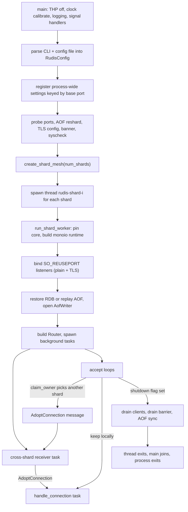

# Component 01: Reactor Runtime & Server Lifecycle — Implementation Reference

> **High-Level Design Spec**: [`docs/design/01_reactor_runtime.md`](../design/01_reactor_runtime.md)
> **Consolidated Implementation Spec**: [`docs/internal/components.md`](components.md)
> **Main source files**: `src/main.rs` (process entry), `src/server.rs` (per-shard worker),
> `src/shutdown.rs` (signals, quiesce, drain barrier), `src/conn_balance.rs` (connection
> rebalancing), `src/netsec.rs` (bind / protected mode / port probe), `src/transport.rs`
> (plain-TCP client transport), `src/mailbox.rs` (cross-shard mesh, as used here),
> `src/syscheck.rs`, `src/log.rs`, `src/telemetry.rs`, `src/server_stats.rs`, `src/cycleclock.rs`,
> `src/lib.rs`.

---

## 1. What this subsystem does

Rudis is a Redis-compatible server built as a **shared-nothing, thread-per-core** system: the
keyspace is split into *shards*, each shard is owned by exactly one OS thread, and that thread runs
its own single-threaded async runtime. No two threads ever touch the same shard's data. This
document covers everything needed to get those threads running and to stop them cleanly:

- **Process startup** (`main.rs`): parse the redis-server-compatible command line and config file,
  register process-wide settings (bind addresses, ACL, TLS, memory limits, logging, metrics),
  refuse to start if the port is already taken, build the cross-shard message mesh, and spawn one
  thread per shard.
- **The shard worker** (`server.rs::run_shard_worker`): build the shard's async runtime, open
  listeners, restore data from RDB or AOF, start background housekeeping tasks, run the
  *cross-shard receiver* that executes requests sent by other shards, and accept client
  connections.
- **Connection placement**: the kernel spreads new connections over shards unevenly, so the accept
  loop hands connections over to a less loaded shard (`conn_balance.rs`).
- **Shutdown** (`shutdown.rs` + the tail of `run_shard_worker`): on `SIGTERM`/`SIGINT` or the
  `SHUTDOWN` command, stop starting new command batches, optionally save, stop accepting, drain
  clients, flush the AOF, and exit.
- **Process-wide plumbing** used by every shard: the Redis-format server log (`log.rs`), `tracing`
  routing and the Prometheus endpoint (`telemetry.rs`), INFO stats counters (`server_stats.rs`),
  a cheap cycle-counter clock for SLOWLOG (`cycleclock.rs`), and OS sanity checks (`syscheck.rs`).

Who uses it: operators (CLI flags, config, logs, signals, systemd), and every other component,
which runs *inside* a shard thread set up here.

Jargon used throughout:

| Term | Meaning |
| :--- | :--- |
| **Shard** | One partition of the keyspace plus the thread that owns it. Identified by `shard_id` in `0..num_shards`. |
| **monoio** | The thread-per-core async runtime. Rudis vendors a patched monoio 0.2.4 (`vendor/monoio`, see `RUDIS_PATCHES.md`). |
| **io_uring / epoll** | Linux async I/O interfaces. monoio's `FusionDriver` uses io_uring when available; `LegacyDriver` uses epoll. |
| **`ShardDb`** | A shard's data (`src/shard.rs`), held as `Rc<RefCell<ShardDb>>` — single-thread only by construction. |
| **`Router`** | Per-shard object (`src/router.rs`) that knows how to reach every other shard and holds per-shard server state. One per shard, shared as `Rc<Router>` by every task on that thread. |
| **Mesh / mailbox** | The N×N set of lock-free queues shards use to send `ShardMessage`s to each other (`src/mailbox.rs`). |
| **`SO_REUSEPORT`** | Socket option letting every shard bind its own listener on the same port; the kernel picks which listener gets each new connection. |
| **Base port** | The configured `port`. Many process-wide registries are keyed by it so several servers can run in one process (tests do this). |

---

## 2. Mental model



The key idea: after `main` spawns the threads, **each shard is an island**. Its runtime, its
`ShardDb`, its `Router`, its client registry and its Pub/Sub hub are thread-local. Shards interact
only by sending `ShardMessage`s through the mesh, plus a small set of process-wide registries
(atomics or locked maps keyed by base port) for configuration and statistics.

---

## 3. Process startup (`main.rs`)

### 3.1 Command line: redis-server compatible

`main` accepts both Rudis's own flags and redis-server's command-line style, because container
images and init scripts pass the latter:

- `rudis /etc/redis.conf` — a first argument not starting with `-` is a config-file path.
- `--<directive> <value...>` — any config directive, e.g. `--appendonly yes`, `--save 900 1 300 10`,
  `--save ""`.

`split_redis_server_args` separates the raw `argv` into three parts:

1. Arguments for clap (`Args`): any `--name` found in the `RUDIS_FLAGS` table (dashes or
   underscores accepted), plus its value if the table says it takes one (`--name=value` also works).
   Short flags (`-p`, `-c`, `-t`) pass straight through.
2. The positional config-file path, if any.
3. Everything else, rewritten as config-file lines: the directive name followed by every
   following argument up to the next `--option`. An empty value or a directive with no values
   becomes `""`.

Worked example (from the module's unit test):

```text
rudis /etc/redis.conf --port 6380 --appendonly yes --save 900 1 300 10 --no-pin --threads=2 --loglevel warning --save ""
clap args : rudis --port 6380 --no-pin --threads=2
config    : /etc/redis.conf
extra     : "appendonly yes\nsave 900 1 300 10\nloglevel warning\nsave \"\"\n"
```

The extra lines are appended **after** the config file's contents and parsed together, so command
line directives override the file, as in Redis.

### 3.2 `Args` — the Rudis-native flags

| Flag | Type | Meaning |
| :--- | :--- | :--- |
| `-c/--config` | path | Config file (also accepted positionally). |
| `-p/--port` | u16 | Base port. |
| `--bind` | string | Redis `bind` syntax, e.g. `"127.0.0.1 -::1"`. Default `* -::*`. |
| `--protected-mode` | `yes`/`no` | Loopback-only access while the default user has no password (default yes). |
| `-t/--threads` | usize | Number of shards. |
| `--aof` | bool | Enable AOF persistence. |
| `--aof-dir` | path | Data directory (`dir`). |
| `--maxmemory` | string | Memory limit, e.g. `512mb`. |
| `--tiered-offload-threshold` | u64 | NVMe offload threshold, percent (default 60). |
| `--tiered-upload-threshold` | u64 | Upload-streaming threshold, percent (default 80). |
| `--no-pin` | flag | Don't pin shard threads to CPU cores. |
| `--idle-poll-us` | u64 | Microseconds a shard thread busy-polls before sleeping (overrides `idle-poll-us`; default 50). |
| `--tls-port`, `--tls-cert-file`, `--tls-key-file` | | TLS listener and its certificate/key. |
| `--cluster-enabled` | `yes`/`true`/`1` | Redis Cluster mode (per-shard ports). |
| `--enable-experimental-commands` | `yes`/`no` | Accept the non-Redis command families (JSON., BF., FT., CRDT., MCP., XDP., ...). Default no. |
| `--metrics-port`, `--metrics-bind` | u16, IP | Prometheus HTTP endpoint and its address (default `127.0.0.1`; the endpoint has no auth). |

Everything else (e.g. `--maxmemory-policy allkeys-lru`) is a config directive handled by the
split described above.

### 3.3 Startup sequence

`main` performs these steps in order. All of them run on the main thread before any shard exists.

1. **Disable Transparent Huge Pages** for the process (`prctl(PR_SET_THP_DISABLE)`, Linux only), so
   the kernel never promotes allocations to 2 MiB pages (latency spikes, copy-on-write
   amplification during snapshots).
2. `connection::mark_server_start()` — fixes the start time and run id used by `INFO server`.
3. `cycleclock::init()` — calibrates the SLOWLOG clock (§9.4) now, a ~2 ms spin, rather than on
   the first timed command.
4. `telemetry::init_telemetry()` — routes `tracing` events into the server log (§9.2).
5. `shutdown::install_signal_handlers()` — §7.1.
6. **Parse arguments** (§3.1) and **load the config**: if a config file is given, read it, append
   the command-line directives, parse with `RudisConfig::parse_str`, and record the path with
   `config::set_active_config_file` (used by `CONFIG REWRITE`). Without a file, parse just the
   command-line directives, or use `RudisConfig::default()`. Any parse error is fatal (exit 1,
   message to the log and stderr via `log_fatal!`).
7. **Merge CLI overrides** with `RudisConfig::merge_cli` (port, threads, aof, aof-dir, maxmemory,
   both tiering thresholds, TLS port/cert/key, cluster flag), then apply `--bind`.
8. **Network settings**: parse `bind` with `netsec::parse_bind_spec` and register it per base
   port (`netsec::set_bind_addrs`); apply `--protected-mode` and register it
   (`netsec::set_protected_mode`).
9. **Memory and client limits**: `tiering::set_max_memory`, `set_offload_threshold_pct`,
   `set_upload_threshold_pct` (keyed by port), `connection::set_max_clients`,
   `connection::set_max_memory_policy`.
10. **`requirepass`**: if set, `acl::get_acl_for_port(port).write().set_requirepass(pass)`
    configures the `default` user's password (Component 15 owns the details).
11. **Shard count**: `get_process_affinity_cores()` returns the CPU ids this process may run on
    (`core_affinity::get_core_ids`, which on Linux is `sched_getaffinity` on the calling thread,
    so it honours `taskset` and cgroup cpusets). `num_cores` is that count, falling back to
    `available_parallelism()` and then 1. `num_shards = threads.unwrap_or(min(num_cores, 8))`.
12. **Cluster hub**: always records the cluster config file path (`cluster-config-file`, default
    `nodes.conf`, relative to `dir`). In cluster mode it also sets the hub's `cluster_enabled`,
    the global `HAS_ACTIVE_CLUSTER`, and `num_shards`, then loads `nodes.conf`: if it describes this
    node as a replica, `replication::set_startup_replicaof` schedules replication of its master;
    if no file existed, a fresh one is saved.
13. **Port probe** (§3.4): every port the process will listen on — the base port (or
    `port..port+num_shards-1` in cluster mode), the TLS port, and the cluster bus port
    `port + 10000` — must be free, else exit 1.
14. **Misc runtime knobs**: `aof::set_aof_load_truncated`, `mailbox::set_cross_shard_spin`
    (`cross-shard-spin`, default 0), `monoio::set_idle_poll_us` (patched-monoio idle polling,
    default 50 µs), `resp::set_experimental_commands`, `config::set_save_points` (`save` rules;
    **empty by default**, unlike Redis), and the metrics listener, which is **bound here**
    (`telemetry::bind_metrics_listener`) so a bad address fails at startup, then served later by
    shard 0.
15. `allocator::set_background_thread(true)` — jemalloc's background purge thread (Redis default
    `jemalloc-bg-thread yes`), so an idle server returns freed pages.
16. **Apply remaining directives**: for every entry in `extra_directives`, `replicaof`/`slaveof`
    becomes a startup replication target, and every directive goes through
    `connection::apply_config_value` (the same code as `CONFIG SET`). Unknown directives are
    collected and reported in one warning; invalid values are fatal. Logging directives
    (`logfile`, `loglevel`, `log-format`, ...) take effect here, so the startup banner that follows
    honours them.
17. **ACL**: resolve a relative `aclfile` against `dir` and load it, then apply `user` lines from
    the config. Errors are fatal.
18. **AOF**: `appendfsync always` is registered with `aof::set_appendfsync`; an `AofConfig
    { enabled, dir, fsync_every_sec }` is built. If AOF is on, `aof::reshard_aof_dir` imports Redis
    7 AOF files or reshards per-shard AOF files written with a different shard count (originals
    are kept in an `aof-reshard-backup-*` directory); failure is fatal.
19. **TLS**: record cert/key/CA/`tls-auth-clients` in `tls::get_tls_runtime(port)`. If a TLS port
    is configured, build a rustls server config from the files (with optional client-cert
    verification), or — if no cert/key is given — from an **in-memory self-signed certificate**
    for `localhost`/`127.0.0.1`. The result is stored in the TLS runtime (so it can be swapped later)
    and wrapped in a `TlsWorkerConfig { tls_port, server_config }` for the shards.
20. **Banner** (logged at notice level): ports, bind, shard count and pinning, metrics URL,
    cluster port range, AOF on/off, followed by `syscheck` warnings (§9.5).
21. **Mesh**: `mailbox::create_shard_mesh(num_shards)` (§4).
22. **Spawn shards**: for each shard, a thread named `rudis-shard-{i}` with a
    `SHARD_THREAD_STACK_SIZE` (32 MiB) stack runs `run_shard_worker(...)`. If pinning is enabled
    and `shard_id < allowed_cores.len()`, the shard is pinned to `allowed_cores[shard_id]`;
    otherwise it is left unpinned.
23. **Join** every shard thread, then log `"Redis is now ready to exit, bye bye..."` and
    `"rudis server gracefully stopped. Goodbye!"`.

The 32 MiB stack exists because shard threads run deeply nested async state machines plus an
embedded Lua VM; unoptimised builds overflow the 2 MiB default. Every spawner of
`run_shard_worker` (including tests) must use `SHARD_THREAD_STACK_SIZE`.

### 3.4 Why the port probe exists

Shard listeners use `SO_REUSEPORT`, so if another process of the same user already listens on the
port, the shards' `bind` would **succeed** and silently share that process's connections.
`netsec::ensure_port_free` instead binds a probe socket *without* `SO_REUSEPORT` (but with
`SO_REUSEADDR`, so `TIME_WAIT` leftovers don't count); Linux refuses it with `EADDRINUSE` while any
listener holds the port. `ensure_port_free_with_grace` retries for up to 3 seconds (logging one
warning), because when a previous io_uring-based instance is killed, the kernel tears down its rings
asynchronously and its listening sockets linger briefly. Optional (`-`-prefixed) bind addresses that
cannot be bound at all (e.g. no IPv6) are skipped, as in `bind_all`.

---

## 4. The cross-shard mesh, as seen by the runtime

`create_shard_mesh(num_shards)` (`src/mailbox.rs`) runs once in `main` and returns
`(senders_mesh, receivers)`:

- An N×N matrix of `SpscQueue<ShardMessage>` rings: `rings[i][j]` carries messages from shard `i`
  to shard `j`. Capacity is 64 for `i != j` and 16 for the self-ring (rounded up to a power of
  two). An SPSC (single-producer, single-consumer) ring needs no locks because exactly one
  thread writes and one thread reads it.
- When a ring is full, `push` falls back to a mutex-protected **overflow `VecDeque`**, so `send`
  never blocks or fails for lack of space; FIFO order is preserved by draining the overflow into
  the ring before appending.
- Per target shard: one `Doorbell` (a 3-state atomic `IDLE/WAITING/RUNG` wake-up with a single
  waker slot), one cache-padded `sleeping` flag, and one `SenderLife` whose drop rings the bell so
  a parked receiver notices when every sender is gone.

Each shard gets **all N senders** (`senders_mesh[shard_id]`, so it can reach any shard including
itself) and **only its own receiver**.

| `ShardSender` field | Type | Meaning |
| :--- | :--- | :--- |
| `target_shard` | `usize` | Destination shard. |
| `ring` | `Arc<SpscQueue<ShardMessage>>` | The dedicated ring from this shard to the target. |
| `target_notify` | `Arc<Doorbell>` | Target's wake-up bell. |
| `target_sleeping` | `Arc<CachePadded<AtomicBool>>` | Whether the target's receiver is about to park. |
| `_life` | `Arc<SenderLife>` | Keeps the target's receiver "connected". |

**Send / receive protocol** (a Dekker-style handshake):

1. `send` pushes onto the ring, issues a `SeqCst` fence, then rings the doorbell **only if** the
   target's `sleeping` flag is set. The common case (target awake) costs a push plus an atomic
   load.
2. `recv_async` tries `try_recv`; if empty, stores `sleeping = true`, fences, and tries again (this
   closes the race with a sender that read `sleeping == false` just before). Only then does it
   `await` the doorbell. After waking it clears `sleeping` and retries.
3. `try_recv` scans incoming rings **round-robin**, starting after the ring that last delivered
   (`next_ring`), so one busy producer cannot starve the others. Each ring stays FIFO; there is no
   ordering across rings.

`mailbox::yield_now()` is a helper the receiver uses to give other tasks a turn (monoio 0.2 has no
public `yield_now`; it spawns a tiny task that wakes the caller so it is re-queued at the back).

Component 04 documents the mesh, the descriptors (`FastGetDescriptor`, `BatchResponder`, ...) and
routing in full.

---

## 5. The shard worker (`run_shard_worker`, `server.rs`)

```rust
pub fn run_shard_worker(
    shard_id: usize, num_shards: usize, port: u16,          // port = base port
    senders: Vec<crate::mailbox::ShardSender>,               // one per shard
    rx: crate::mailbox::ShardReceiver,                       // this shard's mailbox
    core_id: Option<core_affinity::CoreId>,                  // None = unpinned
    aof_config: crate::aof::AofConfig,
    tls_config: Option<crate::tls::TlsWorkerConfig>,
    cluster_enabled: bool,
)
```

### 5.1 Runtime construction

1. Pin to `core_id` if given (`core_affinity::set_for_current`).
2. Seed the thread-local `ADOPTED_CLIENT_SEQ` to `(shard_id << 48) | (1 << 47) | 1` (client ids for
   connections adopted from other shards; §6.3).
3. Build `monoio::RuntimeBuilder::<FusionDriver>` with timers and a custom io_uring builder from
   `shard_uring_builder()`: if the kernel supports them (Linux ≥ 5.19, probed once by building an
   8-entry ring), it enables `IORING_SETUP_COOP_TASKRUN` (the kernel runs completions when the
   thread next enters the kernel instead of interrupting it) and `IORING_SETUP_TASKRUN_FLAG`
   (exposes "completions pending" so the patched runtime's idle poll can see it).
4. If building the io_uring runtime fails (typically `ENOMEM` from a low `RLIMIT_MEMLOCK`), log a
   warning explaining how to raise the locked-memory limit and fall back to
   `RuntimeBuilder::<LegacyDriver>` (epoll). A slower shard beats a shard that never starts.
5. Everything else runs inside `rt.block_on(async move { ... })`.

### 5.2 Startup steps inside `block_on`

In order:

1. **Ports and shared state.** Shard 0 records the startup `appendfsync everysec` flag
   (`aof::set_fsync_every_sec`). `shard_port` is `base_port + shard_id` in cluster mode, else
   `base_port`. `acl::share_acl_with_port(shard_port, base_port)` makes every shard port use one ACL
   table, and `connection::set_node_port(shard_port, base_port)` maps the shard port back to its node.
2. **Listeners.** `netsec::bind_all(bind_addrs, shard_port, 4096)` creates one listener per
   configured bind address via `bind_reuseport_listener`: IPv4 or IPv6 socket (IPv6 sockets set
   `IPV6_V6ONLY` so `::` does not collide with `*`), `SO_REUSEPORT`, `SO_REUSEADDR`, non-blocking,
   512 KiB receive and send buffers, backlog 4096. Optional addresses that fail are skipped; a
   required one failing, or nothing bound at all, panics the shard. If TLS is configured, the same
   is done on `tls_port`. Each socket becomes a `monoio::net::TcpListener`.
3. **`ShardDb`.** `Rc::new(RefCell::new(ShardDb::new(port).with_shard(shard_id)))` — no `Arc`, no
   `Mutex`.
4. **RDB restore** (only when AOF is **off**, as in Redis where the AOF is authoritative): if
   `<dir>/<dbfilename>` exists, `table::load_rdb(path, db, shard_id, num_shards)`. Every shard
   parses the whole file and keeps only the keys that hash to it (Component 05). Shard 0 also
   restores the saved replication id/offset so replicas can `PSYNC` after a restart. Expired keys
   dropped during the load are collected.
5. **AOF replay** (only when AOF is **on**): `aof::replay_aof("<dir>/appendonly-<shard_id>.aof", db)`.
6. **Load summary.** Each shard reports to `note_startup_load`, which sums per base port in the
   `STARTUP_LOADS` map; the **last** shard to finish logs Redis's lines (`"Done loading RDB, keys
   loaded: N, keys expired: M."`, `"DB loaded from disk: X seconds"`, or the AOF equivalents),
   stores `LAST_LOAD_KEYS_LOADED` / `rdb_last_load_keys_expired` for `INFO persistence`, and
   propagates the expired-on-load keys to replicas as `DEL`s.
7. **Fatal load errors.** Any RDB or AOF error calls `fatal_startup_error`, which logs
   `"[Shard N] FATAL: Fatal error loading the DB: ..."` and **exits the process with code 1**.
   Serving an empty dataset instead would let the next save overwrite the original files.
8. **AOF writer.** If AOF is on, `AofWriter::open` (failure is fatal). A dedicated flush task wakes
   every **5 ms**:
   - unless `appendfsync always` is active (it writes chunks on its own path), it first tries
     `write_pending_sync()`; otherwise it takes a chunk (`take_flush_chunk`), writes it with
     `write_all_at`, and reports back (`chunk_written`, which retries failed chunks);
   - every **200th** tick (≈ 1 s) it calls `sync_data()` (fsync) if the `appendfsync everysec`
     flag is currently set (`CONFIG SET appendfsync` can change it at runtime).
   `replication::set_shard_log_context` then registers the writer so expirations anywhere on the
   shard are logged as `DEL`s.
9. **Cluster bus.** Only shard 0, and only in cluster mode, calls `cluster::start_cluster_bus(port)`.
10. **Tiered storage.** `tiering::ShardTierManager::open(shard_id, port, tier_dir)` where
    `tier_dir` is `$RUDIS_TIER_DIR` or `<dir>/rudis_tier_<port>` (under `dir` by default because
    the system temp dir is often tmpfs). On success it is attached as `ShardDb::tier_manager`; on
    failure a warning is logged and the shard runs without tiering.
11. **Router.** Build the client registry (`Rc<RefCell<HashMap<u64, ClientInfo>>>`), the
    per-shard `PubSubHub`, and `Router::new(shard_id, num_shards, shard_port, db, senders, aof,
    pubsub, dir)`; then `set_base_port(base_port)`, set `cluster_enabled`, and switch maxmemory
    accounting to allocator counts (`tier_stats.real_accounting = true`). Wrap it in `Rc` and
    install it in the thread-local `CURRENT_ROUTER` via `connection::set_current_router`, so code
    deep in the call stack (keyspace notifications, `current_shard_id()`) can reach it.
12. Shard 0 calls `tiering::register_server()`; every shard publishes its memory state once.
13. **Background tasks** (§5.3) and the **cross-shard receiver** (§5.4) are spawned.
14. **Readiness.** A process-wide `READY` counter per base port is incremented; the shard that
    brings it to `num_shards` calibrates real memory, logs Redis's `"Ready to accept connections
    tcp"` (tooling waits for this exact line), and sends `READY=1` to systemd
    (`shutdown::sd_notify`).
15. **TLS accept loops** (§6.4), one per TLS listener.
16. Shard 0 only: start replication for a configured `replicaof`; in cluster mode, a 100 ms task
    that makes a master that lost all its slots replicate its new master (`hub.take_follow()`).
17. Shard 0 only: the **save scheduler** (§5.3) and the **signal watcher** (§7.2).
18. **Plain accept loops** (§6): every listener but the first gets a spawned `accept_loop`; the
    first runs `accept_loop` directly, so `block_on` stays inside it until shutdown.
19. **Shutdown tail** (§7.3): drain clients, wait at the drain barrier, final AOF sync.

### 5.3 Background tasks

All are `monoio::spawn`ed on the shard's own runtime and share its `Rc` state with no locking.

| Task | Runs on | Period | What it does |
| :--- | :--- | :--- | :--- |
| Expiry & memory | every shard | 100 ms | Updates the read-only-replica flag; runs `active_expire_cycle()` **unless this server is a replica** (replicas wait for the master's `DEL`); unless a snapshot is running, `table.shrink_step(32)` and `table.trim_arena_step(32)` to give back emptied segments/arenas; `refresh_data_step(50_000)` to recount part of the dataset estimate; `publish_memory_state()`; shard 0 also `calibrate_real_memory()`; `server_stats::sample()` for INFO rates. |
| AOF flush | every shard with AOF | 5 ms | §5.2 step 8. |
| Auto-tier | every shard | 20 ms | `router.check_auto_tier_local()` — offload cold data to NVMe when over threshold (Component 07). |
| Tier GC | every shard | 2 s | `router.gc_local()` — tier file GC and hole punching. |
| AF_XDP ingress | every shard | 5 ms idle (200 ms when experimental commands are off) | Polls the shard's XDP socket (`rx_burst`, up to 32 frames), parses a RESP command from each passed/redirected frame, executes locally or via `execute_remote`, transmits the reply. Packets only arrive through the experimental `XDP.*` commands (Component 10). |
| Metrics server | shard 0, if `--metrics-port` | on demand | `telemetry::serve_metrics` (§9.3). |
| Cluster follow | shard 0, cluster mode | 100 ms | Replicate a new master after losing all slots. |
| Save scheduler | shard 0 | 100 ms | If no save/rewrite is in progress and a `save <secs> <changes>` point is due, log `"N changes in S seconds. Saving..."` and `bgsave()`. Once a second (every 10th tick), if AOF is on and not rate-limited, check `auto-aof-rewrite-percentage` / `-min-size` against the AOF base size and start `bgrewriteaof()`. Stops when shutdown begins. |
| Signal watcher | shard 0 | 50 ms | §7.2. |

### 5.4 The cross-shard receiver

One task per shard executes every `ShardMessage` other shards (or the shard itself) send:

```rust
while let Ok(mut msg) = rx.recv_async().await {
    let mut burst = 0;
    loop {
        match msg { /* one arm per ShardMessage variant */ }
        burst += 1;
        if burst >= 64 {                                   // fairness: let local clients run
            aof_write_after_mailbox(&cross_shard_aof, base_port);
            crate::mailbox::yield_now().await;
            break;
        }
        match rx.try_recv() {
            Ok(next) => msg = next,
            Err(_) => { aof_write_after_mailbox(&cross_shard_aof, base_port); break; }
        }
    }
}
```

1. `recv_async` parks the task when every incoming ring is empty.
2. Once woken, up to **64** messages are handled back-to-back with the non-async `try_recv`,
   amortising wake-up cost under heavy fan-out.
3. After a run ends (mailbox empty or burst limit hit), `aof_write_after_mailbox` writes any AOF
   bytes those messages appended to the kernel (not under `appendfsync always`), so connections on
   other shards waiting to reply to those writes see them written without another round-trip.
4. At the burst limit the task also **yields**: `recv_async` would otherwise be immediately ready
   while messages keep arriving, and a steady stream from other shards would starve this shard's
   own connections.

Handlers that need I/O (cold-tier reads, AOF sync, RDB chunk streaming, tier operations) spawn a
separate task and reply from it, so the receiver loop itself never awaits a slow operation.

`ShardMessage` (`src/shard.rs`) has **79 variants**, grouped:

| Category | Variants |
| :--- | :--- |
| Connection handoff | `AdoptConnection` (§6.3) |
| Single-key ops | `FastGet`, `FastSet`, `Del`, `DelIfUnchanged`, `DelKeys`, `Delex`, `Exists`, `IncrBy`, `Expire`, `Persist`, `Ttl`, `ExpireTime` |
| Pipelines / fan-out | `Batch`, `Mget`, `Mset`, `ScatterMget`, `ScatterMset`, `JsonMget` |
| Keyspace / DB | `Keys`, `Scan`, `RandomKey`, `KeyspaceStats`, `FlushDb`, `FlushAll`, `SwapDb`, `ActiveDefrag` |
| Cluster / slots | `CountKeysInSlot`, `GetKeysInSlot`, `SetSlotState`, `SetSlotOwner`, `SlotBarrier`, `FlushSlots`, `Stick`, `Unstick`, `IsSticky` |
| Persistence | `SyncAof`, `WriteAof`, `RewriteAof`, `SaveRdbChunk`, `StreamRdbChunk`, `RestoreRdbChunk` |
| Replication | `StartSyncImage`, `SyncImageStep`, `DropSyncImage`, `ExecuteReplicaCmd`, `ExecuteReplicaCmds` |
| Pub/Sub | `Publish`, `Spublish`, `Ssubscribe`, `Sunsubscribe`, `PubsubChannels`, `PubsubShardchannels`, `PubsubNumsub`, `PubsubShardnumsub`, `PubsubNumpat`, `RemoveClientPubSub` |
| Blocking ops | `NotifyList` |
| Transactions | `AcquireTxLock`, `ReleaseTxLock` |
| Memory / tiering | `GetUsedMemory`, `MemoryBreakdown`, `EvictUntilUnder`, `TryEvictOneKey`, `TierSpill`, `TierLoad`, `TierSpillAll`, `TierCool`, `TierDecommit`, `TierAutoSpill`, `TierGc`, `TierSnapshot`, `StreamColdRead` |
| Search | `InitSearchIndex`, `DropSearchIndex`, `SearchQuery` |
| Admin / stats | `ClientList`, `FlushCommandStats`, `ResetCommandStats` |

Most handlers start by setting the thread-local `CURRENT_DB` and calling `select_db(db)` because
each message carries the requesting client's selected database.

### 5.5 `ShardMessage::Batch` — remote half of pipeline squashing

When a client pipelines commands, its connection groups the commands owned by each remote shard
into one `Batch { db, items, responder, is_resp3, client_id, no_touch, defer_bcast }`. Each item is
`(idx, key_hash, Command)`: the slot index in the client's reply array, the pre-computed key hash,
and the command. The handler:

1. Installs the requesting client's context in thread-locals: RESP3 flag, DB, `CLIENT_NO_TOUCH`,
   `DEFER_BCAST_FLUSH`, and `CURRENT_CLIENT_ID` (so tracking, `NOLOOP` and script stats behave as if
   the client ran the command locally). Previous values are restored afterwards.
2. Borrows the `ShardDb` once and iterates the items **in place** (the owning shard drops the
   commands when it takes the batch back, so key refcounts never bounce between cores).
3. For each item, `hydrate_cmd_keys` (bring tiered keys back if needed), then try a **fast path**
   that writes a compact reply straight into the responder slot (`responder.write_slot`):
   - reads (`GET`, single-key `EXISTS`/`TOUCH`, `HGET`, `HMGET`, `SISMEMBER`, `SMISMEMBER`,
     `ZMSCORE`, `LRANGE`, `ZRANGE`) — only when no client uses client-side tracking;
   - writes (plain `SET`, `INCRBY`, single-key `DEL`/`UNLINK`, `HSET`, `SADD`, `LPUSH`, `RPUSH`,
     `HDEL`/`SREM`/`ZREM`, `SPOP`, `ZPOPMIN`, `LPOP`/`RPOP`, `ZADD`) — only when there is **no
     tracking, no AOF, no connected replica, and no keyspace notifications** (and, for some, no
     active search index), because the fast path skips logging and notification;
   - `EVAL`/`EVALSHA`/`FCALL` run through the scripting engine with the client's ACL user;
   - anything else goes through `execute_local_command`, the general dispatcher.
4. A `GET` that misses in memory but whose key is tiered is **deferred** into `cold_gets` instead
   of being read inline.
5. If SLOWLOG is enabled, each item is timed with `cycleclock` and slow ones are reported through
   `responder.report_slow` (the owner logs them with the client's address and name).
6. After the loop: if anything was written, `check_auto_tier_after_write()`. If `cold_gets` is
   empty, `responder.finish(items)` hands the batch back immediately. Otherwise one spawned task
   reads each deferred key with `stream_cold_read_local`, fills its slot, then calls `finish`.

Worked example: a client on shard 0 pipelines `SET a 1`, `GET b`, `INCR c`, with `a` and `b` on
shard 1 and `c` on shard 0, AOF off. Shard 0 runs `INCR c` itself and sends shard 1 one `Batch`
with items `(0, h(a), SET a 1)` and `(1, h(b), GET b)`. Shard 1's receiver writes `+OK` into slot 0
via the `SET` fast path; `b` is not in memory but is tiered, so `(1, b)` goes to `cold_gets`. The
receiver spawns a task that reads `b` from NVMe, writes its bulk reply into slot 1 and calls
`finish`; shard 0's connection then emits the three replies in order.

---

## 6. Accepting connections

### 6.1 Waiting for a connection without losing it

Every accept loop uses `accept_until_shutdown(listener)`, which calls `accept_polling` with a
**200 ms** poll (`ACCEPT_SHUTDOWN_POLL`) and `shutdown::is_shutting_down` as the stop check:

```rust
let mut accept = std::pin::pin!(listener.accept());
loop {
    if stop() { return None; }
    if let Ok(res) = monoio::time::timeout(poll, accept.as_mut()).await { return Some(res); }
}
```

The **same** accept future is kept alive across timeouts. Creating a fresh
`timeout(.., listener.accept())` each round would drop an in-flight io_uring accept; if the kernel
had already accepted a connection, monoio discards that completion and the client hangs forever
with a leaked fd (`test_accept_polling_never_loses_a_connection` pins this down).

### 6.2 The plain accept loop (`accept_loop`)

All plain listeners of a shard share one client-id counter starting at `(shard_id << 48) + 1`, so
the top 16 bits of a client id identify the accepting shard. For each accepted connection:

1. **Protected mode**: if `netsec::protected_mode_denies(base_port, peer_ip)` — protected mode is
   on, the peer is not loopback (IPv4, IPv6, or IPv4-mapped loopback), and the `default` user has
   `nopass` — send the Redis `-DENIED ...` message with a non-blocking `send` and close.
2. Set `TCP_NODELAY`, TCP keepalive (`apply_tcp_keepalive`, from `tcp-keepalive`: idle = N s,
   interval N/3, 3 probes; skipped when 0), and `TCP_QUICKACK`.
3. Take the next client id.
4. Pick the owning shard (§6.3): in cluster mode always this shard (`register_conn`); otherwise
   `conn_balance::claim_owner(shard_id, num_shards)`.
5. If the owner is another shard: release the fd without closing it (`into_raw_fd`) and send
   `ShardMessage::AdoptConnection { fd, peer }`. If the send fails, give back the reserved slot
   (`unregister_conn(owner)`) and close the fd.
6. Otherwise spawn `handle_connection(stream, peer, client_id, registry, router)` wrapped in
   `catch_unwind_async` (§8); when it ends, `unregister_conn(shard_id)`; a caught panic increments
   the isolated-panic counter and is logged with the client id.
7. Accept errors are logged as warnings; the loop continues.

`handle_connection` wraps the stream in `transport::PlainTransport` and runs the generic
`connection::handle_client` loop (Component 02).

### 6.3 Connection rebalancing (`conn_balance.rs`)

**The problem.** With `SO_REUSEPORT` the kernel chooses a listener by hashing the connection's
4-tuple. For a loopback client only the ephemeral source port varies, so placement is a random
"balls into bins" draw. With 64 connections on 16 shards the busiest shard gets ~8 while others get
1–2, and throughput is gated by the busiest shard: measured 2.74M ops/s at 64 connections vs 5.44M
at 256, matching a Monte-Carlo prediction of 51.9% of ideal. Delaying `accept()` doesn't help — the
kernel commits the connection to one listener's queue at SYN time.

**The fix.** A process-global census `CONN_COUNTS: [AtomicUsize; MAX_TRACKED_SHARDS]` (256) counts
connections per shard. It is touched only on accept and close, never per command.

`claim_owner(accepting_shard, num_shards)`:

1. If fewer than 2 shards are tracked, or the accepting shard is beyond the tracked range, register
   locally and return it.
2. Up to `MAX_CLAIM_RETRIES` (4) times: scan for the least-loaded shard (`least_loaded` starts with
   the accepting shard's own count and only switches on a **strictly** lower count, so ties keep
   the connection local). If that is the accepting shard, stop. Otherwise try
   `compare_exchange(best_count, best_count + 1)` on the target's counter: success **reserves** the
   slot and returns the target; failure means another shard raced for it, so re-scan.
3. After 4 lost races, register locally (keeping one connection on a slightly busier shard is
   cheaper than stalling accepts).

The reservation happens **before** the handoff. If the count only rose when the target adopted the
connection, the target would look idle during the in-flight window and every concurrently
accepting shard would pick it.

**Adoption.** The fd is just an integer valid process-wide (all shards share one fd table, so no
`SCM_RIGHTS`). The target's receiver handles `AdoptConnection` by rebuilding a
`std::net::TcpStream` (`from_raw_fd`) and `monoio::net::TcpStream::from_std`, takes a client id from
`ADOPTED_CLIENT_SEQ` (bit 47 set), and spawns `handle_connection` under `catch_unwind_async`. It
deliberately does **not** call `register_conn` — the sender already reserved the slot — but does
`unregister_conn` when the connection ends, or immediately if `from_std` fails.

`plan_handoff` is the pure decision function (same rule, no reservation), kept for tests and
callers that only need the answer. `unregister_conn` saturates at zero so a double-unregister cannot
wrap and make a shard look permanently idle.

**Cluster mode is exempt**: each shard listens on its own port and clients choose the shard on
purpose to reach its slots; moving the connection would answer from the wrong shard and break
`MOVED` redirection.

Worked example (4 shards, census `[3, 1, 2, 1]`): shard 0 accepts. `least_loaded` sees shard 1 at 1
(shard 3 ties, not strictly lower, so shard 1 wins). CAS `1 → 2` on shard 1 succeeds; census
becomes `[3, 2, 2, 1]` and shard 0 sends `AdoptConnection` to shard 1. If shard 2 accepted
concurrently and won the CAS on shard 1 first, shard 0's CAS fails, it re-scans, finds shard 3 at
1, and claims it.

### 6.4 The TLS accept loop

One spawned loop per TLS listener, sharing a client-id counter starting at
`(shard_id << 48) | (1 << 46) | 1` (bit 46 keeps TLS ids apart from plain and adopted ids). For each
connection:

1. Set `TCP_NODELAY` and TCP keepalive; take a client id.
2. Choose the server config: `tls::active_tls_server_config(base_port)` (the current one, which can
   be replaced at runtime) or the startup config.
3. Spawn a task (under `catch_unwind_async`) that creates a `TlsSession` and runs
   `handshake_monoio` with a **10 s** limit (`TLS_HANDSHAKE_TIMEOUT`), so stalled sockets cannot pile
   up before they count as clients. Handshake errors and timeouts are logged at **verbose** level
   (port scanners would otherwise flood the log).
4. Wrap the stream in `TlsTransport`; apply the protected-mode check (the denial is written through
   the TLS transport); then run the same generic `connection::handle_client` as plain TCP.

TLS connections are **not** part of the `conn_balance` census (see §11).

### 6.5 The client transport abstraction (`transport.rs`)

`connection::handle_client` is generic over the `ClientTransport` trait and monomorphised per
transport — `PlainTransport` here and `tls::TlsTransport` — so the plaintext hot path pays nothing
for the abstraction.

| `ClientTransport` method | Purpose |
| :--- | :--- |
| `raw_fd()` | Underlying socket, for `shutdown(2)` (CLIENT KILL, shutdown drain) and disconnect polling. |
| `push_target()` | How other threads deliver out-of-band data (MONITOR lines, tracking invalidations). |
| `read(buf)` | Wait for input and append it. |
| `read_ready(buf)` | Append input that already arrived, without waiting. |
| `write_all(data)` | Write everything. |
| `flush(out_buf, set_omem)` | Write `out_buf`, reporting queued bytes to `set_omem` (for `omem` / output-buffer limits). |
| `into_split(writer_tx)` | Split into read/write halves for Pub/Sub mode. |
| `into_tcp_stream()` | Hand over the raw TCP stream (replication links); TLS cannot. |

`PlainTransport` specifics:

- `read` rents the `BytesMut` directly to io_uring (no intermediate copy); if the read filled all
  spare room, it keeps draining with non-blocking `recv` (`recv_ready`) until the socket is empty.
  `recv_ready` first grows the buffer if spare room is below `MIN_READ_SPARE` (16 KiB).
- `flush` first tries a non-blocking `send` (`MSG_DONTWAIT | MSG_NOSIGNAL`); only the remainder,
  if any, goes through an io_uring `write_all`, while `set_omem` reports the queued size.
- `PushTarget::Fd(fd)` writes out-of-band messages straight to the socket with a non-blocking send
  (dropped if the socket buffer is full). TLS uses `PushTarget::Queue`, a bounded channel
  (`PUSH_QUEUE_CAPACITY` = 4096) drained and encrypted by the owning connection.

---

## 7. Shutdown

### 7.1 Signals

`install_signal_handlers` installs:

| Signal | Handler effect |
| :--- | :--- |
| `SIGINT`, `SIGTERM` | `handle_signal`: stores the signal number in `LAST_SHUTDOWN_SIGNAL` and sets `SHUTDOWN_SIGNALLED`. It does **not** stop the server by itself. |
| `SIGHUP` | `log::request_reopen()` — reopen the log file before the next write (logrotate). |
| `SIGPIPE` | Ignored. |

Handlers only store to atomics, which is async-signal-safe.

### 7.2 Deciding to shut down: quiesce, then save

Two paths lead to shutdown, both through `Router::save_before_shutdown(save, own_batches)`:

- **Signal**: shard 0's watcher task polls `take_shutdown_signal()` every 50 ms. On a signal it
  logs `"Received SIGTERM scheduling shutdown..."` and calls `save_before_shutdown(None, 0)`.
- **`SHUTDOWN [SAVE|NOSAVE]` command**: the connection logs `"User requested shutdown..."` and
  calls `save_before_shutdown(save, 1)` (its own batch is still running, hence `own = 1`).

`save_before_shutdown`:

1. **Quiesce** (`shutdown::quiesce(own, CLIENT_DRAIN_TIMEOUT)`): set `QUIESCING`, then wait (1 ms
   steps, up to 2 s) until at most `own` command batches are executing anywhere. Every connection
   brackets each command batch with `shutdown::enter_batch(shard)`, which increments a per-shard
   counter in `INFLIGHT` (256 cache-padded slots, each written only by its shard) and returns
   `None` while quiescing; a connection that gets `None` sleeps in 10 ms steps and closes once
   shutdown is confirmed. Increment-then-check on one side and set-then-read on the other (both
   `SeqCst`) guarantee that either the batch sees the flag or `quiesce` sees the batch. Result: the
   final save contains every acknowledged write and nothing is acknowledged after it. A batch stuck
   in, e.g., `BLPOP` is not waited for past the timeout (a warning is logged).
2. **Save?** `config::should_save_on_shutdown(save, has_save_points)`: an explicit `SAVE`/`NOSAVE`
   wins; otherwise save only if `save` points are configured (none by default).
3. If saving: wait for any running `BGSAVE` to finish, log `"Saving the final RDB snapshot before
   exiting."`, and `save_rdb()`.
4. On success the caller calls `shutdown::request_shutdown()`, which sets `SHUTDOWN_REQUESTED` and
   sends `STOPPING=1` to systemd (once). On failure, `unquiesce()` lets batches run again and the
   server **keeps serving** (`"Error trying to save the DB, can't exit ... use SHUTDOWN NOSAVE"`);
   sending the signal again retries.

### 7.3 Stopping the shards

Once `SHUTDOWN_REQUESTED` is set, on every shard:

1. Accept loops see `is_shutting_down()` within 200 ms and return; the primary loop returning
   lets `run_shard_worker` continue. The save scheduler, cluster-follow and signal tasks exit on
   the same flag.
2. **`drain_clients`**: repeatedly (every 5 ms, until the client registry is empty or
   `CLIENT_DRAIN_TIMEOUT` = 2 s) call `shutdown(fd, SHUT_RD)` on every registered client socket.
   An idle client's pending read returns EOF at once; a client mid-command finishes it and writes
   the reply before its next read sees EOF. Repeating each round also catches connections adopted
   in the meantime. Clients that never read again (blocked commands) are dropped at the timeout.
3. **Drain barrier**: `mark_shard_drained()`, then wait (5 ms steps) until
   `all_shards_drained(num_shards)` or `SHARD_BARRIER_TIMEOUT` (3 s). Meanwhile the shard's
   receiver task keeps running, so a draining client on another shard can still complete a
   cross-shard request against this shard.
4. **Final AOF sync**: `AofWriter::sync_durable` writes and fsyncs remaining AOF data.
5. `block_on` returns; dropping the runtime drops every remaining task (receiver, periodic tasks,
   TLS loops, anything still blocked). The thread ends, `main`'s `join` returns, and after all
   shards join, the process exits.

Worked example (`appendonly yes`, no `save` points, `systemctl stop`): systemd sends `SIGTERM` →
handler sets the flag → within 50 ms shard 0's watcher quiesces (in-flight pipelines finish; new
ones wait) → no save point, so no RDB save → `request_shutdown()` (systemd sees `STOPPING=1`) →
each shard's accept loop exits within 200 ms → waiting connections see shutdown and close; others
get EOF from `SHUT_RD` → barrier → each shard fsyncs its AOF → threads join → `"rudis server
gracefully stopped. Goodbye!"`.

---

## 8. Panic isolation (`CatchUnwind`)

```rust
pub struct CatchUnwind<F> { inner: Pin<Box<F>> }   // boxed: Unpin, no unsafe projection
pub fn catch_unwind_async<F: Future>(f: F) -> CatchUnwind<F>;
// poll() = std::panic::catch_unwind(AssertUnwindSafe(|| inner.poll(cx)))
// Output = Result<F::Output, Box<dyn Any + Send>>
```

Every poll of the wrapped future runs inside `catch_unwind`, turning a panic into `Err`. Because a
shard is one thread running many tasks, an uncaught panic in one connection would unwind through the
runtime and kill every connection on that shard. All three connection entry points (plain, TLS,
adopted) are wrapped; on `Err` they call `connection::inc_isolated_panics()` (exported as
`rudis_isolated_panics_total`) and log the panic message (`log::panic_message`) with the client id.
The cost is one allocation per connection.

---

## 9. Process-wide plumbing

### 9.1 Server log (`log.rs`)

Rudis writes Redis/Valkey-format log lines:

```text
12345:M 10 Oct 2026 20:36:35.123 * Ready to accept connections tcp
```

`<pid>:<role> <timestamp> <level-char> <message>` — role `M` (master) or `S` (replica, set via
`set_role_replica`); level chars `.` debug, `-` verbose, `*` notice, `#` warning.

- **Config** (applied through `CONFIG SET` / config directives): `loglevel`
  (`debug|verbose|notice|warning|nothing`, default notice), `log-format` (`legacy|logfmt`, Valkey
  8.1 style `pid=.. role=.. timestamp=".." level=.. message=".."`), `log-timestamp-format`
  (`legacy|iso8601|milliseconds`), `logfile` (empty = stdout; opened at once so a bad path fails at
  startup).
- **Macros**: `log_debug!`, `log_verbose!`, `log_notice!`, `log_warning!` check `enabled(level)` (one
  relaxed atomic load) **before** formatting; `log_fatal!` logs at warning level **and** always
  prints to stderr, for errors the process exits on.
- **Writing**: each line is one `write(2)` under a mutex, so lines from different shards never
  interleave; messages are truncated to `LOG_MAX_LEN` (1024) bytes. Before each write to a file,
  the sink checks (one `stat`) that the path still names the open file (device + inode) and reopens
  if not — so logrotate's rename-and-create works without a signal; `SIGHUP` forces a reopen.
- **`RateLimit`**: lets a request-triggerable warning (OOM rejection, output-buffer disconnect)
  through at most once per interval.
- Logging is for operational events only, never the per-command path.

### 9.2 `tracing` integration (`telemetry::init_telemetry`)

`init_telemetry` (idempotent) installs a `tracing_subscriber` registry with an optional `RUST_LOG`
`EnvFilter` and `log::RedisLogLayer`. The layer maps `ERROR`/`WARN` → warning, `INFO` → notice,
`DEBUG`/`TRACE` → debug, and re-checks `loglevel` on every event (callsite interest is
"sometimes"), so `CONFIG SET loglevel` applies to `tracing` events too.

### 9.3 Prometheus endpoint (`telemetry.rs`)

With `--metrics-port` / `metrics-port`, `main` binds the listener; shard 0 serves it with
`serve_metrics`. Each connection gets 5 s (`METRICS_REQUEST_TIMEOUT`) to send a request head of at
most 8 KiB (`METRICS_MAX_REQUEST`). `GET /metrics` returns text format `version=0.0.4`; other paths
404, other methods 405; responses are `Connection: close`. Before formatting, the router flushes
every shard's buffered command stats and fans out a used-memory query (one INFO-style fan-out per
scrape). Exported families include connected/max clients, isolated panics, used/max memory,
expired/evicted keys, tiered keys and RAM hits/misses, the `server_stats` counters as `_total`
counters, per-command calls/duration/failed/rejected and latency histograms (power-of-two µs
buckets, 1 µs to ~16.8 s), error counts by prefix, RDB/AOF state gauges (including
`aof_last_write_ok`), `loading`, and numeric `INFO replication` fields plus a role label.

### 9.4 INFO stats counters and SLOWLOG clock

**`server_stats.rs`** backs INFO `# Stats` (`total_commands_processed`, connections received and
rejected, net input/output bytes, keyspace hits/misses, sync full/partial, buffer-limit
disconnections, ACL denials — 16 counters in `enum Stat`). Each thread owns a leaked, 128-byte
aligned `Slot` registered in a global list; `add` is a relaxed load+store on the thread's own slot
(no locked instruction, no cache-line ping-pong). Readers sum all slots. `CONFIG RESETSTAT`
(`reset`) records the current sums as a `BASELINE` instead of zeroing slots, which would race with
their owners. `sample()` (called from every shard's 100 ms task; calls closer than 100 ms are
ignored) feeds a 16-sample ring from which `instantaneous()` reports ops/sec and input/output
bytes/sec.

**`cycleclock.rs`** gives cheap timestamps for timing every command of a pipeline (two
`Instant::now()` per command cost ~5% on cheap commands). On x86-64 with an invariant TSC
(`constant_tsc` and `nonstop_tsc` in `/proc/cpuinfo`), `now()` is one `rdtsc` and `micros_since`
converts with a ticks-per-µs rate calibrated once by a 2 ms spin; elsewhere it falls back to
`Instant` nanoseconds.

### 9.5 OS sanity checks (`syscheck.rs`)

`run_system_sanity_checks()` (a wrapper over the path-parameterised
`run_sanity_checks_with_paths`, which tests use) returns a `SystemSanityReport`; a missing file
yields `None`, not a warning. `print_sanity_warnings` logs each warning under
`"  System Kernel Checks:"`.

| Check | Source | Warns when |
| :--- | :--- | :--- |
| `overcommit_memory` | `/proc/sys/vm/overcommit_memory` | value ≠ 1 (background saves may fail) |
| `somaxconn` | `/proc/sys/net/core/somaxconn` | < 512 |
| max open files | `getrlimit(RLIMIT_NOFILE)` soft limit | < 10000 |
| THP | `/sys/kernel/mm/transparent_hugepage/enabled` | contains `[always]` |

The THP warning is about the system default; this process already disabled THP for itself at
startup.

---

## 10. Invariants & gotchas

1. **Never share `ShardDb` across threads.** It is `Rc<RefCell<_>>` on purpose. Cross-thread state
   in this subsystem is limited to atomics (`CONN_COUNTS`, `INFLIGHT`, shutdown flags, stats slots)
   and locked registries keyed by base port. To touch another shard's data, send a `ShardMessage`.
2. **`RefCell` borrows must not span an `.await`.** All tasks on a shard share the same `ShardDb`;
   holding `borrow_mut()` across an await panics the next task that borrows. The Batch handler
   explicitly drops and re-acquires its borrow around script execution.
3. **Use `SHARD_THREAD_STACK_SIZE`** for any thread that runs `run_shard_worker`.
4. **Long-lived loops must watch `is_shutting_down()`** (or be fine being dropped with the
   runtime). There is no cancellation token.
5. **Never wrap a fresh `listener.accept()` in `timeout` per iteration** — use
   `accept_until_shutdown`/`accept_polling` (§6.1), or connections are silently lost.
6. **Wrap new connection entry points in `catch_unwind_async`**, and pair each `conn_balance`
   registration or reservation with exactly one `unregister_conn` on the owning shard.
7. **Adopted connections must not `register_conn`** — `claim_owner` already reserved the slot.
8. **Every command batch must go through `shutdown::enter_batch`**, or `quiesce` cannot guarantee
   the final save covers all acknowledged writes.
9. **Keep handlers in the receiver loop non-blocking.** A slow synchronous handler delays every
   message queued behind it (up to 64 per burst) and all local connections. Spawn a task for I/O.
10. **Batch fast paths skip AOF, replication, tracking and keyspace notifications**, which is why
    each is gated on those features being off. A new fast path must use the same guards.
11. **`CURRENT_ROUTER` is empty until `set_current_router` runs**; readers use
    `if let Some(..)`, so code running earlier on a shard thread silently does nothing.
12. **Startup load failure exits the whole process** (`fatal_startup_error`), by design.
13. **Process-wide registries are keyed by base port**, so several servers can live in one process
    (the e2e tests rely on this). New global settings should follow that pattern.

---

## 11. Limitations / not implemented

- **TLS connections bypass `conn_balance`.** The TLS accept loop never calls `claim_owner`,
  `register_conn` or `unregister_conn`: TLS clients are never rebalanced off a hot shard, and the
  census (and so plain-TCP placement) does not see TLS load.
- **Rebalancing is per connection, at accept time.** Existing connections never move; `claim_owner`
  gives up after 4 lost races; only the first 256 shards are tracked.
- **Static shard count.** `num_shards` is fixed at startup (default `min(cores, 8)`); changing it
  requires a restart (the AOF is resharded on startup; Components 04/11 cover slot migration).
- **Shutdown drain is bounded, not complete.** `quiesce` waits at most 2 s for running batches,
  client drain at most 2 s, the barrier at most 3 s; clients blocked longer (e.g. `BLPOP`) are
  dropped, and remaining tasks are dropped with the runtime rather than cancelled.
- **No RDB save on SIGTERM by default**, because `save` points default to empty: with `appendonly
  no` and no `save` lines, writes since the last manual `SAVE`/`BGSAVE` are lost on shutdown.
- **Periodic tasks have no jitter**; on a many-shard host they tend to tick in step.
- **The AF_XDP loop runs on every shard** even though packets only arrive through experimental
  `XDP.*` commands; it idles at 200 ms while experimental commands are disabled.
- **Port probe race**: the probe is closed before shards bind, so a process grabbing the port in
  between still slips through.
- **Agent memory / MCP need no startup wiring**: `agent.rs` and `mcp.rs` are not referenced from
  `main.rs` or `server.rs`; their state lives on `ShardDb` and their commands go through normal
  command dispatch (see Components 20 and 21).

---

## 12. Code map

| File | Key symbols | What they do |
| :--- | :--- | :--- |
| `src/main.rs` | `Args`, `RUDIS_FLAGS`, `split_redis_server_args`, `get_process_affinity_cores`, `main` | CLI parsing (Rudis + redis-server style), config merge, process-wide setup, port probe, mesh creation, shard spawn/join. |
| `src/server.rs` | `run_shard_worker`, `SHARD_THREAD_STACK_SIZE`, `shard_uring_builder` | Per-shard runtime, listeners, restore, background tasks, receiver, accept loops, shutdown tail. |
| `src/server.rs` | `fatal_startup_error`, `note_startup_load`, `StartupLoad`, `LAST_LOAD_KEYS_LOADED`, `rdb_last_load_keys_expired` | Fatal load handling and the once-per-server load summary. |
| `src/server.rs` | `accept_loop`, `accept_until_shutdown`, `accept_polling`, `ACCEPT_SHUTDOWN_POLL`, `TLS_HANDSHAKE_TIMEOUT`, `ADOPTED_CLIENT_SEQ` | Accepting plain/TLS clients without losing connections; client-id ranges. |
| `src/server.rs` | `drain_clients`, `aof_write_after_mailbox`, `CatchUnwind`, `catch_unwind_async` | Shutdown drain, AOF write-through after mailbox runs, panic isolation. |
| `src/shutdown.rs` | `install_signal_handlers`, `take_shutdown_signal`, `request_shutdown`, `is_shutting_down`, `sd_notify` | Signals, the shutdown flag, systemd notifications. |
| `src/shutdown.rs` | `enter_batch`, `BatchGuard`, `quiesce`, `unquiesce`, `is_quiescing`, `CLIENT_DRAIN_TIMEOUT`, `SHARD_BARRIER_TIMEOUT`, `mark_shard_drained`, `all_shards_drained` | Quiesce before the final save; drain barrier. |
| `src/conn_balance.rs` | `CONN_COUNTS`, `MAX_TRACKED_SHARDS`, `claim_owner`, `plan_handoff`, `register_conn`, `unregister_conn`, `MAX_CLAIM_RETRIES` | Connection census and accept-time rebalancing. |
| `src/netsec.rs` | `parse_bind_spec`, `bind_all`, `bind_reuseport_listener`, `ensure_port_free_with_grace`, `protected_mode_denies`, `PROTECTED_MODE_DENIED` | Bind addresses, listener sockets, port probe, protected mode. |
| `src/mailbox.rs` | `create_shard_mesh`, `ShardSender`, `ShardReceiver`, `SpscQueue`, `Doorbell`, `yield_now`, `set_cross_shard_spin` | Cross-shard mesh used by the receiver loop. |
| `src/transport.rs` | `ClientTransport`, `PlainTransport`, `PushTarget`, `recv_ready`, `MIN_READ_SPARE`, `PUSH_QUEUE_CAPACITY` | Byte-stream abstraction under the client loop. |
| `src/connection.rs` | `handle_connection`, `handle_client`, `set_current_router`, `apply_tcp_keepalive`, `inc_isolated_panics`, `mark_server_start` | Connection entry points and helpers called from here (Component 02). |
| `src/router.rs` | `Router::new`, `save_before_shutdown`, `bgsave`, `bgrewriteaof` | Per-shard router; shutdown save (Component 04/14). |
| `src/log.rs` | `log_*!` macros, `log_fatal!`, `set_loglevel`, `set_logfile`, `request_reopen`, `RateLimit`, `RedisLogLayer`, `panic_message` | Redis-format server log. |
| `src/telemetry.rs` | `init_telemetry`, `bind_metrics_listener`, `take_metrics_listener`, `serve_metrics`, `format_prometheus_metrics`, `format_server_state_metrics` | `tracing` routing and the Prometheus endpoint. |
| `src/server_stats.rs` | `Stat`, `add`, `total`, `reset`, `sample`, `instantaneous`, `note_key_lookup` | Per-thread INFO stats counters and instantaneous rates. |
| `src/cycleclock.rs` | `init`, `now`, `micros_since` | TSC-based timestamps for SLOWLOG. |
| `src/syscheck.rs` | `run_system_sanity_checks`, `run_sanity_checks_with_paths`, `SystemSanityReport`, `print_sanity_warnings` | Startup OS checks. |
| `src/lib.rs` | module list, `#[global_allocator] GLOBAL` (jemalloc) | Crate root; jemalloc is the global allocator. |
| `vendor/monoio/RUDIS_PATCHES.md` | — | Rudis's monoio patches (foreign-waker draining on submit, idle poll). |
