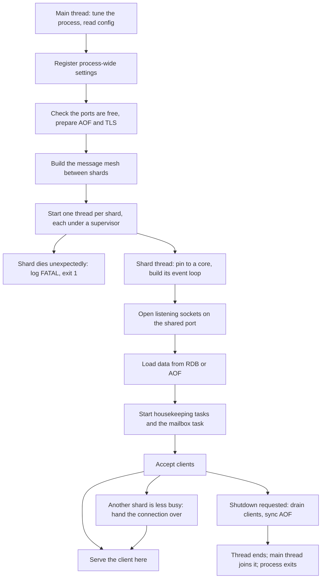
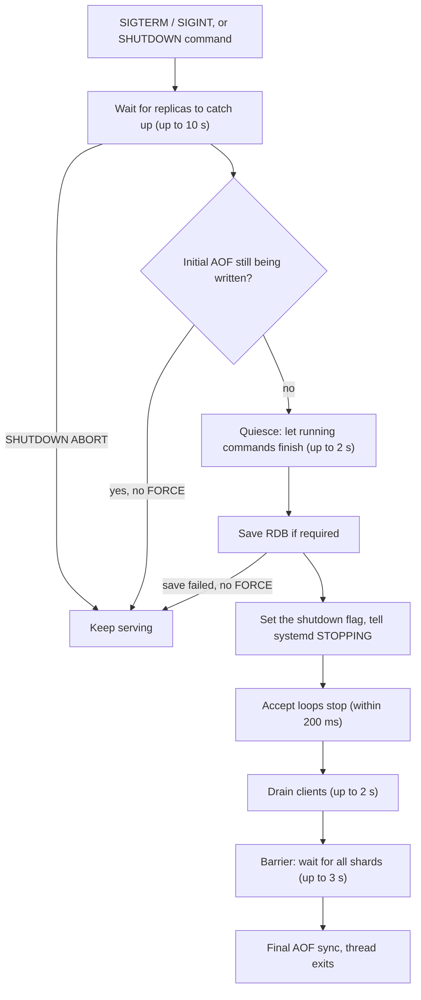

# Component 01: Reactor Runtime & Server Lifecycle

> **High-Level Design Spec**: [docs/design/01_reactor_runtime.md](../design/01_reactor_runtime.md)
> **Consolidated Implementation Spec**: [docs/internal/components.md](components.md)
> **Main source files**: src/main.rs (process entry), src/server.rs (the per-shard worker),
> src/shutdown.rs (signals, quiesce, drain barrier), src/conn_balance.rs (connection rebalancing),
> src/netsec.rs (bind, protected mode, port probe), src/transport.rs (plain-TCP client transport),
> src/mailbox.rs (the cross-shard mesh, as used here), plus src/syscheck.rs, src/log.rs,
> src/telemetry.rs, src/server_stats.rs, src/cycleclock.rs, src/version.rs with build.rs (build
> identity), src/lib.rs and Cargo.toml (cargo features). The [Code map](#12-code-map) lists the
> key symbols.

---

## 1. What this subsystem does

Rudis is a Redis-compatible server built as a **shared-nothing, thread-per-core** system. The
keyspace is split into **shards**; each shard is owned by exactly one operating-system thread,
and that thread runs its own single-threaded async event loop. No two threads ever touch the same
shard's data, so that data needs no locks.

This document covers everything needed to get those threads running and to stop them cleanly:

- **Process startup.** Read the command line and config file (both in redis-server's style),
  register process-wide settings such as bind addresses, passwords, TLS, memory limits, logging
  and metrics, refuse to start if the port is taken, build the message mesh the shards use to talk
  to each other, and start one thread per shard under a supervisor that takes the whole process
  down if a shard dies.
- **The shard worker.** Inside each thread: build the event loop, open listening sockets, restore
  data from disk, start housekeeping tasks, run the task that executes requests from other shards,
  and accept client connections.
- **Connection placement.** The kernel spreads new connections over shards unevenly, so the accept
  loop hands some of them to a less loaded shard.
- **Shutdown.** On a termination signal or the `SHUTDOWN` command: wait for replicas to catch up,
  stop starting new commands, optionally save, stop accepting, let clients finish, flush the
  append-only file, and exit.
- **Process-wide plumbing** shared by every shard: the Redis-format server log, a Prometheus
  metrics endpoint, INFO statistics counters, a cheap clock for the slow log, and OS sanity checks.

Operators meet this subsystem through command-line flags, config, logs, signals and systemd.
Every other component runs *inside* a shard thread set up here.

---

## 2. Mental model

Think of a Rudis process as N small, single-threaded Redis servers that share one listening port
and can post work orders to each other. The main thread's only job is to set them up, start them,
and wait for them to finish.



Five ideas explain most of this document:

* **Each shard is an island.** After startup, every shard has its own event loop, its own data,
  its own router (the object that knows how to reach every other shard), its own client list and
  its own pub/sub subscribers. Shards interact only by sending messages through the mesh, plus a
  small set of process-wide registries for configuration and statistics.
- **Process-wide settings are keyed by port.** Those registries are atomics or locked maps
  indexed by the server's configured port (the **base port**). That lets several independent
  servers live in one process, which the end-to-end tests rely on.
* **The kernel picks a shard, and Rudis may correct it.** Every shard opens its own listener on
  the same port using `SO_REUSEPORT`, a socket option that lets the kernel spread incoming
  connections over all of them. Its spread is lumpy, so a shard that receives a connection may
  pass it to a less busy one.
* **Failure is all or nothing.** A shard cannot be restarted on its own, so a shard that panics
  or stops brings the process down, and the service manager restarts the whole server, which
  recovers from disk.
* **Shutdown is staged and bounded.** Each stage (replica catch-up, quiescing, draining, the
  barrier between shards) has a time limit, so a stuck client or replica delays shutdown by
  seconds, not forever.

Jargon used throughout:

| Term | Meaning |
| :--- | :--- |
| **Shard** | One partition of the keyspace plus the thread that owns it, numbered from 0. |
| **monoio** | The thread-per-core async runtime. Rudis ships a patched copy (vendor/monoio, see its RUDIS_PATCHES.md). |
| **io_uring / epoll** | Linux async I/O interfaces. Rudis prefers io_uring and falls back to epoll. |
| **Mesh / mailbox** | The grid of lock-free queues, one per ordered pair of shards, that carries messages between them. A shard's **mailbox** is the set of queues pointing at it. |
| **Router** | Per-shard object that knows how to reach every other shard and holds per-shard server state. |
| **Base port** | The configured `port`. In cluster mode shard i listens on base port + i. |
| **AOF / RDB** | Redis's two persistence formats: an append-only log of write commands, and a point-in-time snapshot file. |
| **Parking** | A task suspending itself until something wakes it, instead of polling. |

---

## 3. Process startup

### 3.1 The command line speaks redis-server

Container images and init scripts are written for redis-server, so Rudis accepts its command-line
style as well as its own flags:

- `rudis /etc/redis.conf` — a first argument that does not start with a dash is a config file.
- `--<directive> <value...>` — any config directive, such as `--appendonly yes`,
  `--save 900 1 300 10`, or `--save ""`.

Before the normal argument parser runs, the raw arguments are split into three groups. Flags that
Rudis itself knows (listed in a small table, with dashes or underscores accepted, plus their value
if they take one) go to the argument parser, as do the short flags `-p`, `-c` and `-t`. A leading
path becomes the config file. Everything else is rewritten as config-file lines: each directive
name followed by all the arguments up to the next option, with an empty value written as `""`.

Here is the example from the module's unit test:

```text
rudis /etc/redis.conf --port 6380 --appendonly yes --save 900 1 300 10 --no-pin --threads=2 --loglevel warning --save ""
own flags : rudis --port 6380 --no-pin --threads=2
config    : /etc/redis.conf
extra     : "appendonly yes\nsave 900 1 300 10\nloglevel warning\nsave \"\"\n"
```

The extra lines are appended *after* the config file and parsed with it, so the command line
overrides the file, as in Redis. The Rudis-native flags are listed in
[Reference details](#131-command-line-flags).

### 3.2 The startup sequence

All of startup runs on the main thread before any shard exists. It falls into five phases; the
exact call order is in [Reference details](#132-startup-steps-in-order).

**Prepare the process.** The first thing Rudis does is turn off Transparent Huge Pages for itself
(Linux only). Huge pages are 2 MiB pages the kernel can promote memory to; they cause latency
spikes and make copy-on-write during snapshots far more expensive. It then records the start time
and run id shown by INFO, calibrates the slow-log clock (a roughly 2 ms spin, done now rather than
on the first timed command), routes Rust tracing events into the server log, and installs signal
handlers.

**Load the configuration.** The config file (plus the command-line directives) is parsed, and its
path is remembered for `CONFIG REWRITE`. Any parse error is fatal: Rudis logs it, prints it to
stderr, and exits with code 1. Command-line flags are then merged on top, and process-wide
settings are registered under the base port: bind addresses and protected mode, memory limit and
tiering thresholds, client limits and eviction policy, and the default user's password.

**Size the server.** The shard count defaults to the number of CPUs this process may run on,
capped at 8; the `threads` setting overrides it. "May run on" means the CPU affinity mask, so
`taskset` and container CPU limits (cgroup cpusets) are honoured. If the mask cannot be read,
Rudis falls back to the machine's available parallelism, then to 1. For example, a process started
under `taskset -c 0-3` on a 32-core host gets 4 shards.

In cluster mode this phase also loads the cluster's node file (default `nodes.conf` in the data
directory): if it says this node is a replica, replication of its master is scheduled, and if no
file exists a fresh one is written. The path is recorded in both modes.

**Check and prepare resources.** Every port the process will listen on must be free (§3.4).
Remaining runtime knobs are set, including the save rules (§3.3) and the metrics listener, which is
*bound* here so a bad address fails at startup, and served later by shard 0. Rudis enables
jemalloc's background purge thread, as Redis does, so an idle server returns freed memory. Every
remaining config directive is then applied through the same code as `CONFIG SET`; unknown
directives are reported together in one warning, and invalid values are fatal. Logging directives
take effect here, which is why the banner that follows already honours them. Next come the ACL
file and `user` lines, then AOF preparation: if AOF is on, existing files are imported from Redis 7
format or re-split if they were written with a different shard count (the originals are kept in a
backup directory). Last, TLS: Rudis builds a server certificate configuration from the configured
files, or — if no certificate is given — from an in-memory self-signed certificate for localhost.

**Start the shards.** Rudis logs a banner (version with build commit, ports, bind addresses,
shard count, pinning, metrics URL, cluster port range, AOF state) followed by any OS warnings
(§9.5). It builds the mesh (§4), then starts one thread per shard, named `rudis-shard-<i>`, each
running the shard worker under a supervisor (§3.6). If pinning is enabled, shard i is pinned to the
i-th allowed CPU; shards beyond the number of allowed CPUs run unpinned. Finally the main thread
waits for every shard thread to end and logs Redis's goodbye lines.

Shard threads get a 32 MiB stack instead of the usual 2 MiB. They run deeply nested async state
machines plus an embedded Lua interpreter, and unoptimised builds overflow the default. Anything
that starts a shard worker, including tests, must use the same stack size.

### 3.3 Snapshot save rules

The `save` rules decide when Rudis writes an RDB snapshot automatically. Each rule is a pair
"after S seconds, if at least C keys changed". The defaults are Redis's: after an hour with one
change, after 5 minutes with 100 changes, or after a minute with 10,000 changes.

The rules are combined the way Redis combines them. The first `save` line read (config file
first, then command line) *replaces* the defaults; later lines add to them; `save ""` clears them.
So a file with `save 900 1` plus `--save 300 10` on the command line ends with both rules, and
`--save ""` alone ends with none — which also means no snapshot on shutdown (§7.4).

### 3.4 Why the port probe exists

Shard listeners share their port through `SO_REUSEPORT`. The downside: if another process run by
the same user already listens on that port, the shards' binds *succeed*, and the kernel silently
splits incoming connections between Rudis and the other process.

To catch this, Rudis first binds a probe socket *without* that option. Linux refuses the probe
while any listener holds the port. The probe does allow address reuse, so connections lingering
in the kernel's TIME_WAIT state from a previous run do not count. Rudis checks every port it will
use: the base port (or one port per shard in cluster mode), the TLS port, and the cluster bus port
(base port + 10000).

If the port is busy, Rudis retries for up to 3 seconds, logging one warning, before exiting with
code 1. The grace period exists because when an io_uring-based server is killed, the kernel tears
down its rings asynchronously and its listening sockets linger briefly. Optional bind addresses
(those prefixed with a dash) that cannot be bound at all, such as IPv6 on a host without it, are
skipped, just as when the shards bind.

### 3.5 Build identity and optional features

**Build identity.** At build time a build script asks git for the short commit hash and whether
tracked files have uncommitted changes, and bakes both into the binary. They appear in
`--version` (for example `rudis 0.1.0 (1a2b3c4d)`), in the startup banner, and in `INFO server`.
Outside a git checkout — the Docker image copies only the sources — the commit is Redis's
placeholder `00000000`.

**Optional features.** Two experimental subsystems can be left out of a production build with
`cargo build --release --no-default-features`; both are on by default. Without the MCP feature
the MCP module is not compiled and `MCP.*` commands return an error saying so. Without the XDP
feature the per-shard AF_XDP packet task (§5.3) is not started and `XDP.*` commands return a
similar error.

### 3.6 Shard supervision

**Why.** A shard cannot be replaced while the process runs: its keys become unreachable and
requests other shards send it are never answered. Worse, a process in that state still looks
healthy to systemd or Kubernetes, so nothing restarts it.

**How.** Each shard thread runs its worker through a supervisor (`supervise_shard`) that catches
panics. The outcome is judged like this:

1. The worker panics: failure, at any time (including during shutdown).
2. The worker returns while the server is *not* shutting down: failure ("stopped while the server
   was not shutting down").
3. The worker returns during shutdown: success.

On failure the thread logs `FATAL: <reason>; exiting` and exits the whole process with code 1.
The service manager then restarts the server, which recovers from its AOF or RDB.

Tests trigger this path with an environment variable that makes a chosen shard panic as soon as
it starts ([Reference details](#139-tests-that-pin-the-behaviour)).

---

## 4. The cross-shard mesh, as seen by the runtime

The mesh is how shards talk. Component 04 describes it in full; this section covers what the
runtime sets up and relies on.

**Shape.** The main thread builds the mesh once. It is an N×N grid of one-way ring buffers: the
ring at row i, column j carries messages from shard i to shard j. Each ring has exactly one writer
thread and one reader thread, which is what lets it work without locks. Rings between different
shards hold 64 messages; a shard's ring to itself holds 16.

**Never full.** When a ring is full, the sender puts the message on a small mutex-protected
overflow queue instead, so sending never blocks or fails. Order is kept by moving overflow
messages into the ring before new ones. Each overflowed message increments a process-wide counter
exported as a metric (§9.3); a steady rise means some shard cannot keep up with what the others
send it.

**Waking the receiver cheaply.** Each shard has a **doorbell** — an atomic wake-up flag with room
for one waiting task — and a "sleeping" flag. Senders and the receiver follow a handshake that
never loses a wake-up:

1. The sender pushes the message, then rings the doorbell *only if* the receiver's sleeping flag
   is set. In the common case (receiver awake) a send costs one push and one atomic read.
2. A receiver that finds nothing first sets its sleeping flag, then checks the rings once more,
   which catches a sender that read the flag just before it changed. Only then does it park on
   the doorbell. When woken, it clears the flag and checks again.
3. The receiver scans its incoming rings **round-robin**, starting after the ring that last
   delivered, so one busy sender cannot starve the others. Each ring keeps its order; there is no
   order between different senders.

When a shard's senders are all gone, a final ring of the doorbell wakes the receiver so it notices.

**Who gets what.** Each shard gets a sender to every shard, including itself, and only its own
receiver. A small helper lets the mailbox task give other tasks a turn: monoio 0.2 has no public
"yield", so the helper spawns a tiny task that wakes the caller, which puts it at the back of the
queue.

---

## 5. The shard worker

The shard worker (`run_shard_worker` in server.rs) is the body of every shard thread. It
receives its shard number, the shard count, the base port, its row of senders and its own
receiver, the CPU to pin to (if any), the AOF configuration, the TLS configuration (if any), and
whether cluster mode is on.

### 5.1 Building the event loop

1. Pin the thread to its CPU, if one was given.
2. Seed the counter used for client ids of connections adopted from other shards (§6.3).
3. Build the monoio runtime on io_uring, with timers enabled. If the kernel supports them (Linux
   5.19 or later, probed once by building a tiny 8-entry ring), Rudis turns on two io_uring
   options. The first lets the kernel run completion work when the thread next enters the kernel,
   rather than interrupting it. The second exposes a "completions pending" flag so the patched
   runtime's idle polling can see that work arrived.
4. If io_uring cannot be set up — usually because the locked-memory limit is too low — Rudis logs
   a warning explaining how to raise the limit and falls back to epoll. A slower shard beats a
   shard that never starts.

Everything else runs inside the event loop.

### 5.2 Startup steps inside the event loop

The worker brings its shard up in this order.

**Ports and listeners.** In cluster mode the shard's port is base port + shard number; otherwise
it is the base port. All shard ports share one ACL table and map back to their node, so a password
set on one port applies to all. The shard then opens one listener per configured bind address,
with `SO_REUSEPORT`, address reuse, non-blocking mode, 512 KiB socket buffers and a backlog of 4096
pending connections. IPv6 sockets are IPv6-only, so binding `::` does not collide with `*`. An
optional address that fails is skipped; a required one failing, or nothing bound at all, panics
the shard (and so stops the process). If TLS is configured, the same happens on the TLS port.

**Data.** The shard's data store is created as plain single-thread shared state — no atomics, no
mutex. Then data is restored from disk:

- With AOF **off**, the RDB snapshot file is loaded if it exists. Every shard parses the whole file
  and keeps only the keys that hash to it (Component 05). Shard 0 also restores the saved
  replication id and offset, so replicas can resume with a partial sync after a restart.
- With AOF **on**, the shard replays its own AOF file. As in Redis, the AOF is authoritative and
  the RDB file is ignored.

Each shard reports its counts to a per-server tally. The *last* shard to finish logs Redis's load
lines (keys loaded, keys expired, seconds taken), records the totals for `INFO persistence`, and
sends a `DEL` to replicas for every key that had already expired, each in that key's own database.

Any load error is fatal: the shard logs `Fatal error loading the DB` and exits the whole process
with code 1. Serving an empty dataset instead would let the next save overwrite the original
files.

**AOF writer.** If AOF is on, the shard opens its AOF writer (failure is fatal) and puts it in an
**AOF slot**: a shared, swappable holder that everything on the shard reads at the moment of use,
because `CONFIG SET appendonly` can put a writer in or take it out at runtime (§5.6). A flush task
then starts for that writer; it wakes every 5 ms for as long as the slot still holds that writer:

- Each tick it writes pending AOF bytes to the file, unless `appendfsync always` is in effect
  (that mode writes on its own path). Failed chunks are retried.
- Every 200th tick — about once a second — if `appendfsync everysec` is currently set (it can
  change at runtime), it notes how many bytes have been written, calls fsync, and on success marks
  them as durable. This is what `WAITAOF` counts as the local copy.

The slot is also registered for key expiry, so a key that expires anywhere on the shard is logged
as a `DEL`.

**Other subsystems.** In cluster mode, shard 0 starts the cluster bus. Each shard opens its tiered
storage (Component 07) in a directory under the data directory, or wherever the `RUDIS_TIER_DIR`
environment variable points; it defaults to the data directory because the system temp directory
is often in RAM (tmpfs). If tiering fails to open, a warning is logged and the shard runs without
it.

**Router.** The shard builds its client registry, its pub/sub hub and its router, switches memory
accounting to the allocator's real counts, and installs the router in a thread-local so code deep
in the call stack (keyspace notifications, "which shard am I on?") can reach it. Shard 0
registers the server with the tiering subsystem, and every shard publishes its memory state once.

**Tasks and readiness.** The background tasks (§5.3) and the mailbox task (§5.4) are started.
Each shard then increments a per-server ready counter. The shard that brings it to the shard count
logs Redis's `Ready to accept connections tcp` line — tooling waits for exactly this line — and
tells systemd the service is ready.

**Accepting.** TLS accept loops start, one per TLS listener (§6.4). Shard 0 starts replication if
`replicaof` is configured, plus the cluster-follow task, save scheduler and signal watcher. Then the
plain accept loops start (§6): every listener but the first gets its own task, and the first runs
directly, so the worker stays inside it until shutdown.

**Shutdown tail.** When that loop returns, the worker drains clients, waits at the barrier
between shards, and syncs whatever AOF writer the slot holds at that moment (§7.5).

### 5.3 Background tasks

Every periodic job runs as a task on the shard's own event loop and uses the shard's state
directly, with no locking.

**On every shard:**

- **Expiry and memory, every 100 ms.** Updates the "read-only replica" flag. A master runs the
  active expiry cycle, which samples keys with a time-to-live and deletes expired ones. A replica
  does no general expiry, because it waits for its master's `DEL`s; it only expires keys that
  clients wrote directly to a writable replica, which no master will ever expire. Then, unless a
  snapshot is running, the task gives back a little emptied table and arena memory, refreshes part
  of the dataset-size estimate, publishes memory state (shard 0 also recalibrates real memory),
  and samples the INFO rate counters (§9.4).
- **AOF flush, every 5 ms,** while the shard has an AOF writer (§5.2). There is one task per
  writer; it ends when its writer leaves the slot.
- **Auto-tiering, every 20 ms.** Moves cold data to NVMe when memory is over the threshold
  (Component 07).
- **Tier garbage collection, every 2 s.** Reclaims space in tier files and punches holes in them.
- **AF_XDP ingress** (only in builds with the XDP feature). Polls the shard's XDP socket for up to
  32 frames at a time, parses a RESP command from each, runs it locally or on its owning shard,
  and sends the reply. Packets only arrive through the experimental `XDP.*` commands
  (Component 10). When idle it sleeps 5 ms, or 200 ms while experimental commands are disabled.

**On shard 0 only:**

- **Metrics server,** if a metrics port is configured (§9.3).
- **Cluster follow, every 100 ms,** in cluster mode: a master that lost all its slots starts
  replicating its new master.
- **Save scheduler, every 100 ms.** If no save or rewrite is in progress and a save rule is due, it
  logs `N changes in S seconds. Saving...` and starts a background save. Once a second it also
  releases the replication backlog of a master that has had no replica for `repl-backlog-ttl`, and,
  if AOF is on at that moment and not rate-limited, compares the AOF's growth against
  `auto-aof-rewrite-percentage` and `auto-aof-rewrite-min-size` and starts a background rewrite.
  It stops when shutdown begins.
- **Signal watcher, every 50 ms** (§7.2).

### 5.4 The mailbox task

**Why.** Other shards send this shard work: reads and writes of its keys, pipeline batches, pub/sub
fan-out, persistence steps, handed-over connections. One task per shard, the **mailbox task**,
executes all of them. It has to be fast under heavy fan-out, fair to the shard's own clients, and
careful about the order of replication and AOF output.

**How.** The task loops like this:

1. Park until some incoming ring has a message.
2. Once woken, handle messages back to back without parking, up to **64** in a row. This amortises
   the cost of waking up when many messages arrive at once.
3. During this burst, hold the replication bytes the messages produce instead of streaming each
   write separately. They keep their order and go out once at the end of the burst. Before any
   message that is not a plain data message (the single-key get and set, pipeline batches, and the
   multi-key get and set variants), the held bytes are streamed first, so whatever that message
   does — a flush, a full-sync cut, one step of a cross-shard command — comes after them in the
   stream. Connections also wait for held bytes to be streamed before replying (Component 14).
4. Look up the AOF writer from the slot *for each message*, because a message can turn AOF on or
   off between two others.
5. When the burst ends (mailbox empty or limit reached), hand the AOF bytes those messages appended
   to the kernel straight away (except under `appendfsync always`). Connections on other shards
   waiting to reply to those writes then see them written without another round trip.
6. If the burst ended at the limit, **yield** to other tasks before continuing. Otherwise a steady
   stream from other shards would keep the mailbox always ready and starve this shard's own
   connections.

Handlers never wait on slow work inside the loop. Anything that needs I/O — cold-tier reads, AOF
sync, AOF on/off, tier operations — spawns a separate task and replies from there. Handlers that
change a key first call the snapshot write hook: while a point-in-time image is being built (AOF
rewrite, full sync, `SAVE` or `BGSAVE`) it copies the key's current state into the image before the
write; otherwise it costs a single flag test. Most handlers also switch to the requesting client's
selected database first, because every keyed message carries it.

There are 84 message types, grouped in [Reference details](#134-message-types).

**Example.** Shard 2 wakes with 70 messages queued from shards 0 and 1. It handles 64, streams the
replication bytes they produced in one go, writes their AOF bytes to the kernel, and yields. Shard
2's own connections run; then the mailbox task comes back for the remaining 6.

### 5.5 Pipeline batches from other shards

**Why.** When a client pipelines many commands, sending one message per command to another shard
would be slow. Instead, the client's connection groups all the commands owned by one remote shard
into a single **batch** message (Component 04 covers the sending side). Each item in the batch
carries its position in the client's reply array, the key's precomputed hash, and the command.
The owning shard writes each reply straight into that position.

**How the owning shard runs a batch:**

1. It installs the requesting client's context — protocol version (RESP2 or RESP3), database,
   no-touch flag, client id and so on — so client-side tracking, `NOLOOP` and script statistics
   behave as if the client had run the command locally. The previous values are restored
   afterwards.
2. It borrows its data store once and works through the items in place. The commands stay owned by
   the requesting shard, which frees them when it takes the batch back, so key reference counts
   never bounce between cores.
3. For each item it brings tiered keys back into memory if needed. If a point-in-time image is
   being built, it first copies the keys the command touches into the image, because the fast paths
   below write straight to the table. Then it tries a **fast path** that writes a compact reply
   directly into the reply slot:
   - common reads (`GET`, `HGET`, `SISMEMBER`, `LRANGE`, `ZRANGE` and similar) — only when no
     client uses client-side tracking;
   - common writes (plain `SET`, `INCRBY`, `DEL`, `HSET`, `SADD`, `LPUSH`, `ZADD` and similar) —
     only when there is no tracking, no AOF, no connected replica and no keyspace notifications
     (and, for some, no active search index), because the fast path skips logging and
     notification;
   - scripts (`EVAL`, `EVALSHA`, `FCALL`) run through the scripting engine as the client's ACL
     user;
   - everything else goes through the general command dispatcher.
4. A `GET` that misses in memory but whose key lives on NVMe is **deferred** rather than read
   inline.
5. If the slow log is enabled, each item is timed with the cycle clock (§9.4) and slow ones are
   reported back; the requesting shard logs them with the client's address and name.
6. When all items have run, if anything was written, the shard checks whether to start tiering.
   If nothing was deferred, it hands the batch back immediately. Otherwise one spawned task reads
   each deferred key from NVMe, fills its slot, and then hands the batch back.

The full fast-path command lists are in [Reference details](#135-batch-fast-paths).

**Replicating a cross-shard command as one command.** Some commands touch two shards but must
appear in the replication stream as one logical command — for example a cross-shard `LMOVE` or
`SMOVE`. For these, the batch carries a replacement: the bytes to replicate *instead of* whatever
the items change (or nothing, if empty). Normal propagation is muted while the items run; afterwards
the replacement is written into this shard's stream, in the batch's database, and streamed
immediately — *before* the requester hears back, because the requesting shard continues its part
of the move only then.

**Example.** A client on shard 0 pipelines `SET a 1`, `GET b`, `INCR c`. Keys a and b live on shard
1, c on shard 0, and AOF is off. Shard 0 runs `INCR c` itself and sends shard 1 one batch with two
items: slot 0 is `SET a 1` and slot 1 is `GET b`. Shard 1 writes `+OK` into slot 0 via the fast
path. Key b is not in memory but is on NVMe, so it is deferred; a spawned task reads it, writes its
value into slot 1, and hands the batch back. Shard 0's connection then sends all three replies in
order.

### 5.6 Turning AOF on and off at runtime

**Why.** `CONFIG SET appendonly yes|no` must switch persistence on every shard of a running
server, while commands keep flowing, without ever loading a stale file after a crash.

**How.** The shard running the command switches itself directly and sends every other shard a
message to do the same, then waits for all their answers. Each shard:

1. Does nothing if it is already in the requested state.
2. **Turning on:** deletes its old AOF file — it is stale and must not be loaded if the server stops
   before the first rewrite replaces it — opens a new writer that appends to an incremental file,
   puts it in the slot, and starts its flush task.
3. **Turning off:** takes the writer out of the slot *first*, so nothing appends any more and a
   `WAITAOF` waiting on this AOF fails rather than counting the final fsync. Then it writes and
   fsyncs whatever the writer had.

Around that, enabling AOF marks the server as "AOF on" and "AOF enabling" and schedules the initial
background rewrite (after any running save or rewrite). While "enabling" is set, a shutdown refuses
to exit (§7.2), because the AOF files do not yet hold the whole dataset. If the rewrite fails, AOF
is turned off again. Disabling clears both flags and turns every shard off. Component 14 covers the
files themselves.

---

## 6. Accepting connections

### 6.1 Waiting for a connection without losing it

**Why.** Accept loops must notice shutdown, so they cannot wait for a connection forever. The
obvious fix — wait with a timeout, and start a fresh accept each round — loses connections on
io_uring. When the timeout fires, the in-flight accept is dropped; if the kernel had already
accepted a connection for it, monoio throws that result away, and the client hangs forever while
its socket leaks.

**How.** Every accept loop keeps the *same* accept operation alive across timeouts, and checks the
shutdown flag every 200 ms between waits:

```rust
let mut accept = std::pin::pin!(listener.accept());
loop {
    if stop() { return None; }
    if let Ok(res) = monoio::time::timeout(poll, accept.as_mut()).await { return Some(res); }
}
```

The accept is created once, outside the loop; each round only waits on it for another 200 ms. A
unit test pins this behaviour down ([Reference details](#139-tests-that-pin-the-behaviour)).

### 6.2 The plain accept loop

Every client gets an id. Each shard numbers its own clients starting from shard number × 2^48 + 1,
so the top 16 bits of a client id name the shard that accepted it. Adopted and TLS connections use
separate ranges ([Reference details](#133-constants-and-timings)).

For each accepted connection, the loop:

1. **Applies protected mode.** If protected mode is on, the peer is not on loopback (IPv4, IPv6, or
   IPv4-mapped), and the default user has no password, it sends Redis's `-DENIED` message without
   blocking and closes the socket.
2. **Tunes the socket:** disables Nagle's algorithm so small replies go out at once, enables TCP
   keepalive from the `tcp-keepalive` setting (idle N seconds, probe every N/3 seconds, 3 probes;
   off when 0), and turns on quick ACKs.
3. **Takes the next client id.**
4. **Picks the owning shard** (§6.3). In cluster mode this is always the accepting shard.
5. **Hands the connection over** if the owner is another shard: it releases the socket without
   closing it and sends the owner an "adopt this connection" message carrying the file descriptor
   and peer address. If that send fails, it gives back the reserved place and closes the socket.
6. **Otherwise serves it here** in a new task, under panic isolation (§8). When the task ends, the
   shard's connection count goes down; a caught panic is counted and logged with the client id.

Accept errors are logged as warnings and the loop carries on. Serving a connection means wrapping
the socket in the plain transport (§6.5) and running the generic client loop (Component 02).

### 6.3 Connection rebalancing

**The problem.** With `SO_REUSEPORT` the kernel chooses a listener by hashing each connection's
addresses and ports. For clients on one host, only the client's ephemeral port varies, so placement
is effectively a random throw of balls into bins. With 64 connections on 16 shards the busiest
shard gets about 8 while others get 1 or 2, and throughput is limited by the busiest shard.
Measured: 2.74M ops/s with 64 connections versus 5.44M with 256, matching a simulation that
predicted 51.9% of ideal. Delaying the accept does not help, because the kernel commits each
connection to one listener's queue when it first arrives.

**The fix.** A process-wide **census** counts connections per shard: one atomic counter per shard,
for up to 256 shards. It changes only when a connection opens or closes, never per command. When a
shard accepts a connection, it decides the owner like this:

1. If fewer than 2 shards are tracked, or the accepting shard is beyond the tracked range, keep the
   connection.
2. Find the least-loaded shard. The search starts with the accepting shard's own count and only
   switches to a shard with a *strictly* lower count, so ties keep the connection local. If the
   winner is the accepting shard, keep it.
3. Otherwise try to bump the winner's counter atomically, but only if it still holds the value just
   read (a compare-and-swap). Success **reserves** a place for the connection on that shard.
   Failure means another shard grabbed that shard first, so go back to step 2.
4. After 4 lost races, keep the connection locally. One connection on a slightly busier shard is
   cheaper than stalling accepts.

The reservation happens *before* the handoff on purpose. If the count only went up when the target
actually adopted the connection, the target would look idle while the connection was in transit,
and every shard accepting at that moment would pick it.

**Adoption.** A file descriptor is just a number that is valid across the whole process, because
all shards share one descriptor table, so no special socket passing is needed. The target shard's
mailbox task turns the number back into a socket, gives the client an id from its adopted-client
range, and serves it under panic isolation. It deliberately does *not* count the connection again
— the sender already reserved the place — but it does release the place when the connection ends,
or immediately if the socket cannot be rebuilt. Releasing never goes below zero, so a double
release cannot wrap around and make a shard look permanently idle.

**Cluster mode is exempt.** There, each shard listens on its own port and clients pick the shard on
purpose to reach its slots. Moving the connection would answer from the wrong shard and break
`MOVED` redirection. TLS connections are also outside the census (§11).

**Example.** Four shards hold 3, 1, 2 and 1 connections. Shard 0 accepts a new one. The search finds
shard 1 at 1; shard 3 also has 1, but that is not strictly lower, so shard 1 wins. The atomic bump
1 → 2 on shard 1 succeeds, the census becomes 3, 2, 2, 1, and shard 0 sends shard 1 the connection.
Had shard 2 accepted at the same moment and won the bump on shard 1 first, shard 0's bump would
fail; it would search again, find shard 3 at 1, and claim it.

### 6.4 The TLS accept loop

Each TLS listener gets its own loop. TLS client ids come from a third range, kept apart from plain
and adopted ids. For each connection the loop:

1. Tunes the socket (no Nagle, keepalive) and takes a client id.
2. Chooses the TLS configuration: the current one, which can be replaced at runtime, or the
   startup one.
3. Starts a task, under panic isolation, that runs the TLS handshake with a **10 s** limit, so
   stalled sockets cannot pile up before they count as clients. Handshake errors and timeouts are
   logged only at verbose level; otherwise port scanners would flood the log.
4. Wraps the stream in the TLS transport, applies the protected-mode check (the denial goes out
   encrypted), and runs the same generic client loop as plain TCP.

TLS connections are never rebalanced (§11).

### 6.5 The client transport

The generic client loop works with any **transport**: a small interface for reading, writing, and
pushing out-of-band data on a client connection. Rust generates a separate copy of the loop for
each transport — plain TCP here and TLS in the TLS module — so the plain-text hot path pays nothing
for the abstraction. The interface's methods are listed in
[Reference details](#136-client-transport-methods).

The plain transport is tuned for few system calls and no extra copies:

- **Reading** hands the connection's buffer directly to io_uring. If a read fills all spare room,
  it keeps draining with non-blocking reads until the socket is empty, growing the buffer first
  whenever less than 16 KiB of room is left.
- **Writing** first tries a non-blocking send. Only what is left, if anything, goes through
  io_uring, while the queued size is reported for output-buffer limits.
- **Out-of-band messages** (MONITOR lines, tracking invalidations sent from other threads) go
  straight to the socket with a non-blocking send, and are dropped if the socket buffer is full.
  TLS cannot do that, because data must be encrypted by the owning connection, so it uses a bounded
  queue of 4096 messages that the connection drains and encrypts.

---

## 7. Shutdown

Shutdown has two halves. First Rudis *decides* to shut down: it waits for replicas, stops new
commands, and saves. Only if that succeeds does it set the process-wide shutdown flag; then every
shard *stops*: accept loops end, clients drain, and threads exit.



### 7.1 Signals

Signal handlers can safely do very little, so Rudis's handlers only store values in atomics:

| Signal | Effect |
| :--- | :--- |
| `SIGINT`, `SIGTERM` | Record which signal arrived and set a "shutdown signalled" flag. This does not stop the server by itself; shard 0's watcher acts on it (§7.2). |
| `SIGHUP` | Ask the log to reopen its file before the next write (for logrotate). |
| `SIGPIPE` | Ignored. |

### 7.2 Deciding to shut down

There are two ways in. Both wait for replicas (§7.3), refuse to exit while the initial AOF is
still being written (§5.6), and then quiesce and save (§7.4).

**The `SHUTDOWN [NOSAVE|SAVE] [NOW] [FORCE]` command.** The connection logs
`User requested shutdown...` and marks a shutdown command as running for as long as it lasts. Then:

1. Unless `NOW` is given, it waits for replicas. If someone sends `SHUTDOWN ABORT` meanwhile, it
   replies `-ERR Errors trying to SHUTDOWN. Check logs.` and the server keeps serving.
2. If the initial AOF is still being written and `FORCE` is not given, it logs
   `Writing initial AOF, can't exit.` and replies with the same error.
3. It quiesces and saves. The command's own batch is still running, so quiescing waits for all
   batches but that one.
4. If the save failed and `FORCE` is not given, it logs and replies with the error, and the server
   keeps serving. Otherwise — success, or failure with `FORCE` (logged as "exiting anyway") — it
   sets the shutdown flag, replies `+OK`, and closes the connection.

**A signal.** Shard 0's watcher checks every 50 ms until shutdown begins:

1. If shutdown has already been requested (a `SHUTDOWN` command just completed), it stops: a signal
   arriving then must not wait for replicas and save a second time.
2. If a `SHUTDOWN` command is running, it skips this check *without* consuming the signal. The
   signal stays pending and takes effect only if that command fails or is aborted.
3. It takes the pending signal, if any, and logs `Received SIGTERM scheduling shutdown...`.
4. It waits for replicas; if aborted, the server keeps serving.
5. If the initial AOF is still being written, it logs a warning asking the operator to send the
   signal again once the AOF is written, or use `SHUTDOWN FORCE`, and keeps serving. The signal
   has been used up.
6. It quiesces and saves (no save mode forced, and no batch of its own). On success it sets the
   shutdown flag; on failure it logs an error asking the operator to fix the problem and send the
   signal again, or use `SHUTDOWN NOSAVE`.

**`SHUTDOWN ABORT`** cancels a shutdown that is still waiting for replicas. It bumps an abort
counter, logs `Shutdown manually aborted.` and replies `+OK`; every waiter sees the counter change
and gives up. If no shutdown is waiting, it replies `-ERR No shutdown in progress.` — including
once a shutdown has moved past the replica wait.

### 7.3 Waiting for replicas

**Why.** Writes that a replica has not yet received are lost if the master stops now. Redis
therefore gives replicas a chance to catch up first, and Rudis does the same.

**How:**

1. Skip the wait if `shutdown-timeout` is 0 (default 10 seconds), if this server is itself a
   replica, or if it has no replicas.
2. Register as a waiter (also counted as a blocked client), pause *writes* — reads keep working —
   for the timeout plus one second, log `Waiting for replicas before shutting down.`, and publish
   the deadline in INFO.
3. Wait until writes that slipped past the pause have finished and every shard's held replication
   bytes have been streamed.
4. Take the master's current replication offset as the target. Every 10 ms, check whether every
   replica has acknowledged it; every 100 ms, ask replicas for an acknowledgement
   (`REPLCONF GETACK *`) to hurry them along. Stop when all are in sync, at the deadline, or on
   abort.
5. The last waiter to leave unpauses clients and clears the deadline. An aborted wait reports
   failure. Otherwise Rudis logs one line per replica still behind, then
   `X of Y replicas are in sync when shutting down.`, and continues: a timeout does not prevent the
   shutdown.

**Example.** A master with two replicas receives `SHUTDOWN` at replication offset 5000. Writes
pause. Replica A acknowledges 5000 within 30 ms; replica B is stuck at 4800. Acknowledgement
requests go out every 100 ms; after 10 s the wait ends, logging that a replica is 200 bytes behind
and `1 of 2 replicas are in sync`, and shutdown continues to the save. Had another client sent
`SHUTDOWN ABORT` meanwhile, the first client would get the error reply and writes would resume.

### 7.4 Quiescing and the final save

**Why quiesce.** The final snapshot must contain every write a client was told succeeded, and no
write may be acknowledged after the snapshot. So before saving, Rudis stops *new* commands from
starting and waits for running ones to finish.

**How.** Every connection brackets each batch of commands it runs with a cheap per-shard
**in-flight counter** (one cache-line-sized slot per shard, each written only by its own shard).
Entering a batch increments the counter and then checks a process-wide "quiescing" flag.
Quiescing sets the flag and then reads all the counters. Because both sides use the strongest
memory ordering, either the batch sees the flag or the quiescer sees the batch — never neither.

1. Set the quiescing flag. From now on, a connection that tries to start a batch is turned away; it
   sleeps in 10 ms steps and closes once shutdown is confirmed.
2. Wait, checking every millisecond for up to 2 seconds, until no batch is running other than the
   caller's own. A batch stuck in, say, `BLPOP` is not waited for past the limit; a warning is
   logged.
3. Decide whether to save. An explicit `SAVE` or `NOSAVE` wins; otherwise save only if save rules
   are configured (the three Redis defaults, unless cleared with `save ""`).
4. If saving: wait for any running background save to finish, log
   `Saving the final RDB snapshot before exiting.`, and save.
5. On success the caller sets the shutdown flag, which also tells systemd the service is stopping
   (once). On failure the quiescing flag is cleared so commands run again, and unless
   `SHUTDOWN FORCE` was used the server **keeps serving**. Sending the signal again retries.

One subtlety: a connection that turns into a replication link (via `PSYNC`, `SYNC` or `DFLY FLOW`)
stays inside the batch that started it for as long as the replica is connected. It therefore drops
its batch marker when it becomes a link; otherwise every shutdown would wait out the full 2
seconds.

### 7.5 Stopping the shards

Once the shutdown flag is set, every shard does the following:

1. **Stop accepting.** Accept loops see the flag within 200 ms and return; when the primary loop
   returns, the shard worker moves on. The save scheduler, cluster-follow task and signal watcher
   exit on the same flag.
2. **Drain clients.** Every 5 ms, for up to 2 seconds or until no clients remain, the shard shuts
   down the *read* side of every client socket. An idle client's pending read returns end-of-file
   at once; a client in the middle of a command finishes it and sends the reply before its next read
   sees end-of-file. Repeating each round also catches connections adopted in the meantime. Clients
   that never read again, such as those blocked in a command, are dropped at the deadline.
3. **Wait at the barrier.** The shard marks itself drained, then waits (checking every 5 ms, for up
   to 3 seconds) until every shard has. Meanwhile its mailbox task keeps running, so a draining
   client on another shard can still finish a cross-shard request against this one.
4. **Final AOF sync.** If the AOF slot holds a writer, the shard writes and fsyncs its remaining
   data.
5. **Exit.** The event loop ends, dropping every remaining task (the mailbox task, periodic tasks,
   TLS loops, anything still blocked). The thread returns, the supervisor reports success because
   shutdown is under way, and once the main thread has joined all shards, the process exits.

**Example** (`appendonly yes`, `save ""`, one replica, `systemctl stop`). systemd sends SIGTERM; the
handler sets the flag; within 50 ms shard 0's watcher takes it. Writes pause while the replica
acknowledges the master's offset. Quiescing lets in-flight pipelines finish while new ones wait.
There are no save rules, so there is no RDB save. The shutdown flag is set and systemd sees
"stopping". Each shard's accept loop exits within 200 ms; waiting connections see shutdown and
close, and the others get end-of-file from the drain (the replica link holds no batch, so it did
not delay quiescing). The shards meet at the barrier, each fsyncs its AOF, the threads are joined,
and Rudis logs `rudis server gracefully stopped. Goodbye!`. With the default save rules, the same
sequence also writes the RDB file before setting the shutdown flag.

---

## 8. Panic isolation

**Why.** A shard is one thread running many tasks. An uncaught panic in one connection's code would
unwind through the event loop and kill every connection on that shard — and, through the
supervisor, the whole process.

**How.** Each connection's task is wrapped so that every time the event loop runs it, a panic is
caught and turned into an error result. All three ways a connection starts — plain, TLS, and
adopted from another shard — are wrapped. On a caught panic Rudis increments a counter (exported as
a metric) and logs the panic message with the client id. The cost is one allocation per
connection.

Panics outside these wrappers — in a background task, the mailbox task, or startup — unwind out of
the shard worker and reach the supervisor (§3.6), which exits the process.

---

## 9. Process-wide plumbing

### 9.1 Server log

Rudis writes log lines in the Redis/Valkey format, so existing log tooling works:

```text
12345:M 10 Oct 2026 20:36:35.123 * Ready to accept connections tcp
```

The fields are the process id, the role (`M` for master, `S` for replica), a timestamp, a level
character (`.` debug, `-` verbose, `*` notice, `#` warning), and the message. The level, the format
(the legacy layout or Valkey 8.1's key=value "logfmt"), the timestamp style and the log file are
all configurable; the options are in [Reference details](#137-log-settings). Setting a log file
opens it at once, so a bad path fails at startup.

How it behaves:

- **Cheap when off.** The logging macros check the level — one atomic read — *before* formatting
  the message. The fatal variant logs at warning level and always prints to stderr too, for errors
  the process exits on.
- **No interleaving.** Each line is written with a single system call under a mutex, so lines from
  different shards never mix. Messages are truncated to 1024 bytes.
- **Rotation without signals.** Before each write to a file, the log checks (with one `stat`) that
  the path still names the file it has open, and reopens it if not. So logrotate's
  rename-and-create works on its own; SIGHUP forces a reopen.
- **Rate limiting.** Warnings that a client can trigger repeatedly (an out-of-memory rejection, an
  output-buffer disconnect) can be limited to one per interval.
- Logging is for operational events only, never the per-command path.

Rust `tracing` events (from Rudis and its libraries) are routed into the same log: errors and
warnings become warning, info becomes notice, debug and trace become debug. An optional `RUST_LOG`
filter applies, and the current log level is re-checked on every event, so `CONFIG SET loglevel`
affects tracing events too.

### 9.2 (Reserved)

Tracing integration is described at the end of §9.1.

### 9.3 Prometheus endpoint

With a metrics port configured, the main thread binds the listener at startup and shard 0 serves
it. Each connection gets 5 seconds to send a request of at most 8 KiB. `GET /metrics` returns the
Prometheus text format; other paths get 404, other methods 405, and every response closes the
connection. The endpoint has no authentication, which is why it listens on 127.0.0.1 by default.

Before formatting, the router flushes every shard's buffered command statistics, asks every shard
for its used memory (which also makes each shard publish its own), and collects per-shard key
counts. The output covers clients, memory, keys, tiering, the INFO statistics counters,
per-command calls, durations, failures and latency histograms, error counts, persistence state,
loading state and replication. The family list is in
[Reference details](#138-metrics).

**Per-shard metrics** matter in a thread-per-core server, because one hot or oversized shard limits
the whole node while server totals hide it. Rudis therefore also exports each shard's key count and
used memory, the process's resident memory (which `maxmemory` does not bound), and the mailbox
overflow counter (§4). For example, with 3 shards: `rudis_shard_keys{shard="0"} 10`,
`rudis_shard_keys{shard="2"} 7`, `rudis_mailbox_overflows_total 3`.

### 9.4 INFO statistics counters and the slow-log clock

**Statistics counters.** INFO's statistics section (commands processed, connections received and
rejected, network bytes, keyspace hits and misses, sync counts, buffer-limit disconnections, ACL
denials — 16 counters) must be cheap to update on every command from every shard. So each thread
owns a private, cache-line-aligned block of counters, registered in a global list. Incrementing is
a plain read and write on the thread's own block — no locked instruction, no cache line bouncing
between cores. Readers add up all the blocks.

`CONFIG RESETSTAT` cannot simply zero other threads' blocks without racing their owners, so it
records the current sums as a baseline and subtracts it from later reads. Every shard's 100 ms task
feeds a sampler (samples closer than 100 ms apart are ignored), which keeps the last 16 samples to
report instantaneous ops per second and bytes per second.

**Slow-log clock.** Timing every command in a pipeline with the standard clock costs about 5% on
cheap commands (two clock reads per command). On x86-64 machines whose CPU timestamp counter runs at
a constant rate even across sleep states (the `constant_tsc` and `nonstop_tsc` CPU flags), Rudis
reads that counter directly — a single instruction — and converts ticks to microseconds with a rate
calibrated once at startup by a 2 ms spin. Elsewhere it falls back to the standard clock.

### 9.5 OS sanity checks

At startup Rudis checks a few kernel settings that commonly hurt Redis-style servers, and logs a
warning under `System Kernel Checks:` for each one that is off. A missing file simply skips its
check.

| Check | Warns when | Why it matters |
| :--- | :--- | :--- |
| Memory overcommit | not set to 1 | Background saves (which fork) may fail. |
| Listen backlog (`somaxconn`) | below 512 | Bursts of new connections may be refused. |
| Open file limit | soft limit below 10,000 | Each client needs a file descriptor. |
| Transparent Huge Pages | system default is "always" | Latency spikes; Rudis already disabled them for itself (§3.2), so this is about other processes and the system default. |

---

## 10. Invariants and gotchas

1. **Never share a shard's data across threads.** It is single-thread state on purpose. Cross-thread
   state in this subsystem is limited to atomics (connection census, in-flight counters, shutdown
   flags, statistics blocks) and locked registries keyed by base port. To touch another shard's
   data, send it a message.
2. **Never hold a borrow of the shard's data across an await.** All tasks on a shard share it; a
   borrow held while suspended makes the next task that borrows panic. The batch handler drops and
   re-takes its borrow around script execution for this reason.
3. **Use the 32 MiB shard stack size** for any thread that runs a shard worker.
4. **Long-lived loops must watch the shutdown flag**, or be fine being dropped with the event loop.
   There is no cancellation token.
5. **Never start a fresh accept with a timeout on each iteration** — use the shared accept helper
   (§6.1), or connections are silently lost.
6. **Wrap new connection entry points in panic isolation**, and pair every census registration or
   reservation with exactly one release on the owning shard.
7. **Adopted connections must not be counted again** — the sender already reserved their place.
8. **Every command batch must enter through the in-flight counter**, or quiescing cannot guarantee
   the final save covers all acknowledged writes.
9. **Keep mailbox handlers non-blocking.** A slow synchronous handler delays every message queued
   behind it (up to 64 per burst) and all local connections. Spawn a task for I/O.
10. **Batch fast paths skip AOF, replication, tracking and keyspace notifications**, which is why
    each is allowed only when those features are off. A new fast path must use the same checks.
11. **The thread-local router is empty until startup installs it.** Code that reads it handles the
    empty case by doing nothing, so code running earlier on a shard thread silently has no effect.
12. **A startup load failure exits the whole process**, by design. So does a shard thread that
    panics, or returns while the server is not shutting down.
13. **Process-wide registries are keyed by base port**, so several servers can live in one process
    (the end-to-end tests rely on this). New global settings should follow the same pattern.
14. **Fetch the AOF writer from the slot at each use**; never keep it across awaits or messages,
    since `CONFIG SET appendonly` can swap it. A flush task runs only while the slot still holds its
    own writer.
15. **Call the snapshot write hook before changing a key**, so a point-in-time image (AOF rewrite,
    full sync, `SAVE`/`BGSAVE`) keeps the key's prior state. New mailbox handlers and fast paths
    that write must do the same.
16. **Replication bytes held during a mailbox burst must be streamed before anything that depends on
    them.** New non-data message types get this automatically; a new plain data type may join the
    exempt list only if, like the others, its order relative to held bytes does not matter.
17. **A connection that becomes a long-lived link must drop its batch marker** (as replica links
    do), or every shutdown waits out the full quiesce limit.
18. **Signal-driven and command-driven shutdowns must not overlap.** The watcher leaves a signal
    pending while a `SHUTDOWN` command runs, and stops once shutdown begins. Code that starts a
    shutdown from a new path should mark itself as a running shutdown command the same way.

---

## 11. Limitations and not implemented

- **TLS connections are not rebalanced.** The TLS accept loop never touches the connection census:
  TLS clients are never moved off a hot shard, and plain-TCP placement does not see TLS load.
- **Rebalancing happens once, at accept time.** Existing connections never move; a shard gives up
  after 4 lost races; only the first 256 shards are tracked.
- **The shard count is fixed at startup** (default: CPUs, capped at 8). Changing it requires a
  restart; the AOF is re-split on startup, and Components 04 and 11 cover slot migration.
- **Shutdown drain is bounded, not complete.** The replica wait lasts at most `shutdown-timeout`
  (10 s), after which Rudis shuts down with lagging replicas. Quiescing waits at most 2 s for
  running batches, client draining at most 2 s, and the barrier at most 3 s. Clients blocked longer
  (for example in `BLPOP`) are dropped, and remaining tasks are dropped with the event loop rather
  than cancelled.
- **`SHUTDOWN ABORT` only cancels a shutdown still waiting for replicas.** Once the save has started
  it replies `No shutdown in progress.`
- **A signal that arrives while the initial AOF is being written is used up and ignored**; a
  warning asks the operator to send it again or use `SHUTDOWN FORCE`.
- **No RDB save on shutdown after `save ""`.** With AOF off and save rules cleared, writes since the
  last manual save are lost on shutdown (unless `SHUTDOWN SAVE` is used).
- **A dead shard takes the process down.** There is no in-process restart of a shard; recovery is a
  full restart by the service manager, reloading from AOF or RDB.
- **Periodic tasks have no jitter**, so on a host with many shards they tend to tick in step.
- **The AF_XDP task runs on every shard** in builds with the XDP feature (the default), even though
  packets only arrive through experimental `XDP.*` commands; it idles at 200 ms while experimental
  commands are disabled. Build without default features to drop it.
- **The port probe has a small race.** The probe socket is closed before the shards bind, so a
  process that grabs the port in between still slips through.
- **Agent memory and MCP need no startup wiring.** Their modules are not referenced from the
  startup or shard-worker code; their state lives in the shard's data store and their commands go
  through normal dispatch (Components 20 and 21). MCP is compiled only with its feature.

---

## 12. Code map

| File | Key symbols | Role |
| :--- | :--- | :--- |
| `src/main.rs` | `Args`, `RUDIS_FLAGS`, `split_redis_server_args`, `get_process_affinity_cores`, `main` | Command-line parsing (Rudis and redis-server style), config merge, process-wide setup, port probe, mesh creation, supervised shard start and join. |
| `src/server.rs` | `run_shard_worker`, `supervise_shard`, `SHARD_THREAD_STACK_SIZE`, `shard_uring_builder` | Per-shard event loop, listeners, restore, background tasks, mailbox task, accept loops, shutdown tail; dead-shard detection. |
| `src/server.rs` | `fatal_startup_error`, `note_startup_load`, `StartupLoad`, `STARTUP_LOADS`, `LAST_LOAD_KEYS_LOADED`, `rdb_last_load_keys_expired`, `READY` | Fatal load handling, the once-per-server load summary, readiness count. |
| `src/server.rs` | `set_shard_appendonly`, `spawn_aof_flusher`, `everysec_fsync` | Runtime AOF on/off per shard; the 5 ms flush / 1 s fsync task. |
| `src/server.rs` | `accept_loop`, `accept_until_shutdown`, `accept_polling`, `ACCEPT_SHUTDOWN_POLL`, `TLS_HANDSHAKE_TIMEOUT`, `ADOPTED_CLIENT_SEQ`, `handle_connection` | Accepting plain and TLS clients without losing connections; client-id ranges. |
| `src/server.rs` | `drain_clients`, `aof_write_after_mailbox`, `is_plain_data_message`, `CatchUnwind`, `catch_unwind_async` | Shutdown drain, AOF write-through after a mailbox burst, panic isolation. |
| `src/shutdown.rs` | `install_signal_handlers`, `handle_signal`, `LAST_SHUTDOWN_SIGNAL`, `SHUTDOWN_SIGNALLED`, `take_shutdown_signal`, `request_shutdown`, `SHUTDOWN_REQUESTED`, `is_shutting_down`, `sd_notify` | Signals, the shutdown flag, systemd notifications. |
| `src/shutdown.rs` | `ShutdownCommand`, `SHUTDOWN_COMMANDS`, `shutdown_command_running` | Keeps a signal pending while a `SHUTDOWN` command runs. |
| `src/shutdown.rs` | `enter_batch`, `BatchGuard`, `INFLIGHT`, `QUIESCING`, `quiesce`, `unquiesce`, `is_quiescing`, `CLIENT_DRAIN_TIMEOUT`, `SHARD_BARRIER_TIMEOUT`, `mark_shard_drained`, `all_shards_drained` | Quiescing before the final save; the drain barrier. |
| `src/replication.rs` | `wait_replicas_before_shutdown`, `abort_shutdown`, `SHUTDOWN_WAITERS`, `SHUTDOWN_ABORTS`, `SHUTDOWN_TIMEOUT_SECS`, `shutdown_in_milliseconds` | Replica wait before shutdown, `SHUTDOWN ABORT` (Component 14). |
| `src/replication.rs` | `begin_stream_batch`, `flush_stream_batch`, `end_stream_batch`, `propagate_shard_bytes`, `release_idle_backlog`, `set_shard_log_context`, `set_startup_replicaof` | Replication bytes held per mailbox burst; idle backlog release; expiry logging context (Component 14). |
| `src/aof.rs` | `AofSlot`, `AofWriter` (`open`, `open_incremental`, `sync_durable`), `set_aof_on`, `aof_on`, `aof_enabling`, `reshard_aof_dir`, `replay_aof`, `set_appendfsync`, `set_fsync_every_sec` | Swappable per-shard AOF writer; runtime AOF state; startup import and re-split (Component 14). |
| `src/config.rs` | `RudisConfig` (`parse_str`, `merge_cli`), `DEFAULT_SAVE_POINTS`, `set_save_points`, `should_save_on_shutdown`, `set_active_config_file` | Config parsing, Redis default save rules, shutdown save rule. |
| `src/conn_balance.rs` | `CONN_COUNTS`, `MAX_TRACKED_SHARDS`, `claim_owner`, `least_loaded`, `plan_handoff`, `register_conn`, `unregister_conn`, `MAX_CLAIM_RETRIES` | Connection census and accept-time rebalancing. `plan_handoff` is the same decision without a reservation, for tests and callers that only need the answer. |
| `src/netsec.rs` | `parse_bind_spec`, `set_bind_addrs`, `set_protected_mode`, `bind_all`, `bind_reuseport_listener`, `ensure_port_free`, `ensure_port_free_with_grace`, `protected_mode_denies`, `PROTECTED_MODE_DENIED` | Bind addresses, listener sockets, port probe, protected mode. |
| `src/mailbox.rs` | `create_shard_mesh`, `ShardSender`, `ShardReceiver` (`try_recv`, `recv_async`), `SpscQueue`, `Doorbell`, `SenderLife`, `yield_now`, `set_cross_shard_spin`, `MAILBOX_OVERFLOWS` | The cross-shard mesh used by the mailbox task (Component 04). |
| `src/shard.rs` | `ShardDb`, `ShardMessage`, `before_write`, `aof_image_active`, `select_db`, `CURRENT_DB` | Shard data and message types; snapshot write hook. |
| `src/transport.rs` | `ClientTransport`, `PlainTransport`, `PushTarget` (`Fd`, `Queue`), `recv_ready`, `MIN_READ_SPARE`, `PUSH_QUEUE_CAPACITY` | Byte-stream abstraction under the client loop. |
| `src/tls.rs` | `TlsWorkerConfig`, `TlsTransport`, `TlsSession`, `handshake_monoio`, `get_tls_runtime`, `active_tls_server_config` | TLS configuration and transport (Component 15 area). |
| `src/connection.rs` | `handle_client`, `set_current_router`, `CURRENT_ROUTER`, `apply_tcp_keepalive`, `inc_isolated_panics`, `mark_server_start`, `connected_clients`, `set_cross_shard_strict`, `apply_config_value`, `images_before_command`, `execute_local_command` | Client loop and helpers called from here; the `SHUTDOWN` command handler (Component 02). |
| `src/router.rs` | `Router::new`, `Router::aof`, `save_before_shutdown`, `bgsave`, `bgrewriteaof`, `enable_aof`, `disable_aof`, `set_appendonly_everywhere`, `execute_remote_replicate_as`, `shard_dbsizes`, `check_auto_tier_local`, `gc_local` | Per-shard router; shutdown save, runtime AOF toggle (Components 04 and 14). |
| `src/log.rs` | `log_debug!`, `log_verbose!`, `log_notice!`, `log_warning!`, `log_fatal!`, `set_loglevel`, `set_logfile`, `set_role_replica`, `request_reopen`, `RateLimit`, `RedisLogLayer`, `panic_message`, `LOG_MAX_LEN` | Redis-format server log. |
| `src/telemetry.rs` | `init_telemetry`, `bind_metrics_listener`, `take_metrics_listener`, `serve_metrics`, `format_prometheus_metrics`, `format_server_state_metrics`, `format_shard_metrics`, `process_rss_bytes`, `METRICS_REQUEST_TIMEOUT`, `METRICS_MAX_REQUEST` | Tracing routing and the Prometheus endpoint. |
| `src/server_stats.rs` | `Stat`, `Slot`, `add`, `total`, `reset`, `BASELINE`, `sample`, `instantaneous`, `note_key_lookup` | Per-thread INFO counters and instantaneous rates. |
| `src/cycleclock.rs` | `init`, `now`, `micros_since` | Timestamp-counter clock for the slow log. |
| `src/syscheck.rs` | `run_system_sanity_checks`, `run_sanity_checks_with_paths`, `SystemSanityReport`, `print_sanity_warnings` | Startup OS checks (the path-parameterised variant is what tests use). |
| `src/lib.rs` | module list (`mcp` behind `#[cfg(feature = "mcp")]`), `#[global_allocator] GLOBAL` (jemalloc) | Crate root; jemalloc is the global allocator. |
| `src/version.rs`, `build.rs` | `VERSION`, `GIT_SHA`, `GIT_DIRTY`, `long_version`; `RUDIS_GIT_SHA`, `RUDIS_GIT_DIRTY` | Build identity for `--version`, the banner and `INFO server`. |
| `Cargo.toml` | `[features] default = ["mcp", "xdp"]` | Optional experimental subsystems. |
| `vendor/monoio/RUDIS_PATCHES.md` | — | Rudis's monoio patches (foreign-waker draining on submit, idle polling). |

---

## 13. Reference details

### 13.1 Command-line flags

These are the Rudis-native flags. Everything else (for example `--maxmemory-policy allkeys-lru`)
is treated as a config directive (§3.1).

| Flag | Type | Meaning |
| :--- | :--- | :--- |
| `-c/--config` | path | Config file (also accepted positionally). |
| `-p/--port` | u16 | Base port. |
| `--bind` | string | Redis `bind` syntax, e.g. `"127.0.0.1 -::1"`. Default `* -::*`. |
| `--protected-mode` | `yes`/`no` | Loopback-only access while the default user has no password (default yes). |
| `-t/--threads` | usize | Number of shards. |
| `--aof` | bool | Enable AOF persistence. |
| `--aof-dir` | path | Data directory (`dir`). |
| `--maxmemory` | string | Memory limit, e.g. `512mb`. |
| `--tiered-offload-threshold` | u64 | NVMe offload threshold, percent (default 60). |
| `--tiered-upload-threshold` | u64 | Upload-streaming threshold, percent (default 80). |
| `--no-pin` | flag | Don't pin shard threads to CPU cores. |
| `--idle-poll-us` | u64 | Microseconds a shard thread busy-polls before sleeping (overrides `idle-poll-us`; default 50). |
| `--tls-port`, `--tls-cert-file`, `--tls-key-file` | | TLS listener and its certificate/key. |
| `--cluster-enabled` | `yes`/`true`/`1` | Redis Cluster mode (per-shard ports). |
| `--enable-experimental-commands` | `yes`/`no` | Accept the non-Redis command families (JSON., BF., FT., CRDT., MCP., XDP., ...). Default no. |
| `--metrics-port`, `--metrics-bind` | u16, IP | Prometheus HTTP endpoint and its address (default `127.0.0.1`; no auth). |
| `--cross-shard-strict` | `yes`/`no` | Refuse multi-key commands and transactions whose keys live on different shards with Redis Cluster's `CROSSSLOT` error. Default no. |
| `--dual-channel-replication-enabled` | `yes`/`no` | Full syncs send the RDB over a second connection while the stream flows over the main one (both ends must enable it). Default no. |
| `--version` | flag | Prints `rudis <version> (<commit>)`, e.g. `rudis 0.1.0 (1a2b3c4d)`. |

`--cross-shard-strict` and `--dual-channel-replication-enabled` are fields of `Args` but not
entries in `RUDIS_FLAGS`, so on a real command line the split turns them into config directives;
the config parser sets the same `RudisConfig` fields (`yes`/`no`; anything else is a fatal parse
error). Either way `main` then applies the value (step 14 below).

### 13.2 Startup steps in order

`main` performs these steps on the main thread:

1. `prctl(PR_SET_THP_DISABLE)` (Linux only).
2. `connection::mark_server_start()` — start time and run id for `INFO server`.
3. `cycleclock::init()` — ~2 ms calibration spin.
4. `telemetry::init_telemetry()`.
5. `shutdown::install_signal_handlers()`.
6. Parse arguments; load config: read the file, append command-line directives, parse with
   `RudisConfig::parse_str`, record the path with `config::set_active_config_file`. Without a file,
   parse just the directives, or use `RudisConfig::default()`. Parse errors exit 1 via `log_fatal!`.
7. `RudisConfig::merge_cli` (port, threads, aof, aof-dir, maxmemory, both tiering thresholds, TLS
   port/cert/key, cluster flag), then apply `--bind`.
8. `netsec::parse_bind_spec` → `netsec::set_bind_addrs`; `--protected-mode` →
   `netsec::set_protected_mode`.
9. `tiering::set_max_memory`, `set_offload_threshold_pct`, `set_upload_threshold_pct` (keyed by
   port), `connection::set_max_clients`, `connection::set_max_memory_policy`.
10. `requirepass` → `acl::get_acl_for_port(port).write().set_requirepass(pass)` (Component 15).
11. `get_process_affinity_cores()` (`core_affinity::get_core_ids`, i.e. `sched_getaffinity` on Linux)
    → `num_cores`, falling back to `available_parallelism()` and then 1;
    `num_shards = threads.unwrap_or(min(num_cores, 8))`.
12. Cluster hub: record `cluster-config-file` (default `nodes.conf`, relative to `dir`). In cluster
    mode also set the hub's `cluster_enabled`, the global `HAS_ACTIVE_CLUSTER` and `num_shards`, load
    `nodes.conf` (replica → `replication::set_startup_replicaof`; missing → save a fresh one).
13. Port probe (`netsec::ensure_port_free_with_grace`): base port or `port..port+num_shards-1`, TLS
    port, cluster bus port `port + 10000`; busy → exit 1.
14. `aof::set_aof_load_truncated`, `mailbox::set_cross_shard_spin` (`cross-shard-spin`, default 0),
    `monoio::set_idle_poll_us` (default 50 µs), `resp::set_experimental_commands`,
    `connection::set_cross_shard_strict`, `replication::set_dual_channel_replication`,
    `config::set_save_points` (keyed by port), `telemetry::bind_metrics_listener`.
15. `allocator::set_background_thread(true)` (Redis's `jemalloc-bg-thread yes`).
16. For every entry in `extra_directives`: `replicaof`/`slaveof` → startup replication target; every
    directive → `connection::apply_config_value`. Unknown directives: one warning. Invalid values:
    fatal.
17. ACL: resolve a relative `aclfile` against `dir` and load it; apply `user` lines. Errors are fatal.
18. `appendfsync always` → `aof::set_appendfsync`; build `AofConfig { enabled, dir,
    fsync_every_sec }`; if AOF is on, `aof::reshard_aof_dir` (originals kept in
    `aof-reshard-backup-*`); failure is fatal.
19. TLS: record cert/key/CA/`tls-auth-clients` in `tls::get_tls_runtime(port)`; with a TLS port,
    build a rustls server config (optional client-cert verification) or an in-memory self-signed
    certificate for `localhost`/`127.0.0.1`; store it in the TLS runtime and wrap it in
    `TlsWorkerConfig { tls_port, server_config }`.
20. Banner at notice level: `Rudis version=<long version>, bits=64, pid=...`, ports, bind, shards
    and pinning, metrics URL, cluster port range, AOF on/off; then `syscheck` warnings.
21. `mailbox::create_shard_mesh(num_shards)`.
22. Spawn `rudis-shard-{i}` with `SHARD_THREAD_STACK_SIZE` running `run_shard_worker(...)` inside
    `server::supervise_shard`; pinned to `allowed_cores[shard_id]` if pinning is on and
    `shard_id < allowed_cores.len()`.
23. Join all shard threads; log `"Redis is now ready to exit, bye bye..."` and
    `"rudis server gracefully stopped. Goodbye!"`.

Inside `run_shard_worker`, a few exact calls worth knowing: shard 0 calls
`aof::set_fsync_every_sec` and `aof::set_aof_on`; ports are linked with
`acl::share_acl_with_port(shard_port, base_port)` and `connection::set_node_port(shard_port,
base_port)`; listeners come from `netsec::bind_all(bind_addrs, shard_port, 4096)`; RDB loads via
`table::load_rdb(path, db, shard_id, num_shards)` from `<dir>/<dbfilename>`; AOF replays from
`<dir>/appendonly-<shard_id>.aof`; runtime-enabled AOF appends to `appendonly-<id>.aof.incr`; tiering
opens `tiering::ShardTierManager::open(shard_id, port, tier_dir)` with `tier_dir` =
`$RUDIS_TIER_DIR` or `<dir>/rudis_tier_<port>`, attached as `ShardDb::tier_manager`; the router is
`Router::new(shard_id, num_shards, shard_port, db, senders, aof_slot, pubsub, dir)` followed by
`set_base_port`, `cluster_enabled` and `tier_stats.real_accounting = true`; shard 0 calls
`tiering::register_server()` and, in cluster mode, `cluster::start_cluster_bus(port)`; the
cluster-follow task uses `hub.take_follow()`. The flush task uses `write_pending_sync`,
`take_flush_chunk`, `write_all_at`, `chunk_written`, and for fsync `written_total`, `sync_data` and
`mark_fsynced`. Runtime AOF on/off sends `ShardMessage::SetAppendonly { on, dir, responder }` and
calls `set_shard_appendonly(slot, dir, shard_id, base_port, on)`; turning off uses `write_through`
then `sync_durable`. The test failpoint is the `RUDIS_FAILPOINT_SHARD_PANIC` environment variable
(the shard whose id it equals panics at entry).

### 13.3 Constants and timings

| What | Value |
| :--- | :--- |
| Default shard count | `min(allowed CPUs, 8)` |
| Shard thread stack (`SHARD_THREAD_STACK_SIZE`) | 32 MiB |
| Port-probe grace | 3 s |
| Mesh ring capacity | 64 between shards, 16 to self (rounded up to a power of two) |
| Mailbox burst | 64 messages, then yield |
| io_uring probe | 8-entry ring; `IORING_SETUP_COOP_TASKRUN` and `IORING_SETUP_TASKRUN_FLAG` on Linux ≥ 5.19 |
| Listener | backlog 4096, 512 KiB send/receive buffers, `IPV6_V6ONLY` on IPv6 |
| Accept shutdown poll (`ACCEPT_SHUTDOWN_POLL`) | 200 ms |
| TLS handshake limit (`TLS_HANDSHAKE_TIMEOUT`) | 10 s |
| Plain client ids | `(shard_id << 48) + 1`, counting up |
| Adopted client ids (`ADOPTED_CLIENT_SEQ`) | `(shard_id << 48) \| (1 << 47) \| 1` |
| TLS client ids | `(shard_id << 48) \| (1 << 46) \| 1` |
| Census size (`MAX_TRACKED_SHARDS`) | 256 shards |
| Claim retries (`MAX_CLAIM_RETRIES`) | 4 |
| Expiry and memory task | 100 ms; shrink and arena trim 32 steps each, dataset refresh 50,000 |
| AOF flush task | 5 ms; fsync every 200th tick (≈ 1 s) under `everysec` |
| Auto-tier / tier GC | 20 ms / 2 s |
| AF_XDP task | up to 32 frames per poll; idle 5 ms, or 200 ms with experimental commands off |
| Save scheduler | 100 ms; backlog and AOF-rewrite checks every 10th tick |
| Cluster follow | 100 ms |
| Signal watcher | 50 ms |
| `shutdown-timeout` (`SHUTDOWN_TIMEOUT_SECS`) | 10 s; writes paused for timeout + 1 s |
| Replica wait | check every 10 ms, `REPLCONF GETACK *` every 100 ms |
| Quiesce (`CLIENT_DRAIN_TIMEOUT`) | up to 2 s, checking every 1 ms; turned-away batches retry every 10 ms |
| In-flight counters (`INFLIGHT`) | 256 cache-padded slots |
| Client drain (`CLIENT_DRAIN_TIMEOUT`) | up to 2 s, every 5 ms, `shutdown(fd, SHUT_RD)` |
| Drain barrier (`SHARD_BARRIER_TIMEOUT`) | up to 3 s, every 5 ms |
| Default save points (`DEFAULT_SAVE_POINTS`) | `save 3600 1 300 100 60 10000` |
| Plain-transport read spare (`MIN_READ_SPARE`) | 16 KiB |
| TLS push queue (`PUSH_QUEUE_CAPACITY`) | 4096 messages |
| Log line limit (`LOG_MAX_LEN`) | 1024 bytes |
| Metrics request (`METRICS_REQUEST_TIMEOUT`, `METRICS_MAX_REQUEST`) | 5 s, 8 KiB |
| Latency histogram buckets | powers of two, 1 µs to ~16.8 s |
| INFO stats | 16 counters, 128-byte-aligned per-thread blocks, 16-sample rate ring |
| Cycle-clock calibration | 2 ms spin |
| Cluster bus port | base port + 10000 |
| TCP keepalive | idle N s, interval N/3 s, 3 probes (N = `tcp-keepalive`; 0 = off) |

### 13.4 Message types

`ShardMessage` (src/shard.rs) has 84 variants:

| Category | Variants |
| :--- | :--- |
| Connection handoff | `AdoptConnection { fd, peer }` (§6.3) |
| Single-key ops | `FastGet`, `FastSet`, `Del`, `DelIfUnchanged`, `DelKeys`, `Delex`, `Exists`, `IncrBy`, `Expire`, `Persist`, `Ttl`, `ExpireTime` |
| Pipelines / fan-out | `Batch`, `Mget`, `Mset`, `ScatterMget`, `ScatterMset`, `JsonMget` |
| Cross-shard moves | `MoveElement` (source half of a cross-shard `LMOVE`/`SMOVE`: pops here, pushes on `dst_shard`, replicated as one logical command) |
| Keyspace / DB | `Keys`, `Scan`, `RandomKey`, `KeyspaceStats`, `FlushDb`, `FlushAll`, `SwapDb`, `ActiveDefrag` |
| Cluster / slots | `CountKeysInSlot`, `GetKeysInSlot`, `SetSlotState`, `SetSlotOwner`, `SlotBarrier`, `FlushSlots`, `Stick`, `Unstick`, `IsSticky` |
| Persistence | `SyncAof`, `WriteAof`, `RewriteAof`, `SetAppendonly` (§5.6), `SaveRdbChunk`, `RestoreRdbChunk`, `StartSaveImage`, `SaveImageStep`, `DropSaveImage` (point-in-time `SAVE`/`BGSAVE` across shards) |
| Replication | `StartSyncImage`, `SyncImageStep`, `DropSyncImage`, `ExecuteReplicaCmd`, `ExecuteReplicaCmds`, `RememberReplicaKeys` (keys written to a writable replica, for its local expiry) |
| Pub/Sub | `Publish`, `Spublish`, `Ssubscribe`, `Sunsubscribe`, `PubsubChannels`, `PubsubShardchannels`, `PubsubNumsub`, `PubsubShardnumsub`, `PubsubNumpat`, `RemoveClientPubSub` |
| Blocking ops | `NotifyList` |
| Transactions | `AcquireTxLock`, `ReleaseTxLock` |
| Memory / tiering | `GetUsedMemory`, `MemoryBreakdown`, `EvictUntilUnder`, `TryEvictOneKey`, `TierSpill`, `TierLoad`, `TierSpillAll`, `TierCool`, `TierDecommit`, `TierAutoSpill`, `TierGc`, `TierSnapshot`, `StreamColdRead` |
| Search | `InitSearchIndex`, `DropSearchIndex`, `SearchQuery` |
| Admin / stats | `ClientList`, `FlushCommandStats`, `ResetCommandStats` |

The "plain data" messages that do not flush held replication bytes first are `FastGet`, `FastSet`,
`Batch`, `Mget`, `Mset`, `ScatterMget` and `ScatterMset` (`is_plain_data_message`).

### 13.5 Batch fast paths

The batch message is `Batch { db, items, responder, is_resp3, client_id, no_touch, defer_bcast,
replicate_as }`, with items `(idx, key_hash, Command)`. The handler sets the thread-locals for RESP3,
DB, `CLIENT_NO_TOUCH`, `DEFER_BCAST_FLUSH` and `CURRENT_CLIENT_ID`, mutes propagation with a
`SuppressPropagation` guard when `replicate_as` is set, calls `hydrate_cmd_keys` per item, writes
replies with `responder.write_slot`, defers tiered `GET` misses into `cold_gets` (read later with
`stream_cold_read_local`), reports slow items with `responder.report_slow`, propagates
`replicate_as` bytes with `propagate_shard_bytes` then `flush_stream_batch`, calls
`check_auto_tier_after_write()` after writes, and hands back with `responder.finish(items)`.

| Fast path | Commands | Allowed when |
| :--- | :--- | :--- |
| Reads | `GET`, single-key `EXISTS`/`TOUCH`, `HGET`, `HMGET`, `SISMEMBER`, `SMISMEMBER`, `ZMSCORE`, `LRANGE`, `ZRANGE` | No client uses client-side tracking. |
| Writes | plain `SET`, `INCRBY`, single-key `DEL`/`UNLINK`, `HSET`, `SADD`, `LPUSH`, `RPUSH`, `HDEL`/`SREM`/`ZREM`, `SPOP`, `ZPOPMIN`, `LPOP`/`RPOP`, `ZADD` | No tracking, no AOF, no connected replica, no keyspace notifications (and for some, no active search index). |
| Scripts | `EVAL`, `EVALSHA`, `FCALL` | Always; run as the client's ACL user. |
| Fallback | everything else | `execute_local_command`. |

### 13.6 Client transport methods

| `ClientTransport` method | Purpose |
| :--- | :--- |
| `raw_fd()` | Underlying socket, for `shutdown(2)` (CLIENT KILL, shutdown drain) and disconnect polling. |
| `push_target()` | How other threads deliver out-of-band data (MONITOR lines, tracking invalidations). `PushTarget::Fd` for plain TCP, `PushTarget::Queue` for TLS. |
| `read(buf)` | Wait for input and append it. |
| `read_ready(buf)` | Append input that already arrived, without waiting. |
| `write_all(data)` | Write everything. |
| `flush(out_buf, set_omem)` | Write `out_buf`, reporting queued bytes to `set_omem` (for `omem` / output-buffer limits). The plain transport tries `send` with `MSG_DONTWAIT \| MSG_NOSIGNAL` first. |
| `into_split(writer_tx)` | Split into read/write halves for Pub/Sub mode. |
| `into_tcp_stream()` | Hand over the raw TCP stream (replication links); TLS cannot. |

### 13.7 Log settings

| Setting | Values | Notes |
| :--- | :--- | :--- |
| `loglevel` | `debug`, `verbose`, `notice`, `warning`, `nothing` | Default `notice`. |
| `log-format` | `legacy`, `logfmt` | logfmt is Valkey 8.1 style: `pid=.. role=.. timestamp=".." level=.. message=".."`. |
| `log-timestamp-format` | `legacy`, `iso8601`, `milliseconds` | |
| `logfile` | path, or empty for stdout | Opened at once. |

Replica role is set with `log::set_role_replica`. Tracing integration: `init_telemetry` (idempotent)
installs a `tracing_subscriber` registry with an optional `RUST_LOG` `EnvFilter` and
`log::RedisLogLayer`; callsite interest is "sometimes", so the level is re-checked per event.

Fixed log and error strings used in this subsystem: `FATAL: <reason>; exiting`;
`shard N panicked: <message>`; `shard N stopped while the server was not shutting down`;
`[Shard N] FATAL: Fatal error loading the DB: ...`; `Done loading RDB, keys loaded: N, keys expired:
M.`; `DB loaded from disk: X seconds`; `Ready to accept connections tcp`;
`N changes in S seconds. Saving...`; `User requested shutdown...`;
`Received SIGTERM scheduling shutdown...`; `Writing initial AOF, can't exit.` (signal variant adds
`Send the signal again once it is written, or use SHUTDOWN FORCE.`); `Error trying to save the DB,
can't exit: ... Fix the problem and send the signal again, or use SHUTDOWN NOSAVE.`;
`exiting anyway (FORCE)`; `Shutdown manually aborted.`; `Waiting for replicas before shutting
down.`; `Lagging replica ip:port reported offset N behind master, lag=S, state=...`;
`X of Y replicas are in sync when shutting down.`; `Saving the final RDB snapshot before exiting.`;
`Redis is now ready to exit, bye bye...`; `rudis server gracefully stopped. Goodbye!`. Replies:
`-ERR Errors trying to SHUTDOWN. Check logs.`, `-ERR No shutdown in progress.`,
`-ERR MCP is not compiled into this build (cargo feature mcp)`,
`-ERR XDP is not compiled into this build (cargo feature xdp)`, and Redis's `-DENIED ...`
protected-mode message (`PROTECTED_MODE_DENIED`).

### 13.8 Metrics

`GET /metrics` returns text format `version=0.0.4`; the body is `format_prometheus_metrics` +
`format_server_state_metrics` + `format_shard_metrics`. Families include connected clients
(`connection::connected_clients(port)`, which, like INFO, leaves out replica links) and max
clients, isolated panics (`rudis_isolated_panics_total`), used and max memory, expired and evicted
keys, tiered keys and RAM hits/misses, the `server_stats` counters as `_total` counters, per-command
calls/duration/failed/rejected and latency histograms, error counts by prefix, RDB/AOF state gauges
(including `aof_enabled`, read from the slot, and `aof_last_write_ok`), `loading`, and numeric
`INFO replication` fields plus a role label.

| Per-shard metric | Type | Source |
| :--- | :--- | :--- |
| `rudis_shard_keys{shard="i"}` | gauge | Shard i's key count in the current DB (`Router::shard_dbsizes`). |
| `rudis_shard_used_memory_bytes{shard="i"}` | gauge | Shard i's published used memory (`tier_stats.published_shard_used`). |
| `rudis_process_resident_memory_bytes` | gauge | RSS from `/proc/self/statm` × page size (`process_rss_bytes`); omitted if unreadable. |
| `rudis_mailbox_overflows_total` | counter | `mailbox::MAILBOX_OVERFLOWS`. |

OS checks (§9.5) read `/proc/sys/vm/overcommit_memory`, `/proc/sys/net/core/somaxconn`,
`getrlimit(RLIMIT_NOFILE)` and `/sys/kernel/mm/transparent_hugepage/enabled` (warns when it
contains `[always]`).

### 13.9 Tests that pin the behaviour

* `test_dead_shard_thread_exits_the_process_e2e` (tests/e2e_commands.rs) — a shard that panics at
  start (via `RUDIS_FAILPOINT_SHARD_PANIC`) takes the process down.
* `test_accept_polling_never_loses_a_connection` — keeping one accept alive across timeouts never
  drops a kernel-accepted connection.
* The `split_redis_server_args` unit test in src/main.rs — the command-line split example in §3.1.
* End-to-end tests in tests/e2e_*.rs run several servers in one process, relying on per-base-port
  registries.
