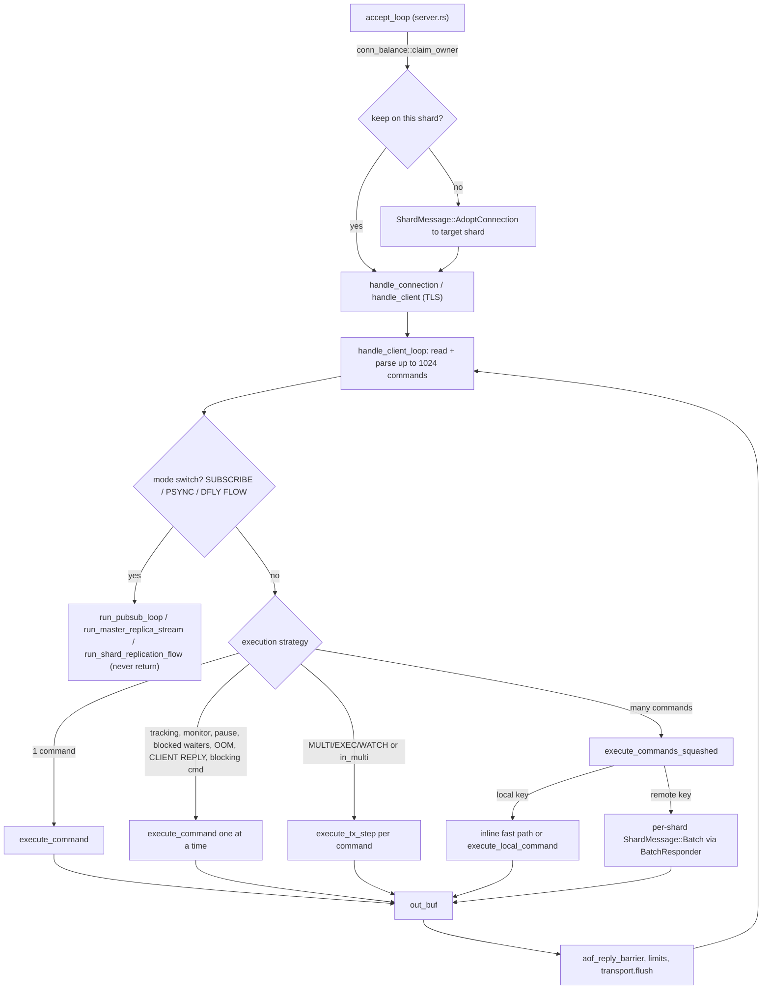

# Component 02: Connection Lifecycle & Command Execution — Implementation Reference

> **High-Level Design Spec**: [`docs/design/02_connection_lifecycle.md`](../design/02_connection_lifecycle.md)
> **Consolidated Implementation Spec**: [`docs/internal/components.md`](components.md)
> **Main source files**: `src/connection.rs` (client loop, transactions, command gates and dispatch,
> pipeline squashing, blocking waits, client registry/stats/limits, Memcached gateway, slot
> migration helpers); `src/transport.rs` (plaintext transport and out-of-band push target);
> `src/tls.rs` (`TlsTransport`); `src/server.rs` (accept loops, panic isolation, remote side of
> `ShardMessage::Batch`); `src/conn_balance.rs` (cross-shard connection hand-off);
> `src/mailbox.rs` (`BatchResponder`, `FastGetDescriptor`, `Doorbell`); `src/shutdown.rs`
> (batch quiescing); `src/slowlog.rs` (SLOWLOG / COMMANDLOG / MONITOR argv);
> `src/command_info.rs` + `src/command_docs.rs` (COMMAND introspection); `src/debug_cmd.rs`
> (DEBUG helpers).

---

## 1. What this subsystem does

Every byte a client sends and every reply it gets back passes through this subsystem. It owns a
client from the moment its TCP (or TLS) connection is accepted until the socket closes:

* **Accepting** the connection on one shard's reactor thread (a *shard* is one CPU-pinned thread
  that owns a slice of the keyspace and runs its own `monoio` io_uring event loop), possibly
  handing it to a less loaded shard.
* **Reading and parsing** client input into `Command` values (RESP2/RESP3 arrays, inline commands
  and Memcached text commands all arrive on the same port).
* **Gating** each command: authentication, ACLs, cluster redirection (`-MOVED`/`-ASK`), replica
  read-only, persistence errors, `maxmemory`, `CLIENT PAUSE`, and so on.
* **Executing** it — directly against the local shard's database when this shard owns the key, or
  by sending it to the owning shard over the inter-shard mailbox mesh when it does not.
* **Batching**: a pipeline of many commands is "squashed" so that all commands for the same
  remote shard travel in one message and all shards work in parallel.
* **Transactions** (`MULTI`/`EXEC`/`WATCH`), **blocking commands** (`BLPOP`, `XREAD BLOCK`, ...),
  and permanent **mode switches** into Pub/Sub or replication streaming.
* **Writing** replies back with as few syscalls as possible, while enforcing output-buffer limits,
  query-buffer limits and idle timeouts.
* **Observability**: per-command stats and latency histograms, SLOWLOG/COMMANDLOG, error stats,
  MONITOR, `CLIENT LIST`/`CLIENT KILL`, `COMMAND INFO/DOCS`, `DEBUG`.

Users are every client library (redis-cli, redis-py, memtier, Memcached clients) and the other
subsystems that need to know "which client is running this command" (tracking, ACL, scripting,
blocking hub).

---

## 2. Mental model

One connection = one `monoio` task on one shard thread. The task loops: read → parse a batch →
pick an execution strategy → execute → flush replies. Commands for keys owned elsewhere become
messages to the owning shard; the reply comes back through a shared-memory slot.



A cross-shard round trip in the squashed path:

```mermaid
sequenceDiagram
    participant C as Client task (shard 0)
    participant R as BatchResponder (shared)
    participant S as Shard 2 event loop
    C->>R: prepare(responses ptr, len) state=RUNNING
    C->>S: ShardMessage::Batch {items, responder, client_id, db, ...}
    C->>R: wait_take: CAS RUNNING to SLEEPING, park on Doorbell
    S->>S: run each item against its ShardDb
    S->>R: write_slot(idx, CompactResp) into caller's Vec
    S->>R: finish(items): swap to COMPLETED, ring Doorbell if SLEEPING
    R-->>C: wake; take recycled items; state=IDLE
    C->>C: write responses to out_buf in pipeline order
```

---

## 3. Accepting a connection (`src/server.rs`, `src/conn_balance.rs`)

### 3.1 Plaintext accept (`accept_loop`)

Each shard binds its own `SO_REUSEPORT` listener per `bind` address: on the shared base port
normally, or on its own port `base_port + shard_id` in cluster mode. For each accepted socket the
shard:

1. Rejects it with `PROTECTED_MODE_DENIED` if `netsec::protected_mode_denies` says so.
2. Sets `TCP_NODELAY`, `TCP_QUICKACK` and keepalive (`connection::apply_tcp_keepalive`: idle time
   `TCP_KEEPALIVE_SECS`, default 300 s; probes every third of that, 3 probes; 0 disables).
3. Mints a client id from the shard's counter `(shard_id << 48) + n`. (Connections adopted from
   another shard use a separate thread-local sequence with bit 47 set; TLS clients use bit 46.
   Client ids are therefore unique process-wide and encode their origin.)
4. **Balances**: unless cluster mode is on, calls `conn_balance::claim_owner(shard_id,
   num_shards)`. `SO_REUSEPORT` hashes the 4-tuple, which for loopback clients is effectively a
   random draw and leaves shards very uneven. `claim_owner` scans a global per-shard census
   (`CONN_COUNTS`, up to `MAX_TRACKED_SHARDS = 256` shards) for the least loaded shard and, if
   this shard holds strictly more, reserves a slot there with one `compare_exchange` (up to
   `MAX_CLAIM_RETRIES = 4` re-scans). In cluster mode the client chose the shard's port on purpose
   (to reach its slots), so it always stays.
5. If another shard won, the stream is converted with `into_raw_fd` (no close) and sent as
   `ShardMessage::AdoptConnection { fd, peer }`; the target rebuilds the stream and runs the same
   `handle_connection`. Otherwise it spawns
   `catch_unwind_async(handle_connection(...))` locally.

**Panic isolation**: every connection task runs inside `server::catch_unwind_async`. A panic in any
command (including the deliberate `DEBUG PANIC`) ends only that connection; the spawner logs it
and calls `connection::inc_isolated_panics()`, which feeds the `ISOLATED_PANICS` counter. RAII
guards (`ClientCleanup`, `ExecCleanup`, `BlockedClientGuard`, ...) undo shared state during the
unwind.

### 3.2 TLS accept

The TLS accept loop performs the `rustls` handshake under `TLS_HANDSHAKE_TIMEOUT` (10 s), wraps the
stream in `tls::TlsTransport`, checks protected mode, and calls the generic
`connection::handle_client`. TLS connections are not balanced across shards.

### 3.3 One loop for both transports (`src/transport.rs`)

`handle_client<T: ClientTransport>` is generic over the transport and monomorphized, so plaintext
pays no dynamic dispatch. `handle_connection` is just `handle_client(PlainTransport::new(stream),
...)`.

| `ClientTransport` method | `PlainTransport` | `TlsTransport` |
| :--- | :--- | :--- |
| `read(buf)` | io_uring read straight into the `BytesMut`'s spare capacity (`RecvBytesMut`); if it filled all spare room, keeps draining with non-blocking `recv(MSG_DONTWAIT)` | decrypts ciphertext into `buf`; while MONITOR/tracking are in use anywhere, the read races the push queue |
| `read_ready(buf)` | one non-blocking `recv` (`recv_ready`) | decrypt what already arrived |
| `flush(out_buf, set_omem)` | non-blocking `send`; remainder via io_uring `write_all`; `set_omem` reports queued bytes while waiting | encrypt (plus queued pushes) then the same send-then-io_uring pattern |
| `push_target()` | `PushTarget::Fd(fd)` — other threads `send` directly to the fd, dropping on a full buffer | `PushTarget::Queue` — bounded flume channel of `PUSH_QUEUE_CAPACITY = 4096`, encrypted by the owner |
| `into_split()` | split TCP halves for Pub/Sub mode | halves sharing the `rustls` session through `Rc<RefCell<...>>` |
| `into_tcp_stream()` | `Ok(stream)` | `Err(self)` — so replication links are refused on TLS |

*Out-of-band pushes* are bytes produced on some other shard for this client: MONITOR lines and
client-side-caching invalidations.

---

## 4. Core data structures

### 4.1 `ClientInfo` — per-connection state in the shard-local registry

Each shard has a `client_registry: Rc<RefCell<HashMap<u64, ClientInfo>>>` (shard-local, no locks).

| Field | Type | Meaning |
| :--- | :--- | :--- |
| `id`, `addr` | `u64`, `SocketAddr` | client id and peer address |
| `name`, `lib_name`, `lib_ver` | `Option<String>` | `CLIENT SETNAME` / `CLIENT SETINFO` |
| `connected_at`, `last_active` | `Instant` | for `age=` / `idle=` |
| `last_cmd` | `&'static str` | interned command name (no allocation per command) |
| `is_resp3` | `bool` | protocol negotiated by `HELLO 3` |
| `db` | `usize` | selected logical database (`SELECT`) |
| `track_tx` | `Option<flume::Sender<Vec<u8>>>` | this client's tracking-invalidation inbox |
| `raw_fd` | `RawFd` | socket fd, for disconnect polling and `CLIENT KILL` |
| `omem`, `qbuf_len`, `qbuf_cap` | `usize` | output-buffer and query-buffer sizes for `CLIENT LIST` |
| `reply_mode` | `ClientReplyMode` | `CLIENT REPLY ON/OFF/SKIP` (enforced, §7.4) |
| `is_monitor` | `bool` | set by `MONITOR` (exempts from idle timeout) |
| `readonly` | `bool` | `READONLY`: a cluster replica serves reads for its master's slots |
| `stats` | `Arc<ClientStats>` | atomics shared with the global registry |
| `push` | `PushTarget` | how other threads reach this client |

`ClientStats` holds atomics readable from any thread: `tot_net_in`, `tot_net_out`, `tot_cmds`,
`read_events`, `pipeline_len_sum`/`pipeline_len_cnt` (average pipeline depth), `killed` (set once
by whoever first accounts the disconnect, so `ACTIVE_CLIENTS` is decremented exactly once) and
`is_replica` (connection became a replication link).

### 4.2 `GlobalClientEntry` — the process-wide registry

`GLOBAL_CLIENTS: RwLock<HashMap<(port, client_id), GlobalClientEntry>>` lets any shard find any
client (for `CLIENT KILL`, tracking redirection, MONITOR). An entry holds `raw_fd`, `push`,
`track_tx`, `is_resp3`, `auth_user`, `is_pubsub` and the shared `stats`. `global_client_entry`
looks a client up by id across all of the node's ports. Cleanup guards remove the entry *before*
the socket closes, so a stale fd number is never used by another thread.

### 4.3 Thread-locals and `ClientScope`

Many deep helpers need "the current client" without threading arguments through, so the command
path keeps per-client values in thread-locals:

| Thread-local | Meaning |
| :--- | :--- |
| `CURRENT_CLIENT_RESP3` | reply protocol of the running command |
| `CURRENT_DB` | selected DB of the running command |
| `CURRENT_CLIENT_ID` / `EXECUTING_CLIENT_ID` | who runs the command (`requesting_client_id()` reads them) |
| `DEFER_BCAST_FLUSH` | defer BCAST tracking invalidations until EXEC ends |
| `CLIENT_NO_TOUCH` | `CLIENT NO-TOUCH`: reads don't update LRU/LFU |
| `CURRENT_AUTH_USER` | ACL user scripts are checked against |
| `TX_CLIENTS` | ids of clients on this thread whose `EXEC` is running (`in_tx(id)`) |
| `CURRENT_ROUTER` | the shard's `Rc<Router>` (`set_current_router`), for helpers like keyspace notifications and scripts |
| `REPLAYING_WRITES` | set during AOF replay / applying master writes: expired keys count as live |

Because connection tasks on one thread interleave at every `.await`, thread-locals would leak
between clients. `handle_client` therefore wraps the loop in **`ClientScope`**: a future adapter
that, on every `poll`, swaps the client's own `ClientThreadLocals` (`resp3`, `db`, `client_id`,
`executing_client_id`, `defer_bcast_flush`, `no_touch`, `auth_user`) into the thread-locals and
swaps the previous values back afterwards. Similarly `execute_command` and
`execute_commands_squashed` run under **`WithCurrentDb`**, which re-selects the client's DB on the
shard's `ShardDb` around every poll.

### 4.4 `ConnScratch` — pooled per-connection buffers

```rust
struct ConnScratch {
    buf: BytesMut,                                  // inbound bytes (starts at 128 KiB)
    out_buf: Vec<u8>,                               // outbound replies (starts at 64 KiB)
    responders: Vec<Arc<mailbox::BatchResponder>>,  // one per shard, index = shard id
    remote_batches: Vec<Vec<(usize, u64, Command)>>,// per-shard (slot idx, key hash, cmd)
    items_pool: Vec<Vec<(usize, u64, Command)>>,    // recycled batch Vecs
    results_pool: Vec<Vec<(usize, CompactResp)>>,   // carried but unused (see §11)
    squashed_responses: Vec<CompactResp>,           // reply slots for a squashed pipeline
    commands: Vec<Command>,                         // parsed batch
}
```

`take_conn_scratch(num_shards)` pops one from the thread-local `CONN_SCRATCH_POOL`;
`recycle_conn_scratch` returns it when the connection ends, **only if every responder is idle
and unreferenced** (`Arc::strong_count == 1 && is_idle()`). A remote shard still holding a clone
could otherwise write a late reply into the next client's buffers. Before pooling,
`trim_conn_scratch` shrinks anything that grew past `SCRATCH_KEEP_BYTES` (1 MiB) or
`SCRATCH_KEEP_ITEMS` (1024 entries); the pool holds at most 32 entries per thread.

### 4.5 `CompactResp` — reply slot type (`src/shard.rs`)

`enum CompactResp { Small { len: u8, data: [u8; 30] }, Big(Vec<u8>), Bulk(Bytes), Array1Bulk(Bytes),
RawBytes(Bytes) }`. Small replies (e.g. `+OK`, small integers, bulk strings up to 20 bytes) are
stored inline with no allocation; `const` values such as `CompactResp::OK`, `INT_0`, `INT_1`,
`NULL`, `EMPTY_ARRAY` and `CompactResp::null(is_resp3)` cover common replies. It is the element
type of the squashed path's response slots and of everything a remote shard writes back.

### 4.6 `BatchResponder` — cross-shard reply mailbox (`src/mailbox.rs`)

| Field | Type | Meaning |
| :--- | :--- | :--- |
| `state` | `CachePadded<AtomicU8>` | `BATCH_IDLE` (0) → `BATCH_RUNNING` (1) → optionally `BATCH_SLEEPING` (2) → `BATCH_COMPLETED` (3) |
| `responses_ptr`, `responses_len` | `AtomicPtr<CompactResp>`, `AtomicUsize` | caller's response slice; remote writes go straight into it |
| `recycled_items` | `UnsafeCell<Option<Vec<(usize,u64,Command)>>>` | the batch Vec handed back for reuse |
| `bell` | `Doorbell` | single-waiter wake-up (one atomic swap when nobody is parked) |
| `slow` / `has_slow` | `Mutex<Vec<..>>` / `AtomicBool` | items that exceeded the slowlog threshold remotely |

Protocol: owner calls `prepare(ptr, len)` (state RUNNING) and sends the batch; the remote shard
calls `write_slot(idx, resp)` per item (bounds-checked against `responses_len`) and finally
`finish(items)`, which swaps state to COMPLETED and rings the bell only if the owner had moved
it to SLEEPING. The owner either polls `try_take()` or calls `wait_take()`, which CASes
RUNNING→SLEEPING and parks on the `Doorbell` until COMPLETED.

Single-key remote `GET`/`SET` use the even lighter `FastGetDescriptor`/`FastSetDescriptor`
(`ShardMessage::FastGet`/`FastSet`): one value slot, a `done` flag and a `Doorbell`, pooled by the
`Router`. `Router::execute_remote` (the generic "run this one command on shard N") sends a
one-item `ShardMessage::Batch` with a pooled `BatchResponder` and a single stack slot.

### 4.7 Output buffer limits (`BufferLimit`, `ClientClass`)

`BufferLimit { hard_limit, soft_limit, soft_seconds }` per `ClientClass { Normal, Replica, Pubsub }`,
stored in `NORMAL_BUFFER_LIMIT` (default `0 0 0`, unlimited), `SLAVE_BUFFER_LIMIT` (256 MiB / 64 MiB
/ 60 s) and `PUBSUB_BUFFER_LIMIT` (32 MiB / 8 MiB / 60 s). `set_client_output_buffer_limit_str`
parses `CONFIG SET client-output-buffer-limit` (groups of 4 tokens; `slave` and `replica` are
synonyms; sizes accept `k/kb/m/mb/g/gb`) and sets `HAS_CUSTOM_BUFFER_LIMIT` when the normal class
has any non-zero limit. `get_client_output_buffer_limit(Normal)` returns "unlimited" from that one
atomic without touching the lock.

---

## 5. The client loop (`handle_client_loop`)

### 5.1 Setup

1. `ACTIVE_CLIENTS += 1`; if above `MAX_CLIENTS` (default 10000) reply `-ERR max number of clients
   reached`, count `RejectedConnections`, return.
2. Create the tracking inbox (`flume::unbounded`), `register_global_client`, insert the
   `ClientInfo`.
3. Install the `ClientCleanup` RAII guard. On drop it: decrements `ACTIVE_CLIENTS` (unless
   `stats.killed` was already set), flushes thread-local command stats, removes the client from
   both registries and MONITOR, removes Pub/Sub subscriptions (locally and via
   `ShardMessage::RemoveClientPubSub` to every other shard), unregisters tracking, clears its
   `WATCH`es, and unregisters it from the `BlockHub` if any blocked waiters exist.
4. Take a `ConnScratch`; initialise `in_multi = false`, `tx_queue`, `tx_has_error`, `asking`,
   `authenticated` (true unless the default user requires a password), `auth_user = "default"`.
5. If AOF is on, capture per-shard AOF progress handles for the reply barrier (§5.4).

### 5.2 Each iteration

1. **Read.** Keep at least `MIN_READ_SPARE` (16 KiB) free in `buf` (reserving
   `READ_BUFFER_SIZE` = 64 KiB). Read through the transport, under a timeout of
   `CLIENT_IDLE_TIMEOUT_SECS` if configured (`idle_read_limit` exempts Pub/Sub subscribers and
   MONITOR clients). Timeout or 0 bytes → close. If the previous batch stopped early with complete
   frames left (`carry_over`), skip the read.
2. **Parse a batch.** Call `resp::parse_command` repeatedly:
   * Each complete command is pushed to `commands`; `has_special` becomes true if
     `is_special_pipeline_cmd` matches (or if already `in_multi`).
   * `QUIT` truncates the buffer and ends parsing.
   * At `MAX_DRAIN_BATCH_CMDS` (1024) commands parsing stops and `carry_over` is set.
   * On an incomplete frame, if the batch is not full (fewer than 1024 commands and fewer than
     `MAX_DRAIN_BATCH_BYTES` = 1 MiB drained), try `transport.read_ready` and continue; otherwise
     leave the partial frame for the next read.
   * **Query-buffer limit**: a single complete command larger than `client-query-buffer-limit`
     (default 1 GiB, minimum 1 MiB), or a partial command larger than it, closes the connection
     without replying (`client_query_limit_reached`).
   * A parse error starting with `Protocol error:` writes the error, flushes and closes. Any other
     parse error first executes the commands parsed so far (through `execute_tx_step` if
     `in_multi`, which then also marks the transaction failed), then appends the error and keeps
     parsing.
3. **Shutdown gate.** `shutdown::enter_batch(shard)` registers the batch as in flight. While a
   shutdown is quiescing it returns `None`; the loop sleeps in 10 ms steps and closes once the
   shutdown proceeds. This guarantees nothing is acknowledged after the final save.
4. **Mode switches** (only when `has_special`): while some command satisfies
   `is_mode_switch_cmd` (`SUBSCRIBE`, `PSUBSCRIBE`, `SSUBSCRIBE`, `PSYNC`, `SYNC`, `DFLY FLOW`):
   execute everything before it via `execute_command`; check `mode_switch_denied` (NOAUTH / ACL
   command and channel permissions — these commands never reach `execute_command`'s gates); flush;
   then hand the connection over (§8) and **return**.
5. **Choose an execution strategy** (§6) and run the batch into `out_buf`.
6. Drain any tracking invalidations from `track_rx` into `out_buf` (when tracking is on).
7. **Output limit** (only if `HAS_CUSTOM_BUFFER_LIMIT`): update `omem`; `out_buf.len() >= hard`
   → close; `>= soft` for at least `soft_seconds` → close (timer resets when back under soft).
   Disconnects are logged and counted by `client_output_limit_reached`; the client just sees the
   socket close.
8. **Flush**: `aof_reply_barrier`, then `transport.flush`. A write error closes.
9. If `buf` is empty, `try_reclaim` shrinks it back.

When the loop exits the scratch is recycled; `ClientCleanup` runs as the function returns.

### 5.3 Worked example

A client sends one TCP segment containing `SET a 1`, `GET b`, `INCR c` (3 shards, this is shard 0;
`a`→0, `b`→2, `c`→1). The read returns all three frames; parsing yields 3 commands with
`has_special = false`. No tracking/monitor/pause is active, so the batch goes to
`execute_commands_squashed` (§9): `SET a` runs inline on shard 0, `GET b` is bucketed for shard 2,
`INCR c` for shard 1; both batches are sent at once and awaited; the three replies are written to
`out_buf` in order (`+OK`, `$..`, `:1`) and flushed with one `send`.

### 5.4 AOF reply barrier

`aof_reply_barrier` runs before every flush. Under `appendfsync always` it syncs every shard's AOF
when any AOF append happened since this connection last checked (`AOF_APPENDS` counter). Otherwise,
if AOF is on and the batch contained writes (`is_write_command`, or `EXEC`/`EVAL`/`EVALSHA`/`FCALL`),
it calls `Router::write_aof_through` so the writes reach the kernel before the client sees `+OK`.

---

## 6. Execution strategies

Evaluated in this order for each non-empty batch:

| # | Condition | Path |
| :--- | :--- | :--- |
| a | `has_special` and (`in_multi` or batch contains `MULTI`/`EXEC`/`DISCARD`/`WATCH`/`UNWATCH`) | every command through `execute_tx_step` (§7.5) |
| b | any of: `CLIENT PAUSE` in effect; tracking clients exist; MONITOR clients exist; blocked waiters on this port; shard over `maxmemory` with a budget; client's `reply_mode != On`; or `has_special` and the batch has a `CLIENT` or blocking command | sequential `execute_command` per command |
| c | exactly one command | `execute_command` |
| d | otherwise | `execute_commands_squashed` |

In path (b), before each blocking command (and before every command while paused) the replies so
far are flushed, because the command may suspend the task for a long time. Path (b) also drains
tracking invalidations after each command so they precede later replies.

In path (d), if a normal-client hard output limit is set, the batch is run in chunks of 1, 2, 4, ...
commands (`take_doubling_chunk`), stopping once `out_buf` exceeds the hard limit — so up to 1024
large replies are not all built before the limit is checked.

`is_special_pipeline_cmd` lists everything that must not be squashed: mode switches, transaction
commands, blocking commands, `HELLO`, `RESET`, `AUTH`, `ACL`, `TIER`, `CONFIG GET/SET`, `DFLY
CLUSTER/MIGRATE`, `STICK`/`UNSTICK`, Memcached `stats`/`version`/`quit`, `QUIT`, `WAIT`,
`WAITAOF`, `CLIENT REPLY`, and commands that change or cross DBs (`SELECT`, `MOVE`, `SWAPDB`,
`FLUSHDB`, `FLUSHALL`, `COPY ... DB`).

---

## 7. Executing one command (`execute_command`)

`execute_command` wraps `execute_command_inner` in `WithCurrentDb`. Every path ultimately funnels
non-fast-path commands here.

### 7.1 Prologue (before any gate)

1. Load `is_resp3`, `db`, `reply_mode` and stats from the registry into thread-locals; if an AOF
   rewrite is building its image, snapshot keys the command may modify (`aof_image_before_command`).
2. `ExecutingClientGuard`: sets `CURRENT_CLIENT_ID`/`EXECUTING_CLIENT_ID`; on drop restores them and
   bumps `stats.tot_cmds`.
3. `CachingResetGuard`: after any command except `CLIENT CACHING`, `CLIENT TRACKINGINFO` and
   `MULTI`, resets the one-shot `CLIENT CACHING yes/no` flag.
4. `wait_if_client_paused` (§10.3).
5. MONITOR broadcast (`broadcast_monitor` with `slowlog::command_to_monitor_argv`), except for
   `MONITOR`/`RESET`/`QUIT`.
6. `CmdStatGuard` times the command for `INFO commandstats` and `LATENCY HISTOGRAM` (no time for
   `may_block` commands, whose wait is not execution time).
7. `snapshot::note_write()` for writes whose dirty count is not counted on change.
8. `SlowlogTracker` (only if `slowlog-log-slower-than >= 0` or `latency-monitor-threshold > 0`):
   clones the command and start time; on drop records a `command` latency event (≥ 1 ms), the
   SLOWLOG entry, and COMMANDLOG large-request / large-reply entries (§12.2). `QUIT`, `EXEC` and
   `COMMANDLOG` are never slowlogged, nor `MSET`/`MGET` when the threshold is ≥ 10 ms.

### 7.2 Gate sequence

The body runs as an `async` block so early `return`s only leave the block. Gates, in order:

1. **Protected commands**: `DEBUG` and `MODULE ...` are refused unless `enable-debug-command` /
   `enable-module-command` allow this peer (`protected_command_denied`).
2. **`-NOREPLICAS`**: write while `min-replicas-to-write` is unmet (`not_enough_good_replicas`).
3. **`-NOAUTH`**: unless authenticated or the command is `AUTH`/`HELLO`/`QUIT`.
4. **ACL** (`acl_denied`, free when no custom ACL exists and the user is `default`): command (with
   first-arg rules such as `+select|0`), every key with the needed read/write permission
   (`acl_key_perm`), and Pub/Sub channels. Denials go to `ACL LOG`. Inside `EXEC` the reply is
   Redis' "ACLs rules changed between the moment the transaction was accumulated..." text.
5. **`ASKING`**: sets the one-shot `asking` flag, replies `+OK`. Every other command captures and
   clears it (`RESTORE ... ASKING` counts as asking).
6. **`-CROSSSLOT`** (cluster mode): all keys from `cmd_keys` must share a hash slot.
7. **Slot state** for `cmd_primary_key` via `router.get_slot_state(slot)`:
   * `Moved(target)` → `-MOVED slot target`.
   * `Importing(source)` → `-MOVED` unless asking.
   * `Migrating(target)` → `-ASK slot target` if the key does not exist here.
   * `Stable` with cluster mode or an active gossip cluster: if this node owns the slot (or the
     client is `READONLY`, the command is a read, and this replica's master owns it) but a
     different local shard does, `-MOVED slot 127.0.0.1:<base_port + shard>`. If no one here owns
     it, `-MOVED slot <ip>:<port>` to the live master that does (`ClusterNodeInfo::port_for_slot`
     picks that node's per-shard port when it announced several shards), else
     `-CLUSTERDOWN Hash slot not served`.
8. **`-LOADING`** while a replica loads its master's dataset, except commands in
   `allowed_while_loading`.
9. **`-MISCONF`** for writes while persistence is failing (`persistence_misconf`: AOF write error,
   or last RDB save failed with save points set and `stop-writes-on-bgsave-error yes`).
10. **`-READONLY`** for writes on a replica with `replica-read-only`.
11. **maxmemory** (skipped on replicas with `replica-ignore-maxmemory`): with an evicting policy,
    `evict_until_under_maxmemory` runs (except for `CONFIG GET/SET`, `INFO`); still over → `-OOM`
    for writes not flagged `allows_oom`. With `noeviction`, if over the limit it first lets the
    NVMe tier offload (`check_auto_tier`) and rejects only if still over.

### 7.3 Dispatch

After the gates, `reply_mode_start` records `out.len()` and the giant `match cmd` runs. Arms come in
two shapes:

* **Specific arms** with their own logic, e.g. `GET` (local: `router.get_local_checked`, which
  falls back to an NVMe cold read for tiered keys; remote: `router.get_checked` via
  `FastGetDescriptor`), `SET` (a local unconditional `SET` with no AOF, replicas or keyspace
  notifications writes directly; everything else evaluates `NX`/`XX`/`IFEQ`/`IFNE`/`IFDEQ`/`IFDNE`
  — the last two compare a 16-hex-char digest — `GET`, `KEEPTTL` and already-expired TTLs), `HELLO`
  (negotiates RESP2/3, authenticates, reports `server: valkey`, `version: 7.2.0`, `mode: cluster`
  when relevant), `CLIENT ...`, `EVAL`/`EVALSHA`/`FCALL`, `DEBUG`, `SLOWLOG`, `COMMAND`, Memcached
  verbs (§13), cross-shard multi-key helpers (`move_key_across_shards`, `msetnx_across_shards`,
  `bitop_across_shards`, `blmove_across_shards`, ...).
* **One merged arm** for a long list of single-target commands (hashes, lists, sets, sorted sets,
  streams, JSON, probabilistic types, vectors, `OBJECT`/`XINFO` subcommands, ...):
  `target_shard_of_cmd` picks the shard; local → `execute_local_command` on `router.local_db`;
  remote → `router.execute_remote(target, cmd)` and copy the raw reply. If blocked waiters existed
  before the command (and the client is not in `EXEC`), the arm sleeps 2 ms so woken clients run
  before the reply goes out.

`execute_local_command(cmd, db, out, aof)` is the shard-local executor; it is shared by this path,
the squashed path, the remote side of `ShardMessage::Batch`, scripts and replication apply.

**Scripts** (`EVAL`/`EVALSHA`/`FCALL`): declared keys spanning shards → `-CROSSSLOT` (via
`keys_span_shards`); keys owned by another shard → the whole command is forwarded with
`execute_remote` and runs there; a keyless script that touches a non-local key is redirected
after the fact (`scripting::arm_script_redirect` / `take_script_redirect`). Scripts never span
shards.

### 7.4 Epilogue

After the body:

1. **`CLIENT REPLY`**: if the client's mode at command start was `OFF` or `SKIP` (and this isn't
   `CLIENT REPLY` itself), `out` is truncated back to `reply_mode_start`; `SKIP` then reverts to
   `ON`. Errors from the gates (written before `reply_mode_start`) are still sent.
2. The reply size is handed to `SlowlogTracker` (for large-reply logging).
3. `record_reply_error_stat`: if the reply starts with `-`, its first word (e.g. `WRONGTYPE`) is
   counted in `ERROR_STATS` / `FAILED_CMD_STATS` / `TOTAL_ERROR_REPLIES` (`INFO errorstats`).
   Script errors are counted once (`SCRIPT_RECORDED_ERROR`).

The return value is "close the connection after this reply" (`QUIT`, `CLIENT KILL` of oneself, a
client that vanished while blocked).

### 7.5 Transactions (`execute_tx_step`)

Transaction state is three locals of the client loop (`in_multi`, `tx_queue`, `tx_has_error`)
passed by `&mut`.

**Not in MULTI**: `MULTI` → `in_multi = true`, `+OK`. `WATCH k...` → `watch_keys`. `UNWATCH` →
`unwatch_keys`. `EXEC`/`DISCARD` → `-ERR ... without MULTI`. Anything else → `execute_command`.

**In MULTI**:

| Command | Effect |
| :--- | :--- |
| `MULTI` | `-ERR MULTI calls can not be nested` |
| `WATCH` | `-ERR WATCH inside MULTI is not allowed` |
| `UNWATCH` | `+OK` (no-op) |
| `DISCARD` | clear queue, unwatch, `+OK` |
| `RESET` | clear queue, unwatch, reset name/RESP/DB/monitor/no-touch/tracking/pub-sub/auth, `+RESET` |
| `QUIT` | `+OK`, close |
| `SAVE`/`BGSAVE`/`SHUTDOWN`, unknown command, denied `DEBUG` | error reply, `tx_has_error = true` |
| anything else | ACL-checked now (denial aborts EXEC); queued, `+QUEUED` |

**`EXEC`** (numbered):

1. `tx_has_error` → `-EXECABORT Transaction discarded because of previous errors.`
2. Cluster mode and keys in different slots (`tx_has_cross_slot`) → `-CROSSSLOT`.
3. A watched key changed (`is_watch_tainted`) → null array.
4. Otherwise: `wait_if_tx_paused`, `unwatch_keys`, compute the sorted set of shards the queued
   keys live on. Arm an **`ExecCleanup`** guard first. If more than one shard: acquire the **VLL**
   cross-shard transaction locks (`router.acquire_tx_locks(sorted_shards, next_tx_id())`, locked in
   sorted shard order so two transactions cannot deadlock). Pause the port's `BlockHub` (wake-ups of
   blocked clients are deferred). Write `*<n>`; `enter_tx(client_id)`; set `DEFER_BCAST_FLUSH`;
   run each queued command through `execute_command`.
5. Dropping `ExecCleanup` (normally or during a panic unwind) clears the in-tx mark, flushes
   deferred BCAST invalidations, releases VLL locks (`release_tx_locks_now`) and resumes the
   `BlockHub`, replaying deferred list/zset/stream wake-ups locally or via
   `ShardMessage::NotifyList` to the owning shard.

Inside `EXEC`, blocking commands return immediately (`in_tx(client_id)`), `CLIENT PAUSE` does not
block individual commands, and cross-shard locks are not re-taken.

**WATCH bookkeeping**: `WATCHED_KEYS: RwLock<HashMap<port, HashMap<(db, key), HashSet<client_id>>>>`
and `CLIENT_WATCH_TAINTED: RwLock<HashMap<(port, client_id), bool>>`. Ports are normalised to the
node's base port (`node_port`), so a watch is node-wide whichever shard port the client used. Writes
call `touch_watched_key` (also invoked by `notify_key_invalidation`); `FLUSHDB`/`FLUSHALL`/`SWAPDB`
taint all affected watchers. Everything is gated on `HAS_WATCHED_KEYS`, so servers that never use
`WATCH` pay one relaxed load per write.

### 7.6 Blocking commands

`BLPOP`, `BRPOP`, `BLMOVE`, `BLMOVEM`, `BLMPOP`, `BZPOPMIN`, `BZPOPMAX`, `BZMPOP`, and
`XREAD`/`XREADGROUP` with `BLOCK` follow one pattern, shown by `handle_bzpop`:

1. Try every key once (locally, or remotely via `execute_remote`); on success reply and, for local
   pops, append the equivalent non-blocking command to AOF/replication.
2. If nothing was available and the client is inside `EXEC`, return a null array immediately.
3. Install `BlockedClientGuard` (unregisters from the `BlockHub` on drop), register waiters for every
   key, call `recheck_blocking_keys` (closes the race with a push that landed in between).
4. `wait_for_blocked_result` waits on the channel in slices of at most 20 ms; between slices it
   polls `is_fd_closed` (`poll` + `MSG_PEEK`) so a vanished client is noticed within ~20 ms (not
   during shutdown, when the server itself half-closes sockets). Timeout → null reply;
   `CLIENT UNBLOCK ... ERROR` → `-UNBLOCKED`.

Details of the hub live in Component 06.

---

## 8. Mode switches

* **Pub/Sub** (`run_pubsub_loop`): the client's `ClientCleanup` is forgotten and replaced by
  `PubsubCleanup`; the transport is split; a writer task drains an unbounded queue wrapped in
  `pubsub::SubscriberTx`, which enforces the Pub/Sub output limit by bytes at enqueue time
  (`close_client_over_output_limit` shuts the socket from the publishing shard). The writer batches
  queued messages up to 256 KiB per write. RESP2 subscribers may only run `(P|S)SUBSCRIBE`,
  `(P|S)UNSUBSCRIBE`, `PING`, `QUIT`, `RESET`; RESP3 subscribers may run anything. Query-buffer
  limits still apply. See Component 19.
* **Replication** (`PSYNC`/`SYNC` → `run_master_replica_stream`, `DFLY FLOW` →
  `run_shard_replication_flow`): `stats.is_replica` is set and the raw `TcpStream` is taken with
  `into_tcp_stream`. On TLS that fails and the client gets `-ERR replication links are only
  supported on the plaintext port`. See Component 14.

---

## 9. Pipeline squashing (`execute_commands_squashed`)

Goal: run a pipeline of N commands with one message per remote shard and all shards working in
parallel, while preserving exact reply order and per-client semantics.

### 9.1 Eligibility (`can_squash`)

Starts as `authenticated`, then becomes false (whole batch falls back to sequential
`execute_command`) if any of:

* a replica is loading (`-LOADING` would be due);
* this is a read-only replica and the batch writes (`batch_has_writes`);
* persistence is failing (`-MISCONF` would be due);
* keyspace notifications are on and some command is not in `notifies_same_when_batched`;
* when `has_special`, a non-default/custom ACL user, cluster mode, or dynamic slot owners apply:
  any command is special; any command fails `acl_check_user_cmd`; any command's keys span slots
  (cluster), span shards under dynamic owners (except `MGET`/`MSET`/`DEL`/`UNLINK`/`EXISTS`/`TOUCH`),
  touch a non-`Stable` slot or one this node does not own; or a keyless command other than a short
  allow-list (`PING`, `QUIT`, `TIME`, `ECHO`, `READONLY`, `READWRITE`, `COMMAND COUNT/LIST`,
  `LATENCY`, `PUBSUB HELP`, `FUNCTION STATS/KILL`) appears in cluster mode.

### 9.2 Phase 1 — walk the pipeline

`responses` is resized to N slots. `write_fast_path` = no AOF, no connected replicas and keyspace
notifications off. For command `idx`:

1. **Single-target commands** (`target_shard_and_hash_of_cmd` returns `(shard, key_hash)`; the hash
   is reused so table lookups never re-hash):
   * **Remote** → push `(idx, key_hash, cmd)` onto `remote_batches[shard]`.
   * **Local** → record tracked reads, `hydrate_cmd_keys` (bring tiered keys back), then an inline
     fast path if one matches, else `execute_local_command(..., router.aof)`:

| Fast path | Extra condition |
| :--- | :--- |
| `GET` (tiered miss deferred to `local_cold_gets`) | — |
| `EXISTS`/`TOUCH` (1 key), `HGET`, `HMGET`, `SISMEMBER`, `SMISMEMBER`, `ZMSCORE`, `LRANGE`, `ZRANGE` | — |
| unconditional `SET`, `INCRBY` family, `SADD`, `SPOP` (no count), `ZPOPMIN` (no count), `SREM`, `ZREM`, `LPOP`, `RPOP` | `write_fast_path` |
| `DEL`/`UNLINK` (1 key), `HSET`, `HDEL` | `write_fast_path` and no search indexes |
| `ZADD`, `LPUSH`, `RPUSH` | `write_fast_path` and no blocked waiters |

   Every write fast path calls `touch_watched_key` and `notify_key_invalidation` when the
   corresponding feature is active.
2. **Folded multi-key commands** — split into one sub-request per key, each with its own extra
   slot appended after the N pipeline slots:
   * `MGET` → per-key `GET`s; assembled into an array at the end (`write_mget_reply`; per-key
     errors such as WRONGTYPE become nil, as MGET reports them).
   * Multi-key `EXISTS`/`TOUCH`, and `DEL`/`UNLINK` (with `write_fast_path`, no search indexes) →
     per-key integer slots summed at the end.
   * `MSET` with `write_fast_path` → local pairs set inline, remote pairs become `SET` items; the
     reply is `+OK` immediately.
3. **`MSET` without the fast path** → flush pending batches, then `router.begin_mset` (dispatched,
   not awaited) and `finish_mset` at the end.
4. **Anything else** → **flush pending remote batches first** (`flush_remote_batches`), then
   `execute_command` into a temporary buffer. The flush is an ordering barrier: e.g. `SET k v` to a
   remote shard followed by `MGET k x` must observe the `SET`. A few keyless commands (`PING`,
   `QUIT`, `TIME`, `ECHO`, `PUBSUB HELP`, `FUNCTION STATS/KILL`) skip the barrier and run via
   `execute_local_command`.

Per-shard FIFO delivery guarantees that commands for the same shard execute in pipeline order even
without a barrier.

### 9.3 Phase 2/3 — dispatch and harvest (`flush_remote_batches`)

1. For each non-empty `remote_batches[s]`: `responders[s].prepare(responses ptr, len)`, swap in a
   recycled Vec from `items_pool`, send `ShardMessage::Batch { db, items, responder, is_resp3,
   client_id, no_touch, defer_bcast }`, set bit `s` in `pending_mask: u64`.
2. Optionally poll `try_take` for `mailbox::cross_shard_spin()` iterations (`cross-shard-spin`,
   default **0** — park immediately so the event loop serves other connections).
3. For each remaining bit, `wait_take().await`. Recycled item Vecs are cleared on the owner (so key
   refcounts are dropped on the owning core) and returned to `items_pool`.

**Remote side** (`server.rs`, `ShardMessage::Batch` arm): installs the requester's RESP version,
DB, `CLIENT NO-TOUCH`, defer-BCAST flag and client id in its own thread-locals; for each item runs a
mirror of the fast paths (`GET`, `SET`, `INCRBY`, single-key `EXISTS`/`TOUCH`/`DEL`, ... — only when
no tracking clients exist, and for writes only without AOF/replicas/notifications), or scripts, or
`execute_local_command`; writes each result with `write_slot`; reports slow items with
`report_slow`; tiered misses are read in a spawned task before `finish(items)`.

### 9.4 Phase 4/5 — assemble

1. Cold-tier local GETs are read (`router.stream_cold_read_local`).
2. Remote slow items (`take_slow`) are logged with this client's address (slots ≥ N are per-key
   parts of folded commands and skipped).
3. Folded integer commands are summed from their slots; in-flight MSETs are finished (if every
   command was an MSET, `+OK`s are written directly and the function returns).
4. Replies are written to `out` in pipeline order, capacity pre-reserved from
   `CompactResp::estimated_len`; folded MGET arrays are written straight from their per-key slots.

Command statistics for squashed commands are recorded by `CmdStatBatch` (time per segment split
across commands, two clock reads per segment); local slow commands are timed individually with
the cycle clock and logged by `log_batched_slow`.

### 9.5 Worked example

Pipeline on shard 0 of 3: `SET a 1` (a→0), `MGET a b c` (b→1, c→2), `HSET h f v` (h→2), `INCR x`
(x→1). No AOF/replicas.

1. idx 0 `SET a 1`: local fast path, slot 0 = `+OK`.
2. idx 1 `MGET`: slots 4,5,6 appended. `a` local → slot 4 = `$1 1`; `GET b` → batch[1] (slot 5);
   `GET c` → batch[2] (slot 6). `folded_mgets = [(1, 4, 3)]`.
3. idx 2 `HSET h`: remote → batch[2] (slot 2).
4. idx 3 `INCR x`: remote → batch[1] (slot 3).
5. `flush_remote_batches`: one message to shard 1 (`GET b`, `INCR x`), one to shard 2 (`GET c`,
   `HSET h`); both run concurrently and write slots 5,3 and 6,2.
6. Output: slot 0, then MGET array from slots 4–6, then slot 2, slot 3.

---

## 10. Limits, timeouts and pauses

### 10.1 Query buffer

`client-query-buffer-limit` (`CONFIG_CLIENT_QUERY_BUFFER_LIMIT`, default 1 GiB, minimum
`MIN_CLIENT_QUERY_BUFFER_LIMIT` = 1 MiB) bounds the bytes of **one** command, complete or partial.
Long pipelines never trip it because complete commands are consumed batch by batch. Breaches close
the connection silently and count `ClientQueryBufferLimitDisconnections`.

### 10.2 Idle timeout and keepalive

`timeout` (`CLIENT_IDLE_TIMEOUT_SECS`, default 0 = never) bounds each read; Pub/Sub and MONITOR
clients are exempt, blocked clients are not reading. `tcp-keepalive` is applied at accept.

### 10.3 `CLIENT PAUSE`

`set_client_pause(timeout_ms, write_only)` stores a deadline in `PAUSE_DEADLINE_MS` and the mode in
`PAUSE_WRITE_ONLY` (overlapping pauses merge: later deadline, `WRITE` only if both were write-only).
`wait_if_client_paused` parks a command (registering in `PAUSED_CLIENTS`) until the deadline or
`CLIENT UNPAUSE` (`unpause_clients` wakes everyone). `should_pause_command` never pauses `CLIENT
PAUSE/UNPAUSE` or `QUIT`; in write-only mode it pauses writes, non-read-only scripts, `PUBLISH`,
`SPUBLISH`, `PFCOUNT`, blocking pops and `XREADGROUP`. `EXEC` pauses as a whole
(`wait_if_tx_paused`) and its queued commands then run unpaused.

### 10.4 Shutdown

`shutdown::quiesce` sets `QUIESCING` and waits until in-flight batches (per-shard `INFLIGHT`
counters incremented by `enter_batch`) drain, so the final save sees every acknowledged write. New
batches wait at the gate in §5.2 step 3.

---

## 11. Client registry operations

* **`CLIENT KILL`**: old form `CLIENT KILL addr` and filter form (`ID`, `TYPE
  normal|master|replica|slave|pubsub`, `USER`, `ADDR`, `LADDR`, `SKIPME`, `MAXAGE`). Matching
  clients (from `router.client_list`, all shards) are marked `killed` (decrementing
  `ACTIVE_CLIENTS` once), their socket is `shutdown(SHUT_RDWR)`, and their blocked waiters are
  removed. Killing oneself returns "close after reply". `TYPE master` (or `ADDR` of the master)
  drops a replica's link to its master.
* **`CLIENT NO-TOUCH`** sets `CLIENT_NO_TOUCH` (per client via `ClientScope`, and forwarded to
  remote shards in batches and fast descriptors).
* **`CLIENT NO-EVICT`** is accepted and ignored.
* **`RESET`** restores connection defaults (see §7.5 table).

---

## 12. Observability

### 12.1 Command stats and latency

`record_cmd_stats(name, calls, nanos)` accumulates into a thread-local
`LOCAL_CMD_STATS: HashMap<&'static str, CmdStat>`, merged into the global `CMD_STATS` every 1024
calls and on disconnect (`flush_local_cmd_stats`). `CmdStat { calls, nanos, hist:
[u64; LATENCY_BUCKETS] }` with 31 power-of-two microsecond buckets backs `INFO commandstats`,
`INFO latencystats` (percentiles from `latency-tracking-info-percentiles`, default 50/99/99.9,
interpolated within a bucket) and `LATENCY HISTOGRAM`. `CONFIG` is split into `config|get`,
`config|set`, `config|resetstat`, `config|rewrite` (`stat_cmd_name`). Latency events (`LATENCY
LATEST/HISTORY/DOCTOR`) are recorded by `record_latency_event` when over
`LATENCY_MONITOR_THRESHOLD`. Error stats (`ERROR_STATS`, `FAILED_CMD_STATS`, `REJECTED_CMD_STATS`,
`TOTAL_ERROR_REPLIES`) are populated as in §7.4 and by gates that reject (`record_rejected_stat`).

### 12.2 SLOWLOG and COMMANDLOG (`src/slowlog.rs`)

Three process-wide ring buffers (`Mutex<VecDeque<SlowlogEntry>>`): slow commands, large requests,
large replies.

| Setting (static) | Default |
| :--- | :--- |
| `slowlog-log-slower-than` (`SLOWLOG_LOG_SLOWER_THAN`, µs; < 0 disables) | 10000 |
| `slowlog-max-len` | 128 |
| `slowlog-entry-max-argc` / `-max-string-len` | 32 / 128 |
| `commandlog-request-larger-than` / `-reply-larger-than` (bytes; < 0 disables) | 1 MiB |
| large-request / large-reply max len | 64 |

`SlowlogEntry { id, timestamp, duration_us, argv, client_addr, client_name, original_argc }`
(`duration_us` holds bytes for the large logs). `log_command_if_slow` builds argv with
`command_to_slowlog_argv` (secrets such as `CONFIG SET requirepass` and ACL rules are
`(redacted)`; commands without a mapping are logged by name only), truncates long strings
(`... (N more bytes)`) and long argv (`... (N more arguments)`), copies arguments so entries don't
pin the shared read buffer, and updates per-command slow stats. `SLOWLOG GET/LEN/RESET/HELP` and
`COMMANDLOG GET <count> <type>/LEN/RESET/HELP` (types `SLOW`, `LARGE-REQUEST`, `LARGE-REPLY`) read
the buffers newest-first. The file also hosts `LOLWUT` and a `SENTINEL` stub that always errors.

### 12.3 MONITOR

`MONITOR` registers the client's `PushTarget` (`register_monitor_client`); `broadcast_monitor`
formats each command (argv from `command_to_monitor_argv`) and pushes it to every monitor of the
node. `EXEC` brackets its commands with `multi`/`exec` lines.

### 12.4 `COMMAND` introspection (`src/command_info.rs`, `src/command_docs.rs`)

`command_docs.rs` is **generated** by `scripts/gen_command_docs.py` from the Valkey command table
plus rudis-only commands: `DOCS: [Option<CmdDoc>; 469]`, each `CmdDoc { name, info, docs_fields,
docs }` holding pre-encoded RESP3 fragments, index-aligned with `acl_categories::COMMANDS`.
`command_info.rs` decides once (`listed()`, a `OnceLock`) which entries to show: an entry is listed
if it has docs, its parent container is listed, and the real parser accepts its name
(`parser_knows` tries 0–3 dummy arguments and treats any answer other than "unknown" as known).
`write_count`, `write_info` (COMMAND / COMMAND INFO; unknown names → null), `write_docs` (unknown
names skipped) and `write_list` (`FILTERBY ACLCAT` / `PATTERN`; `MODULE` matches nothing) emit
RESP3 and down-convert for RESP2 clients with `resp3_to_resp2`. The full COMMAND / COMMAND DOCS
replies are built once per protocol and cached.

### 12.5 `DEBUG` (`src/debug_cmd.rs`)

`DEBUG` requires `enable-debug-command` to allow the client. Whole-server subcommands are handled in
`execute_command` and fan out to every shard through internal pseudo-subcommands
(`router::DEBUG_DIGEST_SHARD` = `__shard-digest`, `__shard-loadaof`, `__shard-populate`,
`__shard-flush`, which clients cannot call): `DIGEST`, `DIGEST-VALUE`, `RELOAD [MERGE|NOFLUSH|NOSAVE]`,
`LOADAOF`, `POPULATE count [prefix] [size]`, `SLEEP` (stalls every shard), `OBJECT`,
`PAUSE-CRON`, `SET-ACTIVE-EXPIRE`, `SET-ALLOW-ACCESS-EXPIRED`, `CHANGE-REPL-ID`, `REPLICATE`
(sent to replicas only), `STRINGMATCH-LEN` (fuzzes the glob matcher), `PANIC` (panics; isolated per
§3.1). `execute_shard_debug` handles the shard parts plus `HELP`, `PROTOCOL <type>` (Redis' RESP2/3
test values), `ERROR`, `LOG`, and `OK_SUBCOMMANDS` — a list of Redis-internal subcommands
(`listpack`, `mallctl`, `htstats`, ...) answered `+OK` without effect so Redis test suites run.
Anything else gets `-ERR unknown subcommand '...'. Try DEBUG HELP.`

---

## 13. Memcached gateway

There is no separate Memcached port or mode; a few Memcached text commands are recognised by the
ordinary parser. `resp::parse_command` dispatches on the first byte:

1. `*` → RESP array (`parse_resp_array`).
2. Otherwise `parse_memcached_storage_command` looks at the first CRLF-terminated line. Only if it
   starts with `set`/`add`/`replace` **and** has at least 5 fields whose `flags`, `exptime` and
   `bytes` parse as numbers (`set k 0 0 5`) is it a Memcached storage command, which then waits for
   the `<bytes>` data block. `set k v` does not match and falls through.
3. Otherwise `parse_inline_command` splits the line and calls the same `build_command` used for
   RESP arrays. In that command table, `DELETE k [noreply]` → `MemcachedDelete`, `INCR k <n>
   [noreply]` / `DECR k <n> [noreply]` (with an amount) → `MemcachedIncr`/`MemcachedDecr`, `STATS`
   → `MemcachedStats`, `VERSION` → `MemcachedVersion`. (Plain `INCR k` / `DECR k` stay Redis
   commands.) These names are recognised in RESP arrays too.

The `Memcached*` arms of `execute_command` use the same `Router` calls as RESP (same keyspace):

* `set` → `router.set` (`exptime` seconds as TTL, `flags` ignored) → `STORED`; `add`/`replace`
  check `router.exists` first (not atomic) → `STORED`/`NOT_STORED`.
* `delete` → `DELETED`/`NOT_FOUND`; `incr`/`decr` → `router.incr_by` (Redis semantics: a missing key
  is created; the `decr` reply is clamped at 0); `NOT_FOUND` only on error (e.g. not an integer).
* `stats` → synthetic lines (`pid`, `uptime 3600`, `version 1.6.0-rudis-dragonfly`, `curr_items` =
  `DBSIZE`); `version` → `VERSION 1.6.0-rudis-dragonfly`.
* `noreply` suppresses replies.

A Memcached `get k` is parsed as the Redis `GET` (one key only) and answered in RESP
(`$<len>\r\nvalue\r\n`), not with `VALUE ... END`; `gets` is unknown; `quit` is the Redis `QUIT`
(`+OK`). `execute_command` still has arms for `MemcachedGet` (multi-key `VALUE`/`END` output) and
`MemcachedQuit`, but the parser never constructs those variants.

---

## 14. Cluster slot migration helpers

* **`migrate_keys_to_node(router, keys, host, port, MigrateOpts { copy, replace, timeout })`**:
  DUMPs each key on its shard and reads its absolute expiry, connects to the target (timeout),
  sends `ASKING` followed by `RESTORE key ttl payload [REPLACE] [ABSTTL]` per key in one write,
  reads one simple reply per command (each read under the timeout). Unless `copy`, a key is deleted
  only after its RESTORE returned `+OK` and only if unchanged since dumped
  (`Router::del_if_unchanged`). Returns the stored count or the first error. `MIGRATE` uses it too.
* **`execute_rebalance_plans(router, hub, plans, pipeline)`**: for plans where this node is the
  source: mark the slot `Migrating`, send `CLUSTER SETSLOT <slot> IMPORTING <my_id>` to the target,
  move keys in batches of `pipeline` (clamped 1–1000) with `SLOT_MIGRATION_TIMEOUT` (5 s), send
  `CLUSTER SETSLOT <slot> NODE myself`, mark `Moved`, reassign the slot in the `ClusterHub`, bump the
  config epoch and refresh the peer. Where this node is the target it marks `Importing` and takes
  the slot.

---

## 15. Invariants & gotchas

* **Reply order is pipeline order.** Squashing preserves it by per-shard FIFO plus the
  `flush_remote_batches` barrier before any non-batched command. New code that executes a command
  out of band inside the squashed loop must flush first.
* **Thread-locals are per client only through `ClientScope`/`WithCurrentDb`.** Code spawned outside a
  client task (e.g. `monoio::spawn`) sees no client context; remote shards get it explicitly in the
  `Batch` message fields.
* **Any of tracking, MONITOR, `CLIENT PAUSE`, blocked waiters, or memory pressure disables squashing
  for every pipeline on the affected scope** (tracking and MONITOR are process-wide flags). Expect
  a throughput drop when a single client enables `CLIENT TRACKING` or `MONITOR`.
* **Write fast paths skip AOF, replication and keyspace notifications** — that is why they require
  `write_fast_path`; with any of those on, writes go through `execute_local_command`.
* **Four hand-synchronized executors**: `execute_command`'s specific arms, `execute_local_command`,
  the squashed fast paths, and the remote `Batch` fast paths in `server.rs`. A semantic change to a
  hot command (e.g. `SET`) must be mirrored in each; nothing enforces it.
* **`ClientCleanup` vs `PubsubCleanup`**: the mode switch `mem::forget`s the former; the latter
  takes over all cleanup. Registry entries are always removed before the socket closes (fd reuse
  safety for `PushTarget::Fd` and `CLIENT KILL`).
* **`ACTIVE_CLIENTS` is decremented exactly once** via `stats.killed.swap/compare_exchange` —
  whether by cleanup, `CLIENT KILL` or the Pub/Sub output-limit closer.
* **Recycling scratch requires idle responders**; a connection torn down mid-batch drops its scratch
  instead of pooling it.
* **WATCH taint scans**: `touch_watched_key_in_db` iterates the whole per-port watch map for each
  touched key, so cost grows with the number of watched keys while any are watched.
* **Mode-switch commands bypass `execute_command`**; their AUTH/ACL checks live only in
  `mode_switch_denied`.
* **`CLIENT REPLY OFF` does not suppress gate errors** (they are written before
  `reply_mode_start`).
* **`SLOWLOG GET` with no count returns every entry**, although its HELP text says the default is 10.
* **The merged single-target arm sleeps 2 ms** after a command when blocked waiters existed, to let
  woken clients reply first; this adds latency to such commands while anyone is blocked.

---

## 16. Limitations / not implemented

* **More than 64 shards**: `flush_remote_batches` tracks outstanding shards in a `u64` bitmask
  (`1u64 << target_shard`). Shard indices ≥ 64 would alias. The default shard count is
  `min(cores, 8)`, but `threads` can be configured higher and nothing caps it at 64.
* **`CLIENT NO-EVICT`** is a no-op.
* **Memcached** is partial: only `set`/`add`/`replace`/`delete`/`incr`/`decr`/`stats`/`version`
  have Memcached-style replies; `get` answers in RESP and takes one key, `gets`/`cas`/`append`/
  `prepend`/`touch` are not implemented, `flags` are not stored, `add`/`replace` are check-then-set
  (not atomic), `incr` creates missing keys, `stats` is mostly synthetic. `Command::MemcachedGet`
  and `Command::MemcachedQuit` are handled but never produced by the parser.
* **Replication on TLS** is refused; TLS connections are not load-balanced across shards.
* **Scripts are single-shard**: multi-shard key sets are rejected with `-CROSSSLOT`.
* **Slot migration**: if a key batch fails in `execute_rebalance_plans`, the loop stops but the slot
  is still handed over (`SETSLOT NODE`, `Moved`), so any keys not yet moved stay on the source and
  become unreachable through redirection.
* **Dead code**: the `ResponderChannel` type alias is unused, and `results_pool` is threaded through
  `ConnScratch` and `execute_commands_squashed` but never used.
* **Squashed-path stats**: `tot_cmds` for a squashed batch is bumped by the batch size after the
  call, while commands that fell back to `execute_command` inside it are also counted by
  `ExecutingClientGuard`.

---

## 17. Code map

| File | Key symbols | What they do |
| :--- | :--- | :--- |
| `src/server.rs` | `accept_loop`, TLS accept loop, `catch_unwind_async`, `ShardMessage::AdoptConnection` / `ShardMessage::Batch` arms | accept, socket options, client ids, hand-off, panic isolation, remote batch execution |
| `src/conn_balance.rs` | `claim_owner`, `register_conn`, `unregister_conn`, `CONN_COUNTS` | per-shard connection census and least-loaded hand-off |
| `src/transport.rs` | `ClientTransport`, `PlainTransport`, `PushTarget`, `recv_ready`, `MIN_READ_SPARE` | transport abstraction, zero-copy reads, send-then-io_uring flush |
| `src/tls.rs` | `TlsTransport` | TLS implementation of `ClientTransport` |
| `src/connection.rs` | `handle_connection`, `handle_client`, `handle_client_loop`, `ClientScope`, `ClientThreadLocals` | the client loop and per-client thread-local isolation |
| `src/connection.rs` | `ClientInfo`, `ClientStats`, `GlobalClientEntry`, `register_global_client`, `GLOBAL_CLIENTS` | client registries |
| `src/connection.rs` | `ConnScratch`, `take_conn_scratch`, `recycle_conn_scratch`, `trim_conn_scratch` | pooled buffers |
| `src/connection.rs` | `execute_command`, `execute_command_inner`, `WithCurrentDb`, `record_reply_error_stat` | gates, dispatch, reply post-processing |
| `src/connection.rs` | `execute_local_command`, `target_shard_of_cmd`, `target_shard_and_hash_of_cmd`, `cmd_keys`, `cmd_primary_key`, `for_each_cmd_key` | shard-local executor and key/shard extraction |
| `src/connection.rs` | `execute_commands_squashed(_inner)`, `flush_remote_batches`, `write_mget_reply`, `notifies_same_when_batched`, `is_special_pipeline_cmd`, `CmdStatBatch` | pipeline squashing |
| `src/connection.rs` | `execute_tx_step`, `ExecCleanup`, `watch_keys`, `unwatch_keys`, `touch_watched_key`, `is_watch_tainted`, `tx_has_cross_slot`, `in_tx` | transactions and WATCH |
| `src/connection.rs` | `handle_bzpop`, `wait_for_blocked_result`, `wait_for_stream_result`, `is_fd_closed`, `BlockedClientGuard` | blocking commands |
| `src/connection.rs` | `run_pubsub_loop`, `run_master_replica_stream`, `run_shard_replication_flow`, `mode_switch_denied`, `is_mode_switch_cmd` | mode switches |
| `src/connection.rs` | `acl_denied`, `acl_denied_in_context`, `acl_check_user_cmd`, `protected_command_denied`, `persistence_misconf`, `allowed_while_loading` | gate helpers |
| `src/connection.rs` | `BufferLimit`, `ClientClass`, `set_client_output_buffer_limit_str`, `client_query_buffer_limit`, `idle_read_limit`, `apply_tcp_keepalive` | limits and timeouts |
| `src/connection.rs` | `set_client_pause`, `wait_if_client_paused`, `wait_if_tx_paused`, `should_pause_command` | `CLIENT PAUSE` |
| `src/connection.rs` | `CmdStat`, `record_cmd_stats`, `flush_local_cmd_stats`, `record_error_stat`, `record_latency_event` | stats |
| `src/connection.rs` | `broadcast_monitor`, `register_monitor_client`, `record_client_read`, `notify_key_invalidation` | MONITOR and tracking hooks |
| `src/connection.rs` | `aof_reply_barrier`, `aof_always_barrier` | durability before replies |
| `src/connection.rs` | `migrate_keys_to_node`, `execute_rebalance_plans`, `MigrateOpts` | slot migration |
| `src/mailbox.rs` | `BatchResponder`, `FastGetDescriptor`, `FastSetDescriptor`, `Doorbell`, `cross_shard_spin` | cross-shard reply delivery |
| `src/shard.rs` | `CompactResp`, `ShardMessage::Batch` | reply slot type and batch message |
| `src/shutdown.rs` | `enter_batch`, `quiesce`, `BatchGuard` | batch quiescing for shutdown |
| `src/slowlog.rs` | `log_command_if_slow`, `log_command_if_large_request/reply`, `command_to_slowlog_argv`, `command_to_monitor_argv`, `handle_commandlog` | SLOWLOG / COMMANDLOG / MONITOR formatting |
| `src/command_info.rs` | `listed`, `parser_knows`, `write_info`, `write_docs`, `write_list`, `write_count`, `resp3_to_resp2` | COMMAND introspection |
| `src/command_docs.rs` | `CmdDoc`, `DOCS` | generated pre-encoded command metadata |
| `src/debug_cmd.rs` | `execute_shard_debug`, `OK_SUBCOMMANDS`, `write_protocol`, `parse_reload_options` | DEBUG helpers |
| `src/resp.rs` | `parse_command`, `parse_memcached_storage_command`, `parse_inline_command` | protocol detection and parsing |
