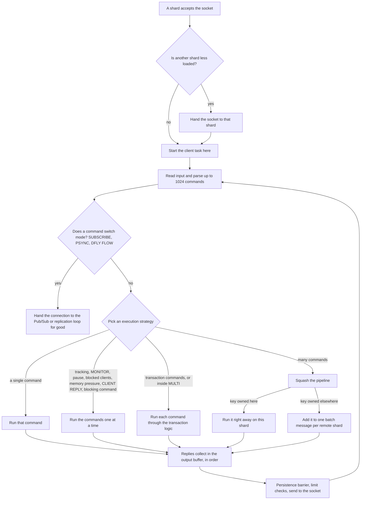
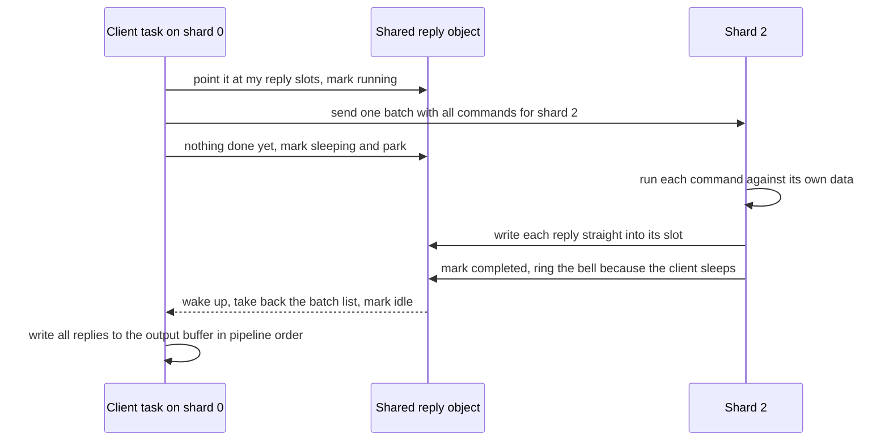

# Component 02: Connection Lifecycle & Command Execution — Implementation Reference

> **High-Level Design Spec**: [docs/design/02_connection_lifecycle.md](../design/02_connection_lifecycle.md)
> **Consolidated Implementation Spec**: [docs/internal/components.md](components.md)
> **Main source files**: src/connection.rs (the client loop, command checks and dispatch,
> transactions, pipelines, blocking waits, client bookkeeping, the Memcached gateway, slot
> migration); src/transport.rs and src/tls.rs (plaintext and TLS sockets); src/server.rs (accepting
> connections, crash isolation, the remote side of pipeline batches); src/conn_balance.rs (moving
> connections between shards); src/mailbox.rs (cross-shard reply objects); src/shutdown.rs;
> src/slowlog.rs; src/command_info.rs and src/command_docs.rs; src/debug_cmd.rs; src/router.rs
> (cross-shard atomicity); src/scripting.rs; src/config.rs. The [Code map](#17-code-map) lists the
> key symbols and the [Reference details](#18-reference-details) list exact constants and lists.

---

## 1. What this subsystem does

Every byte a client sends and every reply it gets back passes through this subsystem. It owns a
client from the moment its connection is accepted until the socket closes.

Rudis runs several **shards**: one CPU-pinned worker thread each, owning a slice of the keyspace
and running its own single-threaded event loop on io_uring (the Linux asynchronous I/O interface).
A connection is accepted by one shard and, from then on, served by that shard's thread. The keys
it asks for, however, usually belong to some other shard. This subsystem bridges that gap.

Its jobs, in the order a command meets them:

* **Accept** the connection, and possibly hand it to a less loaded shard.
* **Read and parse** input. RESP2/RESP3 arrays, inline commands and a few Memcached text commands
  all arrive on the same port.
* **Check** each command before it runs: authentication, permissions, cluster redirection, replica
  rules, persistence errors, memory limits, paused clients, scripts that run too long, and more.
* **Execute** it, either directly on this shard's data or by sending it to the owning shard.
* **Batch** pipelines, so all commands for one remote shard travel in one message and all shards
  work in parallel.
* Handle **transactions**, **blocking commands**, and the one-way **mode switches** into Pub/Sub
  or replication streaming.
* **Write** replies back with as few system calls as possible, while enforcing buffer limits and
  idle timeouts.
* Feed **observability**: command statistics, latency histograms, the slow log, error counters,
  MONITOR, CLIENT LIST and KILL, COMMAND introspection and DEBUG.

Its users are every client library (redis-cli, redis-py, memtier, Memcached clients) and the
other subsystems that need to know "which client is running this command": tracking, ACLs,
scripting and the blocking hub.

---

## 2. Mental model

One connection is one **task** on one shard thread. A task is a lightweight coroutine: it runs
until it has to wait for something, then yields so the thread can run other connections. The task
loops forever: read whatever has arrived, parse a batch of commands, pick a way to run them, run
them, and send the replies.



Six ideas explain most of this document:

* **Work in batches.** The loop reads as much as has arrived and parses up to 1024 commands (or
  1 MiB) at once. Everything after that — choosing a strategy, sending messages, writing to the
  socket — is paid once per batch, not once per command.
* **Check, then run.** Each command passes a fixed sequence of checks (§7.2) before it touches any
  data. A failed check writes a Redis-compatible error and the command never runs.
* **The request moves, not the data.** A command for a key owned by another shard is sent to that
  shard, which runs it on its own thread. The reply comes back through shared memory the requester
  set aside (Component 04 explains the mesh).
* **Reply order is pipeline order.** However commands are spread over shards, replies go out in
  exactly the order the client sent the commands.
* **Per-client context travels with the task.** Many helpers need to know "who is the current
  client" — its protocol version, selected database, user. Since many client tasks share one
  thread, that context is swapped in every time the task resumes and swapped out when it yields.
* **Some states turn batching off.** Features that need to see each command individually
  (MONITOR, client-side caching, CLIENT PAUSE, blocked clients, memory pressure) make the loop run
  commands one at a time.

Here is one cross-shard round trip from a pipeline:



---

## 3. Accepting a connection

### 3.1 Plaintext accept

**Why load balancing is needed.** Each shard opens its own listening socket on the same address
with `SO_REUSEPORT`, a Linux option that lets several sockets share one port; the kernel picks
which one gets each new connection by hashing its addresses and ports. For clients on the same
machine that hash is close to a random draw, and with only a handful of shards the result is very
uneven. So after accepting, a shard checks whether another shard is noticeably less busy and, if
so, gives the connection away.

Normally all shards listen on the shared base port. In cluster mode each shard listens on its own
port, the base port plus the shard number, so cluster-aware clients can reach the shard that
serves their slots.

For each accepted socket the shard:

1. Rejects it if protected mode forbids this peer (Redis' protection for servers with no password
   that are reachable from outside).
2. Sets the socket options: no Nagle delay, quick acknowledgements, and TCP keepalive. Keepalive
   uses the `tcp-keepalive` setting as idle time (300 s by default), probes every third of that,
   and gives up after 3 probes; 0 turns keepalive off.
3. Assigns a client id. Ids are unique across the whole process and encode where the connection
   came from: the shard number sits in the top bits, connections adopted from another shard use a
   separate range, and TLS connections another (exact layout in §18.5).
4. **Balances**, unless cluster mode is on. A global table counts the connections on every shard.
   The shard looks for the least loaded shard and, if it holds strictly more connections itself,
   reserves a place there with a single atomic compare-and-swap. If another accept beat it to
   that place it rescans, a few times at most. In cluster mode the client chose this shard's port
   on purpose, so the connection always stays.
5. If another shard won, the socket is turned back into a raw file descriptor (without closing
   it) and sent to that shard as an "adopt this connection" message. The target rebuilds the
   socket and runs exactly the same connection handler. Otherwise the handler starts here.

**Example.** Four shards hold 10, 3, 5 and 4 connections. A new connection lands on shard 0. The
least loaded shard is shard 1, and 10 is more than 3, so shard 0 reserves a place on shard 1 and
hands the socket over; the counts become 10, 4, 5, 4. Had the connection landed on shard 1, it
would have stayed.

**Crash isolation.** Every connection task runs inside a panic catcher. A panic in any command —
including the deliberate DEBUG PANIC — ends only that connection. The spawner logs it and bumps an
"isolated panics" counter. Cleanup guards (objects whose destructor undoes shared state) for the
client, a running EXEC and a blocked wait run during the unwind, so nothing is left registered.

This isolation covers connection tasks only. If a whole shard *thread* dies — it panics, or its
worker returns while no shutdown is under way — the shard supervisor reports it and the process
exits, so an outside supervisor restarts the server, which recovers from its AOF or RDB file. The
alternative would be worse: a shard that cannot serve its keys or answer messages leaves a process
that looks healthy but hangs every request routed to it.

### 3.2 TLS accept

The TLS accept loop performs the TLS handshake (with rustls) under a 10 second timeout, wraps the
stream in a TLS transport, checks protected mode, and starts the same generic connection handler.
TLS connections are **not** balanced across shards: they stay where the kernel put them.

### 3.3 One loop for both transports

The client loop is written once, generic over a small **transport** interface: read, read what
is already there, flush output, how other threads can push bytes to this client, split into
halves, and give up the raw TCP socket. The compiler produces a separate copy of the loop for each
transport, so plaintext connections pay nothing for TLS support.

| Concern | Plaintext | TLS |
| :--- | :--- | :--- |
| Reading | io_uring reads straight into the input buffer's free space; if a read fills it, keeps draining with non-blocking reads | decrypts into the input buffer; while MONITOR or tracking is in use anywhere, the read also watches the push queue |
| Writing | tries a non-blocking send first and hands any remainder to io_uring | encrypts (including queued pushes), then the same pattern |
| Pushes from other threads | written straight to the socket; dropped if the socket buffer is full | queued (up to 4096 messages) and encrypted by the owning task |
| Replication | allowed | refused, because the raw TCP socket cannot be extracted |

An **out-of-band push** is a reply produced on some other shard for this client: a MONITOR line or
a client-side-caching invalidation. TLS needs the queue because only the owning task may touch the
encryption state.

---

## 4. What each connection holds

| Concept | What it holds | Why it exists |
| :--- | :--- | :--- |
| Client record (`ClientInfo`) | id, address, name, protocol version, selected database, reply mode, buffer sizes, last command, how to push to the client | one per connection in a per-shard registry, read by CLIENT LIST, tracking and the command path |
| Shared counters (`ClientStats`) | bytes in and out, commands, reads, pipeline depth, killed flag, replica flag | atomics any thread can read or update |
| Process-wide registry | where to find any client of the node and how to reach it | CLIENT KILL, tracking redirection and MONITOR work across shards |
| Client context | protocol, database, client id, user and a few flags of the running command | lets deep helpers ask "who is the current client" |
| Connection scratch (`ConnScratch`) | input and output buffers, per-shard batch lists, reply slots | reused between connections to avoid allocation |
| Compact reply slot (`CompactResp`) | one reply, stored inline when small | the unit remote shards write back |
| Batch responder | coordination object for one cross-shard batch | lets a remote shard write replies straight into the requester's slots |
| Output buffer limits | hard and soft limits per client class | disconnect clients that do not read their replies |

### 4.1 The client record and the per-shard registry

Each shard keeps a map from client id to client record. Only the shard's own thread touches it,
so it needs no locks. The record holds what CLIENT LIST shows (address, name, library name and
version, age, idle time, last command, buffer sizes) plus what the command path needs: the
protocol negotiated by HELLO, the selected database, the CLIENT REPLY mode, whether the client is
a MONITOR, whether it sent READONLY (so a cluster replica may serve it reads for its master's
slots), its tracking inbox, its socket and how other threads push to it. The last command's name is
stored as a pointer to a static string, so tracking it costs no allocation per command. The full
field list is in §18.1.

The shared counters sit behind a reference-counted pointer shared with the process-wide registry.
One of them deserves a note: the **killed** flag is set by whoever first accounts the disconnect —
normal cleanup, CLIENT KILL, or the Pub/Sub output-limit closer. Only that party decrements the
global active-client count, so it is decremented exactly once.

### 4.2 The process-wide registry

Some operations must find a client on any shard: CLIENT KILL, tracking redirection, MONITOR. A
global map behind a read-write lock, keyed by (port, client id), stores what they need: the
socket, the push target, the tracking inbox, the protocol, the authenticated user, whether the
client is in Pub/Sub mode, and the shared counters. A lookup by id searches all ports of the node.

Cleanup removes a client from this registry **before** its socket closes. Otherwise another thread
could push to the old file descriptor number after the kernel had reused it for a new connection.

### 4.3 The current-client context

Many deep helpers (keyspace notifications, ACL checks in scripts, tracking, the "touch" bit for
LRU) need the current client's details. Passing them through every call would be unwieldy, so the
command path keeps them in thread-local variables: the reply protocol, selected database, client
id, whether BCAST tracking invalidations should be deferred until EXEC ends, CLIENT NO-TOUCH, the
ACL user, the set of clients whose EXEC is running, the shard's router, and a "replaying writes"
flag that makes expired keys count as live during AOF replay and when applying a master's writes.
§18.2 lists them by name.

The catch: client tasks on one thread interleave at every wait point, so a plain thread-local
would leak from one client to the next. The handler therefore wraps the whole client loop in a
**client scope** (`ClientScope`), a wrapper that, each time the task resumes, swaps the client's
own saved values into the thread-locals and swaps the previous values back when it yields.
Single-command and pipeline execution are further wrapped so that each resume also re-selects the
client's database on the shard's data (`WithCurrentDb`).

Code that runs outside a client task — a spawned background task, or a message handled on a remote
shard — sees no client context. Remote shards receive it explicitly in the batch message instead.

### 4.4 Pooled per-connection buffers

Each connection needs an input buffer (128 KiB to start), an output buffer (64 KiB), a batch
responder per shard, per-shard lists of commands to send, recycled list buffers, reply slots for
a squashed pipeline, and the parsed command batch. Allocating all of that for every short-lived
connection would be wasteful, so these live in one **connection scratch** object taken from a
per-thread pool and returned when the connection ends. §18.3 shows the layout.

A scratch object goes back to the pool **only if every responder in it is idle and nobody else
holds a reference** to it. A remote shard that still held one could otherwise write a late reply
into the next client's buffers; such a scratch is simply dropped. Before pooling, anything that
grew past 1 MiB or 1024 entries is shrunk, and the pool keeps at most 32 objects per thread.

### 4.5 Compact reply slots

Remote shards return replies as **compact reply slots**. Small replies — `+OK`, small integers,
bulk strings up to 20 bytes — are stored inline in a 30-byte buffer with no allocation; larger
ones hold a heap buffer or a shared byte slice. Ready-made constants cover the common replies (OK,
0, 1, null, empty array). The squashed pipeline's reply array is made of these slots. §18.5 lists
the variants.

### 4.6 The batch responder

When a pipeline sends commands to another shard, copying each reply into a message and sending it
back would be wasted work. Instead the requester gives the remote shard a pointer to its own reply
slots, and the remote shard writes each reply directly into its place. The **batch responder**
coordinates this. It moves through four states: idle, running, optionally sleeping, completed.

1. **Prepare.** The requester records where its reply slots are and how many there are, marks the
   responder running, and sends the batch.
2. **Write.** The remote shard writes each reply into its slot; the index is checked against the
   length, so a bad index panics rather than writing out of bounds.
3. **Finish.** The remote shard hands the list of commands back for reuse and marks the responder
   completed. It rings the requester's bell only if the requester had marked itself sleeping.
4. **Take.** The requester either polls for completion or switches the state from running to
   sleeping and parks on the bell until completed. Then the responder is idle again.

So a requester that never had to park costs the remote shard nothing more than one atomic swap.
Commands that crossed the slow-log threshold on the remote side are recorded on the side, so the
requester can log them with its own client's address.

Two lighter variants exist. Single-key remote GET and SET use small pooled request objects with
one value slot, a done flag and a bell. And "run this one command on shard N", used all over the
command code, sends a one-item batch with a pooled responder and a single reply slot on the
caller's stack. Component 04 describes all of these in depth.

### 4.7 Output buffer limits

A client that sends commands but never reads replies makes the server buffer them without bound.
Redis' `client-output-buffer-limit` caps this per **client class** — normal clients, replicas
and Pub/Sub subscribers — with a hard limit (disconnect at once) and a soft limit (disconnect if
exceeded continuously for some seconds). Defaults: normal clients are unlimited; replicas
256 MiB hard, 64 MiB soft for 60 s; Pub/Sub 32 MiB hard, 8 MiB soft for 60 s.

CONFIG SET accepts groups of four tokens (class, hard, soft, seconds), treats `slave` and
`replica` as synonyms, and accepts k/kb/m/mb/g/gb size suffixes. Because the normal class is
almost always unlimited, a single atomic flag records whether it has any limit; the hot path
checks only that flag and never takes the lock.

---

## 5. The client loop

### 5.1 Setup

When a connection starts, the loop:

1. Counts it as active. If that exceeds `maxclients` (10000 by default) it replies
   `-ERR max number of clients reached`, counts a rejected connection, and returns.
2. Creates the client's tracking inbox, registers the client in the process-wide registry, and
   adds its client record to the shard's registry.
3. Installs the **client cleanup guard** (`ClientCleanup`), which runs however the task ends. It
   decrements the active count (unless the killed flag shows someone already did), flushes the
   thread's command statistics, removes the client from both registries and from MONITOR, drops
   its Pub/Sub subscriptions here and on every other shard, unregisters tracking, clears its
   WATCHes, and unregisters it from the blocking hub if any blocked clients exist.
4. Takes a connection scratch and initialises the transaction state, the one-shot ASKING flag,
   and authentication: the client starts authenticated unless the default user needs a password,
   and its user is "default".
5. If AOF is on at this moment, captures per-shard AOF progress handles for the reply barrier
   (§5.4). This decision is made **once per connection** (see §15).

### 5.2 Each iteration

1. **Read.** Keep at least 16 KiB free in the input buffer, growing it in 64 KiB steps. Read
   through the transport, bounded by the idle `timeout` if one is set (Pub/Sub subscribers and
   MONITOR clients are exempt). A timeout or a closed socket ends the connection. If the previous
   batch stopped early with complete commands still buffered, skip the read.
2. **Parse a batch.** Parse commands one after another:
   * Each complete command joins the batch. The batch is marked **special** if a command must not
     be squashed (§6), or if the client is already inside MULTI.
   * QUIT discards the rest of the buffer and ends parsing.
   * At 1024 commands parsing stops; the rest waits for the next iteration.
   * On an incomplete command, if the batch is still small (fewer than 1024 commands and less than
     1 MiB consumed), do a non-blocking read and continue; otherwise leave the partial command for
     the next read.
   * **Query-buffer limit**: a single command, complete or partial, larger than
     `client-query-buffer-limit` (1 GiB by default, at least 1 MiB) closes the connection without
     a reply.
   * A parse error that is a "Protocol error" writes the error, flushes and closes, as Redis does.
     Any other parse error first runs the commands parsed so far (through the transaction logic if
     inside MULTI, which also marks the transaction failed), then appends the error and keeps
     parsing.
3. **Shutdown gate.** Register the batch as in flight with the shutdown coordinator. While a
   shutdown is draining, registration is refused; the loop sleeps in 10 ms steps and closes once
   the shutdown proceeds. This guarantees nothing is acknowledged after the final save.
4. **Mode switches** (only for special batches). While some command is SUBSCRIBE, PSUBSCRIBE,
   SSUBSCRIBE, PSYNC, SYNC or DFLY FLOW: run everything before it normally, check authentication
   and ACL permissions for the switching command (these commands never reach the normal checks of
   §7.2), flush, then hand the connection over (§8) and **return**. A replication switch first
   gives up its shutdown registration: the link lives as long as the replica, and a shutdown's
   drain must not wait for it.
5. **Choose an execution strategy** (§6) and run the batch into the output buffer. For a batch of
   several commands outside a transaction, the loop first counts the batch as a running write if
   it contains one (§10.3). If writes are paused at that moment, the batch is sent down the
   one-at-a-time path instead, where each command waits at the pause check.
6. If tracking is on, move pending invalidations from the tracking inbox into the output buffer.
7. **Output limit** (only when the normal class has a limit): record the output size; at or above
   the hard limit, close; at or above the soft limit for at least the configured seconds, close
   (the timer resets once back under). Such disconnects are logged and counted; the client simply
   sees the socket close.
8. **Flush**: run the AOF reply barrier (§5.4), then send. A write error closes the connection.
9. If the input buffer is empty, shrink it back.

When the loop exits, the scratch is recycled and the cleanup guard runs.

### 5.3 Worked example

A client sends one TCP segment holding `SET a 1`, `GET b` and `INCR c`. There are 3 shards and
this is shard 0; `a` belongs to shard 0, `b` to shard 2 and `c` to shard 1.

1. The read returns all three commands; none is special.
2. No tracking, MONITOR or pause is active, so the batch is squashed (§9).
3. `SET a 1` runs on shard 0 immediately. `GET b` goes into the batch for shard 2 and `INCR c`
   into the batch for shard 1.
4. Both batches are sent at once, so shards 1 and 2 work in parallel. Shard 0 waits for both.
5. The three replies are written in order — `+OK`, the value of `b`, `:1` — and leave in a single
   send.

### 5.4 AOF reply barrier

**Why.** A client that receives `+OK` for a write expects that write to survive what the
configuration promises. The barrier runs before every flush and makes sure the promise holds
before the reply leaves.

* Under `appendfsync always`, it fsyncs (forces to disk) every shard's AOF whenever any AOF append
  happened since this connection last checked.
* The rest applies only if AOF was on when the connection started (§5.1) and the batch contained
  writes (a write command, or EXEC, EVAL, EVALSHA or FCALL):
  1. Unless `appendfsync always` already did more, the writes are pushed to the kernel before the
     client sees the reply.
  2. If replicas are connected, it waits until every shard has streamed what it holds. Shards
     buffer replication bytes for a whole burst of messages and send them once; without this wait,
     an acknowledged write might not yet be in the stream when a WAIT or a failover reads the
     replication offset.

---

## 6. Execution strategies

The loop picks one of four ways to run a non-empty batch, checked in this order:

| # | When | How |
| :--- | :--- | :--- |
| a | the batch is special and the client is inside MULTI, or the batch contains MULTI, EXEC, DISCARD, WATCH or UNWATCH | every command through the transaction logic (§7.5) |
| b | any state that needs per-command handling (list below) | one command at a time |
| c | exactly one command | run it directly |
| d | otherwise | squash the pipeline (§9) |

Path (b) is taken when: the batch writes and writes are paused; CLIENT PAUSE is in effect; any
client uses tracking; any MONITOR client exists; blocked clients exist on this port; this shard is
over `maxmemory` (with a limit set); this client's CLIENT REPLY mode is not ON; or the batch is
special and contains a CLIENT or blocking command. The batch's running-write registration is
dropped first, because each command then registers itself at the pause check.

Why these states? Each needs to observe or act between individual commands: MONITOR and tracking
must see every command in order, a pause must stop each write, blocked clients must get a chance
to run before later replies go out, and eviction must run before each write.

In path (b), the replies so far are flushed before each blocking command (and before every command
while paused), because the command may suspend the task for a long time. Tracking invalidations
are also drained after each command, so they arrive before later replies.

In path (d), if normal clients have a hard output limit, the batch runs in chunks of 1, 2, 4, …
commands and stops once the output exceeds the limit. Otherwise up to 1024 large replies would all
be built before the limit is ever checked. The squashed batch stays counted as a running write
until it has been applied.

A command makes a batch special when squashing it would be wrong: mode switches, transaction and
blocking commands, commands that change connection state (HELLO, RESET, AUTH, CLIENT REPLY),
commands that change or cross databases (SELECT, MOVE, SWAPDB, FLUSHDB, FLUSHALL, COPY … DB), and a
few others; §18.6 has the full list.

---

## 7. Executing one command

Every path ultimately funnels commands that have no fast path into one function, `execute_command`.
It wraps the real body in the database re-selection wrapper from §4.3 and runs three phases: a
prologue, the checks (**gates**), and the dispatch to the command's handler, followed by an
epilogue.

**Writable replicas.** On a replica with `replica-read-only no`, clients may write keys of their
own. A replica normally leaves expiry to its master, but the master has never heard of these
keys, so the replica must expire them itself. Before each client write, the replica collects the
keys it writes (one atomic load when the feature is off), and afterwards hands them to their
owning shards to remember.

### 7.1 Prologue (before any gate)

Before any check, the command is set up:

1. Load the client's protocol, database, reply mode and counters into the current-client context.
   If an AOF rewrite is building its image, record the old state of keys the command may modify
   (SWAPDB needs no snapshot, because each shard's image follows the swap).
2. Mark this client as the one executing; on the way out, restore the previous value and count
   the command.
3. Arrange for the one-shot CLIENT CACHING yes/no flag to be reset after the command, except after
   CLIENT CACHING, CLIENT TRACKINGINFO and MULTI.
4. **Pause check** (§10.3). It returns a guard, held for the rest of the command, that counts a
   pausable write as running.
5. **Busy script.** If a script on this node has run past `busy-reply-threshold`, every command
   except a small allow-list (Redis' allow-busy set: AUTH, HELLO, harmless CLIENT subcommands,
   SCRIPT KILL, FUNCTION KILL, SHUTDOWN and a few more — §18.6) gets
   `-BUSY Redis is busy running a script. You can only call SCRIPT KILL ...` (or FUNCTION KILL for
   a function). This reply leaves before the command body, so the epilogue (§7.4) does not run.
6. Send the command to MONITOR clients, except MONITOR, RESET and QUIT themselves.
7. Start the timer for command statistics and the latency histogram. Commands that may block are
   not timed, since waiting is not execution time.
8. Count the write for snapshot triggers, for writes that do not count themselves on change.
9. If the slow log or latency monitor is enabled, remember the command and start time. When the
   command ends this records a latency event (1 ms or more), a slow-log entry, and large-request
   or large-reply entries (§12.2). QUIT, EXEC and COMMANDLOG are never slow-logged, nor MSET and
   MGET when the threshold is 10 ms or more.

### 7.2 Gate sequence

The gates run in a fixed order; the first that fails writes its error and the command does not
run. Order matters: a client that is not logged in should see `-NOAUTH`, not a redirect.

1. **Protected commands.** DEBUG and MODULE are refused unless `enable-debug-command` /
   `enable-module-command` allow this peer.
2. **Not enough replicas.** A write while `min-replicas-to-write` is unmet gets `-NOREPLICAS`.
3. **Authentication.** Until the client authenticates, everything except AUTH, HELLO and QUIT
   gets `-NOAUTH`.
4. **ACL.** The user must be allowed the command (including first-argument rules such as
   `+select|0`), every key with the needed read or write permission, and any Pub/Sub channels.
   Denials go to ACL LOG. Inside EXEC the reply is Redis' "ACLs rules changed between the moment
   the transaction was accumulated…" text. When no custom ACL exists and the user is "default",
   this gate costs nothing.
5. **ASKING.** ASKING sets a one-shot flag and replies `+OK`. Every other command reads and clears
   the flag (RESTORE … ASKING counts as asking).
6. **Cross-slot keys.** In cluster mode all keys of a command must share a hash slot, as in Redis
   Cluster. Outside cluster mode, with `cross-shard-strict yes` and more than one shard, all keys
   must live on one shard. Either way a violation gets `-CROSSSLOT`, instead of the command running
   across shards with weaker atomicity.
7. **Slot state** of the command's first key (in cluster mode, or when a gossip cluster is active):
   * The slot moved to another node: `-MOVED`.
   * The slot is being imported here: `-MOVED`, unless the client sent ASKING.
   * The slot is migrating away and the key is not here: `-ASK` to the target.
   * The slot is stable: if this node owns it (or the client sent READONLY, the command is a read,
     and this replica's master owns it) but a different local shard serves it, `-MOVED` to
     127.0.0.1 and that shard's port. If no shard here owns it, `-MOVED` to the live master that
     does, at that node's per-shard port when it announced several shards; if there is none,
     `-CLUSTERDOWN Hash slot not served`.
8. **Loading.** While a replica loads its master's dataset, commands outside an allow-list get
   `-LOADING`.
9. **Persistence errors.** Writes get `-MISCONF` while persistence is failing: an AOF write error,
   or the last RDB save failed with save points set and `stop-writes-on-bgsave-error yes`.
10. **Master down.** On a replica with `replica-serve-stale-data no` whose link to the master is
    down, only commands carrying Redis' "stale" flag (INFO, REPLICAOF, CONFIG, CLIENT, …) are
    served. The rest get `-MASTERDOWN Link with MASTER is down and replica-serve-stale-data is set
    to 'no'.` With the default `yes`, this gate is one relaxed atomic load. Commands of a running
    EXEC skip it.
11. **Read-only replica.** Writes on a replica with `replica-read-only` get `-READONLY`. Commands of
    a running EXEC skip this too: EXEC checked them when it started (§7.5), and they still run if
    the same transaction ran REPLICAOF.
12. **Memory.** Unless this is a replica with `replica-ignore-maxmemory`: under an evicting policy,
    evict keys until under `maxmemory` (except for CONFIG GET/SET and INFO); if still over, writes
    not flagged as allowed under OOM get `-OOM`. Under `noeviction`, first let the NVMe tier
    offload data and reject only if still over.

### 7.3 Dispatch

After the gates, the loop remembers how long the output was (so CLIENT REPLY can cut the reply
later) and matches on the command. Handlers come in two shapes.

**Specific handlers** have their own logic. Examples:

* **GET** reads locally (falling back to an NVMe read for tiered keys) or uses the remote GET
  object.
* **SET** has a direct path for a local unconditional SET when no AOF, replicas or keyspace
  notifications are active. Everything else evaluates the options: NX, XX, the compare options
  IFEQ, IFNE, IFDEQ and IFDNE (the last two compare a 16-hex-character digest), GET, KEEPTTL, and
  expiry times already in the past.
* **HELLO** negotiates RESP2 or RESP3, authenticates, and reports `server: valkey`,
  `version: 7.2.0`, and `mode: cluster` when relevant.
* CLIENT, EVAL/EVALSHA/FCALL, DEBUG, SLOWLOG, COMMAND, and the Memcached verbs (§13).
* **MGET and MSET** use the atomic cross-shard versions outside EXEC (§7.7). Inside EXEC the
  transaction's locks already keep cross-shard writers out, and taking them again would wait on
  itself.
* The cross-shard multi-key helpers for RENAME, COPY, LMOVE, SMOVE, MSETNX, BITOP and BLMOVE
  (§7.7).

**One shared handler** covers a long list of single-key commands — hashes, lists, sets, sorted
sets, streams, JSON, probabilistic types, vectors, OBJECT and XINFO subcommands, and more. It works
out which shard owns the key, runs the command on the local data if it is this shard, or sends it
to the owner and copies back the raw reply. If blocked clients existed before the command (and
this client is not inside EXEC), it sleeps 2 ms before replying, so clients woken by this command
reply first.

All of these meet in one shard-local executor (`execute_local_command`) that runs a command
against this shard's data. It is shared by this path, the squashed pipeline, the remote side of
pipeline batches, scripts and replication. Callers pass the shard's current AOF writer, which
lives in a swappable slot because CONFIG SET appendonly turns AOF on and off at runtime.

**Optional features.** The MCP.* commands exist only when built with the `mcp` cargo feature, and
XDP.* only with `xdp`. Without them the commands still parse but answer
`-ERR MCP is not compiled into this build (cargo feature mcp)` (and the XDP equivalent).

**Scripts** never span shards. If a script's declared keys live on several shards it gets
`-CROSSSLOT`. If they all live on another shard, the whole script is forwarded there and runs on
that shard. A script with no declared keys that touches a key owned elsewhere is redirected after
the fact.

### 7.4 Epilogue

After the handler:

1. **CLIENT REPLY.** If the client's mode at the start of the command was OFF or SKIP (and this
   is not CLIENT REPLY itself), the reply is cut off again; SKIP then reverts to ON. Errors from
   the gates were written before the cut-off point, so they are still sent.
2. The reply size goes to the slow-log tracker for large-reply logging.
3. If the reply is an error, its first word (for example WRONGTYPE) is counted for
   INFO errorstats. A script error is counted only once.

The handler's result tells the loop whether to close the connection after this reply: QUIT, a
CLIENT KILL of oneself, or a client that vanished while blocked.

### 7.5 Transactions

A transaction's state is three variables of the client loop: whether the client is inside MULTI,
the queue of commands, and whether queueing hit an error.

**Outside MULTI**, MULTI starts a transaction, WATCH and UNWATCH manage watched keys, EXEC and
DISCARD get `-ERR … without MULTI`, and everything else runs normally.

**Inside MULTI**, most commands are checked and queued rather than run:

| Command | Effect |
| :--- | :--- |
| MULTI | `-ERR MULTI calls can not be nested` |
| WATCH | `-ERR WATCH inside MULTI is not allowed` |
| UNWATCH | `+OK`, does nothing |
| DISCARD | clear the queue, unwatch, `+OK` |
| RESET | clear the queue, unwatch, reset name, protocol, database, MONITOR, no-touch, tracking, Pub/Sub and authentication, `+RESET` |
| QUIT | `+OK`, close |
| SAVE, BGSAVE, SHUTDOWN, unknown commands, a denied DEBUG | error, and the transaction is marked failed |
| anything else | checked now for ACL (`NOPERM`), a busy script (`-BUSY`, unless allowed while busy) and memory (a write over `maxmemory`, after eviction under an evicting policy, gets `-OOM`). A failure marks the transaction failed; otherwise the command is queued: `+QUEUED` |

**EXEC** refuses, before running anything, in this order (every refusal clears the queue and the
watches):

1. A script is running past its time limit: `-EXECABORT Transaction discarded because of: BUSY …`.
2. The server no longer accepts what the queue would do — Redis checks an EXEC like its writes. A
   queued command is refused by the master-down rule; or the queue writes and the server has
   become a read-only replica (READONLY) or lacks enough replicas (NOREPLICAS); or a queued write
   is refused for memory (OOM). The reply is `-EXECABORT Transaction discarded because of: <reason>`.
3. Queueing hit an error: `-EXECABORT Transaction discarded because of previous errors.`
4. Keys span slots in cluster mode, or shards under `cross-shard-strict`: `-CROSSSLOT`.
5. A watched key changed: a null array.

Otherwise it runs:

1. Wait out a write pause; the running-write guard is held until EXEC ends.
2. Unwatch all keys and work out the sorted list of shards the queued keys live on.
3. Arm the **EXEC cleanup guard** (`ExecCleanup`), so everything below is undone even on a panic.
4. If more than one shard is involved, take the **cross-shard transaction locks** on those shards
   in sorted order — sorting means two transactions can never wait on each other in a cycle — and
   then mark the transaction as a running cross-shard write (§7.7). These locks are called VLL
   locks in the code, after "very lightweight locking".
5. Pause wake-ups from the blocking hub, so a client blocked on a list does not run in the middle
   of the transaction.
6. If the queue holds more than one write, open a replication block so replicas receive the writes
   as one MULTI … EXEC (a single write is streamed alone, as Redis does).
7. Write the array header, mark the client as inside EXEC, defer BCAST tracking invalidations, run
   each queued command through the normal path, and close the replication block.

When the cleanup guard is dropped — normally or during a panic — it clears the in-EXEC mark,
sends the deferred invalidations, drops the cross-shard write mark **before** releasing the locks
(a reader that takes the locks next must not still see the write as running), and resumes the
blocking hub, replaying deferred list, sorted-set and stream wake-ups locally or on the owning
shard.

Inside EXEC, blocking commands return at once, CLIENT PAUSE does not stop individual commands,
cross-shard locks are not taken again, and the master-down and read-only gates are skipped
(EXEC's own step 2 covered them).

**WATCH bookkeeping.** WATCH needs to know when any write touches a watched key, so writes check a
node-wide map from (database, key) to the clients watching it, and mark those clients
**tainted**. Ports are normalised to the node's base port, so a watch works whichever shard port
the client used. Expired keys follow Redis:

* WATCH first expires each key that is past its TTL, so a stale key counts as absent and its
  later deletion changes nothing.
* EXEC expires every key the client watches before checking the taint flag: a key that expired
  since WATCH is deleted now, and that taints.
* A client's FLUSHDB, FLUSHALL or SWAPDB taints a watcher only if the watched key is live in an
  affected database. When a replica applies these from its master, it taints every watcher of the
  affected databases.

All of this sits behind one flag, so servers that never use WATCH pay one relaxed atomic load per
write.

### 7.6 Blocking commands

BLPOP, BRPOP, BLMOVE, BLMOVEM, BLMPOP, BZPOPMIN, BZPOPMAX, BZMPOP, and XREAD / XREADGROUP with
BLOCK all follow one pattern:

1. Try every key once, locally or on its owning shard. On success, reply; for a local pop, also log
   the equivalent non-blocking command to the AOF and replication stream.
2. If nothing was available and the client is inside EXEC, return a null array at once.
3. Install a guard that unregisters the client from the blocking hub when the wait ends, register
   a waiter on every key, and check the keys once more — this closes the race with a push that
   landed in between.
4. Wait for a result in slices of at most 20 ms. Between slices, check whether the client's socket
   has closed (a non-destructive peek), so a vanished client is noticed within about 20 ms. This
   check is skipped during shutdown, when the server itself half-closes sockets. A timeout replies
   null; CLIENT UNBLOCK … ERROR replies `-UNBLOCKED`.

The blocking hub itself is Component 06. WAIT and WAITAOF are not hub waiters, but CLIENT UNBLOCK
ends them too: when the hub has no such client, the replication code is asked, and the waiting
command returns at once — with what it has for TIMEOUT, or with `-UNBLOCKED client unblocked via
CLIENT UNBLOCK` for ERROR (Component 14).

### 7.7 Cross-shard multi-key commands

**Why.** Outside cluster mode, a command whose keys live on several shards still runs (unless
`cross-shard-strict` refused it, §7.2). Each shard applies its part on its own thread, so without
extra care another client could observe the command half done. Two mechanisms prevent that for the
commands that matter.

**Cross-shard transaction locks.** EXEC, cross-shard RENAME/RENAMENX/COPY (moved with DUMP and
RESTORE), LMOVE and SMOVE, MSETNX and BITOP take per-shard locks in shard order before touching
data. Inside EXEC they are already held. Each lock holder has a unique id, so a lock is never
released by someone else.

**Cross-shard write marks** form a **seqlock** for readers: a global count of running cross-shard
writers plus an epoch counter that every such write bumps when it starts and again when it ends.
Every locked writer above holds a write mark while it writes. A cross-shard MGET then:

1. Notes the epoch, failing if a writer is running.
2. Reads all shards without locks.
3. Keeps the result only if the epoch has not changed.
4. After 3 failed attempts, reads under the shards' locks instead.

A cross-shard **MSET** normally writes without locks, because locking every shard it touches
serialised all cross-shard MSETs. It takes a lock-free write mark; but if an MGET is currently
reading under the locks, the lock-free mark is refused and the MSET takes the locks instead. The
locked reader in turn waits for running lock-free writers to finish first, so it cannot starve.

**Example.** Two shards; `a` is on shard 0 and `b` on shard 1. Client X sends `MSET a 1 b 1` while
client Y sends `MGET a b`.

1. Y notes epoch 6 with no writer running.
2. X's write mark bumps the epoch to 7. X writes shard 0, then shard 1, and drops the mark: epoch 8.
3. Y read shard 0 before X's write and shard 1 after it, so it holds `nil, 1`.
4. Y sees epoch 8, not 6, throws the result away and reads again.

**Cross-shard LMOVE and SMOVE** (and RPOPLPUSH), under both shards' locks:

1. The source half runs on the source shard's thread. It pops the element without logging the pop.
2. The source shard sends the destination a one-item batch holding the push, marked to be
   replicated as the logical LMOVE or SMOVE instead.
3. The source thread spins until the destination answers, for up to 10 s.
4. The destination logs the logical command in its place among that key's writes.

This way no other write of the source shard can slip between the pop and the logical command in
the replication stream. `DEBUG CROSS-SHARD-MOVE-DELAY <µs>` inserts a sleep between the two
halves so tests can catch the middle.

**Cross-shard BLMOVE** loops: try the locked move; if the source is empty, register a *wake-only*
waiter (the source shard wakes the client without handing it an element, keeping one back from the
waiters behind it) and block for the rest of the timeout; on wake-up try the move again. The pop
and push therefore always run as one locked move, which replicas receive as one LMOVE or
RPOPLPUSH.

---

## 8. Mode switches

Some commands turn the connection into something else for the rest of its life.

* **Pub/Sub.** The client cleanup guard is disarmed and replaced by a Pub/Sub cleanup guard that
  takes over all cleanup. The transport is split into read and write halves. A writer task drains
  an unbounded queue of messages and writes them in batches of up to 256 KiB. The queue enforces
  the Pub/Sub output limit by bytes as messages are added; when a client goes over, the publishing
  shard shuts the socket itself. RESP2 subscribers may only run (P|S)SUBSCRIBE, (P|S)UNSUBSCRIBE,
  PING, QUIT and RESET; RESP3 subscribers may run anything. Query-buffer limits still apply. See
  Component 19.
* **Replication.** PSYNC and SYNC start a master-to-replica stream; DFLY FLOW starts a per-shard
  replication flow. The shutdown registration is released (§5.2 step 4), the client is marked as a
  replica, and the raw TCP socket is taken from the transport. On TLS that fails and the client
  gets `-ERR replication links are only supported on the plaintext port`. Beforehand, REPLCONF
  records the replica's capabilities (`capa eof`, `capa dual-channel`, and `rdb-channel` and
  `rdb-client-id` for dual-channel full sync). See Component 14.

---

## 9. Pipeline squashing

**Why.** A pipeline of 100 commands spread over 4 shards, run one by one, would make up to 100
round trips to other shards, each waiting for the last. Squashing groups the pipeline instead:
commands for this shard run immediately, and all commands for each remote shard travel in **one
message**, so every shard works in parallel and the client task waits once. The hard parts are
keeping replies in exact pipeline order and preserving each client's semantics.

### 9.1 Eligibility

Squashing applies only to authenticated clients, and the whole batch falls back to one-at-a-time
execution if any of these holds — usually because some per-command check would be due and the
squashed path does not run the gates:

* a replica is loading (`-LOADING` would be due);
* this is a replica and the batch writes: a read-only replica would owe `-READONLY`, and a
  writable replica must record the written keys (§7);
* persistence is failing (`-MISCONF` would be due);
* keyspace notifications are on and some command would notify differently when batched;
* when the user is not the plain default user, cluster mode is on, or slots have custom owners:
  the batch is special; a command fails the ACL check; a command's keys span slots (cluster) or
  span shards under custom owners (MGET, MSET, DEL, UNLINK, EXISTS and TOUCH excepted); a key is in
  a slot that is not stable or not owned here; or, in cluster mode, a keyless command outside a
  short allow-list (§18.6) appears.

**Cross-shard MGET and MSET** must stay atomic (§7.7) even inside a pipeline, so a batch involving
more than one shard is classified once:

| Batch contains | Effect |
| :--- | :--- |
| a cross-shard MGET plus any other kind of command | not squashed: re-reading the MGET after a conflict could move it after later commands |
| a cross-shard MSET | the whole batch holds a lock-free write mark while it runs; if that is refused (an MGET reads under locks), not squashed |
| only MGETs, some cross-shard | squashed as usual after noting the epoch (not squashed if a cross-shard write is running); checked at the end (§9.4) |

### 9.2 Phase 1: walk the pipeline

The reply array gets one slot per command. The loop also decides once whether **write fast
paths** are allowed: only when there is no AOF, no connected replica, and no keyspace
notifications, because fast paths skip all three. Then, for each command:

1. **Single-key commands.** The owning shard and the key's hash are computed together; the hash
   is reused later so the owner never hashes the key again.
   * **Remote:** append the command, its reply slot index and its hash to that shard's batch.
   * **Local:** record tracked reads; if a snapshot or AOF-rewrite image is being built, record the
     keys' old state first (fast paths write the table directly); bring tiered keys back into
     memory; then run an inline fast path if one matches, otherwise the shard-local executor.
     Fast paths exist for common reads (GET, single-key EXISTS/TOUCH, HGET, HMGET, SISMEMBER,
     LRANGE, ZRANGE, …) and, when write fast paths are allowed, common writes (SET, INCRBY, SADD,
     DEL, HSET, ZADD, LPUSH, …), with some extra conditions; §18.7 has the table. Every write
     fast path notifies WATCH and tracking when those features are active.
2. **Multi-key commands that fold.** These are split into one sub-request per key, each with an
   extra reply slot appended after the pipeline's own slots:
   * MGET becomes per-key GETs, assembled into one array at the end (a per-key error such as
     WRONGTYPE becomes nil, as MGET reports it).
   * Multi-key EXISTS and TOUCH, and DEL and UNLINK (with write fast paths and no search indexes),
     become per-key integer slots summed at the end.
   * MSET with write fast paths sets local pairs at once and turns remote pairs into SETs; its
     reply is `+OK` immediately.
3. **MSET without the fast path** first flushes pending batches, then starts a cross-shard MSET
   without waiting and finishes it at the end.
4. **Anything else** first **flushes the pending remote batches**, then runs normally into a
   temporary buffer. The flush is an ordering barrier: `SET k v` sent to a remote shard, followed
   by a command that reads `k` some other way, must see the SET. A few keyless commands (PING,
   QUIT, TIME, ECHO, PUBSUB HELP, FUNCTION STATS/KILL) need no barrier and run directly.

Commands for the same shard need no barrier between them: messages from one shard to another are
delivered in order, so they run in pipeline order anyway.

### 9.3 Phase 2 and 3: dispatch and harvest

1. For each shard with a non-empty batch: prepare that shard's batch responder with the reply
   array, swap in a recycled list for the next batch, send the batch, and remember the shard in a
   64-bit "pending" mask.
2. Optionally poll for completion a few times before parking (the `cross-shard-spin` setting,
   default 0: park at once, so the event loop serves other connections meanwhile).
3. Wait for each pending shard. The command lists that come back are cleared on this thread — so
   the memory of their keys is freed on the core that allocated it — and pooled for reuse.

**The remote side.** The receiving shard installs the requester's protocol, database, no-touch
flag, deferred-invalidation flag and client id as its own current-client context. For each command
it records snapshot images first when one is being built, then runs a mirror of the fast paths
(GET, SET, INCRBY, single-key EXISTS/TOUCH/DEL, … — only when no tracking clients exist, and for
writes only without AOF, replicas or notifications), or a script, or the shard-local executor. It
writes each result into its slot and reports slow commands. Tiered keys missing from memory are
read in a spawned task before the batch is marked complete.

A batch can carry a "replicate as" payload (only cross-shard moves set it, §7.7). Then the
commands' own replication is suppressed and that payload is streamed instead, flushed before the
requester is answered. More generally, each shard holds the replication bytes of a whole burst of
messages and streams them once. Those bytes are flushed before any message other than a plain data
message (single-key GET/SET, batches, MGET/MSET and their scatter variants), so a flush, a
full-sync cut or a cross-shard step always comes after them.

### 9.4 Phase 4 and 5: assemble

1. Read the values of local GETs that hit tiered (on-disk) keys.
2. Log remote slow commands with this client's address. Slots after the pipeline's own are parts
   of folded commands and are skipped.
3. Sum the folded integer commands from their slots and finish in-flight MSETs. If every command
   was an MSET, write the `+OK`s directly and stop here.
4. **MGET-only check.** If the batch was folded after noting the cross-shard epoch, and the epoch
   has since changed (a cross-shard write overlapped), throw the folded results away and read each
   MGET again, in order, with the atomic MGET.
5. Write the replies in pipeline order, reserving output space from each slot's estimated length
   up front; folded MGET arrays are written straight from their per-key slots.

Command statistics for squashed commands are recorded per segment: the time of a segment is split
across its commands, with two clock reads per segment. Local slow commands are timed individually
with the CPU cycle counter and logged.

### 9.5 Worked example

A pipeline arrives on shard 0 of 3: `SET a 1`, `EXISTS a b c`, `HSET h f v`, `INCR x`. Key `a` is
on shard 0, `b` and `x` on shard 1, `c` and `h` on shard 2. No AOF or replicas, so write fast paths
are on. The reply array starts with slots 0–3.

1. `SET a 1` is local: the fast path runs and slot 0 holds `+OK`.
2. `EXISTS a b c` folds. Slots 4, 5 and 6 are appended, each starting at `:0`. `a` is local, so slot
   4 becomes `:1`; `EXISTS b` joins shard 1's batch (slot 5) and `EXISTS c` shard 2's (slot 6).
   The loop notes that slot 1 is the sum of the three slots from 4 on.
3. `HSET h f v` is remote: it joins shard 2's batch (slot 2).
4. `INCR x` is remote: it joins shard 1's batch (slot 3).
5. Dispatch: one message to shard 1 (`EXISTS b`, `INCR x`) and one to shard 2 (`EXISTS c`,
   `HSET h`). Both run at the same time and write slots 5 and 3, and 6 and 2.
6. Slot 1 becomes the sum of slots 4–6 (say `:2`). The output is slots 0, 1, 2, 3.

Had the second command been `MGET a b c`, the batch would mix a cross-shard MGET with other
commands and run one command at a time instead (§9.1). A pipeline made only of MGETs is folded the
same way, with per-key GETs and the arrays assembled from the per-key slots.

---

## 10. Limits, timeouts and pauses

### 10.1 Query buffer

`client-query-buffer-limit` (1 GiB by default, at least 1 MiB) bounds the size of **one** command,
complete or partial. It protects against a client that sends an endless argument. Long pipelines
never trip it, because complete commands are consumed batch by batch. A breach closes the
connection silently and is counted in the query-buffer disconnection statistic.

### 10.2 Idle timeout and keepalive

`timeout` (default 0, meaning never) bounds each read, so idle clients are closed. Pub/Sub and
MONITOR clients are exempt, and blocked clients are not reading, so it does not apply to them
either. `tcp-keepalive` is applied at accept (§3.1).

### 10.3 CLIENT PAUSE

**What it does.** CLIENT PAUSE stops commands for a while — all of them, or only writes — so an
operator can, for example, switch clients to a new master without losing writes. A pause stores a
deadline and the mode; overlapping pauses merge (the later deadline wins, and the pause is
write-only only if both were). A paused command parks until the deadline or CLIENT UNPAUSE, which
wakes everyone.

CLIENT PAUSE, CLIENT UNPAUSE and QUIT are never paused. In write-only mode, writes, scripts that
are not read-only, PUBLISH, SPUBLISH, PFCOUNT, blocking pops and XREADGROUP are paused. EXEC pauses
as a whole, and its queued commands then run unpaused.

**Writes still running.** Pausing writes stops new ones at the check, but some may already be past
it. FAILOVER, and a shutdown that waits for replicas, need the replication offset to be final, so
the check also counts writes in flight:

* The count is spread over 64 cache-line-padded counters (each thread uses its own), so it is not
  one contended memory location; reading it sums them all.
* The pause check increments the count **before** looking at the pause, with sequentially
  consistent ordering on both sides. So a pause and a racing write always see each other: either
  the write waits, or whoever paused sees it running. A command that must wait gives its count
  back while it waits and takes it again on the next check.
* Only writes the pause would hold are counted, and not commands that may block: a blocked BLPOP
  changes nothing until some write serves it.
* A squashed batch never reaches the per-command check, so the client loop counts the whole batch
  if it has a write (§5.2 step 5) and, while writes are paused, sends it down the one-at-a-time
  path.

Once writes are paused and the count is zero, every acknowledged write has been applied and handed
to replication.

### 10.4 Shutdown

**Draining.** A shutdown first sets a "quiescing" flag and waits until every in-flight batch
(counted per shard when it registers, §5.2 step 3) has finished, so the final save sees every
acknowledged write. New batches wait at the gate. Replication links give up their registration
(§8), so they never hold up the drain.

The SHUTDOWN command:

1. SHUTDOWN ABORT cancels a shutdown that is waiting for replicas: `+OK`, or
   `-ERR No shutdown in progress.`
2. Otherwise a guard marks a SHUTDOWN as running. A SIGTERM or SIGINT arriving meanwhile stays
   pending and takes effect only if this one fails or is aborted, instead of starting a second
   shutdown beside it.
3. Unless NOW is given, wait for replicas to catch up (up to `shutdown-timeout`). If aborted
   meanwhile: `-ERR Errors trying to SHUTDOWN. Check logs.`
4. If AOF was turned on at runtime and is still writing its initial rewrite, refuse unless FORCE
   is given: the AOF files do not hold the dataset yet.
5. Save; a failed save refuses unless FORCE is given.
6. Request the shutdown, reply `+OK`, and close the connection.

SAVE, BGSAVE and SHUTDOWN cannot be queued inside MULTI.

---

## 11. Client registry operations

* **CLIENT KILL** supports the old form (an address) and the filter form (ID, TYPE
  normal|master|replica|slave|pubsub, USER, ADDR, LADDR, SKIPME, MAXAGE). Matching clients, from
  all shards, are marked killed (so the active count drops exactly once), their socket is shut down
  in both directions, and their blocked waiters are removed. Killing oneself closes the connection
  after the reply. TYPE master (or the master's address) drops a replica's link to its master.
* **CLIENT NO-TOUCH** stops this client's reads from updating LRU/LFU data. It is part of the
  client context (§4.3) and is forwarded to remote shards in batches and single-key requests.
* **CLIENT NO-EVICT** is accepted and ignored.
* **CLIENT UNBLOCK id [TIMEOUT|ERROR]** asks the port's blocking hub first, then the replication
  code (for a client in WAIT or WAITAOF); it returns `:1` if either found the client.
* **RESET** restores connection defaults (see the table in §7.5).
* **INFO clients**: `connected_clients` is the active count minus connected replicas (Redis
  reports those as `connected_slaves`). `blocked_clients` adds clients blocked in the hub, parked
  by CLIENT PAUSE, and waiting in WAIT or WAITAOF.

---

## 12. Observability

### 12.1 Command stats and latency

Updating shared statistics on every command would make all threads fight over the same memory.
Instead each thread accumulates per-command call counts, total time and a latency histogram
locally, and merges them into the global table every 1024 calls and when a client disconnects.
The histogram has 31 power-of-two microsecond buckets.

These feed INFO commandstats, INFO latencystats (percentiles from
`latency-tracking-info-percentiles`, default 50, 99 and 99.9, interpolated within a bucket) and
LATENCY HISTOGRAM. CONFIG is split into its subcommands (`config|get`, `config|set`,
`config|resetstat`, `config|rewrite`). Latency events for LATENCY LATEST/HISTORY/DOCTOR are
recorded when over `latency-monitor-threshold`. Error statistics (per error code, failed and
rejected calls per command, total error replies) come from the epilogue (§7.4) and from gates that
reject.

### 12.2 SLOWLOG and COMMANDLOG

Three process-wide ring buffers record slow commands, large requests and large replies. An entry
holds an id, a timestamp, the duration (or the size in bytes, for the large logs), the arguments,
the client's address and name, and the original argument count. Defaults are in §18.5.

When an entry is built:

* Secrets are hidden: CONFIG SET requirepass, ACL rules and similar are logged as `(redacted)`, and
  commands without an argument mapping are logged by name only.
* Long strings and long argument lists are truncated, with a note of how many bytes or arguments
  were left out.
* Arguments are copied, so entries do not keep the shared read buffer alive.
* Per-command slow statistics are updated.

SLOWLOG GET/LEN/RESET/HELP and COMMANDLOG GET <count> <type>/LEN/RESET/HELP (types SLOW,
LARGE-REQUEST, LARGE-REPLY) read the buffers newest first. The same file also hosts LOLWUT and a
SENTINEL stub that always errors.

### 12.3 MONITOR

MONITOR registers the client's push target. Every command (§7.1 step 6) is formatted and pushed to
every MONITOR client of the node. EXEC brackets its commands with `multi` and `exec` lines.

### 12.4 COMMAND introspection

COMMAND, COMMAND INFO, COMMAND DOCS and COMMAND LIST answer from a **generated** table built by
scripts/gen_command_docs.py from the Valkey command table plus Rudis-only commands. Each of its
469 entries holds pre-encoded RESP3 fragments and lines up with the ACL category table.

Not every entry is shown. The first time it is needed, the server decides which entries to list:
an entry is listed if it has docs, its parent command is listed, and the real parser accepts its
name. To test the last point it tries the name with zero to three dummy arguments, and counts any
answer other than "unknown command" as known.

COMMAND INFO returns null for unknown names, COMMAND DOCS skips them, and COMMAND LIST supports
FILTERBY ACLCAT and PATTERN (FILTERBY MODULE matches nothing). Replies are built in RESP3 and
converted for RESP2 clients. The full COMMAND and COMMAND DOCS replies are built once per protocol
and cached.

The same table answers whether a command carries Redis' "stale" flag, for the master-down gate
(§7.2): true if its info contains the flag, or if it is a container command (CONFIG, CLIENT, …)
whose flags live on its subcommands; unknown names are false.

### 12.5 DEBUG

DEBUG requires `enable-debug-command` to allow the client. Subcommands that concern the whole
server are handled in the command path and fan out to every shard through internal
pseudo-subcommands that clients cannot call. They include DIGEST, RELOAD, LOADAOF, POPULATE, SLEEP
(stalls every shard), OBJECT (shows the key as stored, so an expired key not yet deleted still
appears), replication helpers, CROSS-SHARD-MOVE-DELAY (§7.7) and PANIC (isolated as in §3.1).

Shard-level subcommands, HELP, PROTOCOL (Redis' RESP2/3 test values), ERROR and LOG are handled in
the DEBUG module. A list of Redis-internal subcommands (listpack, mallctl, htstats, …) is answered
`+OK` without effect, so Redis test suites run. Anything else gets
`-ERR unknown subcommand '...'. Try DEBUG HELP.` The full list is in §18.8.

---

## 13. Memcached gateway

There is no separate Memcached port or mode. A few Memcached text commands are recognised by the
ordinary parser, which looks at the first byte of input:

1. `*` starts a RESP array.
2. Otherwise, if the first line starts with `set`, `add` or `replace` **and** has at least five
   fields whose flags, expiry and byte count parse as numbers (`set k 0 0 5`), it is a Memcached
   storage command, and the parser waits for the data block that follows. `set k v` does not match
   and falls through.
3. Otherwise the line is split into words as an inline command and built with the same command
   table as RESP arrays. That table maps `delete k [noreply]`, `incr k <n> [noreply]` and
   `decr k <n> [noreply]` (with an amount), `stats` and `version` to Memcached commands. Plain
   `INCR k` and `DECR k` stay Redis commands. These names are recognised in RESP arrays too.

The Memcached handlers use the same keyspace and the same router calls as Redis commands:

* `set` stores the value with the expiry in seconds as TTL (flags are ignored) and replies
  `STORED`. `add` and `replace` check whether the key exists first — not atomically — and reply
  `STORED` or `NOT_STORED`.
* `delete` replies `DELETED` or `NOT_FOUND`. `incr` and `decr` follow Redis semantics: a missing key
  is created, and the `decr` reply is clamped at 0. `NOT_FOUND` is returned only on an error, such
  as a value that is not an integer.
* `stats` returns a few synthetic lines (pid, uptime, version, and `curr_items` = DBSIZE) and
  `version` returns `VERSION 1.6.0-rudis-dragonfly`.
* `noreply` suppresses the reply.

A Memcached `get k` is parsed as the Redis GET (one key only) and answered in RESP, not with
`VALUE … END`; `gets` is unknown; `quit` is the Redis QUIT (`+OK`). The command code still has
handlers for a multi-key Memcached get and a Memcached quit, but the parser never produces them.

---

## 14. Cluster slot migration helpers

**Moving keys to another node.** One helper moves a list of keys to a target node, used by MIGRATE
and by slot moves:

1. For each key, serialise it on its shard (DUMP) and read its absolute expiry.
2. Use the connection it was given, or connect to the target under the timeout.
3. Send ASKING followed by one `RESTORE key ttl payload [REPLACE] [ABSTTL]` per key, all in one
   write, and read one reply per command, each under the timeout.
4. Unless COPY was requested, delete a key only after its RESTORE returned `+OK`, and only if it
   has not changed since it was dumped.

It returns the number of keys stored or the first error. When every reply was read, the
connection is handed back for the next batch; after an error it is dropped, so the next call starts
on a fresh one. MIGRATE uses one connection per command; slot moves keep one connection for all
their batches.

**Rebalancing slots.** For each plan where this node is the source:

1. Mark the slot as migrating and tell the target `CLUSTER SETSLOT <slot> IMPORTING <my id>`.
2. Move its keys in batches (the pipeline size, clamped to 1–1000) over one connection, with a
   5 second timeout.
3. Tell the target `CLUSTER SETSLOT <slot> NODE myself`, mark the slot as moved, reassign it in the
   cluster state, bump the configuration epoch and refresh the peer.

Where this node is the target, it marks the slot as importing and takes it.
`CLUSTER MIGRATE-SLOT <slot> <host> <port>` moves one slot the same way, in batches of 100 keys
over one connection.

---

## 15. Invariants and gotchas

* **Reply order is pipeline order.** Squashing preserves it through in-order delivery per shard
  plus the flush of pending batches before any command that is not batched. New code that runs a
  command out of band inside the squashed loop must flush first.
* **The current-client context exists only inside a client task.** Code spawned outside it sees
  no client; remote shards get the context explicitly in the batch message.
* **Some features turn squashing off for everyone in scope.** Tracking, MONITOR, CLIENT PAUSE,
  blocked clients or memory pressure each disable squashing for every pipeline they affect
  (tracking and MONITOR are process-wide flags). Expect a throughput drop when a single client
  enables CLIENT TRACKING or MONITOR.
* **Write fast paths skip AOF, replication and keyspace notifications.** That is why they need all
  three off; with any of them on, writes go through the shard-local executor.
* **Four executors must be kept in sync by hand:** the specific handlers in the command path, the
  shard-local executor, the squashed fast paths, and the remote batch fast paths in the server
  loop. A change to a hot command such as SET must be mirrored in each; nothing enforces it.
* **Two cleanup guards, never both.** The Pub/Sub switch disarms the client cleanup guard and the
  Pub/Sub guard takes over all cleanup. Registry entries are always removed before the socket
  closes, so a reused file descriptor number never receives another client's pushes or kills.
* **The active-client count drops exactly once**, through the killed flag — whether by cleanup,
  CLIENT KILL or the Pub/Sub output-limit closer.
* **Scratch is recycled only with idle responders**; a connection torn down mid-batch drops its
  scratch instead of pooling it.
* **WATCH taint checks scan the whole watch map.** Each touched key iterates the per-port map, so
  the cost grows with the number of watched keys while any are watched.
* **Mode-switch commands skip the normal gates.** Their authentication and ACL checks live only in
  the mode-switch path (§5.2 step 4).
* **CLIENT REPLY OFF does not hide gate errors**, because they are written before the reply
  cut-off point.
* **SLOWLOG GET with no count returns every entry**, although its HELP text says the default is 10.
* **The shared single-key handler sleeps 2 ms** when blocked clients existed, to let woken clients
  reply first. That adds latency to such commands while anyone is blocked.
* **A cross-shard MGET in a mixed pipeline turns squashing off** for that batch (§9.1). Clients
  that pipeline cross-shard MGETs together with other commands get one-at-a-time execution.
* **The AOF/replication reply barrier depends on AOF at connection start.** Connections opened
  before CONFIG SET appendonly yes skip both the AOF write-through and the replication-stream flush
  before replies. Without AOF, the flush before replies never runs; WAIT, WAITAOF and cross-shard
  moves flush the streams themselves.
* **Count a running write before checking the pause** (both sequentially consistent). Any new path
  that runs writes without going through the pause checks makes the running-write count too low,
  and FAILOVER or a shutdown may then read a replication offset that is not final.
* **Every cross-shard write must hold a write mark**, from after the locks are taken until before
  they are released. A cross-shard write without one can be seen half applied by a lock-free MGET.
* **Commands of a running EXEC skip the master-down and read-only gates.** EXEC checks them once
  for the whole queue before anything runs, so a queue that runs REPLICAOF still finishes.
* **`-BUSY` leaves before the command body**, so it skips CLIENT REPLY handling and the error
  statistics of §7.4.

---

## 16. Limitations and not implemented

* **At most 64 shards for pipelines.** The pipeline path tracks pending shards in a 64-bit mask, so
  shard numbers of 64 or more would alias. The default shard count is the number of cores, up to
  8, but `threads` can be set higher and nothing caps it at 64.
* **CLIENT NO-EVICT** does nothing.
* **Memcached support is partial.** Only set, add, replace, delete, incr, decr, stats and version
  have Memcached-style replies. `get` answers in RESP and takes one key; gets, cas, append, prepend
  and touch are not implemented; flags are not stored; add and replace check then set (not
  atomic); incr creates missing keys; stats is mostly synthetic. The multi-key get and quit
  handlers are never reached.
* **No replication over TLS**, and TLS connections are not balanced across shards.
* **Scripts run on one shard**; key sets spanning shards get `-CROSSSLOT`.
* **Cross-shard atomicity is not universal.** EXEC, MGET, MSET and the key and element moves of
  §7.7 are isolated from each other, but other multi-key commands spanning shards (for example DEL
  or EXISTS of several keys) run per shard without isolation. `cross-shard-strict yes` refuses all
  of them instead.
* **A cross-shard element move blocks the source shard's thread**, spinning (and yielding) until
  the destination answers its push, for up to 10 s. If the destination never answers, the pop
  stays done and the push may be lost; the reply slot is leaked rather than freed.
* **Slot migration does not stop on failure.** If a key batch fails while rebalancing, the loop
  stops but the slot is still handed over, so keys not yet moved stay on the source and become
  unreachable through redirection.
* **Dead code.** An unused responder-channel type alias, and a results pool that is carried
  through the connection scratch and the squashed path but never used.
* **Squashed-path statistics double count.** A squashed batch adds its size to the client's
  command count after the call, while commands inside it that fell back to the normal path are
  counted again individually.

---

## 17. Code map

| File | Key symbols | What they do |
| :--- | :--- | :--- |
| `src/server.rs` | `accept_loop`, TLS accept loop, `catch_unwind_async`, `supervise_shard`, `ShardMessage::AdoptConnection` / `ShardMessage::Batch` / `ShardMessage::MoveElement` / `ShardMessage::RememberReplicaKeys` arms, `ADOPTED_CLIENT_SEQ`, `TLS_HANDSHAKE_TIMEOUT` | accept, socket options, client ids, hand-off, panic isolation, fatal shard death, remote batch execution |
| `src/conn_balance.rs` | `claim_owner`, `register_conn`, `unregister_conn`, `CONN_COUNTS`, `MAX_TRACKED_SHARDS`, `MAX_CLAIM_RETRIES` | per-shard connection census and least-loaded hand-off |
| `src/netsec.rs` | `protected_mode_denies`, `PROTECTED_MODE_DENIED` | protected-mode check at accept |
| `src/transport.rs` | `ClientTransport`, `PlainTransport`, `PushTarget`, `RecvBytesMut`, `recv_ready`, `MIN_READ_SPARE`, `PUSH_QUEUE_CAPACITY` | transport abstraction, zero-copy reads, send-then-io_uring flush |
| `src/tls.rs` | `TlsTransport` | TLS implementation of `ClientTransport` |
| `src/connection.rs` | `handle_connection`, `handle_client`, `handle_client_loop`, `ClientScope`, `ClientThreadLocals`, `ClientCleanup`, `inc_isolated_panics`, `ISOLATED_PANICS` | the client loop and per-client thread-local isolation |
| `src/connection.rs` | `ClientInfo`, `ClientStats`, `GlobalClientEntry`, `register_global_client`, `global_client_entry`, `GLOBAL_CLIENTS`, `ACTIVE_CLIENTS`, `MAX_CLIENTS` | client registries |
| `src/connection.rs` | `ConnScratch`, `take_conn_scratch`, `recycle_conn_scratch`, `trim_conn_scratch`, `CONN_SCRATCH_POOL` | pooled buffers |
| `src/connection.rs` | `execute_command`, `execute_command_inner`, `WithCurrentDb`, `ExecutingClientGuard`, `CachingResetGuard`, `CmdStatGuard`, `SlowlogTracker`, `record_reply_error_stat`, `writable_replica_write_keys`, `remember_replica_keys` | prologue, gates, dispatch, epilogue, writable-replica key tracking |
| `src/connection.rs` | `execute_local_command`, `target_shard_of_cmd`, `target_shard_and_hash_of_cmd`, `cmd_keys`, `cmd_primary_key`, `for_each_cmd_key`, `images_before_command` | shard-local executor and key/shard extraction |
| `src/connection.rs` | `execute_commands_squashed(_inner)`, `flush_remote_batches`, `write_mget_reply`, `notifies_same_when_batched`, `is_special_pipeline_cmd`, `batch_has_writes`, `take_doubling_chunk`, `CmdStatBatch`, `log_batched_slow` | pipeline squashing |
| `src/connection.rs` | `execute_tx_step`, `ExecCleanup`, `oom_refuses`, `watch_command`, `watch_failed`, `expire_if_needed`, `watched_keys_of`, `watch_keys`, `unwatch_keys`, `touch_watched_key`, `touch_watched_key_in_db`, `touch_live_watched_keys_on_swapdb`, `touch_watched_keys_on_flushdb` / `_flushall` / `_swapdb`, `is_watch_tainted`, `tx_has_cross_slot`, `in_tx`, `enter_tx`, `WATCHED_KEYS`, `CLIENT_WATCH_TAINTED`, `HAS_WATCHED_KEYS` | transactions and WATCH |
| `src/connection.rs` | `cross_shard_strict`, `set_cross_shard_strict`, `keys_on_several_shards`, `keys_span_shards`, `move_key_across_shards`, `move_element_across_shards`, `move_element_via_source`, `move_element_from_source`, `blmove_across_shards`, `msetnx_across_shards`, `bitop_across_shards`, `CROSS_SHARD_MOVE_DELAY_US` | cross-shard multi-key commands |
| `src/connection.rs` | `handle_bzpop`, `wait_for_blocked_result`, `wait_for_stream_result`, `recheck_blocking_keys`, `register_list_wake_waiter`, `is_fd_closed`, `BlockedClientGuard` | blocking commands |
| `src/connection.rs` | `run_pubsub_loop`, `PubsubCleanup`, `run_master_replica_stream`, `run_shard_replication_flow`, `mode_switch_denied`, `is_mode_switch_cmd` | mode switches |
| `src/connection.rs` | `acl_denied`, `acl_denied_in_context`, `acl_check_user_cmd`, `acl_key_perm`, `protected_command_denied`, `not_enough_good_replicas`, `persistence_misconf`, `allowed_while_loading`, `allowed_while_busy`, `masterdown_refuses`, `REPLICA_SERVE_STALE_DATA`, `evict_until_under_maxmemory`, `check_auto_tier` | gate helpers |
| `src/connection.rs` | `BufferLimit`, `ClientClass`, `NORMAL_BUFFER_LIMIT`, `SLAVE_BUFFER_LIMIT`, `PUBSUB_BUFFER_LIMIT`, `HAS_CUSTOM_BUFFER_LIMIT`, `set_client_output_buffer_limit_str`, `get_client_output_buffer_limit`, `client_output_limit_reached`, `client_query_buffer_limit`, `client_query_limit_reached`, `idle_read_limit`, `apply_tcp_keepalive`, `TCP_KEEPALIVE_SECS`, `CLIENT_IDLE_TIMEOUT_SECS` | limits and timeouts |
| `src/connection.rs` | `set_client_pause`, `unpause_clients`, `wait_if_client_paused`, `wait_if_tx_paused`, `should_pause_command`, `WriteRunning`, `WRITES_RUNNING`, `writes_running`, `enter_write_batch`, `counts_as_running_write`, `PAUSE_DEADLINE_MS`, `PAUSE_WRITE_ONLY`, `PAUSED_CLIENTS` | CLIENT PAUSE and running-write accounting |
| `src/connection.rs` | `CmdStat`, `record_cmd_stats`, `flush_local_cmd_stats`, `LOCAL_CMD_STATS`, `CMD_STATS`, `stat_cmd_name`, `record_error_stat`, `record_rejected_stat`, `record_latency_event`, `ERROR_STATS`, `FAILED_CMD_STATS`, `REJECTED_CMD_STATS`, `TOTAL_ERROR_REPLIES`, `SCRIPT_RECORDED_ERROR`, `connected_clients`, `WAIT_BLOCKED_CLIENTS` | stats |
| `src/connection.rs` | `broadcast_monitor`, `register_monitor_client`, `record_client_read`, `notify_key_invalidation` | MONITOR and tracking hooks |
| `src/connection.rs` | `aof_reply_barrier`, `aof_always_barrier`, `AOF_APPENDS` | durability before replies |
| `src/connection.rs` | `migrate_keys_to_node`, `execute_rebalance_plans`, `MigrateOpts`, `SLOT_MIGRATION_TIMEOUT` | slot migration |
| `src/mailbox.rs` | `BatchResponder` (`prepare`, `write_slot`, `report_slow`, `take_slow`, `finish`, `try_take`, `wait_take`, `is_idle`), `FastGetDescriptor`, `FastSetDescriptor`, `Doorbell`, `cross_shard_spin` | cross-shard reply delivery |
| `src/shard.rs` | `CompactResp`, `ShardMessage::Batch`, `aof_image_active`, `ShardDb::replica_local_keys` | reply slot type and batch message |
| `src/shutdown.rs` | `enter_batch`, `quiesce`, `BatchGuard`, `QUIESCING`, `INFLIGHT`, `ShutdownCommand`, `shutdown_command_running` | batch quiescing for shutdown; one shutdown at a time |
| `src/router.rs` | `XShardWriteGuard` (`locked`, `lock_free`), `xshard_read_begin`, `xshard_read_is_consistent`, `write_mget_resp_atomic`, `mset_atomic`, `next_tx_id`, `acquire_tx_locks`, `release_tx_locks_now`, `execute_remote`, `write_aof_through`, `del_if_unchanged`, `DEBUG_DIGEST_SHARD` | cross-shard write marks, atomic cross-shard MGET/MSET, VLL locks, remote execution |
| `src/replication.rs` | `wait_streams_flushed`, `TxStreamBlock`, `unblock_waiter`, `abort_shutdown`, `wait_replicas_before_shutdown` | replication hooks used by the client path |
| `src/pubsub.rs` | `SubscriberTx`, `close_client_over_output_limit` | Pub/Sub output queue and limit |
| `src/scripting.rs` | `busy_script_reply`, `kill_running_script`, `arm_script_redirect`, `take_script_redirect` | `-BUSY` gate, SCRIPT KILL / FUNCTION KILL, keyless-script redirect |
| `src/config.rs` | `RudisConfig::cross_shard_strict` | `cross-shard-strict yes\|no` config-file directive |
| `src/slowlog.rs` | `log_command_if_slow`, `log_command_if_large_request/reply`, `command_to_slowlog_argv`, `command_to_monitor_argv`, `handle_commandlog`, `SlowlogEntry`, `SLOWLOG_LOG_SLOWER_THAN` | SLOWLOG / COMMANDLOG / MONITOR formatting |
| `src/command_info.rs` | `listed`, `parser_knows`, `write_info`, `write_docs`, `write_list`, `write_count`, `resp3_to_resp2`, `serves_stale` | COMMAND introspection, `stale` flag lookup |
| `src/command_docs.rs` | `CmdDoc`, `DOCS` | generated pre-encoded command metadata |
| `src/debug_cmd.rs` | `execute_shard_debug`, `OK_SUBCOMMANDS`, `write_protocol`, `parse_reload_options` | DEBUG helpers |
| `src/resp.rs` | `parse_command`, `parse_resp_array`, `parse_memcached_storage_command`, `parse_inline_command`, `build_command` | protocol detection and parsing |

---

## 18. Reference details

### 18.1 Client record fields

`ClientInfo` lives in each shard's `client_registry: Rc<RefCell<HashMap<u64, ClientInfo>>>`.

| Field | Type | Meaning |
| :--- | :--- | :--- |
| `id`, `addr` | `u64`, `SocketAddr` | client id and peer address |
| `name`, `lib_name`, `lib_ver` | `Option<String>` | CLIENT SETNAME / CLIENT SETINFO |
| `connected_at`, `last_active` | `Instant` | for `age=` / `idle=` |
| `last_cmd` | `&'static str` | interned command name |
| `is_resp3` | `bool` | protocol negotiated by HELLO 3 |
| `db` | `usize` | selected database |
| `track_tx` | `Option<flume::Sender<Vec<u8>>>` | tracking-invalidation inbox |
| `raw_fd` | `RawFd` | socket, for disconnect polling and CLIENT KILL |
| `omem`, `qbuf_len`, `qbuf_cap` | `usize` | output and query buffer sizes for CLIENT LIST |
| `reply_mode` | `ClientReplyMode` | CLIENT REPLY ON/OFF/SKIP |
| `is_monitor` | `bool` | set by MONITOR (exempt from idle timeout) |
| `readonly` | `bool` | READONLY sent |
| `stats` | `Arc<ClientStats>` | counters shared with the global registry |
| `push` | `PushTarget` | how other threads reach this client |

`ClientStats` atomics: `tot_net_in`, `tot_net_out`, `tot_cmds`, `read_events`,
`pipeline_len_sum` / `pipeline_len_cnt` (average pipeline depth), `killed`, `is_replica`.

`GlobalClientEntry` (in `GLOBAL_CLIENTS: RwLock<HashMap<(port, client_id), GlobalClientEntry>>`):
`raw_fd`, `push`, `track_tx`, `is_resp3`, `auth_user`, `is_pubsub`, `stats`.

### 18.2 Thread-locals and the client scope

| Thread-local | Meaning |
| :--- | :--- |
| `CURRENT_CLIENT_RESP3` | reply protocol of the running command |
| `CURRENT_DB` | selected database of the running command |
| `CURRENT_CLIENT_ID` / `EXECUTING_CLIENT_ID` | who runs the command (`requesting_client_id()` reads them) |
| `DEFER_BCAST_FLUSH` | defer BCAST tracking invalidations until EXEC ends |
| `CLIENT_NO_TOUCH` | CLIENT NO-TOUCH: reads don't update LRU/LFU |
| `CURRENT_AUTH_USER` | ACL user that scripts are checked against |
| `TX_CLIENTS` | clients on this thread whose EXEC is running (`in_tx(id)`) |
| `CURRENT_ROUTER` | the shard's `Rc<Router>` (`set_current_router`) |
| `REPLAYING_WRITES` | set during AOF replay and master-write apply (`ReplayingWrites`): expired keys count as live |

`ClientScope` swaps these `ClientThreadLocals` on every poll: `resp3`, `db`, `client_id`,
`executing_client_id`, `defer_bcast_flush`, `no_touch`, `auth_user`.

### 18.3 Connection scratch layout

```rust
struct ConnScratch {
    buf: BytesMut,                                  // inbound bytes (starts at 128 KiB)
    out_buf: Vec<u8>,                               // outbound replies (starts at 64 KiB)
    responders: Vec<Arc<mailbox::BatchResponder>>,  // one per shard, index = shard id
    remote_batches: Vec<Vec<(usize, u64, Command)>>,// per shard: (slot idx, key hash, cmd)
    items_pool: Vec<Vec<(usize, u64, Command)>>,    // recycled batch Vecs
    results_pool: Vec<Vec<(usize, CompactResp)>>,   // carried but unused
    squashed_responses: Vec<CompactResp>,           // reply slots for a squashed pipeline
    commands: Vec<Command>,                         // parsed batch
}
```

Recycling requires `Arc::strong_count == 1 && is_idle()` for every responder.

### 18.4 Transport methods

| `ClientTransport` method | `PlainTransport` | `TlsTransport` |
| :--- | :--- | :--- |
| `read(buf)` | io_uring read into spare capacity (`RecvBytesMut`); if full, drains with `recv(MSG_DONTWAIT)` | decrypts into `buf`; races the push queue while MONITOR/tracking are in use |
| `read_ready(buf)` | one non-blocking `recv` (`recv_ready`) | decrypt what already arrived |
| `flush(out_buf, set_omem)` | non-blocking `send`, remainder via io_uring `write_all`; `set_omem` reports queued bytes | encrypt (plus queued pushes), then the same pattern |
| `push_target()` | `PushTarget::Fd(fd)`: other threads `send` to the fd, dropping on a full buffer | `PushTarget::Queue`: bounded flume channel of `PUSH_QUEUE_CAPACITY` |
| `into_split()` | split TCP halves | halves sharing the rustls session via `Rc<RefCell<...>>` |
| `into_tcp_stream()` | `Ok(stream)` | `Err(self)` |

### 18.5 Constants and settings

| Name | Value | Meaning |
| :--- | :--- | :--- |
| Client id | `(shard_id << 48) + n`; adopted: `(shard_id << 48) \| (1 << 47) \| n`; TLS: `(shard_id << 48) \| (1 << 46) \| n` | process-wide unique, encodes origin |
| `MAX_TRACKED_SHARDS` | 256 | shards in the connection census |
| `MAX_CLAIM_RETRIES` | 4 | rescans when the balance reservation races |
| `tcp-keepalive` (`TCP_KEEPALIVE_SECS`) | 300 s | probe interval idle/3 (at least 1), 3 probes; 0 disables |
| `TLS_HANDSHAKE_TIMEOUT` | 10 s | |
| `PUSH_QUEUE_CAPACITY` | 4096 | TLS out-of-band push queue |
| `maxclients` (`MAX_CLIENTS`) | 10000 | |
| `MIN_READ_SPARE` / `READ_BUFFER_SIZE` | 16 KiB / 64 KiB | free space kept before a read / growth step |
| `MAX_DRAIN_BATCH_CMDS` / `MAX_DRAIN_BATCH_BYTES` | 1024 / 1 MiB | batch size |
| `client-query-buffer-limit` (`CONFIG_CLIENT_QUERY_BUFFER_LIMIT`, `MIN_CLIENT_QUERY_BUFFER_LIMIT`) | 1 GiB, minimum 1 MiB | breach counted in `ClientQueryBufferLimitDisconnections` |
| `timeout` (`CLIENT_IDLE_TIMEOUT_SECS`) | 0 (never) | |
| Scratch initial sizes | input 128 KiB, output 64 KiB | |
| `SCRATCH_KEEP_BYTES` / `SCRATCH_KEEP_ITEMS` | 1 MiB / 1024 | trimmed before pooling |
| Scratch pool | 32 per thread | |
| Output limits (`NORMAL_` / `SLAVE_` / `PUBSUB_BUFFER_LIMIT`) | `0 0 0` / 256 MiB 64 MiB 60 s / 32 MiB 8 MiB 60 s | hard, soft, soft seconds |
| Shutdown gate sleep | 10 ms steps | |
| Blocked-client disconnect poll | 20 ms | `poll` + `MSG_PEEK` |
| Blocked-waiter reply delay | 2 ms | shared single-key handler |
| Pub/Sub writer batch | 256 KiB | |
| `cross-shard-spin` | 0 | polls before parking |
| Cross-shard MGET attempts (`XSHARD_READ_ATTEMPTS`) | 3 | then locked read |
| Cross-shard element move timeout | 10 s | |
| `WRITES_RUNNING` | 64 cache-padded counters | slot `n % 64` per thread |
| Command stats merge | every 1024 calls and on disconnect | |
| `LATENCY_BUCKETS` | 31 | power-of-two µs buckets |
| `latency-tracking-info-percentiles` | 50 99 99.9 | |
| `slowlog-log-slower-than` (`SLOWLOG_LOG_SLOWER_THAN`) | 10000 µs | < 0 disables |
| `slowlog-max-len` | 128 | |
| `slowlog-entry-max-argc` / `-max-string-len` | 32 / 128 | |
| `commandlog-request-larger-than` / `-reply-larger-than` | 1 MiB | < 0 disables |
| Large-request / large-reply log length | 64 | |
| `DOCS` entries | 469 | generated command metadata |
| `SLOT_MIGRATION_TIMEOUT` | 5 s | |
| Rebalance batch | pipeline size clamped 1–1000; MIGRATE-SLOT 100 | |
| HELLO | `server: valkey`, `version: 7.2.0` | |
| Memcached stats | `pid`, `uptime 3600`, `version 1.6.0-rudis-dragonfly`, `curr_items` | |

`CompactResp` variants: `Small { len: u8, data: [u8; 30] }`, `Big(Vec<u8>)`, `Bulk(Bytes)`,
`Array1Bulk(Bytes)`, `RawBytes(Bytes)`; constants `OK`, `INT_0`, `INT_1`, `NULL`, `EMPTY_ARRAY`,
and `CompactResp::null(is_resp3)`.

`BatchResponder` fields: `state: CachePadded<AtomicU8>` (`BATCH_IDLE` 0, `BATCH_RUNNING` 1,
`BATCH_SLEEPING` 2, `BATCH_COMPLETED` 3); `responses_ptr: AtomicPtr<CompactResp>` and
`responses_len: AtomicUsize`; `recycled_items: UnsafeCell<Option<Vec<(usize,u64,Command)>>>`;
`bell: Doorbell`; `slow: Mutex<Vec<..>>` and `has_slow: AtomicBool`. Single-key remote GET/SET use
`ShardMessage::FastGet` / `FastSet` with descriptors pooled by the `Router`.

`ShardMessage::Batch { db, items, responder, is_resp3, client_id, no_touch, defer_bcast,
replicate_as }`; the squashed path sends `replicate_as: None`. Messages that flush held
replication bytes: everything except `FastGet`, `FastSet`, `Batch`, `Mget`, `Mset` and the scatter
variants.

### 18.6 Command lists

**Special pipeline commands** (`is_special_pipeline_cmd`, never squashed): mode switches,
transaction commands, blocking commands, HELLO, RESET, AUTH, ACL, TIER, CONFIG GET/SET, DFLY
CLUSTER/MIGRATE, STICK/UNSTICK, Memcached stats/version/quit, QUIT, WAIT, WAITAOF, CLIENT REPLY,
and SELECT, MOVE, SWAPDB, FLUSHDB, FLUSHALL, COPY … DB.

**Mode switches** (`is_mode_switch_cmd`): SUBSCRIBE, PSUBSCRIBE, SSUBSCRIBE, PSYNC, SYNC, DFLY FLOW.

**Allowed while a script is busy** (`allowed_while_busy`): AUTH, HELLO, harmless CLIENT
subcommands, MULTI, DISCARD, WATCH, UNWATCH, QUIT, RESET, SELECT, REPLCONF, SCRIPT KILL, FUNCTION
KILL, FUNCTION STATS, SHUTDOWN.

**Keyless commands allowed in squashed cluster pipelines**: PING, QUIT, TIME, ECHO, READONLY,
READWRITE, COMMAND COUNT/LIST, LATENCY, PUBSUB HELP, FUNCTION STATS/KILL.

**Not paused in write-only mode** (`should_pause_command`): CLIENT PAUSE/UNPAUSE and QUIT are never
paused; in write-only mode writes, non-read-only scripts, PUBLISH, SPUBLISH, PFCOUNT, blocking pops
and XREADGROUP are.

**Blocking commands**: BLPOP, BRPOP, BLMOVE, BLMOVEM, BLMPOP, BZPOPMIN, BZPOPMAX, BZMPOP,
XREAD/XREADGROUP with BLOCK (pattern shown by `handle_bzpop`).

**Error replies by gate**: `PROTECTED_MODE_DENIED`; `-ERR max number of clients reached`; `-BUSY
Redis is busy running a script. You can only call SCRIPT KILL ...`; `-NOREPLICAS`; `-NOAUTH`;
`-NOPERM`; `-CROSSSLOT`; `-MOVED slot host:port`; `-ASK slot host:port`; `-CLUSTERDOWN Hash slot
not served`; `-LOADING`; `-MISCONF`; `-MASTERDOWN Link with MASTER is down and
replica-serve-stale-data is set to 'no'.`; `-READONLY`; `-OOM`; `-EXECABORT Transaction discarded
because of: <reason>`; `-EXECABORT Transaction discarded because of previous errors.`;
`-UNBLOCKED`; `-ERR replication links are only supported on the plaintext port`;
`-ERR No shutdown in progress.`; `-ERR Errors trying to SHUTDOWN. Check logs.`.

### 18.7 Squashed fast paths

| Fast path | Extra condition |
| :--- | :--- |
| GET (tiered miss deferred to `local_cold_gets`) | — |
| EXISTS/TOUCH (1 key), HGET, HMGET, SISMEMBER, SMISMEMBER, ZMSCORE, LRANGE, ZRANGE | — |
| unconditional SET, INCRBY family, SADD, SPOP (no count), ZPOPMIN (no count), SREM, ZREM, LPOP, RPOP | write fast paths |
| DEL/UNLINK (1 key), HSET, HDEL | write fast paths and no search indexes |
| ZADD, LPUSH, RPUSH | write fast paths and no blocked waiters |

Write fast paths (`write_fast_path`) = no AOF, no connected replicas, keyspace notifications off.
Every write fast path calls `touch_watched_key` and `notify_key_invalidation` when the feature is
active. Folded MGET replies are written by `write_mget_reply`; folded integer sums are tracked as
`folded_int_sums` entries `(pipeline idx, first extra slot, count)`. Cold local GETs are read by
`router.stream_cold_read_local`; reply space is reserved from `CompactResp::estimated_len`.

### 18.8 DEBUG subcommands

Whole-server (in `execute_command`, fanned out through `router::DEBUG_DIGEST_SHARD` =
`__shard-digest`, `__shard-loadaof`, `__shard-populate`, `__shard-flush`): DIGEST, DIGEST-VALUE,
RELOAD [MERGE|NOFLUSH|NOSAVE], LOADAOF, POPULATE count [prefix] [size], SLEEP, OBJECT (runs under
`ReplayingWrites`), PAUSE-CRON, SET-ACTIVE-EXPIRE, SET-ALLOW-ACCESS-EXPIRED, CHANGE-REPL-ID,
REPLICATE (sent to replicas only), STRINGMATCH-LEN (fuzzes the glob matcher),
CROSS-SHARD-MOVE-DELAY <µs> (sets `CROSS_SHARD_MOVE_DELAY_US`; 0 disables), PANIC.

Shard-level (`execute_shard_debug`): the shard parts of the above, plus HELP, PROTOCOL <type>,
ERROR, LOG, and `OK_SUBCOMMANDS` (listpack, mallctl, htstats, …) answered `+OK`.
