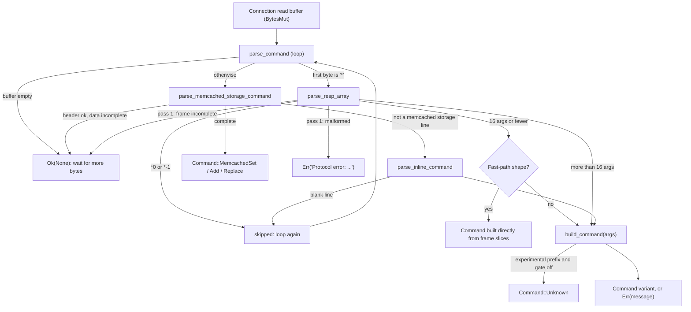

# Component 03: RESP Protocol Engine & Command Parser — Implementation Reference

> **High-Level Design Spec**: [`docs/design/03_resp_engine.md`](../design/03_resp_engine.md)
> **Consolidated Implementation Spec**: [`docs/internal/components.md`](components.md)
> **Main source file**: `src/resp.rs` (framing, the `Command` enum, `build_command`, numeric
> helpers, write-classification helpers). Reply encoding lives in `src/connection.rs`
> (`write_resp_*`), with Pub/Sub push frames in `src/pubsub.rs`. Fuzz target:
> `fuzz/fuzz_targets/parse_command.rs`.

---

## 1. What this subsystem does

Every byte a client sends to Rudis passes through this module before anything else happens.
Its job is to turn a raw, possibly incomplete stream of bytes into a typed Rust value — one
`Command` enum variant per request — that the rest of the server (routing, sharding, storage,
replication, AOF) can match on without ever re-reading strings.

Who uses it:

- **Client connections** (`src/connection.rs`): the main request loop, the Pub/Sub-mode loop and
  the master-side replica-ACK reader.
- **Replication and persistence**: a replica decoding its master's stream
  (`src/replication.rs`), AOF replay and AOF-rewrite splitting (`src/aof.rs`), and legacy
  search-index records in snapshots (`src/table.rs`).
- **The AF_XDP kernel-bypass path** (`src/server.rs`): payloads pulled out of raw packets.

It understands three wire grammars on the same port:

1. **RESP arrays** (REdis Serialization Protocol): `*<N>\r\n` followed by `N` bulk strings
   `$<len>\r\n<bytes>\r\n`. This is what every real Redis client library sends.
2. **Memcached text storage commands**: `set|add|replace <key> <flags> <exptime> <bytes>
   [noreply]\r\n<data>\r\n`.
3. **Inline commands**: one space-separated text line such as `GET foo\r\n`, the form typed into
   `telnet`/`nc`, with `redis-cli`-style quoting.

The module only **parses**. It never writes reply bytes and never looks at whether a client
negotiated RESP2 or RESP3 — that only affects reply encoding, which happens in
`src/connection.rs`.

## 2. Mental model

Think of it as a two-stage pipeline: a **framer** that finds one complete request in the buffer
and slices out its arguments, and a **constructor** (`build_command`) that maps the
upper-cased command name plus arguments to a `Command` variant, validating arity and options on
the way. The very hottest command shapes skip the constructor entirely.



The returned value is always `Result<Option<Command>, String>`:

| Result | Meaning | Caller's reaction |
| :--- | :--- | :--- |
| `Ok(Some(cmd))` | One complete command was consumed from the buffer | Execute it, call again |
| `Ok(None)` | The buffer holds only a partial request (or nothing) | Read more bytes |
| `Err(msg)` starting with `Protocol error:` | The byte stream itself is broken; nothing was consumed | Send the error, close the connection |
| `Err(msg)` otherwise | The frame was consumed but the command is invalid (arity, syntax, range) | Send `-ERR ...`, keep going |

## 3. Data structures

### 3.1 `enum Command`

`Command` is the single currency of the server: roughly 380 variants, one per command or command
family. It derives `Debug, PartialEq, Clone` — not `Eq`, because several variants carry `f64`
scores or `f32` vectors.

```rust
pub enum Command {
    Get(Bytes),
    Set { key: Bytes, value: Bytes, expire_in: Option<Duration>,
          condition: SetCondition, get: bool, keepttl: bool, past_expired: bool },
    Del(SmallVec<[Bytes; 1]>),        // inline capacity 1: single-key DEL never allocates
    Unlink(SmallVec<[Bytes; 1]>),
    IncrBy(Bytes, i64, IncrName),     // INCR/DECR/INCRBY/DECRBY as a signed delta
    Hset { key: Bytes, fields: SmallVec<[(Bytes, Bytes); 1]> },
    Hello { proto: Option<i64>, auth: Option<(String, String)>, setname: Option<String> },
    FtSearch { index: String, query: String, options: Box<crate::search::SearchOptions> },
    McpRpc(Bytes),
    Debug(Vec<Bytes>),                // raw-args variant: executor parses the rest
    MemcachedSet { key: Bytes, flags: u32, exptime: u32, bytes: usize, noreply: bool, data: Bytes },
    Unknown(String),
    // ... ~370 more
}
```

Design points worth knowing:

- **Arguments are `bytes::Bytes`.** A `Bytes` is a reference-counted view into a shared buffer;
  cloning or slicing it is O(1) and copies no data. The framer hands out slices of one per-frame
  buffer (see §4.3).
- **Size is capped at compile time.** Every pipelined command is moved several times (parse
  vector, per-shard batches, the remote shard's drain), so `resp.rs` contains
  `const _: () = assert!(std::mem::size_of::<Command>() <= 184);`. Rarely used variants keep
  under that budget by boxing their large fields — e.g. `FtSearch`/`FtAggregate` box
  `SearchOptions`, `Zrangestore` boxes `ZRangeOpts`, `Xclaim` boxes its ID list, `Xadd` boxes
  its idempotency option, `Xreadgroup` and `Lmovem` box optional fields, and `SemanticSet`'s
  vector is a `Box<Vec<f32>>`. A new variant that breaks the budget fails the build.
- **`SmallVec<[T; 1]>`** (a vector with one inline slot) is used for the common single-key or
  single-field forms of `DEL`, `UNLINK`, `EXISTS`, `TOUCH`, `HSET`, `HDEL`, `SADD`, `SREM`,
  `ZADD`, `ZREM`, `LPUSH`, `RPUSH`, so they parse without a heap allocation.
- **Raw-args variants.** Commands whose grammar is owned by another module are stored unparsed as
  `Vec<Bytes>`: `Debug`, `Slowlog`, `Commandlog`, `Lolwut`, `Sentinel`, `Replconf`, `ConfigGet`,
  `Subscribe`, `Watch`, `Stick`, and similar.
- **Borrowed types from other modules.** Variants embed types defined elsewhere rather than
  duplicating them: `crate::table::ZAddFlags`, `ZRangeOpts`, `StreamId`, `StreamTrimStrategy`;
  `crate::block::ClientUnblockType`; `crate::search::SearchOptions`/`Reducer`;
  `crate::vector::VQuant`/`VectorMetric`; `crate::xdp::XdpAction`.
- **`Unknown(String)`** is what `build_command` returns for a name it does not recognise (and
  for experimental commands while they are disabled, §4.6). The executor replies
  `-ERR unknown command '<name>'`. A few arms deliberately produce `Unknown` with a synthetic
  string such as `"CONFIG HELP"` or `"OBJECT <sub>"` that the executor special-cases.

The enum body is grouped by section comments (`// LIST COMMANDS`, `// ZSET COMMANDS`,
`// STREAM COMMANDS`, `// VALKEY EXTENDED COMMANDS`, `// VECTOR COMMANDS`,
`// AI SEMANTIC CACHE COMMANDS`, `// AI AGENT MEMORY COMMANDS`, `// LLM QUOTA GOVERNOR
COMMANDS`, `// AGENT CHECKPOINT & IDEMPOTENT TOOL EXECUTION COMMANDS`, `// MODEL CONTEXT
PROTOCOL (MCP) COMMANDS`, `// CRDT MULTI-REGION COMMANDS`, `// REDIS 7 FUNCTIONS`,
`// REDISJSON COMMANDS`, `// GEOSPATIAL COMMANDS`, `// PROBABILISTIC COMMANDS`,
`// Full-Text Search (FT.*)`, `// AF_XDP & eBPF (XDP.*)`, `// Dragonfly native extensions`,
`// Memcached Protocol`, and others). Variants above the first section comment form an unlabeled
prelude: `OBJECT`/`XINFO`/`LATENCY`/`COMMAND` wrappers, hash-field TTLs, `XCLAIM`/`XAUTOCLAIM`,
`AUTH`, `GET`/`SET`/`MSETEX`, `DEL`/`UNLINK`/`EXISTS`, `CLUSTER`/`CLIENT`, `WAIT`, `MIGRATE`,
and the basic hash commands.

### 3.2 Subcommand and option types

Multi-verb commands wrap their verbs in a dedicated enum carried by one `Command` variant. All
live at the top of `src/resp.rs`:

| Type | Carried by | Variants (abridged) |
| :--- | :--- | :--- |
| `ClusterSubcommand` | `Command::Cluster` | `KeySlot`, `Slots`, `Shards`, `Nodes`, `SetSlot(u16, SetSlotSubcommand)`, `AddSlots[Range]`, `Meet`, `Failover { force }`, `Reset { hard }`, `Rebalance {..}`, `Reshard {..}`, `BumpEpoch`, `SetConfigEpoch`, `FlushSlots`, ... |
| `SetSlotSubcommand` | `ClusterSubcommand::SetSlot` | `Migrating`, `Importing`, `Stable`, `Node` |
| `DflyClusterSubcommand` / `DflyMigrateSubcommand` | Dragonfly-compatible cluster/migration | `Config`, `GetSlotInfo`, `FlushSlots`, ... / `Init`, `Flow`, `Ack` |
| `ClientSubcommand` | `Command::Client` | `List`, `Info`, `SetName`, `Kill`, `Tracking {..}`, `Caching`, `Unblock {..}`, `Pause`, `NoEvict`, `SetInfo`, `Reply(ClientReplyMode)`, ... |
| `AclSubcommand` | `Command::Acl` | `List`, `Users`, `GetUser`, `SetUser`, `DelUser`, `WhoAmI`, `Cat`, `GenPass`, `DryRun`, `Log`, `LogReset`, `Save`, `Load`, `Help` |
| `MemorySubcommand` | `Command::Memory` | `Usage`, `Stats`, `Purge`, `Doctor`, `Defrag`, `MallocStats` |
| `TierSubcommand` | `Command::Tier` | `Spill`, `Load`, `Info`, `SpillAll`, `Cool`, `Decommit`, `Gc`, `Snapshot(PathBuf)` |
| `LatencySubcommand`, `ObjectSubcommand`, `XinfoSubcommand` | `LATENCY`, `OBJECT`, `XINFO` | the respective Redis verbs |
| `SetCondition` | `Set` | `None`, `Nx`, `Xx`, `Ifeq`, `Ifne`, `Ifdeq`, `Ifdne` (compare-and-set on value or digest) |
| `MsetexCondition` / `MsetexExpiry` | `Msetex` | `None/Nx/Xx` / `None`, `KeepTtl`, `ExpireIn(Duration)` |
| `IncrexIncrement` / `IncrexBound` / `IncrexExpire` | `INCREX` | int-or-float delta and bounds; `Ex/Px/Exat/Pxat/Persist` |
| `HexpireCondition` / `HFieldExpireOpt` / `HsetexCondition` | hash-field TTL commands | `NX/XX/GT/LT`; `Persist`, `KeepTtl`, `ExMs`, `ExAtMs`; `Fnx/Fxx` |
| `ExpireOptions` (struct) | `Expire` | `nx`, `xx`, `gt`, `lt` booleans, validated by `parse_expire_options` |
| `BitfieldSubOp` (struct) + `BitfieldOpType`, `BitfieldOverflow` | `BITFIELD` | one `GET/SET/INCRBY` op with sign, width, offset, overflow mode |
| `LmovemMode` / `LmovemOrdering` | `LMOVEM` | `Count/Exactly`; `Obo/Bulk` |
| `VsimTarget` | `VSIM` | `Element(Bytes)` or `Vector(Vec<f32>)` |
| `XnackMode` | `XNACK` | `Silent`, `Fail`, `Fatal` |
| `IncrName` | `IncrBy` | which of `INCR/DECR/INCRBY/DECRBY` the client typed (kept for ACL, stats, MONITOR) |

One exception to the wrapper-enum convention: `XDP.RULE ADD|DEL|LIST` produces three separate
top-level variants (`XdpRuleAdd`, `XdpRuleDel`, `XdpRuleList`).

### 3.3 Module-level state

| Item | Type | Meaning |
| :--- | :--- | :--- |
| `PROTO_MAX_BULK_LEN` | `static AtomicUsize`, default 512 MiB | Largest bulk string (and memcached data block) a client may send. Set by `CONFIG SET proto-max-bulk-len` via `set_proto_max_bulk_len`. Also bounds bit offsets in `SETBIT`/`GETBIT`/`BITFIELD` (offset `>> 3` must be below it). |
| `DETACH_FRAME_MAX` | `const usize` = 64 KiB | Frames (or, for >16-arg commands, single arguments) up to this size are copied into their own allocation instead of sliced from the read buffer (§4.3). |
| `TRUSTED_INPUT` | `thread_local Cell<bool>` | Set only while `parse_command_trusted` runs; disables the `proto-max-bulk-len` check for the server's own data. |
| `EXPERIMENTAL_COMMANDS` | `static AtomicBool` | Gate for non-Redis command families (§4.6). Defaults to `false` in builds and `true` under `cfg(test)`. Set at startup from `enable-experimental-commands` (`main.rs` calls `set_experimental_commands`). |
| `EXPERIMENTAL_PREFIXES` | `const &[&str]` | `JSON.`, `BF.`, `CF.`, `CMS.`, `TOPK.`, `FT.`, `SEMANTIC.`, `CRDT.`, `LLM.`, `MCP.`, `XDP.` |
| `MAX_RANDOM_REPEATS` | `const i64` = 2^20 | Most elements a negative (repeating) `SRANDMEMBER`/`HRANDFIELD`/`ZRANDMEMBER`/`VRANDMEMBER` count may request; checked by `parse_random_count`. |

## 4. Algorithms

### 4.1 `parse_command`: the entry point

1. If the buffer is empty, return `Ok(None)`.
2. If the first byte is `*`, call `parse_resp_array`.
3. Otherwise call `parse_memcached_storage_command`. It returns a three-level result:
   `Ok(None)` = "not a memcached storage line, try inline"; `Ok(Some(None))` = "it is one, but
   the data block hasn't fully arrived — wait"; `Ok(Some(Some(cmd)))` = complete. The middle
   case stops a half-received `set k 0 0 1024\r\n<200 bytes>` from being misread as inline text.
4. If that returned `Ok(None)`, call `parse_inline_command`.
5. The array and inline parsers set a `skipped` flag when they consumed a frame that carries no
   command (`*0`, any `*-N`, or a blank/whitespace-only inline line). `parse_command` then
   **loops** back to step 1. It loops rather than recursing because a peer can send millions of
   such 2-byte frames; recursion overflowed the stack.

`parse_command_trusted` is the same function wrapped in `TRUSTED_INPUT = true`. AOF replay
(`replay_aof_inner`), AOF-rewrite splitting (`split_rewritten_aof_to_shards`) and the replica's
master stream (`run_replica_worker`) use it, because that data was accepted earlier, possibly
under a higher `proto-max-bulk-len`, and refusing it would leave a server unable to load its own
AOF or follow its master after the limit was lowered.

### 4.2 Line endings: `find_newline` / `find_newline_at`

Both return `(line_end, advance_len)`: the index where the line's content stops and how many
bytes to consume. They search for `\n` and treat a preceding `\r` as part of the terminator, so
**header lines accept either CRLF or bare LF**. Bulk-string data is different — its trailing
terminator must be exactly `\r\n` (§4.3). The memcached parser additionally requires its header
line to end in CRLF; a bare-LF line is not considered a memcached command. The search is a plain
byte scan used only on short headers, never on payload data.

### 4.3 `parse_resp_array`: two passes, then fast path or generic path

**Header.** Find the first newline. If none exists and more than 64 KiB is buffered, fail with
`Protocol error: too big mbulk count string`; otherwise wait. If the count starts with `-`
(e.g. `*-1`), consume it and mark `skipped`. Decode the count with `parse_decimal_bytes`; a
non-digit count or one above **1,048,576** (Redis's `proto-max-multibulk-len` default) is
`Protocol error: invalid multibulk length`. `*0` is consumed and `skipped`.

**Pass 1 — prove the frame is complete, without consuming anything.** A stack array
`offsets: [(usize, usize); 16]` is prepared, and `is_small = num_args <= 16`. For each of the
`num_args` arguments, from a `scan_cursor`:

1. If the cursor is past the buffer end → `Ok(None)` (wait).
2. The byte must be `$`, else `Protocol error: expected '$', got '<c>'`.
3. Find the header's newline; if missing and over 64 KiB is buffered after the cursor →
   `Protocol error: too big bulk count string`, else wait.
4. A negative length (`$-1`) or non-digits → `Protocol error: invalid bulk length`.
5. If the length exceeds `proto-max-bulk-len` and the input is not trusted →
   `Protocol error: invalid bulk length`.
6. If the data plus its 2-byte terminator isn't buffered yet → wait.
7. The two bytes after the data must be `\r\n`, else `Protocol error: invalid CRLF in request`.
8. If `is_small`, record `(data_start, len)` in `offsets[i]`.

Nothing is consumed during pass 1, so an incomplete frame costs only a re-scan when more bytes
arrive.

**Pass 2a — small arrays (≤ 16 arguments).** The whole frame is removed from the read buffer as
one `Bytes` called `frame`:

- Normally the frame is **copied** into its own allocation (`Bytes::copy_from_slice`) when it is
  at most `DETACH_FRAME_MAX` (64 KiB). Reason: keys and values the table stores are slices of
  `frame`; a slice of the shared read buffer would pin that entire buffer (128 KiB+) in memory
  for as long as one key survives, invisible to `maxmemory` accounting.
- A plain two-argument `GET` keeps the zero-copy `split_to(..).freeze()` slice, since `GET`
  never retains its argument. Frames above 64 KiB are also zero-copy (the copy would cost more
  and the pinned buffer is mostly the value itself).

Then the first argument's **length** picks a bucket, and a few case-insensitive comparisons build
the variant directly from `frame.slice(..)` views, skipping `build_command`:

| Name length | Fast-path shapes (anything else falls through) |
| :-: | :--- |
| 3 | `GET k` (exactly 2 args) → `Get`; `SET k v` (exactly 3) → `Set` with no options; `DEL k...` → `Del` |
| 4 | `INCR k` → `IncrBy(k, 1, Incr)`; `HGET k f`; `HSET k f v` (one pair); `SADD k m` (one member); `LPOP k`, `RPOP k`, `SPOP k` (no count); `ZADD k score m` (one pair, score parsed by `parse_redis_f64`); `HDEL`/`SREM`/`ZREM k item...`; `PING` (no arg); `MGET k...`; `MSET k v...` (even pair count) |
| 5 | `TOUCH k...`; `RPUSH k v...`; `LPUSH k v` (one value) |
| 6 | `EXISTS k...`; `LRANGE k start stop` and `ZRANGE k start stop` (integers only); `UNLINK k...` → `Unlink` |
| 7 | `ZPOPMIN k` (no count) |
| 8 | `READONLY` |
| 9 | `READWRITE`; `SISMEMBER k m` |

If no shape matches, a `Vec<Bytes>` is built from the cached offsets (still slices of `frame`)
and passed to `build_command`.

**Pass 2b — large arrays (> 16 arguments).** The `*N` header is consumed and each argument is
taken one at a time: arguments up to `DETACH_FRAME_MAX` are copied, larger ones are
`split_to(..).freeze()`. Pass 1 already validated every header, so this pass trusts them. Then
`build_command`.

**Worked example.** A client sends `SET k v` as
`*3\r\n$3\r\nSET\r\n$1\r\nk\r\n$1\r\nv\r\n` (27 bytes):

1. Header: `num_args = 3`, `scan_cursor = 4`.
2. Pass 1 records `offsets = [(8,3), (17,1), (24,1)]` and ends with `scan_cursor = 27`.
3. Not a `GET`, and 27 ≤ 64 KiB, so the 27 bytes are copied into `frame` and advanced out of the
   read buffer.
4. Name length 3, matches `SET` with exactly 3 args → `Command::Set { key: frame[17..18],
   value: frame[24..25], expire_in: None, condition: SetCondition::None, .. }`.
5. `SET k v EX 10` (5 args) would miss the fast path and go to `build_command`'s `"SET" | "PUT"`
   arm.

### 4.4 `parse_inline_command` and `split_inline_args`

1. Find the newline; if missing and over 64 KiB is buffered → `Protocol error: too big inline
   request`, else wait.
2. `split_inline_args` tokenises the line `redis-cli`-style: whitespace separates arguments;
   `"double quotes"` support `\n \r \t \b \a \xHH` escapes; `'single quotes'` only unescape the
   next byte; an unterminated quote, a quote glued to following text, or a quote character in the
   middle of an unquoted word → `Protocol error: unbalanced quotes in request`.
3. The line is consumed. An empty token list sets `skipped`; otherwise `build_command(tokens)`.

Arguments are freshly allocated (`Bytes::from(Vec)`); this path serves interactive tools, not
pipelined benchmarks.

### 4.5 `parse_memcached_storage_command`

1. Look only at the first line (scanning the whole buffer for CRLF made runs of bare-LF frames
   quadratic). It must end in CRLF and start with `set`, `add` or `replace` (case-insensitive)
   followed by a space or tab.
2. Split on spaces/tabs; require at least 5 tokens and numeric `flags` (`u32`), `exptime`
   (`u32`) and `bytes` (`usize`). Any failure returns `Ok(None)` → inline parsing.
3. A 6th token equal to `noreply` sets `noreply`.
4. `bytes` above `proto-max-bulk-len` → `Protocol error: invalid bulk length` (closes the
   connection; also keeps the length arithmetic from overflowing).
5. If the data block plus CRLF isn't fully buffered → `Ok(Some(None))`.
6. If the block isn't followed by CRLF, the whole block is **consumed** and
   `CLIENT_ERROR bad data chunk` returned. Consuming matters: this is not a `Protocol error:`, so
   the caller keeps parsing, and leaving the bytes would loop forever.
7. Otherwise copy key and data, consume, and return `MemcachedSet`/`MemcachedAdd`/
   `MemcachedReplace`.

Other memcached verbs arrive through the inline parser and are disambiguated inside
`build_command` by arity: `delete k [noreply]` → `MemcachedDelete` (via the
`"DEL" | "DELETE" | "UNLINK"` arm); `incr k 5 [noreply]` / `decr k 5 [noreply]` →
`MemcachedIncr`/`MemcachedDecr` (2-argument `INCR k` stays Redis `IncrBy`); `stats` →
`MemcachedStats`; `version` → `MemcachedVersion`; `quit` → the Redis `Quit`.

### 4.6 `build_command`: the constructor

1. Return `Ok(None)` for an empty argument list.
2. Upper-case the name with `bytes_to_uppercase_ascii` into a 64-byte stack buffer (heap
   fallback only for names over 64 bytes or non-ASCII).
3. **Experimental gate.** If the name contains a `.` (no core command does, so this is a single
   byte scan on the hot path), experimental commands are disabled, and the name starts with one
   of `EXPERIMENTAL_PREFIXES`, return `Command::Unknown(<original name>)`. These families are not
   Redis/Valkey commands, and most of their writes (other than `JSON.`, `SEMANTIC.`, `BF.`,
   `CF.`, `CMS.`, `TOPK.`, `CRDT.` and the `FT.CREATE`/`FT.ALTER`/`FT.DROPINDEX` index
   definitions) are neither written to the AOF nor replicated; `MCP.`/`XDP.`
   also expose tool calls and packet-filter control. Note `AGENT.*` is **not** gated.
4. `match cmd_name { ... }` — one large match with roughly 350 top-level arms (some arms list
   aliases, e.g. `"SET" | "PUT"`, `"EVAL" | "EVAL_RO"`, `"BITFIELD" | "BITFIELD_RO"`,
   `"GETRANGE" | "SUBSTR"`). Arm order roughly follows the order features were added, not the
   enum's section order.
5. The fallback arm returns `Command::Unknown(cmd_name)`.

Typical arm shape: check arity, take positional arguments, then walk options with
`while i < args.len() { match upper(args[i]) { ... } }`, rejecting duplicates and conflicts.
Subcommand families (`ACL`, `CLUSTER`, `CLIENT`, `CONFIG`, `MEMORY`, `TIER`, `DFLY*`,
`XDP.RULE`) match on `args[1]` one level deeper. Some arms (`MGET`, `DEL`, `EXISTS`) move
arguments out with `args.remove(0)`, which is why `args` is `mut`.

**Validating client-supplied counts.** Many grammars contain a count followed by that many items
(`FIELDS n ...`, `PARAMS n ...`, `VALUES n ...`, `numkeys`). The parser never loops or
pre-allocates based on such a count alone:

- `counted_args(args, start, count, keyword)` returns the slice only if `count` items really
  follow, else `Bad arguments for <keyword>: Expected an argument, but none provided`. FT.*
  options (`PREFIX`, `RETURN`, `LOAD`, `GROUPBY`, `REDUCE`) and `parse_ft_params` use it.
- `EVAL`/`EVALSHA`/`FCALL` reject a negative `numkeys` and one greater than the remaining
  arguments.
- `MSETEX` rejects `numkeys` outside `0..=i32::MAX` and caps its pre-allocation by
  `args.len()`.
- `VADD`/`VSIM ... VALUES n` require `n` items present; `HEXPIRE`-family and `HSETEX` require
  `numfields` to match exactly.
- Resource ceilings come from `crate::vector`: `MAX_VECTOR_DIM` (65,536), `MAX_HNSW_M` (4,096),
  `MAX_VSET_EF` (1,000,000), `MAX_PROJECTION_ENTRIES` (2^24, for `REDUCE` input × output dim),
  plus `MAX_RANDOM_REPEATS` for negative random-member counts.

Expiry options (`SET EX/PX/EXAT/PXAT`, `GETEX`, `MSETEX`) are converted to a relative
`Duration` at parse time. Absolute deadlines go through `until_unix_ms`, which subtracts the
current time at nanosecond precision so `PEXPIRETIME` later returns exactly the `PXAT` value.
`SET ... EXAT/PXAT` with a time in the past sets `past_expired = true` instead of a duration.

### 4.7 Number parsing helpers

- `parse_decimal_bytes(&[u8]) -> Option<usize>`: digits only, `checked_mul`/`checked_add` so an
  overflowing length is `None` (a protocol error) rather than a wrapped value. Used for every
  RESP length prefix; no UTF-8 pass, no intermediate `&str`.
- `parse_integer` (private): `i64` from bytes.
- `parse_redis_f64(&str) -> Option<f64>`: Redis's float grammar. Rejects empty strings,
  leading/trailing whitespace and every `nan` spelling; accepts `inf`/`infinity` with optional
  sign. Tries Rust's `f64::from_str` first, then libc `strtod` (via FFI) for C-only forms such as
  hex floats. A finite-looking literal that overflows to infinity is rejected, matching Redis.
- `parse_score_bound(&[u8]) -> Result<(f64, bool), String>`: `ZRANGEBYSCORE`-style bounds; a
  leading `(` means exclusive (the `bool` is "inclusive"), `-inf`/`+inf`/`inf` are special-cased,
  everything else goes to `parse_redis_f64`.
- `parse_min_idle_time`: `XCLAIM`/`XAUTOCLAIM` min-idle-time with Redis's exact error texts.
- `parse_lmovem_trailer`: `LMOVEM`'s optional `COUNT|EXACTLY n OBO|BULK` trailer (default
  `Count, 1, Bulk`).

### 4.8 Command classification on `impl Command`

The parser module also answers two questions about a parsed command, used by the executor:

- `allows_oom()`: whether the command may run while over `maxmemory`. True for `MIGRATE` (it
  only removes local keys) and for `EVAL`/`EVALSHA` scripts whose `#!` shebang line contains
  `allow-oom`.
- `is_write_command()`: `EVAL`/`EVALSHA` are writes unless `read_only` (`EVAL_RO`/`EVALSHA_RO`)
  or their shebang has `no-writes` (scripts without a shebang count as non-writes here);
  `FCALL` asks `scripting::is_function_read_only`. Otherwise the name from
  `connection::get_cmd_name` is checked against a fixed list of core write commands, and failing
  that, `connection::acl_cmd_name` is looked up in the generated ACL command table
  (`acl_categories::COMMANDS`) for the `@write` category. That lookup (`is_write_in_command_table`)
  is cached per thread keyed by the `&'static str` address. Rudis-only families share one coarse
  ACL name tagged `@write`, so `is_family_read` lists their read-only variants (`JsonGet`,
  `BfExists`, `FtSearch`, `SemanticGet`, `CrdtGet`, ...) to exclude them.

## 5. Notable command grammars

**`DEL` vs `UNLINK`.** Both share one arm, but `UNLINK` builds `Command::Unlink` (in both the fast
path and `build_command`). The executor treats them alike except that `UNLINK` may free a large
value lazily (it checks `is_lazyfree_worthy` and counts `lazyfreed_objects`). The storage layer
also synthesises `Command::Unlink` for lazily expired keys when `lazyfree-lazy-expire` is on, so
AOF/replicas see `UNLINK`.

**`HELLO`.** The parser produces `Hello { proto, auth, setname }`. A numeric first argument
becomes `proto`; a non-numeric first argument other than `AUTH`/`SETNAME` becomes
`proto = Some(-1)`; unknown later tokens are skipped. `connection.rs` rejects any proto other
than 2 or 3 with `-NOPROTO unsupported protocol version`, flips the client's `is_resp3` flag,
and replies with a 7-pair map (`%7` in RESP3, flat array in RESP2).

**Hash-field TTLs.** `HEXPIRE | HPEXPIRE | HEXPIREAT | HPEXPIREAT` share one arm:
`HEXPIRE key time [NX|XX|GT|LT] FIELDS numfields field...`. Seconds are multiplied by 1000
(`saturating_mul`), `is_at` comes from the spelling, more than one condition flag →
`Multiple condition flags specified`, `numfields` must be > 0 and match the remaining fields
exactly, and a repeated `FIELDS` is rejected. `HTTL | HPTTL | HEXPIRETIME | HPEXPIRETIME`,
`HPERSIST`, `HGETEX` and `HSETEX` complete the family.

**Streams.** Besides the core `X*` commands: `XCLAIM`, `XAUTOCLAIM`; Redis 8's `XDELEX` and
`XACKDEL` (`[KEEPREF|DELREF|ACKED] IDS n id...`, strategy defaulting to keep-ref, `n` must match);
the Rudis-specific idempotent-record command `XIDMPRECORD key producer-id insertion-id id`; and
`XNACK` (with `XnackMode` `SILENT|FAIL|FATAL`).

**`VADD` — two grammars chosen by sniffing `args[2]`.** If the third argument upper-cases to
`REDUCE`, `FP32` or `VALUES`, the **Redis 8 Vector Sets** grammar applies:
`VADD key [REDUCE dim] FP32 blob|VALUES n v1..vn element [CAS] [NOQUANT|Q8|BIN] [EF ef]
[SETATTR json] [M m] [TIERED]`. `FP32` blobs must be a non-empty multiple of 4 bytes of finite
little-endian floats; `SETATTR` must be valid JSON (or blank); `M` must be ≥ 2; limits from §4.6
apply; result has `is_redis_vset: true`. Otherwise the **Rudis-native** grammar applies:
`VADD key element v1 v2 ... [QUANTIZE|SQ8] [PQ] [TIERED] [metric]`, where every token that
isn't a flag or metric name must be a float; result has `is_redis_vset: false`.

**`FT.HYBRID` — no variant of its own.** It parses `FT.HYBRID index text-query vector-query
[SCORER RRF [K k] | LINEAR [ALPHA a] [BETA b]] [LIMIT off n] [RETURN n f...] [PARAMS n k v...]
[WITHSCORES] [NOCONTENT]` (RRF `k` defaults to 60, LINEAR alpha/beta to 0.5/0.5) and rewrites the
two queries into one: a vector query starting with `*=>` or `=>` becomes `(text)=>tail`, one
starting with `[KNN` becomes `(text)=>[KNN...`, and anything else is space-concatenated. The
result is an ordinary `Command::FtSearch`.

**AI-native families.** `SEMANTIC.*`, `AGENT.MEM.*`, `LLM.QUOTA.*`, `AGENT.CHECKPOINT.*`,
`AGENT.TOOL.*` and `MCP.*` are ordinary arms here and executed by `src/semcache.rs`,
`src/agent.rs` and `src/mcp.rs`. `MCP.RPC` takes exactly one argument and stores it unparsed as
`McpRpc(Bytes)`; the JSON-RPC envelope is parsed by `mcp.rs`. `MCP.CALL tool [json]` defaults
the arguments to `{}`.

**`CONFIG SET`.** Values wrapped in matching single or double quotes are unquoted at parse time;
`CONFIG RESETSTAT` and `CONFIG REWRITE` are encoded as special `ConfigSet` pairs.

## 6. Callers

| Caller | Function | What it does with the result |
| :--- | :--- | :--- |
| `src/connection.rs` | `handle_client_loop` (plain and TLS transports) | Parses every complete command in the buffer into a batch (bounded by `MAX_DRAIN_BATCH_CMDS`), enforces `client-query-buffer-limit` on each command's consumed bytes and on a partial command, stops at `QUIT`. On a `Protocol error:` it writes the error and closes; on other errors it runs the already-parsed commands, then replies with the error and continues (inside `MULTI` the error also marks the transaction so `EXEC` aborts). |
| `src/connection.rs` | `run_pubsub_loop` | Drains commands buffered before entering subscribed mode, then parses in steady state; closes on `Protocol error:`. |
| `src/connection.rs` | `read_replica_acks` | On the master, decodes `REPLCONF ACK <offset>` frames from a replica. |
| `src/replication.rs` | `run_replica_worker` | `parse_command_trusted` on the master's stream; tracks the consumed byte offset and handles `REPLCONF GETACK` and `PING` specially. |
| `src/aof.rs` | `replay_aof_inner`, `split_rewritten_aof_to_shards` | `parse_command_trusted`; an `Unknown` command in the AOF is a load error. |
| `src/table.rs` | `load_legacy_records` | Re-parses stored `FT.CREATE` commands from legacy snapshot records. |
| `src/server.rs` | `run_shard_worker` (AF_XDP RX task) | Parses the payload from `xdp::extract_transport_payload` and executes it locally or routes it. |
| `fuzz/fuzz_targets/parse_command.rs` | libFuzzer target | Asserts no panic and that every `Ok(Some)` consumes input. |

## 7. Reply encoding (outside this module)

`resp.rs` never writes replies. For orientation:

- `connection.rs`'s `write_resp_*` functions read the thread-local `CURRENT_CLIENT_RESP3` to
  choose RESP3 forms: `_\r\n` null (`write_resp_null`/`write_resp_null_array`), `,` doubles
  (`write_resp_score`), and `%` maps in a handful of replies (e.g. `HELLO`). Pub/Sub push frames
  (`>`) are built in `src/pubsub.rs`. RESP3 set (`~`), boolean (`#`), verbatim (`=`), big-number
  (`(`) and attribute (`|`) types are not emitted.
- `write_resp_err` sends only the first line of an error string. It passes the message through
  unchanged if it starts with one of `WRONGTYPE`, `CROSSSLOT`, `MOVED`, `ASK`, `NOSCRIPT`,
  `EXECABORT`, `BUSYGROUP`, `NOGROUP`, `INVALIDOBJ`, `NOREPLICAS`, `OOM`, `READONLY`, `NOPERM`,
  `ERR`; otherwise it prepends `ERR `. That is why most parser errors are written without a
  prefix (`"syntax error"`) and some include one (`"ERR syntax error"`) — both render the same.

## 8. Invariants & gotchas

- **Framing errors don't consume; command errors do.** Every `Protocol error:` leaves the buffer
  untouched and callers must close the connection (or the same bytes would fail forever). Any
  other `Err` comes from `build_command` *after* the frame was split off, or from the memcached
  bad-chunk path which consumes explicitly — so the caller can keep parsing.
- **`Ok(Some)` always consumes input.** The unit fuzz test and the cargo-fuzz target both assert
  this; a parser change that breaks it makes connection loops spin.
- **Split-invariance.** Feeding the same bytes in two pieces must yield the same commands as all
  at once (asserted by `test_parse_command_byte_fuzz`). Pass 1 never consuming is what makes this
  hold.
- **Fast path and `build_command` must agree.** A fast-pathed shape (e.g. `SET k v`) never
  reaches `build_command`, so a semantic change to an arm must be mirrored in
  `parse_resp_array`'s fast path.
- **Stored values must not pin the read buffer.** Keep the `DETACH_FRAME_MAX` copy when adding
  zero-copy shortcuts; only commands that never retain their arguments (plain `GET`) may slice
  the shared buffer for small frames.
- **Memcached sniffing comes before inline.** Any non-`*` line shaped like
  `set|add|replace <key> <num> <num> <num>` followed by CRLF is a memcached storage command, so
  an inline `SET k 0 0 5` waits for a 5-byte data block instead of running Redis `SET`.
- **`VADD` grammar ambiguity.** A native-grammar element literally named `reduce`, `fp32` or
  `values` is parsed as Vector Sets syntax.
- **Experimental commands look unknown when disabled.** With the gate off, `FT.CREATE` etc.
  return `Unknown`; any internal code re-parsing such commands (e.g. legacy `FT.CREATE` records)
  depends on the gate being on.
- **Keep `Command` ≤ 184 bytes.** Box large fields of rare variants; the compile-time assertion
  enforces it.
- **`AUTH` and `HELLO AUTH` credentials are `String`s** built with `from_utf8_lossy`, so
  non-UTF-8 passwords are altered before they reach the ACL layer.

## 9. Limitations / not implemented

- **RESP3 input types are not parsed.** Only arrays of bulk strings, inline text and memcached
  storage lines are accepted; a client cannot send `%`, `~`, `,`, `#`, `_`, `>` frames (no real
  client does).
- **`Command::MemcachedGet` and `Command::MemcachedQuit` are never built by the parser.** `get`
  with one key becomes Redis `Get`, `get k1 k2` is a wrong-arity error, `gets` is unknown, and
  `quit` becomes `Quit`. The executor still has arms for both variants.
- **`FT.HYBRID` rewriting is string concatenation.** A malformed vector query is silently treated
  as free text rather than rejected.
- **`build_command` is one very large `match`.** It compiles to an efficient length-then-bytes
  decision tree, so this is a maintainability cost, not a speed cost; splitting it into
  per-family functions has not been done.
- **Bare-LF headers are accepted** in RESP and inline input (more lenient than Redis), while
  bulk data still requires CRLF.

## 10. Testing

`src/resp.rs` has its own `mod tests`:

- **Framing robustness:** `test_parse_command_byte_fuzz` (mutation fuzzer over a seed corpus of
  RESP, inline and memcached input, `RUDIS_FUZZ_ITERS` env var controls iterations; checks no
  panic, progress, split-invariance), `test_framing_rejects_hostile_lengths` (multibulk limit,
  oversized memcached block, bad data chunk consumed), `test_empty_frames_do_not_recurse`
  (500,000 empty frames on a 256 KiB stack).
- **Hostile arguments:** `test_build_command_survives_hostile_arguments` (every ACL-table
  command plus the module families with random hostile tokens, under `catch_unwind`),
  `test_untrusted_counts_are_rejected`, `test_counted_options_still_parse_valid_input`,
  `test_vector_and_random_count_limits`, `test_bf_reserve_error_rate_range`.
- **Fast paths:** `test_fast_parse_rpush_rpop_spop_zpopmin`,
  `test_smallvec_hdel_srem_zrem_touch_parsing`, `test_smallvec_exists_and_sadd_parsing`,
  `test_smallvec_del_and_hset_parsing`, `test_resp_lrange_zrange_fast_slice_parser`,
  `test_unlink_readonly_wait_object_commands` (also overrides `proto-max-bulk-len` to test the
  length rejection).
- **Grammar coverage:** `test_resp_get`, `test_resp_set_and_put`, `test_inline_commands`,
  `test_resp_hash_commands`, `test_hgetex_zero_expire_accepted_negative_rejected`,
  `test_resp_keyspace_and_transactions`, `test_resp_bitmaps_and_hll`,
  `test_resp_dump_and_restore`, `test_resp_streams`, `test_valkey_extended_parsers`,
  `test_resp_semantic_cache_commands`, `test_parse_decimal_bytes_and_ascii_uppercase`.
- **Classification:** `test_migrate_is_allowed_over_maxmemory`,
  `test_is_write_command_follows_command_table`.

The cargo-fuzz target lives in `fuzz/fuzz_targets/parse_command.rs`. End-to-end behaviour of
parsed commands is covered by `connection.rs`'s test module and `tests/`.

## 11. Code map

| File | Key symbols | What they do |
| :--- | :--- | :--- |
| `src/resp.rs` | `parse_command`, `parse_command_trusted` | Entry points; grammar dispatch, empty-frame loop, trusted-input flag |
| `src/resp.rs` | `parse_resp_array` | Two-pass RESP array framer, `DETACH_FRAME_MAX` copy, ≤16-arg fast path |
| `src/resp.rs` | `parse_inline_command`, `split_inline_args` | Inline line framing and `redis-cli`-style quoting |
| `src/resp.rs` | `parse_memcached_storage_command` | Memcached `set/add/replace` header + data block |
| `src/resp.rs` | `build_command` | Name → `Command` constructor, experimental gate, option parsing |
| `src/resp.rs` | `enum Command`, `*Subcommand` enums, `SetCondition`, `IncrName`, `ExpireOptions`, `BitfieldSubOp`, ... | The typed command surface |
| `src/resp.rs` | `Command::allows_oom`, `Command::is_write_command`, `is_family_read`, `is_write_in_command_table` | OOM and write classification |
| `src/resp.rs` | `PROTO_MAX_BULK_LEN`, `get_/set_proto_max_bulk_len`, `DETACH_FRAME_MAX`, `MAX_RANDOM_REPEATS` | Limits |
| `src/resp.rs` | `EXPERIMENTAL_PREFIXES`, `set_experimental_commands`, `experimental_commands_enabled`, `is_experimental_command_name` | Experimental command gate |
| `src/resp.rs` | `parse_decimal_bytes`, `bytes_to_uppercase_ascii`, `parse_redis_f64`, `parse_score_bound`, `parse_expire_options`, `parse_random_count`, `parse_min_idle_time`, `parse_lmovem_trailer`, `counted_args`, `parse_ft_params`, `until_unix_ms`, `find_newline[_at]` | Parsing helpers |
| `src/connection.rs` | `handle_client_loop`, `run_pubsub_loop`, `read_replica_acks` | Main callers; error/close policy |
| `src/connection.rs` | `write_resp_*`, `write_resp_err`, `CURRENT_CLIENT_RESP3`, `get_cmd_name`, `acl_cmd_name` | Reply encoding, command names |
| `src/replication.rs` / `src/aof.rs` | `run_replica_worker` / `replay_aof_inner`, `split_rewritten_aof_to_shards` | Trusted-input callers |
| `src/main.rs` / `src/config.rs` | `set_experimental_commands(enable_experimental_commands)` | Startup wiring of the experimental gate |
| `src/vector.rs` | `MAX_VECTOR_DIM`, `MAX_HNSW_M`, `MAX_VSET_EF`, `MAX_PROJECTION_ENTRIES` | Vector limits enforced at parse time |
| `fuzz/fuzz_targets/parse_command.rs` | `fuzz_target!` | libFuzzer harness for the framer |
