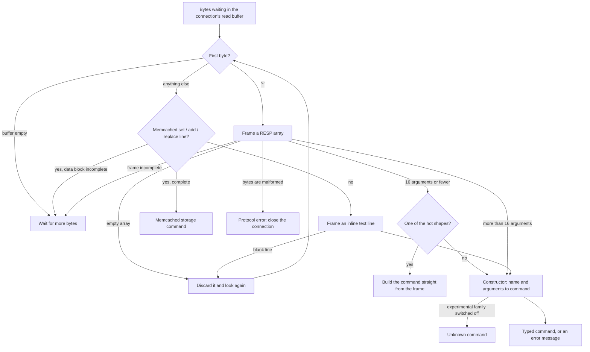

# Component 03: RESP Protocol Engine & Command Parser

> **High-Level Design Spec**: [docs/design/03_resp_engine.md](../design/03_resp_engine.md)
> **Consolidated Implementation Spec**: [docs/internal/components.md](components.md)
> **Main source file**: src/resp.rs (framing, the command type, the command constructor, number
> helpers, write classification). Reply encoding lives in src/connection.rs, with Pub/Sub push
> frames in src/pubsub.rs. Fuzz target: fuzz/fuzz_targets/parse_command.rs. The
> [Code map](#11-code-map) lists the key symbols.

---

## 1. What this subsystem does

Every byte a client sends to Rudis passes through this module before anything else happens. Its
job is to turn a raw, possibly incomplete stream of bytes into one typed value per request — a
**command** — that the rest of the server (routing, sharding, storage, replication, the
append-only file) can act on without ever re-reading strings.

The same port understands three wire formats:

1. **RESP arrays.** RESP (REdis Serialization Protocol) is what every real Redis client library
   sends: a count of arguments, then each argument as a length-prefixed **bulk string**. `GET foo`
   travels as `*2\r\n$3\r\nGET\r\n$3\r\nfoo\r\n`.
2. **Memcached text storage commands**: a header line such as `set key 0 0 5` followed by a
   5-byte data block on the next line.
3. **Inline commands**: one space-separated text line such as `GET foo`, the form people type
   into telnet or nc, with the same quoting rules as redis-cli.

The module only **parses**. It never writes reply bytes, and it does not care whether a client
asked for RESP2 or RESP3 replies — that choice only affects reply encoding, which happens in the
connection code (§7).

Many parts of the server feed it bytes: client connections (normal mode, Pub/Sub mode, and the
master reading acknowledgements from its replicas), a replica reading its master's stream, loading
and rewriting the append-only file (AOF), old search-index records in snapshots, and the
experimental kernel-bypass (AF_XDP) network path. §6 lists them.

---

## 2. Mental model

Think of the parser as a two-stage pipeline:

* A **framer** finds one complete request at the front of the connection's read buffer and cuts
  out its arguments.
* A **constructor** takes the command name and the arguments, checks the argument count and
  options, and produces the typed command.

The very hottest command shapes (a plain GET or SET, for example) skip the constructor: the
framer builds them directly.



Each call has one of four outcomes, and the caller reacts differently to each:

| Outcome | What it means | What the caller does |
| :--- | :--- | :--- |
| A command | One complete request was removed from the buffer | Run it, then ask for the next one |
| Nothing yet | The buffer holds only part of a request, or nothing | Read more bytes from the socket |
| Protocol error | The byte stream itself is broken; nothing was removed | Send the error and close the connection |
| Any other error | The request was removed, but it is invalid (wrong arity, bad option, out of range) | Send `-ERR ...` and keep going |

Five ideas explain most of this document:

* **Check before you cut.** The framer first proves that a whole request is in the buffer without
  removing anything. Only then does it remove bytes. A half-arrived request therefore costs
  nothing but a re-scan later (§4.3).
* **Broken bytes close the connection; bad commands do not.** If the framing itself is wrong, the
  parser cannot know where the next request starts, so the connection must go. If only the
  command is wrong, the frame has already been removed and the next request can be parsed (§8).
* **Arguments are views, not copies — usually.** Arguments are cheap reference-counted views into
  a shared buffer, but small frames are first copied into their own buffer so stored keys don't
  keep a large read buffer alive (§4.3).
* **Untrusted counts are never believed.** Whenever a client says "N items follow", the parser
  checks that N items really are there before looping or allocating (§4.6).
* **Some families are off by default.** Non-Redis command families (JSON, search, semantic cache
  and others) look like unknown commands unless the server is started with experimental commands
  enabled (§4.6).

---

## 3. The parsed command

### 3.1 One value per request

The parser's output is a single Rust enum (`Command`) with one variant per command or command
family — roughly 380 of them. It is the single currency of the server: the connection code, the
shard mailboxes, the AOF and replication all pass these values around. A few variants show the
flavour:

```rust
Get(Bytes),
Set { key: Bytes, value: Bytes, expire_in: Option<Duration>,
      condition: SetCondition, get: bool, keepttl: bool, past_expired: bool },
Del(SmallVec<[Bytes; 1]>),       // one key fits inline: no heap allocation
IncrBy(Bytes, i64, IncrName),    // INCR/DECR/INCRBY/DECRBY as one signed delta
Debug(Vec<Bytes>),               // stored unparsed; the executor reads it
Unknown(String),
```

The design choices behind it:

* **Arguments are reference-counted byte views.** Each argument is a `Bytes`: a cheap view into a
  shared buffer. Copying or slicing one copies no data, so the framer can hand out pieces of one
  per-request buffer.
* **The size of a command is capped at compile time, at 184 bytes.** A pipelined command is moved
  several times — into the parse batch, into per-shard batches, out again on the remote shard — so
  a bloated enum costs on every request. A compile-time check fails the build if a new variant
  pushes past the cap. Rare commands with large fields stay under it by putting those fields in a
  separate heap allocation (boxing them).
* **Single-key forms don't allocate.** Commands like DEL, EXISTS, HSET or SADD usually carry one
  key, field or member, so their lists use a small vector with one inline slot.
* **Some commands are stored unparsed.** When another module owns a command's grammar (DEBUG,
  SLOWLOG, SENTINEL, SUBSCRIBE and similar), the parser just stores the raw argument list and lets
  that module read it.
* **Shared types are reused, not duplicated.** Variants embed types from the modules that execute
  them, such as sorted-set range options, stream IDs, search options or the failover request.
* **Unknown names are a variant, not an error.** A name the constructor does not recognise becomes
  an unknown-command value, and the executor replies `-ERR unknown command '<name>'`. A few
  constructor branches deliberately produce an unknown value with a made-up name (for example
  "CONFIG HELP") that the executor treats specially.

The enum is not comparable for full equality (`Eq`), only partial equality, because some variants
carry floating-point scores or vectors. [§12.3](#123-the-command-type-in-detail) lists the boxed
fields, the variant groups and the borrowed types.

### 3.2 Commands with subcommands and options

Commands with several verbs — CLUSTER, CLIENT, ACL, MEMORY, TIER, LATENCY, OBJECT, XINFO and the
Dragonfly-compatible cluster commands — are one variant each, carrying a small enum that names the
verb. For example, `CLIENT SETNAME foo` becomes the client command carrying a "set name" verb.

Options with a fixed set of values get their own small types too: the SET condition (NX, XX, or
compare-and-set on the old value or its digest), expiry choices for MSETEX and hash-field TTLs,
the BITFIELD operation, the XNACK mode, and so on. One small type, the increment name, remembers
which of INCR, DECR, INCRBY or DECRBY the client actually typed: they all become the same "add a
signed delta" command, but ACLs, statistics and MONITOR still need the original name.

One exception to the "one variant plus a verb enum" pattern: `XDP.RULE ADD|DEL|LIST` produces
three separate variants. [§12.4](#124-subcommand-and-option-types) has the full table.

### 3.3 Global settings and limits

The parser keeps a little global state:

* **The bulk-length limit** (`proto-max-bulk-len`, default 512 MiB) is the largest bulk string —
  or memcached data block — a client may send. `CONFIG SET` changes it at runtime. It also bounds
  bit offsets in SETBIT, GETBIT and BITFIELD.
* **The detach threshold** (64 KiB) decides which frames are copied into their own buffer
  (§4.3).
* **The trusted-input flag** is set only while the server parses its own data (the AOF, its
  master's stream), and turns the bulk-length limit off (§4.1).
* **The experimental gate** switches the non-Redis command families on or off (§4.6). It is off in
  normal builds and on in unit tests.
* **The random-count cap** (2^20, about a million) limits how many elements a negative,
  repeating count may ask for in SRANDMEMBER, HRANDFIELD, ZRANDMEMBER and VRANDMEMBER. Rudis
  builds those replies in memory, so a count near the 64-bit minimum would otherwise hang the shard
  or exhaust memory.

Unit tests also get a per-thread override of the bulk-length limit, so a test of the limit does
not break other parse tests running on other threads at the same time (§8).
[§12.1](#121-constants-and-limits) has the exact names and values.

---

## 4. How parsing works

### 4.1 The entry point: choosing a grammar

**Why.** The three wire formats share one port, so the parser has to decide from the bytes alone
which one it is looking at, and it has to cope with a buffer that holds half a request.

**How.** Each call looks at the front of the buffer:

1. If the buffer is empty, there is nothing to do yet.
2. If the first byte is `*`, it is a RESP array (§4.3).
3. Otherwise it first asks "is this a memcached storage line?" (§4.5). That check has three
   answers: no (try inline), yes but the data block hasn't fully arrived (wait), or yes and here is
   the command. The middle answer matters: without it, a half-received `set k 0 0 1024` with only
   200 data bytes so far would be misread as an inline command.
4. If it is not memcached, it parses an inline line (§4.4).
5. Some frames carry no command at all: an empty array (`*0`), a null array (`*-1` or any
   negative count), or a blank inline line. The parser removes them and **loops** back to step 1.

It loops rather than calling itself again because a hostile client can send millions of these
two-byte frames; the recursive version overflowed the stack.

**Trusted input.** A second entry point does exactly the same work with the trusted-input flag
set, so the bulk-length limit is not enforced. It is used for AOF loading, for splitting a
rewritten AOF between shards, and by a replica reading its master's stream. That data was accepted
earlier, perhaps under a higher limit; refusing it after the limit was lowered would leave a
server unable to load its own AOF or follow its master. Redis makes the same choice.

### 4.2 Line endings

RESP specifies CRLF (`\r\n`) line endings, but Rudis is lenient about **header lines**: it looks
for `\n` and treats an `\r` just before it as part of the terminator, so header lines may end in
either CRLF or a bare LF. The search is a plain byte scan, used only on short headers, never on
payload data.

Two places are strict:

* The two bytes after a bulk string's data must be exactly CRLF (§4.3).
* A memcached header line must end in CRLF; a bare-LF line is not treated as memcached.

### 4.3 RESP arrays: validate first, then cut

**Why two passes.** A request can arrive split across any number of socket reads. If the parser
removed bytes as it went and then discovered the frame was incomplete, it would have to put them
back. Instead it first walks the whole frame without removing anything (pass 1), and only removes
bytes once it knows the frame is complete and well-formed (pass 2). This is also what makes
parsing **split-invariant**: feeding the same bytes in two pieces gives exactly the same commands
as feeding them all at once.

**The header.** The parser reads the argument count after the `*`.

* If no newline has arrived yet, it waits — unless more than 64 KiB is already buffered with no
  newline, which is a protocol error.
* A negative count (a null array) is removed and skipped.
* A count that isn't plain digits, or is above 1,048,576 (Redis's default multibulk limit), is a
  protocol error.
* A count of zero is removed and skipped.

**Pass 1: prove the frame is complete.** For each argument, starting just after the header:

1. If the scan has reached the end of the buffer, wait for more bytes.
2. The next byte must be `$`; anything else is a protocol error.
3. Read the length line. If its newline is missing, wait — or fail if more than 64 KiB has piled
   up without one.
4. A negative length or non-digits is a protocol error.
5. A length above the bulk-length limit is a protocol error, unless the input is trusted.
6. If the data and its two-byte terminator haven't all arrived, wait.
7. The two bytes after the data must be CRLF, or it is a protocol error.
8. For arrays of 16 arguments or fewer, remember where this argument starts and how long it is, in
   a small fixed array on the stack.

Nothing is removed during pass 1, so "wait" simply means "try again when more bytes arrive".
Lengths are decoded with overflow checks, so an absurd length is an error, not a wrapped-around
small number.

**Pass 2, small arrays (16 arguments or fewer).** The whole frame is removed from the read buffer
as one unit, and every argument becomes a view into it. One question matters here: should the
frame be copied?

* **Usually it is copied** into its own buffer, if it is at most 64 KiB. The reason is memory
  accounting. Keys and values the table stores are views into the frame. A view into the shared
  read buffer would keep that whole buffer (128 KiB or more) alive for as long as one key
  survives, and that memory would be invisible to `maxmemory`.
* **A plain two-argument GET is not copied**, because GET never keeps its argument.
* **Frames above 64 KiB are not copied** either: the copy would cost more, and the buffer being
  kept alive is then mostly the value itself.

Then the **fast path** runs. The length of the command name picks a bucket, and a couple of
case-insensitive comparisons build the command directly from views into the frame, skipping the
constructor. For example, name length 3 covers GET, SET and DEL; length 4 covers INCR, HGET, HSET,
SADD, ZADD, PING, MGET, MSET and a few pops and removes. Each fast shape is narrow — `SET k v`
with exactly three arguments, no options — and anything else falls through to the constructor with
the cached argument views. [§12.2](#122-fast-path-shapes) lists every shape.

**Pass 2, large arrays (more than 16 arguments).** The header is removed and each argument is cut
out one at a time: arguments up to 64 KiB are copied, larger ones are shared views. Pass 1 has
already validated every header, so this pass trusts them. Then the constructor runs.

**Worked example.** A client sends `SET k v`, which is 27 bytes on the wire:
`*3\r\n$3\r\nSET\r\n$1\r\nk\r\n$1\r\nv\r\n`.

1. The header says 3 arguments; the first argument header starts at byte 4.
2. Pass 1 records the arguments at (byte 8, length 3), (17, 1) and (24, 1), and finishes at byte
   27: the frame is complete.
3. It is not a GET and it is far below 64 KiB, so the 27 bytes are copied into their own buffer
   and removed from the read buffer.
4. The name is 3 bytes long and spells SET, with exactly 3 arguments, so the fast path builds a
   SET command whose key is byte 17 and value byte 24 of the copy, with no expiry and no
   condition.
5. Had the client sent `SET k v EX 10` (5 arguments), the fast path would not match, and the
   constructor's SET branch would parse the options.

### 4.4 Inline commands

**Why.** Inline commands exist so a person can talk to the server with telnet or nc. They are not
used by client libraries, so this path favours simplicity over speed: every argument is freshly
allocated.

**How.**

1. Find the end of the line. If there is none yet, wait — or fail if more than 64 KiB has piled up.
2. Split the line into arguments the way redis-cli does. Whitespace separates arguments. Double
   quotes allow escapes (`\n`, `\r`, `\t`, `\b`, `\a` and `\xHH` hex bytes). Single quotes only
   let a backslash escape the next byte. An unterminated quote, a closing quote glued to more text,
   or a quote in the middle of an unquoted word is a protocol error ("unbalanced quotes").
3. Remove the line. A line with no arguments is skipped; otherwise the arguments go to the
   constructor.

Example: `SET greeting "hello world"` becomes three arguments, the last being `hello world` with
the space kept.

### 4.5 Memcached storage commands

**Why it is sniffed first.** A memcached `set` header looks like an inline command, but it is
followed by a raw data block that is not text. The parser has to recognise it before inline
parsing, or the data block would be misread as the next command.

**How.**

1. Look only at the **first line** of the buffer. (Searching the whole buffer for a CRLF made a
   long run of bare-LF frames quadratic.) It must end in CRLF and start with `set`, `add` or
   `replace` in any case, followed by a space or tab.
2. Split on spaces and tabs. There must be at least five words, and the flags, expiry time and
   byte count must be numbers. If anything fails, this is not a memcached line: fall through to
   inline parsing.
3. A sixth word `noreply` asks for no reply.
4. A byte count above the bulk-length limit is a protocol error, which closes the connection. This
   also keeps the length arithmetic from overflowing.
5. If the data block and its CRLF haven't fully arrived, wait.
6. If the block is not followed by CRLF, the whole block is **removed** and the client gets
   `CLIENT_ERROR bad data chunk`. Removing it matters: this is not a protocol error, so the caller
   keeps parsing, and leaving the bytes in place would fail on them forever.
7. Otherwise copy the key and data, remove the request, and return a memcached set, add or replace
   command.

**Example.** `set user:1 0 60 5\r\nhello\r\n` becomes a memcached set of `user:1` with flags 0, an
expiry of 60 and the 5-byte value `hello`. If only `set user:1 0 60 5\r\nhel` has arrived, the
parser waits.

**Other memcached verbs** arrive as inline lines and are told apart inside the constructor by
their argument count. `delete k [noreply]` becomes a memcached delete. `incr k 5 [noreply]` and
`decr k 5 [noreply]` become memcached increment and decrement — while the two-argument Redis
`INCR k` stays a Redis increment. `stats` and `version` become their memcached commands, and
`quit` becomes the ordinary Redis QUIT.

### 4.6 Building the command

**Why one constructor.** Every request that doesn't hit the fast path — all inline commands, all
large arrays, all uncommon shapes — goes through one function that maps a name and arguments to a
typed command, checking arity and options on the way.

**How.**

1. An empty argument list produces nothing.
2. Upper-case the command name into a 64-byte buffer on the stack. Only names longer than 64 bytes
   or containing non-ASCII bytes need a heap allocation.
3. **The experimental gate.** If the name contains a dot, the experimental gate is off, and the
   name starts with one of the experimental prefixes (JSON., BF., CF., CMS., TOPK., FT., SEMANTIC.,
   CRDT., LLM., MCP., XDP.), the result is an unknown command carrying the name exactly as the
   client typed it. No core command has a dot in its name, so on the hot path this costs one byte
   scan.
4. Otherwise one large `match` on the name picks a branch — roughly 350 of them. Some branches
   accept aliases, such as SET and PUT, EVAL and EVAL_RO, or GETRANGE and SUBSTR. The order of the
   branches roughly follows the order features were added.
5. A name with no branch becomes an unknown command.

**Why the experimental gate exists.** These families are not Redis or Valkey commands, and most
of their writes are neither written to the AOF nor replicated — the exceptions are JSON.,
SEMANTIC., BF., CF., CMS., TOPK., CRDT. and the search index definitions (FT.CREATE, FT.ALTER,
FT.DROPINDEX). So a restart or failover silently loses that data. MCP. and XDP. also expose tool
calls and packet-filter control. The gate is set at startup from `enable-experimental-commands`.
Note that the AGENT.* families are **not** gated.

**A typical branch** checks the argument count, takes the positional arguments, then walks the
remaining options one by one, rejecting duplicates and conflicting options. Commands with
subcommands (ACL, CLUSTER, CLIENT, CONFIG, MEMORY, TIER, the Dragonfly commands, XDP.RULE) match
on the second argument one level deeper.

**Never trust a client's count.** Many grammars contain a count followed by that many items —
`FIELDS n ...`, `PARAMS n ...`, `VALUES n ...`, or the `numkeys` of EVAL. A client could claim a
billion items and send two. The parser never loops or allocates based on such a count alone:

* A shared helper hands back the items only if that many really follow; otherwise it returns
  "Bad arguments for <keyword>: Expected an argument, but none provided". The search (FT.*)
  options use it.
* EVAL, EVALSHA and FCALL reject a negative `numkeys` and one larger than the arguments left.
* MSETEX rejects `numkeys` outside 0 to 2^31−1 and never pre-allocates more than the argument
  count.
* VADD and VSIM require the promised `VALUES` items to be present; the hash-field TTL commands
  require the field count to match exactly.
* Vector commands are capped by resource limits from the vector module: at most 65,536
  dimensions, an HNSW link count of at most 4,096, a search breadth of at most 1,000,000, and a
  REDUCE projection of at most 2^24 entries. Negative random counts are capped as described in
  §3.3.

**Expiry options become durations at parse time.** SET's EX, PX, EXAT and PXAT options, GETEX and
MSETEX are all turned into a "time from now". Absolute deadlines are converted by subtracting the
current time at nanosecond precision, so that PEXPIRETIME later returns exactly the PXAT value the
client gave. A SET with an EXAT or PXAT already in the past is marked as "already expired" instead
of getting a duration.

### 4.7 Reading numbers

The parser has its own number readers, because the rules are Redis's, not Rust's:

* **Lengths** in RESP headers are read straight from bytes, digits only, with overflow checks; an
  overflowing length is a protocol error instead of a wrapped value. There is no UTF-8 check and
  no intermediate string, because this runs for every argument of every request.
* **Floats** follow Redis's grammar. Empty strings, surrounding whitespace and every spelling of
  NaN are rejected; `inf` and `infinity` with an optional sign are accepted. Rust's own float
  parser is tried first, then the C library's (`strtod`) for C-only forms such as hex floats. A
  finite-looking number that overflows to infinity is rejected, as in Redis.
* **Score bounds** for ZRANGEBYSCORE and friends: a leading `(` means "exclusive", `-inf`, `+inf`
  and `inf` are special-cased, and everything else is a float.
* A few commands get dedicated readers that reproduce Redis's exact error messages: the stream
  claim commands' minimum idle time, LMOVEM's optional `COUNT|EXACTLY n OBO|BULK` trailer, the
  WAIT and WAITAOF timeout, and the whole FAILOVER grammar (§5).

### 4.8 Classifying commands: writes and out-of-memory

Besides parsing, the module answers two questions about a parsed command, which the executor
needs before running it.

**May it run when memory is over `maxmemory`?** Normally only reads may. The exceptions are
MIGRATE, because it only removes local keys and so is a way back under the limit, and Lua scripts
whose first line (the `#!` shebang) contains the `allow-oom` flag.

**Is it a write?** The executor uses this, among other things, for the memory check: over
`maxmemory`, a write is refused unless the first question says it may run anyway.

1. Scripts are special. EVAL and EVALSHA are writes unless they are the read-only variants
   (EVAL_RO, EVALSHA_RO) or their shebang line says `no-writes`. A script with no shebang counts
   as a non-write here. FCALL asks the scripting module whether the function is read-only.
2. Everything else is first checked against a fixed list of core write commands (SET, DEL, LPUSH,
   ZADD, XADD, FLUSHALL and so on).
3. Failing that, the command's ACL name is looked up in the command table generated from Valkey's,
   and it is a write if it is in the `@write` category. The lookup result is cached per thread,
   keyed by the address of the name, since every command passes through here.
4. The Rudis-only families (JSON, Bloom filters, search, semantic cache, CRDT, ...) share one
   coarse ACL name per family that is tagged `@write`, so their read-only commands (JSON.GET,
   BF.EXISTS, FT.SEARCH, SEMANTIC.GET, CRDT.GET and others) are listed explicitly and excluded.

---

## 5. Notable command grammars

Most branches are straightforward. These are the ones with surprises.

**DEL and UNLINK.** They share a branch, but UNLINK produces its own command (both in the fast
path and in the constructor). The executor treats them alike except that UNLINK may free a large
value in the background (lazy free) and counts it in the lazy-freed statistics. The storage layer
also creates UNLINK commands for keys that expire lazily when `lazyfree-lazy-expire` is on, so the
AOF and replicas see UNLINK.

**HELLO.** A numeric first argument is the requested protocol version. A non-numeric first
argument other than AUTH or SETNAME is recorded as version −1 (invalid). Unknown later words are
skipped. The connection code then rejects any version other than 2 or 3 with
`-NOPROTO unsupported protocol version`, switches the client to RESP3 if asked, and replies with a
7-entry map (a real map in RESP3, a flat array in RESP2).

**Hash-field TTLs.** HEXPIRE, HPEXPIRE, HEXPIREAT and HPEXPIREAT share one branch:
`HEXPIRE key time [NX|XX|GT|LT] FIELDS numfields field...`. Seconds are converted to milliseconds
(saturating rather than overflowing), and the spelling decides whether the time is relative or
absolute. More than one condition flag fails with "Multiple condition flags specified". The field
count must be above zero and match the fields given exactly, and `FIELDS` may appear only once.
HTTL, HPTTL, HEXPIRETIME, HPEXPIRETIME, HPERSIST, HGETEX and HSETEX complete the family.

**Streams.** Besides the core X* commands, the parser handles XCLAIM and XAUTOCLAIM; Redis 8's
XDELEX and XACKDEL (`[KEEPREF|DELREF|ACKED] IDS n id...`, defaulting to KEEPREF, with `n` required
to match); the Rudis-specific idempotent-record command
`XIDMPRECORD key producer-id insertion-id id`; and XNACK with its SILENT, FAIL or FATAL mode.

**VADD: two grammars, chosen by peeking.** Rudis had its own vector commands before Redis 8 added
Vector Sets, and VADD accepts both. The parser looks at the third argument:

* If it is REDUCE, FP32 or VALUES (in any case), the **Redis 8 Vector Sets** grammar applies:
  `VADD key [REDUCE dim] FP32 blob|VALUES n v1..vn element [CAS] [NOQUANT|Q8|BIN] [EF ef]
  [SETATTR json] [M m] [TIERED]`. An FP32 blob must be a non-empty multiple of 4 bytes of finite
  little-endian floats, SETATTR must be valid JSON (or blank), M must be at least 2, and the
  vector limits of §4.6 apply. The command is marked as a Redis vector set.
* Otherwise the **Rudis-native** grammar applies: `VADD key element v1 v2 ... [QUANTIZE|SQ8] [PQ]
  [TIERED] [metric]`, where every word that is not a flag or a metric name must be a float.

The catch: a native-grammar element literally named "reduce", "fp32" or "values" is read as Vector
Sets syntax.

**FT.HYBRID: rewritten into a plain search.** It has no command of its own. The parser accepts
`FT.HYBRID index text-query vector-query [SCORER RRF [K k] | LINEAR [ALPHA a] [BETA b]]
[LIMIT off n] [RETURN n f...] [PARAMS n k v...] [WITHSCORES] [NOCONTENT]`, with RRF's k defaulting
to 60 and LINEAR's alpha and beta to 0.5 each. It then glues the two queries into one:

* a vector query starting with `*=>` or `=>` becomes `(text)=>` plus the rest;
* one starting with `[KNN` becomes `(text)=>[KNN...`;
* anything else is joined to the text query with a space.

The result is an ordinary FT.SEARCH command.

**AI-native families.** SEMANTIC.*, AGENT.MEM.*, LLM.QUOTA.*, AGENT.CHECKPOINT.*, AGENT.TOOL.* and
MCP.* are ordinary branches here; the semantic-cache, agent and MCP modules execute them.
MCP.RPC takes exactly one argument and stores it unparsed — the MCP module parses the JSON-RPC
envelope. `MCP.CALL tool [json]` defaults the arguments to `{}`.

**WAIT and WAITAOF timeouts.** `WAIT numreplicas timeout` and
`WAITAOF numlocal numreplicas timeout` check the timeout (in milliseconds, 0 meaning "forever")
the way Redis does, in this order:

1. Not a 64-bit integer: "value is not an integer or out of range".
2. Negative: "timeout is negative".
3. Adding it to the current Unix time in milliseconds would overflow: "timeout is out of range".

So `WAIT 2 9223372036854775807` fits in a 64-bit integer but fails step 3, instead of blocking the
client forever. `WAIT 2 9223372036854775808` fails step 1, and `WAITAOF 0 0 -5` fails step 2.
Because of step 3, the executor can safely add the timeout to "now".

**SHUTDOWN.** `SHUTDOWN [NOSAVE|SAVE] [NOW] [FORCE]` or `SHUTDOWN ABORT`. Flags are
case-insensitive and may come in any order:

| Flag | Meaning for the executor |
| :--- | :--- |
| SAVE / NOSAVE | Do or don't write a final snapshot. With neither, follow the save configuration. |
| NOW | Don't wait for replicas to catch up. |
| FORCE | Exit even if the final save fails. |
| ABORT | Cancel a shutdown that is waiting for replicas. |

A second SAVE or NOSAVE (including `SAVE NOSAVE`), any unknown word, or ABORT combined with
anything else is a "syntax error". Repeating NOW or FORCE is accepted.

**FAILOVER.** `FAILOVER ABORT` (exactly two arguments) asks to cancel a failover. Otherwise
`FAILOVER [TO host port] [FORCE] [TIMEOUT ms]`, in any order, fills a failover request owned by
the replication module:

1. TIMEOUT (at most once): the value must be an integer ("value is not an integer or out of
   range") and greater than 0 ("FAILOVER timeout must be greater than 0").
2. TO (at most once): the port must be an integer. A port too large for 16 bits is stored as 0,
   which matches no replica, so the executor replies with Redis's
   "FAILOVER target HOST and PORT is not a replica."
3. FORCE (at most once) sets the force flag.
4. Anything else — a repeated option, TO without a port, ABORT with other arguments — is a
   "syntax error".

Example: `FAILOVER TO 10.0.0.1 6380 FORCE TIMEOUT 500` targets 10.0.0.1:6380, forced, with a
500 ms timeout. A bare `FAILOVER` means no target, no force and no timeout. The executor refuses
FAILOVER in cluster mode ("FAILOVER not allowed in cluster mode."), and otherwise hands an abort
or a request to the replication hub (see the replication doc).

**PSYNC.** `PSYNC replid offset [FAILOVER]`: three arguments, or four when the last one is
FAILOVER in any case. The FAILOVER flag is what a master running FAILOVER sends to the replica it
is promoting: "take over from me". Any other fourth argument is a wrong-arity error, and a
non-integer offset is "ERR value is not an integer or out of range".

**CONFIG SET.** Values wrapped in matching single or double quotes are unquoted at parse time.
CONFIG RESETSTAT and CONFIG REWRITE are encoded as special CONFIG SET pairs.

---

## 6. Who calls the parser

| Caller | What it does with the result |
| :--- | :--- |
| Client connections, normal mode (plain TCP and TLS) | Parses every complete command in the buffer into a batch (at most 1,024 commands), enforces `client-query-buffer-limit` on each command's bytes and on a partial command, and stops at QUIT. On a protocol error it sends the error and closes. On any other error it runs the commands already parsed, replies with the error and carries on; inside MULTI the error also marks the transaction so EXEC aborts. |
| Client connections, Pub/Sub mode | Drains commands buffered before entering subscribed mode, then parses as usual; closes on a protocol error. |
| The master's replica-acknowledgement reader | Decodes `REPLCONF ACK <offset>` frames from a replica. |
| A replica following its master | Uses trusted parsing on the master's stream, tracks how many bytes it has consumed, handles `REPLCONF GETACK` and PING specially, and picks out whole MULTI ... EXEC blocks. |
| AOF loading and AOF-rewrite splitting | Use trusted parsing. An unknown command while loading the AOF is a load error. |
| Snapshot loading | Re-parses stored FT.CREATE commands from old-format search-index records. |
| The AF_XDP receive task on each shard | Parses the payload extracted from a raw packet and runs it locally or routes it to its owner. |
| The cargo-fuzz target | Checks that parsing never panics and that every returned command consumed input. |

---

## 7. Reply encoding (outside this module)

The parser never writes replies. For orientation:

* The connection code's reply writers check a per-thread "this client speaks RESP3" flag and pick
  RESP3 forms where they differ: `_` for null, `,` for doubles, and `%` maps in a handful of
  replies such as HELLO. Pub/Sub push frames (`>`) are built in the Pub/Sub module. The other
  RESP3 types — sets, booleans, verbatim strings, big numbers and attributes — are never sent.
* The error writer sends only the first line of an error message. If the message already starts
  with a known error code (ERR, WRONGTYPE, MOVED, OOM and others; [§12.5](#125-error-handling-details)
  lists them), it is sent as is; otherwise `ERR ` is put in front. That is why most parser errors
  are written without a prefix ("syntax error") while some include one ("ERR syntax error") — both
  reach the client the same way.

---

## 8. Invariants & gotchas

* **Framing errors don't consume; command errors do.** A protocol error leaves the buffer
  untouched, so the caller must close the connection — otherwise the same bytes would fail
  forever. Every other error comes from the constructor *after* the frame was removed, or from the
  memcached bad-chunk case, which removes the block on purpose. Either way the caller can keep
  parsing.
* **A returned command always consumed input.** The unit fuzz test and the cargo-fuzz target both
  check this; a parser change that breaks it makes connection loops spin.
* **Split-invariance.** Feeding the same bytes in two pieces must give the same commands as
  feeding them at once. Pass 1 never removing anything is what makes this hold.
* **The fast path and the constructor must agree.** A fast-path shape such as `SET k v` never
  reaches the constructor, so a change to what a command means must be made in both places.
* **Stored values must not pin the read buffer.** Keep the 64 KiB copy when adding zero-copy
  shortcuts. Only commands that never keep their arguments (plain GET) may take views into the
  shared buffer for small frames.
* **Memcached sniffing comes before inline parsing.** Any line not starting with `*` that looks
  like `set|add|replace <key> <num> <num> <num>` followed by CRLF is a memcached storage command.
  So an inline `SET k 0 0 5` waits for a 5-byte data block instead of running Redis SET.
* **VADD's grammar is ambiguous.** A native-grammar element literally named reduce, fp32 or values
  is parsed as Vector Sets syntax (§5).
* **Experimental commands look unknown when the gate is off.** With the gate off, FT.CREATE and
  friends parse as unknown commands; internal code that re-parses such commands (for example old
  FT.CREATE snapshot records) depends on the gate being on.
* **Keep a command at 184 bytes or less.** Box large fields of rare variants; the compile-time
  check enforces the limit.
* **AUTH and HELLO AUTH passwords are converted to text lossily.** Bytes that are not valid UTF-8
  are replaced before the password reaches the ACL layer, so a binary password is altered.
* **Unit tests must not change the global bulk-length limit.** Tests run in parallel threads that
  share it, and lowering it makes unrelated parse tests fail. Use the per-thread test override and
  reset it afterwards.
* **Timeouts are range-checked against the clock.** WAIT and WAITAOF reject a timeout whose sum
  with the current Unix time in milliseconds would overflow, so the executor can add it to "now"
  safely.

---

## 9. Limitations / not implemented

* **RESP3 input types are not parsed.** Only arrays of bulk strings, inline text and memcached
  storage lines are accepted. A client cannot send RESP3 maps, sets, doubles, booleans, nulls or
  pushes — and no real client does.
* **Two memcached commands are never produced by the parser.** The memcached get and quit
  variants exist, but `get` with one key becomes a Redis GET, `get k1 k2` is a wrong-arity error,
  `gets` is unknown, and `quit` becomes Redis QUIT. The executor still handles both variants.
* **FT.HYBRID's rewriting is string gluing.** A malformed vector query is silently treated as free
  text rather than rejected.
* **The constructor is one very large `match`.** The compiler turns it into an efficient
  length-then-bytes decision tree, so this costs maintainability, not speed. It has not been split
  into per-family functions.
* **Bare-LF headers are accepted** in RESP and inline input, which is more lenient than Redis;
  bulk data still requires CRLF.

---

## 10. Testing

The parser's own unit tests cover:

* **Framing robustness.** A mutation fuzzer over a seed corpus of RESP, inline and memcached input
  checks for no panics, steady progress and split-invariance (the `RUDIS_FUZZ_ITERS` environment
  variable sets the iteration count). Other tests feed hostile lengths (the multibulk limit, an
  oversized memcached block, a bad data chunk being removed) and 500,000 empty frames on a 256 KiB
  stack.
* **Hostile arguments.** Every command in the ACL table, plus the module families, is fed random
  hostile words under a panic catcher. Separate tests check that untrusted counts are rejected
  while valid counted options still parse, and cover the vector and random-count limits.
* **Fast paths.** Each fast-path shape, including the small-vector forms, and the bulk-length
  rejection using the per-thread override.
* **Grammar coverage.** GET and SET, inline commands, hashes, keyspace and transactions, bitmaps
  and HyperLogLog, DUMP and RESTORE, streams, Valkey extensions, the semantic cache, number
  parsing, and the Redis-compatible SHUTDOWN, FAILOVER, PSYNC and WAIT grammars.
* **Classification.** MIGRATE over `maxmemory`, and write detection following the command table.

Outside the module, the cargo-fuzz target exercises the framer, a separate test file throws random
input at the constructor (plus the JSONPath, search-query and RDB parsers), and the connection
tests and end-to-end tests cover parsed commands in action — for example the replication
end-to-end tests for WAIT and FAILOVER. Run one end-to-end file with
`cargo test --test e2e_commands`. [§12.6](#126-tests-that-pin-the-behavior) names the tests.

---

## 11. Code map

| File | Key symbols | Role |
| :--- | :--- | :--- |
| `src/resp.rs` | `parse_command`, `parse_command_trusted`, `TRUSTED_INPUT`, `trusted_input` | Entry points; grammar choice, empty-frame loop, trusted-input flag. |
| `src/resp.rs` | `parse_resp_array`, `DETACH_FRAME_MAX` | Two-pass RESP array framer, small-frame copy, fast path for ≤ 16 arguments. |
| `src/resp.rs` | `parse_inline_command`, `split_inline_args` | Inline line framing and redis-cli-style quoting. |
| `src/resp.rs` | `parse_memcached_storage_command` | Memcached `set`/`add`/`replace` header and data block. |
| `src/resp.rs` | `find_newline`, `find_newline_at` | Line-end search; return `(line_end, advance_len)`. |
| `src/resp.rs` | `build_command`, `bytes_to_uppercase_ascii` | Name → `Command` constructor; option parsing. |
| `src/resp.rs` | `EXPERIMENTAL_COMMANDS`, `EXPERIMENTAL_PREFIXES`, `set_experimental_commands`, `experimental_commands_enabled`, `is_experimental_command_name` | Experimental command gate. |
| `src/resp.rs` | `enum Command`, `*Subcommand` enums, `SetCondition`, `IncrName`, `ExpireOptions`, `BitfieldSubOp`, … | The typed command surface (§12.3, §12.4). |
| `src/resp.rs` | `Command::allows_oom`, `Command::is_write_command`, `Command::is_family_read`, `is_write_in_command_table` | Out-of-memory and write classification. |
| `src/resp.rs` | `PROTO_MAX_BULK_LEN`, `get_proto_max_bulk_len`, `set_proto_max_bulk_len`, `TEST_PROTO_MAX_BULK_LEN` (tests only), `MAX_RANDOM_REPEATS` | Limits. |
| `src/resp.rs` | `parse_decimal_bytes`, `parse_integer`, `parse_redis_f64`, `parse_score_bound`, `parse_expire_options`, `parse_random_count`, `parse_min_idle_time`, `parse_lmovem_trailer`, `parse_wait_timeout`, `parse_failover`, `counted_args`, `parse_ft_params`, `until_unix_ms` | Parsing helpers. |
| `src/replication.rs` | `FailoverRequest`, `ReplicationHub::start_failover`, `ReplicationHub::abort_failover` | The type carried by `Command::Failover`, and its executor. |
| `src/replication.rs` | `run_replica_worker`, `take_tx_block` | Trusted parsing of the master's stream; MULTI … EXEC blocks. |
| `src/aof.rs` | `replay_aof_inner`, `split_rewritten_aof_to_shards` | Trusted-input AOF callers. |
| `src/connection.rs` | `handle_client_loop`, `run_pubsub_loop`, `read_replica_acks`, `MAX_DRAIN_BATCH_CMDS` | Main callers; error and close policy. |
| `src/connection.rs` | `write_resp_*`, `write_resp_null`, `write_resp_null_array`, `write_resp_score`, `write_resp_err`, `CURRENT_CLIENT_RESP3` | Reply encoding. |
| `src/connection.rs` | `get_cmd_name`, `acl_cmd_name` | Command names used by write classification. |
| `src/table.rs` | `load_legacy_records` | Re-parses legacy FT.CREATE records. |
| `src/server.rs` | `run_shard_worker` (AF_XDP receive task), `xdp::extract_transport_payload` | Parses commands from raw packets. |
| `src/main.rs` / `src/config.rs` | `set_experimental_commands(server_config.enable_experimental_commands)` | Startup wiring of the experimental gate. |
| `src/vector.rs` | `MAX_VECTOR_DIM`, `MAX_HNSW_M`, `MAX_VSET_EF`, `MAX_PROJECTION_ENTRIES` | Vector limits enforced at parse time. |
| `src/acl_categories.rs` | `COMMANDS`, `CATEGORIES` | Generated command table used for `@write`. |
| `fuzz/fuzz_targets/parse_command.rs` | `fuzz_target!` | libFuzzer harness for the framer. |

---

## 12. Reference details

### 12.1 Constants and limits

| Name | Value | Meaning |
| :--- | :--- | :--- |
| `PROTO_MAX_BULK_LEN` | `static AtomicUsize`, default 512 MiB | Largest bulk string or memcached data block. Set by `CONFIG SET proto-max-bulk-len` via `set_proto_max_bulk_len`. Bit offsets in `SETBIT`/`GETBIT`/`BITFIELD` must satisfy `offset >> 3` < limit. |
| `DETACH_FRAME_MAX` | `const usize` = 64 KiB | Frames (or, for > 16-argument commands, single arguments) up to this size are copied out of the read buffer. |
| `TRUSTED_INPUT` | `thread_local Cell<bool>` | Set only while `parse_command_trusted` runs; skips the bulk-length check. |
| `TEST_PROTO_MAX_BULK_LEN` | `thread_local Cell<Option<usize>>`, `cfg(test)` only | Per-thread override returned by `get_proto_max_bulk_len` when set. Absent from release builds. |
| `EXPERIMENTAL_COMMANDS` | `static AtomicBool` | Defaults to `cfg!(test)`: `false` in builds, `true` in unit tests. Set by `main.rs` from `enable-experimental-commands`. |
| `EXPERIMENTAL_PREFIXES` | `const &[&str]` | `JSON.`, `BF.`, `CF.`, `CMS.`, `TOPK.`, `FT.`, `SEMANTIC.`, `CRDT.`, `LLM.`, `MCP.`, `XDP.` |
| `MAX_RANDOM_REPEATS` | `const i64` = 2^20 | Most elements a negative random-member count may request; checked by `parse_random_count` ("value is out of range"). |
| Multibulk count limit | 1,048,576 (`1024 * 1024`) | Larger `*N` counts are rejected. |
| Header newline search | 64 KiB | Buffered bytes allowed without a newline before "too big ..." errors. |
| Fast path / offset cache | 16 arguments | `offsets: [(usize, usize); 16]`, `is_small = num_args <= 16`. |
| Name upper-casing buffer | 64 bytes on the stack | Heap fallback for longer or non-ASCII names. |
| `Command` size | ≤ 184 bytes | `const _: () = assert!(std::mem::size_of::<Command>() <= 184);` |
| Pipeline batch | `MAX_DRAIN_BATCH_CMDS` = 1,024 | Commands parsed per batch in `handle_client_loop`. |
| Vector limits | `MAX_VECTOR_DIM` 65,536; `MAX_HNSW_M` 4,096; `MAX_VSET_EF` 1,000,000; `MAX_PROJECTION_ENTRIES` 2^24 | From `crate::vector`; projection limit is REDUCE input × output dimensions. |
| FT.HYBRID defaults | RRF `k` = 60; LINEAR `alpha` = `beta` = 0.5 | |

### 12.2 Fast-path shapes

Small arrays (≤ 16 arguments) whose name matches one of these shapes are built directly in
`parse_resp_array`, without `build_command`. Matching is case-insensitive; anything else falls
through.

| Name length | Shapes |
| :-: | :--- |
| 3 | `GET k` (exactly 2 args) → `Get`; `SET k v` (exactly 3) → `Set` with no options; `DEL k...` → `Del` |
| 4 | `INCR k` → `IncrBy(k, 1, Incr)`; `HGET k f`; `HSET k f v` (one pair); `SADD k m` (one member); `LPOP k`, `RPOP k`, `SPOP k` (no count); `ZADD k score m` (one pair, score via `parse_redis_f64`); `HDEL`/`SREM`/`ZREM k item...`; `PING` (no argument); `MGET k...`; `MSET k v...` (whole pairs) |
| 5 | `TOUCH k...`; `RPUSH k v...`; `LPUSH k v` (one value) |
| 6 | `EXISTS k...`; `LRANGE k start stop` and `ZRANGE k start stop` (integers only); `UNLINK k...` → `Unlink` |
| 7 | `ZPOPMIN k` (no count) |
| 8 | `READONLY` |
| 9 | `READWRITE`; `SISMEMBER k m` |

A plain `GET` is the only small frame that skips the `DETACH_FRAME_MAX` copy (zero-copy
`split_to(..).freeze()`); other small frames use `Bytes::copy_from_slice`. On a miss, a
`Vec<Bytes>` is built from the cached offsets (still slices of the frame) and passed to
`build_command`.

### 12.3 The command type in detail

* **Derives:** `Debug, PartialEq, Clone` (not `Eq`: `f64` scores, `f32` vectors).
* **Boxed fields that keep it ≤ 184 bytes:** `FtSearch`/`FtAggregate` box `SearchOptions`;
  `Zrangestore` boxes `ZRangeOpts`; `Xclaim` boxes its ID list; `Xadd` boxes its idempotency
  option; `Xreadgroup` and `Lmovem` box optional fields; `SemanticSet`'s vector is a
  `Box<Vec<f32>>`.
* **`SmallVec<[T; 1]>` forms:** `DEL`, `UNLINK`, `EXISTS`, `TOUCH`, `HSET`, `HDEL`, `SADD`, `SREM`,
  `ZADD`, `ZREM`, `LPUSH`, `RPUSH`.
* **Raw-args (`Vec<Bytes>`) variants:** `Debug`, `Slowlog`, `Commandlog`, `Lolwut`, `Sentinel`,
  `Replconf`, `ConfigGet`, `Subscribe`, `Watch`, `Stick`, and similar.
* **Borrowed types:** `crate::table::ZAddFlags`, `ZRangeOpts`, `StreamId`, `StreamTrimStrategy`;
  `crate::block::ClientUnblockType`; `crate::replication::FailoverRequest`;
  `crate::search::SearchOptions`/`Reducer`; `crate::vector::VQuant`/`VectorMetric`;
  `crate::xdp::XdpAction`.
* **Other notable variants:** `Hello { proto: Option<i64>, auth: Option<(String, String)>,
  setname: Option<String> }`; `FtSearch { index, query, options: Box<SearchOptions> }`;
  `McpRpc(Bytes)`; `MemcachedSet { key, flags: u32, exptime: u32, bytes: usize, noreply, data }`
  (also `MemcachedAdd`, `MemcachedReplace`, `MemcachedDelete`, `MemcachedIncr`, `MemcachedDecr`,
  `MemcachedStats`, `MemcachedVersion`; `MemcachedGet`/`MemcachedQuit` are never produced);
  `Shutdown { save: Option<bool>, now, force, abort }`; `Failover { abort, request }`;
  `Psync { replid, offset, failover }`; `Vadd { .., is_redis_vset }`.
* **Synthetic `Unknown` names** the executor special-cases include `"CONFIG HELP"` and
  `"OBJECT <sub>"`.
* **Variant groups** (section comments in the enum): `// LIST COMMANDS`, `// SET COMMANDS`,
  `// ZSET COMMANDS`, `// GENERIC & DATABASE COMMANDS`, `// EXTENDED STRING COMMANDS`,
  `// LUA SCRIPTING COMMANDS`, `// TIERED STORAGE COMMANDS`, `// CONFIG COMMANDS`,
  `// PUBSUB COMMANDS`, `// KEYSPACE INSPECTION`, `// TRANSACTIONS`, `// BITMAP COMMANDS`,
  `// HYPERLOGLOG COMMANDS`, `// RDB SERIALIZATION`, `// STREAM COMMANDS`,
  `// VALKEY EXTENDED COMMANDS`, `// VECTOR COMMANDS`, `// AI SEMANTIC CACHE COMMANDS`,
  `// AI AGENT MEMORY COMMANDS`, `// LLM QUOTA GOVERNOR COMMANDS`,
  `// AGENT CHECKPOINT & IDEMPOTENT TOOL EXECUTION COMMANDS`,
  `// MODEL CONTEXT PROTOCOL (MCP) COMMANDS`, `// CRDT MULTI-REGION COMMANDS`,
  `// REDIS 7 FUNCTIONS`, `// REDISJSON COMMANDS`, `// GEOSPATIAL COMMANDS`,
  `// PROBABILISTIC COMMANDS`, `// AF_XDP & eBPF (XDP.*)`, and others. Variants above the first
  section comment form an unlabeled prelude: `OBJECT`/`XINFO`/`LATENCY`/`COMMAND` wrappers,
  hash-field TTLs, `XCLAIM`/`XAUTOCLAIM`, `AUTH`, `GET`/`SET`/`MSETEX`, `DEL`/`UNLINK`/`EXISTS`,
  `CLUSTER`/`CLIENT`, `WAIT`, `MIGRATE`, and the basic hash commands.
* **Constructor aliases (examples):** `"SET" | "PUT"`, `"EVAL" | "EVAL_RO"`,
  `"BITFIELD" | "BITFIELD_RO"`, `"GETRANGE" | "SUBSTR"`, `"DEL" | "DELETE" | "UNLINK"` (memcached
  `delete` arrives here). Some arms (`MGET`, `DEL`, `EXISTS`) move arguments out with
  `args.remove(0)`, which is why `build_command` takes `mut args`.

### 12.4 Subcommand and option types

All live at the top of `src/resp.rs` unless noted.

| Type | Carried by | Variants (abridged) |
| :--- | :--- | :--- |
| `ClusterSubcommand` | `Command::Cluster` | `KeySlot`, `Slots`, `Shards`, `Nodes`, `SetSlot(u16, SetSlotSubcommand)`, `AddSlots[Range]`, `Meet`, `Failover { force }`, `Reset { hard }`, `Rebalance {..}`, `Reshard {..}`, `BumpEpoch`, `SetConfigEpoch`, `FlushSlots`, … |
| `SetSlotSubcommand` | `ClusterSubcommand::SetSlot` | `Migrating`, `Importing`, `Stable`, `Node` |
| `DflyClusterSubcommand` / `DflyMigrateSubcommand` | Dragonfly-compatible cluster / migration | `Config`, `GetSlotInfo`, `FlushSlots`, … / `Init`, `Flow`, `Ack` |
| `ClientSubcommand` | `Command::Client` | `List`, `Info`, `SetName`, `Kill`, `Tracking {..}`, `Caching`, `Unblock {..}`, `Pause`, `NoEvict`, `SetInfo`, `Reply(ClientReplyMode)`, … |
| `AclSubcommand` | `Command::Acl` | `List`, `Users`, `GetUser`, `SetUser`, `DelUser`, `WhoAmI`, `Cat`, `GenPass`, `DryRun`, `Log`, `LogReset`, `Save`, `Load`, `Help` |
| `MemorySubcommand` | `Command::Memory` | `Usage`, `Stats`, `Purge`, `Doctor`, `Defrag`, `MallocStats` |
| `TierSubcommand` | `Command::Tier` | `Spill`, `Load`, `Info`, `SpillAll`, `Cool`, `Decommit`, `Gc`, `Snapshot(PathBuf)` |
| `LatencySubcommand`, `ObjectSubcommand`, `XinfoSubcommand` | `LATENCY`, `OBJECT`, `XINFO` | the respective Redis verbs |
| `SetCondition` | `Set` | `None`, `Nx`, `Xx`, `Ifeq`, `Ifne`, `Ifdeq`, `Ifdne` (compare-and-set on value or digest) |
| `MsetexCondition` / `MsetexExpiry` | `Msetex` | `None/Nx/Xx` / `None`, `KeepTtl`, `ExpireIn(Duration)` |
| `IncrexIncrement` / `IncrexBound` / `IncrexExpire` | `INCREX` | int-or-float delta and bounds; `Ex/Px/Exat/Pxat/Persist` |
| `HexpireCondition` / `HFieldExpireOpt` / `HsetexCondition` | hash-field TTL commands | `NX/XX/GT/LT`; `Persist`, `KeepTtl`, `ExMs`, `ExAtMs`; `Fnx/Fxx` |
| `ExpireOptions` (struct) | `Expire` | `nx`, `xx`, `gt`, `lt` booleans, validated by `parse_expire_options` |
| `BitfieldSubOp` (struct) + `BitfieldOpType`, `BitfieldOverflow` | `BITFIELD` | one `GET/SET/INCRBY` op with sign, width, offset, overflow mode |
| `LmovemMode` / `LmovemOrdering` | `LMOVEM` | `Count/Exactly`; `Obo/Bulk` (trailer default `Count, 1, Bulk`) |
| `VsimTarget` | `VSIM` | `Element(Bytes)` or `Vector(Vec<f32>)` |
| `XnackMode` | `XNACK` | `Silent`, `Fail`, `Fatal` |
| `IncrName` | `IncrBy` | which of `INCR/DECR/INCRBY/DECRBY` the client typed (for ACL, stats, MONITOR) |
| `crate::replication::FailoverRequest` (struct) | `Failover { abort, request }` | `target: Option<(String, u16)>`, `force: bool`, `timeout_ms: u64` (0 = no timeout) |
| — | `XdpRuleAdd`, `XdpRuleDel`, `XdpRuleList` | separate top-level variants for `XDP.RULE ADD|DEL|LIST` |

### 12.5 Error handling details

**Protocol errors** (buffer untouched; caller closes the connection):

| Message | Cause |
| :--- | :--- |
| `Protocol error: too big mbulk count string` | > 64 KiB buffered with no newline after `*` |
| `Protocol error: invalid multibulk length` | non-digit count, or count > 1,048,576 |
| `Protocol error: expected '$', got '<c>'` | argument header doesn't start with `$` |
| `Protocol error: too big bulk count string` | > 64 KiB after the cursor with no newline in a `$` header |
| `Protocol error: invalid bulk length` | negative or non-digit length; length > `proto-max-bulk-len` (untrusted); memcached byte count > limit |
| `Protocol error: invalid CRLF in request` | bulk data not followed by `\r\n` |
| `Protocol error: too big inline request` | > 64 KiB buffered with no newline in an inline line |
| `Protocol error: unbalanced quotes in request` | inline quoting error |

**Other parser errors** (frame consumed; connection continues), with exact texts:
`CLIENT_ERROR bad data chunk` (memcached block not followed by CRLF; block consumed);
`Bad arguments for <keyword>: Expected an argument, but none provided` (`counted_args`);
`Multiple condition flags specified` (hash-field TTLs); `value is not an integer or out of range`,
`timeout is negative`, `timeout is out of range` (`parse_wait_timeout`);
`FAILOVER timeout must be greater than 0` and `syntax error` (`parse_failover`); `syntax error`
(SHUTDOWN); `ERR value is not an integer or out of range` (PSYNC offset); `value is out of range`
(`parse_random_count`); `ERR min-idle-time is not an integer` / `ERR min-idle-time must be a
positive integer` (`parse_min_idle_time`); `value is not a valid float` (`parse_score_bound`).

**Executor-side messages mentioned above:** `-ERR unknown command '<name>'`,
`-NOPROTO unsupported protocol version`, `FAILOVER not allowed in cluster mode.`,
`FAILOVER target HOST and PORT is not a replica.`, and the AOF load error
`Unknown command '<name>' reading the append only file <path>`.

**`write_resp_err` pass-through prefixes:** `WRONGTYPE`, `CROSSSLOT`, `MOVED`, `ASK`, `NOSCRIPT`,
`EXECABORT`, `BUSYGROUP`, `NOGROUP`, `INVALIDOBJ`, `NOREPLICAS`, `OOM`, `READONLY`, `NOPERM`,
`ERR`. Anything else gets `ERR ` prepended; only the first line is sent.

**RESP3 reply forms:** `_\r\n` null (`write_resp_null`/`write_resp_null_array`), `,` doubles
(`write_resp_score`), `%` maps (e.g. `HELLO`, `%7`), `>` push frames (`src/pubsub.rs`). Not
emitted: `~` set, `#` boolean, `=` verbatim, `(` big number, `|` attribute.

### 12.6 Tests that pin the behavior

In `src/resp.rs` `mod tests`:

* **Framing:** `test_parse_command_byte_fuzz` (mutation fuzzer; `RUDIS_FUZZ_ITERS`; no panic,
  progress, split-invariance), `test_framing_rejects_hostile_lengths`,
  `test_empty_frames_do_not_recurse`.
* **Hostile arguments:** `test_build_command_survives_hostile_arguments` (`catch_unwind`),
  `test_untrusted_counts_are_rejected`, `test_counted_options_still_parse_valid_input`,
  `test_vector_and_random_count_limits`, `test_bf_reserve_error_rate_range`.
* **Fast paths:** `test_fast_parse_rpush_rpop_spop_zpopmin`,
  `test_smallvec_hdel_srem_zrem_touch_parsing`, `test_smallvec_exists_and_sadd_parsing`,
  `test_smallvec_del_and_hset_parsing`, `test_resp_lrange_zrange_fast_slice_parser`,
  `test_unlink_readonly_wait_object_commands` (also uses the `TEST_PROTO_MAX_BULK_LEN` override).
* **Grammar coverage:** `test_resp_get`, `test_resp_set_and_put`, `test_inline_commands`,
  `test_resp_hash_commands`, `test_hgetex_zero_expire_accepted_negative_rejected`,
  `test_resp_keyspace_and_transactions`, `test_resp_bitmaps_and_hll`,
  `test_resp_dump_and_restore`, `test_resp_streams`, `test_valkey_extended_parsers`,
  `test_resp_semantic_cache_commands`, `test_parse_decimal_bytes_and_ascii_uppercase`,
  `test_shutdown_flags_parse_like_redis`, `test_failover_and_psync_failover_parse_like_redis`,
  `test_wait_timeout_is_validated_like_redis`.
* **Classification:** `test_migrate_is_allowed_over_maxmemory`,
  `test_is_write_command_follows_command_table`.

Elsewhere: `fuzz/fuzz_targets/parse_command.rs` (cargo-fuzz), `tests/test_fuzz_parsers.rs`
(random input to `build_command`, JSONPath, search query and RDB parsers), the `connection.rs`
test module, and `tests/e2e_*.rs` (e.g. `tests/e2e_commands.rs`; `tests/e2e_replication.rs` for
`WAIT` and `FAILOVER`).
