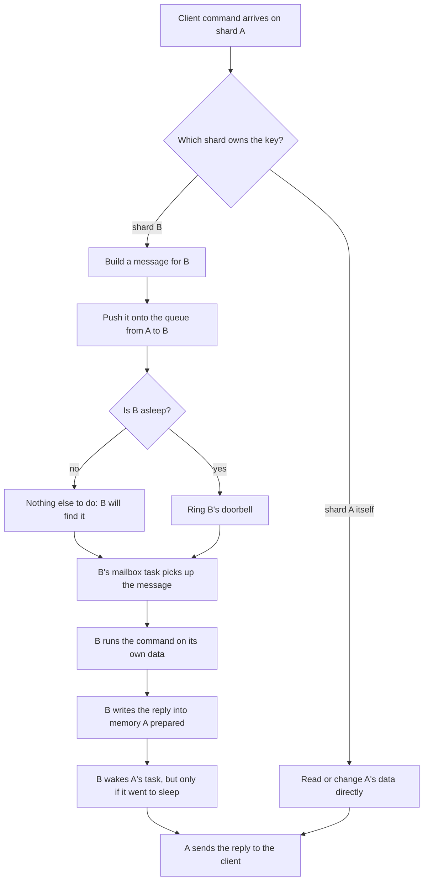
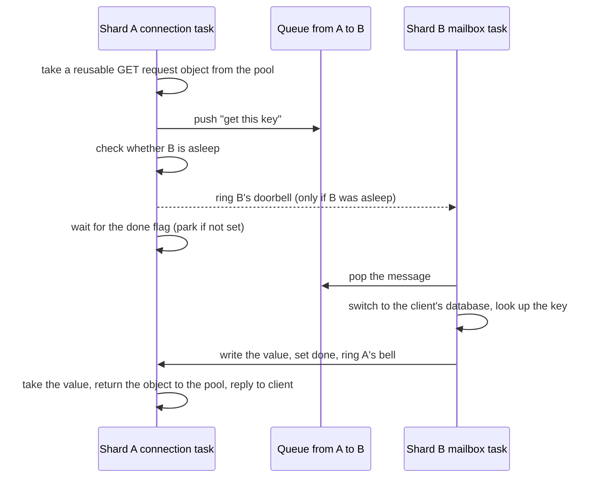
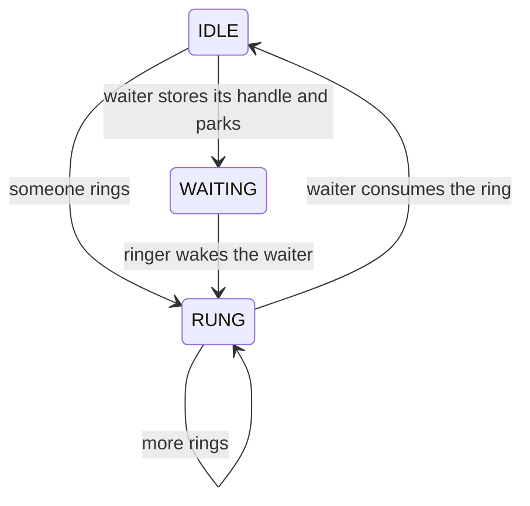
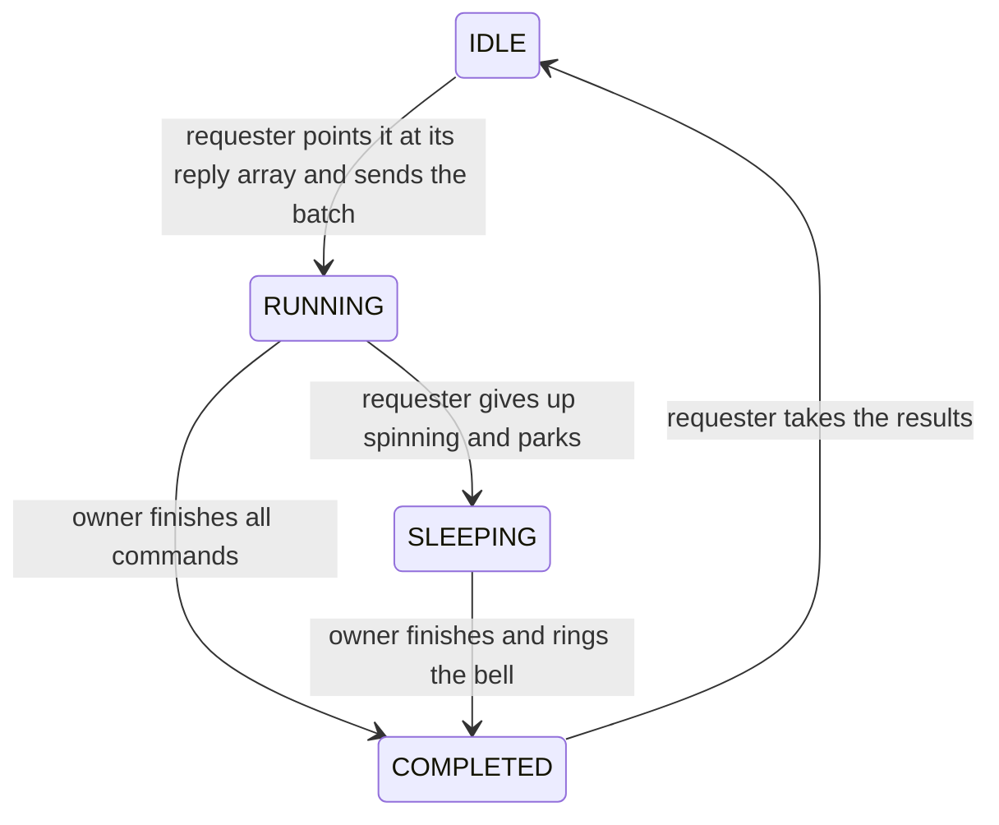

# Component 04: Sharding and the Cross-Core Mesh

> **High-Level Design Spec**: [docs/design/04_sharding_mesh.md](../design/04_sharding_mesh.md)
> **Consolidated Implementation Spec**: [docs/internal/components.md](components.md)
> **Main source files**: src/router.rs (routing and every cross-shard operation), src/mailbox.rs
> (the queues between shards and the reply objects), src/shard.rs (message format and per-shard
> data), src/server.rs (the loop that runs incoming messages), src/connection.rs (pipelines,
> cluster redirection, cross-shard moves). The [Code map](#10-code-map) lists the key symbols.

---

## 1. What this subsystem does

Rudis spreads its work over several worker threads, and gives each thread a private part of the
data. A **shard** is one such thread together with the keys it owns. By default Rudis starts one
shard per CPU core, up to 8; the `threads` setting overrides that. Each shard is pinned to its
core and runs its own single-threaded event loop.

Because only its own thread ever touches a shard's data, that data needs no locks. This is the
whole point of the design: almost every command runs on one core, against memory that no other
core is writing, with no lock contention and no shared cache lines.

The catch is that a client connection lands on whichever shard accepted it, and the keys it asks
for usually belong to some other shard. This subsystem bridges that gap in three steps:

1. **Routing** — work out which shard owns a key.
2. **Dispatch** — if this shard is the owner, do the work right here. Otherwise send a message to
   the owner over the **mesh**: a grid of one-way queues, one for every ordered pair of shards.
3. **Reply** — get the answer back to the waiting connection as cheaply as possible, usually by
   having the owner write it straight into memory the requester set aside for it.

Every command handler goes through this subsystem. So do persistence, replication, tiering,
pub/sub and cluster code whenever they need to reach or collect from all shards.

---

## 2. Mental model

Picture the process as N small, single-threaded Redis servers that share one listening port and
can post work orders to each other. (In cluster mode each shard listens on its own port instead:
the node's port plus the shard number.)



Six ideas explain almost everything in this document:

* **The request moves, not the data.** A value is never read or written by a foreign thread. The
  owner runs the command and also performs its side effects — writing to the append-only file
  (AOF), feeding replication, sending keyspace notifications. Each shard therefore logs only its
  own changes.
* **Slots.** In cluster mode a key belongs to one of 16,384 **slots** (the Redis Cluster unit of
  ownership), and each slot belongs to one shard. Outside cluster mode keys are hashed straight to
  a shard.
* **One queue per direction per pair.** Each queue has exactly one writer and one reader, which
  lets it work without locks. Messages on one queue stay in order; messages from different
  senders have no order relative to each other.
* **Cheap sleep and wake-up.** A shard with nothing to do **parks**: its task suspends and lets
  the event loop run other work until something wakes it. A sender pays for a wake-up only when
  the receiver has actually announced that it is going to sleep.
* **Replies through shared memory.** For the busy paths, the requester prepares a reply slot,
  the owner fills it and sets a "done" flag, and the requester reads it. No reply message is
  sent back.
* **Atomicity is opt-in.** Single-key commands are naturally atomic because one thread owns the
  key. Commands that touch several shards at once use a version check and per-shard locks,
  described in [§7.4](#74-cross-shard-atomicity-a-seqlock-with-a-locked-fallback) and
  [§7.11](#711-cross-shard-transaction-locks).

Here is a remote `GET` from start to finish:



---

## 3. Key routing

### 3.1 Hash tags and slots

Some commands need several keys on the same shard — a transaction over a user's profile and cart,
for example. Rudis follows the Redis convention of **hash tags** for this. If a key contains
`{...}` with something inside the braces, only that inner part decides where the key goes. So
`{user:1}:profile` and `{user:1}:cart` always land together. Empty braces do not count: `{}foo`
is routed on the whole key.

In cluster mode the tag (or the whole key) is turned into a slot exactly the way Redis Cluster
does it — a CRC16 checksum modulo 16,384 — so cluster-aware clients compute the same slot.

Slots are then assigned to shards in **contiguous ranges**, not round-robin. With 4 shards, shard
0 owns slots 0–4095, shard 1 owns 4096–8191, and so on, so each shard serves one block of slots on
its own port (this is also how `CLUSTER SLOTS` splits a node's ranges per shard port). For example, the key
`foo` is in slot 12182, and 12182 × 4 / 16384 rounds down to 2, so shard 2 owns it.

One related helper works out the slot of a glob pattern, when the pattern can only ever match one
slot (it has a complete, non-empty hash tag before any wildcard). `SORT ... BY` and `SORT ... GET`
use it in cluster mode to reject patterns that could reach keys in other slots.

### 3.2 Standalone mode: hashing without slots

Outside cluster mode there are no slots. The key's tag is hashed with the same fast hash the
storage table uses (FxHash), the result is scrambled, and the remainder modulo the shard count
picks the shard.

The scrambling step matters. FxHash only pushes a key's differences toward the high bits of the
hash, so taking the remainder directly would send keys that differ only in their last characters
— `key:0001` through `key:9999`, say — to the same shard. The scrambler (the splitmix64
finalizer) spreads every bit across the whole hash first. It deliberately uses different
constants from the table's own bucket mixer, so the choice of shard and the choice of bucket
inside that shard stay independent.

A side benefit: when a key has no hash tag, the same hash serves both for picking the shard and
for the owner's table lookup, so the key is hashed only once.

One consequence to keep in mind: in standalone mode the shard is a function of the shard count,
so changing the number of threads moves almost every key to a different shard.

### 3.3 Two routing paths: the fixed layout and the slot-owner table

The contiguous layout above is only the default. Cluster commands can assign a slot to a specific
local shard, and each shard records those choices in a **slot-owner table** (`slot_owners`).

The table starts empty. The first time a slot is assigned, the shard fills all 16,384 entries
with the default layout and then overwrites the one entry. `CLUSTER ADDSLOTS` and
`ADDSLOTSRANGE` record every added slot (with its default owner), and `CLUSTER SETSLOT <slot>
NODE ...` can point a slot at a particular shard of this node. In practice, then, any node that
has been given slots has a filled table.

There are two ways to ask "who owns this key?", and they differ in whether they know about the
table:

| Question asked through | Uses slots when | Knows about the slot-owner table? |
| :--- | :--- | :--- |
| The shard's router (the normal path) | cluster mode is configured, the table is filled, or a cluster is active on this node's port | Yes |
| Free-standing helper functions | a process-wide "some cluster is active" flag is set | No — they only know the default layout |

"A cluster is active" means the node's cluster state has peers or cluster mode is configured. The
process-wide flag is set at startup with `cluster-enabled yes` and whenever `CLUSTER MEET` adds a
node.

Nearly every operation, including the pipeline path, asks the router. A few places still use the
free-standing helpers; [§9](#9-limitations-and-not-implemented) lists them and explains when that
matters.

### 3.4 Worked example

A 4-shard node in cluster mode receives `GET {user:7}:name` on shard 0.

1. Before running anything, the connection checks whether the client should be redirected
   ([§7.10](#710-cluster-redirection-and-slot-table-propagation)). The slot comes from the tag
   `user:7`.
2. Suppose this node owns the slot but the slot-owner table says shard 3 serves it. Because each
   shard has its own port in cluster mode, the client is told to go there: `-MOVED <slot>
   127.0.0.1:<node port + 3>`.
3. Otherwise the `GET` handler asks the router for the value. The router finds the owner and, if
   it is another shard, takes the remote path in
   [§7.1](#71-single-key-operations).

In standalone mode the same key simply hashes to some shard and there is no redirection: any shard
serves any key by forwarding the request.

---

## 4. What each shard holds

### 4.1 The router

Every shard has one **router** (`Router`): its handle on everything it needs to serve a command.
It holds the shard's own data, one sender for each shard in the mesh, the slot state and
slot-owner tables, a slot for the current AOF writer, the local pub/sub subscribers, the
cross-shard transaction lock, tiering pacing state, and a set of object pools. Because a shard is
single-threaded, all of this is plain single-thread shared state with no locks inside.

A few resources are shared by the whole node rather than per shard: the memory and tiering
counters, the "a save is in progress" flag, and the table of which shards have pub/sub
subscribers. They are looked up by the node's base port, so in cluster mode — where every shard
has its own port — all shards still share one memory budget, one save flag and one presence
table.

The AOF writer sits in a swappable slot because `CONFIG SET appendonly` can turn the AOF on or
off at runtime. Code fetches the current writer each time it needs it instead of keeping a copy.

**Object pools.** The busy cross-shard paths would otherwise allocate a request object, a
channel or a few vectors on every call. Instead the router keeps small pools of these and reuses
them:

| Pool of | Used by | Kept at most |
| :--- | :--- | :--- |
| GET and SET request objects | remote single-key GET and SET | 64 each |
| Scatter request objects | cross-shard MGET and MSET | 32 each |
| Per-shard key buckets | splitting MGET/MSET keys by shard | — |
| Key lists | atomic MGET retries ([§7.4](#74-cross-shard-atomicity-a-seqlock-with-a-locked-fallback)) | — |
| Batch responders | running arbitrary commands on another shard | — |
| One-slot reply channels | single-key ops, flushes, barriers, lock grants | 64 per type |

[Reference details](#111-router-fields-and-pools) lists every field and pool by name.

### 4.2 The shard's data

The shard's data lives in a `ShardDb`. Its main part is the key table for each logical database:
the currently selected one is "in hand", and `SELECT` swaps another one in (creating it empty the
first time). Alongside the key table sit the shard's other stores — vector and search indexes,
JSON, CRDT and probabilistic structures, the AI feature stores, and the set of "sticky" keys
pinned in memory.

**Every keyed message carries a database number.** Because each shard keeps only one database in
hand at a time, a request from a client that selected database 3 must say so. The owner switches
to that database before running the request. Forgetting this would run the command against
whatever database the shard last used.

**Tier bookkeeping.** When a write overwrites or deletes a key whose value was spilled to NVMe,
the table notes the freed disk extent, and the shard hands it to the tiering manager right after
the write. That keeps tiering statistics and free space accurate (see Component 07).

**The snapshot write hook.** While the shard is building a point-in-time image of itself — for an
AOF rewrite, a full sync to a replica, or `SAVE`/`BGSAVE` — the image must record each key's
value as it was at the cut. So every write path calls a hook (`shard::before_write`) *before*
changing a key, which lets the image save the old value first. When no image is being built, the
hook is a single flag check. Cross-shard handlers follow the rule too: the owner's SET, DEL,
EXPIRE, PERSIST, MSET and related handlers call it per key, and a batch's fast paths call a
per-command version of it while an image is active.

**Keys written on a writable replica.** A replica normally does not expire its master's keys; it
waits for the master's `DEL`. But a key that a client writes directly on a *writable* replica
never reaches the master, so nobody would ever delete it. The shard that accepted such a write
tells each owner shard to remember the key, and the owner later expires the remembered keys whose
TTL has passed (and forgets those that were deleted or lost their TTL).

### 4.3 Messages between shards

A message (`ShardMessage`) has one variant per remote operation, and the variant also fixes how
the reply comes back. There are four possibilities:

| Reply style | When it is used | Examples |
| :--- | :--- | :--- |
| No reply | Notices that need no answer | slot table updates, releasing a lock, "remember these replica keys" |
| Shared request object | The hottest single-key and multi-key paths | remote GET, SET, MGET, MSET |
| Direct writes into the caller's reply array | Pipelines and arbitrary commands | a batch of commands |
| One-slot reply channel | Everything else | DEL, EXPIRE, SCAN, FLUSHALL, PUBLISH, persistence and tiering steps |

The full list of variants by reply style is in
[Reference details](#112-message-variants-by-reply-style).

A **batch** message carries a list of commands plus the requesting client's context, because the
owner must run the commands "as" that client: whether it speaks RESP3, whether it set
`CLIENT NO-TOUCH`, and its client id (for client-side caching and `NOLOOP`). It can also ask the
owner to hold tracking broadcasts until the client's `EXEC` finishes. Finally, a batch can carry
a replacement for its replication output: the owner then streams those bytes instead of what the
commands would normally replicate. That is how the destination half of a cross-shard `LMOVE`
reaches replicas as a single `LMOVE` ([§7.12](#712-cross-shard-element-moves-lmove-rpoplpush-smove)).

Two older variants, a plain MGET and MSET with a reply channel, are still handled but are only
sent by unit tests.

### 4.4 Compact reply slots

A pipeline of a hundred small commands should not allocate a hundred little buffers for replies.
Each reply slot (`CompactResp`) therefore picks the cheapest form for its contents:

* **Inline** — the whole RESP reply stored inside the slot, up to 30 bytes. That covers `+OK`,
  small integers, nulls, and bulk strings with up to 20 bytes of payload.
* **Value bytes** — a shared reference to the value; the `$<len>` framing is added only when the
  reply is written to the socket. A variant wraps one value in a one-element array.
* **Pre-encoded bytes** — RESP that is already complete, written as is.
* **Owned buffer** — anything else built as bytes.

Strings that the table stores in a packed 7-bit form must be unpacked before they can be sent.
Instead of allocating a buffer per reply, the shard unpacks them into a per-thread 256 KiB **reply
slab** and hands out slices of it, so many replies share one allocation.

Just before the pipeline's replies are assembled, each slot that refers to a value prefetches up
to the first 4 KiB of it into the CPU cache.

### 4.5 Slot states

During resharding a slot can be in one of four states: **stable** (served normally),
**migrating** to another node, **importing** from another node, or **moved** to another node. The
non-stable states record the other node's `host:port`. Only non-stable slots are stored, so an
absent entry means stable. When a shard changes a slot's state, it also posts the change to every
other shard.

---

## 5. The mesh: how messages travel

### 5.1 One-way rings with an ordered overflow

Each queue in the mesh is a **ring buffer** with exactly one producer (the sending shard) and one
consumer (the receiving shard). With a single writer and a single reader, a ring needs only two
counters — a tail that only the producer moves and a head that only the consumer moves — and no
lock at all. Each counter sits on its own 64-byte cache line, so the two cores do not keep
stealing the same line from each other (**false sharing**). The ring's size is rounded up to a
power of two so an index can be computed with a bit mask.

**Pushing** a message:

1. If the ring has room and nothing is waiting in the overflow, write the message into the next
   slot and publish it by advancing the tail.
2. Otherwise take the slow path: lock a small **overflow queue**, first move as many older
   overflow messages into the ring as now fit, then put the new message in the ring if the
   overflow emptied and there is room — or at the back of the overflow queue if not.

**Popping** takes the next slot from the ring, or, if the ring is empty but overflow exists, the
front of the overflow queue (re-checking the ring first, since the producer may just have moved
overflow items into it).

Why an overflow at all? A sender must never wait for a slow receiver, and must never drop a
message. The overflow guarantees both. Order is still strict, because the overflow only ever
holds messages newer than everything already in the ring.

Each message that has to go to the overflow is counted, and the counter is exported on `/metrics`
as `rudis_mailbox_overflows_total`. A steady rise means some shard cannot keep up with what the
others send it.

### 5.2 The doorbell: waking a sleeper without losing the wake-up

A shard with no messages should sleep rather than spin. That raises three requirements: a sender
must be able to wake it, a wake-up must never get lost in a race, and when nobody is asleep,
"ringing" should cost almost nothing. The **doorbell** (`Doorbell`) meets all three with a
three-state flag: idle, waiting, and rung.

* **Ringing** sets the flag to rung in one atomic swap. Only if someone was waiting does the ringer
  also take a small lock and wake them. Ringing an idle bell is therefore just one atomic
  operation.
* **Waiting** first checks for a pending ring and consumes it if there is one. Otherwise the
  waiter stores its wake-up handle *first* and only then switches the flag from idle to waiting.
  That order means a ringer that sees "waiting" always finds a handle to wake. If the switch fails,
  a ring arrived in between, and the waiter consumes it and carries on.

A ring is never lost: it either wakes the parked waiter or stays "rung" for the next wait. The
doorbell is also lighter than a one-slot channel used purely as a signal, which is why the mesh
and the fast reply objects all use it.



A doorbell can also clear a stale ring without waiting (used when resetting a pooled object) and
can block a plain thread (used by tests and synchronous helpers).

### 5.3 Sending, sleeping, and the no-lost-wake-up handshake

Every receiving shard has one doorbell and one **sleeping flag**, shared by all the shards that
send to it.

**Sending** a message:

1. Push it onto the ring.
2. Issue a full memory fence.
3. If the target's sleeping flag is set, ring its doorbell.

Under load the target is busy and its flag is clear, so a send costs only the push. A send never
fails; its result type exists only for the shape of the API.

**Receiving** a message:

1. Try to pop from the incoming rings. If something is there, return it.
2. Set the sleeping flag, then issue a full fence.
3. Try again. If a message arrived in the meantime, clear the flag and return it.
4. If every sender has gone away, the mesh is shutting down: clear the flag and return whatever is
   left (or report that the mesh is closed).
5. Otherwise wait on the doorbell, clear the flag when woken, and go back to step 1.

**Why this cannot lose a message.** The danger is a receiver that checks the rings, finds them
empty, and goes to sleep just as a sender pushes a message and decides not to ring. The two sides
are arranged as a **Dekker handshake**: each writes its own flag first (the receiver sets
"sleeping", the sender pushes the message) and then reads the other's (the receiver re-checks the
rings, the sender reads "sleeping"). With full fences on both sides, at least one of them is
guaranteed to see the other's write. Either the receiver finds the message on its second check, or
the sender sees the flag and rings.

### 5.4 Draining several rings fairly

A shard receives from one ring per sender. It pops from them **round-robin**, starting each time
just after the ring that last delivered. If it always started at ring 0, one busy low-numbered
shard could keep every other sender waiting.

Each ring is first-in first-out, but there is no order between rings: two messages from different
shards to the same target can be handled in either order.

### 5.5 Building the mesh

At startup Rudis builds the whole grid once. For N shards there are N × N rings — a 4-shard
server has 16. A ring between two different shards has 64 slots; a shard's ring to itself has 16.
Bursts beyond that spill into the overflow queue.

Each worker thread receives its own row of the grid (one sender per target shard, including
itself) and its own column (the receiver over every ring that points at it), and builds its
router from those senders.

### 5.6 The receive loop

Each shard runs one **mailbox task** that pulls messages off the mesh and executes them against
the shard's own data, router and pub/sub state. It works in **bursts**:

1. Wait for a message. When one arrives, start a burst.
2. Run the message. Then keep popping and running messages without waiting, up to **64** in a
   row.
3. After 64 messages, yield to the event loop so a steady stream from other shards cannot starve
   this shard's own client connections. When the rings run dry, end the burst and go back to
   waiting.

**Replication bytes are held for the whole burst.** Writes made by the burst's messages produce
replication output, and sending it to replicas one message at a time would mean many small
writes. So the shard holds that output during the burst and streams it out when the burst ends.
There is one exception: before running any message that is *not* a plain data message (GET, SET,
batch, MGET or MSET), the shard first streams what it has held. Whatever that message does — a
flush, a full-sync cut, one step of a cross-shard operation — then appears after the earlier
writes in the replication stream.

For example, shard 2 receives three batches from three shards, each doing one SET, followed by a
FLUSHDB. The three SETs' replication bytes are held. FLUSHDB is not a plain data message, so the
held bytes are streamed first, then the flush runs, and its own bytes are held until the burst
ends. Replicas see SET, SET, SET, FLUSHDB in that order, delivered in two writes instead of four.

At the end of each burst, the shard also writes its pending AOF bytes to the kernel (unless
`appendfsync always` is set). Connections waiting for their write to
reach the AOF therefore usually find it already written without having to send a separate
message.

**Slow work does not hold up the mailbox.** Tier loads, AOF fsyncs, AOF rewrites and turning the
AOF on or off run in separately spawned tasks. Snapshot images are built in small steps instead:
each step message writes about one millisecond's worth of the image and returns, so other messages
keep flowing between steps.

**Yielding.** The event loop library has no public "yield" call, and a task that simply wakes
itself is put back at the *front* of the run queue. So the shard's yield spawns a tiny task whose
only job is to wake the caller, which places the caller at the back of the queue behind other
tasks and I/O completions.

### 5.7 Spinning before parking

A connection waiting for a cross-shard reply can either park right away or check a few times
first. The `cross-shard-spin` setting (also changeable with `CONFIG SET`) is how many times it
checks before parking. The default is **0**: park immediately. Spinning burns the shard's CPU
while other connections on the same shard wait their turn, so parking is usually better. A small
value can shave latency on a lightly loaded server. Every wait in [§6](#6-reply-mechanisms) uses
this setting.

---

## 6. Reply mechanisms

Four ways of getting a reply back coexist. They differ in who allocates, who wakes whom, and
when:

| Mechanism | Used for | How the waiter is woken | Steady-state allocation |
| :--- | :--- | :--- | :--- |
| Single-key request object | remote GET and SET | its own doorbell | none (pooled) |
| Scatter request object | MGET and MSET across shards | a pooled channel, only if the waiter parked | none (pooled) |
| Batch responder | pipelines; running any command on another shard | its own doorbell, only if the waiter parked | none (pooled) |
| One-slot reply channel | most other operations | the channel itself | pooled for common reply types, new otherwise |

### 6.1 The rule all shared objects follow

The first three mechanisms share memory between threads, so they all obey one rule. Each slot in
the shared object is written by **exactly one** shard, and the requester reads it only after it
has seen the "done" signal with acquire ordering — a memory-ordering guarantee that everything the
writer did before setting "done" is visible to the reader.

A pooled object is reused only when no other shard still holds a reference to it (its reference
count is exactly one). Otherwise a late write from an old request could land in a new one. Each
type explains its thread-safety argument in a safety comment in the code.

### 6.2 Single-key GET and SET

A remote GET uses a small request object holding the key, the requester's database and no-touch
setting, a slot for the value, a "wrong type" flag, a done flag, and a doorbell. A SET's object
holds the value and an optional expiry instead.

1. The requester takes a free object from its pool (one nobody else references), resets it, and
   records the key, its current database and its no-touch setting. If none is free it allocates a
   new one.
2. It sends the object to the owner.
3. The owner switches to the right database and looks up the key. It then stores the value, marks
   the key as the wrong type, or records "not found". If the key's value has been spilled to NVMe,
   the owner finishes from a spawned task that reads it back from disk.
4. Finishing means: write the value, set done, ring the doorbell.
5. The requester checks the done flag (spinning as configured), then waits on the doorbell until
   done is set. It takes the value — or returns a `WRONGTYPE` error — and puts the object back in
   the pool (which keeps at most 64).

A remote SET has the same shape. The owner logs the SET to its AOF and replication stream,
applies it, sends keyspace notifications, and checks whether it should start spilling to NVMe
before finishing.

### 6.3 Scatter MGET and MSET: count down, wake once

A cross-shard MGET sends one message to each shard involved, and all of them write into one
shared request object. It holds a result slot per key (each on its own cache line), a counter of
shards still working, a three-state flag (**running**, **completed**, **sleeping**), the
requester's database, and a channel to wake the requester. An MSET object is the same minus the
result slots, since its reply is always `+OK`.

1. The requester resets the object with the number of shards that will reply (if that number is
   zero, it starts out completed).
2. Each shard writes its results into the slots for its keys, hands its emptied key list back for
   reuse, and then reports that it is finished.
3. Reporting decrements the counter. Only the shard that brings it to zero marks the object
   completed — and it sends on the wake-up channel only if the requester had marked itself
   sleeping. Every other shard does nothing more.
4. The requester returns at once if the object is already completed. Otherwise it spins as
   configured, then tries to switch the flag from running to sleeping. If that works it waits on
   the channel; if it fails, the last shard must have just completed it.

So only a requester that really parked costs a channel send, and since that send never blocks, a
full channel can never stall a finishing shard.

When taking an object from the pool, the requester skips any that are too small for this request
or still referenced by a straggling shard (they go back into the pool; it never waits on them). A
new object gets room for at least 64 keys, and the pool keeps at most 32.

### 6.4 Batch responder: remote shards write straight into the reply array

For pipelines and for running arbitrary commands remotely, copying replies back would be wasted
work. Instead the requester hands the owner a pointer to its own array of reply slots, and the
owner writes each reply directly into its place. The **batch responder** (`BatchResponder`) is
the small shared object that coordinates this. It has four states:



1. **Prepare.** The requester records where its reply array is and how long it is, sets the state
   to running, and sends the batch. The queue's ordering guarantees make those values visible to
   the owner.
2. **Write.** The owner writes each reply into its slot. It checks the index against the array's
   length, so a bad index panics instead of writing past the end. Each slot is written by exactly
   one shard.
3. **Report slow commands.** Commands that crossed the slow-log threshold are recorded on the side
   (behind a lock, since this is rare). The requester later logs them with its own client's
   address and name.
4. **Finish.** The owner hands the list of commands back for reuse — the commands themselves are
   left in it, so their memory is freed on the requester's core — and marks the batch completed.
   It rings the bell only if the requester was sleeping.
5. **Take.** The requester checks for completion without waiting, or parks until completed, then
   sets the state back to idle and takes the command list.

The idle state, which the scatter objects do not need, marks a responder that is safe to hand to
the next request.

### 6.5 One-slot reply channels

Everything without a dedicated shared object carries a one-slot channel in its message, and the
owner sends the reply on it. Channels for the common reply types come from pools: yes/no answers
(DEL, EXISTS, EXPIRE, PERSIST), integers (TTL, EXPIRETIME), increment results, counts (PUBLISH,
multi-key DEL, defragmentation, sticky keys), and plain acknowledgements (FLUSHDB, FLUSHALL,
SWAPDB, slot barriers, lock grants). Returning a channel to its pool first drains any leftover
value; each pool keeps at most 64.

Lower-traffic gathers still create a fresh channel per remote shard. Examples are JSON MGET,
memory breakdowns, KEYS, SCAN, RANDOMKEY, the PUBSUB introspection commands, full-text search,
CLIENT LIST, slot key counting, the snapshot fan-outs, turning the AOF on or off, and cross-shard
element moves.

**Replica batches do not wait in place.** A replica applying its master's stream sends one batch
of commands to each shard that has work, all answering on one shared channel, and gets back an
"in flight" handle it can poll or await. Because each shard applies its messages in order, later
commands for that shard still come after the batch even while it is in flight. Each send also
bumps a replication counter of batches in flight, which the owner decrements after applying.

---

## 7. Algorithms

### 7.1 Single-key operations

Every single-key operation on the router follows the same pattern:

1. Find the owner shard of the key (and the key's hash, so the owner can reuse it).
2. If this shard is the owner, run the operation on the local data, then do the side effects:
   log the change to the AOF and replication, send keyspace notifications, and check whether
   tiering should spill something to NVMe.
3. Otherwise build the message, send it, and wait for the reply. The owner does the same side
   effects on its side.

Local reads have one extra branch for tiering. If the key is not in memory but its value has been
spilled to NVMe, the shard reads it back: it streams the value from disk without bringing it back
into RAM when the server is short on memory, and loads it back into RAM otherwise.

Commands without a dedicated router method — some hash, list and SORT helpers, and the generic
fallback for vector-set, OBJECT, XINFO and similar commands — run on the owner through "execute
remote" ([§7.6](#76-running-any-command-on-another-shard)).

### 7.2 Single-command MGET: scatter-gather

An MGET outside a transaction runs in atomic mode
([§7.4](#74-cross-shard-atomicity-a-seqlock-with-a-locked-fallback)). Inside `EXEC` it runs the
plain version, because the transaction already holds the shards' locks. Either way the core is
one "begin, then finish" round, which splits the work so the local keys are read while the remote
shards work.

**Worked example.** Shard 0 of 3 receives `MGET a b c d`. Keys `a` and `d` live on shard 0, `b` on
shard 1, and `c` on shard 2.

1. **Split.** The shard sorts the keys into buckets by owner, remembering each key's position:
   `a` (position 0) and `d` (position 3) are local; `b` (position 1) goes in shard 1's bucket;
   `c` (position 2) goes in shard 2's. Two remote shards are involved.
2. **All-local shortcut** (not taken here). If every key were local, the reply would be written
   straight to the output and nothing shared would be touched. A single-shard server always takes
   this path.
3. **Send.** The shard takes a wake-up channel and a scatter object expecting 2 replies, and sends
   one scatter message to shard 1 (for `b`) and one to shard 2 (for `c`). Each carries the client's
   no-touch setting.
4. **Overlap.** While shards 1 and 2 work, it reads `a` and `d` locally into result slots 0 and 3.
5. **Remote side.** Shard 1 switches to the client's database, looks up `b` and writes it into
   slot 1. Keys spilled to NVMe are handled in a spawned task, as in §7.1. Shard 1 then returns
   its key bucket and reports finished. Shard 2 does the same for `c`. Whichever finishes second
   marks the object completed.
6. **Gather.** Shard 0 waits for completion, returns the buckets and the channel to their pools,
   writes `*4` followed by the four results (as values or nulls) straight from the shared slots,
   and returns the object to its pool.

A version that returns the values instead of a RESP reply exists but is only used by unit tests.

### 7.3 MSET

The first half of an MSET never waits:

1. On a single-shard server, set every pair locally, log one MSET, and finish.
2. Otherwise split the pairs by owner. If they are all local, log and apply the local MSET and
   finish.
3. Otherwise take a wake-up channel and a scatter object, send one scatter message per remote
   shard, then log and apply the local pairs while the others work.
4. Each remote shard logs its own smaller MSET, applies its pairs, checks tiering, returns its
   pair list, and reports finished.

The second half waits for completion and returns the buckets, channel and object to their pools.
Outside a transaction, the MSET command uses the atomic version in §7.4; inside `EXEC` it uses
this plain one.

### 7.4 Cross-shard atomicity: a seqlock with a locked fallback

**The problem.** An MGET across shards reads each shard at a slightly different moment. If a
cross-shard write — an MSET, an EXEC, a key move — is running at the same time, the MGET could see
it half applied: the new value on one shard and the old value on another.

**The idea.** Rudis uses a **seqlock**: a version number (an "epoch") that every cross-shard
writer bumps when it starts and again when it finishes. A reader notes the epoch, reads, and
checks the epoch again. If it did not move and no write was running at the start, no cross-shard
write overlapped the read, so the result is consistent. Readers never block writers, and in the
common case they take no locks at all.

The bookkeeping uses four process-wide counters:

| Counter | What it counts |
| :--- | :--- |
| Writers | Cross-shard writes in progress, locked or not |
| Lock-free writers | The subset running without the shards' locks |
| Locked readers | MGETs that gave up retrying and now read under the locks |
| Epoch | Bumped when any cross-shard write starts and again when it ends |

**Writers** hold a write guard (`XShardWriteGuard`) for the whole write. There are two kinds:

* A **locked** guard, for writers that already hold the shards' transaction locks
  ([§7.11](#711-cross-shard-transaction-locks)): multi-shard EXEC, cross-shard RENAME, RENAMENX
  and COPY, LMOVE, RPOPLPUSH and SMOVE, MSETNX, BITOP, and an MSET that had to lock. It bumps the
  writer count and the epoch.
* A **lock-free** guard, for a normal cross-shard MSET. It first bumps the lock-free count, then
  checks for locked readers. If one exists it backs out, and the MSET must take the locks instead.
  Otherwise it bumps the writer count and the epoch.

Dropping either guard bumps the epoch again and lowers the counts.

**An atomic MSET:**

1. If there is one shard, or every key is on the same shard, run a plain MSET.
2. Otherwise try for a lock-free guard. If that works, run the MSET under it.
3. If not — an MGET is reading under the locks — take the transaction locks of every shard
   involved (in ascending order), plus a locked guard, and run the MSET.

Taking every shard's lock on every cross-shard MSET would serialize them all, so the lock-free
path is the normal case. The price is that two concurrent cross-shard MSETs of the same keys are
not ordered against each other.

**An atomic MGET:**

1. If there is one shard, or every key is on the same shard, run a plain MGET — one shard's reads
   all happen in one step.
2. Otherwise keep a copy of the keys for retries and remember where the reply starts in the
   output.
3. Try up to **3** times: note the epoch (or stop trying if a cross-shard write is running right
   now), run the MGET, and check the epoch again. If it has not moved, done. If it has, discard
   the partial reply and try again.
4. **Locked fallback.** Register as a locked reader, then wait — checking every 20 µs — until no
   lock-free writers are left. From that moment, new MSETs take the locks (step 3 above), so the
   reader cannot be starved. Then take the transaction locks of the keys' shards (in ascending
   order) and read once more.

Both sides use the same "raise my count, then check the other's" pattern — the writer raises the
lock-free count and checks for readers; the reader raises the reader count and checks for
lock-free writers. It is another Dekker-style handshake: with sequentially consistent atomics, at
least one side always sees the other.

**Example.** One client runs `MGET a b` (keys on shards 0 and 1) while another runs
`MSET a 1 b 1`.

* The MGET notes epoch 10 with no writer running. The MSET gets its lock-free guard: epoch 11. It
  writes `a` on shard 0. The MGET's reads see the new `a` and the old `b`. The MSET writes `b` and
  drops its guard: epoch 12.
* The MGET checks: 12 is not 10, so it throws its result away and retries. The next attempt sees
  both new values with an unchanged epoch and returns them.

**Pausing cross-shard writes for a snapshot.** Some snapshots cut each shard at its own moment:
the full sync to a replica, and the per-shard images that `SAVE` and `BGSAVE` start. Such a cut
must not land in the middle of a cross-shard write. So it runs under a pause guard that registers
as a locked reader (draining lock-free MSETs and forcing later ones to lock) and then takes
**every** shard's transaction lock. Single-key commands are not held back.

The pipeline path applies the same rules to whole batches
([§7.7](#77-squashed-pipelines)).

### 7.5 Multi-key DEL

1. One key: use the single-key DEL.
2. Single-shard server: delete locally, send `del` notifications, log one DEL of the keys that
   were actually deleted.
3. Otherwise sort the keys by owner. Delete the local ones in place (logging one DEL), send one
   message per remote shard with its keys — all before waiting on any — and add up the counts.

This path uses pooled one-slot channels, one per remote shard, rather than a scatter object.

### 7.6 Running any command on another shard

"Execute remote" runs one arbitrary command on another shard and returns its RESP reply. It
reuses the batch machinery with a batch of one:

1. Take a batch responder from the pool (or create one).
2. Point it at a single reply slot that lives inside this function's own state.
3. Send a one-command batch with the client's database, RESP version, client id, no-touch and
   deferred-broadcast settings.
4. Check for completion as configured, then park until done.
5. Convert the reply slot to bytes and put the responder back in the pool.

A "many" variant sends one single-command batch per (shard, command) pair, runs an optional piece
of local work while they are in flight, then waits for all of them and returns the replies in
input order. Talking to K remote shards thus costs one round trip, not K. Fan-outs such as DBSIZE
use it to send the same command to every other shard. A related helper runs the command in place
if the target happens to be this shard, and another splits a list of keys into local keys and
per-shard batches, keeping duplicates (EXISTS counts them).

### 7.7 Squashed pipelines

When a client pipelines several commands, Rudis runs the whole pipeline with **at most one batch
message per remote shard** per flush, instead of one message per command. This is called
**squashing**. Throughout, a wrapper keeps the connection's selected database and the shard's
in-hand database in sync across waits.

**When squashing is not used.** The pipeline falls back to running commands one at a time if:

* the client is not authenticated, or the server is loading a full sync;
* the server is a replica and the pipeline contains writes (a read-only replica must answer them
  with `-READONLY`; a writable one must record client-written keys for expiry, §4.2);
* persistence is failing, so writes must be refused with `MISCONF`;
* keyspace notifications are on and some command would notify differently when batched;
* or — checked only when there are special commands, a non-default ACL user, cluster mode, or a
  filled slot-owner table — any command is a special pipeline command, fails an ACL check, has keys
  in different slots (cluster mode), has keys on different shards according to the slot-owner
  table (except MGET, MSET, DEL, UNLINK, EXISTS and TOUCH, which are split per key anyway), touches
  a slot that is not stable or not owned by this node, or is keyless in cluster mode (other than
  harmless ones such as PING, ECHO and TIME).

**Keeping MGET and MSET atomic in a pipeline.** On a multi-shard server, the pipeline is then
scanned for MGETs and MSETs whose keys span shards:

| The pipeline contains | What happens |
| :--- | :--- |
| A cross-shard MGET plus anything other than MGETs | Run command by command: retrying an MGET later could move it after commands that followed it |
| A cross-shard MSET | The whole batch holds one lock-free write guard while it runs; if none is available (an MGET is reading under the locks), run command by command |
| Only MGETs, some of them cross-shard | Note the epoch (or run command by command if a cross-shard write is running) and keep a copy of the commands |

In the last case, if the epoch has moved by the time the replies are gathered, the batched MGET
results are thrown away and each MGET is re-run in atomic mode, in order.

**Dispatch.** The connection keeps a reusable array of reply slots, one per pipelined command.

1. For each command, find its owner (from its key; with a filled slot-owner table, the router
   recomputes it).
   * **Local:** run it right away. GET, plain SET, INCRBY, single-key EXISTS and DEL, and common
     hash, list, set and sorted-set commands have fast paths that write straight into the reply
     slot; others go through the normal local executor. The write fast paths are used only when
     there is no AOF, no replica and no keyspace notification to produce. Local GETs of keys
     spilled to NVMe are put aside and resolved later.
   * **Remote:** add the command, with its slot number and key hash, to that shard's batch.
2. Multi-key commands are **folded**: split into one sub-command per key, each with an extra reply
   slot added after the pipeline's own slots. MGET becomes one GET per key. EXISTS, TOUCH and (on
   the write fast path) DEL and UNLINK become single-key commands whose results are added up. MSET
   on the write fast path sets local pairs in place and turns remote pairs into SETs; its own reply
   is `+OK`.
3. A command that cannot be batched (including MSET off the write fast path) first flushes the
   batches built so far, so it cannot overtake earlier commands, and then runs on its own.
4. At the end the remaining batches are flushed: each non-empty batch's responder is pointed at
   the reply array and the batch is sent. The shard then checks all pending batches for
   completion as configured and parks on each one still running. Returned command lists are
   cleared on this core and kept for reuse.
5. Then the shard resolves the deferred local NVMe reads, logs remote slow commands, adds up the
   folded counts, and finishes any MSETs that ran on their own.
6. Finally it writes the replies in pipeline order. Each slot is prefetched and appended; a folded
   MGET is written as one array built from its sub-slots.

**Worked example.** Shard 0 of 2 gets the pipeline `SET a 1` (owner: shard 1), `GET b` (owner:
shard 0), `MGET a b`.

* Command 0 is remote: shard 1's batch gets "slot 0: SET a 1".
* Command 1 is local: slot 1 gets the value of `b` right away.
* Command 2 is folded: slots 3 (for `a`) and 4 (for `b`) are added. Shard 1's batch gets "slot 3:
  GET a"; slot 4 is filled locally.
* Flush: one batch with two commands goes to shard 1. Shard 1 runs them in order — which is why
  `GET a` sees the pipeline's own `SET a 1` — and writes `+OK` into slot 0 and the value `1` into
  slot 3.
* Output: `+OK`, the value of `b`, then a two-element array built from slots 3 and 4.

**The owner's side of a batch.** The owner adopts the client's context (RESP version, database,
no-touch, deferred broadcasts, client id) and switches to the right database. If the batch carries
a replication replacement, it suppresses the commands' normal replication. For each command it:

1. brings any NVMe-spilled keys of data-type commands back into RAM;
2. calls the snapshot write hook if an image is being built (§4.2);
3. runs a fast path if there is one — GET; SET, INCRBY and DEL when there is no tracking, AOF,
   replica or notification to produce; EXISTS, TOUCH; hash, set, list and sorted-set commands;
   and scripts (EVAL, EVALSHA, FCALL) — or the normal local executor otherwise;
4. writes the reply into the requester's slot and times the command for the slow log.

Afterwards it ends any suppression. If the batch carried non-empty replacement bytes, it streams
them and flushes its replication output immediately, so they are on their way before the requester
hears back. GETs of spilled keys are collected; if there are any, a spawned task streams them from
disk and then finishes the batch, otherwise the batch finishes at once.

### 7.8 Broadcast operations

Operations that must reach every shard apply locally first, then fan out and wait for every
shard to acknowledge:

* **FLUSHDB, FLUSHALL, SWAPDB:** apply and log locally, then send the command to every other shard
  on pooled channels. Each shard applies it, appends it to its own AOF, and acknowledges. Only the
  coordinating shard writes it to the replication stream.
* **PUBLISH:** deliver to local subscribers, then send only to shards that the node-wide presence
  table marks as interested in the channel (by channel or by pattern), and add up the receiver
  counts.
* **KEYS:** concatenate the local result with every other shard's.
* **DBSIZE** and similar counters: send the command to every other shard at once (§7.6).
* **Per-shard key counts:** each shard's key count in the current database, exported on `/metrics`
  as `rudis_shard_keys`, so an uneven key spread shows up per shard.

### 7.9 Cross-shard SCAN

A SCAN cursor has to remember both which shard the scan is on and where it is inside that shard.
Rudis packs both into the 64-bit cursor: the **shard number in the high 32 bits** and that
shard's own table cursor in the low 32 bits.

1. Decode the shard and the inner cursor. A shard number past the last shard returns cursor 0 and
   no keys.
2. Scan that shard (locally, or by message) for the number of keys still wanted (at least one).
3. If the shard has more, return a cursor pointing at the same shard and its next inner position.
4. If the shard is finished, move on to the next shard. Once enough keys are collected, return a
   cursor for the start of the next shard; after the last shard, return 0.

For example, with COUNT 10, shard 0 might return 4 keys and finish, and shard 1 return 6 keys with
inner cursor 37. The reply cursor is then shard 1 in the high half and 37 in the low half. One call
can thus cross several sparse shards. What the inner cursor means is up to the shard's table and
is documented in Component 05.

### 7.10 Cluster redirection and slot-table propagation

**Redirection.** Before running a command, the connection checks whether this shard should serve
it at all:

1. **Multi-key commands.** In cluster mode, all keys of a command must share a slot, or the reply
   is `-CROSSSLOT`. Outside cluster mode, if the `cross-shard-strict` setting is on (default off;
   settable in the config file, on the command line, or with `CONFIG SET`) and there is more than
   one shard, a command whose keys live on different shards gets the same `-CROSSSLOT` error. An
   `EXEC` applies this check to all keys of its queued commands and refuses the whole transaction.
   Keys that share a hash tag share a shard, so they keep working.
2. **The command's first key** is checked against its slot's state:
   * **Moved** — reply `-MOVED` with the new address.
   * **Importing** — reply `-MOVED` to the source node, unless the client sent `ASKING` (or this is
     a `RESTORE ... ASKING`).
   * **Migrating** — if the key does not exist here, reply `-ASK` with the target node.
   * **Stable** — in cluster mode: if this node owns the slot (or the client is a READONLY client
     of a replica serving it) but a different local shard serves it, reply `-MOVED` to that shard's
     port. If this node does not own the slot, reply `-MOVED` to the healthy master that does —
     directly at the port of the shard that serves it there — or `-CLUSTERDOWN Hash slot not
     served` if there is none.

**One hop instead of two.** When redirecting to another node, Rudis points the client straight at
the shard port that serves the slot there, saving the client a second `-MOVED` inside that node.
To make that possible, nodes announce their shard count in cluster-bus PING and PONG frames (the
real count in cluster mode, 1 otherwise; 0 until known). For a peer with more than one shard, the
port is the peer's port plus the default shard for the slot. For example, a peer at port 7000 that
announces 4 shards serves slot 9000 at port 7000 + 9000 × 4 / 16384 = 7002. `CLUSTER SLOTS` uses
the same announced count to list each node's ranges per shard port.

A reusable function implementing the same slot-state check exists in the router but has no
callers.

**Keeping every shard's slot tables in sync.** Changing a slot's state or owner updates the local
tables and posts the change to every other shard, which applies it (filling its own slot-owner
table the same way the sender did). Those posts get no reply, so for a moment a connection on
another shard could still see the old table. That is why every `CLUSTER SETSLOT`, `ADDSLOTS` and
migration step then runs a **slot barrier**: it sends a barrier message on every ring and waits for
all of them to be answered. Because each ring is first-in first-out, an answered barrier proves
that every slot update sent earlier on that ring has been applied.

### 7.11 Cross-shard transaction locks

Some operations must change (or read) several shards as one step. Each of them takes an advisory
per-shard **transaction lock** (sometimes called the VLL lock) on every shard involved:

| Who takes the locks | Why |
| :--- | :--- |
| EXEC touching more than one shard | the whole transaction runs as one step |
| Cross-shard RENAME, RENAMENX, COPY | the key leaves one shard and appears on another |
| Cross-shard LMOVE, RPOPLPUSH, SMOVE, and blocked BLMOVE and BRPOPLPUSH | the element leaves one key and joins another ([§7.12](#712-cross-shard-element-moves-lmove-rpoplpush-smove)) |
| Cross-shard MSETNX and BITOP | all-or-nothing writes over several shards |
| A cross-shard MSET while an MGET reads under the locks | see §7.4 |
| An MGET that could not get a consistent read | see §7.4 |
| A snapshot cut | takes every shard's lock (§7.4) |

These helpers skip locking when they run inside `EXEC`, since the transaction already holds the
locks for all its keys.

How a lock is taken and released:

1. The caller lists the shards involved, **sorts them in ascending order**, removes duplicates,
   and takes a fresh lock id from one counter that all lock takers share — so a lock can never be
   released by a different holder.
2. It visits the shards in order. On the local shard: if the lock is free, take it; otherwise join
   the waiting line and wait. On a remote shard: send a lock request and wait for the grant (the
   remote shard grants immediately or queues the request).
3. Writers then hold a locked write guard (§7.4) until just before releasing.
4. Release visits the shards in reverse order. A shard whose lock is held by this id passes it to
   the next waiter that is still alive (skipping any that gave up). Remote shards are sent a
   release notice with no reply. Release does not need to wait, so it can run from cleanup guards
   when a transaction ends.

Taking locks in ascending shard order is what prevents deadlock: two lock holders can never each
hold a lock the other is waiting for. The locks are **advisory** — only other lock takers check
them. Ordinary single-key commands go straight through.

### 7.12 Cross-shard element moves (LMOVE, RPOPLPUSH, SMOVE)

Moving an element between keys on different shards has two problems beyond plain atomicity:

* Replicas must receive **one** logical `LMOVE` or `SMOVE`, not a separate pop and push.
* No other write to the source key may slip between the pop and that logical command in the
  replication stream. For example, a racing `RPUSH` to the source of an `RPOPLPUSH` must reach
  replicas on the same side of the move as it actually ran.

The move runs like this:

1. Take both shards' locks in shard order (unless inside `EXEC`), and hold a locked write guard.
2. Check types the way Redis does: a missing source returns nil (or `:0` for SMOVE); a source or
   destination of the wrong type returns `WRONGTYPE`.
3. Build the pop (LPOP, RPOP, or SREM of the member), the matching push, and the RESP text of the
   logical LMOVE, RPOPLPUSH or SMOVE.
4. Run the source half **on the source shard's thread** — directly if that is this shard,
   otherwise by sending a move message and waiting for the pop's reply.
5. On the source shard:
   * flush its held replication bytes, so earlier writes on this shard are streamed before the
     move;
   * run the pop as the requesting client, with replication suppressed;
   * if nothing was popped, return that reply;
   * otherwise send the destination shard a one-command batch with the push and the logical
     command as its replication replacement;
   * **block this thread** — spinning and yielding the CPU — until the destination answers. After
     10 seconds it gives up; the reply slot is then deliberately leaked rather than freed while the
     destination might still write to it.
6. The destination applies the push, streams the logical command instead of LPUSH or SADD, and
   flushes its stream before answering (see the owner's side of a batch in §7.7).
7. Back on the requesting shard: wait until the replication streams are flushed, then reply with
   the element (or `:1` for SMOVE).

Blocking the source thread for the whole round trip is what keeps its own writes out of the gap
between the pop and the logical command. It cannot deadlock, because every move holds both
shards' locks (taken in shard order), so no other move can be blocking the destination's thread
while waiting on this source.

A debug command (`DEBUG CROSS-SHARD-MOVE-DELAY <µs>`) makes the source sleep between the pop and
the push, so tests can observe a half-done move.

Blocked BLMOVE and BRPOPLPUSH across shards (in standalone mode) wait for the source to receive an
element, then retry the move in the same locked way.

---

## 8. Invariants and gotchas

* **One writer per slot, read only after "done".** Every slot of a shared reply object is written
  by exactly one shard and read only after the requester sees completion. Two shards writing the
  same batch slot, or reading MGET results before completion, is a data race.
* **The reply array behind a batch must stay put.** Remote shards write into the requester's reply
  array through a raw pointer. The array must not grow, move or be freed while any batch is
  running. The pipeline path guarantees this by always finishing a flush before touching the array
  again (it may grow between flushes, never during one), and a connection's scratch space is only
  recycled once every responder is idle and unreferenced. "Execute remote" points the responder at
  a slot inside its own async state, so that future must always run to completion — dropping it
  mid-wait would leave the remote shard writing into freed memory.
* **Pooled objects are reused only when nobody else holds them.** Reusing one that a remote shard
  still references would let a late reply corrupt a different request.
* **Per-ring order is load-bearing.** Pipelines rely on it for read-your-own-writes, slot barriers
  rely on it to prove earlier updates were applied, and replica batches rely on it so later
  replicated commands follow a batch still in flight. There is no order between different senders.
* **Use the router to decide ownership.** Code that decides which shard owns a key must ask the
  router whenever the slot-owner table may be filled; the free-standing helpers ignore it.
* **Three wake-up schemes coexist.** The doorbell (the mesh, single-key objects, batch
  responders), the three-state count-down with a channel (scatter objects), and plain reply
  channels. They are not interchangeable; read the specific type before changing a wait loop.
* **Every keyed message carries the database.** A new message type that touches keys must carry
  the requester's database, and its handler must switch to it.
* **Lock lists must be sorted and free of duplicates.** The lock helper does not remove duplicates
  itself; a duplicate shard would make a holder wait behind itself.
* **Never take transaction locks inside EXEC.** The transaction already holds them, and taking
  them again would wait forever. That is why MGET and MSET switch to their plain versions inside a
  transaction, and why the cross-shard move helpers know whether they run inside one.
* **Cross-shard writers must announce themselves.** Any new operation that writes several shards
  as one step must hold a write guard for the whole write — locked after taking the locks, or
  lock-free with a fall-back to locking — or atomic MGETs may see it half applied (§7.4).
* **Call the snapshot write hook before changing a key.** New handlers and fast paths that write
  must call it first, or an image being built records the new value instead of the old one (§4.2).
* **Replication bytes are held per mailbox burst.** A handler whose effect must come after earlier
  writes in the replication stream must not be a plain data message, or must flush the held bytes
  itself, as the element move and a batch with a replication replacement do (§5.6).
* **The element move blocks its shard thread.** It is safe only because both shards' locks are
  held; without them, two shards could end up waiting on each other (§7.12).
* **Sending never fails.** Error handling around sends is purely defensive.
* **Standalone mode does not use slots** unless a cluster is active or the slot-owner table is
  filled. Keys are placed by hash, so changing the shard count reshuffles every key.

---

## 9. Limitations and not implemented

* **Some code still routes with the default layout.** The per-command routing helpers in the
  connection code use the free-standing functions. The pipeline path corrects their answer when
  the slot-owner table is filled, but other users take it as is: the generic keyed fallback (for
  vector-set, OBJECT, XINFO and similar commands), AOF loading, applying replicated commands, and
  the experimental XDP path. The GET, SET and INCREX handlers also use it to choose between their
  local fast path and the routed call, and the `cross-shard-strict` check uses it too. In cluster
  mode, redirection (§7.10) sends `-MOVED` before any of this runs, so the gap only matters when
  the slot-owner table is filled without cluster mode configured.
* **`cross-shard-strict` does not see squashed pipelines.** The check runs per command and per
  EXEC. Multi-key commands that a pipeline folds into per-shard batches (§7.7) are not checked, so
  they are refused only when the pipeline falls back to one-at-a-time execution (for example, a
  cross-shard MGET mixed with other commands).
* **One-hop redirects assume the peer's default layout.** The port is computed from the default
  slot-to-shard mapping, so a slot that the peer reassigned to another of its shards gets one more
  `-MOVED` inside that node.
* **Cross-shard MSETs are not ordered against each other.** Two concurrent lock-free MSETs of the
  same keys can apply in different orders on different shards. Atomic MGETs never see either one
  half applied, but the final values may mix the two.
* **At most 64 shards for pipelines.** The pipeline path tracks in-flight shards in a 64-bit mask,
  and nothing caps the `threads` setting.
* **Not every gather is pooled.** A number of low-traffic fan-outs (§6.5) still create a new
  channel per remote shard per call, and multi-key DEL uses per-shard channels rather than a
  scatter object.
* **Dead or test-only code.** The router's reusable slot-redirection check has no callers; the
  legacy MGET and MSET messages and the value-returning MGET are used only by unit tests.
* **Transaction locks are advisory.** They order EXECs, cross-shard moves, MSETNX, BITOP, locked
  MSETs and MGETs, and snapshot cuts against each other — not against plain single-key commands.
* **No ordering across rings.** Two messages from different shards to the same target can be
  handled in either order.

---

## 10. Code map

| File | Key symbols | Role |
| :--- | :--- | :--- |
| `src/router.rs` | `extract_hash_tag`, `key_slot`, `pattern_hash_slot`, `slot_to_shard`, `shard_of_hash`, `target_shard`, `target_shard_and_hash` | Free-standing key → slot → shard routing (default layout only). |
| `src/router.rs` | `Router`, `Router::new`, `set_base_port`, `Router::aof` | Per-shard router; node-wide resources keyed by base port; the current AOF writer from `aof_slot`. |
| `src/router.rs` | `Router::target_shard`, `Router::target_shard_and_hash`, `target_shard_for_slot`, `get_slot_state`, `set_slot_state`, `set_slot_owner`, `sync_slot_tables`, `check_slot_redirection` | Routing that honors `slot_owners`; slot-table maintenance and barriers. |
| `src/router.rs` | `get`, `get_checked`, `get_local_direct`, `get_local_checked`, `read_cold_key_local`, `set`, `acquire/release_fast_{get,set}_descriptor` | Remote GET/SET over `FastGet`/`FastSet`. |
| `src/router.rs` | `mget`, `begin_mget_resp`, `finish_mget_resp`, `write_mget_resp`, `begin_mset`, `finish_mset`, `mset`, `MgetInFlight`, `MsetInFlight`, `acquire/release_m{get,set}_descriptor` | Scatter-gather MGET/MSET. |
| `src/router.rs` | `write_mget_resp_atomic`, `mset_atomic`, `XShardWriteGuard` (`locked`, `lock_free`), `XShardLockedRead`, `xshard_read_begin`, `xshard_read_is_consistent`, `XSHARD_WRITERS`, `XSHARD_LOCKFREE_WRITERS`, `XSHARD_LOCKED_READERS`, `XSHARD_EPOCH`, `XSHARD_READ_ATTEMPTS`, `pause_cross_shard_writes`, `CrossShardWritesPaused` | Cross-shard atomicity (seqlock plus locked fallback); pausing cross-shard writes for a snapshot cut. |
| `src/router.rs` | `del`, `del_local`, `del_keys`, `exists`, `incr_by`, `expire`, `persist`, `ttl`, `expiretime`, `del_if_unchanged`, `delex`, `acquire/release_*_responder`, `acquire/release_notify_channel` | Single- and multi-key ops on pooled `flume` channels. |
| `src/router.rs` | `execute_remote`, `execute_remote_many`, `execute_remote_many_with`, `execute_on_shard`, `group_keys_by_shard`, `to_other_shards` | Running arbitrary commands on other shards through `BatchResponder`. |
| `src/router.rs` | `flushdb`, `flushall`, `swapdb`, `publish`, `keys`, `scan`, `random_key`, `dbsize`, `shard_dbsizes` | Broadcast and gather operations. |
| `src/router.rs` | `send_replica_batch`, `flush_replica_batch`, `ReplicaBatchInFlight` | Non-blocking fan-out of replicated commands. |
| `src/router.rs` | `acquire_tx_locks`, `release_tx_locks`, `release_tx_locks_now`, `grant_next_tx_lock`, `next_tx_id`, `TxLocksGuard` | Cross-shard transaction locks. |
| `src/mailbox.rs` | `CachePadded`, `SpscQueue` (`push`, `push_slow`, `pop`, `pop_overflow`), `MAILBOX_OVERFLOWS` | Lock-free ring with ordered overflow; overflow counter. |
| `src/mailbox.rs` | `Doorbell` (`ring`, `wait`, `poll_wait`, `try_consume`, `wait_blocking`) | Single-waiter cross-thread wake-up. |
| `src/mailbox.rs` | `ShardSender::send`, `ShardReceiver::{try_recv, recv, recv_async}`, `SenderLife`, `create_shard_mesh` | The mesh and its sleeping-flag handshake. |
| `src/mailbox.rs` | `FastGetDescriptor`, `FastSetDescriptor`, `ScatterMgetDescriptor`, `ScatterMsetDescriptor`, `DESC_*`, `BatchResponder`, `BATCH_*` | Shared-memory reply objects. |
| `src/mailbox.rs` | `yield_now`, `cross_shard_spin`, `set_cross_shard_spin` | Cooperative yield; the `cross-shard-spin` setting. |
| `src/shard.rs` | `ShardMessage`, `MoveElement`, `MovePush`, `ScanParams`, `SlotState` | Message format and slot state. |
| `src/shard.rs` | `CompactResp` (`empty`, `null`, `from_compact_str`, `estimated_len`, `write_to`, `as_slice`, `prefetch`, `into_vec`), `REPLY_SLAB` | Compact reply slots. |
| `src/shard.rs` | `ShardDb`, `select_db`, `switch_db_slow`, `drain_dropped_tier`, `hydrate_cmd_keys`, `replica_local_keys`, `expire_replica_local_keys` | Per-shard data, database switching, tier bookkeeping, writable-replica key expiry. |
| `src/shard.rs` | `before_write`, `before_write_in`, `start_save_image`, `save_image_step`, `RDB_SAVE_STEP` | Snapshot write hook; stepwise per-shard images. |
| `src/server.rs` | mailbox task (`rx.recv_async()` loop), `aof_write_after_mailbox`, `set_shard_appendonly` | Runs every message on the owning shard; per-burst replication batching. |
| `src/replication.rs` | `begin_stream_batch`, `flush_stream_batch`, `end_stream_batch`, `wait_streams_flushed` | Holding a shard's replication bytes for one burst. |
| `src/connection.rs` | `target_shard_of_cmd`, `target_shard_and_hash_of_cmd`, `cmd_primary_key`, `cmd_keys`, `for_each_cmd_key` | Per-command key extraction and default-layout routing. |
| `src/connection.rs` | `execute_commands_squashed`, `execute_commands_squashed_inner`, `flush_remote_batches`, `WithCurrentDb`, `ConnScratch`, `take_conn_scratch`, `recycle_conn_scratch`, `images_before_command` | Squashed pipelines and per-connection scratch pooling. |
| `src/connection.rs` | `execute_command` (CROSSSLOT / MOVED / ASK checks), `cross_shard_strict`, `set_cross_shard_strict`, `keys_on_several_shards` | Cluster redirection; the `cross-shard-strict` refusal. |
| `src/connection.rs` | `execute_tx_step`, `ExecCleanup`, `in_tx`, `move_key_across_shards`, `move_element_across_shards`, `move_element_via_source`, `move_element_from_source`, `msetnx_across_shards`, `bitop_across_shards`, `CROSS_SHARD_MOVE_DELAY_US` | Locked multi-shard EXEC, RENAME/COPY, LMOVE/SMOVE, MSETNX, BITOP. |
| `src/cluster.rs` | `HAS_ACTIVE_CLUSTER`, `has_active_cluster`, `ClusterNodeInfo::shards`, `ClusterNodeInfo::port_for_slot` | Cluster-active detection; one-hop `-MOVED` to the peer shard's port. |
| `src/telemetry.rs` | `format_shard_metrics` | `rudis_shard_keys`, `rudis_mailbox_overflows_total` and other per-shard metrics. |
| `src/main.rs` | `create_shard_mesh` call, shard thread spawn | Gives each shard thread its row of senders and its receiver. |

---

## 11. Reference details

### 11.1 Router fields and pools

| Field(s) | Type | Meaning |
| :--- | :--- | :--- |
| `shard_id`, `num_shards` | `usize` | This shard's index and the shard count. |
| `port`, `base_port` | `u16` | This shard's port and the node's port (shard 0's). `set_base_port` rebinds `is_saving`, `tier_stats` and `presence_table` to the node-wide instances. |
| `cluster_enabled` | `bool` | `cluster-enabled` from the config. |
| `local_db` | `Rc<RefCell<ShardDb>>` | This shard's data. |
| `senders` | `Vec<ShardSender>` | One sender per shard, indexed by target shard id (including this one). |
| `slot_states` | `Rc<RefCell<HashMap<u16, SlotState>>>` | Sparse; a missing slot is `Stable`. |
| `slot_owners` | `Rc<RefCell<Vec<usize>>>` | Empty, or a 16,384-entry slot → shard table. |
| `aof_slot` | `aof::AofSlot` | Swappable holder of the AOF writer; `Router::aof()` returns the current one. `log_mutation` appends to it and to replication. |
| `pubsub`, `presence_table` | `Rc<RefCell<PubSubHub>>`, `Arc<ShardedPresenceTable>` | Local subscribers; node-wide map of which shards have subscribers. |
| `tx_lock`, `tx_waiters` | `Rc<RefCell<Option<u64>>>`, `Rc<RefCell<VecDeque<(u64, flume::Sender<()>)>>>` | The transaction lock and its waiting line. |
| `is_saving`, `db_dir` | `Arc<AtomicBool>`, `PathBuf` | Save-in-progress flag (per base port) and data directory. |
| `is_auto_tiering`, `spill_backoff_until`, `spill_backoff_used`, `remote_spill_backoff`, `remote_evict_backoff`, `backoff_epoch`, `last_usage_refresh` | `Rc<Cell<..>>` | Tiering and eviction pacing (Component 07). |
| `tier_stats` | `Arc<TieringStats>` | Node-wide memory and tiering counters. |
| `fast_get_desc_pool`, `fast_set_desc_pool` | `Vec<Arc<Fast{Get,Set}Descriptor>>` | Cap 64 each. |
| `mget_desc_pool`, `mset_desc_pool` | `Vec<Arc<ScatterM{get,set}Descriptor>>` | Cap 32 each. |
| `mget_batch_pool`, `mset_batch_pool` | `Vec<Vec<Vec<..>>>` | Per-shard key / pair buckets. |
| `mget_keys_pool` | `Vec<Vec<Bytes>>` | Key copies for atomic MGET retries. |
| `remote_responder_pool` | `Vec<Arc<BatchResponder>>` | Responders for `execute_remote(_many)`. |
| `notify_channel_pool` | `Vec<(flume::Sender<()>, flume::Receiver<()>)>` | Wake-up and ack channels; cap 64. |
| `bool_responder_pool`, `i64_responder_pool`, `incr_responder_pool`, `pubsub_responder_pool` | pooled `flume::bounded(1)` of `bool`, `i64`, `Result<i64, String>`, `usize` | Cap 64 each. The `usize` pool also serves `DelKeys`, `ActiveDefrag`, `Stick`/`Unstick`. |

`MgetInFlight` (scatter object, pooled wake-up channel pair, key count) and `MsetInFlight`
(scatter object and channel pair) are the handles that connect the two halves of a cross-shard
MGET or MSET.

### 11.2 Message variants by reply style

| Reply style | Variants |
| :--- | :--- |
| None | `AdoptConnection`, `NotifyList`, `SetSlotState`, `SetSlotOwner`, `ReleaseTxLock`, `RemoveClientPubSub`, `DropSyncImage`, `DropSaveImage`, `RememberReplicaKeys` |
| Shared request object | `FastGet`, `FastSet`, `ScatterMget`, `ScatterMset` |
| Direct writes into the caller's array | `Batch` |
| `flume` channel | Single-key: `Del`, `DelIfUnchanged`, `Exists`, `IncrBy`, `Expire`, `Persist`, `Ttl`, `ExpireTime`, `Delex`. Multi-key: `DelKeys`, `JsonMget`. Moves: `MoveElement`. Keyspace walks: `Keys`, `Scan`, `RandomKey`, `KeyspaceStats`, `CountKeysInSlot`, `GetKeysInSlot`, `FlushSlots`. DB admin: `FlushDb`, `FlushAll`, `SwapDb`. Cluster: `SlotBarrier`. Transactions: `AcquireTxLock`. Pub/sub: `Publish`, `Spublish`, `Ssubscribe`, `Sunsubscribe`, `PubsubChannels`, `PubsubShardchannels`, `PubsubNumsub`, `PubsubShardnumsub`, `PubsubNumpat`. Search: `InitSearchIndex`, `DropSearchIndex`, `SearchQuery`. Persistence and replication: `SyncAof`, `WriteAof`, `RewriteAof`, `SetAppendonly`, `SaveRdbChunk`, `StartSaveImage`, `SaveImageStep`, `StartSyncImage`, `SyncImageStep`, `RestoreRdbChunk`, `ExecuteReplicaCmd`, `ExecuteReplicaCmds`. Tiering and memory: `TierSpill`, `TierLoad`, `TierSpillAll`, `TierCool`, `TierDecommit`, `TierAutoSpill`, `TierGc`, `TierSnapshot`, `StreamColdRead`, `GetUsedMemory`, `MemoryBreakdown`, `TryEvictOneKey`, `EvictUntilUnder`. Stats: `ClientList`, `FlushCommandStats`, `ResetCommandStats`, `ActiveDefrag`. Sticky keys: `Stick`, `Unstick`, `IsSticky`. Legacy (tests only): `Mget`, `Mset`. |

Shapes of the hot variants:

```rust
FastGet  { descriptor: Arc<FastGetDescriptor> },
FastSet  { descriptor: Arc<FastSetDescriptor> },
ScatterMget { shard_id, keys: Vec<(usize, Bytes)>, descriptor, no_touch },  // (result index, key)
ScatterMset { shard_id, pairs: Vec<(Bytes, Bytes)>, descriptor },
Batch { db, items: Vec<(usize, u64, Command)>,      // (reply slot, key hash, command)
        responder: Arc<BatchResponder>, is_resp3, client_id, no_touch, defer_bcast,
        replicate_as: Option<Bytes> },
MoveElement(Box<MoveElement>),  // db, pop, dst_shard, push, logical, client_id, is_resp3, responder
```

In the scatter variants, `shard_id` is the *receiving* shard; it indexes the object's per-shard
slot for handing back key or pair lists. `replicate_as: Some(bytes)` makes the owner suppress the
items' replication and stream `bytes` instead (nothing if empty). `MovePush` is `List { key, to }`
(LPUSH/RPUSH) or `Set { key, member }` (SADD).

### 11.3 Shared reply objects

* **`FastGetDescriptor` / `FastSetDescriptor`:** `key`; `val` and `wrong_type` (GET); `value` and
  `expire_in` (SET); `done` (Release on finish, Acquire on wait); `bell: Doorbell`; `no_touch`
  (GET); `db`. Reset goes through `Arc::get_mut`; `wait_done(spin)` then `bell.wait()` in a loop
  that tolerates stray rings.
* **`ScatterMgetDescriptor` / `ScatterMsetDescriptor`:** `results` (MGET only, one cache-padded
  slot per key), `pending: AtomicUsize`, `state: AtomicU8` (`DESC_RUNNING` = 0, `DESC_COMPLETED`
  = 1, `DESC_SLEEPING` = 2), `db`, `notify` sender, `recycled_keys` / `recycled_pairs` per shard.
  Methods: `reset`, `write_result`, `recycle_keys`, `finish_shard`, `wait_completed`.
* **`BatchResponder`:** `state` (`BATCH_IDLE` = 0, `BATCH_RUNNING` = 1, `BATCH_SLEEPING` = 2,
  `BATCH_COMPLETED` = 3), `responses_ptr`, `responses_len`, `recycled_items`, `bell`, slow-log list
  and flag. Methods: `prepare`, `write_slot`, `report_slow`, `take_slow`, `finish`, `try_take`,
  `wait_take`, `is_idle`.
* **`Doorbell`:** `state: AtomicU8` (`BELL_IDLE` = 0, `BELL_WAITING` = 1, `BELL_RUNG` = 2) and a
  mutex-guarded waker.

### 11.4 `CompactResp` variants

`Small { len, data: [u8; 30] }`, `Big(Vec<u8>)`, `Bulk(Bytes)`, `Array1Bulk(Bytes)`,
`RawBytes(Bytes)`. Constants: `OK`, `INT_0`, `INT_1`, `NULL`, `NULL_RESP3`, `EMPTY_ARRAY`.
`empty()` is a zero-length `Small` marking an unfilled slot; `null(is_resp3)` picks `$-1` or `_`.
`from_compact_str` produces `RawBytes` sliced from `REPLY_SLAB`.

### 11.5 Constants and settings

| Name | Value | Meaning |
| :--- | :--- | :--- |
| Default shard count | `min(cores, 8)` | Overridden by `threads`. |
| Slots | 16,384 | CRC16/XMODEM of the hash tag, modulo 16,384. |
| Slot → shard | `slot * n / 16384` | Contiguous ranges. |
| Standalone shard | splitmix64 finalizer of `table::hash_key`, then `% n` | Finalizer: `x ^= x >> 30; x *= 0xbf58476d1ce4e5b9; x ^= x >> 27; x *= 0x94d049bb133111eb; x ^= x >> 31`. |
| Ring capacity | 64 between shards, 16 to self | Rounded up to a power of two; overflow beyond. |
| Mailbox burst | 64 messages | Then `mailbox::yield_now()`. |
| `cross-shard-spin` | default 0 | Polls before parking on any cross-shard wait. |
| `cross-shard-strict` | default `no` | Config file, `--cross-shard-strict`, or `CONFIG SET`. |
| `XSHARD_READ_ATTEMPTS` | 3 | Lock-free MGET attempts before the locked fallback. |
| Locked-reader poll | 20 µs | Wait for lock-free writers to drain. |
| Element-move timeout | 10 s | Source shard gives up and leaks the reply slot (`mem::forget`). |
| `RDB_SAVE_STEP` | 1 ms | Work per snapshot image step. |
| `REPLY_SLAB` | 256 KiB per thread | Shared buffer for unpacked string replies. |
| `CompactResp::Small` | 30 bytes inline; bulk payload ≤ 20 bytes | |
| Reply prefetch | up to 4 KiB per slot | Before pipeline reply assembly. |
| SCAN cursor | shard in high 32 bits, inner cursor in low 32 bits | |
| Pool caps | 64 (single-key objects, channels), 32 (scatter objects) | New scatter objects get at least 64 result slots. |
| Cluster-bus field | `shards=N` in PING/PONG | Stored as `ClusterNodeInfo::shards`; 0 until known. |
| Metrics | `rudis_mailbox_overflows_total`, `rudis_shard_keys` | On `/metrics`. |

### 11.6 Tests that pin the behavior

* `test_keys_differing_in_last_bytes_spread_over_shards` — standalone hashing spreads similar keys.
* `test_cache_padded_alignment` — cache-line padding.
* `test_spsc_queue_concurrent_overflow_keeps_order` — the overflow keeps strict order.
* `test_try_recv_round_robins_across_producer_shards` — fair draining.
* `test_mesh_ping_pong_never_loses_wakeup`, `test_mesh_sleeping_flag_bypass` — the sleeping-flag
  handshake.
* `test_descriptors_finish_nonblocking_when_notify_channel_full` — finishing never blocks.
* `test_sync_slot_tables_waits_for_earlier_slot_updates` — slot barrier semantics.
