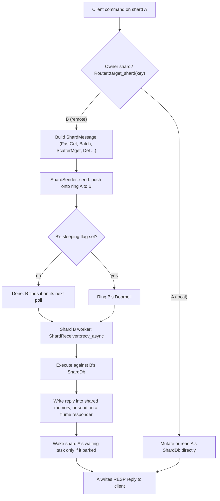
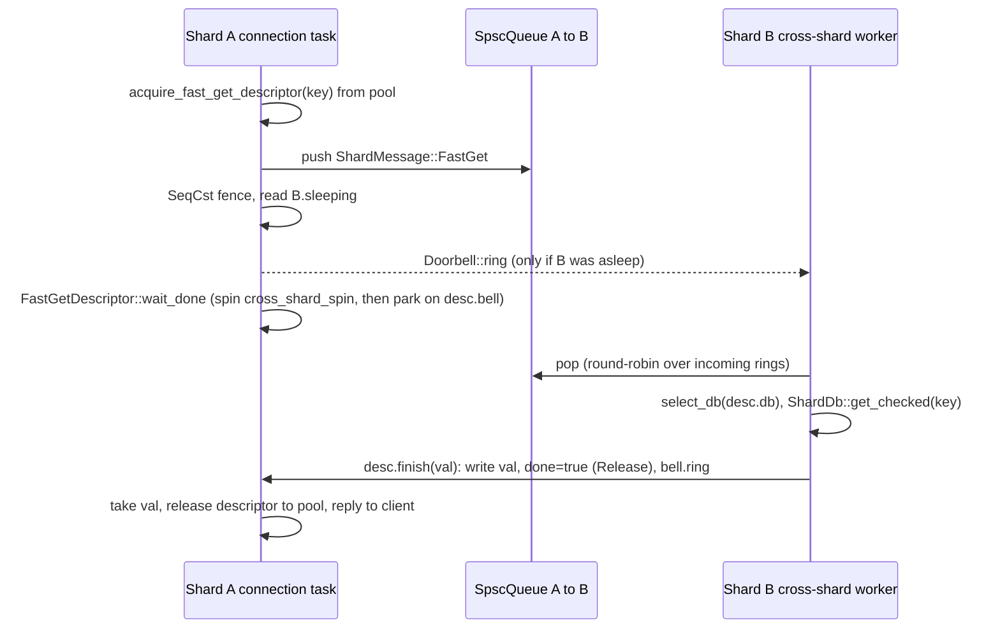
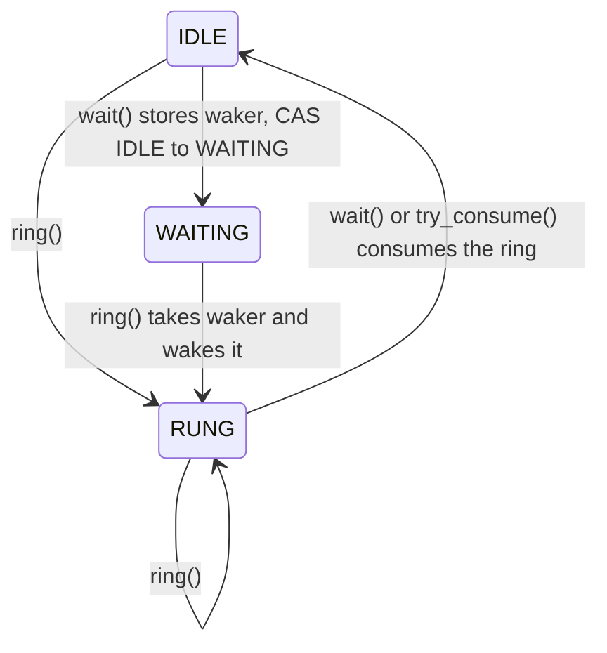
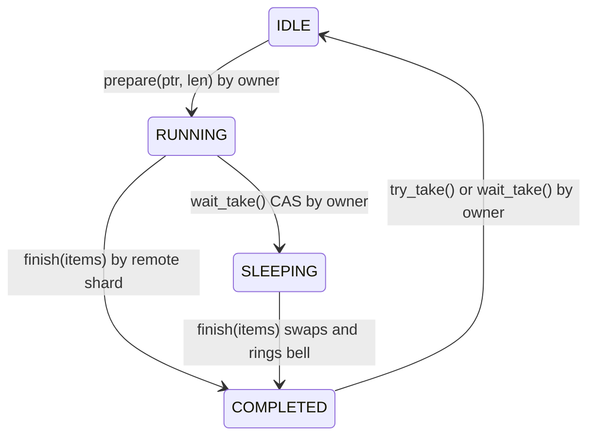

# Component 04: Sharding Architecture & Cross-Core Mesh — Implementation Reference

> **High-Level Design Spec**: [`docs/design/04_sharding_mesh.md`](../design/04_sharding_mesh.md)
> **Consolidated Implementation Spec**: [`docs/internal/components.md`](components.md)
> **Main source files**: `src/router.rs` (key routing, the per-shard `Router`, one method per
> cross-shard operation, object pools); `src/mailbox.rs` (lock-free SPSC rings, the shard mesh,
> the `Doorbell` wake-up primitive, shared-memory reply descriptors); `src/shard.rs` (the
> `ShardMessage` wire format, `CompactResp`, `SlotState`, the per-shard `ShardDb`);
> `src/server.rs` (the receive loop that executes messages on the owning shard);
> `src/connection.rs` (per-command routing helpers, the squashed-pipeline dispatcher, cluster
> redirection).

---

## 1. What this subsystem does

Rudis runs one **shard** per worker thread (by default `min(cores, 8)` threads, or the
`threads` config value). Each shard is pinned to a core, runs its own single-threaded `monoio`
event loop, and owns a private slice of the keyspace in a `ShardDb`. Nothing in a `ShardDb` is
behind a mutex: only its own thread ever touches it.

A client connection, however, lands on whichever shard accepted it, and that shard usually does
not own the keys the client asks for. This subsystem solves that problem:

1. **Routing** — given a key, decide which shard owns it (`router::target_shard`,
   `Router::target_shard`).
2. **Dispatch** — if the owner is the local shard, touch `ShardDb` directly; otherwise send a
   `ShardMessage` to the owner over the **mesh**, a full matrix of lock-free single-producer /
   single-consumer (SPSC) ring buffers, one per ordered pair of shards.
3. **Reply** — get the answer back to the waiting connection task as cheaply as possible: by
   writing straight into shared memory the requester owns (descriptors and `BatchResponder`),
   or, for low-traffic operations, over a small `flume` channel.

Users of the subsystem are every command handler in `src/connection.rs` (through the `Router`
methods or the squashed-pipeline path), plus persistence, replication, tiering, pub/sub and
cluster code that needs to broadcast to or gather from all shards.

---

## 2. Mental model

Think of the process as N independent single-threaded Redis servers that share one listening
port (in cluster mode each shard listens on `base_port + shard_id` instead) and can post work
orders to each other. Every shard has:

* a `ShardDb` (the data),
* a `Router` (its view of "who owns what" plus one `ShardSender` per shard),
* a `ShardReceiver` drained by a dedicated "cross-shard worker" task in its event loop.



A remote `GET` from end to end:



---

## 3. Key routing

### 3.1 Hash tags and slots

`extract_hash_tag(key)` returns the bytes between the first `{` and the first `}` after it, if
that span is non-empty; otherwise the whole key. So `{user:1}:profile` and `{user:1}:cart`
route identically, while `{}foo` routes on the whole key.

`key_slot(key)` is the Redis Cluster slot: CRC16/XMODEM of the hash tag, modulo 16384.

`slot_to_shard(slot, n)` maps a slot to a shard as `slot * n / 16384` — **a contiguous range per
shard, not a modulo**. With 4 shards, slots 0–4095 go to shard 0, 4096–8191 to shard 1, and so
on. Example: `foo` hashes to slot 12182; `12182 * 4 / 16384 = 2`, so shard 2 owns it.

`pattern_hash_slot(pattern)` computes the slot of a glob pattern when it is fixed: it scans left
to right and returns `None` as soon as it sees `*`, `?`, `[` or `\` before a complete non-empty
`{...}` tag; otherwise it returns the tag's slot. `SORT ... BY`/`GET` uses it in cluster mode to
reject patterns that could reach other slots.

### 3.2 Standalone routing: `shard_of_hash`

Outside cluster mode there are no slots. The key's hash tag is hashed with the storage engine's
`table::hash_key` (FxHash) and reduced by `shard_of_hash(hash, n)`, which first runs the
splitmix64 finalizer (`x ^= x >> 30; x *= 0xbf58476d1ce4e5b9; x ^= x >> 27;
x *= 0x94d049bb133111eb; x ^= x >> 31`) and then takes `% n`. The finalizer exists because
FxHash only propagates entropy upward: a plain `hash % n` put keys that differ only in their last
bytes (`sk:0`..`sk:9`, `key:0001`..`key:9999`) on the same shard. Its constants differ from the
table's own bucket mixer, so shard choice and bucket choice stay independent
(`test_keys_differing_in_last_bytes_spread_over_shards`).

### 3.3 Two routing entry points: static and dynamic

| Function | Inputs | When it uses slots | Honors `slot_owners`? |
| :--- | :--- | :--- | :--- |
| `router::target_shard(key, n)` (free fn) | key, shard count | when the process-wide `cluster::HAS_ACTIVE_CLUSTER` flag is set | no |
| `router::target_shard_and_hash(key, n)` (free fn) | same | same | no |
| `Router::target_shard(&self, key)` | key + router state | when `cluster_enabled`, or `slot_owners` is non-empty, or `cluster::has_active_cluster(base_port)` | yes |
| `Router::target_shard_and_hash(&self, key)` | same | same | yes |

* Both `*_and_hash` variants also return the whole-key hash so the owner can reuse it for its
  table lookup (`get_with_hash`, `set_with_hash`, ...). In standalone mode, when the key has no
  hash tag, the same hash serves both purposes, so the key is hashed once.
* `Router::target_shard_for_slot(slot)` returns `slot_owners[slot]` if the table is populated,
  else `slot_to_shard(slot, num_shards)`.
* `cluster::has_active_cluster(port)` checks the port's `ClusterHub` (`has_nodes` or
  `cluster_enabled`) through a per-thread cached copy of the hub list, falling back to
  `HAS_ACTIVE_CLUSTER`. `HAS_ACTIVE_CLUSTER` is set at startup when `cluster-enabled yes` and
  when `CLUSTER MEET` adds a node.

**`slot_owners`** (`Rc<RefCell<Vec<usize>>>`, per shard) starts **empty**. The first
`Router::set_slot_owner` call fills it with 16,384 entries seeded from `slot_to_shard`, then
overwrites one entry. `CLUSTER ADDSLOTS`/`ADDSLOTSRANGE` call `set_slot_owner` for every added
slot (with the default `slot_to_shard` owner), and `CLUSTER SETSLOT <slot> NODE <this node or
one of its shard ids>` reassigns a slot to a specific local shard. So in practice the table is
populated on any node that has been assigned slots, and the dynamic path is what matters there.

Nearly every `Router` method and the squashed-pipeline dispatcher route through the dynamic
`Router` methods. The static free functions remain in a few places (see §9).

### 3.4 Worked example

A 4-shard node in cluster mode receives `GET {user:7}:name` on shard 0:

1. `execute_command` runs the redirection checks (§7.9). The slot is `key_slot("user:7")`.
2. If this node owns the slot but `target_shard_for_slot(slot)` is shard 3, the client gets
   `-MOVED <slot> 127.0.0.1:<base_port + 3>` — in cluster mode each shard listens on its own
   port, `base_port + shard_id`.
3. Otherwise the `GET` handler calls `router.get_checked(key)`; `Router::target_shard` returns the
   owner and the remote path in §7.1 runs.

In standalone mode the same key goes to `shard_of_hash(hash_key("user:7"), 4)` and there is no
redirection: any shard serves any key by forwarding.

---

## 4. Data structures

### 4.1 `Router` (`src/router.rs`)

One `Router` per shard, `Clone` (all shared state is `Rc`/`Arc`). A shard is single-threaded,
so its pools and tables are plain `Rc<RefCell<..>>` / `Rc<Cell<..>>` with no interior locking.

| Field(s) | Type | Meaning |
| :--- | :--- | :--- |
| `shard_id`, `num_shards` | `usize` | This shard's index and the shard count. |
| `port`, `base_port` | `u16` | The port this shard listens on, and the node's port (shard 0's). `set_base_port` also rebinds `is_saving`, `tier_stats` and `presence_table` to the node-wide instances keyed by `base_port`, so all shard ports share one memory budget, one save flag and one pub/sub presence table. |
| `cluster_enabled` | `bool` | `cluster-enabled` from the config. |
| `local_db` | `Rc<RefCell<ShardDb>>` | This shard's data. |
| `senders` | `Vec<ShardSender>` | One sender per shard, indexed by target shard id (including this shard). |
| `slot_states` | `Rc<RefCell<HashMap<u16, SlotState>>>` | Sparse: a missing slot is `Stable` (`get_slot_state`). |
| `slot_owners` | `Rc<RefCell<Vec<usize>>>` | Empty, or a dense 16,384-entry slot→shard table (§3.3). |
| `aof` | `Option<Rc<RefCell<AofWriter>>>` | This shard's AOF writer; `log_mutation` appends to it and the replication stream. |
| `pubsub`, `presence_table` | `Rc<RefCell<PubSubHub>>`, `Arc<ShardedPresenceTable>` | Local subscribers; node-wide bitmap of which shards have subscribers for a channel. |
| `tx_lock`, `tx_waiters` | `Rc<RefCell<Option<u64>>>`, `Rc<RefCell<VecDeque<(u64, flume::Sender<()>)>>>` | The cross-shard transaction lock (§7.8). |
| `is_saving`, `db_dir` | `Arc<AtomicBool>`, `PathBuf` | Snapshot-in-progress flag (shared per base port) and data directory. |
| `is_auto_tiering`, `spill_backoff_until`, `spill_backoff_used`, `remote_spill_backoff`, `remote_evict_backoff`, `backoff_epoch`, `last_usage_refresh` | `Rc<Cell<..>>` | Tiering/eviction pacing state (see Component 07). |
| `tier_stats` | `Arc<TieringStats>` | Node-wide memory and tiering counters. |
| **Pools** (all capped; see §6.5) | | |
| `fast_get_desc_pool`, `fast_set_desc_pool` | `Vec<Arc<FastGetDescriptor>>`, `Vec<Arc<FastSetDescriptor>>` | Remote GET/SET descriptors. |
| `mget_desc_pool`, `mset_desc_pool` | `Vec<Arc<ScatterM{get,set}Descriptor>>` | Scatter-gather descriptors. |
| `mget_batch_pool`, `mset_batch_pool` | `Vec<Vec<Vec<..>>>` | Per-shard key/pair bucket vectors. |
| `remote_responder_pool` | `Vec<Arc<BatchResponder>>` | Responders for `execute_remote(_many)`. |
| `notify_channel_pool` | `Vec<(flume::Sender<()>, flume::Receiver<()>)>` | Wake-up/ack channels. |
| `bool_responder_pool`, `i64_responder_pool`, `incr_responder_pool`, `pubsub_responder_pool` | pooled `flume::bounded(1)` pairs of `bool`, `i64`, `Result<i64, String>`, `usize` | Reply channels for single-key ops; the `usize` pool (named for pub/sub) is also used for `DelKeys`, `ActiveDefrag`, `Stick`/`Unstick` counts. |

`MgetInFlight` and `MsetInFlight` are opaque handles returned by the dispatch half of a
cross-shard MGET/MSET and consumed by the completion half:

```rust
pub struct MgetInFlight {
    descriptor: Arc<ScatterMgetDescriptor>,
    notify_tx: flume::Sender<()>,     // pooled wake-up channel
    notify_rx: flume::Receiver<()>,
    total_keys: usize,
}
pub struct MsetInFlight { descriptor: Arc<ScatterMsetDescriptor>, notify_tx, notify_rx }
```

### 4.2 `ShardDb` (`src/shard.rs`)

The per-shard container. Only its own thread accesses it, so there is no locking.

```rust
pub struct ShardDb {
    pub table: RudisTable,                      // the currently selected logical DB
    pub current_db: usize,
    pub tables: Vec<Option<RudisTable>>,        // the other logical DBs, swapped in on select
    pub port: u16,
    pub shard_id: usize,
    pub tier_manager: Option<Rc<ShardTierManager>>,
    pub vector_indexes: HashMap<String, HnswIndex>,
    pub semantic_caches, agent_memories, llm_quotas, agent_checkpoints, agent_tools, // AI features
    pub crdt_store: CrdtStore, pub json_store: JsonStore,
    pub probabilistic_store: ProbabilisticStore,
    pub sticky_keys: HashSet<Bytes>,
    pub search_indices: HashMap<String, InvertedIndex>,
}
```

**Multi-DB (`SELECT`)**: `select_db(n)` is a no-op if `n` is already current; otherwise
`switch_db_slow` swaps `table` with `tables[n]` (creating an empty table on first use). Every
cross-shard message that touches keys therefore carries the requester's DB index — a `db: usize`
field on the message, or a `db` field on the descriptor — and the receiving handler sets
`connection::CURRENT_DB` and calls `select_db` before executing.

Most `ShardDb` methods are thin delegates to `RudisTable`. Writes (`set`, `set_extended`, `del`,
`del_with_hash`) call `drain_dropped_tier()` afterwards: the table records tier extents freed by
an overwrite or delete in `table.dropped_tier`, and the drain hands each to
`ShardTierManager::on_key_overwritten` so NVMe tiering stats and extents stay consistent.
`del` also removes the key from `sticky_keys`, and deleting a name that is a vector index drops
the index.

### 4.3 `ShardMessage` — the wire format (`src/shard.rs`)

An enum with one variant per remote operation. The variant decides the reply mechanism:

| Reply mechanism | Variants |
| :--- | :--- |
| **None** (fire-and-forget) | `AdoptConnection`, `NotifyList`, `SetSlotState`, `SetSlotOwner`, `ReleaseTxLock`, `RemoveClientPubSub`, `DropSyncImage` |
| **Shared-memory descriptor** (§6.2, §6.3) | `FastGet`, `FastSet`, `ScatterMget`, `ScatterMset` |
| **Direct writes into the caller's buffer** (§6.4) | `Batch` |
| **`flume` responder** (pooled or fresh, §6.5) | everything else: single-key ops (`Del`, `DelIfUnchanged`, `Exists`, `IncrBy`, `Expire`, `Persist`, `Ttl`, `ExpireTime`, `Delex`), multi-key (`DelKeys`, `JsonMget`), keyspace walks (`Keys`, `Scan`, `RandomKey`, `KeyspaceStats`, `CountKeysInSlot`, `GetKeysInSlot`, `FlushSlots`), DB admin (`FlushDb`, `FlushAll`, `SwapDb`), cluster (`SlotBarrier`), transactions (`AcquireTxLock`), pub/sub (`Publish`, `Spublish`, `Ssubscribe`, `Sunsubscribe`, `PubsubChannels`, `PubsubShardchannels`, `PubsubNumsub`, `PubsubShardnumsub`, `PubsubNumpat`), search (`InitSearchIndex`, `DropSearchIndex`, `SearchQuery`), persistence/replication (`SyncAof`, `WriteAof`, `RewriteAof`, `SaveRdbChunk`, `StreamRdbChunk`, `StartSyncImage`, `SyncImageStep`, `RestoreRdbChunk`, `ExecuteReplicaCmd`, `ExecuteReplicaCmds`), tiering/memory (`TierSpill`, `TierLoad`, `TierSpillAll`, `TierCool`, `TierDecommit`, `TierAutoSpill`, `TierGc`, `TierSnapshot`, `StreamColdRead`, `GetUsedMemory`, `MemoryBreakdown`, `TryEvictOneKey`, `EvictUntilUnder`), stats (`ClientList`, `FlushCommandStats`, `ResetCommandStats`, `ActiveDefrag`), sticky keys (`Stick`, `Unstick`, `IsSticky`), and the legacy `Mget`/`Mset` |

The hot variants:

```rust
FastGet  { descriptor: Arc<FastGetDescriptor> },
FastSet  { descriptor: Arc<FastSetDescriptor> },
ScatterMget { shard_id: usize, keys: Vec<(usize, Bytes)>,   // (result index, key)
              descriptor: Arc<ScatterMgetDescriptor>, no_touch: bool },
ScatterMset { shard_id: usize, pairs: Vec<(Bytes, Bytes)>, descriptor: Arc<ScatterMsetDescriptor> },
Batch { db: usize,
        items: Vec<(usize, u64, Command)>,   // (response slot, key hash, command)
        responder: Arc<BatchResponder>,
        is_resp3: bool, client_id: u64, no_touch: bool, defer_bcast: bool },
```

In `ScatterMget`/`ScatterMset`, `shard_id` is the *receiving* shard's id; it indexes the
descriptor's per-shard recycle slot. `Batch` carries the requesting client's context so the
owner can run "as" that client: `client_id` (client-side caching / tracking and `NOLOOP`),
`no_touch` (`CLIENT NO-TOUCH`), `defer_bcast` (tracking broadcasts deferred until the client's
`EXEC` finishes), `is_resp3` (null encoding).

`Mget { db, keys, responder }` and `Mset { db, pairs, responder }` are still handled by the
receive loop but are only constructed by unit tests; production MGET/MSET use the scatter or
batch paths.

### 4.4 `CompactResp` — one reply slot (`src/shard.rs`)

```rust
pub enum CompactResp {
    Small { len: u8, data: [u8; 30] },   // whole RESP reply inline, no allocation
    Big(Vec<u8>),                        // anything else that was built as bytes
    Bulk(Bytes),                         // value bytes; framed as $<len>\r\n..\r\n on write
    Array1Bulk(Bytes),                   // a one-element array around one bulk string
    RawBytes(Bytes),                     // pre-encoded RESP, written verbatim
}
```

* `Small` holds replies up to 30 bytes: `+OK`, small integers, nulls, and bulk strings whose
  payload is at most 20 bytes. Constants: `OK`, `INT_0`, `INT_1`, `NULL`, `NULL_RESP3`,
  `EMPTY_ARRAY`; `CompactResp::empty()` is a zero-length `Small` used as an unfilled slot;
  `null(is_resp3)` picks `$-1` or `_`.
* `from_compact_str` turns a 7-bit-packed heap string value into `RawBytes`: the value is
  unpacked and RESP-encoded into a per-thread 256 KiB **reply slab** (`REPLY_SLAB`) and the reply
  is a `Bytes` slice of that slab, so a remote shard's replies share one allocation instead of
  one `Vec` each.
* `estimated_len`, `write_to`, `as_slice`, `into_vec`, and `prefetch` (issues x86 prefetches for
  up to 4 KiB of a `Bulk`/`Array1Bulk`/`RawBytes` value before the pipeline reply is assembled).

### 4.5 `SlotState`

```rust
pub enum SlotState { Stable, Migrating(String), Importing(String), Moved(String) }
```

The `String` is the other side's `host:port`. Stored sparsely in `Router::slot_states` (absent
means `Stable`). `set_slot_state` updates the local map and posts `SetSlotState` to every other
shard; `Stable` removes the entry.

---

## 5. The mesh transport (`src/mailbox.rs`)

### 5.1 `CachePadded<T>`

`#[repr(align(64))] pub struct CachePadded<T>(pub T)` — puts a value on its own 64-byte cache
line so two cores writing neighbouring atomics do not false-share. It derefs to `T`.
`test_cache_padded_alignment` asserts the alignment.

### 5.2 `SpscQueue<T>` — a lock-free ring with an ordered overflow

```rust
#[repr(align(64))]
pub struct SpscQueue<T> {
    head: CachePadded<AtomicUsize>,     // written only by the consumer
    tail: CachePadded<AtomicUsize>,     // written only by the producer
    buffer: Box<[UnsafeCell<Option<T>>]>,
    capacity: usize, mask: usize,       // capacity = requested.next_power_of_two()
    overflow: parking_lot::Mutex<VecDeque<T>>,
    has_overflow: AtomicBool,
}
```

Single producer, single consumer — enforced by how `create_shard_mesh` hands out rings, not by
the type.

**`push(item)`** (producer):

1. Load `tail` (Relaxed) and `head` (Acquire).
2. If `has_overflow` is false and the ring has room (`tail - head < capacity`), write the slot
   and publish with a Release store of `tail + 1`.
3. Otherwise take the cold `push_slow` path: lock the overflow queue, first move as many queued
   overflow items as fit into the ring (oldest first), then put the new item in the ring if the
   overflow is now empty and there is room, else at the back of the overflow queue. Finally
   `has_overflow = !overflow.is_empty()`.

Because the overflow only ever holds items newer than everything in the ring, the queue stays
strictly FIFO and never drops or blocks (`test_spsc_queue_concurrent_overflow_keeps_order`).

**`pop()`** (consumer): if `head != tail` take the slot and Release-store `head + 1`; else if
`has_overflow`, lock the overflow (re-checking the ring first, since the producer may have moved
overflow items into it) and pop its front; else `None`.

### 5.3 `Doorbell` — a lock-light cross-thread wake-up

`Doorbell` replaces a `flume::bounded::<()>(1)` that was used purely as a signal. It wakes one
waiting task (or thread) from any number of ringers.

```rust
pub struct Doorbell {
    state: AtomicU8,                              // BELL_IDLE=0, BELL_WAITING=1, BELL_RUNG=2
    waker: parking_lot::Mutex<Option<Waker>>,
}
```



A woken waiter goes `WAITING → RUNG` (by the ringer) and then `RUNG → IDLE` when its re-poll
consumes the ring.

* `ring()` swaps the state to `RUNG` (AcqRel). Only if the previous state was `WAITING` does it
  lock the waker slot and wake. A ring with nobody parked is a single atomic swap.
* `poll_wait` first consumes a pending ring (swap to `IDLE`; if it was `RUNG`, return `Ready`).
  Otherwise it stores the waker **before** CAS-ing `IDLE → WAITING`, so a ringer that sees
  `WAITING` always finds the waker. If the CAS fails, a ring arrived in between; consume it and
  return `Ready`.
* A ring is never lost: it either wakes the parked waiter or leaves `RUNG` for the next `wait`.
* `try_consume()` clears a stale ring without waiting (used when resetting pooled descriptors);
  `wait_blocking()` parks a plain thread (tests, sync helpers).

### 5.4 `ShardSender` / `ShardReceiver` and the sleeping flag

```rust
#[derive(Clone)]
pub struct ShardSender {
    pub target_shard: usize,
    pub ring: Arc<SpscQueue<ShardMessage>>,           // this producer -> target
    pub target_notify: Arc<Doorbell>,                  // target's doorbell (shared by all producers)
    pub target_sleeping: Arc<CachePadded<AtomicBool>>, // target's "I am about to park" flag
    pub _life: Arc<SenderLife>,                        // rings the bell when the last sender drops
}
pub struct ShardReceiver {
    pub shard_id: usize,
    pub incoming_rings: Vec<Arc<SpscQueue<ShardMessage>>>, // one per producer shard
    pub notify_rx: Arc<Doorbell>,
    pub senders: Weak<SenderLife>,                     // dead once every sender is gone
    pub sleeping: Arc<CachePadded<AtomicBool>>,
    pub next_ring: AtomicUsize,                        // round-robin start
}
```

**`ShardSender::send(msg)`**:

1. `ring.push(msg)`.
2. `fence(SeqCst)`.
3. If `target_sleeping` is true, `target_notify.ring()`.
4. Return `Ok(())` — `send` never fails; the `Result` exists for API shape.

Under load the target is busy and its flag is false, so a send costs only the lock-free push.

**`ShardReceiver::try_recv()`** pops from the incoming rings round-robin, starting at
`next_ring` and moving `next_ring` past the ring that delivered. Each ring is FIFO; there is no
ordering across rings. Always starting at ring 0 would let one busy low-numbered shard delay
every other producer (`test_try_recv_round_robins_across_producer_shards`).

**`recv_async()`** (and the blocking `recv()`):

1. `try_recv()`; return a message if there is one.
2. Store `sleeping = true` (SeqCst), then `fence(SeqCst)`.
3. `try_recv()` again; if it finds a message, clear `sleeping` and return it.
4. If `senders.strong_count() == 0`, clear `sleeping` and return one last `try_recv()` (which
   yields `RecvError` when empty): the mesh is shutting down.
5. `notify_rx.wait().await`, clear `sleeping`, `try_recv()`, loop.

Steps 2–3 pair with the fence in `send` as a **Dekker handshake**: the receiver writes `sleeping`
then reads the rings; the sender writes the ring then reads `sleeping`. With full fences on both
sides at least one of them sees the other's write, so a receiver can never park while a message
it was not told about sits in a ring (`test_mesh_ping_pong_never_loses_wakeup`,
`test_mesh_sleeping_flag_bypass`).

### 5.5 `create_shard_mesh(num_shards)`

Builds:

* `rings[i][j]` — the ring from producer shard `i` to consumer shard `j`, capacity **64** for
  `i != j` and **16** for the shard's own ring (`i == j`). The overflow queue absorbs bursts
  beyond that.
* One `Doorbell`, one sleeping flag and one `SenderLife` per **consumer** shard, shared by every
  producer that targets it.
* `senders_mesh[i]` — shard `i`'s `Vec<ShardSender>`, one per target `j`.
* `receivers[j]` — shard `j`'s receiver over column `j` of the matrix.

`main.rs` calls it once and hands each worker thread its row of senders and its receiver; the
worker builds its `Router` with those senders.

### 5.6 The receive loop (`src/server.rs`)

Each shard spawns one cross-shard worker task:

1. `while let Ok(msg) = rx.recv_async().await`, then `match msg { ... }` executes the message
   against this shard's `ShardDb` / `Router` / `PubSubHub`.
2. After each message it keeps draining with `try_recv()` without awaiting, up to a **burst of
   64** messages. At 64 it calls `mailbox::yield_now()` so a steady stream from other shards
   cannot starve this thread's own connections; when the rings run dry it breaks out.
3. Either way, before yielding or going back to sleep it calls `aof_write_after_mailbox`, which
   writes this shard's pending AOF bytes to the kernel (unless `appendfsync always`), so
   connections waiting on `Router::write_aof_through` usually see them written without sending
   a `WriteAof` message.

Slow or async work (tier loads, `SyncAof`/`WriteAof` fsyncs, AOF rewrite, RDB streaming) is
moved into `monoio::spawn`ed tasks so it does not hold up the mailbox.

`mailbox::yield_now()` exists because `monoio` 0.2 has no public yield, and a task that wakes
itself while being polled is re-queued at the *front*. It instead spawns a tiny task that wakes
the caller, which puts the caller at the back of the queue so other tasks and I/O completions
run first.

### 5.7 The `cross-shard-spin` knob

`mailbox::cross_shard_spin()` (config `cross-shard-spin`, also settable with `CONFIG SET`,
default **0**) is how many times a waiting connection polls for a cross-shard reply before
parking its task. Spinning burns the shard's CPU while other connections on the same shard
wait, so the default parks immediately and lets the event loop serve them; a small value can
shave latency on idle servers. Every wait in §6 uses it.

---

## 6. Reply mechanisms

Four families coexist; they differ in who allocates, who wakes whom, and when.

| Family | Used by | Wake-up | Allocation in steady state |
| :--- | :--- | :--- | :--- |
| `FastGetDescriptor` / `FastSetDescriptor` | `Router::get_checked`/`get`, `Router::set` | per-descriptor `Doorbell` | none (pooled) |
| `ScatterMgetDescriptor` / `ScatterMsetDescriptor` | `Router::mget`, `begin/finish_mget_resp`, `begin/finish_mset` | pooled `flume` channel, only if the waiter parked | none (pooled) |
| `BatchResponder` | squashed pipelines, `execute_remote`, `execute_remote_many(_with)` | per-responder `Doorbell`, only if the waiter parked | none (pooled) |
| `flume` responder | most other `Router` methods | the channel itself | pooled for common types, fresh `flume::bounded(1)` for the rest |

### 6.1 Ownership rule shared by all descriptors

A descriptor is wrapped in an `Arc`, filled by exactly one writer per slot, and read by the
requester only after it observes completion with Acquire ordering. Pooled descriptors are reused
only when `Arc::strong_count == 1`, i.e. every remote shard has dropped its clone, so a late
write from a previous request can never land in a new one. Each type documents its exact
`unsafe impl Sync` argument in a `SAFETY` comment.

### 6.2 `FastGetDescriptor` / `FastSetDescriptor`

| Field | Type | Meaning |
| :--- | :--- | :--- |
| `key` | `Bytes` | Key to read/write. |
| `val` (GET only) | `CachePadded<UnsafeCell<Option<Bytes>>>` | Result, written once by the owner. |
| `wrong_type` (GET only) | `AtomicBool` | Set by `finish_wrong_type`: the key holds a non-string. |
| `value`, `expire_in` (SET only) | `Bytes`, `Option<Duration>` | What to store. |
| `done` | `AtomicBool` | Completion flag (Release on finish, Acquire on wait). |
| `bell` | `Doorbell` | Wakes the requester. |
| `no_touch` (GET only) | `bool` | Requester's `CLIENT NO-TOUCH`. |
| `db` | `usize` | Requester's selected DB. |

Protocol:

1. `acquire_fast_get_descriptor(key)` scans `fast_get_desc_pool` from the back for an entry with
   `strong_count == 1`, takes it, and `reset`s it through `Arc::get_mut` (clears `val`, `done`,
   `wrong_type`, consumes any stale bell ring, captures `no_touch` and `CURRENT_DB`). Otherwise it
   allocates a new one.
2. Send `ShardMessage::FastGet { descriptor }`.
3. The owner selects `desc.db`, runs `get_checked` with the requester's `no_touch`, then
   `finish(Some(v))`, `finish_wrong_type()`, or `finish(None)`. If the key is spilled to NVMe it
   spawns a task that runs `Router::read_cold_key_local` and finishes from there.
4. `finish` writes `val`, stores `done = true` (Release), rings `bell`.
5. The requester's `wait_done(cross_shard_spin())` polls `done`, then loops `bell.wait()` until
   `done` is true (the loop tolerates a stray ring). It takes `val` (or returns the `WRONGTYPE`
   error) and `release_fast_get_descriptor` returns it to the pool (cap 64).

`FastSet` is identical in shape; the owner logs the `SET` to its AOF/replication stream, applies
it, emits keyspace notifications, runs `check_auto_tier_after_write`, then `finish()`.

### 6.3 `ScatterMgetDescriptor` / `ScatterMsetDescriptor` — 3-state handshake

```rust
pub const DESC_RUNNING: u8 = 0;  pub const DESC_COMPLETED: u8 = 1;  pub const DESC_SLEEPING: u8 = 2;

pub struct ScatterMgetDescriptor {
    pub results: Box<[CachePadded<UnsafeCell<Option<Bytes>>>]>, // one slot per key, by index
    pub pending: AtomicUsize,          // remote shards still working
    pub state: AtomicU8,               // DESC_*
    pub db: AtomicUsize,               // requester's DB
    pub notify: CachePadded<UnsafeCell<flume::Sender<()>>>,
    pub recycled_keys: Box<[CachePadded<UnsafeCell<Vec<(usize, Bytes)>>>]>, // per shard
}
```

`ScatterMsetDescriptor` has the same `pending`/`state`/`db`/`notify` fields plus
`recycled_pairs` and no `results` (an MSET reply is just `+OK`).

State machine:

1. `new`/`reset(total_keys, pending_shards, notify)` sets `state = RUNNING`, or `COMPLETED`
   directly when `pending_shards == 0`, and clears the result slots.
2. Each remote shard writes its result slots (`write_result(idx, val)`), hands its emptied key
   vector back (`recycle_keys(shard_id, keys)`), then calls `finish_shard()`.
3. `finish_shard` decrements `pending` (AcqRel). Only the shard that brings it to zero swaps
   `state` to `COMPLETED`; if the previous state was `SLEEPING` it `try_send`s on `notify`.
   Every other finisher does nothing more.
4. The requester's `wait_completed(spin, notify_rx)` returns at once if `COMPLETED`; otherwise
   it spins `spin` times, then CASes `RUNNING → SLEEPING`. If the CAS succeeds it awaits
   `notify_rx`; if it fails the state must already be `COMPLETED`.

Only a waiter that actually parked costs a channel send. `try_send` never blocks, so a full
notify channel cannot stall a finisher (`test_descriptors_finish_nonblocking_when_notify_channel_full`).

Pooling: `acquire_mget_descriptor` pops entries off `mget_desc_pool`, picks the first whose
`results` is large enough, whose `recycled_keys` covers `num_shards`, and whose
`strong_count == 1`; entries it skips go back into the pool (it does not spin waiting for a
straggler). A new descriptor gets `max(total_keys, 64)` result slots. Pools are capped at 32.

### 6.4 `BatchResponder` — 4-state handshake with direct slot writes

```rust
pub const BATCH_IDLE: u8 = 0; pub const BATCH_RUNNING: u8 = 1;
pub const BATCH_SLEEPING: u8 = 2; pub const BATCH_COMPLETED: u8 = 3;

pub struct BatchResponder {
    pub state: CachePadded<AtomicU8>,
    pub responses_ptr: AtomicPtr<CompactResp>,   // the OWNER's response slice
    pub responses_len: AtomicUsize,              // bounds for write_slot
    pub recycled_items: CachePadded<UnsafeCell<Option<Vec<(usize, u64, Command)>>>>,
    pub bell: Doorbell,
    slow: parking_lot::Mutex<Vec<(usize, u64, Command)>>, // slowlog reports
    has_slow: AtomicBool,
}
```

The remote shard does not send results back; it writes each reply **directly into the owner's
`Vec<CompactResp>`** through a raw pointer.



1. **`prepare(ptr, len)`** — owner stores the slice pointer and length (Relaxed) and sets
   `RUNNING` (Release), then sends `ShardMessage::Batch`. The ring's Release push / Acquire pop
   makes those stores visible to the remote shard.
2. **`write_slot(idx, resp)`** — remote shard asserts `idx < responses_len` (an out-of-range
   index panics instead of writing past the slice) and assigns `*ptr.add(idx) = resp`. Each slot
   is written by exactly one shard.
3. **`report_slow(slot, micros, cmd)`** — remote shard records items that met the slowlog
   threshold (a cold path that takes the mutex); the owner logs them with its client's address
   and name via `take_slow()`.
4. **`finish(items)`** — remote shard parks the item vector in `recycled_items` (the commands are
   left in place, so their key refcounts are dropped on the owner's core) and swaps `state` to
   `COMPLETED`; it rings `bell` only if the previous state was `SLEEPING`.
5. **`try_take()`** — owner, non-blocking: if `COMPLETED`, set `IDLE` and return the items.
   **`wait_take()`** — owner: unless already `COMPLETED`, CAS `RUNNING → SLEEPING` and wait on the
   bell until `COMPLETED`; then set `IDLE` and return the items.
6. **`is_idle()`** — used before pooling a responder.

The extra `IDLE` state (compared with the scatter descriptors) marks a responder that is safe to
hand to the next request.

### 6.5 `flume` responders

Single-key operations without a descriptor use a `flume::bounded(1)` pair carried in the
message. Common reply types come from pools: `acquire_bool_responder` (`Del`, `DelIfUnchanged`,
`Exists`, `Expire`, `Persist`), `acquire_i64_responder` (`Ttl`, `ExpireTime`),
`acquire_incr_responder` (`IncrBy`), `acquire_pubsub_responder` (`Publish`, `DelKeys`,
`ActiveDefrag`, `Stick`/`Unstick`, ...), `acquire_notify_channel` (`FlushDb`, `FlushAll`,
`SwapDb`, `SlotBarrier`, `AcquireTxLock`, ...). `release_*` drains any leftover value and
returns the pair if the pool holds fewer than 64.

Lower-traffic gathers still allocate a fresh `flume::bounded(1)` per remote shard — for example
`json_mget`, `memory_breakdown`, `keys`, `scan`, `random_key`, `pubsub_channels` and the other
`PUBSUB` introspection calls, `ft_search`, `client_list`, slot key counting, and the RDB/AOF
snapshot fan-outs.

---

## 7. Algorithms

### 7.1 Single-key operations

Every per-key `Router` method follows one pattern:

1. `let target = self.target_shard(&key)` (or `target_shard_and_hash`).
2. If `target == self.shard_id`: run against `local_db`, then do the local side effects —
   `log_mutation` (AOF + replication), keyspace notifications, `check_auto_tier_after_write` or
   `start_auto_tier_if_over`.
3. Else: build the message, send it, await the reply. The owner performs the same side effects
   on its side, so each shard logs only its own mutations.

`get_local_direct`/`get_local_checked` add a tiering split: a miss on a key that `is_tiered`
calls `read_cold_key_local`, which streams the value from NVMe without promoting it when the
server `is_memory_constrained()`, or loads it back into RAM (`load_local`) otherwise.

Commands without a dedicated method use `Router::execute_remote(target, cmd)` (§7.5) — for
example `HGET`/`RPUSH`/`SORT` helpers inside `router.rs`, and the generic keyed fallback in
`connection.rs` for vector-set, `OBJECT`, `XINFO` and similar commands.

### 7.2 Single-command `MGET` — scatter-gather

`execute_command`'s `MGET` arm calls `router.write_mget_resp(keys, out)`, which is
`begin_mget_resp` followed by `finish_mget_resp`.

**Worked example**: shard 0 of 3 receives `MGET a b c d`, where `a` and `d` live on shard 0, `b`
on shard 1, `c` on shard 2.

1. **Partition.** Pop a bucket set from `mget_batch_pool`. For each `(idx, key)`:
   `target_shard_and_hash` → `a` (idx 0) and `d` (idx 3) go to `local_keys` with their hashes;
   `b` → `remote_batches[1] = [(1, b)]`; `c` → `remote_batches[2] = [(2, c)]`;
   `num_remote_shards = 2`.
2. **All-local fast path** (not taken here): if no key were remote, the RESP array would be
   written straight into `out` and `None` returned — no channel or descriptor touched. A
   single-shard server always takes this path.
3. **Dispatch.** Acquire a notify channel and a descriptor with `pending = 2`. Send
   `ScatterMget { shard_id: 1, keys: [(1, b)], .. }` and `ScatterMget { shard_id: 2, keys:
   [(2, c)], .. }`, each carrying the client's `no_touch`.
4. **Overlap local work.** While shards 1 and 2 work, write `a` and `d` into `results[0]` and
   `results[3]` with `get_with_hash`. Return `MgetInFlight`.
5. **Remote side.** Shard 1 selects `descriptor.db`, looks up `b`, `write_result(1, val)`;
   tiered keys are collected and handled in a spawned task (streamed or loaded, mirroring
   §7.1). It recycles its key vector into `recycled_keys[1]` and calls `finish_shard()`.
   Shard 2 does the same for `c`; whichever finishes second flips `state` to `COMPLETED`.
6. **Gather** (`finish_mget_resp`). `wait_completed(cross_shard_spin(), &notify_rx)`; push the
   recycled bucket vectors back into `mget_batch_pool`; release the notify channel; write
   `*4\r\n` and then each `results[i]` as a bulk string or null directly from shared memory;
   release the descriptor.

`Router::mget(keys) -> Vec<Option<Bytes>>` is the same algorithm returning values instead of
RESP; it has no production caller today (unit tests only).

### 7.3 `MSET`

`begin_mset(pairs)` is synchronous (the dispatch never awaits):

1. Single shard: set every pair locally, log one `MSET`, return `None`.
2. Partition by `Router::target_shard`. If nothing is remote, log the local `MSET`, apply it,
   return `None`.
3. Otherwise acquire a notify channel and an `ScatterMsetDescriptor` with `pending =
   num_remote_shards`, send one `ScatterMset` per remote shard, then log and apply the local
   pairs while they run. Return `MsetInFlight`.
4. Each remote shard logs its own sub-`MSET`, applies the pairs, runs
   `check_auto_tier_after_write`, recycles its pair vector, and calls `finish_shard()`.

`finish_mset` waits, returns the bucket vectors to `mset_batch_pool`, and releases the channel and
descriptor. `Router::mset` is `begin_mset` + `finish_mset`.

### 7.4 Multi-key `DEL`

`Router::del_keys(keys)`:

1. One key: delegate to `Router::del`.
2. Single shard: delete locally, emit `del` notifications, log one `DEL` of the deleted keys.
3. Otherwise bucket by `target_shard`; delete local keys in place (logging one `DEL`); send one
   `DelKeys { db, keys }` per remote shard on a pooled `usize` responder, all before awaiting
   any; sum the counts.

This path uses `flume` responders rather than a scatter descriptor — one channel per remote
shard per call, from the pool.

### 7.5 `execute_remote` and `execute_remote_many`

`execute_remote(target, cmd) -> Vec<u8>` runs one arbitrary `Command` on another shard and
returns its RESP reply:

1. Pop a `BatchResponder` from `remote_responder_pool` (or create one).
2. `let mut slot = CompactResp::empty(); responder.prepare(&mut slot, 1)` — the reply slot is a
   local variable of this `async fn`.
3. Send `Batch { items: vec![(0, hash_of_primary_key, cmd)], .. }` with the current DB, RESP
   version, client id, `no_touch` and `defer_bcast`.
4. Poll `try_take()` up to `cross_shard_spin()` times, then `wait_take().await`.
5. `slot.into_vec()`; push the responder back into the pool.

`execute_remote_many_with(cmds, between)` sends one single-item `Batch` per `(shard, command)`
pair into a boxed slice of slots (never resized while in flight), runs the `between` closure on
this thread, then waits for every responder, returning replies in input order. K remote shards
cost one round trip instead of K. `execute_remote_many(cmds)` passes a no-op closure. Fan-outs
such as `DBSIZE` build their command list with the private helper `to_other_shards`.
`execute_on_shard(target, cmd)` runs in place via `execute_local_command` when `target` is this
shard. `group_keys_by_shard(keys)` splits a key list into local keys and per-remote-shard
batches, keeping duplicates (`EXISTS` counts them).

### 7.6 Squashed pipelines (`src/connection.rs`)

When a client pipelines several commands, `execute_commands_squashed` (wrapped in
`WithCurrentDb`, which keeps `CURRENT_DB` and the shard's selected DB in sync across `.await`
points) executes the whole pipeline with **at most one batch message per remote shard** per
flush.

**Eligibility.** The pipeline falls back to one-at-a-time `execute_command` if: the client is not
authenticated; the server is loading a full sync; it is a read-only replica and the pipeline has
writes; persistence is failing (`MISCONF`); keyspace notifications are on and some command does
not notify identically when batched; or — when there are special commands, a non-default ACL
user, cluster mode, or a populated `slot_owners` — any command is a "special" pipeline command,
fails an ACL check, has keys in different slots (cluster mode), has keys on different shards per
`slot_owners` (except multi-key `MGET`/`MSET`/`DEL`/`UNLINK`/`EXISTS`/`TOUCH`, which are split
per key anyway), touches a slot that is not `Stable` or not owned by this node, or is keyless
(other than `PING`, `ECHO`, `TIME`, etc.) in cluster mode.

**Dispatch** (`responses` is the connection's pooled `Vec<CompactResp>`, sized to the pipeline
length `n`):

1. For each command at index `idx`, `target_shard_and_hash_of_cmd(cmd, n_shards)` gives a target
   for single-key commands; if `slot_owners` is populated, the target is recomputed with
   `router.target_shard(primary_key)`.
   * Local: run in place. `GET`, plain `SET`, `INCRBY`, single-key `EXISTS`/`DEL`, hash/list/set/
     zset fast paths write a `CompactResp` into `responses[idx]` directly; others go through
     `execute_local_command`. Write fast paths are used only with no AOF, no replicas and no
     keyspace notifications. Local tiered `GET`s are deferred to `local_cold_gets`.
   * Remote: push `(idx, key_hash, cmd)` onto `remote_batches[target]`.
2. Multi-key commands are **folded** into the same batches, one sub-command per key, each with
   its own extra slot appended to `responses` past index `n`:
   * `MGET k1..km` → `GET ki` per key; recorded in `folded_mgets` as `(idx, start, m)`.
   * `EXISTS`, `TOUCH`, and (on the write fast path) `DEL`/`UNLINK` → single-key sub-commands;
     recorded in `folded_int_sums`.
   * `MSET` on the write fast path → local pairs set in place, remote pairs become `SET`
     sub-commands; `responses[idx] = +OK`.
3. A command that cannot be batched (including `MSET` off the write fast path) first calls
   `flush_remote_batches` so it cannot overtake earlier commands, then runs via
   `execute_command` (or `begin_mset`, whose handle goes into `inflight_msets`).
4. At the end, `flush_remote_batches` sends what is left:
   * `responder.prepare(responses.as_mut_ptr(), responses.len())` for each non-empty batch,
     send `Batch`, set the shard's bit in a `u64` `pending_mask`;
   * poll `try_take()` across pending shards up to `cross_shard_spin()` rounds, then
     `wait_take().await` each remaining one;
   * recycled item vectors are cleared on this core and kept in `items_pool`.
5. Resolve deferred local cold `GET`s, log remote slow items (`take_slow`, skipping folded
   sub-slots), sum each `folded_int_sums` range (counting `:1` replies), finish any
   `inflight_msets`.
6. Write replies in pipeline order: each `responses[i]` is prefetched and appended; a folded
   `MGET` is written as one array straight from its sub-slots.

**Worked example** — shard 0 of 2, pipeline `SET a 1` (owner 1), `GET b` (owner 0),
`MGET a b` (owners 1, 0):

* `idx 0`: remote → `remote_batches[1] = [(0, h(a), SET a 1)]`.
* `idx 1`: local → `responses[1]` = value of `b`.
* `idx 2`: folded → slots 3 (`a`) and 4 (`b`) appended; slot 3 → `remote_batches[1]` gets
  `(3, h(a), GET a)`; slot 4 filled locally.
* Flush: one `Batch` to shard 1 with two items. Shard 1 runs them in order — per-shard FIFO is
  why `GET a` sees the pipeline's own `SET a 1` — and writes `responses[0] = +OK`,
  `responses[3] = $1 1`.
* Output: `+OK`, the bulk for `b`, then `*2` built from slots 3 and 4.

**Remote side of `Batch`** (`src/server.rs`): set `CURRENT_CLIENT_RESP3`, `CURRENT_DB`,
`CLIENT_NO_TOUCH`, `DEFER_BCAST_FLUSH`, `CURRENT_CLIENT_ID` from the message; `select_db`; for
each item, `hydrate_cmd_keys` (bring tiered keys of data-type commands back to RAM), then a fast
path keyed on the command (`GET` via `get_compact_with_hash`; `SET`/`INCRBY`/`DEL` only without
tracking, AOF, replicas, keyspace notifications; `EXISTS`, `TOUCH`, hash/set/list/zset
commands; `EVAL`/`EVALSHA`/`FCALL` scripts) or `execute_local_command`, then
`responder.write_slot(idx, ..)`; time each item for the slowlog. Tiered `GET`s are collected in
`cold_gets`; if there are any, a spawned task streams them and then calls `finish(items)`,
otherwise `finish(items)` runs immediately.

### 7.7 Broadcast operations

Operations that must reach every shard apply locally first, then fan out and wait for all acks:

* `flushdb` / `flushall` / `swapdb`: local apply + log, then `FlushDb { db }` / `FlushAll` /
  `SwapDb` to every other shard on pooled notify channels; each remote shard applies, appends
  the command to its own AOF, and acks. Only the coordinating shard logs to replication.
* `publish(channel, msg)`: deliver locally, then send `Publish` only to shards whose bit is set
  in `presence_table.is_shard_interested(sid, channel)` (channel stripes plus pattern presence),
  summing receiver counts.
* `keys(pattern)`: concatenate local `keys` and every shard's `Keys` reply.
* `dbsize` and other counters: `execute_remote_many(to_other_shards(..))`.

### 7.8 Cross-shard `SCAN`

The 64-bit cursor packs **shard index in the high 32 bits** and that shard's own table cursor in
the low 32 bits. `Router::scan(cursor, pattern, count, type)`:

1. Decode `shard_id`, `slot_idx`; a `shard_id` past the last shard returns `(0, [])`.
2. Loop: scan `shard_id` (locally, or via `Scan { db, params }`) for `count - collected`
   (at least 1) keys.
3. If that shard returned a non-zero next cursor, return `(shard_id << 32 | next, keys)`.
4. If it is exhausted, move to the next shard; return `(next_shard << 32, keys)` once `count`
   keys are collected, or `(0, keys)` after the last shard.

One call can therefore cross several sparse shards. The per-shard cursor is opaque here; its
meaning (segment-aware cursor mapping inside `RudisTable::scan`) is documented in Component 05.

### 7.9 Cluster redirection and slot-table propagation

**Redirection** lives inline in `connection.rs::execute_command`:

1. If `router.cluster_enabled` and the command has more than one key, all keys must share a slot
   or the reply is `-CROSSSLOT`.
2. For the primary key (`cmd_primary_key`), match `get_slot_state(slot)`:
   * `Moved(target)` → `-MOVED slot target`.
   * `Importing(source)` → `-MOVED slot source` unless the client sent `ASKING` (or this is
     `RESTORE ... ASKING`).
   * `Migrating(target)` → if the key does not exist here, `-ASK slot target`.
   * `Stable` → when cluster mode is on (`cluster_enabled` or `has_active_cluster`): if the
     node owns the slot (or the client is a `READONLY` client of a replica serving it), then in
     `cluster_enabled` mode a different `target_shard_for_slot` yields
     `-MOVED slot 127.0.0.1:<base_port + shard>`; if the node does not own it, `-MOVED` to the
     master that does, or `-CLUSTERDOWN Hash slot not served`.

`Router::check_slot_redirection` implements the same `SlotState` match as a reusable function but
has no callers.

**Propagation.** `set_slot_state` and `set_slot_owner` update the local tables and post
`SetSlotState` / `SetSlotOwner` to every other shard (fire-and-forget; the receiver applies
them, lazily initializing its own `slot_owners` exactly like the sender). Because a connection
on another shard might still see the old table, every `CLUSTER SETSLOT` / `ADDSLOTS` /
migration step follows up with `Router::sync_slot_tables()`: it sends a `SlotBarrier` on every
ring and waits for all acks. Rings are FIFO, so an answered barrier proves every earlier slot
update on that ring has been applied (`test_sync_slot_tables_waits_for_earlier_slot_updates`).

### 7.10 Cross-shard transaction locks

`EXEC` touching more than one shard, and cross-shard `RENAME`/`RENAMENX`/`COPY`
(`move_key_across_shards`), take an advisory per-shard lock:

1. The caller computes the set of shards involved, **sorts it ascending**, and allocates a
   `tx_id` (`next_tx_id`).
2. `acquire_tx_locks(shards, tx_id)` visits shards in order. Locally: if `tx_lock` is `None`,
   take it; else enqueue `(tx_id, sender)` on `tx_waiters` and await. Remotely: send
   `AcquireTxLock` and await the ack (the remote shard either grants immediately or queues the
   responder).
3. `release_tx_locks_now(shards, tx_id)` (non-async, callable from drop guards such as
   `ExecCleanup`) visits shards in reverse; a shard whose lock is held by `tx_id` passes it to
   the next live waiter via `grant_next_tx_lock`, which skips waiters whose receiver was dropped.
   Remote shards get a fire-and-forget `ReleaseTxLock`.

Ascending acquisition order prevents deadlock between two multi-shard transactions. The lock is
only checked by other lock takers; ordinary commands do not consult it.

---

## 8. Invariants & gotchas

* **One writer per slot, read after Acquire.** Every descriptor/responder slot is written by
  exactly one shard and read by the requester only after an Acquire load observes completion.
  Breaking this (two shards writing one `BatchResponder` index, reading `results` before
  `wait_completed`) is a data race on an `UnsafeCell`.
* **The `BatchResponder` target buffer must outlive the batch.** `write_slot` writes into memory
  the owner holds. The owner must not resize, move or drop it while any responder is `RUNNING`
  or `SLEEPING`. The squashed path guarantees this by always finishing `flush_remote_batches`
  before touching `responses` again (the `Vec` may grow between flushes, never during one).
  `recycle_conn_scratch` refuses to pool a connection's scratch unless every responder is
  `strong_count == 1` and `is_idle()`. `execute_remote` points the responder at a local
  variable of its own future, so it relies on that future always being polled to completion —
  dropping it mid-wait would leave the remote shard writing into freed memory.
* **Pool reuse needs `strong_count == 1`.** Reusing a descriptor or responder that a remote
  shard still holds would let a late reply corrupt another request. `FastGet`/`FastSet` reuse
  additionally goes through `Arc::get_mut`.
* **Per-ring FIFO is load-bearing.** Squashed pipelines rely on it for read-your-writes within a
  pipeline, and `sync_slot_tables` relies on it for barrier semantics. There is no ordering
  across different source shards.
* **Static vs dynamic routing.** Code that decides ownership must use `Router::target_shard*`
  when `slot_owners` may be populated; the free functions ignore it.
* **Three wake-up protocols coexist.** `Doorbell` (mesh, fast descriptors, `BatchResponder`), the
  3-state `DESC_*` handshake with a `flume` notify (scatter descriptors), and plain `flume`
  replies. They are not interchangeable; read the specific type before changing a wait loop.
* **Every keyed message carries the DB.** New message variants that touch keys must carry the
  requester's DB and the handler must `select_db` it, or the command runs against whatever DB the
  shard last selected.
* **`acquire_tx_locks` does not dedupe.** Callers pass a sorted list of distinct shards; a
  duplicate would make a transaction queue behind itself.
* **`ShardSender::send` always returns `Ok`.** The `is_err()` fallbacks around sends (calling
  `finish_shard()` for an unsent scatter message, `-ERR internal shard routing error`) are
  defensive only.
* **Standalone mode never uses slots** unless cluster mode is active or `slot_owners` is
  populated; keys are placed by `shard_of_hash`, so changing the shard count reshuffles every
  key's owner.

---

## 9. Limitations / not implemented

* **Remaining static-routing call sites.** `connection.rs::target_shard_of_cmd` and
  `target_shard_and_hash_of_cmd` are built on the static free functions. The squashed pipeline
  corrects their answer with `router.target_shard` when `slot_owners` is populated, but other
  users take it as-is: the generic keyed fallback in `execute_command` (vector-set, `OBJECT`,
  `XINFO`, ... commands), AOF loading, replica command application
  (`apply_replica_command_batched`, `execute_replica_command`) and the experimental XDP path.
  The `GET`, `SET` and `INCREX` arms of `execute_command` also compute a static target to choose
  between their local fast path and the routed `Router` call. In `cluster_enabled` mode the
  redirection check in §7.9 sends `-MOVED` before these run, so the gap only matters when
  `slot_owners` is populated without `cluster_enabled`.
* **`u64` pending mask.** `flush_remote_batches` tracks in-flight shards in a `u64` bitmask, and
  nothing caps `threads`, so the squashed path assumes fewer than 64 shards.
* **Not every gather is pooled.** A number of low-traffic fan-outs (§6.5) still allocate a fresh
  `flume::bounded(1)` per remote shard per call, and multi-key `DEL` uses per-shard `flume`
  responders rather than a scatter descriptor.
* **Dead or test-only code.** `Router::check_slot_redirection` has no callers;
  `ShardMessage::Mget`/`Mset` and `Router::mget` are exercised only by unit tests.
* **Transaction locks are advisory.** They serialize `EXEC`s and cross-shard moves against each
  other, not against plain single-key commands.
* **No cross-ring ordering.** Two messages from different shards to the same target can be
  processed in either order.

---

## 10. Code map

| File | Key symbols | What they do |
| :--- | :--- | :--- |
| `src/router.rs` | `extract_hash_tag`, `key_slot`, `pattern_hash_slot`, `slot_to_shard`, `shard_of_hash`, `target_shard`, `target_shard_and_hash` | Static key → slot → shard routing. |
| `src/router.rs` | `Router`, `Router::new`, `set_base_port` | Per-shard router state; node-wide resources keyed by base port. |
| `src/router.rs` | `Router::target_shard`, `target_shard_and_hash`, `target_shard_for_slot`, `get_slot_state`, `set_slot_state`, `set_slot_owner`, `sync_slot_tables`, `check_slot_redirection` | Dynamic routing and slot-table maintenance. |
| `src/router.rs` | `get`, `get_checked`, `get_local_direct`, `read_cold_key_local`, `set`, `acquire/release_fast_{get,set}_descriptor` | Remote GET/SET over `FastGet`/`FastSet`. |
| `src/router.rs` | `mget`, `begin_mget_resp`, `finish_mget_resp`, `write_mget_resp`, `begin_mset`, `finish_mset`, `mset`, `MgetInFlight`, `MsetInFlight`, `acquire/release_m{get,set}_descriptor` | Scatter-gather MGET/MSET. |
| `src/router.rs` | `del`, `del_local`, `del_keys`, `exists`, `incr_by`, `expire`, `persist`, `ttl`, `expiretime`, `del_if_unchanged`, `delex`, `acquire/release_*_responder`, `acquire/release_notify_channel` | Single- and multi-key ops on pooled `flume` responders. |
| `src/router.rs` | `execute_remote`, `execute_remote_many`, `execute_remote_many_with`, `execute_on_shard`, `group_keys_by_shard`, `to_other_shards` | Run arbitrary commands on other shards through `BatchResponder`. |
| `src/router.rs` | `flushdb`, `flushall`, `swapdb`, `publish`, `keys`, `scan`, `random_key`, `dbsize` | Broadcast / gather operations. |
| `src/router.rs` | `acquire_tx_locks`, `release_tx_locks`, `release_tx_locks_now`, `grant_next_tx_lock` | Cross-shard transaction locking. |
| `src/mailbox.rs` | `CachePadded`, `SpscQueue` (`push`, `push_slow`, `pop`, `pop_overflow`) | Lock-free FIFO ring with ordered overflow. |
| `src/mailbox.rs` | `Doorbell` (`ring`, `wait`, `try_consume`, `wait_blocking`) | Single-waiter cross-thread wake-up. |
| `src/mailbox.rs` | `ShardSender::send`, `ShardReceiver::{try_recv, recv, recv_async}`, `SenderLife`, `create_shard_mesh` | The mesh and its sleeping-flag handshake. |
| `src/mailbox.rs` | `FastGetDescriptor`, `FastSetDescriptor`, `ScatterMgetDescriptor`, `ScatterMsetDescriptor`, `DESC_*`, `BatchResponder`, `BATCH_*` | Shared-memory reply objects. |
| `src/mailbox.rs` | `yield_now`, `cross_shard_spin`, `set_cross_shard_spin` | Cooperative yield; the `cross-shard-spin` knob. |
| `src/shard.rs` | `ShardMessage`, `ScanParams`, `SlotState` | Cross-shard wire format and slot state. |
| `src/shard.rs` | `CompactResp` (`empty`, `null`, `from_compact_str`, `write_to`, `prefetch`, `into_vec`), `REPLY_SLAB` | Compact reply slots for batches. |
| `src/shard.rs` | `ShardDb`, `select_db`, `switch_db_slow`, `drain_dropped_tier`, `hydrate_cmd_keys` | Per-shard data container, multi-DB switching, tier bookkeeping. |
| `src/server.rs` | cross-shard worker task (`rx.recv_async()` loop), `aof_write_after_mailbox` | Executes every `ShardMessage` on the owning shard. |
| `src/connection.rs` | `target_shard_of_cmd`, `target_shard_and_hash_of_cmd`, `cmd_primary_key`, `for_each_cmd_key` | Per-command key extraction and static routing. |
| `src/connection.rs` | `execute_commands_squashed`, `execute_commands_squashed_inner`, `flush_remote_batches`, `WithCurrentDb`, `ConnScratch`, `take_conn_scratch`, `recycle_conn_scratch` | Squashed pipeline dispatch and per-connection scratch pooling. |
| `src/connection.rs` | `execute_command` (CROSSSLOT / MOVED / ASK checks), `move_key_across_shards` | Cluster redirection; cross-shard RENAME/COPY. |
| `src/main.rs` | `create_shard_mesh` call, shard thread spawn | Wires one mesh row and one receiver into each shard thread. |
