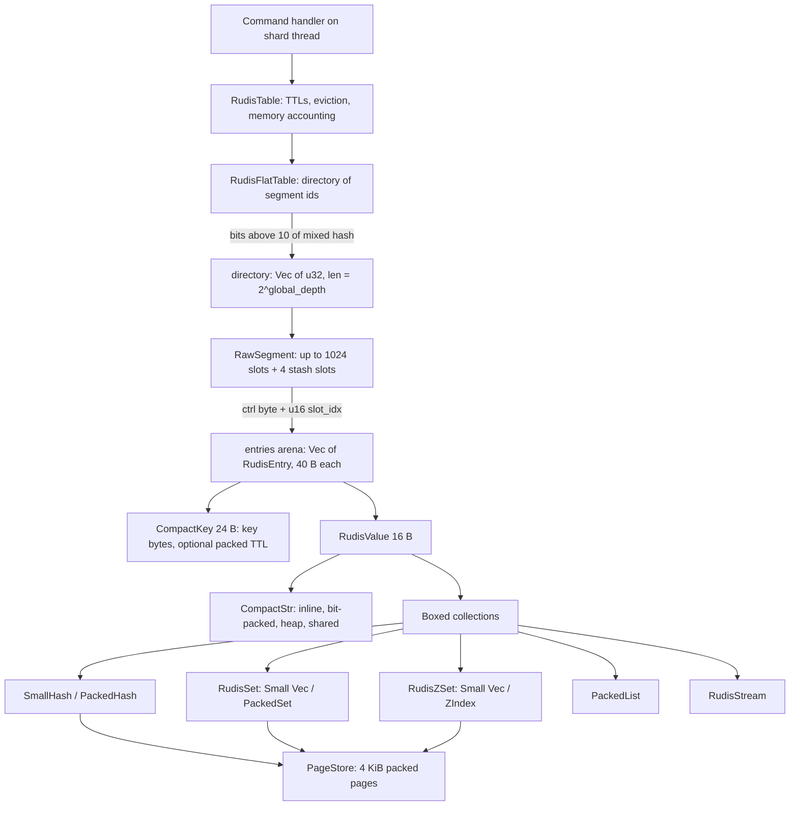

# Component 05: Storage Engine & Compact Encodings (Implementation Guide)

> **High-level design**: [`docs/design/05_storage_engine.md`](../design/05_storage_engine.md)
> **Consolidated implementation spec**: [`components.md`](components.md)
> **Background reading**: [`docs/design/rudis_table.md`](../design/rudis_table.md) (the original table design spec; useful for motivation, but this document is the reference for how the code works today)

---

## 1. What this subsystem does

Every Redis key a shard owns lives in one in-memory hash table that belongs to that shard's thread. This
subsystem is that table plus the encodings of the values stored in it:

- **Who uses it**: every command handler. A connection routes a command to the owning shard
  (see `04_sharding_mesh.md`); the shard calls methods on its `RudisTable` (`get_with_hash`,
  `set_extended_with_hash`, `hset_*`, `lpush`, `zadd`, `pfadd`, …). Persistence (RDB/AOF), replication,
  NVMe tiering, cluster slot migration, `SCAN`, `DEBUG DIGEST` and `MEMORY STATS` also read it directly.
- **What problem it solves**: holding hundreds of millions of keys per process with (a) no stop-the-world
  resize, (b) as few bytes per key as possible, and (c) Redis-compatible semantics for TTLs, eviction
  policies, and the six core data types.
- **No locks**: a table is never shared between threads. All the cleverness goes into memory layout and
  bounded amounts of work per operation.

The subsystem has two halves:

1. **The key table** (`src/table.rs`): a Dragonfly-style *extendible-hashing* table — a directory of
   pointers to fixed-size, SIMD-probed *segments* — wrapped by `RudisTable`, which adds TTLs, eviction,
   memory accounting and the command-level API.
2. **Compact encodings** (`src/compact.rs`, `src/smallhash.rs`, `src/packedhash.rs`, `src/pagestore.rs`,
   `src/packedset.rs`, `src/zindex.rs`, `src/packedlist.rs`, `src/hll.rs`): byte-packed representations of
   keys, strings and collections that replace one-heap-object-per-element layouts.

`src/digest.rs` (`DEBUG DIGEST`) is documented here too because it is the one place that must treat every
encoding as equal.

---

## 2. Mental model



Read it top to bottom as "how a lookup finds a value":

1. Hash the key once (`fxhash::hash64`), then *avalanche* it (`mix_hash`, a multiply/xorshift finalizer so
   that every bit of the hash depends on every bit of the key).
2. Bits 10 and up of the mixed hash index the **directory**, which names a **segment**.
3. Inside the segment, the low bits pick a starting slot; a SIMD-style compare of 16 one-byte
   **fingerprints** (top 7 bits of the hash) finds candidate slots.
4. A candidate slot holds a 2-byte index into the segment's **entry arena**; the entry's key is compared
   byte-for-byte to confirm the hit.
5. The entry's `RudisValue` is either a small inline value (int, short string) or a pointer to a boxed,
   byte-packed collection.

---

## 3. Entries: the 40-byte unit of storage

### 3.1 `RudisEntry`

```rust
// src/table.rs
pub struct RudisEntry {
    pub key: crate::compact::CompactKey, // 24 B — key bytes AND the expiry deadline
    pub val: RudisValue,                 // 16 B
}
const _: () = assert!(std::mem::size_of::<RudisEntry>() == 40);
```

There is no separate `expire_at` field. The deadline lives inside the key (§3.3), so keys without a TTL do
not pay for one. Use the accessors: `expire_at()`, `set_expire_at()`, `take_expire_at()`. `uncool()` turns a
`Cooled` value (see §8.6) back into a plain in-memory value and returns the stale disk pointer.

### 3.2 `Expiry` — an `Option<Instant>` in 8 bytes

`Expiry(Option<NonZeroU64>)` stores *nanoseconds since a process-wide base instant, plus one*; 0 means "no
TTL". The base (`expiry_base`) is chosen once, one hour before first use and aligned to a whole wall-clock
millisecond, so that:

- deadlines slightly in the past (e.g. a restored already-expired key) still round-trip;
- absolute `PXAT`/`PEXPIREAT` deadlines land exactly on the millisecond grid used by inline keys.

Deadlines before the base clamp to it (they are expired either way); ordering is preserved.

### 3.3 `CompactKey` — 24-byte keys with an optional deadline

`src/compact.rs`. A 24-byte enum (`Option<CompactKey>` is also 24 bytes):

| Variant | Holds | When used |
| :--- | :--- | :--- |
| `Inline { len, data: [u8; 22] }` | ≤ 22 key bytes | key without TTL, ≤ 22 B |
| `Inline23([u8; 23])` | exactly 23 bytes | key without TTL, 23 B (`INLINE_CAP`) |
| `InlineTtl { len, data: [u8; 17], ttl: [u8; 5] }` | ≤ 17 bytes + deadline | key with TTL, ≤ 17 B |
| `InlineTtl18 { data: [u8; 18], ttl: [u8; 5] }` | 18 bytes + deadline | key with TTL, 18 B (`INLINE_TTL_CAP`) |
| `Heap(Box<[u8]>)` | exact-size heap copy | longer key, no TTL |
| `HeapTtl(Box<[u8]>)` | `[8-byte raw Expiry][key bytes]` | longer key with TTL, or a deadline too far out to pack |

Inline deadlines are packed by `pack_ttl_ms` into 40 bits of **milliseconds** (rounded to the nearest ms,
so `PTTL` never reports more than was set); that covers about 34.8 years past the base, after which the key
falls back to `HeapTtl`. `HeapTtl` keeps the exact nanosecond deadline. `set_ttl` updates the deadline in
place when the representation does not change, and otherwise re-encodes the key (e.g. adding a TTL to a
20-byte inline key moves it to `HeapTtl`).

**Example.** `SET session:42 x EX 60` stores key `session:42` (10 B) as `InlineTtl` with the deadline in the
5 `ttl` bytes: zero heap allocations for the key. A 40-byte key with a TTL costs one 48-byte heap allocation.

`heap_bytes()` reports the heap cost (0 for inline variants) and feeds memory accounting.

### 3.4 `RudisValue` — 16 bytes

```rust
// src/table.rs
pub enum RudisValue {
    String(crate::compact::CompactStr),
    Int(i64),
    SmallHash(crate::smallhash::SmallHash),
    Hash(Box<RudisHashMap>),                 // RudisHashMap = crate::packedhash::PackedHash
    List(Box<crate::packedlist::PackedList>),
    Set(Box<RudisSet>),
    ZSet(Box<RudisZSet>),
    HyperLogLog(Box<[u8; 16384]>),           // legacy only, see §7.7
    Stream(Box<RudisStream>),
    Tiered(Box<TieredPointer>),              // value lives only on NVMe
    Cooled(Box<CooledValue>),                // in RAM and on NVMe: { ptr, val }
}
const _: () = assert!(std::mem::size_of::<RudisValue>() == 16);
```

Everything except `String`, `Int` and `SmallHash` (an 8-byte pointer) is boxed so that the enum fits beside
`CompactStr`'s 16-byte layout. `Tiered`/`Cooled` are boxed too; they are cold.

Three size functions exist; know which is which:

| Method | Meaning | Used for |
| :--- | :--- | :--- |
| `mem_bytes()` | heap bytes beyond the slot: 0 for `Int` and inline strings, `heap_bytes()` for heap strings, `24 + inner` for `Cooled`, else `approx_bytes()` | `used_memory` / dataset estimate |
| `approx_bytes()` | logical size heuristic: string length, `Int` = 8, `SmallHash` Σ(k+v+2), `Hash` Σ(k+v+32), `List` Σ(len+16), `Set` len×32, `ZSet` len×48, `HyperLogLog` 16384, `Stream` len×64, `Tiered` 24 | `MEMORY USAGE`, spill thresholds |
| `collection_len()` | element count of hashes and lists (0 otherwise) | budgeting the dataset recount (§5.5) |

### 3.5 `CompactStr` — 16-byte string values

`src/compact.rs`. The variant is chosen in `CompactStr::new` by length and content:

| Length | Content | Variant | Heap |
| :--- | :--- | :--- | :--- |
| 0–14 | any | `Inline { len, data: [u8;14] }` | none |
| 15 | any | `Inline15` | none |
| 16 | ASCII | `Packed` (7 bits/char → 14 bytes) | none |
| 17 | ASCII | `Packed17` (16 chars 7-bit packed + 1 raw byte) | none |
| 18–20 | all chars in a 64-symbol alphabet | `Packed6A18..20` (`0-9A-Za-z:-`) or `Packed6B18..20` (`0-9A-Za-z_.`) | none |
| 21–24 | all chars in a 32-symbol alphabet | `Packed5A21..24` (`0-9a-f:-_.TZ /+ghiklnv`, aimed at hex, timestamps, ids) or `Packed5B21..24` (`a-z:-_./ `) | none |
| 25–255 | ASCII, and packing lands in a smaller jemalloc size class | `HeapPacked { len, ptr }` (7 bits/char) | `ceil(7n/8)` |
| other | any | `Heap { len: u32, ptr }` (thin pointer + length) | `n` |
| ≥ 256 after first read | any | `Shared(Box<Bytes>)` | `n + size_of::<Bytes>()` |

Key mechanics:

- **Reading**: `view()` returns a `StrView` that derefs to `[u8]` — a borrowed slice for contiguous variants,
  or bytes unpacked onto the stack (or into a `Vec` for `HeapPacked`). `extend_into` / `write_resp_bulk`
  unpack straight into an output buffer. `as_contiguous()` returns `None` for packed variants.
- **7-bit packing** uses SWAR (`pack7_u64`/`unpack7_u64`), or BMI2 `pext`/`pdep` when the CPU has it
  (`pack7_heap_bmi2`). `heap_pack_pays` only picks `HeapPacked` when `alloc_class(packed_len(n)) <
  alloc_class(n)` (16-byte classes to 128 B, 32-byte classes to 256 B).
- **Zero-copy sharing**: a `Heap` value of at least `SHARE_MIN` (256) bytes is converted in place to
  `Shared` the first time it is read (`needs_share` / `make_shared`, driven by `RudisValue::string_needs_share`
  in `get_with_hash`). Later reads — often cross-shard — are a refcount clone instead of malloc + memcpy.
  `HeapPacked` stops at 255 bytes for exactly this reason.
- **Integers**: `set_extended_with_hash` first tries `parse_i64_bytes`; a clean parse stores
  `RudisValue::Int`. `format_i64` turns it back into bytes on read.

**Example.** `SET user:1:ts 2026-10-30T14:29:57Z` → 20 chars, all in `ALPHABET_6A`
(`0-9A-Za-z:-`) → `Packed6A20`, 0 heap bytes. The same value with a trailing `.123` (24 chars) packs into
`Packed5A24` because every char is in `ALPHABET_5A`.

`CompactStr` contains `unsafe` code (raw `NonNull` ownership for `Heap`/`HeapPacked`, manual `Send`/`Sync`);
`scripts/miri_compact.sh` runs its tests under Miri. (The module doc comment's "safe Rust only" describes
`CompactKey`, not `CompactStr`.)

---

## 4. `RawSegment`: one SwissTable-style segment

A segment is a small open-addressing hash table. Slots are tiny (3 bytes); the 40-byte entries live in a
dense side array (the *arena*), so empty slots cost almost nothing.

```rust
// src/table.rs (trimmed)
pub struct RawSegment {
    pub ctrl: Vec<u8>,          // capacity + 16 control bytes (16 mirrored at the end)
    slot_idx: Vec<u16>,         // slot -> index into `entries`, or NO_ENTRY (u16::MAX)
    entries: Vec<RudisEntry>,   // dense arena, may contain holes
    last_access: Vec<u16>,      // LRU clock or LFU word, parallel to `entries`
    holes: Vec<u64>,            // bitmap: bit i set => entries[i] is a dead placeholder
    pub capacity: usize,        // power of two, 16..=1024 main slots
    pub items: usize,           // live entries (main + stash)
    pub growth_left: usize,     // inserts into EMPTY slots before split/grow
    pub local_depth: u8,        // extendible-hashing depth (u8::MAX marks a merge hole)
    pub stash_ctrl: [u8; 4], pub stash_count: u8,
    data_est: usize,            // estimated bytes of this segment's entries
}
```

### 4.1 Constants

| Constant | Value | Meaning |
| :--- | :--- | :--- |
| `GROUP_SIZE` | 16 | control bytes compared per probe step |
| `EMPTY` / `DELETED` | `0xFF` / `0xFE` | control byte of a never-used / tombstoned slot; full slots hold a 7-bit fingerprint |
| `SEG_SHIFT`, `SEG_CAP` | 10, 1024 | max main slots per segment |
| `STASH_CAP` | 4 | overflow stash slots per segment |
| `GLOBAL_IDX_SHIFT` | 11 | a *global index* is `seg_id << 11 \| local_slot` |
| `MERGE_MAX_ITEMS` | 256 (`SEG_CAP / 4`) | buddy segments merge when their combined items fit |
| `HOLE_DEPTH` | `u8::MAX` | `local_depth` of a placeholder left by a merge |
| `NO_ENTRY` | `u16::MAX` | `slot_idx` value of an unoccupied slot |

### 4.2 Probing

`find_entry`, `find_entry_mut` and `find_or_prepare_insert_raw` share one loop:

1. `tag = fingerprint(h)` (top 7 bits); `idx = h & mask`; prefetch `slot_idx[idx]` (`prefetch_read`) so the
   arena-index load overlaps the control-group load.
2. Compare the 16 control bytes at `idx` against `tag` and `EMPTY` (`probe_group_match_or_empty`; the insert
   variant also reports `DELETED`). These are plain loops that LLVM lowers to `pcmpeqb` + `pmovmskb` on
   x86-64; there are no hand-written intrinsics.
3. For each matching bit, follow `slot_idx` into `entries` and compare keys with `fast_slice_eq`
   (overlapping 4/8-byte word compares for keys ≤ 32 bytes).
4. If the group has an `EMPTY` byte, the key is absent — stop. (The insert variant returns the first
   `DELETED` slot seen, else that `EMPTY` slot, as the insert position.)
5. Otherwise advance *triangularly*: `step += 16; idx = (idx + step) & mask`.
6. When `step` reaches 32 (two full groups probed), scan the 4-slot **stash** by fingerprint. On insert, if
   no free main slot has been seen yet and the stash has room, a stash slot becomes the insert position.
7. Give up when `step >= capacity` (probing is bounded).

Stash slots are addressed as `capacity + s` in the same index space as main slots, so `insert_at`,
`mark_slot_free` and `remove` branch on `idx < capacity`.

### 4.3 Insert, delete and the arena

- **Insert** (`insert_at`): reuse the lowest hole in the arena (`take_hole`) or push a new entry (growing
  the arena by 1/16, at least 16, with `reserve_exact` — `grow_arena`). Write the fingerprint into `ctrl`
  (or `stash_ctrl`), store the arena index in `slot_idx`, stamp `last_access` with `access_word_new()`.
  `growth_left` drops only when an `EMPTY` main slot (or a stash slot) is consumed — reusing a `DELETED`
  slot is free.
- **Delete** (`remove`/`remove_present` → `mark_slot_free` + `take_entry`): a main slot becomes `DELETED`
  (a tombstone, so probe chains stay intact); a stash slot becomes `EMPTY` and returns its growth credit. The
  arena entry is popped if it is last, otherwise replaced with a placeholder and marked in `holes`. Nothing
  else moves, so no back-pointer from entry to slot is needed.
- **Last item removed**: the whole segment resets — all control bytes `EMPTY`, stash cleared, arena
  cleared, `growth_left` restored.
- **Arena trimming**: `maybe_trim_arena` compacts the arena (walking slots so each moved entry's
  `slot_idx` is repointed) once fewer than half of at least 32 arena positions are live. The periodic
  `RudisFlatTable::trim_step` (§5.5) trims more aggressively.
- `growth_left` starts at `capacity * 7 / 8`, plus `STASH_CAP` only for a full 1024-slot segment. The stash
  slots exist physically in every segment (`slot_idx` has `capacity + 4` entries) but are only credited at
  full size.

### 4.4 Memory per key

A full 1024-slot segment has ≈ 3.2 KB of fixed arrays (1,040 ctrl bytes, 1,028 × 2-byte `slot_idx`, a
17-word hole bitmap) plus 42 bytes per arena position (40-byte entry + 2-byte access word). With segments
typically 45–60% full (they all split at the same time under uniform hashing), a key costs roughly
42 B + ~6 B of slots, plus any heap bytes of its key and value. (The source comment beside `SEG_CAP` still
says "~48KB" per segment; that figure predates the slot/arena split and is not accurate.)

---

## 5. `RudisFlatTable`: extendible hashing over segments

```rust
// src/table.rs (trimmed)
pub struct RudisFlatTable {
    pub segments: Vec<RawSegment>,
    pub directory: Vec<u32>,       // len == 2^global_depth; entry = segment id
    pub global_depth: u8,
    pub capacity: usize, pub items: usize,
    pub slot_counts: Option<Box<[u32; 16384]>>, // cluster-slot key counts, built lazily
    layout_epoch: u64,             // bumped whenever segments are renumbered or entries move between them
    seg_heap_bytes: usize, seg_fixed_bytes: usize, // incremental sums of segment heap bytes
    trim_cursor: usize, data_est_total: usize, data_cursor: usize,
}
```

A new table (`RudisFlatTable::new(64)`, as `RudisTable::new` creates it) is one 64-slot segment and a
one-entry directory (`global_depth = 0`).

### 5.1 Lookup and insert

`find_entry(key, hash)`: `h = mix_hash(hash)`; `seg_id = directory[(h >> 10) & dir_mask]`; probe that segment;
return `(seg_id << 11 | local_slot, &entry)`. The caller passes the raw `hash_key` value so it can compute it
once and reuse it (e.g. the router hashes a key for shard routing and then calls `get_with_hash`).

`find_or_prepare_insert(key, hash)` returns `(existing_global_idx, insert_global_idx)`. If the target
segment has `growth_left == 0`, it first checks whether the key already exists (an overwrite never forces a
split), and only for a new key calls `split_or_grow_segment`. Callers then use `insert_prepared` to place
the entry without a second probe. `insert`, `insert_prepared`, `remove` and `remove_present` keep `items`,
the per-segment `data_est`, `seg_heap_bytes` and (when built) `slot_counts` in sync.

`find_entry_mut` and `get_slot_mut` stamp the slot's access word (they are "client accesses");
`get_slot_mut_no_touch` does not.

### 5.2 Growing: `split_or_grow_segment`

Runs while the target segment's `growth_left == 0`, cheapest option first:

1. **Tombstone purge** — fewer than half the slots are live: `rebuild` the segment at the same capacity
   (re-inserting every live entry, which drops all `DELETED` bytes).
2. **In-place doubling** — capacity below 1024: `rebuild` at twice the capacity.
3. **Split** — a full 1024-slot segment at local depth `d`:
   1. If `d == global_depth`, double the directory (append a copy of itself) and increment `global_depth`.
   2. Drain the segment, hash every entry once, count how many go each way, and build two 1024-slot segments
      at depth `d + 1` with exactly sized arenas. Bit `10 + d` of the mixed hash decides: 0 stays in the old
      segment id, 1 goes to a new segment appended at the end of `segments`.
   3. Repoint every directory entry that referenced the old segment and has bit `d` set to the new id.
   4. Loop: if the segment the key maps to is still full, repeat.

Every step touches at most one segment (≤ 1,028 entries) regardless of table size, which is why there is no
incremental rehash protocol. The methods `is_rehashing`, `rehash_step`, `finish_rehash`,
`migrate_key_if_in_old` and `RudisTable::prepare_key_lookup` remain as no-op stubs (always `false` / empty)
and nothing outside `table.rs` calls them.

**Worked example.** A fresh shard receives 1,000 distinct `SET`s:

1. Keys 1–56 fill the 64-slot segment (`64 × 7/8 = 56`); key 57 finds `growth_left == 0` → case 2 doubles to
   128 slots. The same happens at 128 → 256 → 512 → 1024.
2. At 1024 slots the segment takes `896 + 4 = 900` keys. Key 901 → case 3 with `d = 0 = global_depth`: the
   directory becomes `[0, 0]`, then entries with bit 10 = 1 move to new segment 1 and `directory[1] = 1`.
   Directory: `[0, 1]`, both segments at depth 1, ~450 keys each.
3. When segment 1 fills later (`d = 1 = global_depth`), the directory doubles to `[0, 1, 0, 1]`, segment 1
   splits by bit 11 into segments 1 and 2, and `directory[3] = 2`. Segment 0 (depth 1) is still pointed to
   by entries 0 and 2 — most splits only repoint, they do not double.

### 5.3 Shrinking: `shrink_step`, `defrag`, `clear`

Deletes never shrink a segment by themselves. Three mechanisms give memory back:

- **`shrink_step(max_merges)`** (periodic, §6.7): walks the directory looking for *buddy* pairs — two
  segments at the same depth `d` whose patterns differ only in bit `d-1` — whose combined `items` ≤
  `MERGE_MAX_ITEMS` (256). Each pair is merged by `merge_buddies` into one 1024-slot segment at depth `d-1`.
  The merged segment takes the **higher** of the two ids and the lower id becomes a tiny `HOLE_DEPTH`
  placeholder, so a positional `SCAN` cursor that already passed the lower id still meets the moved
  entries. Afterwards `shrink_directory` halves the directory while no segment needs the full depth, and
  `compact_holes` drops placeholders and renumbers once holes are at least half of `segments`.
  `RudisTable::shrink_step` additionally calls `defrag` once there are multiple segments but
  `len * 2 <= 1024`.
- **`defrag()`**: if `next_pow2(items × 2)` (min 64) fits in one segment and the table has several segments,
  is oversized, or has tombstones, everything is rebuilt into a single segment and the directory reset to
  `[0]`. Otherwise every segment containing a `DELETED` byte is rebuilt in place.
- **`clear()`**: back to one 64-slot segment; drops `slot_counts`.

`layout_epoch` increments whenever entries move between segment ids (`clear`, a collapsing `defrag`, any
merge, hole compaction). Splits only append segments and in-place rebuilds keep entries in their segment, so
they do not bump it.

### 5.4 Positional cursors and segment patterns

Background walkers address slots positionally:

- `cursor_bound()` = the single segment's `slot_count()` when there is one segment, else
  `segments.len() × 1028`.
- `cursor_to_global_idx(c)` = `c` for one segment, else `(c / 1028) << 11 | (c % 1028)`.

Used by active expiry, eviction sampling, tier spill candidate selection, `RANDOMKEY` and large-table
`SCAN`.

`segment_pattern(seg)` returns `(local_depth, low depth bits of key_dir_bits)` that every key in `seg`
shares; a split only refines patterns. The yielding RDB save (`RdbSaveCursor` in `src/shard.rs`) walks
segment ids in order and records written patterns, so a key that moves to a new segment during the save is
not written twice; if `layout_epoch` changes mid-save it writes only the keys no recorded pattern covers.
See `14_persistence_replication.md`.

### 5.5 Incremental bookkeeping and maintenance steps

| Method | What it does |
| :--- | :--- |
| `struct_bytes()` | O(1): `seg_heap_bytes` + segment vector + directory + `slot_counts` (if built) |
| `struct_bytes_exact()` | same, recomputed from every segment (for drift checks) |
| `free_arena_bytes()` | arena bytes allocated but not holding a live entry |
| `dataset_estimate()` | Σ per-segment `data_est`: exact on insert/remove, refreshed by `refresh_data_step` |
| `refresh_data_step(budget)` | recounts segments round-robin (`data_cursor`) until ~`budget` units of work (1 per entry + collection length) so in-place growth (`HSET` on an existing hash, `APPEND`, `LPUSH`) is reflected |
| `trim_step(budget)` | for up to `budget` segments round-robin (`trim_cursor`): if the arena has ≥ 64 positions and more than 1/8 free, compact it to ~1/16 slack |
| `slot_count(slot)` | live-or-not-yet-reaped keys in a cluster slot; builds `slot_counts` on first call by scanning every entry |

---

## 6. `RudisTable`: the per-shard engine

```rust
// src/table.rs
pub struct RudisTable {
    table: RudisFlatTable,
    sample_cursor: usize,   // shared by active expiry, hash-field expiry and eviction sampling
    spill_cursor: usize,    // tiering spill-candidate cursor (independent)
    pub data_bytes: usize,  // bytes held by entries (keys, values, ENTRY_OVERHEAD each)
    pub arena: crate::allocator::SmallCollectionArena,
    pub num_expires: usize, // entries with a whole-key TTL
    pub hash_field_expires: hashbrown::HashMap<Bytes, hashbrown::HashMap<Bytes, Instant>>,
    pub dropped_tier: smallvec::SmallVec<[(TieredPointer, bool); 4]>, // stale NVMe extents to release
}
```

`ShardDb` (`src/shard.rs`) holds the selected database's table in `table` and the others in
`tables: Vec<Option<RudisTable>>` (multi-DB support, `SELECT`).

### 6.1 Key expiry

**Passive (lazy) expiry.** Read and write paths check `num_expires > 0` first — a single integer compare
with no clock read on shards that have no TTLs — and only then `entry.expire_at()`,
`connection::access_expired_allowed()` and `Instant::now()`. `check_expired_slot(idx)` packages this; many
hot paths inline the same pattern. An expired key is removed by `expire_slot`, which:

1. does nothing while clients are paused (`CLIENT PAUSE`), and does nothing on a **read-only replica**
   (`replication::hide_expired_keys()`): the replica keeps the key until its master's `DEL` arrives, while
   `check_expired_slot` still reports it as gone so reads hide it;
2. otherwise removes the entry, queues any tier extent on `dropped_tier`, decrements `num_expires` and
   `data_bytes`, bumps `expired_keys`, logs a `DEL` to the AOF/replicas (`replication::log_expired_key`,
   skipped while replaying writes), touches `WATCH`ed keys, sends client-tracking invalidations and an
   `expired` keyspace event.

`access_expired_allowed()` is true when the `ALLOW_ACCESS_EXPIRED` flag is set or while the thread is
replaying writes (`REPLAYING_WRITES`, AOF load / replication apply): nothing expires during replay.

**Active expiry** (`active_expire_cycle`, every 100 ms from the shard cron, skipped on replicas, while
paused, or when `PAUSE_CRON` is set):

1. If `hash_field_expires` is non-empty, run `evict_expired_hash_fields_sample(8)` first (§6.2).
2. If `num_expires == 0`, stop.
3. Walk positional cursor slots from `sample_cursor`, examining TTL-carrying entries, until 20 have been
   checked, 512 positions have been scanned (`max_scan = min(bound, 512)`), or no TTLs remain.
4. Expired ones go through `check_expired_slot` and bump `expired_keys_active`.

`ShardDb::active_expire_cycle` runs it on the selected DB and on every other DB that has TTLs.

### 6.2 Hash-field TTLs (`HEXPIRE`, `HPEXPIRE`, `HTTL`, `HPERSIST`, `HGETEX`, `HSETEX`)

`hash_field_expires` maps *hash key → (field → deadline)*. It is independent of `num_expires`.

- **Passive**: `purge_expired_hash_fields(key)` runs at the top of hash commands (gated on the map being
  non-empty), removes expired fields from the inner map, logs them as `HDEL` (`replication::log_expired_fields`)
  and deletes them via `hdel`. Like keys, nothing is purged while replaying or on a read-only replica.
- **Reads that must not purge** (`HRANDFIELD`, `HSCAN`) use `expired_fields_view`, and a read-only replica
  uses `replica_hidden_fields`; both return a `HiddenFields` list the read skips.
- **Active**: `evict_expired_hash_fields_sample(max_keys)` picks up to `max_keys` hash keys starting at
  `sample_cursor % hash_field_expires.len()` and purges each. It reads but never advances `sample_cursor`.

### 6.3 Access tracking: 16-bit LRU clock or LFU word

Each arena entry has a parallel 16-bit `last_access` word:

- **LRU mode** (default): `lru_now()` = `CLOCK_MONOTONIC_COARSE` seconds truncated to 16 bits. Idle time is
  `lru_now().wrapping_sub(word)`, exact up to ~18.2 hours; a key idle longer wraps and looks recent.
- **LFU mode** (`LFU_ACTIVE`, set when `maxmemory-policy` contains `lfu`): high byte = last decrement time in
  minutes mod 256, low byte = logarithmic counter, as in Redis. New keys start at `LFU_INIT_VAL` (5).
  `access_word_touched` decays the counter by one per `LFU_DECAY_TIME` minutes (`lfu-decay-time`, default 1;
  0 never decays) and increments it with probability `1 / ((counter − 5) × LFU_LOG_FACTOR + 1)`
  (`lfu-log-factor`, default 10). Minutes wrap at 256 (~4.3 h).

Reads stamp the word unless the client set `CLIENT NO-TOUCH` (`connection::CLIENT_NO_TOUCH`). Migrations
(split, rebuild, merge, defrag) carry the word along.

### 6.4 Eviction: `try_evict_one_key_with(policy, on_evict)`

Called (through `ShardDb::try_evict_one_key`) by the router's `evict_local_until_under` until the shard is
under its share of `maxmemory`.

1. Return `None` for an empty table, or for a `volatile-*` policy when `num_expires == 0`.
2. Walk positional slots from the shared `sample_cursor` (at most `cursor_bound()` positions). For
   `volatile-*` policies skip keys without a TTL.
3. Choose by policy:
   - `*-ttl`: keep the nearest deadline seen;
   - `*-lru`: keep the largest idle time; `*-lfu`: keep the smallest decayed counter (`255 − counter`);
   - `*-random`: keep the last sampled key.
   LRU/LFU/random stop after 10 eligible keys.
4. Remove the winner, queue tier extents, adjust `num_expires` / `data_bytes`, bump `evicted_keys`, call
   `on_evict` (the caller logs a `DEL` to AOF/replicas), then `WATCH`/tracking/`evicted` notifications.
   Returns the accounted bytes freed.

`eviction_size()` (= `struct_bytes() + dataset_estimate()`) is what the router uses to split eviction
between shards.

### 6.5 Memory accounting

`used_memory() = data_bytes + table.struct_bytes()`, O(1). Every entry is charged
`key.heap_bytes() + val.mem_bytes() + ENTRY_OVERHEAD` (16). `ENTRY_OVERHEAD` must stay non-zero: with fully
inline keys and values an eviction would otherwise free 0 accounted bytes and `evict_local_until_under`
would evict everything.

This is an estimate used to split eviction and pace tiering; the `maxmemory` limit itself is checked
against allocator counters (`tiering::TieringStats::real_used_total`).

`memory_breakdown()` (for `MEMORY STATS`) returns a `MemoryBreakdown`:

| Field | Meaning |
| :--- | :--- |
| `keys` | live key count |
| `dataset` | incremental `data_bytes` |
| `dataset_estimate` | per-segment estimate (`dataset_estimate()`) |
| `dataset_exact` | `dataset` recomputed by walking every entry |
| `table` / `table_exact` | `struct_bytes()` incremental / recomputed |
| `free_arena` | `free_arena_bytes()` |

`recalculate_used_memory()` rebuilds `data_bytes` from scratch (used by `active_defrag`).

### 6.6 Small helpers worth knowing

- `insert_entry(entry)` deletes any existing key first, then inserts and charges memory.
- `take_key_entry(key)` removes an entry and its field-TTL map together (used by `MOVE` via
  `ShardDb::move_key`).
- `peek_entry(key)` reads without expiry, access stamping or warming (`DEBUG DIGEST-VALUE`).
- `find_entry_mut_warm` / `get_slot_mut_warm` / `warm_slot` turn a `Cooled` value back into a plain one before
  an in-place mutation and queue the stale extent on `dropped_tier`.
- `is_lazyfree_worthy(key)`: true for collections over 64 elements (or streams with consumer groups);
  `UNLINK` uses it to decide whether a delete counts as a lazy free.
- `active_defrag()` runs `defrag`, re-creates every string value with `CompactStr::new`, then recalculates
  memory. It is triggered by an explicit cross-shard request, not by the cron.

### 6.7 The shard cron

Every 100 ms each shard (`src/server.rs`):

1. sets the read-only-replica flag; if not a replica, runs `ShardDb::active_expire_cycle`;
2. unless an RDB save is walking the segments (`is_saving`), runs `table.shrink_step(32)` and
   `table.trim_arena_step(32)` on the **selected** DB's table;
3. runs `refresh_data_step(50_000)` on every DB (read-only, safe during a save);
4. publishes the shard's memory state.

### 6.8 SCAN

`RudisTable::scan(cursor, pattern, count, type)` has two modes:

- **≤ 8,192 keys**: compute an odd 32-bit hash (`xxh3(key) as u32 | 1`) per live key, sort, and return keys
  with hash ≥ cursor; the next cursor is the next larger hash. Stable across resizes because it does not
  depend on slot positions.
- **Larger**: a positional cursor over `cursor_bound()`; returns after `count` matches. Splits append
  segments and merges keep entries at the higher id (§5.3), so keys present for the whole scan are seen.

### 6.9 Cluster slot counts

`count_keys_in_slot` / `get_keys_in_slot` (for `CLUSTER COUNTKEYSINSLOT` / `GETKEYSINSLOT`) ask
`RudisFlatTable::slot_count`, which builds the 64 KiB `slot_counts` array on first use and then maintains it on
every insert/remove. A zero count returns immediately. A non-zero count is trusted when `num_expires == 0`;
otherwise the table is scanned (`enumerate_slots`), counting live keys and removing expired ones.

### 6.10 Read fast paths

The `write_*_resp` family serialize a reply directly into the connection's output buffer without an
intermediate `Bytes`: `write_get_resp`, `write_hget_resp`, `write_lpop_resp[_with_hash]`,
`write_rpop_resp[_with_hash]`, `write_lrange_resp`, `write_sismember_resp`, `write_zrange_resp`.
`get_compact_with_hash` returns a `shard::CompactResp`. MGET/MSET batching lives in the router and connection
layers (see `04_sharding_mesh.md`); the table contributes hash-reusing single-key primitives such as
`get_with_hash`.

---

## 7. Collection encodings

| Type | Small form | Large form | Switch point | `OBJECT ENCODING` (small / large) |
| :--- | :--- | :--- | :--- | :--- |
| String | `Int(i64)` or `String(CompactStr)` | — | content-based | `int` / `raw` |
| Hash | `SmallHash` | `Hash(Box<PackedHash>)` | > `hash-max-listpack-entries` (512) fields, or a field/value > `hash-max-listpack-value` (64) bytes | `listpack` / `hashtable` |
| Set | `RudisSet::Small(Vec<SmallSetEntry>)` | `RudisSet::Full(PackedSet)` | > 64 members (`SMALL_SET_LIMIT`) | `intset` / `hashtable` |
| Sorted set | `RudisZSet::Small(Vec<(OrderedScore, CompactKey)>)` | `RudisZSet::Full(ZIndex)` | > 64 members (`SMALL_ZSET_LIMIT`) | `listpack` / `skiplist` |
| List | `PackedList` (one form) | — | — | `quicklist` |
| HyperLogLog | `String` holding a Redis `HYLL` blob | — | sparse ↔ dense inside the blob | `raw` |
| Stream | `RudisStream` (one form) | — | — | `stream` |

Hash thresholds are the runtime atomics `connection::HASH_MAX_ENTRIES` / `HASH_MAX_VALUE`, settable with
`CONFIG SET hash-max-listpack-*` (and the `ziplist` aliases). The set and sorted-set limits are constants;
the `set-max-*`, `zset-max-*` and `list-max-*` directives are not wired to them. Conversion is one-way: a
large collection never shrinks back to the small form.

### 7.1 `SmallHash` — one exact-size allocation (`src/smallhash.rs`)

`SmallHash { ptr: NonNull<u8> }` (8 bytes) owns one allocation laid out as
`[count: u32][len: u32][pairs…]`, each pair `[varint flen][field][varint vlen][value]`. A 5-byte field and
5-byte value cost 12 bytes. Lookups are a linear scan (`find`); `set` overwrites a same-length value in place
and otherwise splices (`replace_range`, which `realloc`s to the exact new size); `push_new` appends a field
known to be absent. Iteration is in insertion order. `to_map()` converts to a `PackedHash` on promotion.
`SmallHash` uses `unsafe` raw allocation; `scripts/miri_smallhash.sh` covers it.

### 7.2 `PageStore` — the shared packed-entry heap (`src/pagestore.rs`)

Large hashes, sets and sorted sets all store their elements in a `PageStore<H>`:

- An entry is `[varint(len << 1 | dead)][payload]`, addressed by a **handle** `H` = (page, offset).
  `u32` handles are `page << 12 | offset` (2^20 pages); `u64` handles are `page << 32 | offset`.
- Normal pages hold up to `PAGE_BYTES` (4096, an exact allocator size class). A payload longer than
  `OWN_PAGE_MIN` (1024) gets its own page. Page 0 is stored inline in the store (`Pages::first`) so a
  one-page collection needs no page-table load.
- Only the *current* page takes appends. It starts at `FIRST_PAGE_CAP` (64) bytes and grows by a quarter at
  a time up to 4096, so small collections stay small.
- `release(h)` sets the dead bit. A fully dead page is freed to `free_pages` for reuse. Once at least half a
  page is dead, `release` returns that page and the owner compacts it: `moves(page)` lists
  `(old, new, payload)` for every live entry that will move (read-only, so the owner can still look entries
  up to find what points at them), then `compact(page)` slides entries down and `shrink_to_fit`s the buffer.
- `insert` returns `None` when the next page would not fit the handle type; owners then **widen** once from
  `u32` to `u64` handles (`Repr::Narrow` → `Repr::Wide`), so there is no size limit.

### 7.3 `PackedHash` — large hashes (`src/packedhash.rs`)

`PackedHash(Repr)` where each repr is `Inner { dict: hashbrown::HashTable<H>, store: PageStore<H>, len }`.
A bucket is just a handle; each field/value pair is one page entry `[varint flen][field][value]`.

- `get`: hash the field (`fxhash`), probe `dict`, compare the field through the page.
- `insert` on an existing field: same-length value → overwrite in place; otherwise append the new pair,
  repoint the bucket, release the old entry.
- Page compaction re-hashes each moved field to find and repoint its bucket.
- Iteration is in hash-table order.

### 7.4 Sets: `SmallSetEntry` vector and `PackedSet` (`src/packedset.rs`)

- **Small**: `Vec<SmallSetEntry { hash: u64, member: CompactKey }>`. The cached `fxhash` lets
  `contains`/`insert`/`remove` reject most non-matches without touching member bytes. Removal uses
  `swap_remove` (O(1), reorders). `pop` takes the last element.
- **Full**: `PackedSet`, Dragonfly-`DenseSet`-style: `dict: HashTable<H>` whose buckets hold the member's page
  location directly, plus a `PageStore`. A 5-byte member costs a 6-byte page entry plus a 4-byte bucket.
  `pop` (for `SPOP`) resumes scanning buckets at `pop_cursor` instead of bucket 0, so draining a set scans the
  table about once.

### 7.5 Sorted sets: small vector and `ZIndex` (`src/zindex.rs`)

- **Small**: a `Vec<(OrderedScore, CompactKey)>` kept sorted by (score, member). `OrderedScore(f64)` orders with
  `f64::total_cmp`. Insert removes any old entry, then binary-searches the position (`Vec::insert` shifts the
  tail).
- **Full**: `ZIndex`, each member stored once:

| Field | Type | Meaning |
| :--- | :--- | :--- |
| `store` | `PageStore<H>` | entries `[score: f64 LE][member bytes]` |
| `dict` | `hashbrown::HashTable<H>` | member → handle |
| `runs` | `VecDeque<VecDeque<H>>` | handles in (score, member) order, split into sorted runs of ≤ `CHUNK_MAX` (127) |
| `len` | `usize` | member count |

Operations:

1. `get`/`contains_key`: one hash lookup, then read the score from the page.
2. `insert`/`remove`: hash lookup, then `lower_bound` — binary search over run tails, then within one run —
   and a shift of at most 127 handles. A run that exceeds 127 splits in half; a run under 31 (`CHUNK_MAX / 4`)
   merges with its successor if they fit. Runs are allocated at 128 handles (512 bytes as `u32`).
3. A score change rewrites the 8 score bytes in place and re-links the handle.
4. `rank`: lower bound plus the sum of preceding run lengths — O(len / 127).
5. `pop_first`/`pop_last` (`ZPOPMIN`/`ZPOPMAX`) take from the ends of the deques without shifting.
6. `iter_from_score(min)` seeks with `lower_bound` (used for `ZRANGEBYSCORE`).
7. Page compaction locates each moved entry's run slot (binary search) and bucket (re-hash) *before* moving
   anything, then repoints both.

### 7.6 Lists: `PackedList` (`src/packedlist.rs`)

`PackedList { chunks: VecDeque<Chunk>, len }`, `Chunk` is 32 bytes:

- `Chunk::Packed(Packed)` — a byte deque `buf: Vec<u8>` with a 4-byte header `[count: u16][head: u16]` in the
  buffer itself; live entries are `buf[head..]`, each `[varint len][bytes][reversed varint len]` so the chunk can
  be walked from either end. At most `CHUNK_MAX` (4092) live bytes, so a full chunk is exactly 4096 bytes.
- `Chunk::Big(Bytes)` — one element longer than `PACK_MAX` (63) bytes, sharing the `Bytes` it arrived in.

Behaviour:

1. **Push back**: append to the last packed chunk if it fits. A new chunk is allocated full-size only when the
   previous chunk is a full packed chunk; otherwise (first chunk, or after a `Big` chunk) it starts small and
   grows by a quarter (at least 4 entries, at least `MIN_STEP` = 32 bytes). If most of a chunk has been popped
   from the front, the dead front is reclaimed instead of growing.
2. **Push front**: write into the gap before `head`; when the gap runs out, re-lay the chunk with a fresh gap of
   about a quarter of its live size.
3. **Pop**: advance `head` (front) or truncate (back); an emptied chunk is dropped.
4. **Index access** (`locate`): walk chunk counts from the nearer end, then scan within the chunk.
5. **Middle insert/remove**: a `memmove` within one chunk.

**Example.** `RPUSH q a b c` → one packed chunk holding three 3-byte entries (`[1]a[1]`, …) after its 4-byte
header. `RPUSH q <100-byte blob>` appends a `Big` chunk. A following `RPUSH q d` starts a new small packed
chunk rather than a 4 KB one.

### 7.7 HyperLogLog (`src/hll.rs`)

Live HyperLogLogs are `RudisValue::String` values holding Redis's own `HYLL` byte format, so `GET`/`SET`/`DUMP`
interoperate with Redis:

- 16-byte header: `"HYLL"`, encoding byte (`HLL_DENSE` = 0, `HLL_SPARSE` = 1), 3 unused bytes, an 8-byte
  little-endian cached cardinality whose bit 63 set means "stale".
- **Dense**: 16,384 six-bit registers (`HLL_DENSE_SIZE` = 12,304 bytes total).
- **Sparse**: run-length opcodes `ZERO` (1 byte, ≤ 64 zero registers), `XZERO` (2 bytes, ≤ 16,384), `VAL`
  (1 byte, value 1–32, run ≤ 4).

Algorithm of `PFADD key e1 e2`:

1. New key: start from `hll_create_sparse_empty()` (header + one `XZERO` covering all registers: 18 bytes).
2. `hll_add` decodes all 16,384 registers, and for each element computes `hll_pat_len` (MurmurHash64A with
   seed `0xadc83b19`; low 14 bits pick the register, the run of zero bits after them + 1 is the candidate).
3. If any register increased, re-encode with `hll_create_from_regs`: sparse when every register ≤ 32 and the
   payload stays within `HLL_SPARSE_MAX_BYTES` (3000), else dense; the cardinality cache is marked stale.

`PFCOUNT` (`hll_count`) returns the cached cardinality if valid, otherwise computes it with Redis's estimator
(`hll_compute_card`, Ertl's improved estimator via `hll_sigma`/`hll_tau`) and writes it back into the header.
`PFMERGE` takes register-wise maxima. `PFDEBUG GETREG/ENCODING/TODENSE` are supported.

`RudisValue::HyperLogLog(Box<[u8; 16384]>)` (one byte per register) is a legacy representation. It is built
only by `RudisTable::deserialize_val_payload` (type tag 5 of the internal value payload used by tier records
and legacy Rudis-format payloads). Commands still accept it.

### 7.8 Streams

`RudisStream` is a single representation:

| Field | Type | Meaning |
| :--- | :--- | :--- |
| `entries` | `BTreeMap<StreamId, Vec<(Bytes, Bytes)>>` | entries ordered by `StreamId { ms, seq }` |
| `last_id`, `max_deleted_entry_id` | `StreamId` | for ID generation and `XINFO` |
| `entries_added` | `u64` | lifetime count (survives trimming) |
| `groups` | `HashMap<Bytes, StreamGroup>` | consumer groups: `last_delivered_id`, `entries_read`, `consumers`, `pel: BTreeMap<StreamId, StreamPelEntry>`, `next_nack_seq` |
| `idmp_duration`, `idmp_maxsize`, `idmp_producers`, `iids_added`, `iids_duplicates` | — | idempotent-producer de-duplication for `XADD` (Rudis extension; defaults `STREAM_IDMP_DURATION` = 100 ms, `STREAM_IDMP_MAXSIZE` = 100) |
| `nodes` | `VecDeque<Vec<StreamId>>` | IDs chunked by `STREAM_NODE_MAX_ENTRIES` (100), only so `XINFO STREAM` can report radix-tree-like `radix-tree-keys`/`radix-tree-nodes` numbers |

`StreamPelEntry` carries `consumer`, `delivery_time_ms`, `delivery_count` and `nack_seq`. See the streams
sections of the command docs for semantics.

---

## 8. Other pieces

### 8.1 `SmallCollectionArena` (`src/allocator.rs`)

A per-table pool of empty containers reused on delete/overwrite (`RudisTable::recycle_value`):

| Pool | Recycled from | Limit |
| :--- | :--- | :--- |
| `list_pool` | `List` (`PackedList` after `clear()`, keeping its chunk queue allocation) | `MAX_ARENA_POOLED` (1024) |
| `set_pool` | `RudisSet::Small` vectors with capacity ≤ 512 | 1024 |
| `zset_pool` | `RudisZSet::Small` vectors with capacity ≤ 512 | 1024 |

Small hashes are not pooled (`acquire_small_hash` returns `SmallHash::new()`; `recycle_small_hash` drops) —
a `SmallHash` is one exact allocation that every insert reallocates anyway. Large collections are dropped.

### 8.2 `DEBUG DIGEST` (`src/digest.rs`)

Computes a SHA1-based digest of the *logical* dataset, modelled on Redis's `computeDatasetDigest`, so a master
and replica, or a server before and after a reload, agree:

1. Per shard (`shard_digest`), for every DB and every live key: `kd = mix(db index if > 0, key name)`, then
   `object_digest` mixes a type tag (Redis `OBJ_*` numbers; 100–105 for JSON, Bloom, Cuckoo, CMS, Top-K,
   vector sets) and the value, then XORs in `!!expire!!` if the key has a TTL (presence only — deadlines
   differ between master and replica). The shard XORs all `kd`s.
2. Encoding independence: strings digest their bytes (an `Int` as its decimal text, a legacy HLL as its
   registers); lists and stream entries are mixed in order; set members, hash fields and `(member, score)`
   pairs are XORed so small and large encodings agree; scores use `%.17g` (`format_score`). Hash fields with
   a TTL add `!!hexpire!!`.
3. Expired-but-unreclaimed keys and fields are skipped. Tiered values are read back without promotion; an
   unreadable one digests as `TYPE_UNREADABLE` plus its pointer so the failure shows as a mismatch.
4. Shards return `"<40 hex>:<count>"` (`encode_shard_part`); `combine_shards` XORs them and returns 40 zeros
   for an empty dataset. `DEBUG DIGEST-VALUE` (`key_value_digest`) digests one key without its name.

The digest is not bit-compatible with Redis's; it only has to agree between Rudis servers.

### 8.3 NVMe tiering hooks

- `get_hot_keys_for_spill(limit)`: walks positional slots from `spill_cursor` (at most
  `max(limit × 64, 4096)` positions per call) collecting keys whose value is not already tiered and whose
  `approx_bytes()` ≥ `MIN_SPILL_VALUE_BYTES` (64). Despite the name it does not consult access recency.
- `get_value_for_spill(key)`: serializes a value (`serialize_val_payload`) with its type tag
  (0 string/int, 1 list, 2 set, 3 zset, 4 hash, 5 legacy HLL, 6 stream).
- `restore_tiered_value`: `Tiered` → `Cooled`; `decommit_cooled_key` / `decommit_all_cooled`: `Cooled` →
  `Tiered`, freeing the in-memory copy.
- Removing, expiring or evicting a tiered/cooled key, or warming a cooled one before mutation, pushes its
  extent onto `dropped_tier`; `ShardDb::drain_dropped_tier` releases them. See `07_nvme_tiering.md`.

---

## 9. Numbers at a glance

| Quantity | Value |
| :--- | :--- |
| `size_of::<RudisEntry>()` | 40 B (compile-time assert) |
| `size_of::<CompactKey>()` / `RudisValue` / `CompactStr` | 24 / 16 / 16 B |
| Inline key capacity | 23 B without TTL, 18 B with TTL |
| Inline string capacity | 15 B any; 16–17 ASCII; 18–20 in a 6-bit alphabet; 21–24 in a 5-bit alphabet |
| `SHARE_MIN` | 256 B |
| Segment | 16–1024 main slots + 4 stash; split at 7/8 load |
| Per-slot / per-arena-entry | 3 B / 42 B |
| Initial / cleared table | one 64-slot segment |
| Active expiry | every 100 ms; ≤ 20 TTL keys checked, ≤ 512 positions scanned; ≤ 8 hash keys for field TTLs |
| Eviction sample | 10 eligible keys (LRU/LFU/random) |
| Cron maintenance | `shrink_step(32)`, `trim_arena_step(32)`, `refresh_data_step(50_000)` |
| `HASH_MAX_ENTRIES` / `HASH_MAX_VALUE` | 512 / 64 (runtime-configurable) |
| `SMALL_SET_LIMIT` / `SMALL_ZSET_LIMIT` | 64 / 64 (constants) |
| `PAGE_BYTES` / `OWN_PAGE_MIN` | 4096 / 1024 |
| `ZIndex` run length | ≤ 127 handles |
| `PACK_MAX` / list chunk | 63 B / 4096 B including header |
| HLL | 16,384 registers; dense 12,304 B; sparse ≤ 3,000 B payload |

---

## 10. Invariants & gotchas

- **Key lookups need the mixed hash.** `RudisFlatTable` methods take the raw `hash_key(key)` and apply
  `mix_hash` themselves; never pass an already-mixed hash.
- **Stash invariant**: an entry lives in the stash only if, when inserted, its first two probe groups had no
  free slot. Deletes turn main slots into `DELETED` (not `EMPTY`), so lookups still reach the stash.
- **Tombstones count against growth**: `DELETED` slots are not credited back to `growth_left`; heavy
  delete/insert churn triggers same-size rebuilds (case 1 of §5.2).
- **Global indexes are short-lived.** A `seg_id << 11 | slot` index is invalidated by any insert that may
  split or rebuild a segment, and by `shrink_step`, `defrag` and `clear`. (Arena trimming is safe: it moves
  entries but repoints `slot_idx`, so slot positions stay valid.) Re-find instead of caching.
- **`num_expires` must match reality.** Any code that sets or clears a TTL must adjust it (via
  `set_expire_at`/`take_expire_at` plus a counter update, as `expire`/`persist` do). Several fast paths skip
  the TTL check entirely when it is 0.
- **`data_bytes` is not maintained by every write path** (e.g. some `HSET` fast paths and slot-scan
  expirations in `count_keys_in_slot`). `dataset_estimate` (exact on insert/remove, refreshed by the cron) is
  what eviction relies on; `MEMORY STATS` shows the drift between `dataset`, `dataset_estimate` and
  `dataset_exact`.
- **`sample_cursor` is shared** by active expiry and eviction (both advance it modulo `cursor_bound()`) and
  read by hash-field sampling (modulo `hash_field_expires.len()`). `spill_cursor` is independent.
- **Expiry is suppressed** during `CLIENT PAUSE`, during write replay, and on read-only replicas — the key
  stays in the table (and in `num_expires`) while reads treat it as gone.
- **`volatile-ttl` / `allkeys-ttl` scan far**: the TTL branch of eviction sampling never increments the
  "checked" counter, so each eviction walks up to `cursor_bound()` positions.
- **`*-random` eviction is positional**: it takes the 10th eligible slot after the shared cursor, not a random
  key.
- **The 16-bit LRU clock wraps** after ~18.2 h of idleness; very old keys can look fresh.
- **HLL re-encodes from scratch**: every modifying `PFADD` decodes 16,384 registers and re-encodes. Because
  `hll_create_from_regs` prefers sparse whenever it fits, an HLL converted with `PFDEBUG TODENSE` can return
  to sparse on the next modifying `PFADD` (Redis never goes dense → sparse).
- **Legacy dense HLL reads**: `GET` on a `RudisValue::HyperLogLog` returns the 16,384 raw register bytes, not
  a `HYLL` blob.
- **Packed strings are not contiguous**: use `view()` / `extend_into()`; `as_contiguous()` returns `None` for
  packed variants. Bit operations (`SETBIT`) re-encode, so a flipped bit can move a value between inline,
  packed and heap forms.
- **Collections never demote**: a hash that grew past 512 fields stays a `PackedHash` after deletes, likewise
  sets and sorted sets.

---

## 11. Limitations / not implemented

- `OBJECT ENCODING` is approximate: a small set reports `intset` even for non-integer members; a list is
  always `quicklist`; string values report `int` or `raw` (never `embstr`).
  `RudisValue::encoding_str` (another reporting path) reports `hashtable` / `skiplist` for sets and sorted sets
  regardless of size.
- Set, sorted-set and list encoding thresholds are not configurable (`set-max-*`, `zset-max-*`,
  `list-max-*` are accepted names but have no effect).
- `ZCOUNT` on a large sorted set (`RudisZSet::count`) iterates every member instead of seeking; lexicographic
  ranges also iterate.
- Periodic `shrink_step` / `trim_arena_step` only run on the currently selected DB's table; other DBs only
  shrink via `active_defrag`, `FLUSHDB`, or their own deletes resetting empty segments.
- `approx_bytes()` for sets, sorted sets and streams is a flat per-element constant, independent of member size.
- `is_rehashing` / `rehash_step` / `finish_rehash` / `migrate_key_if_in_old` / `prepare_key_lookup` are dead
  stubs from an earlier design.
- The stream `nodes` field is bookkeeping for `XINFO` output only; lookups use the `BTreeMap`.

---

## 12. Code map

| File | Key symbols | What they do |
| :--- | :--- | :--- |
| `src/table.rs` | `RudisEntry`, `Expiry`, `expiry_base` | 40-byte entry; packed 8-byte deadline |
| `src/table.rs` | `RudisValue`, `CooledValue`, `TieredPointer`, `mem_bytes`, `approx_bytes`, `encoding_str` | value enum and its size/encoding helpers |
| `src/table.rs` | `hash_key`, `mix_hash`, `fingerprint`, `key_dir_bits`, `dir_bits_mask`, `probe_group_match_or_empty`, `fast_slice_eq` | hashing and probe primitives |
| `src/table.rs` | `RawSegment` (`find_entry`, `find_or_prepare_insert_raw`, `insert_at`, `remove`, `rebuild`, `trim_arena`, `take_hole`) | one segment: slots, stash, arena |
| `src/table.rs` | `RudisFlatTable` (`find_or_prepare_insert`, `split_or_grow_segment`, `shrink_step`, `merge_buddies`, `defrag`, `trim_step`, `refresh_data_step`, `cursor_bound`, `segment_pattern`, `slot_count`) | extendible-hashing directory and maintenance |
| `src/table.rs` | `lru_now`, `access_word_new`, `access_word_touched`, `lfu_decayed_counter`, `LFU_ACTIVE` | LRU clock / LFU counter |
| `src/table.rs` | `RudisTable` (`expire_slot`, `check_expired_slot`, `active_expire_cycle`, `evict_expired_hash_fields_sample`, `purge_expired_hash_fields`, `try_evict_one_key_with`, `used_memory`, `memory_breakdown`, `scan`, `count_keys_in_slot`, `get_hot_keys_for_spill`, `write_get_resp`) | per-shard engine API |
| `src/table.rs` | `RudisSet`, `SmallSetEntry`, `RudisZSet`, `OrderedScore`, `RudisStream`, `MemoryBreakdown` | collection wrappers and stats |
| `src/compact.rs` | `CompactKey`, `pack_ttl_ms`, `CompactStr`, `StrView`, `pack7_heap`, `heap_pack_pays`, `SHARE_MIN` | inline/packed keys and strings |
| `src/smallhash.rs` | `SmallHash` | listpack-like small hash in one allocation |
| `src/pagestore.rs` | `PageStore`, `Handle`, `PAGE_BYTES`, `OWN_PAGE_MIN` | packed entry pages with dead bits and compaction |
| `src/packedhash.rs` | `PackedHash` | large hash: handle table + pages |
| `src/packedset.rs` | `PackedSet` | large set: handle table + pages, resumable `pop` |
| `src/zindex.rs` | `ZIndex`, `CHUNK_MAX` | large sorted set: dict + sorted runs of handles |
| `src/packedlist.rs` | `PackedList`, `Chunk`, `Packed`, `PACK_MAX`, `CHUNK_MAX` | chunked list of packed entries |
| `src/hll.rs` | `hll_add`, `hll_count`, `hll_merge`, `hll_create_from_regs`, `hll_compute_card` | Redis-format HyperLogLog |
| `src/digest.rs` | `shard_digest`, `object_digest`, `key_value_digest`, `combine_shards` | `DEBUG DIGEST` |
| `src/allocator.rs` | `SmallCollectionArena`, `MAX_ARENA_POOLED` | container recycling pool |
| `src/shard.rs` | `ShardDb::table`, `tables`, `active_expire_cycle`, `eviction_size`, `RdbSaveCursor` | per-DB tables, cron entry points, segment-walking save |
| `src/server.rs` | shard cron loop | 100 ms expiry / shrink / trim / refresh |

### Verifying changes

Unit tests live in `#[cfg(test)]` modules at the bottom of each file (e.g. the model tests in
`packedhash.rs`, `RawSegment::check_invariants` / `RudisFlatTable::check_invariants` used by table tests).
`scripts/miri_compact.sh` and `scripts/miri_smallhash.sh` run the unsafe-code tests under Miri. The usual
gate is `cargo fmt --check`, `cargo clippy --all-targets -- -D warnings`, and `cargo test --lib`.
