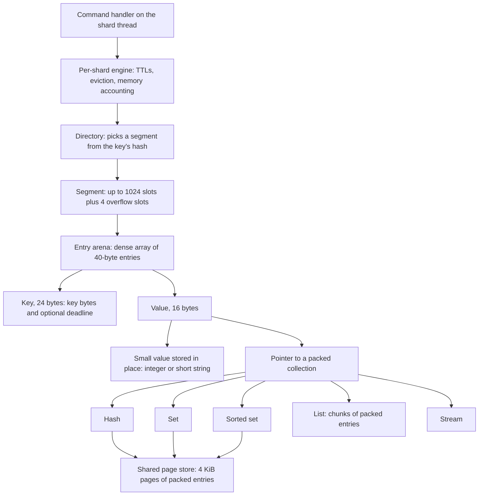

# Component 05: Storage Engine & Compact Encodings (Implementation Guide)

> **High-level design**: [`docs/design/05_storage_engine.md`](../design/05_storage_engine.md)
> **Consolidated implementation spec**: [`components.md`](components.md)
> **Background reading**: [`docs/design/rudis_table.md`](../design/rudis_table.md) (the original table design spec; useful for motivation, but this document is the reference for how the code works today)
> **Main source files**: src/table.rs (the key table and the per-shard engine), src/compact.rs (compact
> keys and strings), and one file per collection encoding: src/smallhash.rs, src/pagestore.rs,
> src/packedhash.rs, src/packedset.rs, src/zindex.rs, src/packedlist.rs, src/hll.rs. The
> [Code map](#11-code-map) lists the key symbols.

---

## 1. What this subsystem does

Every Redis key that a shard owns lives in one in-memory hash table, and only that shard's thread
ever touches it. (A **shard** is one worker thread plus the keys it owns; see
[04_sharding_mesh.md](04_sharding_mesh.md).) This subsystem is that table, plus the compact
formats used for the values stored in it.

The table has three jobs. It must hold hundreds of millions of keys per process without ever
pausing to resize the whole table at once. It must spend as few bytes per key as possible. And it
must give Redis-compatible behavior for expiring keys (TTLs), for evicting keys when memory runs
out, and for the six core data types. Because a table is never shared between threads it needs no
locks; all the cleverness goes into memory layout and into keeping the work done per operation
small and bounded.

Every command handler uses it: the connection routes a command to the owning shard, and the shard
calls a method on its table (get, set, push to a list, add to a sorted set, ...). Persistence
(RDB and AOF), replication, NVMe tiering, cluster slot migration, SCAN, DEBUG DIGEST and MEMORY
STATS also read the table directly.

The subsystem has two halves:

1. **The key table**: an *extendible hashing* table in the style of Dragonfly. A directory points
   at many small fixed-size hash tables called **segments**; growing the table means splitting one
   segment at a time. A wrapper around it adds TTLs, eviction, memory accounting and the
   command-level API.
2. **Compact encodings**: byte-packed formats for keys, strings and collections. They replace the
   usual "one heap object per element" layout, which wastes memory on pointers and allocator
   overhead.

The DEBUG DIGEST code is described here too, because it is the one place that must treat every
encoding as equal.

---

## 2. Mental model



Five ideas explain most of this document:

* **An entry is 40 bytes.** A 24-byte key and a 16-byte value. Short keys, a key's expiry deadline,
  integers and short strings all fit inside those 40 bytes, so a typical small key costs no heap
  allocation at all.
* **Slots are tiny; entries live elsewhere.** A segment's slots hold only a 1-byte fingerprint and
  a 2-byte index into a dense side array of entries (the **arena**). Empty slots therefore cost 3
  bytes instead of 40.
* **Growth touches one segment.** When a segment fills up, only that segment is rebuilt or split
  in two. There is never a whole-table rehash, so no operation stalls for long.
* **Background work is budgeted.** Expiry, eviction, shrinking and statistics refreshes each do a
  small, fixed amount of work per call, driven by a 100 ms timer on each shard (the **shard
  cron**).
* **Collections start small and switch once.** Each collection type has a compact "small" form
  that is scanned linearly, and a "large" form with an index. A collection moves to the large form
  when it passes a size threshold and never moves back.

Here is how a lookup finds a value:

1. Hash the key once with FxHash, then **avalanche** the hash: run it through a short
   multiply-and-shift finalizer so every output bit depends on every input bit.
2. Bits 10 and up of that mixed hash index the directory, which names a segment.
3. Inside the segment, the low bits pick a starting slot. Each slot has a one-byte
   **fingerprint** (the top 7 bits of the hash), and 16 fingerprints are compared at once to find
   candidate slots.
4. A candidate slot holds a 2-byte index into the segment's arena; the entry's key is compared
   byte for byte to confirm the hit.
5. The entry's value is either a small value stored in place (an integer, a short string) or a
   pointer to a packed collection.

---

## 3. Entries: the 40-byte unit of storage

### 3.1 One entry = key + value

Every key in the table is one 40-byte entry (`RudisEntry`): a 24-byte key followed by a 16-byte
value. A compile-time check keeps it at exactly 40 bytes, because the size multiplies across
hundreds of millions of keys.

There is no separate field for the expiry deadline. Most keys have no TTL, and a dedicated 8- or
16-byte field would cost every one of them. Instead the deadline is folded into the key's own
encoding (§3.3), so only keys that have a TTL pay for it, and short ones pay nothing extra.

### 3.2 Storing a deadline in 8 bytes

A standard "optional point in time" takes 16 bytes. Rudis packs it into 8 (`Expiry`): the number
of nanoseconds since a fixed process-wide base instant, plus one, with 0 meaning "no TTL".

The base is chosen once, the first time it is needed: one hour before that moment, and aligned to
a whole wall-clock millisecond. The hour of slack lets deadlines slightly in the past (for example
an already-expired key being restored) still be represented. The millisecond alignment means
absolute deadlines from PXAT or PEXPIREAT land exactly on the millisecond grid that short keys use
(§3.3). Deadlines before the base are clamped to it; they are expired either way, and ordering
between deadlines is preserved.

### 3.3 Keys: 24 bytes, usually no heap

A key (`CompactKey`) is a 24-byte value that picks one of six layouts depending on its length and
whether it has a TTL:

| Key | Layout | Heap |
| :--- | :--- | :--- |
| No TTL, up to 23 bytes | bytes stored in place | none |
| With TTL, up to 18 bytes | bytes plus a 5-byte deadline stored in place | none |
| No TTL, longer | exact-size heap copy | key length |
| With TTL, longer (or a deadline too far out to pack) | heap copy prefixed by the full 8-byte deadline | key length + 8 |

The in-place deadline is 5 bytes (40 bits) of **milliseconds** since the base. The deadline is
rounded to the nearest millisecond, so PTTL never reports more time than was set. Forty bits cover
about 34.8 years past the base; a deadline beyond that falls back to the heap layout, which keeps
the exact nanosecond deadline.

Changing a TTL updates the deadline in place when the layout does not change, and otherwise
re-encodes the key. For example, adding a TTL to a 20-byte key moves it from the in-place layout
(23 bytes available) to the heap layout, because only 18 bytes fit beside a deadline.

**Example.** `SET session:42 x EX 60` stores the 10-byte key `session:42` in place, with its
deadline in the 5 spare bytes: zero heap allocations for the key. A 40-byte key with a TTL costs
one 48-byte heap allocation (8 bytes of deadline plus 40 bytes of key).

The key also reports its heap cost (0 for the in-place layouts), which feeds memory accounting.
The exact variant names are in [§12.2](#122-key-layouts).

### 3.4 Values: 16 bytes

A value (`RudisValue`) is 16 bytes and has one variant per kind of data:

* a string (a compact string, §3.5) or an integer, stored in place;
* a small hash, stored as a single 8-byte pointer to one allocation (§7.1);
* a pointer to a large hash, list, set, sorted set or stream (§7);
* a legacy dense HyperLogLog (§7.7);
* two NVMe tiering states: **tiered** (the value lives only on disk) and **cooled** (the value is
  both in memory and on disk, so it can be dropped from memory without writing it again; §8.3).

Everything except strings, integers and small hashes is boxed behind a pointer so the whole value
fits in the same 16 bytes a compact string needs. The tiering states are boxed too, since they are
cold.

There are three different "size" questions, and the value answers each separately: how much heap
memory it uses beyond its slot (for memory accounting), roughly how large its content is (for
MEMORY USAGE and for deciding what to spill to disk), and how many elements a hash or list has
(for budgeting the background recount in §5.5). The exact formulas are in
[§12.4](#124-value-variants-and-size-functions).

### 3.5 String values: inline, packed, heap, shared

Many real values are short and drawn from a small alphabet: ids, hex digests, timestamps, ASCII
words. The compact string (`CompactStr`) exploits this: it picks a layout by length and content so
that as many values as possible fit in 16 bytes with no heap allocation.

The ladder, from cheapest to most expensive:

1. **Up to 15 bytes of anything**: stored in place.
2. **16–17 ASCII characters**: packed at 7 bits per character, still in place.
3. **18–20 characters from a 64-symbol alphabet** (digits, letters, plus `:-` or `_.`): packed at
   6 bits per character, in place.
4. **21–24 characters from a 32-symbol alphabet**: packed at 5 bits per character, in place. One
   alphabet is aimed at hex, timestamps and ids; the other at lowercase words.
5. **25–255 ASCII characters**: packed at 7 bits per character on the heap, but only when packing
   actually lands the allocation in a smaller allocator size class. Saving 1/8 of the bytes is
   useless if jemalloc rounds both sizes up to the same class.
6. **Anything else**: a plain heap copy (a thin pointer plus a length).
7. **256 bytes or more, after the first read**: converted to a reference-counted shared buffer.

The last step is about cross-shard reads. Copying a large value out of the table costs an
allocation plus a memory copy every time. So the first time a heap string of at least 256 bytes is
read, it is converted in place to a shared buffer, and every later read (often from another shard)
is just a reference-count increment. The packed heap layout stops at 255 bytes for exactly this
reason: anything larger will be shared, and a packed value cannot be.

Integers get their own path: when a SET value parses cleanly as a 64-bit integer, it is stored as
an integer, and formatted back to text on read.

Reading a packed value means unpacking it. Callers get a view that behaves like a byte slice:
either a borrowed slice for unpacked layouts, or bytes unpacked onto the stack (or into a heap
buffer for long packed values). Reply code can unpack straight into the output buffer instead. Code
that needs a real contiguous slice must handle "not available" for packed layouts. The 7-bit
packing uses SWAR (word-at-a-time bit tricks), or the BMI2 bit-deposit/extract instructions when
the CPU has them.

**Example.** `SET user:1:ts 2026-10-30T14:29:57Z` stores a 20-character value whose characters
are all in the first 64-symbol alphabet (`0-9A-Za-z:-`), so it packs in place at 6 bits per
character: 0 heap bytes. The same value with a trailing `.123` (24 characters) packs in place at
5 bits per character, because every character is in the hex-and-timestamp alphabet.

The compact string uses `unsafe` code (it owns raw heap pointers and declares itself thread-safe
by hand); its tests also run under Miri. The full layout table is in
[§12.3](#123-string-layouts).

---

## 4. Segments: one small hash table

### 4.1 Slots and the arena

A segment (`RawSegment`) is a small open-addressing hash table in the SwissTable style: a key can
sit in any of several slots, found by probing from a starting position. What makes it compact is
that the slots are separate from the entries:

| Part | What it holds | Why |
| :--- | :--- | :--- |
| Control bytes | one byte per slot: empty, deleted, or the key's 7-bit fingerprint | 16 can be compared at once, so most non-matching slots are rejected without touching the entry |
| Slot indexes | one 2-byte index per slot into the arena | keeps empty slots at 3 bytes total |
| Arena | the 40-byte entries, packed densely; may contain holes | entries take space only when they exist |
| Access words | one 2-byte LRU/LFU word per arena entry | eviction data stays next to the entry it describes (§6.3) |
| Stash | 4 extra overflow slots | absorbs keys whose probe sequence found no room |

A segment has between 16 and 1,024 main slots (always a power of two) plus the 4 stash slots. It
also tracks its live item count, how many more inserts it can take before it must grow (its
**growth budget**), its depth in the directory (§5), and an estimate of the bytes its entries hold.

### 4.2 Probing: finding a key

All lookups and inserts share one probe loop:

1. Take the key's fingerprint (top 7 bits of the mixed hash) and its starting slot (low bits).
   Start loading the slot-index line right away, so that memory load overlaps the control-byte
   load instead of following it.
2. Compare the 16 control bytes starting at that slot against the fingerprint and against
   "empty". These are plain loops that the compiler turns into SIMD compare instructions on x86-64;
   there are no hand-written intrinsics.
3. For each match, follow the slot index into the arena and compare the keys. Short keys (up to 32
   bytes) are compared with a few overlapping word-sized reads.
4. If the group contained an empty slot, the key is not in the table: stop. (An insert instead
   takes the first deleted slot it saw, or else that empty slot.)
5. Otherwise jump ahead *triangularly*: the step grows by 16 each time, so successive groups are
   16, 32, 48, ... slots further on.
6. Once two full groups have been probed, check the 4-slot stash by fingerprint. On insert, if no
   free main slot has been seen and the stash has room, a stash slot becomes the insert position.
7. Give up once the step reaches the segment's capacity, so probing is always bounded.

Stash slots are numbered right after the main slots, so the rest of the code distinguishes them
simply by comparing the slot number against the capacity.

**Why a stash?** Without it, a segment that is mostly empty could still have one crowded
neighbourhood, and the first key that cannot find a slot in its first two groups would force the
whole segment to grow or split. The stash absorbs those few unlucky keys.

### 4.3 Insert, delete and the arena

**Insert.** The new entry goes into the lowest hole in the arena, or is appended. When the arena
has to grow, it grows by 1/16 of its length (at least 16 entries) with an exact-size reservation,
so arenas do not double and waste up to half their memory. The slot gets the fingerprint and the
arena index, and the access word is stamped. The growth budget drops only when a never-used main
slot (or a stash slot) is consumed; reusing a deleted slot is free.

**Delete.** A main slot becomes a **tombstone** ("deleted" rather than "empty"), so probe sequences
that pass through it still reach keys stored further along. A stash slot becomes empty again and
returns its growth credit. The arena entry is removed if it is the last one; otherwise it is
replaced with a placeholder and recorded in a hole bitmap. Nothing else moves, so an entry never
needs a back-pointer to its slot.

**Last key removed.** The whole segment resets: all control bytes empty, stash and arena cleared,
growth budget restored.

**Arena trimming.** Once fewer than half of at least 32 arena positions are live, the segment
compacts its arena, walking the slots so every moved entry's slot index is updated. A periodic
background step (§5.5) trims more aggressively.

**Growth budget.** A segment starts with a budget of 7/8 of its capacity. Only a full 1,024-slot
segment also gets credit for its 4 stash slots; smaller segments have the stash slots physically
but are not credited for them, so they double (§5.2) rather than lean on the stash.

### 4.4 Memory per key

A full 1,024-slot segment has about 3.2 KB of fixed arrays (1,040 control bytes, 1,028 two-byte
slot indexes, a 17-word hole bitmap), plus 42 bytes per arena position (the 40-byte entry and its
2-byte access word).

Segments are typically 45–60% full: with a uniform hash, all segments fill at roughly the same rate
and split at roughly the same time, so most of the time they sit between half full and the 7/8
split point. That puts the cost of a key at roughly 42 bytes plus about 6 bytes of slots, plus any
heap bytes of its key and value. (The source comment beside the segment-capacity constant still
says "~48KB" per segment; that figure predates the slot/arena split and is not accurate.)

---

## 5. The directory: extendible hashing over segments

The table (`RudisFlatTable`) is a list of segments plus a **directory**: an array of segment
numbers whose length is always a power of two, 2^(global depth). A key's mixed hash, shifted right
by 10 bits and masked to the global depth, indexes the directory and so picks the segment.

Several directory entries can point at the same segment. Each segment has a **local depth**: the
number of hash bits that all its keys agree on. A segment at local depth 1 in a directory of
global depth 3 is pointed to by 4 directory entries. A brand-new table is one 64-slot segment and
a one-entry directory (global depth 0).

### 5.1 Lookup and insert

**Lookup** mixes the hash, picks the segment from the directory, probes it, and returns the entry
together with a **global index**: the segment number shifted left by 11 bits, combined with the
slot number. Callers pass in the raw key hash rather than the key alone, so a hash computed
earlier can be reused; for example, the router hashes a key to pick its shard and the owning
shard then looks the key up with the same hash.

**Insert** is split in two steps. The first finds either the existing entry or the position where
a new one would go. If the target segment's growth budget is zero, it first checks whether the key
already exists (overwriting never forces a split), and only for a genuinely new key grows or splits
the segment (§5.2). The second step places the entry at the prepared position without probing
again. Insert and remove keep the item count, the per-segment data estimate, the heap-byte total,
and (once built) the per-cluster-slot key counts in sync.

Lookups made on behalf of a client stamp the entry's access word (§6.3); there are also variants
that read without stamping, for internal walks.

### 5.2 Growing without a stop-the-world resize

**Why.** A classic hash table doubles by rehashing every key at once, which stalls a big table for
a long time. Extendible hashing grows one segment at a time instead, so every growth step costs at
most one segment's worth of work (at most 1,028 entries) no matter how large the table is.

When an insert finds its target segment's growth budget at zero, the table tries the cheapest fix
first:

1. **Purge tombstones.** If fewer than half the slots are live, the segment is full mostly of
   tombstones. Rebuild it at the same capacity by re-inserting every live entry, which drops them.
2. **Double in place.** If the segment has fewer than 1,024 slots, rebuild it at twice the size.
3. **Split.** A full 1,024-slot segment at local depth *d* splits in two:
   1. If *d* equals the global depth, the directory doubles first (it is appended to itself) and
      the global depth goes up by one.
   2. The segment is drained and every entry hashed once. Hash bit 10 + *d* decides where it goes:
      0 stays in the old segment, 1 goes to a new segment appended at the end of the segment list.
      The entries are counted first so both new segments get exactly sized arenas, and both get
      local depth *d* + 1.
   3. The directory entries that pointed at the old segment and have bit *d* set are repointed to
      the new one.
   4. If the segment the key maps to is still full, repeat.

Because of this, there is no incremental-rehash protocol. A few methods from an earlier design
that had one remain as stubs that always report "not rehashing" or do nothing; nothing outside the
table file calls them.

**Worked example.** A fresh shard receives 1,000 `SET`s of distinct keys:

1. Keys 1–56 fill the 64-slot segment (64 × 7/8 = 56). Key 57 finds the budget at zero, so the
   segment doubles to 128 slots. The same happens at 128 → 256 → 512 → 1,024.
2. At 1,024 slots the segment takes 896 + 4 = 900 keys. Key 901 forces a split. The segment's
   local depth (0) equals the global depth, so the directory first doubles to [0, 0]. Then entries
   with hash bit 10 set move to new segment 1, and directory entry 1 is repointed to it. The
   directory is now [0, 1], both segments are at depth 1, and each holds about 450 keys.
3. When segment 1 fills later, its depth (1) again equals the global depth, so the directory
   doubles to [0, 1, 0, 1]. Segment 1 splits on hash bit 11 into segments 1 and 2, and directory
   entry 3 now points at segment 2. Segment 0, still at depth 1, is pointed to by entries 0 and 2.
   Most splits only repoint directory entries; they do not double the directory.

### 5.3 Giving memory back

Deleting keys never shrinks a segment by itself. Three mechanisms return memory:

**Merging buddies (periodic).** Two segments are **buddies** when they have the same depth *d* and
their hash patterns differ only in bit *d* − 1, that is, they came from the same split. A periodic
step (run with a budget of 32 merges by the shard cron, §6.6) walks the directory looking for
buddy pairs whose combined item count is at most 256 (a quarter of a full segment), and merges
each pair into one 1,024-slot segment at depth *d* − 1.

The merged segment takes the **higher** of the two segment numbers, and the lower number becomes a
tiny placeholder (a **hole**). This matters for SCAN (§6.7): a positional cursor that has already
passed the lower number will still reach the moved entries at the higher one. After merging, the
directory is halved while no segment needs the full depth, and once holes make up at least half
the segment list they are dropped and the segments renumbered. The engine wrapper also collapses
the whole table to a single segment once there are several segments but no more keys than half a
segment holds (512).

**Defragmenting.** If all the keys fit in one segment, sized at the next power of two above twice
the item count (minimum 64), and the table has several segments, is oversized, or contains
tombstones, everything is rebuilt into that single segment and the directory reset to one entry.
Otherwise every segment that contains a tombstone is rebuilt in place.

**Clearing.** FLUSHDB-style clearing goes straight back to one 64-slot segment and drops the
cluster-slot key counts.

**Layout epoch.** The table keeps a counter (`layout_epoch`) that goes up whenever entries move
between segment numbers: clearing, a defrag that collapses to one segment, any merge, and hole
compaction. Splits only append segments, and in-place rebuilds keep entries in their segment, so
they do not change it. Snapshot walks use the counter to notice that the layout changed under them
(§5.4).

### 5.4 Walking the table: positional cursors and snapshots

Background walkers need to visit every slot over many small steps without holding a reference
into the table. They use a **positional cursor**: a plain number from 0 up to a bound. With one
segment, the bound is that segment's slot count and the cursor is the slot number. With several
segments, the bound is the segment count × 1,028, and cursor *c* means slot *c* mod 1,028 of
segment *c* / 1,028. Active expiry, eviction sampling, tier spill candidate selection, RANDOMKEY
and large-table SCAN all use it.

**Snapshots.** A point-in-time snapshot image (used by SAVE and BGSAVE, by full syncs to replicas,
and by AOF rewrites) is built step by step while clients keep writing. It walks each database's
segments in order. Each segment has a **pattern**: its local depth together with the low hash bits
that every key in it shares. A split only refines patterns, so the walk records the patterns it
has written, and when it reaches a segment created by a later split it skips keys that a recorded
pattern already covers. That way a key that moves to a new segment during the walk is not written
twice. If the layout epoch changes mid-walk (a merge or defrag happened), the walk writes only the
keys no recorded pattern covers.

To keep the image a true point-in-time copy, a key the walk has not reached yet is written into
the image in its unchanged state just before any change to it, and the walk skips it later. See
[14_persistence_replication.md](14_persistence_replication.md).

### 5.5 Keeping counters cheap

Statistics such as MEMORY STATS and the eviction controller need sizes constantly, so the table
maintains them incrementally rather than walking every entry:

* **Structure size** (segments, directory, slot counts) is a running total, readable in constant
  time. A slow "exact" version recomputes it from every segment, so drift can be checked.
* **Free arena bytes**: arena space allocated but not holding a live entry.
* **Dataset estimate**: the sum of per-segment data estimates. It is exact when keys are inserted
  or removed, but a value that grows in place (HSET on an existing hash, APPEND, LPUSH) does not
  update it. So a background step recounts segments round-robin, each call doing about a budget's
  worth of work (one unit per entry plus the length of each hash or list). The shard cron uses a
  budget of 50,000 (§6.6).
* **Arena trim step**: for a budget of segments round-robin, an arena with at least 64 positions
  of which more than 1/8 are free is compacted down to about 1/16 slack.
* **Cluster-slot key counts**: the number of keys (live or expired but not yet removed) in each of
  the 16,384 cluster slots. Built on first use by scanning every entry, then maintained on every
  insert and remove (§6.8).

---

## 6. The per-shard engine

The engine (`RudisTable`) wraps the table and adds everything that makes it a Redis keyspace:
expiry, eviction, memory accounting and the command-level API. Each shard keeps one engine per
database: the selected one, plus the other databases for SELECT. Alongside the table, the engine
keeps:

* a running count of keys that have a TTL (`num_expires`), which lets hot paths skip expiry checks
  entirely when it is zero;
* a map of hash fields that have their own TTLs (§6.2);
* a byte count of the data its entries hold (`data_bytes`, §6.5);
* a shared **sample cursor** for expiry and eviction sampling, and a separate cursor for choosing
  values to spill to NVMe;
* a pool of empty containers to reuse (§8.1);
* a short list of NVMe extents whose keys were deleted, waiting to be released (§8.3).

### 6.1 Key expiry

Redis expires keys two ways, and Rudis does the same: **passively**, when a command touches an
expired key, and **actively**, by periodically sampling keys with TTLs so that keys nobody reads
still go away.

**Passive expiry.** Before using an entry, read and write paths first check the TTL count. On a
shard with no TTLs that is a single integer comparison, with no clock read. Only if it is non-zero
do they look at the entry's deadline, check whether expired keys are currently allowed to be read,
and read the clock.

Expired keys are allowed to be read while the thread is replaying writes (loading the AOF or
applying a replication stream), or when a flag explicitly allows it. During replay nothing expires,
because the stream being replayed will contain the DEL itself.

When a key turns out to be expired, it is removed (`expire_slot`), which:

1. does nothing while clients are paused (CLIENT PAUSE), and does nothing on a **read-only
   replica**: a replica keeps the key until its master's DEL arrives, while still reporting the
   key as gone so reads hide it;
2. otherwise removes the entry, queues any NVMe extent for release, decrements the TTL count and
   the byte count, bumps the expired-keys statistic, logs a DEL to the AOF and to replicas (except
   while replaying), touches WATCHed keys, sends client-tracking invalidations, and publishes an
   `expired` keyspace event.

**Keys written on a writable replica.** A replica never actively expires its master's keys: the
master does that and sends a DEL. But with `replica-read-only no`, clients can write keys directly
to the replica, and no master will ever expire those. So the connection layer records each such
key, with its database, in a per-shard set (`replica_local_keys`), forwarding it to the owning
shard when needed. On a replica, the cron sweeps that set instead of running the active cycle.
For each recorded key it asks whether the key has a TTL:

1. **Yes** (expired or not): expire it if its deadline has passed. The key stays recorded while it
   still has a TTL, either because it is not due yet or because it is only hidden (the replica
   turned read-only meanwhile).
2. **No TTL, or the key is gone**: forget it.

When the server stops being a replica the set is cleared, since the normal active cycle now covers
everything. This mirrors Redis's `slaveKeysWithExpire`.

**Active expiry** runs every 100 ms from the shard cron, except on replicas, while clients are
paused, or when the cron is paused for testing. Each run:

1. If any hash fields have TTLs, first expire fields from up to 8 hash keys (§6.2).
2. If no keys have a TTL, stop.
3. Walk positional cursor slots from the shared sample cursor, looking at keys with a TTL, until 20
   such keys have been checked, 512 positions have been scanned, or no TTL keys remain.
4. Expire the ones whose deadline has passed, counting them as actively expired.

The shard runs this on the selected database and on every other database that has TTLs. The
limits keep each run to a fraction of a millisecond even on a huge table: at most 512 slot
positions per database per 100 ms.

**Example.** A shard holds 10 million keys, 100,000 of them with `EX 60`. A minute later, keys
nobody reads are still in the table. Each cron tick scans up to 512 positions from where the last
tick stopped and removes the expired TTL keys it finds among the first 20 it checks; the cursor
keeps moving, so over many ticks the whole table is covered. A GET on an expired key removes it
immediately, whatever the cursor is doing.

### 6.2 Hash-field TTLs

HEXPIRE, HPEXPIRE, HTTL, HPERSIST, HGETEX and HSETEX give individual hash fields their own
deadlines. These are kept outside the entries, in a per-engine map from hash key to (field →
deadline), because field TTLs are rare and the hash encodings have no room for them. This map is
independent of the key TTL count.

* **Passive:** at the top of a hash command (only if the map is non-empty), expired fields of that
  hash are removed from the map, logged as HDEL to the AOF and replicas, and deleted from the hash.
  As with keys, nothing is purged while replaying writes or on a read-only replica.
* **Reads that must not purge** (HRANDFIELD, HSCAN) instead get a list of fields to skip. A
  read-only replica gets a similar list of fields to hide.
* **Active:** the cron purges up to a given number of hash keys (8 per tick), starting at the shared
  sample cursor modulo the number of hashes in the map. It reads the cursor but never advances it.

### 6.3 Access tracking: LRU clock or LFU counter

Eviction needs to know which keys are least valuable. Each arena entry has a 16-bit **access
word** beside it, used in one of two modes:

* **LRU mode** (the default; Least Recently Used): the word is the current time in seconds (from
  a cheap coarse monotonic clock) truncated to 16 bits. A key's idle time is "now minus word",
  with wrap-around. That is exact up to about 18.2 hours; a key idle longer than that wraps around
  and looks recently used.
* **LFU mode** (Least Frequently Used; active when `maxmemory-policy` contains `lfu`): as in Redis,
  the high byte holds the time of the last decrement in minutes (mod 256, so it wraps after about
  4.3 hours) and the low byte holds a **logarithmic counter**. New keys start at 5. On each access
  the counter first decays by one for every `lfu-decay-time` minutes since the last decrement
  (default 1; 0 means never decay), then increments with probability 1 / ((counter − 5) ×
  `lfu-log-factor` + 1), with a default factor of 10. So the counter rises quickly at first and
  ever more slowly after, and a counter of 255 represents a very hot key.

Reads stamp the word unless the client set CLIENT NO-TOUCH. Every operation that moves entries
(split, rebuild, merge, defrag) carries the word along.

### 6.4 Eviction

**Why sampling.** When a shard is over its share of `maxmemory`, it must remove keys. Finding the
truly least-recently-used key would need a global ordering of all keys, which costs memory and
time on every access. Like Redis, Rudis instead samples a few keys and evicts the worst of them.

The router calls the shard's eviction routine (`try_evict_one_key`) repeatedly until the shard is
back under its share. Each call evicts at most one key:

1. Pick the database: the selected one first, then the others. (The current-database marker is set
   to each database while it is tried, because the snapshot step below needs it.)
2. Give up for an empty table, or for a `volatile-*` policy when no key has a TTL.
3. Walk positional slots from the shared sample cursor, at most one full pass. Under a `volatile-*`
   policy, skip keys without a TTL.
4. Keep the best candidate according to the policy:
   * `*-ttl`: the nearest deadline;
   * `*-lru`: the longest idle time;
   * `*-lfu`: the smallest decayed counter;
   * `*-random`: simply the last key sampled.
   LRU, LFU and random stop after `maxmemory-samples` eligible keys (default 5; CONFIG SET accepts
   1–64).
5. If a snapshot image is being built (SAVE or BGSAVE, a full sync, an AOF rewrite), first write
   the victim into the image, so the image still contains the key as it was when the snapshot
   started — just as Redis's forked child would still have it.
6. Remove the victim, queue any NVMe extent for release, adjust the TTL count and byte count,
   bump the evicted-keys statistic, log a DEL to the AOF and replicas, then send WATCH, tracking
   and `evicted` keyspace notifications. Return the bytes freed.

**Example.** With `maxmemory-samples 5` and `allkeys-lru`, one eviction reads occupied slots from
the sample cursor until it has looked at 5 keys, and evicts the one idle longest. With
`maxmemory-samples 1` the victim is simply the next occupied slot (effectively random). Larger
values come closer to true LRU, at the cost of reading more slots per eviction.

The router splits eviction between shards using each shard's **eviction size**: its structure size
plus its dataset estimate (§5.5).

### 6.5 Memory accounting

The engine estimates its own memory use in constant time: the byte count of its entries plus the
table's structure size. Each entry is charged its key's heap bytes, its value's heap bytes, and a
fixed overhead of 16 bytes.

That fixed overhead must never be zero. With a fully in-place key and value, an entry has no heap
bytes at all, so evicting it would "free" 0 accounted bytes, and the eviction loop, which keeps
going until enough bytes are freed, would evict everything.

This estimate is used to split eviction between shards and to pace tiering. The `maxmemory` limit
itself is checked against the allocator's real counters (Component 07).

MEMORY STATS shows a breakdown with key count, the incremental byte count, the per-segment
dataset estimate, the byte count recomputed exactly by walking every entry, the incremental and
recomputed structure sizes, and the free arena bytes. Seeing several versions side by side shows
how far the incremental counters have drifted (§9). The byte count can be rebuilt from scratch,
which active defragmentation does.

### 6.6 The shard cron

Every 100 ms each shard:

1. Records whether it is a read-only replica. If it is not a replica, it runs active expiry (§6.1)
   and clears the writable-replica key set. On a replica, it sweeps that set instead.
2. Unless a snapshot image is walking the segments, runs one merge step (up to 32 merges, §5.3)
   and one arena trim step (up to 32 segments, §5.5) on the **selected** database. These are
   skipped during a snapshot because moving entries mid-walk would force the walk into its slower
   fallback.
3. Runs a dataset recount step (budget 50,000, §5.5) on every database. This only reads, so it is
   safe during a snapshot.
4. Publishes the shard's memory state.

### 6.7 SCAN

SCAN must return every key that exists for the whole scan, even if the table grows or shrinks in
between. The engine uses two strategies:

* **Up to 8,192 keys:** compute an odd 32-bit hash of every live key (xxh3, low 32 bits, with the
  lowest bit forced on so it is never 0, which means "done"), sort, and return keys whose hash is
  at least the cursor; the next cursor is the next larger hash. This does not depend on slot
  positions at all, so it survives any resize.
* **Larger tables:** a positional cursor (§5.4) that returns after COUNT matches. Splits only append
  segments, and merges keep entries at the higher segment number (§5.3), so a key that exists for
  the whole scan is not skipped.

### 6.8 Cluster slot counts

CLUSTER COUNTKEYSINSLOT and GETKEYSINSLOT need the keys of one cluster slot quickly. They use the
table's per-slot key counts, a 64 KiB array built on first use and then maintained on every insert
and remove. A zero count returns immediately. A non-zero count is trusted when no key has a TTL;
otherwise the table is scanned, counting live keys and removing expired ones along the way.

### 6.9 Read fast paths and other helpers

**Writing replies directly.** A family of read methods (GET, HGET, LPOP/RPOP, LRANGE, SISMEMBER,
ZRANGE) serialize the reply straight into the connection's output buffer, with no intermediate
byte buffer. Another returns a compact reply object (`CompactResp`) for cross-shard GETs. MGET and
MSET batching lives in the router and connection layers (see
[04_sharding_mesh.md](04_sharding_mesh.md)); the table contributes single-key primitives that reuse
the caller's hash.

**Other helpers worth knowing:**

* Inserting a whole entry deletes any existing key first, then inserts and charges memory.
* Taking a key's entry out removes its hash-field TTLs with it (MOVE uses this).
* "Peek" reads an entry without expiring it, stamping its access word, or loading it back from
  NVMe (DEBUG DIGEST-VALUE uses this).
* Before mutating a cooled value in place, the engine **warms** it: turns it back into a plain
  in-memory value and queues the now-stale disk copy for release.
* UNLINK counts a delete as a lazy free when the value is a collection with more than 64 elements,
  or a stream with consumer groups.
* Active defragmentation defragments the table (§5.3), re-creates every string value (so each picks
  its best layout again), then recalculates memory. It runs on an explicit cross-shard request,
  not from the cron.

---

## 7. Collection encodings

Each collection type has a small form and a large form:

| Type | Small form | Large form | Switches to large | OBJECT ENCODING (small / large) |
| :--- | :--- | :--- | :--- | :--- |
| String | integer, or compact string | — | by content | `int` / `raw` |
| Hash | one packed allocation (§7.1) | hash index over pages (§7.3) | more than 512 fields, or a field or value longer than 64 bytes | `listpack` / `hashtable` |
| Set | vector of members with cached hashes | hash index over pages (§7.4) | more than 64 members | `intset` / `hashtable` |
| Sorted set | sorted vector | hash index plus sorted runs (§7.5) | more than 64 members | `listpack` / `skiplist` |
| List | chunks of packed entries (one form, §7.6) | — | — | `quicklist` |
| HyperLogLog | a string holding Redis's HLL format (§7.7) | — | sparse ↔ dense inside the string | `raw` |
| Stream | one form (§7.8) | — | — | `stream` |

The hash thresholds are runtime settings, changeable with CONFIG SET `hash-max-listpack-entries`
and `hash-max-listpack-value` (or their older `ziplist` names). The set and sorted-set limits are
constants: the `set-max-*`, `zset-max-*` and `list-max-*` settings are accepted but do nothing.
Conversion is one-way: a large collection never shrinks back to the small form, even after
deletes.

### 7.1 Small hashes: one exact-size allocation

**Why.** A small hash with a handful of fields would waste most of its memory on per-field
allocations and hash-table buckets. Redis uses a "listpack" (a flat byte array) for this; Rudis
does the same.

A small hash (`SmallHash`) is a single 8-byte pointer to one allocation laid out like this:

```text
[count: u32][len: u32] [varint flen][field][varint vlen][value] [varint flen][field]...
```

Each field/value pair is two length-prefixed byte strings, with lengths as variable-length
integers, so a 5-byte field and a 5-byte value cost 12 bytes. Lookup is a linear scan, which is
fast at this size. Setting a field overwrites the value in place if the new value has the same
length; otherwise the pair is spliced and the allocation resized to the exact new size. A field
known to be new is appended. Iteration is in insertion order. On promotion, the pairs are copied
into a large hash. Like the compact string, this uses `unsafe` raw allocation and has its own Miri
test script.

### 7.2 The page store: shared storage for large collections

Large hashes, sets and sorted sets all keep their elements in a **page store** (`PageStore`),
instead of allocating each element separately.

* An element is one **page entry**: a variable-length header holding its length and a "dead" bit,
  followed by its bytes. It is addressed by a **handle**, a (page, offset) pair packed into an
  integer. 32-bit handles allow 2^20 pages of 4 KiB; 64-bit handles are effectively unlimited.
* Normal pages hold up to 4,096 bytes, which is exactly one allocator size class. An element longer
  than 1,024 bytes gets a page of its own. The first page is stored inside the store itself, so a
  one-page collection needs no extra pointer hop.
* Only the current page accepts new entries. It starts at 64 bytes and grows by a quarter at a time
  up to 4,096, so small collections stay small.
* Releasing an element sets its dead bit. A page that is completely dead is freed for reuse. Once at
  least half a page is dead, the store asks its owner to compact it: it first lists, read-only,
  every live entry that will move and where to, so the owner can still look up what points at each
  entry; then it slides the entries down and shrinks the buffer.
* When the next page would not fit in a 32-bit handle, the owner **widens** once to 64-bit handles,
  so there is no size limit.

### 7.3 Large hashes

A large hash (`PackedHash`) is a hash table of handles plus a page store. Each field/value pair is
one page entry (`[varint flen][field][value]`), and a bucket holds nothing but the handle.

* **Get:** hash the field (FxHash), probe the table, compare the field by reading it from its page.
* **Set an existing field:** a same-length value is overwritten in place. Otherwise the new pair is
  appended, the bucket repointed, and the old entry released.
* **Page compaction:** each moved field is re-hashed to find and repoint its bucket.
* Iteration is in hash-table order.

### 7.4 Sets

* **Small:** a vector of members, each stored with its cached FxHash. Comparing hashes first lets
  membership tests, inserts and removes reject most non-matches without touching member bytes.
  Removal swaps the last element into the gap (constant time, but it reorders); SPOP takes the last
  element.
* **Large** (`PackedSet`, modeled on Dragonfly's DenseSet): a hash table whose buckets hold the
  member's page handle directly, plus a page store. A 5-byte member costs a 6-byte page entry plus
  a 4-byte bucket. SPOP resumes scanning buckets where the previous pop stopped instead of at bucket
  0, so draining a whole set scans the table about once rather than quadratically.

### 7.5 Sorted sets

**Small:** a vector of (score, member) pairs kept sorted by score and then member. Scores are
compared with a total order on floating-point numbers, so every value, including NaN-like edge
cases, has a defined place. Insert removes any old entry for the member, then binary-searches the
position.

**Large** (`ZIndex`): each member is stored exactly once, as a page entry holding its 8-byte score
followed by the member bytes. Two indexes point at it:

* a hash table from member to handle, for score lookups;
* a list of **sorted runs**: short arrays of handles in (score, member) order, each holding at most
  127 handles.

Why runs instead of a skiplist? A skiplist needs several pointers per member. Runs need one 4-byte
handle per member, and shifting at most 127 handles within one run is cheap.

* **Score lookup:** one hash lookup, then read the score from the page.
* **Insert and remove:** a hash lookup, then binary search over the runs' last elements to find the
  run, a binary search within it, and a shift of at most 127 handles. A run that grows past 127
  splits in half; a run that drops below 31 merges with the next one if they fit. Runs are allocated
  at 128 handles (512 bytes with 32-bit handles).
* **Score change:** rewrite the 8 score bytes in place and move the handle to its new position.
* **Rank:** find the position, then add up the lengths of the preceding runs, so about len / 127
  steps.
* **ZPOPMIN / ZPOPMAX:** take from the ends without shifting.
* **ZRANGEBYSCORE:** seek to the first score with the same binary search.
* **Page compaction:** locate each moved entry's run position and bucket *before* moving anything,
  then repoint both.

### 7.6 Lists

A list (`PackedList`) is a double-ended queue of 32-byte **chunks**, plus a length. A chunk is one
of:

* **Packed:** a byte buffer with a 4-byte header (element count and head offset) stored in the
  buffer itself. Each element is `[varint len][bytes][reversed varint len]`; the length at both ends
  lets the chunk be walked from either end. A packed chunk holds at most 4,092 bytes of elements,
  so a full chunk is exactly 4,096 bytes.
* **Big:** a single element longer than 63 bytes, which shares the buffer it arrived in instead of
  being copied.

How it behaves:

1. **Push to the back:** append to the last packed chunk if it fits. A new chunk starts at full size
   only after a full packed chunk; otherwise (the first chunk, or after a big chunk) it starts small
   and grows by a quarter at a time (at least 4 elements, at least 32 bytes). If most of a chunk has
   been popped from the front, the dead front space is reclaimed instead of growing.
2. **Push to the front:** write into the gap before the head; when the gap runs out, re-lay the
   chunk with a fresh gap of about a quarter of its live size.
3. **Pop:** move the head forward (front) or truncate (back); an emptied chunk is dropped.
4. **Index access:** walk the chunk counts from the nearer end, then scan within the chunk.
5. **Insert or remove in the middle:** one memory move within one chunk.

**Example.** `RPUSH q a b c` creates one packed chunk holding three 3-byte elements (length, byte,
length) after its 4-byte header. `RPUSH q <100-byte blob>` appends a big chunk. A following
`RPUSH q d` starts a new, small packed chunk rather than a 4 KB one.

### 7.7 HyperLogLog

Live HyperLogLogs are ordinary string values holding Redis's own HLL byte format, so GET, SET and
DUMP interoperate with Redis.

* A 16-byte header: the magic `"HYLL"`, an encoding byte (dense or sparse), 3 unused bytes, and an
  8-byte cached cardinality whose top bit means "stale".
* **Dense:** 16,384 six-bit registers (12,304 bytes in total).
* **Sparse:** a run-length encoding of the registers, for HLLs where most registers are zero. It
  has three opcodes: a short zero run (1 byte, up to 64 registers), a long zero run (2 bytes, up to
  16,384), and a value run (1 byte, value 1–32, up to 4 registers).

What `PFADD key e1 e2` does:

1. A new key starts as an empty sparse HLL: the header plus one long zero run covering every
   register (18 bytes).
2. All 16,384 registers are decoded. For each element, a 64-bit MurmurHash picks a register (the
   low 14 bits) and a candidate value (the run of zero bits after them, plus one).
3. If any register increased, the HLL is re-encoded: sparse when every register is at most 32 and
   the payload stays within 3,000 bytes, otherwise dense. The cached cardinality is marked stale.

PFCOUNT returns the cached cardinality if it is valid; otherwise it computes it with Redis's
estimator (Ertl's improved estimator) and writes it back into the header. PFMERGE takes the
register-wise maximum. PFDEBUG GETREG, ENCODING and TODENSE are supported.

There is also a legacy representation: a boxed array of 16,384 bytes, one per register. It is only
ever built when decoding the internal value format (type tag 5), which tier records and legacy
Rudis-format payloads use. Commands still accept it.

### 7.8 Streams

A stream (`RudisStream`) has a single representation: an ordered map from entry ID (milliseconds,
sequence) to the entry's field/value pairs. Around that it keeps the last ID and the largest
deleted ID (for ID generation and XINFO), a lifetime count of entries added (which survives
trimming), and the consumer groups, each with its pending-entries list.

Two parts are specific to Rudis:

* **Idempotent producers:** XADD can de-duplicate retried writes from the same producer. The stream
  keeps per-producer state, with a window that defaults to 100 ms and 100 entries.
* **Radix-tree statistics:** the stream groups IDs in chunks of 100 purely so XINFO STREAM can
  report Redis-like `radix-tree-keys` and `radix-tree-nodes` numbers. Lookups never use it.

The field list is in [§12.8](#128-stream-fields). See the stream sections of the command docs for
semantics.

---

## 8. Other pieces

### 8.1 Recycling containers

Allocating a fresh container for every new small list, set or sorted set is wasteful when keys of
that type are constantly created and deleted. So each engine keeps a pool of empty containers
(`SmallCollectionArena`): when a value is deleted or overwritten, its container is cleared and kept
for the next one. Lists keep their chunk-queue allocation; small sets and sorted sets keep vectors
whose capacity is at most 512. Each pool holds at most 1,024 containers.

Small hashes are not pooled: a small hash is one exact-size allocation that every insert resizes
anyway, so there is nothing worth keeping. Large collections are simply dropped.

### 8.2 DEBUG DIGEST

DEBUG DIGEST computes a SHA1-based fingerprint of the *logical* dataset, modeled on Redis's
`computeDatasetDigest`. Its purpose is to let a master and a replica, or one server before and
after a reload, check that they hold the same data even if their encodings differ.

1. **Per key:** mix the database index (if not 0) and the key name. Then mix in a type tag (Redis's
   object type numbers; 100–105 for JSON, Bloom, Cuckoo, Count-Min Sketch, Top-K and vector sets)
   and the value. If the key has a TTL, mix in the marker `!!expire!!`, recording only that a TTL
   exists, because deadlines differ slightly between master and replica. Each shard XORs its keys'
   digests together.
2. **Encoding independence:** strings digest their bytes (an integer as its decimal text, a legacy
   HLL as its registers). List and stream entries are mixed in order. Set members, hash fields and
   (member, score) pairs are XORed, so the order a small or large encoding stores them in does not
   matter. Scores are formatted with `%.17g`. Hash fields with a TTL add `!!hexpire!!`.
3. **What is skipped:** keys and fields that have expired but not yet been removed. Tiered values
   are read back from NVMe without loading them into memory; an unreadable one digests as an
   "unreadable" tag plus its disk pointer, so the failure shows up as a mismatch.
4. **Combining:** each shard returns `"<40 hex digits>:<key count>"`, and the results are XORed
   together. An empty dataset gives 40 zeros. DEBUG DIGEST-VALUE digests one key without its name.

The digest is not bit-compatible with Redis's; it only has to agree between Rudis servers.

### 8.3 NVMe tiering hooks

The engine gives the tiering component (Component 07) a few hooks:

* **Choosing values to spill:** walk positional slots from the spill cursor (at most the larger of
  64 × the requested count and 4,096 positions per call), collecting keys whose value is not
  already on disk and whose approximate size is at least 64 bytes. Despite the method's name
  ("hot keys"), it does not look at access recency.
* **Serializing a value** for disk in the internal value format, with a type tag (0 string or
  integer, 1 list, 2 set, 3 sorted set, 4 hash, 5 legacy HLL, 6 stream).
* **State changes:** reading a tiered value back makes it cooled; decommitting a cooled value (one
  key or all of them) makes it tiered again and frees the in-memory copy.
* **Releasing disk space:** removing, expiring or evicting a tiered or cooled key, or warming a
  cooled one before mutating it, queues its disk extent; the shard later releases the queued
  extents. See [07_nvme_tiering.md](07_nvme_tiering.md).

### 8.4 DUMP and RESTORE payloads

DUMP emits a Redis-format value followed by a 2-byte RDB version and a CRC64 checksum, so payloads
move between Rudis and Redis. A stream carrying idempotent-producer or NACK state, which Redis
has no encoding for, uses the internal value format instead, sealed the same way with version 10.
This matters because cross-shard key moves also go through DUMP and RESTORE, and must not lose
that state.

RESTORE:

1. Rejects payloads shorter than 10 bytes, a checksum that does not match (a zero checksum means
   "no checksum", as in Redis), or an RDB version above 15, with
   `DUMP payload version or checksum are wrong`.
2. If the version is one the Redis decoder understands, tries it. That decoder refuses corrupt
   ziplist, listpack and hash-field-TTL payloads.
3. Otherwise, or if that fails, tries the legacy internal format, but accepts the result only if it
   consumes **every** byte of the body. Otherwise a damaged Redis payload could be mistaken for a
   short legacy one.
4. If both fail, logs `DUMP payload integrity check failed: <Redis decoder error>` and returns
   `ERR Bad data format`.

---

## 9. Invariants & gotchas

* **Lookups need the raw hash, not the mixed one.** Table methods take the plain key hash and mix
  it themselves; passing an already-mixed hash finds nothing.
* **Stash invariant.** A key is in the stash only if its first two probe groups had no free slot
  when it was inserted. That is why deletes leave tombstones rather than empty slots in main slots:
  lookups must keep probing far enough to reach the stash.
* **Tombstones count against growth.** Deleted slots are not credited back to the growth budget, so
  heavy delete/insert churn triggers same-size rebuilds (case 1 of §5.2).
* **Global indexes are short-lived.** A (segment, slot) index is invalidated by any insert that may
  split or rebuild a segment, and by merging, defragmenting and clearing. Arena trimming is safe: it
  moves entries but updates the slot indexes, so slot positions stay valid. Look the key up again
  instead of caching an index.
* **The TTL count must match reality.** Any code that sets or clears a TTL must also adjust the
  count, as EXPIRE and PERSIST do. Several fast paths skip the TTL check entirely when it is 0.
* **The byte count is not maintained by every write path** (for example some HSET fast paths, and
  expirations during the slot scan of §6.8). Eviction relies on the dataset estimate instead, which
  is exact on insert and remove and refreshed by the cron. MEMORY STATS shows the drift between the
  three dataset figures.
* **The sample cursor is shared** by active expiry and eviction (both advance it, modulo the cursor
  bound) and read by hash-field sampling (modulo the number of hashes with field TTLs). The spill
  cursor is independent.
* **Expiry is suppressed** during CLIENT PAUSE, while replaying writes, and on read-only replicas.
  The key stays in the table, and in the TTL count, while reads treat it as gone. A writable replica
  runs no active expiry cycle: only keys clients wrote to it are swept by the cron, and its master's
  keys go away only when a client touches them after their deadline or the master's DEL arrives.
* **TTL eviction policies scan far.** The `*-ttl` branch of eviction sampling never counts keys as
  "checked", so each eviction walks up to a full pass of the table and `maxmemory-samples` has no
  effect on it.
* **Random eviction is positional.** `*-random` takes the N-th eligible slot after the shared
  cursor (N = `maxmemory-samples`), not a truly random key.
* **Eviction during a snapshot reads the current database.** The step that writes the victim's old
  state into a snapshot image uses the current-database marker, so callers must set it to the
  table's database, as the shard's eviction routine does.
* **The 16-bit LRU clock wraps** after about 18.2 hours of idleness, so very old keys can look
  fresh.
* **HLLs re-encode from scratch.** Every modifying PFADD decodes all 16,384 registers and
  re-encodes them. Because re-encoding prefers sparse whenever it fits, an HLL converted with
  PFDEBUG TODENSE can go back to sparse on the next modifying PFADD. (Redis never goes from dense
  back to sparse.)
* **GET on a legacy dense HLL** returns the 16,384 raw register bytes, not an HLL-format string.
* **Packed strings are not contiguous.** Use the view or unpack-into-buffer methods; asking for a
  contiguous slice returns nothing for packed layouts. Bit operations such as SETBIT re-encode the
  value, so flipping one bit can move it between in-place, packed and heap layouts.
* **Collections never demote.** A hash that grew past 512 fields stays a large hash after deletes;
  likewise sets and sorted sets.

---

## 10. Limitations / not implemented

* **OBJECT ENCODING is approximate.** A small set reports `intset` even for non-integer members, a
  list always reports `quicklist`, and strings report `int` or `raw` (never `embstr`). A second
  reporting path (`RudisValue::encoding_str`) reports `hashtable` and `skiplist` for sets and
  sorted sets regardless of size.
* **Set, sorted-set and list thresholds are not configurable.** `set-max-*`, `zset-max-*` and
  `list-max-*` are accepted names with no effect.
* **ZCOUNT on a large sorted set iterates every member** instead of seeking. Lexicographic ranges
  also iterate.
* **Only the selected database shrinks periodically.** The cron's merge and arena-trim steps run on
  the selected database only. Other databases shrink only through active defragmentation, FLUSHDB,
  or deletes that empty a whole segment (which resets it).
* **Approximate sizes of sets, sorted sets and streams** use a flat per-element constant,
  independent of member size.
* **Dead rehash stubs** from an earlier design remain (§5.2).
* **The stream radix-tree statistics** exist only for XINFO output; lookups use the ordered map.

---

## 11. Code map

| File | Key symbols | Role |
| :--- | :--- | :--- |
| `src/table.rs` | `RudisEntry` (`expire_at`, `set_expire_at`, `take_expire_at`, `uncool`), `Expiry`, `expiry_base` | 40-byte entry; packed 8-byte deadline. |
| `src/table.rs` | `RudisValue`, `CooledValue`, `TieredPointer`, `mem_bytes`, `approx_bytes`, `collection_len`, `encoding_str`, `string_needs_share` | Value enum and its size/encoding helpers. |
| `src/table.rs` | `hash_key` (`fxhash::hash64`), `mix_hash`, `fingerprint`, `key_dir_bits`, `dir_bits_mask`, `probe_group_match_or_empty`, `fast_slice_eq`, `prefetch_read` | Hashing and probe primitives. |
| `src/table.rs` | `RawSegment` (`find_entry`, `find_entry_mut`, `find_or_prepare_insert_raw`, `insert_at`, `remove`, `remove_present`, `mark_slot_free`, `take_entry`, `rebuild`, `maybe_trim_arena`, `trim_arena`, `take_hole`, `grow_arena`, `check_invariants`) | One segment: slots, stash, arena. |
| `src/table.rs` | `RudisFlatTable` (`new`, `find_entry`, `find_or_prepare_insert`, `insert_prepared`, `get_slot_mut`, `get_slot_mut_no_touch`, `split_or_grow_segment`, `shrink_step`, `merge_buddies`, `shrink_directory`, `compact_holes`, `defrag`, `clear`, `trim_step`, `refresh_data_step`, `struct_bytes`, `struct_bytes_exact`, `free_arena_bytes`, `dataset_estimate`, `cursor_bound`, `cursor_to_global_idx`, `segment_pattern`, `slot_count`, `check_invariants`) | Extendible-hashing directory and maintenance. |
| `src/table.rs` | `is_rehashing`, `rehash_step`, `finish_rehash`, `migrate_key_if_in_old`, `RudisTable::prepare_key_lookup` | Dead no-op stubs. |
| `src/table.rs` | `lru_now`, `access_word_new`, `access_word_touched`, `lfu_decayed_counter`, `lfu_log_incr`, `LFU_ACTIVE`, `LFU_INIT_VAL`, `LFU_DECAY_TIME`, `LFU_LOG_FACTOR` | LRU clock / LFU counter. |
| `src/table.rs` | `RudisTable` (`expire_slot`, `check_expired_slot`, `is_key_expired`, `key_has_expire`, `active_expire_cycle`, `evict_expired_hash_fields_sample`, `purge_expired_hash_fields`, `expired_fields_view`, `replica_hidden_fields`, `try_evict_one_key`, `try_evict_one_key_with`, `eviction_size`, `used_memory`, `memory_breakdown`, `recalculate_used_memory`, `scan`, `count_keys_in_slot`, `get_keys_in_slot`, `enumerate_slots`) | Per-shard engine: expiry, eviction, accounting, SCAN, slot counts. |
| `src/table.rs` | `RudisTable` (`get_with_hash`, `set_extended_with_hash`, `get_compact_with_hash`, `write_get_resp`, `write_hget_resp`, `write_lpop_resp[_with_hash]`, `write_rpop_resp[_with_hash]`, `write_lrange_resp`, `write_sismember_resp`, `write_zrange_resp`) | Hash-reusing primitives and direct reply writers. |
| `src/table.rs` | `RudisTable` (`insert_entry`, `take_key_entry`, `peek_entry`, `find_entry_mut_warm`, `get_slot_mut_warm`, `warm_slot`, `is_lazyfree_worthy`, `active_defrag`, `shrink_step`, `trim_arena_step`, `recycle_value`) | Helpers and maintenance wrappers. |
| `src/table.rs` | `RudisTable` (`get_hot_keys_for_spill`, `get_value_for_spill`, `serialize_val_payload`, `deserialize_val_payload`, `restore_tiered_value`, `decommit_cooled_key`, `decommit_all_cooled`, `dump`, `restore`, `decode_dump_payload`, `seal_dump_payload`) | Tiering hooks; DUMP/RESTORE. |
| `src/table.rs` | `RudisSet`, `SmallSetEntry`, `RudisZSet`, `OrderedScore`, `RudisStream`, `StreamId`, `StreamGroup`, `StreamPelEntry`, `MemoryBreakdown` | Collection wrappers and stats. |
| `src/compact.rs` | `CompactKey` (`new`, `with_ttl`, `set_ttl`, `heap_bytes`), `pack_ttl_ms`, `INLINE_CAP`, `INLINE_TTL_CAP` | Compact keys with optional deadline. |
| `src/compact.rs` | `CompactStr` (`new`, `view`, `extend_into`, `write_resp_bulk`, `as_contiguous`, `needs_share`, `make_shared`), `StrView`, `pack7_u64`, `unpack7_u64`, `pack7_heap`, `pack7_heap_bmi2`, `heap_pack_pays`, `alloc_class`, `ALPHABET_6A/6B/5A/5B`, `SHARE_MIN`, `parse_i64_bytes`, `format_i64` | Inline, packed, heap and shared strings. |
| `src/smallhash.rs` | `SmallHash` (`find`, `set`, `replace_range`, `push_new`, `to_map`) | Listpack-like small hash in one allocation. |
| `src/pagestore.rs` | `PageStore`, `Handle`, `Pages::first`, `insert`, `release`, `moves`, `compact`, `free_pages`, `PAGE_BYTES`, `OWN_PAGE_MIN`, `FIRST_PAGE_CAP` | Packed entry pages with dead bits and compaction. |
| `src/packedhash.rs` | `PackedHash`, `Repr::Narrow` / `Repr::Wide`, `Inner` | Large hash: handle table + pages. |
| `src/packedset.rs` | `PackedSet` (`pop`, `pop_cursor`) | Large set: handle table + pages, resumable pop. |
| `src/zindex.rs` | `ZIndex` (`get`, `insert`, `remove`, `lower_bound`, `rank`, `pop_first`, `pop_last`, `iter_from_score`), `CHUNK_MAX` | Large sorted set: dict + sorted runs of handles. |
| `src/packedlist.rs` | `PackedList` (`locate`), `Chunk::Packed`, `Chunk::Big`, `Packed`, `PACK_MAX`, `CHUNK_MAX`, `MIN_STEP` | Chunked list of packed entries. |
| `src/hll.rs` | `hll_add`, `hll_count`, `hll_merge`, `hll_pat_len`, `hll_create_sparse_empty`, `hll_create_from_regs`, `hll_compute_card`, `hll_sigma`, `hll_tau` | Redis-format HyperLogLog. |
| `src/digest.rs` | `shard_digest`, `object_digest`, `key_value_digest`, `format_score`, `encode_shard_part`, `combine_shards`, `TYPE_UNREADABLE` | DEBUG DIGEST. |
| `src/allocator.rs` | `SmallCollectionArena` (`list_pool`, `set_pool`, `zset_pool`, `acquire_small_hash`, `recycle_small_hash`), `MAX_ARENA_POOLED` | Container recycling pool. |
| `src/shard.rs` | `ShardDb` (`table`, `tables`, `active_expire_cycle`, `try_evict_one_key`, `replica_local_keys`, `expire_replica_local_keys`, `move_key`, `drain_dropped_tier`), `ShardMessage::RememberReplicaKeys` | Per-DB tables, cron entry points, eviction across DBs, writable-replica expiry. |
| `src/shard.rs` | `AofImage`, `DbWalk`, `WrittenPatterns`, `aof_image_active`, `before_write`, `before_write_table`, `CompactResp` | Segment-walking point-in-time snapshot images; compact replies. |
| `src/connection.rs` | `maxmemory_samples`, `remember_replica_keys`, `access_expired_allowed`, `ALLOW_ACCESS_EXPIRED`, `REPLAYING_WRITES`, `CLIENT_NO_TOUCH`, `HASH_MAX_ENTRIES`, `HASH_MAX_VALUE`, `CURRENT_DB` | Settings and per-thread flags the engine reads. |
| `src/replication.rs` | `hide_expired_keys`, `log_expired_key`, `log_expired_fields` | Read-only-replica check; replicating expirations. |
| `src/server.rs` | shard cron loop | 100 ms expiry / replica-local expiry / shrink / trim / refresh. |
| `src/redis_rdb.rs` | `dump_value`, `decode_dump_body`, `MAX_RDB_VERSION` | Redis-format DUMP payloads. |

---

## 12. Reference details

### 12.1 Numbers at a glance

| Quantity | Value |
| :--- | :--- |
| Entry / key / value / compact string size | 40 / 24 / 16 / 16 B (`RudisEntry` size is a compile-time assert; `Option<CompactKey>` is also 24 B) |
| In-place key capacity | 23 B without TTL, 18 B with TTL |
| In-place string capacity | 15 B any; 16–17 ASCII; 18–20 in a 6-bit alphabet; 21–24 in a 5-bit alphabet |
| Share threshold (`SHARE_MIN`) | 256 B |
| Segment | 16–1,024 main slots + 4 stash; grows at 7/8 load |
| Per slot / per arena entry | 3 B / 42 B |
| New or cleared table | one 64-slot segment |
| Merge threshold | combined items ≤ 256 |
| Active expiry | every 100 ms; ≤ 20 TTL keys checked, ≤ 512 positions scanned; ≤ 8 hash keys for field TTLs |
| Eviction sample | `maxmemory-samples` eligible keys (LRU/LFU/random); default 5, range 1–64; unit-test entry point fixes 10 |
| Cron maintenance | `shrink_step(32)`, `trim_arena_step(32)`, `refresh_data_step(50_000)` |
| SCAN hash mode | tables of ≤ 8,192 keys |
| `ENTRY_OVERHEAD` | 16 B per entry |
| `HASH_MAX_ENTRIES` / `HASH_MAX_VALUE` | 512 / 64 (runtime-configurable) |
| `SMALL_SET_LIMIT` / `SMALL_ZSET_LIMIT` | 64 / 64 (constants) |
| `PAGE_BYTES` / `OWN_PAGE_MIN` / `FIRST_PAGE_CAP` | 4096 / 1024 / 64 |
| Page-store handles | `u32`: `page << 12 \| offset` (2^20 pages); `u64`: `page << 32 \| offset` |
| `ZIndex` run length | ≤ 127 handles (`CHUNK_MAX`); merge below 31; allocated at 128 |
| `PACK_MAX` / list chunk | 63 B / 4096 B including the 4-byte header (`CHUNK_MAX` = 4092) |
| HLL | 16,384 registers; dense 12,304 B (`HLL_DENSE_SIZE`); sparse ≤ 3,000 B payload (`HLL_SPARSE_MAX_BYTES`); MurmurHash64A seed `0xadc83b19` |
| Lazy-free threshold | collections with > 64 elements, or streams with consumer groups |
| Spill candidates | `approx_bytes()` ≥ `MIN_SPILL_VALUE_BYTES` (64); ≤ `max(limit × 64, 4096)` positions per call |
| Container pools | `MAX_ARENA_POOLED` = 1024 per pool; set/zset vectors with capacity ≤ 512 |

### 12.2 Key layouts

| Variant | Holds | When used |
| :--- | :--- | :--- |
| `Inline { len, data: [u8; 22] }` | ≤ 22 key bytes | key without TTL, ≤ 22 B |
| `Inline23([u8; 23])` | exactly 23 bytes | key without TTL, 23 B (`INLINE_CAP`) |
| `InlineTtl { len, data: [u8; 17], ttl: [u8; 5] }` | ≤ 17 bytes + deadline | key with TTL, ≤ 17 B |
| `InlineTtl18 { data: [u8; 18], ttl: [u8; 5] }` | 18 bytes + deadline | key with TTL, 18 B (`INLINE_TTL_CAP`) |
| `Heap(Box<[u8]>)` | exact-size heap copy | longer key, no TTL |
| `HeapTtl(Box<[u8]>)` | `[8-byte raw Expiry][key bytes]` | longer key with TTL, or a deadline too far out to pack |

`pack_ttl_ms` packs the deadline into 40 bits of milliseconds since `expiry_base`, rounded to the
nearest millisecond. The `CompactKey` module doc comment's "safe Rust only" describes `CompactKey`,
not `CompactStr`.

### 12.3 String layouts

`CompactStr::new` chooses the variant:

| Length | Content | Variant | Heap |
| :--- | :--- | :--- | :--- |
| 0–14 | any | `Inline { len, data: [u8;14] }` | none |
| 15 | any | `Inline15` | none |
| 16 | ASCII | `Packed` (7 bits/char → 14 bytes) | none |
| 17 | ASCII | `Packed17` (16 chars 7-bit packed + 1 raw byte) | none |
| 18–20 | all chars in a 64-symbol alphabet | `Packed6A18..20` (`0-9A-Za-z:-`) or `Packed6B18..20` (`0-9A-Za-z_.`) | none |
| 21–24 | all chars in a 32-symbol alphabet | `Packed5A21..24` (`0-9a-f:-_.TZ /+ghiklnv`) or `Packed5B21..24` (`a-z:-_./ `) | none |
| 25–255 | ASCII, and packing lands in a smaller jemalloc size class | `HeapPacked { len, ptr }` (7 bits/char) | `ceil(7n/8)` |
| other | any | `Heap { len: u32, ptr }` (thin pointer + length) | `n` |
| ≥ 256 after first read | any | `Shared(Box<Bytes>)` | `n + size_of::<Bytes>()` |

* `heap_pack_pays` picks `HeapPacked` only when `alloc_class(packed_len(n)) < alloc_class(n)`
  (16-byte classes up to 128 B, 32-byte classes up to 256 B).
* Sharing happens in `get_with_hash`: `RudisValue::string_needs_share` → `needs_share` /
  `make_shared` on a `Heap` value of at least `SHARE_MIN` bytes.
* `view()` returns a `StrView` that derefs to `[u8]` (stack-unpacked, or a `Vec` for
  `HeapPacked`); `extend_into` / `write_resp_bulk` unpack into an output buffer; `as_contiguous()`
  returns `None` for packed variants.
* `set_extended_with_hash` tries `parse_i64_bytes` first and stores `RudisValue::Int`; reads use
  `format_i64`.
* `CompactStr` owns `NonNull` pointers for `Heap` / `HeapPacked` and implements `Send` / `Sync`
  manually; `scripts/miri_compact.sh` runs its tests under Miri.

### 12.4 Value variants and size functions

```rust
pub enum RudisValue {                        // 16 bytes (compile-time assert)
    String(CompactStr), Int(i64), SmallHash(SmallHash),
    Hash(Box<RudisHashMap>),                 // RudisHashMap = PackedHash
    List(Box<PackedList>), Set(Box<RudisSet>), ZSet(Box<RudisZSet>),
    HyperLogLog(Box<[u8; 16384]>),           // legacy only (§7.7)
    Stream(Box<RudisStream>),
    Tiered(Box<TieredPointer>),              // value lives only on NVMe
    Cooled(Box<CooledValue>),                // in RAM and on NVMe: { ptr, val }
}
```

`RudisEntry::uncool()` turns a `Cooled` value back into a plain in-memory value and returns the
stale disk pointer.

| Method | Meaning | Used for |
| :--- | :--- | :--- |
| `mem_bytes()` | heap bytes beyond the slot: 0 for `Int` and inline strings, `heap_bytes()` for heap strings, `24 + inner` for `Cooled`, else `approx_bytes()` | `used_memory` / byte count |
| `approx_bytes()` | logical size: string length, `Int` = 8, `SmallHash` Σ(k+v+2), `Hash` Σ(k+v+32), `List` Σ(len+16), `Set` len×32, `ZSet` len×48, `HyperLogLog` 16384, `Stream` len×64, `Tiered` 24 | `MEMORY USAGE`, spill thresholds |
| `collection_len()` | element count of hashes and lists (0 otherwise) | budgeting the dataset recount (§5.5) |

### 12.5 Segment and table internals

```rust
pub struct RawSegment {          // src/table.rs (trimmed)
    pub ctrl: Vec<u8>,           // capacity + 16 control bytes (16 mirrored at the end)
    slot_idx: Vec<u16>,          // slot -> index into `entries`, or NO_ENTRY
    entries: Vec<RudisEntry>,    // dense arena, may contain holes
    last_access: Vec<u16>,       // LRU clock or LFU word, parallel to `entries`
    holes: Vec<u64>,             // bit i set => entries[i] is a dead placeholder
    pub capacity: usize, pub items: usize, pub growth_left: usize,
    pub local_depth: u8,         // u8::MAX marks a merge hole
    pub stash_ctrl: [u8; 4], pub stash_count: u8, data_est: usize,
}
```

| Constant | Value | Meaning |
| :--- | :--- | :--- |
| `GROUP_SIZE` | 16 | control bytes compared per probe step |
| `EMPTY` / `DELETED` | `0xFF` / `0xFE` | control byte of a never-used / tombstoned slot; full slots hold a 7-bit fingerprint |
| `SEG_SHIFT`, `SEG_CAP` | 10, 1024 | max main slots per segment |
| `STASH_CAP` | 4 | overflow stash slots per segment |
| `GLOBAL_IDX_SHIFT` | 11 | a global index is `seg_id << 11 \| local_slot` |
| `MERGE_MAX_ITEMS` | 256 (`SEG_CAP / 4`) | buddy segments merge when their combined items fit |
| `HOLE_DEPTH` | `u8::MAX` | `local_depth` of a placeholder left by a merge |
| `NO_ENTRY` | `u16::MAX` | `slot_idx` value of an unoccupied slot |

Probe details: `tag = fingerprint(h)`, `idx = h & mask`; triangular step `step += 16; idx = (idx +
step) & mask`; stash checked when `step` reaches 32; give up at `step >= capacity`. Stash slots
are `capacity + s`, so `insert_at`, `mark_slot_free` and `remove` branch on `idx < capacity`.
`growth_left` starts at `capacity * 7 / 8` (+ `STASH_CAP` only at 1024 slots); `slot_idx` always
has `capacity + 4` entries. `maybe_trim_arena` runs when arena capacity ≥ 32 and `items * 2 <
capacity`; `grow_arena` reserves `max(len / 16, 16)` with `reserve_exact`.

`RudisFlatTable` fields: `segments`, `directory: Vec<u32>` (length `2^global_depth`),
`global_depth`, `capacity`, `items`, `slot_counts: Option<Box<[u32; 16384]>>`, `layout_epoch`,
`seg_heap_bytes`, `seg_fixed_bytes`, `trim_cursor`, `data_est_total`, `data_cursor`.

* `find_entry(key, hash)`: `h = mix_hash(hash)`; `seg_id = directory[(h >> 10) & dir_mask]`;
  returns `(seg_id << 11 | local_slot, &entry)`.
* `find_or_prepare_insert(key, hash)` returns `(existing_global_idx, insert_global_idx)`.
* Split: the directory doubles when `d == global_depth`; bit `10 + d` of the mixed hash routes
  entries; directory entries with bit `d` set are repointed.
* `defrag()`: collapses to one segment when `next_pow2(items × 2)` (min 64) ≤ 1024 and (several
  segments, or oversized, or tombstones); else rebuilds segments containing `DELETED`.
  `RudisTable::shrink_step` calls it when `segments.len() > 1 && len * 2 <= 1024`.
* `cursor_bound()` = the segment's `slot_count()` with one segment, else `segments.len() × 1028`;
  `cursor_to_global_idx(c)` = `c` for one segment, else `(c / 1028) << 11 | (c % 1028)`.
* `segment_pattern(seg)` = `(local_depth, low depth bits of key_dir_bits)`.
* `trim_step(budget)`: arena ≥ 64 positions and `(cap - items) * 8 > cap` → compact to ~1/16
  slack.

### 12.6 Engine fields and memory breakdown

```rust
pub struct RudisTable {                      // src/table.rs
    table: RudisFlatTable,
    sample_cursor: usize,   // shared by active expiry, hash-field expiry and eviction sampling
    spill_cursor: usize,    // tiering spill-candidate cursor (independent)
    pub data_bytes: usize,  // bytes held by entries (keys, values, ENTRY_OVERHEAD each)
    pub arena: SmallCollectionArena,
    pub num_expires: usize, // entries with a whole-key TTL
    pub hash_field_expires: HashMap<Bytes, HashMap<Bytes, Instant>>,
    pub dropped_tier: SmallVec<[(TieredPointer, bool); 4]>, // stale NVMe extents to release
}
```

`ShardDb` holds the selected database's engine in `table` and the others in
`tables: Vec<Option<RudisTable>>`.

* `used_memory()` = `data_bytes + table.struct_bytes()`; each entry is charged
  `key.heap_bytes() + val.mem_bytes() + ENTRY_OVERHEAD`.
* `eviction_size()` = `struct_bytes() + dataset_estimate()`.
* The `maxmemory` limit is checked against `tiering::TieringStats::real_used_total`.
* Expiry: `expire_slot` returns early while paused or when `replication::hide_expired_keys()`;
  otherwise bumps `expired_keys`, logs via `replication::log_expired_key`. Active expiry bumps
  `expired_keys_active`, uses `max_scan = min(cursor_bound, 512)`, and is skipped on replicas,
  while paused, or with `PAUSE_CRON`.
* `key_has_expire(key)`: `Some(true)` = has a TTL (expired or not), `Some(false)` = no TTL, `None`
  = absent.
* Eviction: `ShardDb::try_evict_one_key` passes `samples = connection::maxmemory_samples()` to
  `try_evict_one_key_with(policy, samples, on_evict)`, called from the router's
  `evict_local_until_under`; LFU ranks by `255 − lfu_decayed_counter`; on success it bumps
  `evicted_keys` and calls `on_evict` (the caller logs the `DEL`).

`memory_breakdown()` returns a `MemoryBreakdown`:

| Field | Meaning |
| :--- | :--- |
| `keys` | live key count |
| `dataset` | incremental `data_bytes` |
| `dataset_estimate` | per-segment estimate (`dataset_estimate()`) |
| `dataset_exact` | `dataset` recomputed by walking every entry |
| `table` / `table_exact` | `struct_bytes()` incremental / recomputed |
| `free_arena` | `free_arena_bytes()` |

LFU word: high byte = `lfu_minutes()` mod 256, low byte = counter; `lfu-decay-time` →
`LFU_DECAY_TIME`, `lfu-log-factor` → `LFU_LOG_FACTOR`. LRU word: `CLOCK_MONOTONIC_COARSE` seconds
truncated to 16 bits.

### 12.7 Collection internals

* `SmallHash { ptr: NonNull<u8> }`; `scripts/miri_smallhash.sh` covers it.
* Page entry: `[varint(len << 1 | dead)][payload]`.
* `PackedHash(Repr)`, each repr `Inner { dict: hashbrown::HashTable<H>, store: PageStore<H>, len }`;
  `insert` returning `None` triggers `Repr::Narrow` → `Repr::Wide`.
* Small set: `Vec<SmallSetEntry { hash: u64, member: CompactKey }>`, `swap_remove` on removal.
* Small sorted set: `Vec<(OrderedScore, CompactKey)>`, `OrderedScore(f64)` ordered by
  `f64::total_cmp`.

`ZIndex` fields:

| Field | Type | Meaning |
| :--- | :--- | :--- |
| `store` | `PageStore<H>` | entries `[score: f64 LE][member bytes]` |
| `dict` | `hashbrown::HashTable<H>` | member → handle |
| `runs` | `VecDeque<VecDeque<H>>` | handles in (score, member) order, sorted runs of ≤ `CHUNK_MAX` (127) |
| `len` | `usize` | member count |

`PackedList { chunks: VecDeque<Chunk>, len }`; `Chunk` is 32 bytes; `Chunk::Packed` buffer header
is `[count: u16][head: u16]`, live entries `buf[head..]`; `Chunk::Big(Bytes)`.

HLL header: `"HYLL"`, encoding byte (`HLL_DENSE` = 0, `HLL_SPARSE` = 1), 3 unused bytes, 8-byte
little-endian cardinality with bit 63 = stale. Sparse opcodes: `ZERO` (1 byte, ≤ 64 zero
registers), `XZERO` (2 bytes, ≤ 16,384), `VAL` (1 byte, value 1–32, run ≤ 4).

### 12.8 Stream fields

| Field | Type | Meaning |
| :--- | :--- | :--- |
| `entries` | `BTreeMap<StreamId, Vec<(Bytes, Bytes)>>` | entries ordered by `StreamId { ms, seq }` |
| `last_id`, `max_deleted_entry_id` | `StreamId` | for ID generation and `XINFO` |
| `entries_added` | `u64` | lifetime count (survives trimming) |
| `groups` | `HashMap<Bytes, StreamGroup>` | consumer groups: `last_delivered_id`, `entries_read`, `consumers`, `pel: BTreeMap<StreamId, StreamPelEntry>`, `next_nack_seq` |
| `idmp_duration`, `idmp_maxsize`, `idmp_producers`, `iids_added`, `iids_duplicates` | — | idempotent-producer de-duplication for `XADD` (defaults `STREAM_IDMP_DURATION` = 100 ms, `STREAM_IDMP_MAXSIZE` = 100) |
| `nodes` | `VecDeque<Vec<StreamId>>` | IDs chunked by `STREAM_NODE_MAX_ENTRIES` (100) for `XINFO STREAM` `radix-tree-keys` / `radix-tree-nodes` |

`StreamPelEntry` carries `consumer`, `delivery_time_ms`, `delivery_count` and `nack_seq`.

### 12.9 Container pools

| Pool | Recycled from | Limit |
| :--- | :--- | :--- |
| `list_pool` | `List` (`PackedList` after `clear()`, keeping its chunk queue allocation) | `MAX_ARENA_POOLED` (1024) |
| `set_pool` | `RudisSet::Small` vectors with capacity ≤ 512 | 1024 |
| `zset_pool` | `RudisZSet::Small` vectors with capacity ≤ 512 | 1024 |

`acquire_small_hash` returns `SmallHash::new()`; `recycle_small_hash` drops.

### 12.10 Tests and verifying changes

* Unit tests live in `#[cfg(test)]` modules at the bottom of each file, for example the model
  tests in `packedhash.rs`, and `RawSegment::check_invariants` / `RudisFlatTable::check_invariants`
  used by the table tests.
* `test_eviction_compares_maxmemory_samples_keys` (in `table.rs`) checks that eviction honors
  `samples`.
* `scripts/miri_compact.sh` and `scripts/miri_smallhash.sh` run the unsafe-code tests under Miri.
* End-to-end coverage: eviction and memory accounting in `tests/e2e_memory.rs`, writable-replica
  expiry in `tests/e2e_replication.rs`, snapshots in `tests/e2e_persistence.rs` (for example
  `cargo test --test e2e_memory`).
* The usual gate is `cargo fmt --check`, `cargo clippy --all-targets -- -D warnings`, and
  `cargo test --lib`.
