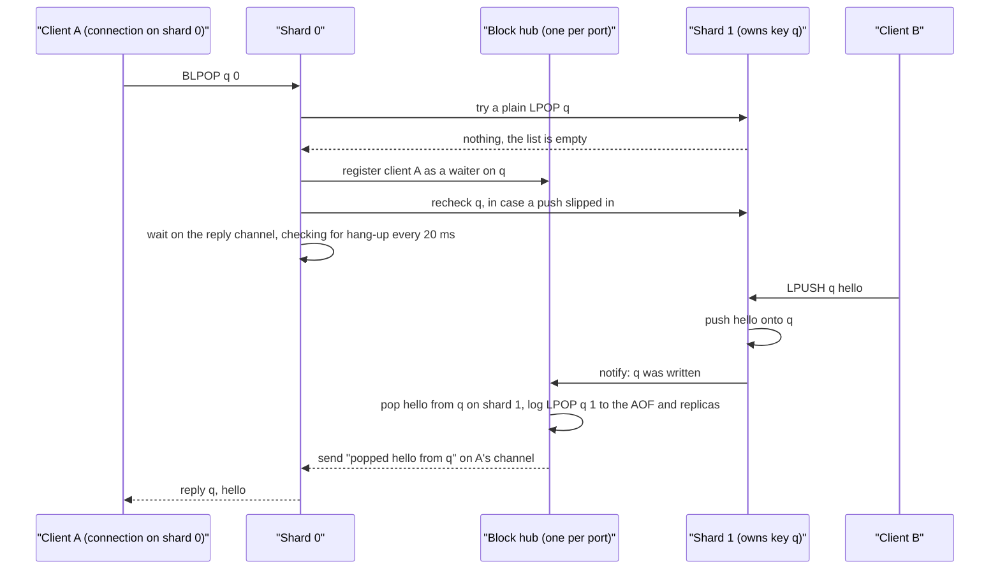
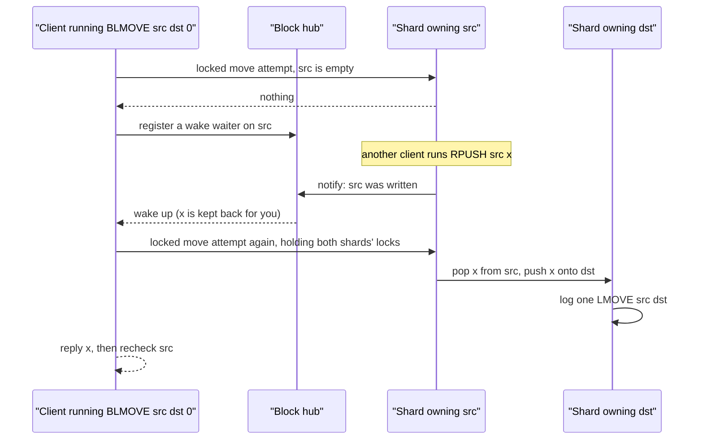

# Component 06: Blocking Operations and the Reactive Event Hub

> **High-Level Design Spec**: [docs/design/06_blocking_hub.md](../design/06_blocking_hub.md)
> **Consolidated Implementation Spec**: [docs/internal/components.md](components.md)
> **Main source files**: src/block.rs (the waiter registry and the serve-on-write algorithms),
> src/connection.rs (every blocking command handler, the wait loops, the write-side hooks, EXEC
> deferral, CLIENT UNBLOCK and KILL, INFO), src/shard.rs (the cross-shard "notify" message and the
> SWAPDB/MOVE/COPY wakeups), src/server.rs (the owner shard's handling of that message, flush
> wakeups, guarded write fast paths), src/router.rs (flush wakeups, CLIENT LIST), src/replication.rs
> (REPLICAOF unblocking and the separate WAIT loop). The [Code map](#11-code-map) lists the key
> symbols.

---

## 1. What this subsystem does

Some Redis commands *wait for data* instead of returning an empty answer. BLPOP on an empty list
does not reply "nothing"; it holds the connection open until another client pushes an element, or
until its timeout runs out. Rudis supports four families of such **blocking commands**:

| Family | Commands | Waits until… |
| :--- | :--- | :--- |
| List pop | BLPOP, BRPOP, BLMPOP | one of the listed keys holds a non-empty list |
| List move | BLMOVE, BRPOPLPUSH, BLMOVEM (a Rudis extension: blocking LMOVEM) | the source list has enough elements |
| Sorted-set pop | BZPOPMIN, BZPOPMAX, BZMPOP | one of the listed keys holds a non-empty sorted set |
| Stream read | XREAD and XREADGROUP with BLOCK (XREADGROUP also with the CLAIM extension) | a stream gets entries newer than the requested ID, or a pending entry becomes claimable |

Each command takes a timeout, where 0 means "wait forever". Three things must hold. A blocked
client must wake up **as soon as** another client writes the data. It must get that data **exactly
once**: two clients blocked on one list must never both receive the same element. And the pop it
receives must be written to the append-only file (AOF) and sent to replicas right after the write
that triggered it, in the same order.

The **block hub** is the registry that makes this work. A blocking command that finds nothing
*registers* itself as a waiter: "I wait on this key, to do this operation, and here is where to send
the result". Every write that could satisfy a waiter (LPUSH, ZADD, XADD, RENAME, …) *notifies* the
hub, and the hub **serves the waiter on the spot**: it performs the pop, move or read on the
waiter's behalf, on the writer's thread, and hands over the finished result. The blocked connection
only has to format the reply.

The hub itself contains no async code and no command parsing. Waiting, timeouts, noticing that a
client hung up, and formatting replies all live in the connection code.

---

## 2. Mental model

A few terms are used throughout:

* **Shard** — one worker thread that owns a slice of the keys and their data (see Component 04).
  A client connection lives on one shard; the keys it touches may be owned by others.
* **Owner shard** — the shard a key is routed to. Only its thread may read or change the key.
* **Waiter** — one registration: "client C waits on key K to do operation O".
* **Serve** — perform a waiter's operation against the data and send it the result.
* **Reply channel** — a small queue that any thread can send into and an async task can wait on
  (a flume channel). Each blocking command owns one with room for exactly one message.

There is **one hub per listening port**, shared by every shard thread behind a single mutex.
Registering and notifying both take that lock, so a waiter registered from shard 0 is immediately
visible to a write running on shard 3 — no extra messages are needed to "subscribe" a key.

Here is a BLPOP that blocks and is then served by another client's LPUSH:



Five ideas explain almost everything in this document:

* **Serve on write, on the owner's thread.** The hub never runs on a neutral thread. A
  notification always runs on the key's owner shard, with that shard's data, because that is the
  only place the data may be changed safely. When a thread that does not own the key needs a
  notification run (the end of a transaction, the recheck after registering), it sends the owner a
  "notify these keys" message instead.
* **First come, first served — for lists and sorted sets.** Waiters on one key form a queue. A
  write serves them from the front, one element at a time, so each element goes to exactly one
  client. Stream readers are different: every reader may see the same new entries, so all of them
  are served.
* **Check, register, recheck.** A blocking command first tries the plain, non-blocking version.
  Only if that finds nothing does it register — and then it asks the owner to look once more,
  because a write may have landed between the try and the registration.
* **A cheap "is anyone blocked?" check.** Almost all of the time nobody is blocked. A process-wide
  counter lets every write skip the hub, and its lock, entirely in that case.
* **Transactions hold notifications back.** Inside MULTI/EXEC, blocked clients must not see
  half-finished states, so the hub collects the written keys and serves waiters only after EXEC
  finishes.

---

## 3. The registry and the "is anyone blocked?" check

### 3.1 What a waiter carries

When a blocking command registers, it leaves one waiter record per key it waits on. A client
running BLPOP on keys a, b and c has three records, one in each key's queue, all pointing at the
same reply channel. Whichever key is written first serves the client, and the hub then removes its
records from the other two queues.

Each record says *what serving means*. There are three kinds:

| Waiter kind | What serving it does | Why it holds what it holds |
| :--- | :--- | :--- |
| List waiter | Pop up to *count* elements from one end, or move elements to a destination list, or just wake the client | The operation is stored so the hub can do it on the client's behalf. |
| Sorted-set waiter | Pop up to *count* lowest- or highest-scored members | BZPOPMIN/BZPOPMAX ask for one; BZMPOP asks for its COUNT and needs a different reply shape, which a flag records. |
| Stream waiter | Re-run the client's own XREAD or XREADGROUP | Stream reads are complicated (several streams, IDs, consumer groups), so rather than re-implement them, the hub stores the command and executes it again. |

A list waiter's operation is one of four:

* **Pop** — BLPOP, BRPOP and BLMPOP: pop up to *count* elements from the left or right.
* **Move** — BLMOVE and BRPOPLPUSH: pop one element and push it onto the destination list.
  BRPOPLPUSH is parsed as a BLMOVE with a flag that only changes how the move is logged (as
  RPOPLPUSH rather than LMOVE).
* **Move-many** — BLMOVEM: move several elements at once, in "count" or "exactly" mode, one by one
  or in bulk.
* **Wake** — used only by a BLMOVE whose source and destination live on different shards
  ([§5.5](#55-the-blocking-side-a-commands-life-cycle)). Serving it touches no data: the client is
  sent an empty result, meaning "the source has an element now", and one element of the list is
  kept back from the waiters queued behind it. The client then performs the move itself, under both
  shards' locks, the same way a non-blocking cross-shard LMOVE does.

A stream waiter's stored command is rewritten before registration so that it no longer blocks and
names concrete IDs ([§5.5](#55-the-blocking-side-a-commands-life-cycle)). It also records whether
the client speaks RESP3, so the hub can format the reply in the client's protocol.

### 3.2 What the client receives

The hub sends one of a few results through the reply channel:

* **Popped**, with the key and the elements (for sorted sets, members with scores). An empty
  "popped" is the wake signal described above.
* **Unblocked**, with a reason: a timeout or an error requested by CLIENT UNBLOCK (an error is also
  used when the server becomes a replica), or "wrong type" when a move's destination turns out to
  hold something other than a list.
* For streams, a ready-made RESP **reply** or **error reply**, or a bare "re-query" signal for
  reads that span several shards.

[Reference details](#121-result-and-waiter-types) lists the exact types.

### 3.3 The hub's tables

The hub keeps two kinds of tables for each data type (lists, sorted sets, streams):

| Table | Answers the question | Used by |
| :--- | :--- | :--- |
| Waiter queues, one per key | "Who waits on this key, and in what order?" | Serving after a write |
| Blocked-client maps, one entry per client | "Is this client blocked, and how do I reach it?" | CLIENT UNBLOCK, the `b` flag in CLIENT LIST, INFO's blocked-client count, cleanup |

Two more fields support transactions: a pause count (above zero while an EXEC runs) and a list of
keys written during the pause, each stored once.

**Keys include the database number.** Waiter queues are keyed by (database, key), where the
database is the one the client has selected (read from a per-thread "current database" value).
So a client that runs SELECT 1 and BLPOP k is not served by another client's SELECT 0 and LPUSH k.
Code that serves keys in a database other than the current one must switch both that per-thread
value and the shard's selected database first.

### 3.4 Skipping the hub when nobody waits

Every list, sorted-set and stream write would otherwise lock the hub just to find an empty queue.
To avoid that, the process keeps one atomic counter of "things blocked", and each write first
checks whether it is above zero (`has_blocked_waiters`). When it is zero, the write never touches
the hub's mutex.

The counter is **process-wide**, not per port. With several servers in one process (common in
tests), a waiter on any port makes every port take the slow path. That costs some speed but can
never miss a wakeup.

Keeping a shared counter right with several hubs needs care. If each hub simply stored its own
total into the counter, a hub that emptied would write zero and hide another hub's waiters — and
a push there would then skip the wakeup. So each hub remembers what it last contributed and, after
every change, adds or subtracts only the difference. Dropping a hub withdraws its whole share.

What a hub contributes is the number of waiter records in all its queues, plus the entries in its
blocked-client maps, plus its pause count. The result means "non-zero, go look", not "number of
blocked clients". The pause count is included on purpose: while an EXEC runs, every write must
reach the hub so that it can defer its notification ([§6](#6-multiexec-deferred-notification)).

---

## 4. How writes reach the hub

Every write that might satisfy a waiter calls a small **notify hook** right after changing the
data, on the owner shard. There is one hook per data type, and they all do the same three things:

1. Invalidate WATCH on the key (this happens even when nobody is blocked).
2. If the "is anyone blocked?" counter is zero, stop. This is the lock-free fast exit.
3. Lock the hub. If an EXEC is running, add the key to the deferred list; otherwise serve the key's
   waiters now ([§5](#5-algorithms)).

The list hook runs after LPUSH, RPUSH, LPUSHX, RPUSHX, LINSERT, the destination of LMOVE and
LMOVEM, the destination of SORT … STORE, RENAME, MOVE and COPY. The sorted-set hook runs after ZADD
(only when it changed something), ZINCRBY, MOVE and COPY. The stream hook covers XADD and also
commands that delete or replace a key, so that a blocked reader notices
([§5.3](#53-serving-stream-waiters)).

Some commands move whole databases or wipe them, so instead of one key they ask the hub to sweep:

* After **SWAPDB** (both databases), **MOVE** and **COPY … DB** (the target database), the hub
  serves every waited key in that database that now exists and has not expired — lists first, then
  sorted sets, then streams — or defers them during EXEC.
* After **FLUSHDB**, **FLUSHALL** and the DEBUG shard-flush, the hub re-runs every stream waiter in
  the current database, so blocked readers see that their stream is gone.

**Fast paths must respect the hub.** Pipelines can be "squashed": several commands for one shard
run as one batch (Component 04). That code has zero-allocation paths for LPUSH, RPUSH and ZADD
which write the table directly and skip the notify hooks — in the connection's pipeline executor
and in the owner's batch handler. Each of these paths is only taken while the "is anyone blocked?"
counter is zero. On top of that, a connection does not use the squashed path at all while anyone
is blocked.

---

## 5. Algorithms

All serving runs **under the hub lock, on the owner shard's thread**, after the triggering write
has already been applied.

### 5.1 Serving list waiters

**Why.** A push may satisfy several waiters, or none. The hub must hand out elements in queue
order, give each element to one client only, stop when the list runs dry, and log every pop it
makes.

**How.**

1. Invalidate WATCH on the key, since a served pop changes it. If the key has expired, stop.
2. Run the snapshot write hook so that an AOF rewrite in progress keeps the key's old value
   (Component 04, §4.2). With no rewrite running this is a single flag check.
3. Take waiters from the front of the key's queue one at a time, keeping a count of elements
   *reserved* for woken clients (starting at zero):
   * Drop a waiter whose client has gone away (its channel has no receiver).
   * If the key no longer exists, or every element left is reserved for a woken client, put the
     waiter back at the front and stop. The existence check also stops a move waiter from failing
     with "wrong type" before any element has arrived — Redis only fails once there is an element.
   * **Wake**: send the empty result, reserve one element, and continue. Nothing is popped or
     logged.
   * **Pop**: pop up to *count* elements. If any came out, log a plain LPOP or RPOP with the actual
     number, send the elements, and **continue with the next waiter** while the key still exists.
     If nothing came out (or the key is not a list), put the waiter back and stop.
   * **Move**: if the destination exists and is not a list, release the client with "wrong type"
     and continue. Otherwise pop one element, push it onto the destination, log LMOVE (or
     RPOPLPUSH), invalidate WATCH on the destination, send the element, and **stop**: at most one
     move is served per notification.
   * **Move-many**: same destination check, then try the multi-element move. If it moved elements,
     log it as an LMOVEM … EXACTLY with the real count, invalidate WATCH on both keys, send, and
     stop. If there were not enough elements (EXACTLY 5 with only 3 present), put the waiter back
     and stop. If the move failed with a type error, release the client with "wrong type" and
     continue.
4. Remove every served client from **all** queues, so a BLPOP on a and b that was served from a
   does not linger on b.
5. If a move pushed into a destination list, serve that list's waiters too, in the same call. A
   chain such as "BLMOVE a b" plus "BLPOP b" thus completes in one go.

**Example.** Clients C1, C2 and C3 run BLPOP q 0, in that order, and C4 then runs
BLMPOP 0 1 q LEFT COUNT 5. Now RPUSH q a b c d runs on q's owner shard:

1. RPUSH succeeds and calls the list hook. The counter is non-zero and no EXEC is running, so the
   hub serves q.
2. C1 gets a (logged as LPOP q 1); q still exists, so continue.
3. C2 gets b and C3 gets c. C4 asks for up to 5 and gets the one element left, d (logged as
   LPOP q 1). q is now gone, so stop.
4. All four clients are removed from the hub; each connection wakes up and formats its reply.

**Example with a wake waiter.** W1, a cross-shard BLMOVE q dst, blocked first; then P1 ran BLPOP q;
then W2, another cross-shard BLMOVE q dst2. RPUSH q a b arrives:

1. W1 is woken with the empty result; one element is reserved.
2. P1: q holds 2 elements, more than the 1 reserved, so P1 pops a (logged as LPOP q 1).
3. W2: q holds 1 element, which is reserved, so W2 goes back to the front and the walk stops. b
   stays in q for W1, which now performs its own locked move.

**Edge case.** The reservation is a gate, not a cap. A pop waiter that passes the gate pops up to
its full count: a BLMPOP … COUNT 5 in P1's place would take both a and b. The woken W1 then finds
the source empty and blocks again ([§5.5](#55-the-blocking-side-a-commands-life-cycle)). No data is
lost; W1 only loses its turn.

### 5.2 Serving sorted-set waiters

This works like the list "pop" case: invalidate WATCH, stop if the key expired, run the snapshot
write hook, then walk the queue from the front. Each waiter pops up to its count of lowest or
highest members; a non-empty result is logged as ZPOPMIN or ZPOPMAX with the actual number and
sent, and the walk continues while the key still exists. An empty result or an error puts the
waiter back and stops the walk. Served clients are then removed from every queue.

One difference: a waiter is also skipped if its client was **already served in this call**. That
happens when a client names the same key twice, and it guarantees the client gets one answer.

### 5.3 Serving stream waiters

**Why it differs.** Stream readers do not compete for entries. Every client reading new entries
may receive the same ones, and consumer groups hand out distinct entries by themselves. So instead
of a queue, the hub visits **every** waiter on the key and serves each one that now has something
to read.

**How.**

1. If anyone waits on the key, run the snapshot write hook first, because serving an XREADGROUP
   changes the group's state.
2. For each waiter, in registration order:
   * If its client has gone, mark it for removal.
   * If it is a read spanning several shards, send the "re-query" signal (the client will ask all
     shards itself) and mark it.
   * Otherwise, switch to the client's protocol and re-run its stored command on this shard, with
     this shard's AOF writer. If the reply is empty (a null or an empty array) — or, for XREAD only,
     a wrong-type error — the waiter stays. Otherwise send the reply (as an error if it starts with
     "-") and mark the waiter.
3. Remove the marked waiters and their blocked-client entries, drop the key's queue if it is now
   empty, remove those clients from every other stream key, and update the counter.

Because the stored command is the client's own XREADGROUP, serving it advances the group's
last-delivered ID and adds to its pending entries list (PEL), and it is logged and replicated
exactly like a normal read. An XREADGROUP whose group was destroyed (XGROUP DESTROY) or whose key
was deleted gets whatever error re-running it produces — for example a NOGROUP error.

**Which writes notify streams.** XADD, XNACK, XGROUP DESTROY, and the commands that replace or
delete a key: SET (including the remote-SET fast path), MSET, DEL and UNLINK (including the remote
delete path), RENAME, MOVE and COPY. That way a blocked reader sees a stream that was deleted or
replaced.

**Example.** Readers R1 (XREAD BLOCK 0 STREAMS s $) and R2 (XREADGROUP GROUP g c1 BLOCK 0 STREAMS s >)
wait on stream s. XADD s * f v arrives. The hub re-runs R1's read, which now returns the new entry,
and sends it. It re-runs R2's group read, which delivers the entry to consumer c1, records it as
pending, and is logged like any XREADGROUP. Both clients are served by the same write.

### 5.4 Logging and replicating what the hub did

**Why.** A pop the hub performs is a change to the data, just like the client's own LPOP would be.
The AOF and replicas must see it, and in the right place: right after the push that caused it.

**How.** After each served pop or move, the hub converts the equivalent non-blocking command
(LPOP key n, ZPOPMAX key n, LMOVE, RPOPLPUSH or LMOVEM … EXACTLY n) to RESP. It appends that to
the current shard's AOF writer (there is none while the AOF is off) and, if replicas are connected,
to this shard's replication stream. If a command cannot be converted, the failure is recorded
rather than silently ignored.

Because this runs on the owner's thread immediately after the triggering write, the AOF and
replicas see "LPUSH q x" followed by "LPOP q 1", in that order, in the same shard's stream.
Stream reads need no extra step: the re-run XREADGROUP logs itself.

### 5.5 The blocking side: a command's life cycle

**Why.** The connection must avoid blocking when data is already there, must never miss a write
that races with its registration, and must leave the hub clean however the command ends.

**How.** Every list and sorted-set handler (BLPOP, BRPOP, BLMPOP, BLMOVE, BLMOVEM, BZMPOP, and the
shared handler for BZPOPMIN/BZPOPMAX) follows the same steps:

1. **Try without blocking.** For each key in order: if this shard owns it, pop locally (and log the
   pop here); otherwise ask the owner shard to run the plain command (LPOP, ZPOPMIN, LMOVE, …),
   and the owner logs it. A wrong-type error goes back to the client. The first key that yields
   data answers the command.
2. **Never block inside MULTI/EXEC.** In a transaction the command replies with a null instead.
3. **Arm cleanup.** Create a guard object (`BlockedClientGuard`) that unregisters the client when it
   is dropped. Success, timeout, error, disconnect, or the connection's task being cancelled — all
   leave the hub clean.
4. **Register.** Create a reply channel with room for one message, lock the hub, record the client
   in the blocked-client map, then add one waiter per key, each holding a copy of the channel.
5. **Recheck** (`recheck_blocking_keys`). Steps 1 and 4 are not atomic: shards run concurrently,
   and step 1 may wait for remote shards. A push landing in between finds no waiter and wakes
   nobody. So, right after registering, the command asks each key's owner to serve the key again
   (streams, then lists, then sorted sets) — directly for keys this shard owns, and through a
   "notify these keys" message, grouped per shard, for the rest. During an EXEC the keys are added
   to the deferred list instead.
6. **Wait** for a result, a timeout or a hang-up ([§5.6](#56-waiting-timeouts-and-disconnect-detection)).
7. **Reply.** A popped result is formatted (the hub has already logged it). "Wrong type" becomes a
   WRONGTYPE error; an error release becomes `-UNBLOCKED client unblocked via CLIENT UNBLOCK`.
   Anything else — timeout, a timeout release, a dropped channel — becomes a null. If the client
   hung up, the handler tells the connection to close. (The BZPOPMIN/BZPOPMAX handler has no
   "wrong type" case; it would fall into the null reply, but sorted-set waiters never receive one.)

**Example of the race the recheck closes.** Client A runs BLPOP q 0 on shard 0; q lives on shard 1.
A's step 1 asks shard 1 for an LPOP and gets nothing. Before A registers, client B's LPUSH q x
runs on shard 1: the counter is still zero, so the push skips the hub. A then registers. Without
the recheck, A would sleep until its timeout although q holds x. With it, shard 1 serves q again
and A gets x.

#### Keys on several shards

Multi-key blocking commands — BLPOP a b, BZMPOP, XREAD … STREAMS a b, BLMOVE src dst, and so on —
may name keys owned by different shards. They are refused with `-CROSSSLOT` before the handler
runs in two cases: in cluster mode when the slots differ, and in standalone mode when the
`cross-shard-strict` setting is on. With the setting off (the default), the handlers work across
shards as described below.

#### BLMOVE and BRPOPLPUSH across shards

**Why special.** A move pops on one shard and pushes on another. If the hub served it, the pop and
push would run outside the shards' cross-shard locks (Component 04, §7.11), and replicas could see
them out of order. So the hub never pops for this client; it only wakes it up, and the client runs
the same locked move that a non-blocking cross-shard LMOVE uses. Replicas then receive one logical
LMOVE (or RPOPLPUSH) in the right place: a full sync holds it back while taking its snapshot, and
the source's shard cannot stream another write between the pop and the push.

When source and destination share a shard, step 1 above runs a plain LMOVE on that shard and the
normal path applies. In cluster mode, different shards mean `-CROSSSLOT`. In standalone mode, a
loop takes over:

1. **Try the locked move.** Take both shards' transaction locks (skipped inside EXEC, which already
   holds them), check types — a missing source (null) wins over a wrong-typed destination
   (WRONGTYPE) — pop on the source shard and push on the destination shard. The destination's shard
   streams the logical command right after the push.
2. **Done?** A non-null reply (an element or an error), or being inside a transaction, ends the
   command. If this round followed a wakeup, the client first asks for a recheck of the source: the
   element kept back for it may have been taken by someone else, or more elements may be waiting
   for the clients behind it. On success, client-side caching invalidations are sent for both keys.
3. **Block.** If the deadline has passed, reply null. Otherwise arm the cleanup guard, register a
   wake waiter on the source, recheck, and wait for the **remaining** time (forever if the timeout
   was 0).
4. **Woken.** The empty "popped" signal sends the loop back to step 1. A "wrong type" release
   becomes WRONGTYPE, an error release becomes UNBLOCKED, a timeout becomes null, and a hang-up
   closes the connection.



BLMOVEM has no cross-shard path: different shards mean `-CROSSSLOT` in every mode.

#### Streams: XREAD and XREADGROUP with BLOCK

Blocking is allowed only for XREAD, or for XREADGROUP when every requested ID is ">" (new entries
only), and never inside a transaction.

1. **One shard.** If all keys live on one shard, run the command there. If the reply is empty,
   rewrite the command for the hub: drop BLOCK, and replace the special IDs "$" and "+" with the
   stream's current last ID (0-0 if the stream does not exist). That way the hub's re-run only
   returns entries added *after* the client blocked.
2. **Register and wait.** Register one stream waiter per key, recheck, then wait. A reply or error
   from the hub is written as is; a timeout or timeout release gives a null; an error release gives
   UNBLOCKED.
3. **Several shards.** In cluster mode with different slots the reply is `-CROSSSLOT`. Otherwise
   the handler asks every involved shard and merges the per-stream results. If that is empty it
   loops: register with the "spans shards" flag (re-registering is harmless, duplicates are
   skipped), recheck, and wait for the remaining time. On the "re-query" signal it asks all shards
   again; a non-empty result is the reply, otherwise it loops again.

**XREADGROUP … CLAIM** (a Rudis extension, single-shard path only). Besides new entries, such a
read can return pending entries that have been idle for at least *min-idle* milliseconds. Those
become eligible just by time passing — no write announces them, so the hub would never be
notified. The handler therefore waits in slices. Each round it works out, for keys this shard
owns, how long until the next pending entry becomes claimable, and waits that long, clamped to
between 1 and 50 ms (50 ms if nothing is pending or the key lives on another shard) and never past
the deadline. When a slice ends without a result from the hub, the handler re-runs the read
itself; a non-empty reply ends the wait.

### 5.6 Waiting, timeouts and disconnect detection

**Why.** A blocked connection waits on its reply channel, but a channel cannot tell that the TCP
peer has hung up. Without a separate check, a client that disconnects would keep its waiters — and
might be served, losing elements — until its timeout, which may be forever.

**How.** List and sorted-set commands give their timeout in seconds, streams in milliseconds, but
both use the same loop:

1. A timeout of 0 means no deadline. Otherwise the deadline is now plus the timeout.
2. Each round waits on the channel for at most 20 ms, or for the time remaining if that is less.
   The remaining time is rounded **up** to whole milliseconds, so the command never times out
   early. If no time remains, the result is a timeout.
3. A received result ends the wait. If every sender has gone (the hub dropped the client's
   waiters), the result is also treated as a timeout.
4. When a 20 ms round passes without data, check the socket: if it is known, the server is not
   shutting down, and the socket is closed, report a hang-up. Otherwise, if the deadline has
   passed, report a timeout; if not, loop.

The socket check does a zero-timeout poll for "hung up" or "error". If the only event is "readable",
it peeks at one byte without consuming it; reading zero bytes means the peer closed the
connection. During shutdown the server has already shut the read side of every connection, which
would look like a hang-up, so the check is skipped and the command is allowed to finish (the drain
timeout bounds the wait).

**Example.** BLPOP q 0.05 waits 20 ms, 20 ms, then the remaining 10 ms, checking the socket after
each empty round, and then replies null.

---

## 6. MULTI/EXEC: deferred notification

**Why.** Inside a transaction, blocked clients must not observe intermediate states. Redis serves
them only after EXEC completes, against the final data. Rudis does the same by **pausing** the hub
for the duration of an EXEC.

**How.**

1. **Checks first.** EXEC runs all its refusal checks before touching the hub: a script running
   past its time limit (EXECABORT … BUSY), a replica with `replica-serve-stale-data no` whose master
   link is down (MASTERDOWN), writes the server no longer accepts (a read-only replica, too few
   good replicas for `min-replicas-to-write`, maxmemory exceeded), errors in queued commands,
   CROSSSLOT (cluster mode, or `cross-shard-strict`), and a WATCHed key that changed. All these
   abort paths return before the hub is touched.
2. **Pause.** EXEC builds a cleanup guard (`ExecCleanup`), takes the cross-shard transaction locks
   if needed, then pauses the hub and stores it in the guard. Pausing raises the pause count, which
   also makes the "is anyone blocked?" counter non-zero, so every write reaches the hub.
3. **Collect.** The queued commands run. Every notify hook, recheck and database sweep sees the
   pause and adds the key (with its database) to the deferred list, once. Blocking commands inside
   the transaction never block (§5.5 step 2).
4. **Resume.** When the guard is dropped — normally, or because the EXEC was cancelled or unwound
   after a queued command panicked — it resumes the hub. When the pause count reaches zero the
   deferred list is handed back. For each key: if this shard owns it and its data is not currently
   borrowed (it may still be, higher up, while unwinding), the guard selects the key's database and
   serves streams, lists and sorted sets right there. Otherwise it sends the owner a "notify these
   keys" message.
5. **Owner side.** The owner's message handler switches to the given database, locks the hub, and
   serves streams, lists and sorted sets for each key against its own data.

**Example.** C1 is blocked in BLPOP q 0. C2 runs MULTI, RPUSH q a, RPUSH q b, LPOP q, EXEC. Both
pushes defer q, which is stored once. The LPOP inside the transaction returns a. After EXEC, one
notification for q runs and serves C1 with b — the final state, as in Redis.

**Not the same as CLIENT PAUSE.** Only EXEC pauses the hub. CLIENT PAUSE is a separate mechanism
that delays commands *before* they run. Blocking commands count as writes for CLIENT PAUSE WRITE,
and clients held by CLIENT PAUSE are included in INFO's blocked-client count.

---

## 7. Releasing waiters without data

A blocked client can end without receiving data in several ways:

| Trigger | What happens | What the client sees |
| :--- | :--- | :--- |
| Timeout | The wait loop's deadline passes (§5.6). | A null: `*-1` for pops, `$-1` for single-element moves and streams |
| CLIENT UNBLOCK id [TIMEOUT] | The hub sends a timeout release through the client's channels and removes its waiters. | A null. The caller gets `:1`, or `:0` if the client was not blocked. |
| CLIENT UNBLOCK id ERROR | The hub sends an error release. | `-UNBLOCKED client unblocked via CLIENT UNBLOCK` |
| CLIENT UNBLOCK on a client in WAIT or WAITAOF | The client is not in the hub, so the command falls back to the replication code, which sets a flag that the WAIT poll loop reads. | TIMEOUT: the counts reached so far. ERROR: UNBLOCKED. |
| CLIENT KILL | The victim's socket is shut down and its waiters are removed. | The connection closes; the victim's wait loop notices within one 20 ms round. |
| Client closes the connection | The wait loop's socket check notices; the connection's cleanup unregisters the client (when anyone is blocked). | — |
| REPLICAOF host port | Every list and sorted-set waiter, and every XREADGROUP waiter, is released with an error. Served on a replica they would change its data behind its master's back. Plain XREAD keeps waiting, as in Redis. | UNBLOCKED |
| A move's destination is not a list | Serving sends a "wrong type" release (§5.1). | WRONGTYPE |

The hub uses a blocking send for list and sorted-set channels and a non-blocking send for stream
channels when releasing a client; the release is a typed value, so the stream handler can tell it
apart from a reply.

---

## 8. Ordering and fairness

* **Lists and sorted sets are first come, first served per key** (and database). Registration
  appends to the queue, serving takes from the front, and a waiter that cannot be served stays at
  the front.
* **Pop waiters drain a push.** One notification serves as many queued pop waiters as there are
  elements.
* **Move waiters do not.** Serving stops after one successful move. If three clients wait in
  BLMOVE src dst and RPUSH src a b c arrives, only the first is served by that push; the others are
  served by later writes to src (or a recheck), even though src still holds elements.
* **Head-of-line blocking.** A waiter at the front that cannot be served stops the walk. A
  BLMOVEM … EXACTLY 5 waiter in front of a BLPOP waiter keeps the BLPOP waiting while the list has
  fewer than 5 elements.
* **Wake waiters keep one element each.** After *k* cross-shard BLMOVE clients are woken in one
  call, the walk stops as soon as the list holds *k* or fewer elements, so the woken clients find
  their elements when they run their own moves.
* **No fairness across keys.** A client blocked on several keys is served by whichever key is
  written first.
* **Streams have no queue.** Every waiter on the key is evaluated on each notification.
* **Transactions coalesce.** Several writes to one key in an EXEC produce one notification after
  the EXEC.

---

## 9. Invariants & gotchas

* **Serve on the owner thread only.** The serving functions must receive the data of the shard
  that owns the key. A caller without it must send the owner a "notify these keys" message.
* **The database is part of the key.** Code that serves another database must switch both the
  per-thread current database and the shard's selected database. The database sweep and EXEC
  cleanup restore both afterwards; the owner's "notify" message handler sets them without
  restoring.
* **Check, then register, then recheck.** Every blocking handler must recheck after registering,
  or a write racing between the first try and registration leaves the client blocked until its
  timeout.
* **Every fast write path must be gated** by the "is anyone blocked?" check, or call a notify hook.
  A new zero-copy write path that skips both silently starves blocked clients.
* **The hub lock is held while serving** — including while re-running a stream waiter's read and
  appending to the AOF. Nothing called from inside serving may take the hub lock again: the mutex
  is not re-entrant. Serving a move's destination works because it is a direct call on the
  already-locked hub.
* **Channels hold one message, and the hub sends with a blocking send.** A command is served at
  most once because a served client is removed from all queues afterwards, but within one call that
  relies on bookkeeping. Sorted-set serving skips clients already served in the same call, and
  stream registration skips duplicates per key, but **list serving has no such check**. By code
  inspection, a client that names the same list twice (BLPOP q q 0 — the parser does not remove
  duplicate keys), followed by a push of two or more elements, would be served twice in one call.
  The second send blocks the shard thread on a full channel: a deadlock if the blocked connection
  lives on the same shard, otherwise the second element is popped and lost. Not covered by tests.
* **Serving streams leaves the per-thread RESP3 flag** set to the last served waiter's protocol.
  The connection loop resets it before each command, so this is harmless today, but code that runs
  after a notification within the same command should not rely on it.
* **The EXEC pause is balanced by a guard.** The hub is paused only after all of EXEC's early
  exits, and the guard always resumes it. A leaked pause would make every later write on the port
  defer forever.
* **The "is anyone blocked?" check is global.** It ignores which port it is asked about. That is
  safe — a waiter on any port only disables fast paths everywhere — but multi-server test processes
  run the slow paths.
* **The per-port hub map never shrinks**: one entry stays for every port ever used.
* **A served cross-shard BLMOVE must recheck its source.** The element kept back for a woken client
  is only reserved within one notification. Once the client has moved (or failed to move) its
  element, waiters behind it that were held back are only served by the next notification — hence
  the recheck after every round that followed a wakeup.
* **The hub never pops across shards.** Every pop the hub performs lands on the owner's data and is
  logged from there. A move whose destination is on another shard is never served by the hub: it
  would run outside the shards' locks and could reach replicas out of order.

---

## 10. Limitations / not implemented

* **BLMOVEM needs both keys on one shard** (`-CROSSSLOT` otherwise, even in standalone mode).
  BLMOVE handles keys on different shards only in standalone mode with `cross-shard-strict` off.
* **A woken cross-shard BLMOVE can lose its turn.** The element kept back for it gates the waiters
  behind it but does not cap a COUNT pop that passes the gate, and a non-blocked client's LPOP can
  take it too. The client then blocks again for the rest of its timeout, behind the waiters already
  queued.
* **Move waiters are served one per notification** (§8).
* **CLAIM eligibility is polled** in 1–50 ms slices, so a pending entry can be delivered up to
  about 50 ms after it became claimable. For keys on another shard the slice is always 50 ms.
* **XREAD on a key that becomes a non-stream keeps waiting**: the hub treats a wrong-type error as
  "nothing yet" for XREAD.
* **INFO's "blocked on a missing key" count** counts keys with stream waiters, not Redis's exact
  notion.
* **BLMOVEM waiting time counts as execution time.** Command statistics exclude wait time for the
  blocking commands, but BLMOVEM is missing from that list.
* **WAIT and WAITAOF do not use the hub.** They share a poll loop that sends REPLCONF GETACK * once
  a second while short of replicas, and checks every 1 ms (every 10 ms after the first 100 ms) until
  enough copies are acknowledged or the timeout passes. A timeout of 0 waits forever, as in Redis.
  WAITAOF counts only copies fsynced to the AOF (see 14_persistence_replication.md §6.8). These
  clients are tracked outside the hub — a counter added to INFO's blocked-client count, and a
  per-client unblock-request map that CLIENT UNBLOCK uses (§7) — so they have no `b` flag in
  CLIENT LIST.

---

## 11. Code map

| File | Key symbols | Role |
| :--- | :--- | :--- |
| `src/block.rs` | `BlockHub`, `ListWaiter`, `ZSetWaiter`, `StreamWaiter`, `WaiterOp` | Waiter registry keyed by `(db, key)`. |
| `src/block.rs` | `BlockedListResult`, `BlockedZSetResult`, `BlockedStreamResult`, `ClientUnblockType`, `ListPopType`, `ZSetPopType` | Messages sent to blocked commands. |
| `src/block.rs` | `PORT_BLOCK_HUBS`, `get_block_hub_for_port`, `TOTAL_BLOCKED_WAITERS`, `has_blocked_waiters`, `sync_atomic_waiters_count`, `publish_waiters` | One hub per port; lock-free "anyone blocked?" counter with per-hub delta publishing. |
| `src/block.rs` | `register_list_waiter`, `register_list_wake_waiter`, `register_move_waiter`, `register_movem_waiter`, `register_zset_waiter`, `register_stream_waiter` | Waiter registration (`WaiterOp::Pop`, `Wake`, `Move`, `Movem`, zset, stream). |
| `src/block.rs` | `notify_list`, `notify_zset`, `notify_stream`, `notify_all_streams`, `notify_db_keys` | Serve-on-write algorithms. |
| `src/block.rs` | `pause`, `resume`, `add_pending_notify`, `is_paused` | EXEC deferral. |
| `src/block.rs` | `unblock_client`, `unblock_writers`, `remove_waiters_for_client`, `unregister_blocked_client`, `is_blocked`, `blocked_clients_count`, `blocking_keys_count`, `blocking_keys_on_nokey_count` | Release, cleanup and introspection. |
| `src/block.rs` | `propagate_served` | AOF and replication of pops/moves performed for a waiter. |
| `src/block.rs` | `mod tests` | Unit tests ([§12.6](#126-tests-that-pin-the-behavior)). |
| `src/connection.rs` | `notify_list_or_defer`, `notify_zset_or_defer`, `notify_stream_or_defer` | Write-side hooks. |
| `src/connection.rs` | `recheck_blocking_keys` | Post-registration recheck, local or via `ShardMessage::NotifyList`. |
| `src/connection.rs` | `BlockedClientGuard`, `wait_for_blocked_result`, `wait_for_stream_result`, `remaining_wait_ms`, `is_fd_closed` | Blocking wait loop, timeout and disconnect detection. |
| `src/connection.rs` | `Command::Blpop/Brpop/Blmpop/Blmove/Blmovem/Bzmpop` arms, `handle_bzpop`, `in_tx` | List and sorted-set blocking handlers. |
| `src/connection.rs` | `blmove_across_shards`, `move_element_across_shards`, `move_element_via_source`, `CrossShardElementMove` | Cross-shard BLMOVE: wake waiter plus the locked cross-shard LMOVE. |
| `src/connection.rs` | `cross_shard_strict`, `keys_on_several_shards` (checked in `execute_command_inner` and EXEC) | `cross-shard-strict`: `-CROSSSLOT` for multi-key commands across shards. |
| `src/connection.rs` | `Command::Xread \| Command::Xreadgroup` arm (`can_block`, `unblocked_cmd`), `resolve_stream_last_ids`, `query_cross_shard_streams` | Stream blocking (single-shard, cross-shard, CLAIM). |
| `src/connection.rs` | `ExecCleanup` | Pauses the hub for EXEC and drains deferred notifications on drop. |
| `src/connection.rs` | `ClientSubcommand::Unblock` / `Kill` arms, `ClientCleanup`, INFO clients section, `may_block`, `should_pause_command`, `set_client_pause`, `wait_if_client_paused`, `wait_if_tx_paused` | Release paths (hub, then WAIT/WAITAOF), metrics, stats, CLIENT PAUSE interplay. |
| `src/connection.rs` | `execute_commands_squashed_inner` | Squashed pipeline with LPUSH/RPUSH/ZADD fast paths gated by `has_blocked_waiters`. |
| `src/connection.rs` | `CURRENT_DB`, `CURRENT_CLIENT_RESP3`, `CURRENT_ROUTER`, `touch_watched_key`, `execute_local_command` | Per-thread state and helpers the hub uses while serving. |
| `src/shard.rs` | `ShardMessage::NotifyList { db, keys }`, `ShardDb::swap_dbs`, `move_key`, `copy_to_db`, `earliest_claim_wait_ms`, `before_write`, `before_write_table` | Cross-shard notify message; database-moving wakeups; CLAIM slice timing; snapshot write hooks used while serving. |
| `src/server.rs` | `ShardMessage::NotifyList`, `FlushDb`, `FlushAll`, `Batch`, `ClientList` handlers | Owner-side notify; flush wakeups; guarded fast paths; `b` flag. |
| `src/router.rs` | `Router::flushdb`, `Router::flushall`, `Router::rpush`, `Router::client_list` | Flush wakeups, push helper, `b` flag. |
| `src/replication.rs` | `unblock_writers` call on REPLICAOF, `wait_replicas`, `wait_replicas_for`, `wait_aof`, `wait_acks`, `unblock_waiter`, `WAIT_BLOCKED_CLIENTS` | Replica-role unblocking; the separate WAIT/WAITAOF poll loop and its CLIENT UNBLOCK/INFO hooks. |
| `src/debug_cmd.rs` | DEBUG shard-flush | Calls `notify_all_streams` after flushing a shard. |

---

## 12. Reference details

### 12.1 Result and waiter types

| Type | Variants | Meaning |
| :--- | :--- | :--- |
| `ListPopType` | `Left`, `Right` | Which end of a list to pop from / push to. |
| `ZSetPopType` | `Min`, `Max` | Pop lowest or highest scores. |
| `ClientUnblockType` | `Timeout`, `Error`, `WrongType` | Why a waiter was released without data. `Timeout`/`Error` come from CLIENT UNBLOCK; `Error` also from REPLICAOF; `WrongType` from a move whose destination holds a non-list. |
| `BlockedListResult` | `Popped(key, Vec<Bytes>)`, `Unblocked(ClientUnblockType)` | What a list waiter receives; `Popped(key, [])` is the wake signal. |
| `BlockedZSetResult` | `Popped { key, items: Vec<(Bytes, f64)>, is_zmpop }`, `Unblocked(..)` | What a sorted-set waiter receives. |
| `BlockedStreamResult` | `Data(Vec<u8>)`, `Error(Vec<u8>)`, `CrossShard`, `Unblocked(..)` | A formatted RESP reply, an error reply, the "re-query" signal, or a forced release. |

```rust
pub enum WaiterOp {
    Pop   { pop_type: ListPopType, count: usize },                 // BLPOP/BRPOP/BLMPOP
    Move  { where_from, where_to, destination: Bytes, is_rpoplpush: bool }, // BLMOVE/BRPOPLPUSH
    Movem { where_from, where_to, destination: Bytes,
            mode: LmovemMode /* Count | Exactly */, count: usize,
            ordering: LmovemOrdering /* Obo | Bulk */ },          // BLMOVEM
    Wake,                                                         // cross-shard BLMOVE
}
```

| Waiter struct | Fields | Notes |
| :--- | :--- | :--- |
| `ListWaiter` | `client_id: u64`, `key: Bytes`, `op: WaiterOp`, `sender: Sender<BlockedListResult>` | One per (client, key). |
| `ZSetWaiter` | `client_id`, `key`, `pop_type: ZSetPopType`, `count: usize`, `is_zmpop: bool`, `sender` | BZPOPMIN/MAX register `count = 1, is_zmpop = false`; BZMPOP registers its COUNT and `is_zmpop = true`. |
| `StreamWaiter` | `client_id`, `key`, `cmd: Command`, `is_resp3: bool`, `is_cross_shard: bool`, `sender` | `cmd` is the non-blocking rewrite with concrete IDs. |

### 12.2 Hub fields and the waiter counter

| Field | Type | Meaning |
| :--- | :--- | :--- |
| `port` | `u16` | The hub's port; `BlockHub::default()` uses 0. |
| `list_waiters`, `zset_waiters` | `HashMap<(usize, Bytes), VecDeque<..>>` | FIFO queue per (db, key). |
| `stream_waiters` | `HashMap<(usize, Bytes), Vec<StreamWaiter>>` | All served on each notify. |
| `blocked_clients`, `blocked_zset_clients`, `blocked_stream_clients` | `HashMap<u64, Sender<..>>` | client id → sender. |
| `paused_count` | `usize` | Above 0 while an EXEC runs. |
| `pending_notifies` | `Vec<(usize, Bytes)>` | Keys written during EXEC, deduplicated. |
| `published_waiters` | `usize` | This hub's share of `TOTAL_BLOCKED_WAITERS`. |

```rust
pub static PORT_BLOCK_HUBS: LazyLock<Mutex<HashMap<u16, Arc<Mutex<BlockHub>>>>>;
static TOTAL_BLOCKED_WAITERS: AtomicUsize;   // sum of every hub's share
pub fn has_blocked_waiters(_port: u16) -> bool { TOTAL_BLOCKED_WAITERS.load(Relaxed) > 0 }
pub fn get_block_hub_for_port(port: u16) -> Arc<Mutex<BlockHub>>;  // lazily inserts
```

`sync_atomic_waiters_count` computes
`count = paused_count + Σ waiters in all three queues + |blocked_clients| + |blocked_zset_clients| + |blocked_stream_clients|`,
and `publish_waiters(count)` applies `fetch_add`/`fetch_sub` of the difference from
`published_waiters`. `Drop` calls `publish_waiters(0)`. The mutexes are `parking_lot::Mutex`.

### 12.3 `BlockHub` API

| Method | Purpose |
| :--- | :--- |
| `new(port)` | Empty hub. |
| `register_blocked_client` / `register_blocked_zset_client` | Record the client's list / zset sender. Called once per blocking command, before the per-key registrations. |
| `register_list_waiter(client, key, pop_type, count, tx)` | Append a `WaiterOp::Pop` waiter to the back of the key's queue. |
| `register_list_wake_waiter(client, key, tx)` | Append a `WaiterOp::Wake` waiter. |
| `register_move_waiter(client, source, from, to, destination, is_rpoplpush, tx)` | Append a `WaiterOp::Move` on `source`. |
| `register_movem_waiter(client, source, from, to, destination, mode, count, ordering, tx)` | Append a `WaiterOp::Movem` on `source`. |
| `register_zset_waiter(client, key, pop_type, count, is_zmpop, tx)` | Append a `ZSetWaiter`. |
| `register_stream_waiter(client, key, cmd, is_resp3, is_cross_shard, tx)` | Insert into `blocked_stream_clients` and push a `StreamWaiter`, skipping the push if this client already waits on that key. |
| `notify_list(table, key)` / `notify_zset(table, key)` | Serve list / sorted-set waiters (§5.1, §5.2). |
| `notify_stream(db, key)` | Serve stream waiters (§5.3); takes the whole `ShardDb` because it executes commands. |
| `notify_all_streams(db)` | `notify_stream` for every stream-waited key of the current DB. Used by local and `Router::flushdb/flushall`, the `ShardMessage::FlushDb/FlushAll` handlers, and DEBUG shard-flush. |
| `notify_db_keys(db, db_idx)` | Serve every waited key of `db_idx` that exists and is unexpired (lists, zsets, streams), deferring if paused; saves and restores `CURRENT_DB` and the selected DB. Used by `ShardDb::swap_dbs`, `move_key`, `copy_to_db`. |
| `pause()` / `is_paused()` / `add_pending_notify(key)` / `resume()` | EXEC deferral (§6). `add_pending_notify` stores `(CURRENT_DB, key)` once; `resume` returns the list when the count reaches 0. |
| `remove_waiters_for_client(id)` | Remove the client from every queue and all three `blocked_*` maps, prune empty queues, re-sync the counter. |
| `unregister_blocked_client(id)` | Alias of `remove_waiters_for_client`; used by `BlockedClientGuard` and connection cleanup. |
| `unblock_client(id, type)` | Send `Unblocked(type)` through whichever senders the client has (`send` for list/zset, `try_send` for stream), remove its waiters, return whether it was blocked. |
| `unblock_writers()` | Release with `Error` all list and zset waiters plus `XREADGROUP` stream waiters. Called on `REPLICAOF host port`. |
| `is_blocked(id)` | Membership in any `blocked_*` map — the CLIENT LIST / CLIENT INFO `b` flag. |
| `blocked_clients_count()` | Sum of the three `blocked_*` map sizes — INFO `blocked_clients` (plus clients held by CLIENT PAUSE and `replication::WAIT_BLOCKED_CLIENTS`). |
| `blocking_keys_count()` | Distinct `(db, key)` pairs with at least one waiter — INFO `total_blocking_keys`. |
| `blocking_keys_on_nokey_count()` | Keys with at least one stream waiter — INFO `total_blocking_keys_on_nokey`. |

`propagate_served(port, cmd)` (private): `aof::command_to_resp` (on failure
`aof::note_unpropagated`), append to `router.aof()` of the thread-local `CURRENT_ROUTER`, and if
`replication::has_connected_replicas(port)`, `replication::propagate_shard_bytes(port, shard_id, ..)`
(or `propagate_bytes` when no router is installed).

### 12.4 Write hooks and their callers

```rust
pub fn notify_list_or_defer(db: &mut ShardDb, key: &Bytes) {
    touch_watched_key(db.port, key.as_ref());
    if !crate::block::has_blocked_waiters(db.port) { return; }   // lock-free fast exit
    let hub_arc = crate::block::get_block_hub_for_port(db.port);
    let mut hub = hub_arc.lock();
    if hub.is_paused() { hub.add_pending_notify(key.clone()); }   // inside EXEC
    else { hub.notify_list(&mut db.table, key); }
}
```

`notify_zset_or_defer` and `notify_stream_or_defer` are identical apart from the serving call.

| Hook | Called after |
| :--- | :--- |
| `notify_list_or_defer` | LPUSH, RPUSH, LPUSHX, RPUSHX, LINSERT, LMOVE/LMOVEM (destination), SORT … STORE (destination), RENAME, MOVE, COPY, `Router::rpush` |
| `notify_zset_or_defer` | ZADD (only when something changed), ZINCRBY, MOVE, COPY |
| `notify_stream_or_defer` | XADD, XNACK, XGROUP DESTROY, SET (including the `FastSet` mailbox path), MSET, DEL/UNLINK (including the `Del` mailbox path), RENAME, MOVE, COPY |
| `BlockHub::notify_db_keys` | SWAPDB (both DBs), MOVE and COPY … DB (target DB) |
| `BlockHub::notify_all_streams` | FLUSHDB, FLUSHALL, DEBUG shard-flush |

The squashed fast paths live in `execute_commands_squashed_inner` and the `ShardMessage::Batch`
handler; each is guarded by `!has_blocked_waiters(port)`, and the connection loop skips the
squashed path when `has_blocked_waiters` is true.

### 12.5 Constants, timings and replies

| Item | Value |
| :--- | :--- |
| Reply channel | `flume::bounded(1)` per blocking command |
| Wait-loop slice | 20 ms (or the remaining time, rounded up to whole ms by `remaining_wait_ms`) |
| Socket check | `libc::poll` with timeout 0 for `POLLRDHUP \| POLLHUP \| POLLERR`; on `POLLIN` only, `recv` of 1 byte with `MSG_PEEK \| MSG_DONTWAIT`, 0 = closed; skipped while `shutdown::is_shutting_down()` |
| CLAIM slice | `min(remaining, clamp(earliest_claim_wait_ms, 1, 50))` ms; 50 ms if nothing pending or key remote |
| WAIT/WAITAOF loop | GETACK every 1 s while short; poll 1 ms, then 10 ms after the first 100 ms |
| Timeout reply | `*-1` (pops), `$-1` (single-element moves, streams) |
| Error release | `-UNBLOCKED client unblocked via CLIENT UNBLOCK` |
| Wrong-type release | `-WRONGTYPE Operation against a key holding the wrong kind of value` |
| Empty stream reply (waiter stays) | `$-1` or `*0`; for XREAD also `-WRONGTYPE…` |
| CLIENT UNBLOCK reply | `:1` if released, `:0` otherwise |
| `may_block` | BLPOP, BRPOP, BLMPOP, BLMOVE, BZPOPMIN, BZPOPMAX, BZMPOP, XREAD, XREADGROUP, WAIT, WAITAOF (not BLMOVEM) |

### 12.6 Tests that pin the behavior

Unit tests in `src/block.rs`:

* `test_block_hub_lifecycle_and_pause` — registration, pause and resume.
* `test_one_hub_emptying_does_not_hide_another_hubs_waiters` — per-hub delta publishing.
* `test_block_hub_notify_list_and_move` — list pops and moves.
* `test_wake_waiter_wakes_without_popping_and_keeps_an_element_back` — the wake waiter.
* `test_block_hub_zset_and_stream_notifications` — sorted-set, stream and unblock paths.
