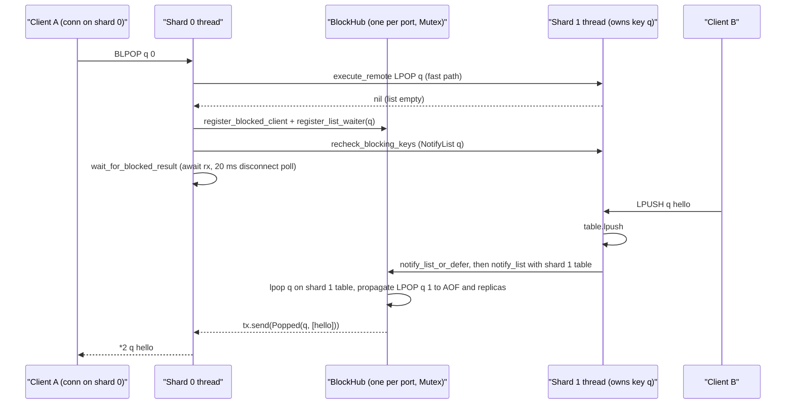

# Component 06: Blocking Operations & the Reactive Event Hub — Implementation Reference

> **High-Level Design Spec**: [`docs/design/06_blocking_hub.md`](../design/06_blocking_hub.md)
> **Consolidated Implementation Spec**: [`docs/internal/components.md`](components.md)
> **Main source files**: `src/block.rs` (the `BlockHub` waiter registry and the serve-on-write
> algorithms); `src/connection.rs` (every blocking command handler, the async wait loops, the
> write-side hooks, EXEC deferral, `CLIENT UNBLOCK`/`KILL`, `INFO`); `src/shard.rs`
> (`ShardMessage::NotifyList`, `SWAPDB`/`MOVE`/`COPY ... DB` wakeups); `src/server.rs` (the shard
> mailbox handler for `NotifyList`, `FLUSHDB`/`FLUSHALL` stream wakeups, guarded write fast paths);
> `src/router.rs` (`CLIENT LIST` `b` flag, flush wakeups, `rpush` helper); `src/replication.rs`
> (`REPLICAOF` unblocking, and the separate `WAIT` loop).

---

## 1. What this subsystem does

Some Redis commands *wait for data* instead of returning an empty answer:

| Family | Commands | Waits until… |
| :--- | :--- | :--- |
| List pop | `BLPOP`, `BRPOP`, `BLMPOP` | some listed key holds a non-empty list |
| List move | `BLMOVE`, `BRPOPLPUSH` (parsed as `BLMOVE` with `is_rpoplpush`), `BLMOVEM` (Rudis extension, blocking `LMOVEM`) | the source list has enough elements |
| Sorted-set pop | `BZPOPMIN`, `BZPOPMAX`, `BZMPOP` | some listed key holds a non-empty sorted set |
| Stream read | `XREAD ... BLOCK ms`, `XREADGROUP ... BLOCK ms [CLAIM min-idle]` | a stream gets entries newer than the requested ID (or, with `CLAIM`, a pending entry becomes claimable) |

Each command takes a timeout (`0` = wait forever). A blocked client must be woken **immediately**
when another client writes the data, must get the data **exactly once** (two clients blocked on
one list must not both receive the same element), and the pop it receives must be logged to the
AOF and replicated in the same order as the write that triggered it.

The **block hub** (`BlockHub` in `src/block.rs`) is the registry that makes this work. Blocking
command handlers *register* a waiter (key + what to do + a reply channel); write commands
(`LPUSH`, `ZADD`, `XADD`, `RENAME`, …) *notify* the hub, which **serves the waiter on the spot**:
it pops/moves/reads on the waiter's behalf, under the hub lock, using the writer's table, and sends
the finished result through the waiter's channel. The blocked connection only has to format the
reply.

`src/block.rs` itself contains no async code and no command parsing. Waiting, timeouts, disconnect
detection and reply formatting live in the callers, mostly `src/connection.rs`.

---

## 2. Mental model

Jargon used throughout:

- **Shard** — one OS thread owning a slice of the keyspace (its own `ShardDb`/`RudisTable`).
  A client connection lives on one shard; the keys it touches may be owned by others.
- **Owner shard** — the shard that `router.target_shard(key)` maps a key to.
- **Waiter** — one registration "client C waits on key K to do operation O".
- **Serve** — perform the waiter's operation against the table and send the result.
- **flume channel** — a multi-producer/multi-consumer channel usable from any thread and
  awaitable from async code; each blocked command owns one `flume::bounded(1)` channel.

There is **one `BlockHub` per listening port**, shared by every shard thread behind a
`parking_lot::Mutex`. Registration and notification both go through that single lock, so a waiter
registered from shard 0 is visible to a write executing on shard 3 with no extra messaging.



The hub never runs on a "neutral" thread: `notify_*` always executes on the **owner shard's
thread** with that shard's table, because that is the only place the data can be popped safely.
When a notification is needed from a thread that does not own the key (EXEC cleanup, the
post-registration recheck), it is forwarded to the owner as `ShardMessage::NotifyList`.

---

## 3. Data structures (`src/block.rs`)

### 3.1 Result and operation enums

| Type | Variants | Meaning |
| :--- | :--- | :--- |
| `ListPopType` | `Left`, `Right` | Which end of a list to pop from / push to. |
| `ZSetPopType` | `Min`, `Max` | Pop lowest or highest scores. |
| `ClientUnblockType` | `Timeout`, `Error`, `WrongType` | Why a waiter was released without data. `Timeout`/`Error` come from `CLIENT UNBLOCK`; `Error` also from `REPLICAOF`; `WrongType` from a move whose destination holds a non-list. |
| `BlockedListResult` | `Popped(key, Vec<Bytes>)`, `Unblocked(ClientUnblockType)` | What a list waiter receives. |
| `BlockedZSetResult` | `Popped { key, items: Vec<(Bytes, f64)>, is_zmpop }`, `Unblocked(..)` | What a sorted-set waiter receives. |
| `BlockedStreamResult` | `Data(Vec<u8>)`, `Error(Vec<u8>)`, `CrossShard`, `Unblocked(..)` | What a stream waiter receives: a fully formatted RESP reply, an error reply, a bare "go re-query" signal for cross-shard reads, or a forced release. |

`WaiterOp` says what serving a list waiter means:

```rust
pub enum WaiterOp {
    Pop   { pop_type: ListPopType, count: usize, suppress_repl: bool },   // BLPOP/BRPOP/BLMPOP
    Move  { where_from: ListPopType, where_to: ListPopType,
            destination: Bytes, is_rpoplpush: bool },                       // BLMOVE/BRPOPLPUSH
    Movem { where_from: ListPopType, where_to: ListPopType, destination: Bytes,
            mode: LmovemMode /* Count | Exactly */, count: usize,
            ordering: LmovemOrdering /* Obo | Bulk */ },                    // BLMOVEM
}
```

`suppress_repl` is set only by `register_list_waiter_no_repl`, used by the cross-shard `BLMOVE`
path (§5.4): the pop is still appended to the owner's AOF, but not replicated, because the handler
later replicates the logical `LMOVE` itself. `is_rpoplpush` only affects how the served move is
propagated (`RPOPLPUSH` vs `LMOVE`).

### 3.2 Waiter records

| Struct | Fields | Notes |
| :--- | :--- | :--- |
| `ListWaiter` | `client_id: u64`, `key: Bytes`, `op: WaiterOp`, `sender: Sender<BlockedListResult>` | One per (client, key). |
| `ZSetWaiter` | `client_id`, `key`, `pop_type: ZSetPopType`, `count: usize`, `is_zmpop: bool`, `sender: Sender<BlockedZSetResult>` | `BZPOPMIN/MAX` register `count = 1, is_zmpop = false`; `BZMPOP` registers its `COUNT` and `is_zmpop = true` (the flag selects the reply shape). |
| `StreamWaiter` | `client_id`, `key`, `cmd: Command`, `is_resp3: bool`, `is_cross_shard: bool`, `sender: Sender<BlockedStreamResult>` | `cmd` is the client's own `XREAD`/`XREADGROUP` rewritten to be non-blocking with concrete IDs (§5.5); the hub re-executes it. `is_resp3` lets the hub format the reply in the client's protocol. |

### 3.3 `BlockHub`

```rust
pub struct BlockHub {
    pub port: u16,
    list_waiters:   HashMap<(usize, Bytes), VecDeque<ListWaiter>>,  // FIFO per (db, key)
    zset_waiters:   HashMap<(usize, Bytes), VecDeque<ZSetWaiter>>,  // FIFO per (db, key)
    stream_waiters: HashMap<(usize, Bytes), Vec<StreamWaiter>>,     // all served each notify
    blocked_clients:        HashMap<u64, Sender<BlockedListResult>>,   // client_id -> list sender
    blocked_zset_clients:   HashMap<u64, Sender<BlockedZSetResult>>,   // client_id -> zset sender
    blocked_stream_clients: HashMap<u64, Sender<BlockedStreamResult>>, // client_id -> stream sender
    paused_count: usize,                    // >0 while an EXEC is running
    pending_notifies: Vec<(usize, Bytes)>,  // keys written during EXEC, deduplicated
    published_waiters: usize,               // this hub's share of TOTAL_BLOCKED_WAITERS
}
```

- **Keys are `(db index, key)`**. The DB index is read from the thread-local
  `connection::CURRENT_DB` at registration and notification time, so `SELECT 1; BLPOP k` and
  `SELECT 0; LPUSH k x` do not meet. Callers that serve another DB first set both `CURRENT_DB`
  and `ShardDb::select_db`.
- **The waiter queues** answer "who waits on this key?". A client blocked on `BLPOP a b c` has one
  `ListWaiter` in each of three queues, all sharing one `Sender`.
- **The `blocked_*_clients` maps** answer "is this client blocked, and how do I reach it?" — used by
  `CLIENT UNBLOCK`, `CLIENT LIST`'s `b` flag, `INFO`'s `blocked_clients`, and cleanup.
- `BlockHub::default()` builds a hub for port 0. Dropping a hub withdraws its share from the global
  counter (`Drop` calls `publish_waiters(0)`).

### 3.4 Process-wide registry and the cheap "anyone blocked?" check

```rust
pub static PORT_BLOCK_HUBS: LazyLock<Mutex<HashMap<u16, Arc<Mutex<BlockHub>>>>>;
static TOTAL_BLOCKED_WAITERS: AtomicUsize;              // sum of every hub's share

pub fn has_blocked_waiters(_port: u16) -> bool { TOTAL_BLOCKED_WAITERS.load(Relaxed) > 0 }
pub fn get_block_hub_for_port(port: u16) -> Arc<Mutex<BlockHub>>;  // lazily inserts
```

`has_blocked_waiters` is the hot-path filter: every list/zset/stream write calls it, and when it
is `false` the write never touches the hub mutex. It is process-wide (the `port` argument is
ignored), so with several servers in one process a waiter on any port makes every port take the
slow path — conservative, never a missed wakeup.

Each hub keeps the counter correct with **delta publishing**: after every mutation
`sync_atomic_waiters_count` computes

```
count = paused_count + Σ waiters in all three queues + |blocked_clients| + |blocked_zset_clients| + |blocked_stream_clients|
```

and `publish_waiters(count)` does `fetch_add`/`fetch_sub` of the difference from
`published_waiters`. A hub therefore only ever adds or removes its own contribution; one hub
emptying cannot hide another hub's waiters (unit test
`test_one_hub_emptying_does_not_hide_another_hubs_waiters`). The number is a "non-zero means
look" signal, not a client count. `paused_count` is included so that while an EXEC is running the
write hooks always reach the hub and defer their notifications (§6).

---

## 4. `BlockHub` API

| Method | Purpose |
| :--- | :--- |
| `new(port)` | Empty hub. |
| `register_blocked_client` / `register_blocked_zset_client` | Record the client's list / zset sender in `blocked_clients` / `blocked_zset_clients`. Called once per blocking command, before the per-key registrations. |
| `register_list_waiter(client, key, pop_type, count, tx)` | Append a `WaiterOp::Pop` waiter (`suppress_repl = false`) to the back of the key's queue. |
| `register_list_waiter_no_repl(..)` | Same with `suppress_repl = true` (cross-shard `BLMOVE`). |
| `register_move_waiter(client, source, from, to, destination, is_rpoplpush, tx)` | Append a `WaiterOp::Move` on `source`. |
| `register_movem_waiter(client, source, from, to, destination, mode, count, ordering, tx)` | Append a `WaiterOp::Movem` on `source`. |
| `register_zset_waiter(client, key, pop_type, count, is_zmpop, tx)` | Append a `ZSetWaiter`. |
| `register_stream_waiter(client, key, cmd, is_resp3, is_cross_shard, tx)` | Insert into `blocked_stream_clients` **and** push a `StreamWaiter` on the key, skipping the push if this client already waits on that key (so re-registering in a loop is safe). |
| `notify_list(table, key)` | Serve list waiters on `key` (§5.1). |
| `notify_zset(table, key)` | Serve sorted-set waiters on `key` (§5.2). |
| `notify_stream(db, key)` | Serve stream waiters on `key` (§5.3). Takes the whole `ShardDb` because it executes commands. |
| `notify_all_streams(db)` | `notify_stream` for every stream-waited key of the current DB. Used after `FLUSHDB`/`FLUSHALL` (local, `Router::flushdb/flushall`, the `ShardMessage::FlushDb/FlushAll` handlers) and `DEBUG` shard-flush. |
| `notify_db_keys(db, db_idx)` | For DB `db_idx`, serve every waited key that now exists and is unexpired (lists, then zsets, then streams), deferring instead if paused. Used by `ShardDb::swap_dbs`, `move_key` and `copy_to_db` after `SWAPDB`/`MOVE`/`COPY ... DB`. |
| `pause()` / `is_paused()` / `add_pending_notify(key)` / `resume()` | EXEC deferral (§6). |
| `remove_waiters_for_client(id)` | Remove the client from **every** queue and all three `blocked_*` maps, prune empty queues, re-sync the counter. |
| `unregister_blocked_client(id)` | Alias of `remove_waiters_for_client`; used by `BlockedClientGuard` and connection cleanup. |
| `unblock_client(id, type)` | `CLIENT UNBLOCK`: send `Unblocked(type)` through whichever senders the client has, remove its waiters, return whether it was blocked. |
| `unblock_writers()` | Release with `Error` every client whose served command would write: all list and zset waiters, plus `XREADGROUP` stream waiters (plain `XREAD` keeps waiting). Called when the server becomes a replica (`REPLICAOF host port`), matching Redis. |
| `is_blocked(id)` | Membership in any `blocked_*` map — the `CLIENT LIST`/`CLIENT INFO` `b` flag. |
| `blocked_clients_count()` | Sum of the three `blocked_*` map sizes — `INFO clients: blocked_clients` (plus clients held by `CLIENT PAUSE`). |
| `blocking_keys_count()` | Distinct `(db, key)` pairs with at least one waiter of any kind — `total_blocking_keys`. |
| `blocking_keys_on_nokey_count()` | Keys with at least one stream waiter — `total_blocking_keys_on_nokey` (an approximation: only stream waiters are counted). |

Two private helpers propagate what serving changed:

- `propagate_served(port, cmd)` / `propagate_served_opts(port, cmd, suppress_repl)` convert the
  equivalent non-blocking command to RESP (`aof::command_to_resp`; if that fails,
  `aof::note_unpropagated`), append it to the current shard's AOF writer (found through the
  thread-local `CURRENT_ROUTER`), and, unless suppressed and if replicas are connected, send it
  with `replication::propagate_shard_bytes` (or `propagate_bytes` if no router is installed).
  Because this runs on the owner's thread right after the triggering write, the AOF and replicas
  see `LPUSH q x` followed by `LPOP q 1`, in that order, in the same shard's stream.

---

## 5. Algorithms

### 5.1 `notify_list(table, key)` — serve list waiters

Runs under the hub lock on the owner shard's thread; the caller has already applied its write.

1. `touch_watched_key(port, key)` (a served pop modifies the key, so `WATCH`ers must be
   invalidated). If the key is logically expired, return.
2. Call `shard::before_write_table(table, db, key)` so an in-progress non-blocking AOF rewrite
   snapshots the key's old image first (it is a no-op when no rewrite is running).
3. Take waiters from the **front** of `list_waiters[(db, key)]` one at a time:
   - Skip (drop) waiters whose receiver is gone (`sender.is_disconnected()`).
   - If the key no longer exists, put the waiter back at the front and stop. (This also prevents a
     move waiter from failing with `WRONGTYPE` before any element arrived.)
   - **`Pop { pop_type, count, suppress_repl }`**: `lpop`/`rpop` up to `count`. If elements came
     out, propagate `LPOP key n` / `RPOP key n` (n = actual number), send
     `Popped(key, vals)`, record the client as satisfied, and **continue with the next waiter**
     while the key still exists. If nothing came out (or the key is not a list), put the waiter
     back and stop.
   - **`Move { .. }`**: `before_write_table` for the destination; if the destination exists and is
     not a list, send `Unblocked(WrongType)`, mark satisfied and continue. Otherwise pop one
     element, push it to the destination, propagate `LMOVE` (or `RPOPLPUSH`), touch the
     destination's watchers, send `Popped(key, [val])`, remember the destination for step 5 and
     **stop** — at most one move waiter is served per call.
   - **`Movem { .. }`**: same destination type check, then `table.lmovem(..)`. `Ok(Some(vals))`:
     propagate `LMOVEM ... EXACTLY <n>` with the real count, touch both keys, send, remember the
     destination, **stop**. `Ok(None)` (not enough elements — e.g. `EXACTLY 5` with 3 present):
     put back, stop. `Err` (wrong type): send `Unblocked(WrongType)` and continue.
4. For each satisfied client call `remove_waiters_for_client`, removing its waiters on all other
   keys (a `BLPOP a b` served from `a` must not linger on `b`).
5. If a move pushed into a destination, recurse `notify_list(table, destination)` so a waiter on
   the destination (e.g. a chain `BLMOVE a b`, `BLPOP b`) is served in the same call.

**Worked example.** Clients C1, C2, C3 run `BLPOP q 0` in that order; C4 runs `BLMPOP 0 1 q LEFT
COUNT 5` last. Then `RPUSH q a b c d` executes on q's owner shard:

1. `RPUSH` succeeds; its handler calls `notify_list_or_defer(db, q)`; the counter is non-zero, the
   hub is not paused, so `notify_list` runs.
2. C1: `lpop q 1` → `[a]`, propagate `LPOP q 1`, send. q still exists → continue.
3. C2 gets `[b]`, C3 gets `[c]`. C4: `lpop q 5` → `[d]`, propagate `LPOP q 1`, send. q is now
   gone → stop.
4. All four clients are removed from the hub; each connection wakes up and formats its reply.

### 5.2 `notify_zset(table, key)` — serve sorted-set waiters

Same shape as the `Pop` case: touch watchers, return if expired, `before_write_table`, then walk
the FIFO queue. A waiter is skipped if disconnected **or already satisfied in this call** (a client
that listed the same key twice). `zpopmin`/`zpopmax(key, count)`; non-empty result → propagate
`ZPOPMIN/ZPOPMAX key n`, send `Popped { key, items, is_zmpop }`, continue while the key exists;
empty or error → put back and stop. Satisfied clients are then removed everywhere.

### 5.3 `notify_stream(db, key)` — serve stream waiters

Stream waiters are not FIFO competitors: every client reading new entries can receive the same
entries (and consumer groups hand out distinct entries by themselves). So `notify_stream` visits
**all** waiters on the key and serves each one that now has something to read:

1. If anyone waits on `(db, key)`, call `shard::before_write` (AOF-rewrite snapshot; serving an
   `XREADGROUP` changes group state).
2. For each waiter, in registration order:
   - disconnected → mark for removal;
   - `is_cross_shard` → send `CrossShard` (the client will re-query all shards itself), mark;
   - otherwise set `CURRENT_CLIENT_RESP3` to the waiter's protocol and run the stored command with
     `execute_local_command(&waiter.cmd, db, &mut out, aof)` using this shard's AOF writer. If
     `out` is an empty reply (`$-1`, `*0`) — or, for `XREAD` only, a `-WRONGTYPE` error — the waiter
     stays. Otherwise send `Error(out)` if it starts with `-`, else `Data(out)`, and mark it.
3. Remove the marked waiters (and their `blocked_stream_clients` entries), drop the key's entry if
   empty, remove those clients from every other stream key, re-sync the counter.

Because the stored command is the client's own `XREADGROUP`, serving it updates the group's
last-delivered ID and PEL, and `execute_local_command` logs/replicates it exactly like a normal
read. An `XREADGROUP` whose group was destroyed (`XGROUP DESTROY`) or whose key was deleted gets
the error reply its re-execution produces (for example a `NOGROUP` error) through `Error`.

**Which writes notify streams.** `notify_stream_or_defer` is called by `XADD`, `XNACK`,
`XGROUP DESTROY`, and by key-replacing commands — `SET` (including the `FastSet` mailbox path),
`MSET`, `DEL`/`UNLINK` (including the `Del` mailbox path), `RENAME`, `MOVE`, `COPY` — so a blocked
reader observes a stream that was deleted or replaced.

### 5.4 The write side: `notify_*_or_defer` and friends (`src/connection.rs`)

```rust
pub fn notify_list_or_defer(db: &mut ShardDb, key: &Bytes) {
    touch_watched_key(db.port, key.as_ref());
    if !crate::block::has_blocked_waiters(db.port) { return; }   // lock-free fast exit
    let hub_arc = crate::block::get_block_hub_for_port(db.port);
    let mut hub = hub_arc.lock();
    if hub.is_paused() { hub.add_pending_notify(key.clone()); }   // inside EXEC
    else { hub.notify_list(&mut db.table, key); }
}
// notify_zset_or_defer / notify_stream_or_defer are identical apart from the notify_* call.
```

Callers (all run on the owner shard with its `ShardDb`):

| Hook | Called after |
| :--- | :--- |
| `notify_list_or_defer` | `LPUSH`, `RPUSH`, `LPUSHX`, `RPUSHX`, `LINSERT`, `LMOVE`/`LMOVEM` (on the destination), `SORT ... STORE` (on the destination), `RENAME`, `MOVE`, `COPY`, `Router::rpush` |
| `notify_zset_or_defer` | `ZADD` (only when something changed), `ZINCRBY`, `MOVE`, `COPY` |
| `notify_stream_or_defer` | see §5.3 |
| `BlockHub::notify_db_keys` | `SWAPDB` (both DBs), `MOVE` and `COPY ... DB` (target DB) |
| `BlockHub::notify_all_streams` | `FLUSHDB`, `FLUSHALL`, DEBUG shard-flush |

**Write fast paths must respect the hub.** The pipeline-squashing executors have zero-allocation
paths for `LPUSH`, `RPUSH` and `ZADD` that write the table directly and skip the notify hooks
(`execute_commands_squashed_inner` in `src/connection.rs`, and the `ShardMessage::Batch` handler in
`src/server.rs`). Each is guarded by `!has_blocked_waiters(port)`. In addition, the connection
loop does not use the squashed path at all while `has_blocked_waiters` is true.

### 5.5 The blocking side: a command's life cycle

All list/zset handlers (`BLPOP`, `BRPOP`, `BLMPOP`, `BLMOVE`, `BLMOVEM`, `BZMPOP`, and
`handle_bzpop` for `BZPOPMIN`/`BZPOPMAX`) follow the same steps:

1. **Try without blocking.** For each key in order: if this shard owns it, pop from
   `router.local_db` (and log/replicate the pop here); otherwise `router.execute_remote(target,
   LPOP/ZPOPMIN/LMOVE/...)` — the owner logs it. A `WRONGTYPE` error is returned to the client.
   The first key that yields data answers the command.
2. **Inside MULTI/EXEC, never block.** If `in_tx(client_id)` is true, reply nil (`*-1` or `$-1`).
3. **Arm cleanup.** Create a `BlockedClientGuard { port, client_id }` whose `Drop` calls
   `unregister_blocked_client`, so success, timeout, error, disconnect and a dropped future all
   leave the hub clean.
4. **Register.** Create `flume::bounded(1)`, lock the hub, `register_blocked_client` (or
   `register_blocked_zset_client`), then one `register_*_waiter` per key with clones of `tx`.
5. **Recheck.** `recheck_blocking_keys(router, keys)`: step 1 and step 4 are not atomic (shards run
   concurrently and step 1 may await remote hops), so a push landing in between would find no
   waiter. The recheck runs `notify_stream` + `notify_list` + `notify_zset` for each key — directly
   for locally owned keys, via `ShardMessage::NotifyList { db, keys }` (grouped per shard) for
   remote ones — or, if the hub is paused, adds the keys to `pending_notifies`.
6. **Wait.** `wait_for_blocked_result(&rx, timeout_secs, raw_fd)` (§5.6).
7. **Reply.** `Popped` → format the reply (the hub already logged/replicated). `Unblocked(WrongType)`
   → `-WRONGTYPE ...`. `Unblocked(Error)` → `-UNBLOCKED client unblocked via CLIENT UNBLOCK`.
   Anything else (timeout, `Unblocked(Timeout)`, dropped sender) → nil. If the client disconnected,
   return `true` so the connection closes. (`handle_bzpop` has no `WrongType` arm; it falls into
   nil, which is unreachable in practice since zset waiters never receive it.)

**`BLMOVE` / `BRPOPLPUSH` across shards.** Step 1 runs `LMOVE` on the source's shard when source
and destination share a shard. If they do not: in cluster mode the reply is `-CROSSSLOT`; in
standalone mode `blmove_across_shards` takes over. It first tries `move_element_across_shards`; if
the source is empty it registers a **plain one-element pop** on the source with
`register_list_waiter_no_repl`. When served, it checks the destination's type on its shard: a
non-list puts the element back on the source and replies `WRONGTYPE`; otherwise it pushes the
element to the destination shard and replicates the logical `LMOVE`/`RPOPLPUSH` (with hub
propagation suppressed for the inner pushes). `BLMOVEM` has no cross-shard path: different shards
→ `-CROSSSLOT` in every mode.

**Streams (`XREAD`/`XREADGROUP` with `BLOCK`).** Blocking is allowed only for `XREAD`, or for
`XREADGROUP` when every ID is `>` (`can_block`), and not inside a transaction.

1. If all keys are on one shard, run the command there. If the reply is empty, rewrite it into
   `unblocked_cmd`: `block_ms = None`, and IDs from `resolve_stream_last_ids`, which replaces `$`
   and `+` by the stream's current last ID (`0-0` if the stream does not exist) so the hub's
   re-execution only returns entries added after the client blocked.
2. Register one `StreamWaiter` per key (`is_cross_shard = false`), `recheck_blocking_keys`, then
   `wait_for_stream_result(&rx, block_ms, raw_fd)`. `Data`/`Error` are written verbatim;
   `Unblocked(Timeout)` → `$-1`; `Unblocked(Error)` → `-UNBLOCKED ...`; timeout → `$-1`.
3. Keys on several shards: in cluster mode with different slots → `-CROSSSLOT`; otherwise
   `query_cross_shard_streams` fans the read out with `execute_remote` and merges the per-stream
   blocks. If empty, the handler loops: register with `is_cross_shard = true` (deduplicated),
   `recheck_blocking_keys`, wait for the remaining time. On `CrossShard` it re-queries all shards;
   a non-empty result is the reply, otherwise it loops again.

**`XREADGROUP ... CLAIM min-idle`** (Rudis extension; single-shard path only). Besides new entries,
such a read can return pending entries idle for at least `min-idle` ms, which become eligible as
time passes — no write announces that. The handler therefore waits in slices: each iteration
computes, for locally owned keys, `ShardDb::earliest_claim_wait_ms(key, group, min_idle)` (time until
the next pending entry becomes claimable), waits `min(remaining deadline, clamp(that, 1, 50))` ms
(50 ms if nothing is pending or the key is remote), and when the slice expires without a hub
result, re-runs `unblocked_cmd` itself; a non-empty reply ends the wait.

### 5.6 Waiting, timeouts and disconnect detection

`wait_for_blocked_result<T>(rx, timeout_secs: f64, raw_fd)` (lists/zsets, seconds) and
`wait_for_stream_result(rx, timeout_ms: u64, raw_fd)` (streams, milliseconds) share one loop:

1. `timeout = 0` → no deadline (wait forever). Otherwise `deadline = now + timeout`.
2. Each round waits on `rx.recv_async()` for at most `min(20 ms, remaining)`. The remaining time is
   computed by `remaining_wait_ms`, which rounds **up** to whole milliseconds so the command never
   times out early; `0` remaining → return `(None, false)` (timeout).
3. A received value → `(Some(v), false)`. All senders gone → `(None, false)`.
4. On a 20 ms tick without data: if `raw_fd` is known, the server is not shutting down, and
   `is_fd_closed(fd)` is true → `(None, true)` (client gone). If the deadline passed → timeout.
   Otherwise loop.

The 20 ms tick exists only for **disconnect detection**: a flume receiver cannot see a TCP close.
`is_fd_closed` does a zero-timeout `libc::poll` for `POLLRDHUP | POLLHUP | POLLERR`; if only
`POLLIN` is set it peeks one byte with `MSG_PEEK | MSG_DONTWAIT` and treats a `0` return as a peer
close. During shutdown draining the server has already shut the read side, which would look like
a close, so the check is skipped and the command is allowed to finish.

---

## 6. MULTI/EXEC: deferred notification

Inside a transaction, blocked clients must not observe intermediate states (Redis serves them
after `EXEC` completes). The hub's pause mechanism does this:

1. `EXEC` runs its checks first (queued-command errors, cluster `CROSSSLOT`, `WATCH` taint); those
   abort paths return before the hub is touched.
2. It builds an `ExecCleanup` guard, takes VLL (cross-shard transaction) locks if needed, then
   `hub.pause()` (`paused_count += 1`, which also makes `has_blocked_waiters` true) and stores the
   hub in the guard.
3. Queued commands run. Every `notify_*_or_defer`, `recheck_blocking_keys` and `notify_db_keys`
   sees `is_paused()` and calls `add_pending_notify(key)`, which stores `(CURRENT_DB, key)` once.
   Blocking commands inside the transaction never block (§5.5 step 2).
4. When `ExecCleanup` drops — normally, or because the EXEC future was dropped/unwound after a
   panicking queued command — it calls `resume()`: `paused_count -= 1`, and when it reaches zero
   the pending list is returned. For each `(db, key)`: if this shard owns the key and
   `local_db.try_borrow_mut()` succeeds, it selects that DB and runs `notify_stream`, `notify_list`
   and `notify_zset` locally; otherwise it sends `ShardMessage::NotifyList { db, keys: vec![key] }`
   to the owner.
5. The owner's mailbox handler (`src/server.rs`) sets `CURRENT_DB`, selects the DB, locks the hub
   and runs the same three notifies for each key against its own table.

**Example.** C1 is blocked in `BLPOP q 0`. C2 runs `MULTI; RPUSH q a; RPUSH q b; LPOP q; EXEC`.
Both pushes defer `q` (stored once). `LPOP` inside the transaction returns `a`. After EXEC, one
`notify_list(q)` runs and serves C1 with `b` — the final state, as Redis would.

`pause`/`resume` are used only by EXEC. `CLIENT PAUSE` is a different mechanism
(`set_client_pause`, `wait_if_client_paused`, `wait_if_tx_paused` in `src/connection.rs`): it
delays commands before they run. Blocking commands count as writes for `CLIENT PAUSE WRITE`
(`should_pause_command`), and paused clients are added to `INFO`'s `blocked_clients`.

---

## 7. Releasing waiters without data

| Trigger | Mechanism | Client sees |
| :--- | :--- | :--- |
| Timeout | wait loop deadline (§5.6) | nil (`*-1` for pops, `$-1` for single-element moves and streams) |
| `CLIENT UNBLOCK id [TIMEOUT]` | `unblock_client(id, Timeout)` sends `Unblocked(Timeout)` | nil; reply to the caller `:1` (or `:0` if not blocked) |
| `CLIENT UNBLOCK id ERROR` | `unblock_client(id, Error)` | `-UNBLOCKED client unblocked via CLIENT UNBLOCK` |
| `CLIENT KILL ...` | shuts the victim's socket down (`libc::shutdown`) and calls `remove_waiters_for_client` | connection closes; the victim's wait loop notices within one 20 ms tick |
| Client closes connection | `is_fd_closed` in the wait loop; `ClientCleanup` drop calls `unregister_blocked_client` (when `has_blocked_waiters`) | — |
| `REPLICAOF host port` | `unblock_writers()` releases list/zset waiters and `XREADGROUP` waiters with `Error` | `-UNBLOCKED ...` |
| Move destination is not a list | `notify_list` sends `Unblocked(WrongType)` | `-WRONGTYPE ...` |

`unblock_client` uses `send` for list/zset senders and `try_send` for stream senders; the
stream path distinguishes the release because the payload is a typed `Unblocked(..)` value.

---

## 8. Ordering and fairness

- **Lists and sorted sets are FIFO per `(db, key)`**: registration appends, notify serves from the
  front, and a waiter that cannot be served stays at the front.
- **Pop waiters drain a push**: one notify serves as many queued pop waiters as there are elements.
- **Move waiters do not**: `notify_list` stops after one successful `Move`/`Movem`, so if three
  clients wait in `BLMOVE src dst` and `RPUSH src a b c` arrives, only the first is served by that
  push; the others are served by later writes to `src` (or a recheck), even though `src` still has
  elements.
- **Head-of-line blocking**: a waiter at the front that cannot be served stops the walk — e.g. a
  `BLMOVEM ... EXACTLY 5` waiter in front of a `BLPOP` waiter keeps the `BLPOP` waiting while the
  list has fewer than 5 elements.
- **No cross-key fairness**: a client blocked on several keys is served by whichever key is written
  first.
- **Streams**: every waiter on the key is evaluated on each notify; there is no "first blocked,
  first served".
- **Transactions**: multiple writes to one key in an EXEC produce one notification after the EXEC.

---

## 9. Invariants & gotchas

- **Serve on the owner thread only.** `notify_list/zset/stream` must receive the table/`ShardDb` of
  the shard that owns `key`. Any caller without it must forward a `ShardMessage::NotifyList`.
- **`CURRENT_DB` is part of the key.** Code that serves another DB (EXEC cleanup, the `NotifyList`
  handler, `notify_db_keys`) sets `CURRENT_DB` *and* calls `select_db`, then restores both.
- **Check, then register, then recheck.** Every blocking handler must call
  `recheck_blocking_keys` after registering, or a write racing between the fast path and
  registration leaves the client blocked until timeout.
- **Every fast write path must be gated** by `has_blocked_waiters` (or call a notify hook). A
  new zero-copy write path that skips both silently starves blocked clients.
- **The hub lock is held while serving**, including running a stream waiter's `XREAD`/`XREADGROUP`
  and appending to the AOF. Do not call anything that takes the hub lock from inside
  `notify_*` (it is a non-reentrant `parking_lot::Mutex`); the recursive `notify_list` call for a
  move destination works because it is a method call on the already-locked hub.
- **Channels are `bounded(1)` and the hub uses blocking `send`.** A blocking command is served at
  most once because the satisfied client is removed from all queues, but this relies on
  per-call bookkeeping: `notify_zset` skips clients already satisfied in the same call,
  `register_stream_waiter` deduplicates per key, but **`notify_list` has no such check**. By code
  inspection, a client that names the same list twice (`BLPOP q q 0`, the parser does not
  deduplicate keys) followed by a push of two or more elements would be served twice in one call:
  the second `send` blocks the shard thread on a full channel (deadlock if the blocked connection
  lives on the same shard; otherwise the second element is popped and lost). Not covered by tests.
- **`notify_stream` leaves `CURRENT_CLIENT_RESP3` set** to the last served waiter's protocol. The
  connection loop resets it before each command, so this is harmless today, but code after a
  notify within the same command should not rely on it.
- **EXEC pause is balanced by a guard.** `pause()` is only called after all EXEC early exits, and
  `ExecCleanup::drop` always calls `resume()`. A leaked pause would make every later write on the
  port defer forever.
- **`has_blocked_waiters` is global.** It ignores its `port` argument; this is safe (a waiter on any
  port only disables fast paths everywhere) but means multi-server test processes run slow paths.
- **`PORT_BLOCK_HUBS` never shrinks**; one entry per port ever used.

---

## 10. Limitations / not implemented

- `BLMOVEM` requires source and destination on the same shard (`-CROSSSLOT` otherwise, even in
  standalone mode); `BLMOVE` handles that case only in standalone mode.
- Move waiters are served one per notify (§8).
- `XREADGROUP ... CLAIM` eligibility is polled (1–50 ms slices), so a pending entry can be
  delivered up to ~50 ms after it became claimable; for keys on another shard the slice is always
  50 ms.
- `XREAD` on a key that becomes a non-stream keeps waiting (the hub treats `-WRONGTYPE` as "nothing
  yet" for `XREAD`).
- `total_blocking_keys_on_nokey` counts keys with stream waiters, not Redis's exact "blocked on a
  missing key" notion.
- `may_block` (which excludes wait time from command statistics) lists the blocking commands but
  not `BLMOVEM`, so time a `BLMOVEM` spends waiting is counted as execution time.
- **`WAIT` / `WAITAOF` do not use the hub.** `replication::wait_replicas` / `wait_aof` are thin
  wrappers over `wait_acks`, a poll loop: it sends `REPLCONF GETACK *` once a second while short
  of replicas and polls every 1 ms (10 ms after the first 100 ms) until enough copies are
  acknowledged or the timeout passes. A timeout of `0` waits forever, as in Redis. `WAITAOF`
  counts only AOF-fsynced copies (see `14_persistence_replication.md` §6.8).

---

## 11. Code map

| File | Key symbols | What they do |
| :--- | :--- | :--- |
| `src/block.rs` | `BlockHub`, `ListWaiter`, `ZSetWaiter`, `StreamWaiter`, `WaiterOp` | Waiter registry keyed by `(db, key)`. |
| `src/block.rs` | `BlockedListResult`, `BlockedZSetResult`, `BlockedStreamResult`, `ClientUnblockType`, `ListPopType`, `ZSetPopType` | Messages sent to blocked commands. |
| `src/block.rs` | `PORT_BLOCK_HUBS`, `get_block_hub_for_port`, `TOTAL_BLOCKED_WAITERS`, `has_blocked_waiters`, `sync_atomic_waiters_count`, `publish_waiters` | One hub per port; lock-free "anyone blocked?" counter with per-hub delta publishing. |
| `src/block.rs` | `notify_list`, `notify_zset`, `notify_stream`, `notify_all_streams`, `notify_db_keys` | Serve-on-write algorithms. |
| `src/block.rs` | `pause`, `resume`, `add_pending_notify`, `is_paused` | EXEC deferral. |
| `src/block.rs` | `unblock_client`, `unblock_writers`, `remove_waiters_for_client`, `is_blocked`, `blocked_clients_count`, `blocking_keys_count`, `blocking_keys_on_nokey_count` | Release, cleanup and introspection. |
| `src/block.rs` | `propagate_served`, `propagate_served_opts` | AOF + replication of pops/moves performed for a waiter. |
| `src/block.rs` | `mod tests` | Pause/resume, multi-hub counter, list/move, zset/stream/unblock unit tests. |
| `src/connection.rs` | `notify_list_or_defer`, `notify_zset_or_defer`, `notify_stream_or_defer` | Write-side hooks. |
| `src/connection.rs` | `recheck_blocking_keys` | Post-registration recheck, local or via `NotifyList`. |
| `src/connection.rs` | `BlockedClientGuard`, `wait_for_blocked_result`, `wait_for_stream_result`, `remaining_wait_ms`, `is_fd_closed` | Blocking wait loop, timeout and disconnect detection. |
| `src/connection.rs` | `Command::Blpop/Brpop/Blmpop/Blmove/Blmovem/Bzmpop` arms, `handle_bzpop`, `blmove_across_shards` | List and sorted-set blocking handlers. |
| `src/connection.rs` | `Command::Xread \| Command::Xreadgroup` arm, `resolve_stream_last_ids`, `query_cross_shard_streams` | Stream blocking (single-shard, cross-shard, `CLAIM`). |
| `src/connection.rs` | `ExecCleanup` | Pauses the hub for EXEC and drains deferred notifications on drop. |
| `src/connection.rs` | `ClientSubcommand::Unblock` / `Kill` arms, `ClientCleanup`, INFO clients section, `may_block`, `should_pause_command` | Release paths, metrics, stats, `CLIENT PAUSE` interplay. |
| `src/connection.rs` | `execute_commands_squashed_inner` | Squashed pipeline with `LPUSH`/`RPUSH`/`ZADD` fast paths gated by `has_blocked_waiters`. |
| `src/shard.rs` | `ShardMessage::NotifyList { db, keys }`, `ShardDb::swap_dbs`, `move_key`, `copy_to_db`, `before_write`, `before_write_table` | Cross-shard notify message; DB-moving wakeups; AOF-rewrite snapshot hooks used while serving. |
| `src/server.rs` | `ShardMessage::NotifyList`, `FlushDb`, `FlushAll`, `Batch`, `ClientList` handlers | Owner-side notify; flush wakeups; guarded fast paths; `b` flag. |
| `src/router.rs` | `Router::flushdb`, `Router::flushall`, `Router::rpush`, `Router::client_list` | Flush wakeups, push helper, `b` flag. |
| `src/replication.rs` | `unblock_writers` call on `REPLICAOF`, `wait_replicas` | Replica-role unblocking; the separate `WAIT` poll loop. |
| `src/debug_cmd.rs` | DEBUG shard-flush | Calls `notify_all_streams` after flushing a shard. |
