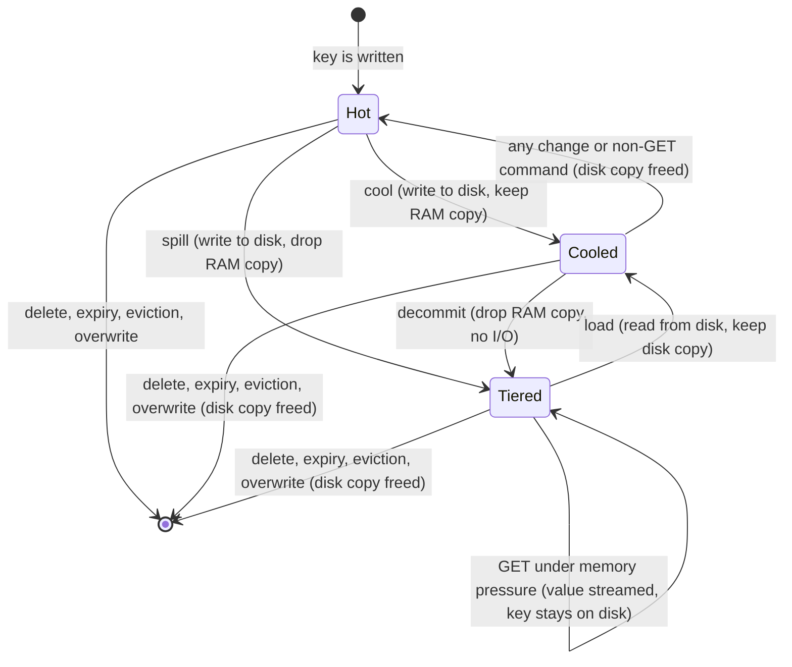
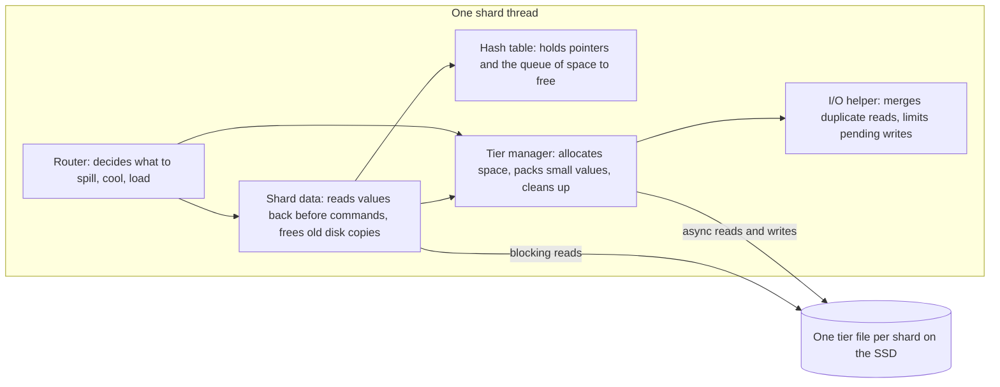

# Component 07: NVMe SSD Tiered Storage Engine

> **High-level design**: [`docs/design/07_nvme_tiering.md`](../design/07_nvme_tiering.md)
> **Consolidated implementation spec**: [`docs/internal/components.md`](components.md)
>
> **Main source files**: src/tiering.rs (the on-disk store), src/router.rs (moving keys between
> states, automatic tiering), src/table.rs (how a value records its tiering state, the queue of disk
> space to free), src/shard.rs and src/aof.rs (reading values back for commands and saves),
> src/server.rs (startup and background loops), src/connection.rs and src/resp.rs (the TIER command
> and the out-of-memory check), src/config.rs and src/main.rs (settings). The
> [Code map](#8-code-map) lists the key symbols.

---

## 1. What this subsystem does

Rudis keeps every key in RAM by default. An operator can cap memory with the `maxmemory` setting.
Under the default policy, `noeviction`, Redis would then start refusing writes with an `-OOM` error
once the cap is reached. Rudis does something gentler: it moves the *values* of some keys out to a
file on local disk (ideally an NVMe SSD) and leaves a small pointer behind in the hash table. The key
still exists, every command still works on it, and a later read brings the value back from disk.

Three kinds of callers use this:

- **The write path, automatically.** After writes, and every 20 ms in the background, each shard
  checks whether the server is over its memory cap. If it is, the shard moves values to disk until
  the server is back under.
- **Operators, by hand,** through the TIER command family (TIER SPILL, TIER COOL, TIER LOAD,
  TIER INFO and others).
- **Every command that touches a key.** A key whose value is on disk is quietly read back first, so
  clients never notice tiering except as extra latency.

Tiering is *not* a persistence layer. The disk file is wiped every time the server starts. Snapshot
files (RDB) and the append-only log (AOF) always contain real values — tiered values are read back
from disk while saving — never disk pointers.

> [!NOTE]
> src/pagestore.rs has a similar-sounding name but is unrelated. It is an in-memory page allocator
> that large sets, sorted sets and hashes use to pack their elements. It never touches disk.

---

## 2. Mental model

Every value in a shard's table is in one of three tiering states:

| State | Value in RAM? | Copy on disk? | What it is for |
| :--- | :--- | :--- | :--- |
| **Hot** | yes | no | The normal state of every key. |
| **Cooled** | yes | yes | A write-through cache: the RAM copy can be dropped instantly, with no disk I/O. |
| **Tiered** (also called spilled or cold) | no, only a pointer | yes | Saves RAM; the value must be read from disk to use it. |

Moving a value from RAM to disk is called **spilling** (Hot to Tiered) or **cooling** (Hot to
Cooled, keeping the RAM copy). Dropping the RAM copy of a cooled value is called **decommitting**.
Reading a tiered value back into RAM is called **loading** or, when it happens automatically before
a command runs, **hydrating**.



And the pieces that take part in moving a value:



Six ideas explain almost everything else in this document:

* **Per shard, single-threaded.** Each shard thread (see [Component 04](04_sharding_mesh.md)) owns
  one tier manager and one file. Nothing in the tier is shared between threads except a block of
  statistics.
* **The key stays; only the value moves.** The table slot keeps the key, its expiry and a small
  pointer saying where on disk the value lives. That is why every command keeps working.
* **Small values share pages.** Disk space is handed out in 4 KiB pages. Values under 2 KiB are
  packed together into shared pages so a 150-byte value does not cost a whole page.
* **Records are self-checking.** Each value on disk carries a header and a checksum, so a corrupt
  or misplaced read is detected rather than returned to a client.
* **Freeing is queued.** When a key that has a disk copy is overwritten or deleted, the table puts
  the old pointer on a queue, and the shard frees the space a moment later.
* **The disk file is disposable.** Pointers live only in memory, so the file is meaningless once
  the process ends. It is emptied on every start.

---

## 3. The building blocks

### 3.1 The pointer left behind

When a value leaves RAM, its table slot keeps a **tiered pointer**: which file the value is in (the
shard number, since there is one file per shard), the byte offset of its record, the record's
length, and a one-byte type tag (string, list, set, and so on). A cooled value keeps the same
pointer plus the in-memory value.

Every value in the table must fit in 16 bytes, and the compiler checks that. A pointer is bigger
than that, so both tiering states store it in a separate heap allocation (a box). The extra
allocation does not matter, because tiered and cooled keys are by definition the rarely used ones.

For memory accounting, a tiered value counts as a flat 24 bytes and a cooled value as 24 bytes
plus its in-memory value. This is why spilling tiny values is pointless: the pointer would outweigh
them.

### 3.2 The per-shard tier manager

Each shard has one **tier manager** that owns its tier file. If the file cannot be opened at
startup, the shard has no tier manager and simply runs without tiering.

| Part | What it holds | Why |
| :--- | :--- | :--- |
| The file | An open handle used for async disk reads and writes, plus the path | Synchronous reads reopen the file by its path. |
| Append cursor | The end of the highest byte ever handed out (always a multiple of 4 KiB) | New space comes from here when nothing can be reused. |
| Preallocated length | How far the file has been grown in advance | The file grows in 64 MiB steps so most writes need no resizing. |
| Free page list | Single 4 KiB pages that can be reused | Reuse is last-in, first-out. |
| Free extent list | Longer runs of free space, as offset and length | Searched first-fit for large values. |
| Small bins | The page currently being filled with small values, plus per-page bookkeeping | See §3.3. |
| I/O helper | Merges duplicate reads and tracks pending writes | See §3.4. |
| Direct I/O flag | Whether the file really was opened to bypass the OS page cache | Opening that way can fail, and then the shard silently falls back. |

### 3.3 Small bins: packing small records

**Why.** Disk space is handed out in 4 KiB pages, and many values are a few hundred bytes. Giving
each its own page would waste most of the disk and most of the write bandwidth.

**How.** A **small bin** is a 4 KiB page that holds several small records back to back. Each shard
has at most one **active bin**: a page-sized buffer in RAM that new small records are appended to.
When the active bin is full, it is padded with zeros to exactly 4 KiB and written out in one go.

Three pieces of bookkeeping make this safe:

1. **A live count per page**, raised the moment a record is appended and lowered when that record's
   key is deleted or overwritten. A page can be freed only when its count reaches zero. Counting
   from the append, not from the write to disk, means a record that dies while its page is still in
   RAM is not lost track of.
2. **A "being written" map** holding a copy of each page whose disk write has started but not yet
   finished. Readers look there and in the active bin before going to disk, so a record can be read
   back the instant it is stashed, long before its page reaches the SSD.
3. **A dead-page list** of pages whose live count reached zero and that are no longer in RAM. They
   wait there for the garbage collector (§4.9).

### 3.4 Read coalescing and write backpressure

A small **I/O helper** sits in front of the file and does two jobs.

**Read coalescing.** Small records live inside shared pages, so several requests often need the
same page at the same moment. The first request to ask for a page issues the one real disk read and
registers the page as "in flight". Later requests for the same page join a waiting list instead of
reading again. When the read finishes, every waiter gets the same buffer (or the same error).

**Write backpressure.** The helper adds up the bytes of all stashes in progress. If more than
16 MiB are in flight, a new stash is refused straight away with a "would block" error, and the
caller simply leaves that key in RAM. A small guard object adds a stash's size when it starts and
subtracts it however the stash ends — success, error, or the task being dropped — so a failed write
can never leave the limit stuck on.

### 3.5 The shared statistics block

All shards of one server share one **statistics block**, kept in a global map keyed by the server's
base port. (In cluster mode each shard listens on its own port, but every shard is pointed at the
base port's block at startup.) Each thread caches its reference to the block, so the command path
never takes the global map's lock.

The block holds three groups of things:

1. **Tiering counters**, all shown by TIER INFO: how many keys are tiered or cooled, bytes on disk,
   RAM saved, disk reads and writes, dead bytes, garbage-collection results, and hit/miss counts.
   The full list is in [§9.3](#93-statistics-block).
2. **Settings**: the memory cap in bytes (0 means no cap), the offload threshold (default 60 %) and
   the upload threshold (default 80 %). Thresholds above 100 are clamped to 100.
3. **Memory accounting for the cap.** The router's eviction and limit logic owns this; it only lives
   here so every shard can see it. Each shard publishes its table's own estimate and its thread's
   real allocator usage, and the block adds those up (plus bytes allocated outside any shard) into
   the server-wide "used memory" figure the cap is judged against.

Resetting the statistics (on FLUSHALL) zeroes only the counters, and does it in place. It must not
replace the block, because routers and the per-thread caches all hold references to the existing
one.

Two related globals live next to the block:

* A **memory-limit epoch** counter, bumped whenever the cap, the eviction policy or the dataset is
  reset. Routers compare it with the value they last saw and drop any stale "nothing left to spill"
  back-offs when it changes.
* An **eviction pause** guard that is held while a full snapshot for a replica is being built. It
  pauses *eviction* only; spilling to disk does not check it.

### 3.6 The record on disk

Every stashed value becomes one self-describing record:

```
offset 0      4        5          9          13               21
       | TIER | type:1 | key_len:4 | val_len:4 | xxh3_64:8      | key bytes | value payload |
```

The record starts with the four bytes `TIER`, then the type tag, the key and value lengths, and a
64-bit checksum of everything after the header. The value payload uses the same serialized form the
table uses elsewhere, and its first byte repeats the type tag. All integers are little-endian.

Reading a record back checks, in order: that it is at least as long as the header, the magic bytes,
that the type matches the pointer's type, that the declared lengths fit, and the checksum. Any
failure is reported as an error rather than returned as data.

The record also stores the key, but readers ignore it: the table slot that holds the pointer is the
source of truth. That is why a key renamed while tiered still reads back correctly, even though its
record carries the old name.

---

## 4. Algorithms

### 4.1 Opening the tier file

When a shard starts, it opens its tier file:

1. **Pick the directory.** The `RUDIS_TIER_DIR` environment variable wins if set. Otherwise it is a
   folder named after the port (`rudis_tier_<port>`) inside the configured data directory — the
   same one RDB and AOF use. The system temp directory is avoided on purpose because it is often
   RAM-backed (tmpfs). Each shard's file is named after its shard number.
2. **Try direct I/O if asked.** If `RUDIS_DIRECT_IO` is set to anything except `0`, the file is opened
   to bypass the OS page cache. If that fails, the shard silently opens it normally instead.
3. **Claim the file.** The shard takes an exclusive, non-blocking file lock. If another process
   already holds it, opening fails and the shard runs without tiering, rather than destroying a
   running server's live data.
4. **Empty it.** The file is truncated to zero. Nothing from an earlier run can be referenced (RDB
   and AOF store values, not pointers), so whatever is left over is garbage.
5. **Start clean**: append cursor and preallocated length at zero, no active bin, empty free lists.

### 4.2 Allocating disk space

**Why.** The allocator has to hand out space quickly, reuse space freed by deletes, and avoid
growing the file one write at a time.

**Growing the file.** When a write would end past the preallocated length, the file is grown to the
next 64 MiB boundary. Only the *new* range is reserved; reserving from the start of the file would
re-fill every hole the garbage collector has punched. If the reservation call fails, the shard just
extends the file length instead, which grows it without reserving blocks.

**One page (small bins).** Reuse the most recently freed page if there is one. Otherwise take the
page at the append cursor and move the cursor forward 4 KiB.

**A larger extent (big records).** Scan the free extent list for the first extent that is long
enough. Take it, and put any leftover tail back on the list. If none fits, take space at the append
cursor.

**Giving space back.** A freed one-page extent goes onto the free page list; anything longer goes
onto the free extent list. Neighbouring free extents are never merged.

### 4.3 Stashing a value

**Stashing** is writing a value's record to disk and getting back a pointer to it.

1. **Check backpressure.** If more than 16 MiB of stashes are already in flight, fail at once.
2. **Encode the record** (§3.6) and count its bytes as pending.
3. **Small record (under 2,048 bytes):**
   1. Make sure there is an active bin with room. If there is none, allocate a page and start one.
      If there is one but it is too full, write it out and look again. The check is repeated after
      every wait, because while this task was waiting another stash on the same shard may have
      started and filled a new bin; replacing that bin would lose its records.
   2. Append the record and raise the page's live count.
   3. The pointer is the page's position plus the record's position inside the page.
   4. If fewer than 64 bytes of room remain, write the bin out now rather than wait.
4. **Large record (2,048 bytes or more):**
   1. Write out any open bin first.
   2. Round the length up to a whole number of 4 KiB pages. In direct I/O mode, pad the buffer with
      zeros to that size.
   3. Allocate an extent and write. If the write fails, give the extent back and report the error.
   4. The pointer records the real, unpadded length.

**Writing out a bin.** The active bin is taken away, padded to 4 KiB, copied into the "being written"
map and written to its page. Once the write finishes, the copy is removed. If every record on the page
died while it was still in RAM, the page goes straight to the dead-page list. If the write fails, the
live counts are kept, so the page is still reclaimed later when its records are deleted.

**Worked example.** The active bin is page 7 with 3,900 bytes used.

1. A 300-byte record arrives. 3,900 + 300 is more than 4,096, so page 7 is written out (4,096 bytes
   at offset 28,672). The free page list holds page 2, so page 2 is reused as the new active bin. The
   record lands at its start: pointer offset 8,192, length 300. 3,796 bytes remain, so the bin stays
   open.
2. A 5,000-byte record arrives. Page 2 is written out first. The record rounds up to 8,192 bytes.
   The free extent list is empty, so the space comes from the append cursor (say 40,960), which moves
   to 49,152. The pointer is offset 40,960, length 5,000.
3. Later that large key is deleted. Its 8,192 bytes at 40,960 are handed back to the filesystem at
   once, and the extent goes onto the free extent list for the next large record.

### 4.4 Reading a record back

There are two read paths, because some callers can wait asynchronously and others cannot.

**Asynchronous read** (used when loading a key and when streaming a value to a client):

1. If the record lies inside a single page — always true for small-bin records — first look for the
   page in the active bin or the "being written" map. Otherwise read the whole page through the
   coalescing helper (§3.4) and cut the record out of it.
2. A large record is read with one direct read of exactly its length.
3. Decode and check the record against the pointer's type.

**Synchronous read** (used by hydration, by RDB and AOF saves and by DUMP — code that must have the
value right now, without yielding):

1. Look in the in-memory pages first. This look uses a non-panicking borrow, so it simply skips the
   check if an async stash is currently holding the bookkeeping.
2. Otherwise open the file by path and do a blocking read of exactly the record's length.

The synchronous read blocks the whole shard thread for the duration of the disk access. That is the
price of letting any command use a tiered key without being rewritten as async code.

### 4.5 Moving one key between states

The router offers one operation per arrow in the state diagram. Each works on the shard's own keys;
thin wrappers forward a request to the owning shard with a message when the key lives elsewhere.

**Spill (Hot to Tiered).**

1. Refuse "sticky" keys — keys pinned in RAM with the STICK command.
2. If the key is already cooled, just decommit it (no I/O) and stop.
3. Serialize the current value. If the key is missing, expired, already tiered, or the shard has no
   tier manager, stop. This makes spilling safe to repeat.
4. Stash the record (§4.3).
5. **Commit only if unchanged.** Serialize the key's current value again and swap in the pointer only
   if it still equals what was stashed. If a write, delete or expiry happened during the disk write,
   that change wins and the freshly written record is freed.
6. On success, update the counters and, unless the caller asked otherwise, write out the active bin.
   (The automatic loop skips this per key and writes the bin once at the end.)

**Cool (Hot to Cooled)** works like spill, but refuses keys that are already tiered or cooled,
keeps the in-memory value next to the pointer, and always writes out the bin.

**Load (Tiered to Cooled)** reads the record asynchronously, rebuilds the value and stores it next
to the pointer. The disk copy is kept, so the key can be dropped back to disk later for free.

**Decommit (Cooled to Tiered)** drops the in-memory value and keeps the pointer. It does no I/O at
all, which is what makes the cooled state useful. It can target one key or walk the whole table; the
full walk is skipped when no keys are cooled.

**Stream (stays Tiered)** reads and decodes the record and returns the bytes, but only for string
values (other types get nothing back). The key stays on disk. GET uses this under memory pressure,
and so do cold GETs inside pipelines.

### 4.6 The GET path

**Why it is special.** GET is the most common read, and reading a value should not force it back
into RAM when RAM is exactly what is short. So GET can return a tiered value *without* promoting it.

**Steps for a single GET:**

1. Look the key up in RAM. A cooled string is answered from its in-memory copy (a RAM hit).
2. If the slot holds a pointer, decide based on memory pressure. The server counts as **memory
   constrained** when its total allocator usage is at least the offload threshold (default 60 %) of
   the memory cap.
   - If constrained, **stream** the value to the client. The key stays tiered.
   - Otherwise **load** the key (it becomes cooled) and answer from RAM.

A GET sent to another shard does the same thing in a task spawned on the owning shard. There is
also a message for "stream this one key on its owning shard"; its handler exists, but nothing sends
it today.

**Pipelines take a different route.** When a pipeline is folded into per-shard batches (see
[Component 04, §7.7](04_sharding_mesh.md#77-squashed-pipelines)), GET and MGET items that hit a
tiered key are not awaited one by one. They are collected into a list of cold reads and then
streamed, never promoted:

- On the connection's own shard, the cold reads run after the local commands have executed and
  after the batches for other shards have been sent and answered.
- On a shard handling a batch from another shard, if any cold reads were collected, filling their
  reply slots and finishing the batch moves into a spawned task, so the shard keeps serving other
  messages while the disk reads run.

**Example.** The cap is 1 GiB and the server uses 700 MiB, which is above 60 % (614 MiB). A client
sends GET for a key whose 10 KiB value is on disk. The shard reads the record, sends the bytes to
the client and leaves the key tiered. Had usage been 500 MiB, the key would have been loaded and
become cooled, and the next GET would be a RAM hit.

### 4.7 Hydration: making tiered keys answer every command

**Why.** Every data-type command (HSET, LPUSH, ZADD, INCR, ...) is written for in-memory values.
Teaching each one about disk pointers would be a huge change, so instead the shard brings any tiered
or cooled key fully back to RAM *before* the command runs. This is called **hydration**.

**Steps,** run before a command executes on its shard — for ordinary commands, inside squashed
pipelines and inside batches from other shards:

1. **Cheap exit.** Skip everything if the shard has no tier manager, or if no key anywhere on the
   server is tiered or cooled. (These counters are server-wide, so the check is conservative.)
2. **Skip commands that do not need the value.** GET and MGET stream instead; DEL, UNLINK, EXISTS and
   TYPE do not read the value at all.
3. **For each key of the command:**
   - If it is tiered, read the record *synchronously* (§4.4), check that the payload's type byte
     matches and that the whole payload decodes, and make the key cooled.
   - Then **warm** it: turn the cooled key into a plain hot value and queue its disk pointer for
     freeing, since the command may change the value and the disk copy would go stale.
4. **Free the queued pointers** (§4.8).

A few single-key fast paths (the INCR family) hydrate their key the same way. Writes that reach a
cooled entry through the table's write-lookup helpers also warm it in place and queue its pointer.

**Net effect:** any non-GET command on a spilled or cooled key brings it fully back to RAM,
regardless of memory pressure, and drops its disk copy. Automatic tiering may spill it again later.

**Example.** Key `user:9` is a tiered hash. A client sends HGET for one field. The shard does a
blocking read of the record, rebuilds the hash in RAM, frees the disk space and only then runs HGET.
If the server is over its cap, the next automatic tiering pass may push this or another value back
out.

### 4.8 Freeing disk space when a key goes away

**Why a queue.** Many table operations can replace or remove a value — overwrite, delete, expiry,
eviction, rename. The table itself does not own the tier manager, so instead of freeing disk space
directly, it pushes the old pointer (and whether the key was cooled) onto a small **drop queue**.
The shard drains that queue right after the operation.

**What fills the queue:** any time a tiered or cooled value is replaced or removed — SET-style
overwrites, DEL, expiry, eviction, the INCR path that replaces a value, RENAME onto an existing key,
FLUSHDB, and warming (§4.7).

**What draining does,** for each queued pointer: lower the tiered or cooled key count, count a
delete, and then:

- **Small record:** add its bytes to the dead-bytes counter and lower its page's live count. When
  the count hits zero and the page is neither the active bin nor being written, the page moves to
  the dead-page list (and all 4 KiB are added to dead bytes). Other live records on the page keep it
  alive.
- **Large record:** add its padded size to dead bytes, **punch a hole** in the file immediately
  (tell the filesystem to release those physical blocks), and put the extent on a free list.

The queue is drained after the shard's set and delete helpers, after FLUSHDB, after hydration and
the INCR helpers, and after each command, squashed pipeline and cross-shard batch. COPY and RENAME
also free an overwritten destination's pointer directly (see §6 for a caveat about RENAME).

**COPY never shares a pointer.** Copying a tiered key reads the value back for the copy; copying a
cooled key copies its in-memory value. Two keys never point at the same disk space, so no space is
freed twice.

### 4.9 Garbage collection

**Why.** Large records are released as soon as they die, but a small-bin page can only be released
when *every* record on it is dead. Those pages pile up on the dead-page list, and a background pass
gives them back.

**Steps,** every 2 seconds on each shard (and on demand with TIER GC):

1. Take every page on the dead-page list.
2. Punch a hole for each one and put it on the free page list for reuse.
3. Count a GC cycle if any page was reclaimed, and report the bytes reclaimed (pages × 4 KiB).

Punching a hole releases the physical blocks while keeping the file's logical length, so the offsets
of every other record stay valid. A successful punch adds its length to the reclaimed-bytes counter.

### 4.10 Automatic tiering under maxmemory

**When it runs.** Only when a memory cap is set **and** the eviction policy is `noeviction` (the
default). With any evicting policy, the cap is enforced by evicting keys before commands instead,
and the tiering check only reports whether the server is under the cap. "Over the cap" is always
judged server-wide, from the allocator's count of memory in use, not per shard.

**What triggers it:**

- **After writes.** After local writes, write batches and pipelines, the shard publishes its memory
  use. If the server is over and this shard is not already tiering, it decommits all its cooled keys
  on the spot. If that freed nothing or was not enough, it starts a full pass in the background.
- **A 20 ms timer** on every shard runs the full pass.
- **The out-of-memory check** before a write command under `noeviction`. If the server looks over the
  cap (after re-reading the other shards' published use), it runs the full pass here and then asks
  the other shards in turn. The write is rejected with `-OOM` only if the server is still over.

**The full pass on one shard:**

1. Stop if there is no cap or the policy is not `noeviction`. Drop stale back-offs if the
   memory-limit epoch changed. If over, refresh the other shards' published usage (at most once per
   millisecond).
2. If another task on this shard is already tiering, wait up to 100 ms (in 1 ms steps) for it to
   bring the server under. Stop if it is still busy, the server is already under, or there is no
   tier manager.
3. Mark this shard as tiering. A guard clears the mark however the pass ends.
4. **Phase 1 — decommit.** Drop the RAM copy of every cooled key. This costs no I/O. Stop if it was
   enough.
5. **Back-off check.** If the previous pass freed nothing, it set a 1-second back-off. Respect it
   unless the shard's table has grown noticeably since (by 1/1024 of the cap, at least 1 KiB).
6. **Phase 2 — spill.** Aim a little below the cap: the target is the cap minus 5 % headroom (at
   least 128 KiB). The *excess* is how far the server is above that target. This shard tries to
   shrink its own table estimate by the whole excess. It repeatedly asks the table for up to 64
   spill candidates and spills each one, until the estimate reaches the goal, no candidates are left,
   or 1,024 keys have been tried (the timer resumes later).
7. If candidates ran out or the estimate did not drop, set a 1-second back-off.
8. Write out the active bin once, clear the mark, and report whether the server is under the cap.

Progress is measured with the table's own estimate rather than the allocator's count, because
spilled bytes linger in the tier's write buffers for a while and the allocator count lags behind.

**Asking the other shards** happens only from the out-of-memory check. After the local pass, if the
server is still over and has several shards, it sends each other shard in turn a "run your local
pass" message (each replies with its table size) until the server is under. If the round ends still
over, the shard waits 1 second before fanning out again, unless server-wide usage grows by the same
regrowth amount as above.

**Choosing victims.** The table keeps a cursor that walks round-robin over its slots, picking up
where the last call stopped. It skips tiered and cooled entries, and values smaller than 64 bytes —
spilling those would *grow* memory, since the 24-byte pointer outweighs them. Each call scans a
bounded number of slots (at least 4,096, or 64 per requested key). There is no LRU or LFU ranking:
the victims are simply whatever the cursor reaches next.

**Worked example.** The cap is 1 GiB, there are 4 shards, and the allocator reports 1,044 MiB in
use. The target is 1,024 − 51.2 = 972.8 MiB, so the excess is about 71 MiB. A write lands on a shard
whose table estimate is 300 MiB; its goal is therefore about 229 MiB. It first decommits all its
cooled keys. If the server is still over, it spills values of 64 bytes or more, 64 candidates at a
time, until its estimate has dropped by about 71 MiB or it has tried 1,024 keys. Note that this one
shard tries to absorb the *whole* server's excess; other shards are only asked to help from the
out-of-memory check.

### 4.11 Persistence, DUMP and migration

Tiering must never leak a disk pointer into anything that outlives the process. Every writer of
saved data therefore reads tiered values back.

- **RDB snapshots.** A tiered value is read back synchronously and written in normal Redis encoding;
  a cooled value is written from its RAM copy. SAVE, BGSAVE and streamed full syncs to replicas build
  a per-shard point-in-time image and write it a step at a time, and the one-pass chunk writer
  that saves a whole shard at once goes through the same per-entry function. Because reading a spilled value blocks the shard
  thread, an image step that has used up its time budget stops *before* the next tiered entry and
  continues in a later step. If a tiered value cannot be read or decoded, the whole save fails (and
  is logged), so a snapshot missing that key is never renamed into place.
- **AOF rewrite** reads tiered values back the same way. An unreadable value fails the rewrite.
- **DUMP** reads a tiered key back and serializes it *without* promoting it into RAM. So MIGRATE and
  cluster slot migration (which use DUMP and RESTORE) keep working even when the source is over its
  memory cap.
- **FLUSHALL** throws away the drop queue (no per-key frees) and resets the tier manager: clears the
  small bins, the "being written" map and the free lists, sets the append cursor and preallocated
  length to zero, truncates the file, resets the counters, and bumps the memory-limit epoch. It does
  not wait for writes already in flight on that shard.
- **FLUSHDB** queues every tiered or cooled pointer and frees them one by one. The file is not
  truncated.

### 4.12 Snapshots (TIER SNAPSHOT dir)

TIER SNAPSHOT copies every shard's tier file into a backup directory as fast as the filesystem
allows. On each shard:

1. Write out the active bin and flush the file to disk.
2. Create the backup directory.
3. Try an instant **reflink** copy — a copy-on-write clone that shares blocks with the original
   (supported by btrfs and reflink-enabled XFS).
4. If that fails, fall back to an ordinary file copy, which on Linux uses the kernel's in-kernel copy
   (then sendfile, then plain read and write).
5. Write a small manifest file next to the copy: format version, shard number, file size, whether a
   reflink was used, and the append cursor.

The router runs this on every shard and reports whether all copies were reflinks, the total bytes,
and the number of shards. Nothing reads these snapshots back today (see §7).

---

## 5. Commands and configuration

### 5.1 The TIER command

| Subcommand | What it does | Reply |
| :--- | :--- | :--- |
| TIER SPILL *key* | Spill one key (or decommit it if cooled). Unlike automatic tiering, it does not skip small values. | 1 or 0 |
| TIER COOL *key* | Cool one key. | 1 or 0 |
| TIER LOAD *key* (alias PROMOTE) | Load one key. Does nothing and returns 0 when the server is memory constrained. | 1 or 0 |
| TIER DECOMMIT [*key*] | Decommit one key, or every cooled key on every shard. | count |
| TIER SPILLALL | Every shard tries to spill every one of its keys. | count |
| TIER GC | Run garbage collection on every shard. | bytes reclaimed |
| TIER SNAPSHOT *dir* (alias BACKUP) | Snapshot every shard's tier file (§4.12). | a status line |
| TIER INFO | A report of the memory cap, memory in use, every counter and both thresholds. | bulk string |

An unknown subcommand returns an error listing the valid ones. Exact reply formats are in
[§9.6](#96-tier-replies).

### 5.2 Configuration

| Setting | Where it is set | Effect |
| :--- | :--- | :--- |
| `maxmemory` | config file, command line, CONFIG SET | Turns on automatic tiering (with `noeviction`). 0 turns it off. |
| `maxmemory-policy` | same | Automatic tiering runs only under `noeviction`, the default. |
| `tiered-offload-threshold` | config file, command line, CONFIG SET/GET | Percent of the cap (default 60) at or above which GETs stream instead of loading, and TIER LOAD refuses. |
| `tiered-upload-threshold` | same | Percent of the cap (default 80). Stored and reported, but **not used by any logic**. |
| `RUDIS_TIER_DIR` | environment | Overrides the tier directory. |
| `RUDIS_DIRECT_IO` | environment | Any value except `0` tries to bypass the OS page cache. |

---

## 6. Invariants & gotchas

- **One pointer, one owner.** Each piece of disk space is referenced by exactly one table slot. COPY
  reads the value back rather than sharing, and every removal queues the pointer exactly once.
  Breaking this frees space twice, after which two future records can be given the same bytes.
- **RENAME onto an existing tiered or cooled key may free the old destination twice.** The table's
  rename queues the removed destination's pointer, and the shard's rename *also* frees it directly.
  The shard's rename does not drain the queue itself, so the second free happens at the next drain.
  Treat this as a likely bug; the unit test for renaming and copying tiered keys does not cover
  RENAME onto a tiered destination.
- **Spills commit only if the key did not change.** The pointer is installed only if the key's value
  is the same after the disk write as before it; otherwise the new record is freed.
- **Records are readable before they reach disk.** Readers check the active bin and the "being
  written" map first, and a page in RAM is never put on the dead-page list until its write finishes.
- **Page live counts start at append,** not at write-out, so records deleted while their page is
  still in RAM are counted, and the page is retired when its write finishes.
- **Every wait can interleave with other work.** A shard is single-threaded but async, so the stash,
  write-out and read paths re-check their state after each wait. In unit tests every tier write
  yields once on purpose, so tests can run other work in that gap deterministically.
- **Cooled is not permanent.** GET keeps a key cooled, but any other command or change warms it back
  to hot and frees the disk copy.
- **Hydration is synchronous and ignores memory pressure.** A non-GET command on a spilled key does a
  blocking read on the shard thread and brings the value fully into RAM even when the server is over
  its cap (automatic tiering may spill it again afterwards).
- **Counters are server-wide and approximate.** The tiered and cooled key counts are shared by all
  shards, so checks that use them are conservative. Dead bytes count a small record's bytes *and*,
  later, its whole page. RAM-saved bytes go down by the payload length when a key is loaded but by
  the record length when it is hydrated.
- **The tier file does not outlive the process.** It is emptied on start and on FLUSHALL. The file
  lock stops two servers from sharing one file.
- **Free lists exist only in memory.** The file grows in 64 MiB steps, and its logical length jumps
  with each step. Holes are reused only through the in-memory free lists.

---

## 7. Limitations / not implemented

- **The upload threshold does nothing.** Its comment describes a "stream without promotion" cut-off,
  but the only such check reads the offload threshold.
- **A pipelined GET of a spilled key may answer WRONGTYPE.** The table's fast compact lookup returns
  the wrong-type error for any non-string value, including a tiered pointer. The squashed-pipeline and
  cross-shard batch GET paths expect "not found in RAM" before queuing a cold read, so for a tiered
  slot they appear to take the error branch instead; the squashed MGET path appears to answer nil.
  Single GETs handle it correctly. No end-to-end test pipelines GETs on spilled keys.
- **Streaming only covers strings.** Other types return nothing from the streaming read.
- **Victim selection is round-robin**, not LRU or LFU, so hot keys can be spilled.
- **The triggering shard absorbs the whole excess** in its own pass. Other shards are asked to spill
  only from the out-of-memory check, not from the after-write or timer triggers.
- **Free-space management is simple.** First fit, no merging of neighbouring free extents, freed
  space is never handed back to the append cursor, and the file never shrinks (except on FLUSHALL).
- **Direct I/O is best-effort.** Buffers are ordinary vectors with no guaranteed 4 KiB address
  alignment, and large-record reads ask for exactly the record's length (not a multiple of 4 KiB).
  Either can make direct reads or writes fail with `EINVAL`, depending on the filesystem and on how
  the async I/O runtime handles buffers. By default (variable unset) the file uses normal buffered
  I/O.
- **Synchronous reads reopen the file** on every miss of the in-memory pages.
- **Snapshots are write-only.** Nothing reads the manifest or restores a snapshot, and a restored
  file would be emptied on start anyway; the file means nothing without the in-memory pointers.
- **TIER INFO always says tiering is enabled,** even on shards whose tier file failed to open.
- **No per-shard disk quota.** The tier grows until the filesystem is full; after that, write errors
  just make spills fail.

---

## 8. Code map

| File | Key symbols | What they do |
| :--- | :--- | :--- |
| `src/tiering.rs` | `ShardTierManager` (`open`, `stash_record`, `flush_active_bin`, `allocate_page`, `allocate_extent`, `release_extent`, `ensure_preallocated`, `on_key_deleted`, `on_key_overwritten`, `run_gc`, `punch_hole`, `read_ptr_sync`, `reset`, `snapshot`, `snapshot_file`), `claim_tier_file` | Per-shard tier file: allocation, packing, writes, frees, GC, reset, snapshots. |
| `src/tiering.rs` | `SmallBinsManager` (`bytes_in_memory`, `decrement_page_key`, `retire_if_unused`), `ActiveBin` (`can_fit`, `seal`), `SmallBinItem` | 4 KiB page packing of small records and page liveness tracking. |
| `src/tiering.rs` | `OpManager` (`read_page_coalesced`, `check_write_backpressure`), `PendingStash` | Read coalescing and 16 MiB write backpressure. |
| `src/tiering.rs` | `encode_tiered_record`, `decode_tiered_record`, `read_tiered_record`, `read_tiered_record_sync` | Record format, checksums, async/sync reads. |
| `src/tiering.rs` | `TieringStats` (`real_used_total`, `reset_counters`), `ShardRealMem`, `get_tier_stats`, `with_tier_stats`, `reset_tier_stats`, `set_max_memory`, `set_offload_threshold_pct`, `set_upload_threshold_pct`, `MAXMEMORY_EPOCH`, `SnapshotEvictionPause`, `parse_memory_bytes`, `format_bytes_human` | Node-wide stats/config block and memory-limit plumbing. |
| `src/table.rs` | `TieredPointer`, `RudisValue::Tiered` / `Cooled`, `CooledValue`, `RudisEntry::uncool`, `approx_bytes`, `mem_bytes` | Value representation and its memory accounting. |
| `src/table.rs` | `RudisTable::{get_value_for_spill, set_spilled_pointer_if_unchanged, set_tiered_pointer, set_cooled_pointer, restore_tiered_value, decommit_cooled_key, decommit_all_cooled, is_tiered, is_cooled, warm_key, warm_slot, find_entry_mut_warm, get_slot_mut_warm, get_hot_keys_for_spill, copy_with_hydrated, serialize_val_payload, deserialize_val_payload}`, `dropped_tier`, `spill_cursor`, `MIN_SPILL_VALUE_BYTES` | State transitions, victim selection, and the drop queue. |
| `src/router.rs` | `Router::{spill_local, spill_local_internal, cool_local, load_local, decommit_local, stream_cold_read_local, read_cold_key_local, get_local_direct, get_local_checked, is_memory_constrained}` | Per-key tier operations and the GET cold path. |
| `src/router.rs` | `Router::{check_auto_tier, check_auto_tier_local, check_auto_tier_after_write, start_auto_tier_if_over, over_maxmemory, over_maxmemory_checked, refresh_published_usage, publish_memory_state, sync_backoff_epoch, set_base_port}`, `MAX_SPILL_ATTEMPTS_PER_CALL` | Automatic tiering and the server-wide limit check. |
| `src/router.rs` | `Router::{spill_key, cool_key, ensure_loaded, decommit, spill_all, gc_local, gc_all, snapshot_local, tier_snapshot_all}` | Cross-shard wrappers behind TIER. |
| `src/shard.rs` | `ShardDb::{tier_manager, hydrate_cmd_keys, hydrate_key, hydrate_key_unchecked, hydrate_tiered, get_checked, is_sticky, drain_dropped_tier, copy, rename, dump, flushdb, flushall, save_rdb_chunk, save_rdb_entry, save_rdb_entry_with}`, `AofImage` (`step_walk`), `start_save_image`, `start_sync_image`, `TieredReadError`, `ShardMessage::{TierSpill, TierLoad, TierCool, TierDecommit, TierSpillAll, TierAutoSpill, TierGc, TierSnapshot, StreamColdRead, FastGet, Batch, SaveRdbChunk}` | Hydration, freeing, persistence, and the tier messages. |
| `src/server.rs` | tier directory selection and `ShardTierManager::open` at shard start; 20 ms auto-tier and 2 s GC loops; `Batch` / `FastGet` cold-read handling; `Tier*` and `StreamColdRead` message handlers | Lifecycle and background work. |
| `src/connection.rs` | `Command::Tier` handler, noeviction OOM gate, `execute_local_command`, `execute_commands_squashed_inner` (`local_cold_gets`, `flush_remote_batches`), `for_each_cmd_key`, `set_max_memory_policy`, `migrate_keys_to_node` | Command surface and pipeline cold reads. |
| `src/aof.rs` | AOF rewrite hydration of `Tiered` values | Rewrite never writes pointers. |
| `src/resp.rs`, `src/config.rs`, `src/main.rs` | `TierSubcommand`, `tiered-offload-threshold`, `tiered-upload-threshold` | Parsing and configuration. |

---

## 9. Reference details

### 9.1 Tier manager fields

`ShardTierManager` is stored in `ShardDb::tier_manager: Option<Rc<ShardTierManager>>`.

| Field | Type | Meaning |
| :--- | :--- | :--- |
| `shard_id` | `usize` | Owning shard; also written into every pointer's `file_id`. |
| `port` | `u16` | Key for the shared `TieringStats` block. |
| `file` | `Rc<monoio::fs::File>` | The tier file, used for io_uring reads and writes. |
| `current_offset` | `Cell<u64>` | Append cursor. Always a multiple of 4 KiB. |
| `preallocated_len` | `Cell<u64>` | How far the file has been grown with `fallocate` (64 MiB steps). |
| `path` | `PathBuf` | File path; `read_tiered_record_sync` reopens the file by this path. |
| `stats` | `Arc<TieringStats>` | Node-wide counters. |
| `op_manager` | `Rc<OpManager>` | Read coalescing and write backpressure. |
| `small_bins` | `RefCell<SmallBinsManager>` | Packing of small records. |
| `is_direct_io` | `bool` | Whether the file was really opened with `O_DIRECT`. |
| `free_pages` | `RefCell<Vec<u64>>` | Reusable single pages (page indices), used LIFO. |
| `free_extents` | `RefCell<Vec<(u64, u64)>>` | Reusable multi-page `(offset, len)` extents, first-fit, taken with `swap_remove`. |

`TieredPointer { file_id: u32, offset: u64, length: u32, value_type: u8 }`; `length` includes the
header and is never padded. `CooledValue { ptr: TieredPointer, val: RudisValue }`. Both tiering
variants are boxed (`Tiered(Box<TieredPointer>)`, `Cooled(Box<CooledValue>)`) so `RudisValue` stays
16 bytes.

### 9.2 Small bins and the I/O helper

| Type / field | Type | Meaning |
| :--- | :--- | :--- |
| `ActiveBin { page_index, buffer, items }` | `u64`, `Vec<u8>`, `Vec<SmallBinItem>` | The page being filled. `can_fit(n)` is `buffer.len() + n <= 4096`; `seal()` zero-pads to 4096. |
| `SmallBinItem { key, offset_in_page, length, value_type }` | `Bytes`, `u16`, `u32`, `u8` | One record in the active bin. |
| `SmallBinsManager::active_bin` | `Option<ActiveBin>` | The page being filled, if any. |
| `SmallBinsManager::page_active_counts` | `HashMap<u64, usize>` | Live records per page, counted from append. |
| `SmallBinsManager::dead_pages` | `Vec<u64>` | Pages with no live records, not in memory, waiting for GC. |
| `SmallBinsManager::flushing` | `HashMap<u64, Vec<u8>>` | Sealed pages whose write is in flight. |
| `OpManager::in_flight_reads` | `RefCell<HashMap<u64, Vec<flume::Sender<Result<Rc<Vec<u8>>, String>>>>>` | Page offset → waiters for the read already in flight. |
| `OpManager::pending_stash_bytes` | `AtomicUsize` | Bytes of stashes in progress; backpressure when > 16 MiB (`io::ErrorKind::WouldBlock`, "write backpressure: stash buffer full"). |

`bytes_in_memory(ptr)` returns a record's bytes if its page is the active bin or in `flushing`.
`read_ptr_sync` calls it through `try_borrow`. Small-record pointers: `offset = page_index * 4096 +
offset_in_page`. A bin is flushed early when `!can_fit(64)`.

### 9.3 Statistics block

`TieringStats` lives in a global `RwLock<Option<HashMap<u16, Arc<TieringStats>>>>` keyed by base
port, with a thread-local cache used by `with_tier_stats` / `get_tier_stats`. `Router::set_base_port`
switches every shard to the base port's block.

| Group | Fields |
| :--- | :--- |
| Counters (`AtomicU64`, reset by `reset_counters`) | `tiered_keys`, `cooled_keys`, `tiered_bytes`, `ram_saved_bytes`, `disk_reads`, `disk_writes`, `dead_bytes`, `gc_reclaimed_bytes`, `gc_cycles`, `decommit_count`, `coalesced_reads`, `bin_pages`, `total_stashes`, `total_fetches`, `total_deletes`, `ram_hits`, `ram_misses`, `streaming_reads` (18 in all) |
| Settings | `max_memory` (bytes, 0 = unlimited), `offload_threshold_pct` (default 60), `upload_threshold_pct` (default 80); setters clamp to 100 |
| Memory accounting | `shard_used` (per-shard table estimate), `shard_real` (`ShardRealMem { net, slack }`: allocator net bytes and reusable table slack), `num_shards`, `unattributed` (recalibrated against jemalloc), `snapshots_in_progress`, `real_accounting`; up to `MAX_PUBLISHED_SHARDS` (1024) shards |

`real_used_total()` = Σ(`net` − `slack`) + `unattributed` − full-sync image bytes.
`reset_tier_stats(port)` calls `reset_counters()` on the existing `Arc`.
`MAXMEMORY_EPOCH` is bumped by `set_max_memory`, by `ShardTierManager::reset` (FLUSHALL) and by
`connection::set_max_memory_policy`. `SnapshotEvictionPause` increments `snapshots_in_progress`.

Counter updates per operation:

| Operation | Counters |
| :--- | :--- |
| Spill | `tiered_keys += 1`, `tiered_bytes += ptr.length`, `ram_saved_bytes += payload.len()` |
| Cool | `cooled_keys += 1`, `tiered_bytes += ptr.length` |
| Load | `total_fetches += 1`, `tiered_keys -= 1`, `cooled_keys += 1`, `ram_saved_bytes -= payload.len()` |
| Decommit | `cooled_keys -= n`, `tiered_keys += n`, `decommit_count += n` |
| Free (`on_key_overwritten`) | `cooled_keys` or `tiered_keys -= 1`, `total_deletes += 1`, then `dead_bytes` as in §4.8 |
| GC | `gc_reclaimed_bytes += len` per successful punch, `gc_cycles += 1` if any page |
| GET | `ram_hits += 1` for a cooled string; `streaming_reads += 1` and `ram_misses += 1` when streamed |

### 9.4 Record format and type tags

Header: `TIER_MAGIC` (`b"TIER"`, 4 bytes), type (1), `key_len` (4, LE), `val_len` (4, LE),
`xxhash_rust::xxh3::xxh3_64` of `key ‖ payload` (8, LE), i.e. 21 bytes, then key and payload.

| `value_type` | Variants |
| :--- | :--- |
| 0 | `String`, `Int` (an `Int` is stored as its decimal text) |
| 1 | `List` |
| 2 | `Set` |
| 3 | `ZSet` |
| 4 | `SmallHash`, `Hash` |
| 5 | `HyperLogLog` |
| 6 | `Stream` |

`get_value_for_spill` returns `(payload, value_type)` for a hot value and `None` for a missing,
expired, `Tiered` or `Cooled` key. `decode_tiered_record` errors, in check order: `"corrupt tiered
record header"` (shorter than 21 bytes), `"invalid tier magic"`, `"value type mismatch"`, `"corrupt
record length"`, `"crc mismatch on tiered read"`. It returns `(key, payload)`; callers ignore `key`.

### 9.5 Constants and thresholds

| Name | Value | Meaning |
| :--- | :--- | :--- |
| `PAGE_SIZE` | 4096 | Small-bin page size and direct I/O alignment. |
| `SMALL_VALUE_LIMIT` | 2048 | Records shorter than this go into small bins. |
| Early bin flush | < 64 bytes free | Bin written out right after an append. |
| Preallocation step | 64 MiB | `fallocate(fd, 0, old_len, new_len - old_len)`, falling back to `ftruncate`. |
| Write backpressure | 16 MiB in flight | `stash_record` fails with `WouldBlock`. |
| `MIN_SPILL_VALUE_BYTES` | 64 | Smaller values are never auto-spilled. |
| Tiered value accounting | 24 bytes | Cooled: 24 + inner value. |
| Victim batch | 64 keys | Per `get_hot_keys_for_spill` call from auto-tiering. |
| Victim scan bound | `min(total_slots, max(limit * 64, 4096))` slots | Per call; cursor persists. |
| `MAX_SPILL_ATTEMPTS_PER_CALL` | 1024 | Keys tried per local auto-tier pass. |
| Spill headroom | `max(max_mem / 20, 128 KiB)` | `target_total = max_mem - headroom`. |
| Regrowth | `max(max_mem / 1024, 1024)` bytes | Growth that lifts a back-off early. |
| Back-offs | 1 s | `spill_backoff_until`, `remote_spill_backoff`. |
| Concurrent-pass wait | 100 × 1 ms | In `check_auto_tier_local`. |
| Usage refresh | at most once per ms | `refresh_published_usage`. |
| Auto-tier timer | 20 ms | Per-shard background task in `server.rs`. |
| GC timer | 2 s | Per-shard background task calling `Router::gc_local`. |
| Memory constrained | `real_used_total >= max_memory / 100 * offload_threshold_pct` | `Router::is_memory_constrained`. |
| Hole punch | `FALLOC_FL_PUNCH_HOLE \| FALLOC_FL_KEEP_SIZE` | Large records on free; dead pages in GC. |
| Reflink | `ioctl(FICLONE = 0x40049409)` | Fallback `std::io::copy` (`copy_file_range`, `sendfile`, read/write). |
| Tier directory | `$RUDIS_TIER_DIR` or `<dir>/rudis_tier_<port>` | File `tier_shard_<shard_id>.db`. |
| Lock error | `"tier file ... is in use by another server"` | From `claim_tier_file` (exclusive non-blocking `flock`). |
| Manifest | `tier_shard_<id>.manifest` | Lines `version:1`, `shard_id`, `file_size`, `is_reflink`, `current_offset`. |

### 9.6 TIER replies

| Subcommand | Router call | Reply |
| :--- | :--- | :--- |
| `TIER SPILL <key>` | `spill_key` (no `MIN_SPILL_VALUE_BYTES` filter) | `:1` / `:0` |
| `TIER COOL <key>` | `cool_key` | `:1` / `:0` |
| `TIER LOAD <key>` / `PROMOTE` | `ensure_loaded` (`:0` when `is_memory_constrained()`) | `:1` / `:0` |
| `TIER DECOMMIT [key]` | `decommit` | `:<count>` |
| `TIER SPILLALL` | `spill_all` (`spill_local` on every key from `table.keys(b"*")`) | `:<count>` |
| `TIER GC` | `gc_all` | `:<bytes reclaimed>` |
| `TIER SNAPSHOT <dir>` / `BACKUP` | `tier_snapshot_all` → `(all_reflink, total_bytes, shard_count)` | `+OK snapshot created in <ms>ms, shards:<n>, bytes:<n>, reflink:<bool>` or `-ERR snapshot failed: ...` |
| `TIER INFO` | — | Bulk string headed `# Tiered Storage (io_uring NVMe)`: `tier_enabled:1`, `maxmemory`, `maxmemory_human`, `used_memory`, `used_memory_human` (server-wide allocator count after every shard republishes), the 18 counters, `offload_threshold_pct`, `upload_threshold_pct` |

Cross-shard messages: `TierSpill`, `TierCool`, `TierLoad`, `TierDecommit`, `TierSpillAll`,
`TierAutoSpill` (reply: the shard's table usage), `TierGc`, `TierSnapshot`, `StreamColdRead`
(handled in `server.rs`, never sent).

### 9.7 Where things are called from

- **Hydration** (`hydrate_cmd_keys`): `execute_local_command`, the squashed pipeline, the `Batch`
  handler. `hydrate_key`: `incr_by`, `incr_by_slice`, `incr_by_slice_fast`. Warming on write
  lookups: `find_entry_mut_warm`, `get_slot_mut_warm`, `warm_slot` (via `RudisEntry::uncool`).
- **Drop queue pushes** (`RudisTable::dropped_tier: SmallVec<[(TieredPointer, bool); 4]>`, the bool
  meaning "was cooled"): `set_extended_with_hash`, `del_with_hash`, `expire_slot`,
  `try_evict_one_key_with`, `incr_by_slice_internal`, `rename`, `flushdb`, warming.
- **Drop queue drains** (`ShardDb::drain_dropped_tier` → `on_key_overwritten`): after
  `ShardDb::set` / `set_extended` / `del` / `del_with_hash` / `flushdb`, hydration, the incr helpers,
  `execute_local_command`, the squashed pipeline, the `Batch` handler. `ShardDb::copy` and
  `ShardDb::rename` call `on_key_overwritten` directly for an overwritten destination.
- **Auto-tier triggers**: `check_auto_tier_after_write` → `start_auto_tier_if_over` (after local
  writes, write batches, pipelines); the 20 ms loop → `check_auto_tier_local`; the OOM gate in
  `connection.rs` → `over_maxmemory_checked()` then `check_auto_tier()`.
- **GET cold path**: `get_local_checked` / `get_local_direct` → `read_cold_key_local`;
  `ShardDb::get_checked` turns the table's type error for a tiered slot into "not in RAM".
  Pipelines collect `cold_gets` / `local_cold_gets` and call `stream_cold_read_local`; the `Batch`
  handler moves `responder.finish(items)` into a `monoio::spawn`ed task when it has cold reads.
- **RDB writers**: `save_rdb_entry` → `save_rdb_entry_with`, used by `AofImage` steps
  (`start_save_image`, `start_sync_image`) and by `save_rdb_chunk` (`Router::generate_full_rdb`,
  `ShardMessage::SaveRdbChunk`). Failure: `TieredReadError { key }`. DUMP-based migration:
  `migrate_keys_to_node`.

### 9.8 Tests that pin the behavior

- `tests/e2e_memory.rs`: `test_nvme_tiered_storage_e2e`, `test_auto_tiering_memory_pressure_e2e`,
  `test_tiered_storage_gc_and_hole_punching_e2e`,
  `test_tier_file_lives_under_dir_is_reset_at_startup_and_not_shared_e2e`,
  `test_tiered_cooling_mutation_and_extent_reclamation_e2e`, `test_tiered_keys_answer_every_command_e2e`.
- `tests/e2e_persistence.rs`: `test_unreadable_tiered_value_fails_saves_and_keeps_old_files_e2e`,
  `test_dump_of_tiered_key_over_maxmemory_is_restorable_e2e`.
- `src/tiering.rs` unit tests: `test_concurrent_small_stashes_keep_every_record`,
  `test_record_readable_while_its_bin_is_written`,
  `test_page_reclaimed_when_items_die_before_their_bin_is_written`,
  `test_overwritten_large_value_is_punched`, `test_growing_the_file_keeps_punched_holes`,
  `test_free_extent_and_page_reuse`, `test_open_discards_stale_data_and_refuses_a_file_in_use`.
  Every tier write yields once under `cfg(test)` (`write_all_at`), and `run_during_first_wait` runs
  other work during that yield.
- `src/router.rs` unit test `test_rename_and_copy_of_tiered_and_cooled_keys` covers RENAME/COPY of tiered and cooled keys, but
  not RENAME onto a tiered destination.
