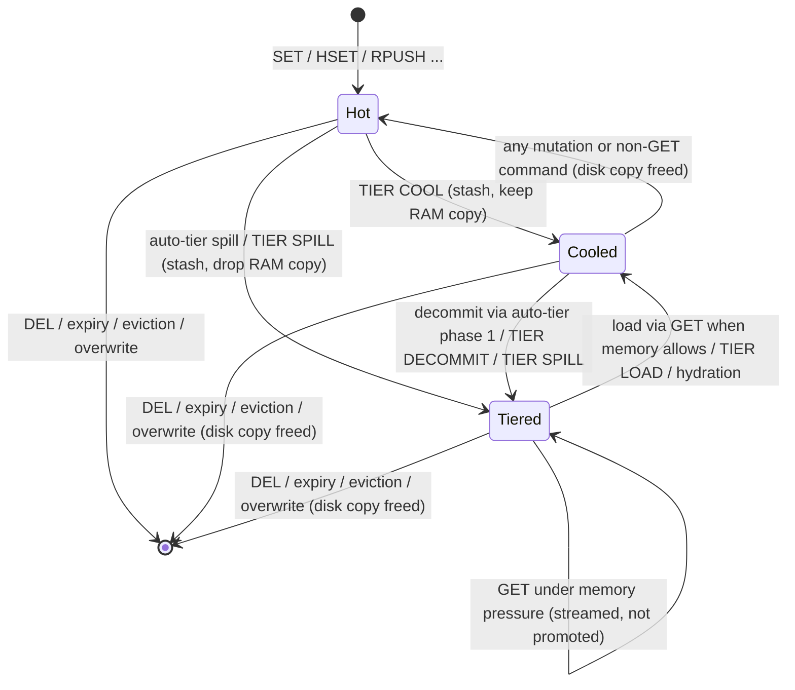
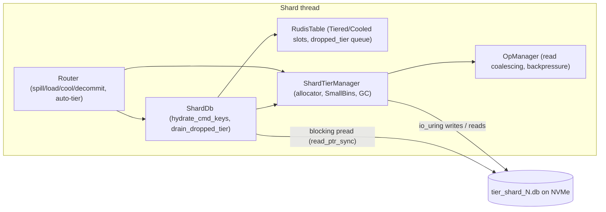

# Component 07: NVMe SSD Tiered Storage Engine

> **High-level design**: [`docs/design/07_nvme_tiering.md`](../design/07_nvme_tiering.md)
> **Consolidated implementation spec**: [`docs/internal/components.md`](components.md)
>
> **Main source**: `src/tiering.rs` (on-disk store). **Orchestration**: `src/router.rs`.
> **Value states and free-tracking**: `src/table.rs`. **Hydration, persistence, COPY/RENAME/DUMP**:
> `src/shard.rs`, `src/aof.rs`. **Lifecycle, background loops, batch cold reads**: `src/server.rs`.
> **Commands and the OOM gate**: `src/connection.rs`, `src/resp.rs`. **Config**: `src/config.rs`, `src/main.rs`.

---

## 1. What this subsystem does

Rudis keeps every key in RAM by default. When an operator sets `maxmemory` with the default
`maxmemory-policy noeviction`, Redis would start refusing writes with `-OOM` once the limit is reached.
Rudis instead moves the *values* of some keys out to a per-shard file on local disk (ideally an NVMe SSD)
and leaves a small pointer in the hash table. The key still exists, every command still works on it,
and a later read brings the value back from disk.

Who uses it:

- **The write path**, automatically: after writes, and from a 20 ms background loop, each shard checks
  whether the server is over `maxmemory` and, if so, spills values to disk until it is back under.
- **Operators**, manually, through the `TIER` command family (`TIER SPILL`, `TIER COOL`, `TIER LOAD`,
  `TIER INFO`, ...).
- **Every command that touches a key**: a spilled key is transparently read back ("hydrated") before a
  data-type command runs on it, so tiering is invisible to clients except for latency.

What it is *not*: it is not a persistence layer. The tier file is wiped at every start. RDB and AOF
always contain real values (tiered values are read back from disk while saving), never tier pointers.

> [!NOTE]
> `src/pagestore.rs` has a similar-sounding name but is unrelated: it is an in-memory packed page
> allocator used by large sets, sorted sets and hashes (`packedset.rs`, `zindex.rs`, `packedhash.rs`).
> It never touches disk.

---

## 2. Mental model

Each value in the shard's table is in one of three tiering states:

| State | `RudisValue` variant | Value in RAM? | Copy on disk? |
| :--- | :--- | :--- | :--- |
| **Hot** | any normal variant (`String`, `Int`, `Hash`, `List`, ...) | yes | no |
| **Cooled** | `Cooled(Box<CooledValue>)` | yes | yes |
| **Tiered** (a.k.a. spilled, cold) | `Tiered(Box<TieredPointer>)` | no, only a pointer | yes |

"Cooled" is a write-through cache state: the value is in RAM *and* on disk, so it can be dropped from
RAM instantly ("decommitted") without any I/O.



And the components involved in moving a value:



Everything is **per shard and single-threaded**: each shard thread owns one `ShardTierManager` and one
file, and nothing in the tier is shared across threads except the statistics block.

---

## 3. Key data structures

### 3.1 `TieredPointer` and the two tiering variants (`src/table.rs`)

```rust
pub struct TieredPointer {
    pub file_id: u32,    // the shard id (one file per shard)
    pub offset: u64,     // byte offset of the record in the tier file
    pub length: u32,     // length of the encoded record (header included)
    pub value_type: u8,  // type tag, see §3.6
}

pub enum RudisValue {
    // ... String, Int, SmallHash, Hash, List, Set, ZSet, HyperLogLog, Stream ...
    Tiered(Box<TieredPointer>),   // boxed so RudisValue stays 16 bytes
    Cooled(Box<CooledValue>),
}

pub struct CooledValue { pub ptr: TieredPointer, pub val: RudisValue }
```

`RudisValue` is asserted to be exactly 16 bytes; the tiering variants are boxed to keep it that way
(they are cold, so the extra allocation is off the hot path). For memory accounting, a `Tiered` value is
charged a flat 24 bytes and a `Cooled` value 24 bytes plus its inner value (`approx_bytes` and
`mem_bytes`).

### 3.2 `ShardTierManager` (`src/tiering.rs`)

One per shard, stored in `ShardDb::tier_manager: Option<Rc<ShardTierManager>>`. `None` means the tier
file could not be opened; that shard then runs without tiering.

| Field | Type | Meaning |
| :--- | :--- | :--- |
| `shard_id` | `usize` | Owning shard; also written into every pointer's `file_id`. |
| `port` | `u16` | Key for the shared `TieringStats` block. |
| `file` | `Rc<monoio::fs::File>` | The tier file, used for io_uring reads and writes. |
| `current_offset` | `Cell<u64>` | Append cursor: end of the highest allocated byte. Always a multiple of 4 KiB. |
| `preallocated_len` | `Cell<u64>` | How far the file has been grown with `fallocate` (64 MiB steps). |
| `path` | `PathBuf` | File path; synchronous reads reopen the file by this path. |
| `stats` | `Arc<TieringStats>` | Node-wide counters (§3.5). |
| `op_manager` | `Rc<OpManager>` | Read coalescing and write backpressure (§3.4). |
| `small_bins` | `RefCell<SmallBinsManager>` | Packing of small records into 4 KiB pages (§3.3). |
| `is_direct_io` | `bool` | Whether the file was really opened with `O_DIRECT`. |
| `free_pages` | `RefCell<Vec<u64>>` | Reusable single 4 KiB pages (page indices), used LIFO. |
| `free_extents` | `RefCell<Vec<(u64, u64)>>` | Reusable multi-page `(offset, len)` extents, searched first-fit. |

Constants:

| Constant | Value | Meaning |
| :--- | :--- | :--- |
| `TIER_MAGIC` | `b"TIER"` | First four bytes of every record. |
| `PAGE_SIZE` | 4096 | Page size for SmallBins and Direct I/O alignment. |
| `SMALL_VALUE_LIMIT` | 2048 | Encoded records shorter than this are packed into shared pages. |

### 3.3 SmallBins: packing small records

A **SmallBin** is a 4 KiB page that holds several small records back to back, so a 150-byte value
doesn't cost a whole disk block.

- `ActiveBin { page_index, buffer: Vec<u8>, items: Vec<SmallBinItem> }`: the one page currently being
  filled in RAM. `can_fit(n)` is `buffer.len() + n <= PAGE_SIZE`. `seal()` zero-pads it to 4096 bytes.
- `SmallBinItem { key, offset_in_page: u16, length: u32, value_type }`: bookkeeping for one record in
  the active bin.
- `SmallBinsManager`:

| Field | Type | Meaning |
| :--- | :--- | :--- |
| `active_bin` | `Option<ActiveBin>` | The page being filled, if any. |
| `page_active_counts` | `HashMap<u64, usize>` | Live records per page, counted from the moment each record is appended. |
| `dead_pages` | `Vec<u64>` | Pages whose live count reached 0 and are no longer in memory: waiting for GC. |
| `flushing` | `HashMap<u64, Vec<u8>>` | Sealed pages whose disk write is in flight; reads are served from here until the write lands. |

`bytes_in_memory(ptr)` returns a record's bytes if its page is still the active bin or in `flushing`.
Both the async and sync read paths check it first, so a record is readable the instant `stash_record`
returns, even before its page reaches disk.

### 3.4 `OpManager`: coalescing and backpressure

| Field | Type | Meaning |
| :--- | :--- | :--- |
| `in_flight_reads` | `RefCell<HashMap<u64, Vec<flume::Sender<Result<Rc<Vec<u8>>, String>>>>>` | Page offset -> tasks waiting for the read already in flight for that page. |
| `pending_stash_bytes` | `AtomicUsize` | Bytes of stashes currently in progress. |

`check_write_backpressure()` is true when more than **16 MiB** of stashes are in flight; `stash_record`
then fails with `io::ErrorKind::WouldBlock`. A private RAII guard, `PendingStash`, adds the record's
length when a stash starts and subtracts it when the stash ends on *any* path (success, error, or the
future being dropped), so failed writes cannot leave backpressure stuck on.

### 3.5 `TieringStats`: one statistics block per node

`TieringStats` lives in a global `HashMap<u16, Arc<TieringStats>>` keyed by the node's base port, so all
shards of one server share one block (in cluster mode every shard listens on its own port, but
`Router::set_base_port` switches every shard to the base port's block). Accessors (`with_tier_stats`,
`get_tier_stats`) cache the `Arc` in a thread-local, so the command path avoids the global lock.

It holds three groups of fields:

1. **Tiering counters** (`AtomicU64`), all reported by `TIER INFO`: `tiered_keys`, `cooled_keys`,
   `tiered_bytes`, `ram_saved_bytes`, `disk_reads`, `disk_writes`, `dead_bytes`, `gc_reclaimed_bytes`,
   `gc_cycles`, `decommit_count`, `coalesced_reads`, `bin_pages`, `total_stashes`, `total_fetches`,
   `total_deletes`, `ram_hits`, `ram_misses`, `streaming_reads`.
2. **Configuration**: `max_memory` (bytes, 0 = unlimited), `offload_threshold_pct` (default 60),
   `upload_threshold_pct` (default 80). Thresholds are clamped to 100 when set.
3. **Memory-accounting state for `maxmemory`**, owned by the router's eviction/limit logic and only
   hosted here: `shard_used` (each shard's table estimate), `shard_real` (each shard's allocator net
   bytes and reusable table slack, `ShardRealMem`), `num_shards`, `unattributed` (allocated bytes not
   charged to any shard, recalibrated against jemalloc), `snapshots_in_progress`, and
   `real_accounting`. `real_used_total()` sums these into the server-wide "used memory" that
   `maxmemory` is judged against. Up to `MAX_PUBLISHED_SHARDS` (1024) shards are tracked.

`reset_counters()` zeroes group 1 only. `reset_tier_stats(port)` calls it on the existing `Arc` rather
than replacing the map entry, because routers and thread-local caches hold clones of that `Arc`.

Related globals in `tiering.rs`: `MAXMEMORY_EPOCH` (bumped by `set_max_memory`, by
`ShardTierManager::reset` (FLUSHALL), and by `connection::set_max_memory_policy`; routers clear their
spill/evict back-offs when it changes), and `SnapshotEvictionPause`, an RAII guard that increments `snapshots_in_progress` while a
replica full-sync snapshot is built so that **eviction** pauses (spilling to the tier does not consult
it).

### 3.6 On-disk record format and value-type tags

Every stashed value becomes one self-describing record:

```
offset 0      4        5          9          13               21
       | TIER | type:1 | key_len:4 | val_len:4 | xxh3_64:8      | key bytes | value payload |
```

All integers are little-endian. The checksum is `xxhash_rust::xxh3::xxh3_64` over `key ‖ payload`
(bytes 21 onward). The payload is the value in `RudisTable::serialize_val_payload` form, whose first
byte is itself the same type tag.

| `value_type` | Variants |
| :--- | :--- |
| 0 | `String`, `Int` (an `Int` is stored as its decimal text) |
| 1 | `List` |
| 2 | `Set` |
| 3 | `ZSet` |
| 4 | `SmallHash`, `Hash` |
| 5 | `HyperLogLog` |
| 6 | `Stream` |

`RudisTable::get_value_for_spill` produces `(payload, value_type)` for a hot value and returns `None`
for a key that is already `Tiered`/`Cooled` (or missing/expired), which is what makes spilling
idempotent.

`decode_tiered_record` checks, in order: length >= 21, the magic, the type byte against the pointer's
`value_type`, the declared lengths against the buffer, and the checksum (error text
`"crc mismatch on tiered read"`). It returns `(key, payload)`. Callers ignore the returned key: the
table slot that holds the pointer is the source of truth, which is why a renamed tiered key still
reads back correctly even though its record carries the old name.

---

## 4. Algorithms

### 4.1 Opening the tier file (`ShardTierManager::open`)

At shard startup, `server.rs` picks the directory and calls `open(shard_id, port, dir)`:

1. Directory: `$RUDIS_TIER_DIR` if set, else `<dir>/rudis_tier_<port>`, where `<dir>` is the configured
   data directory (the same one RDB and AOF use; the system temp dir is avoided because it is often
   tmpfs, i.e. RAM). The file is `tier_shard_<shard_id>.db`.
2. If `RUDIS_DIRECT_IO` is set to anything other than `"0"`, try opening with `O_DIRECT`; if that fails,
   silently fall back to a buffered open (`is_direct_io = false`).
3. `claim_tier_file`: take an exclusive, non-blocking `flock` on the file. If another process holds it,
   `open` fails with `"tier file ... is in use by another server"` and the shard runs without tiering
   rather than destroying another server's live data.
4. Truncate the file to 0. Nothing from an earlier run can be referenced (RDB/AOF store values, not
   pointers), so leftovers are garbage.
5. Start with `current_offset = 0`, `preallocated_len = 0`, empty SmallBins and empty free lists.

### 4.2 Allocating disk space

- **`ensure_preallocated(needed_end)`**: if `needed_end` passes `preallocated_len`, round up to the next
  64 MiB multiple and `fallocate(fd, 0, old_len, new_len - old_len)`, i.e. allocate **only the new
  range** (allocating from offset 0 would refill every hole GC punched). If `fallocate` fails, fall
  back to `ftruncate(new_len)`, which grows the length but doesn't reserve blocks.
- **`allocate_page()`**: pop `free_pages` if non-empty; otherwise take the page at `current_offset`,
  advance it by 4096 and call `ensure_preallocated`.
- **`allocate_extent(aligned_len)`**: first-fit scan of `free_extents` for an extent at least
  `aligned_len` long; take it (via `swap_remove`) and push back any remainder
  `(offset + aligned_len, len - aligned_len)`. Otherwise append at `current_offset`.
- **`release_extent(offset, aligned_len)`**: a one-page extent goes to `free_pages`, anything longer to
  `free_extents`. Neighbouring free extents are never merged.

### 4.3 Stashing a value (`stash_record`)

1. If backpressure is on (> 16 MiB in flight), fail with `WouldBlock`.
2. Encode the record (§3.6) and start a `PendingStash` guard for its length.
3. **Small record** (`record_len < 2048`):
   1. Loop until there is an active bin that fits: if none, `allocate_page()` and install a new
      `ActiveBin`; if one exists but is too full, `flush_active_bin().await` and loop. The check is
      repeated after every `await` because another stash on the same shard may have installed and
      filled a new bin meanwhile; replacing that bin would lose its records.
   2. Append the record and increment `page_active_counts[page]` immediately.
   3. Pointer: `offset = page_index * 4096 + offset_in_page`, `length = record_len`.
   4. If fewer than 64 bytes of room remain (`!can_fit(64)`), flush the bin now.
4. **Large record** (`record_len >= 2048`):
   1. Flush any open bin first.
   2. `aligned_len = record_len` rounded up to 4096. In Direct I/O mode, zero-pad the buffer to
      `aligned_len`.
   3. `offset = allocate_extent(aligned_len)`, then write. On a write error, `release_extent` and return
      the error.
   4. Pointer: `offset`, `length = record_len` (unpadded).

**Flushing** (`flush_active_bin`): take the active bin, seal it to 4096 bytes, put a copy in `flushing`,
write the page at `page_index * 4096`, then remove it from `flushing` and call `retire_if_unused`
(if every record on the page died while it was in memory, the page goes straight to `dead_pages`). On a
write error the page counts are kept, so the page is still reclaimed when its records are deleted.

**Worked example.** The active bin is page 7 with 3,900 bytes used.

1. A 300-byte record arrives. `3900 + 300 > 4096`, so page 7 is flushed (4,096 bytes written at offset
   28,672). `free_pages` holds `[2]`, so page 2 is reused and becomes the active bin. The record lands
   at offset 0: pointer `{offset: 8192, length: 300}`. 3,796 bytes remain, so the bin stays open.
2. A 5,000-byte record arrives. Page 2 is flushed first. `aligned_len = 8192`; `free_extents` is
   empty, so the extent comes from `current_offset` (say 40,960), which advances to 49,152. Pointer
   `{offset: 40960, length: 5000}`.
3. That large key is later deleted: 8,192 bytes at 40,960 are hole-punched and `(40960, 8192)` is pushed
   onto `free_extents` for the next large record.

### 4.4 Reading a record back

**Async path** (`read_tiered_record`, used by load and streaming reads):

1. If the record fits inside one page (`offset_in_page + length <= 4096`, true for every SmallBin
   record): serve it from `bytes_in_memory` if its page is active or flushing; otherwise read the
   whole page through `OpManager::read_page_coalesced` and slice it.
2. Otherwise (large record): one `read_exact_at` of exactly `length` bytes.
3. `decode_tiered_record` against the pointer's `value_type`.

`read_page_coalesced` merges concurrent reads of the same page: the first task registers the page in
`in_flight_reads` and issues the one physical read; later tasks for that page add a `flume` channel and
wait (`coalesced_reads += 1`). When the read finishes, every waiter gets a clone of the same
`Rc<Vec<u8>>` (or the error).

**Sync path** (`read_ptr_sync`, used by hydration, RDB/AOF saves and `DUMP`): check `bytes_in_memory`
via `try_borrow` (so it never panics if an async stash holds the `RefCell`), otherwise
`read_tiered_record_sync`, which **opens the file by path** with `std::fs::File` and does a blocking
`read_exact_at` of exactly `length` bytes. This blocks the shard thread for the duration of the read.

### 4.5 Spill, cool, load, decommit, stream (`Router`, `src/router.rs`)

All of these act on the local shard; the `*_key` / `ensure_loaded` / `decommit` wrappers route to the
owning shard with `ShardMessage::TierSpill`, `TierCool`, `TierLoad`, `TierDecommit`.

**`spill_local_internal(key, flush_bin)`** (Hot -> Tiered):

1. Refuse sticky keys (`ShardDb::is_sticky`, set by the `STICK` command).
2. If the key is Cooled, just decommit it (no I/O) and return.
3. `get_value_for_spill` -> `(payload, type)`; return `false` if not spillable or no tier manager.
4. `stash_record(...).await`.
5. `set_spilled_pointer_if_unchanged(key, payload, ptr, false)`: re-serialize the key's current value
   and swap in the pointer **only if it still equals `payload`**. A write, delete or expiry that
   happened during the I/O wins; the stashed copy is then freed with `on_key_deleted(ptr)`.
6. On success: `tiered_keys += 1`, `tiered_bytes += ptr.length`, `ram_saved_bytes += payload.len()`,
   and flush the bin if `flush_bin` (the auto-tier loop passes `false` and flushes once at the end).

**`cool_local`** (Hot -> Cooled): same as spill but refuses keys that are already Tiered/Cooled, swaps
in `Cooled { ptr, val }` (keeping the RAM copy), counts `cooled_keys += 1`, and always flushes the bin.

**`load_local`** (Tiered -> Cooled): async read, `deserialize_val_payload`, then
`restore_tiered_value`, which turns the slot into `Cooled { ptr, val }` (the disk copy is kept).
Counters: `total_fetches += 1`, `tiered_keys -= 1`, `cooled_keys += 1`.

**`decommit_local(key | None)`** (Cooled -> Tiered, zero I/O): `decommit_cooled_key` or
`decommit_all_cooled` (a full table walk, skipped when `cooled_keys == 0`) drops the in-memory value
and leaves the pointer. Counters: `cooled_keys -=`, `tiered_keys +=`, `decommit_count +=`.

**`stream_cold_read_local`** (Tiered stays Tiered): async read and decode, returning the bytes only for
`String`/`Int` values (`None` for other types). Used by GET under memory pressure and by pipeline/batch
cold GETs.

### 4.6 The GET path

`Router::get_local_checked` / `get_local_direct`:

1. Look up the key in RAM. A Cooled string is answered from its in-memory copy (`ram_hits += 1`).
2. If the slot is `Tiered` (`ShardDb::get_checked` turns the table's type error for a tiered slot into
   "not in RAM"), call `read_cold_key_local`:
   - If `is_memory_constrained()` — server-wide allocator usage (`real_used_total`) is at least
     `max_memory / 100 * offload_threshold_pct` — **stream** it (`streaming_reads += 1`,
     `ram_misses += 1`); the key stays Tiered.
   - Otherwise `load_local` (key becomes Cooled) and answer from RAM.

Cross-shard single GETs (`ShardMessage::FastGet`) do the same via a spawned task on the owning shard.
`ShardMessage::StreamColdRead` (stream one key on its owning shard) has a handler in `server.rs`, but
nothing currently sends it.

Pipelines take a different route: in a squashed pipeline (`execute_commands_squashed_inner`) or a
cross-shard `ShardMessage::Batch`, local GET/MGET items on tiered keys are collected into a
`cold_gets` list instead of being awaited inline, and then read with `stream_cold_read_local` (never
promoted):

- In `execute_commands_squashed_inner`, the cold reads run after the local commands are executed and
  after the remote per-shard batches have been dispatched and awaited (`flush_remote_batches`).
- In the `Batch` handler (`server.rs`), if any cold GETs were collected, filling those reply slots and
  calling `responder.finish(items)` moves into a `monoio::spawn`ed task, so the shard's message loop
  keeps serving other messages while the disk reads run.

### 4.7 Hydration: making tiered keys answer every command (`ShardDb`, `src/shard.rs`)

The data-type commands only understand in-memory values. Before a command runs,
`ShardDb::hydrate_cmd_keys(cmd)` is called from `execute_local_command`, from the squashed pipeline,
and from the `Batch` handler:

1. Return immediately if there is no tier manager or if `tiered_keys == 0 && cooled_keys == 0`
   (node-wide counters, so this is a cheap, conservative check).
2. Skip `GET`, `MGET` (they stream), and `DEL`, `UNLINK`, `EXISTS`, `TYPE` (they don't need the value).
3. For every key of the command (`connection::for_each_cmd_key`), `hydrate_key_unchecked`:
   - If Tiered: `hydrate_tiered(ptr)` (a **synchronous** `read_ptr_sync` + decode; the payload's leading
     type byte must match `ptr.value_type` and decoding must consume the whole payload), then
     `restore_tiered_value` -> Cooled.
   - Then `RudisTable::warm_key`: if Cooled, turn it into the plain Hot value and queue its disk pointer
     in `dropped_tier` (the disk copy is now stale).
4. `drain_dropped_tier()` frees the queued pointers.

Single-key fast paths (`incr_by`, `incr_by_slice`, `incr_by_slice_fast`) call `hydrate_key(key)` the
same way. Mutations that find a Cooled entry through `find_entry_mut_warm` / `get_slot_mut_warm` /
`warm_slot` also warm it in place (`RudisEntry::uncool`) and queue its pointer.

Net effect: **any non-GET command on a spilled or cooled key brings it fully back to RAM, regardless of
memory pressure**, and drops its disk copy. It may then be spilled again by auto-tiering.

### 4.8 Freeing disk space when a key goes away

`RudisTable::dropped_tier: SmallVec<[(TieredPointer, bool /* was cooled */); 4]>` is a queue of disk
pointers whose keys no longer need them. The table pushes onto it whenever a `Tiered`/`Cooled` value is
replaced or removed: SET-style overwrites (`set_extended_with_hash`), `del_with_hash`, expiry
(`expire_slot`), eviction (`try_evict_one_key_with`), `incr_by_slice_internal`, RENAME onto an existing
key, `flushdb`, and warming (above).

`ShardDb::drain_dropped_tier()` hands each entry to `ShardTierManager::on_key_overwritten(ptr, is_cooled)`,
which decrements `cooled_keys` or `tiered_keys`, bumps `total_deletes`, and calls `on_key_deleted(ptr)`:

- **Small record** (`ptr.length < 2048`): `dead_bytes += length`; `decrement_page_key(page)`; when the
  page's live count hits 0 and the page is neither the active bin nor flushing, it moves to
  `dead_pages` (`dead_bytes += 4096`). Other live records on the page keep it alive.
- **Large record**: `dead_bytes += aligned_len`, punch the hole immediately, `release_extent`.

`drain_dropped_tier` runs after `ShardDb::set`/`set_extended`/`del`/`del_with_hash`/`flushdb`,
hydration, the incr helpers, `execute_local_command`, the squashed pipeline, and the `Batch` handler.
`ShardDb::copy` and `ShardDb::rename` additionally free an overwritten destination's pointer
explicitly with `on_key_overwritten` (see §6 for a caveat on RENAME).

`COPY` never duplicates a pointer: copying a Tiered key hydrates the value for the copy; copying a
Cooled key copies its in-memory value. Two keys never share a disk extent, so no extent is freed twice.

### 4.9 Garbage collection (`run_gc`)

Every 2 seconds (`server.rs` background task -> `Router::gc_local`) and on `TIER GC`:

1. Take all `dead_pages`.
2. For each, `punch_hole(offset, 4096)` and push the page onto `free_pages`.
3. `gc_cycles += 1` if any page was reclaimed. Return `pages * 4096`.

`punch_hole` calls `fallocate(FALLOC_FL_PUNCH_HOLE | FALLOC_FL_KEEP_SIZE)`: the filesystem releases the
physical blocks, the logical file length stays the same, and `gc_reclaimed_bytes` grows by the
length on success. Large records skip GC entirely: they are punched and freed the moment they die.

### 4.10 Automatic tiering under `maxmemory`

Auto-tiering only runs when `maxmemory > 0` **and** `maxmemory-policy` is `noeviction` (the default).
With any evicting policy, the limit is enforced by evicting keys before commands instead, and
`check_auto_tier_local` just reports whether the server is under the limit.

"Over the limit" (`Router::over_maxmemory` = `publish_memory_state`) is judged server-wide by the
allocator's count (`TieringStats::real_used_total`), not per shard.

**Triggers:**

- **After writes**: `check_auto_tier_after_write` (called after local writes, write batches and
  pipelines) -> `start_auto_tier_if_over`: publish this shard's usage; if over and not already
  tiering, `decommit_local(None)` synchronously; if nothing was decommitted or it's still over, spawn
  `check_auto_tier_local`.
- **20 ms cron**: a per-shard background task calls `check_auto_tier_local`.
- **OOM gate** (`connection.rs`, before a write command under `noeviction`): if
  `over_maxmemory_checked()` (re-reads other shards' usage when the cached view says "over"), run
  `check_auto_tier()` (local, then other shards) and reject with `-OOM` only if still over.

**`check_auto_tier_local` steps:**

1. Return if `max_memory == 0` or the policy isn't `noeviction`. Clear stale back-offs if
   `MAXMEMORY_EPOCH` changed. If over, refresh other shards' published usage (rate-limited to once per
   ms).
2. If another task on this shard is already tiering (`is_auto_tiering`), wait up to 100 × 1 ms for it to
   bring the server under. Return if still busy, already under, or there's no tier manager.
3. Set `is_auto_tiering` (cleared by a drop guard however the function ends).
4. **Phase 1 – decommit**: `decommit_local(None)`. Return if that was enough.
5. **Back-off check**: if the last pass freed nothing and set `spill_backoff_until` (1 s), and the local
   table estimate hasn't grown by `regrowth = max(max_mem / 1024, 1024)` bytes since, return.
6. **Phase 2 – spill**: compute
   - `target_total = max_mem - max(max_mem / 20, 128 KiB)` (5 % headroom, at least 128 KiB);
   - `excess = real_used_total - target_total`;
   - `target_mem = (local table used_memory at start) - excess`.

   Progress is measured with the table's own estimate (`table.used_memory()`), because spilled bytes
   linger in the tier write buffers and the allocator count lags. Loop: fetch up to 64 keys from
   `get_hot_keys_for_spill(64)` and `spill_local_internal(key, false)` each, until the estimate is at or
   below `target_mem`, no candidates are left, or `MAX_SPILL_ATTEMPTS_PER_CALL` (1024) keys have been
   tried (the cron resumes later).
7. If the candidates ran out or the estimate didn't drop, set a 1 s back-off.
8. `flush_active_bin()` once, clear the flag, return whether the server is under the limit.

**`check_auto_tier`** (OOM gate only): run the local pass; if still over and there are multiple shards,
send `ShardMessage::TierAutoSpill` to each other shard in turn (each runs its own local pass and replies
with its table usage) until the server is under. A fan-out that ends over the limit sets a 1 s
`remote_spill_backoff`, lifted early if the server-wide total grows by `regrowth`.

**Choosing victims** (`RudisTable::get_hot_keys_for_spill(limit)`): a persistent round-robin
`spill_cursor` over the table's slots (`cursor_bound` / `cursor_to_global_idx`, which work across the
segmented, directory-based table layout). It skips Tiered/Cooled entries and values whose `approx_bytes`
is below `MIN_SPILL_VALUE_BYTES` (64), since spilling them would *grow* memory (the 24-byte pointer
outweighs them). Each call scans at most `min(total_slots, max(limit * 64, 4096))` slots. There is no
LRU/LFU ranking: victims are whatever the cursor reaches next.

**Worked example.** `maxmemory 1gb`, 4 shards, allocator usage 1,044 MiB. `target_total = 1024 -
51.2 = 972.8 MiB`, so `excess ≈ 71 MiB`. The shard whose write tipped the server over has a table
estimate of 300 MiB, so its `target_mem ≈ 229 MiB`. It first decommits all its Cooled keys; if still
over, it spills 64-key slices of values ≥ 64 bytes until its estimate drops by ~71 MiB, or 1,024 keys
have been tried. Note that the triggering shard tries to absorb the *whole* server's excess locally;
other shards are only asked (via `TierAutoSpill`) from the OOM gate.

### 4.11 Persistence, DUMP and migration

- **RDB** (`ShardDb::save_rdb_chunk` -> `save_rdb_entry_with`): a `Tiered` value is hydrated with
  `read_ptr_sync` and written in normal Redis encoding; a `Cooled` value is written from its RAM copy.
  If a tiered value can't be read or decoded, the save fails as a whole with `TieredReadError { key }`
  (logged), so a snapshot missing that key is never renamed into place.
- **AOF rewrite** (`aof.rs`): same hydration; an unreadable value fails the rewrite.
- **`DUMP`** (`ShardDb::dump`): a tiered key is hydrated and dumped without promoting it, so `MIGRATE`
  and cluster slot migration (`migrate_keys_to_node`, DUMP + `RESTORE`) work even when the source is
  over `maxmemory`.
- **FLUSHALL** (`ShardDb::flushall`): clears `dropped_tier` (no per-key frees) and calls
  `ShardTierManager::reset()`: clear SmallBins, `flushing` and free lists, set `current_offset` and
  `preallocated_len` to 0, `ftruncate(0)`, reset the node-wide counters, bump `MAXMEMORY_EPOCH`.
  `reset` does not wait for writes already in flight on that shard.
- **FLUSHDB** (`ShardDb::flushdb`): the table queues every Tiered/Cooled pointer in `dropped_tier` and
  they are freed one by one; the file is not truncated.

### 4.12 Snapshots (`TIER SNAPSHOT <dir>`)

`ShardTierManager::snapshot(backup_dir)`: flush the active bin, `sync_all`, create the directory, then
`snapshot_file(src, dst)`:

1. `ioctl(FICLONE = 0x40049409)`: an instant copy-on-write reflink (btrfs, reflink-enabled XFS).
2. On failure: `std::io::copy`, which on Linux uses `copy_file_range` (then `sendfile`, then
   read/write).

It then writes `tier_shard_<id>.manifest` with `version:1`, `shard_id`, `file_size`, `is_reflink`,
`current_offset`. `Router::tier_snapshot_all` runs this on every shard and aggregates
`(all_reflink, total_bytes, shard_count)`.

---

## 5. Commands and configuration

### 5.1 `TIER` (parsed in `resp.rs` into `TierSubcommand`, executed in `connection.rs`)

| Subcommand | What it does | Reply |
| :--- | :--- | :--- |
| `TIER SPILL <key>` | `Router::spill_key`: Hot -> Tiered, or Cooled -> Tiered by decommit. No `MIN_SPILL_VALUE_BYTES` filter. | `:1` / `:0` |
| `TIER COOL <key>` | `Router::cool_key`: Hot -> Cooled. | `:1` / `:0` |
| `TIER LOAD <key>` (alias `PROMOTE`) | `Router::ensure_loaded`: Tiered -> Cooled. Returns `:0` without doing anything when `is_memory_constrained()`. | `:1` / `:0` |
| `TIER DECOMMIT [key]` | `Router::decommit`: one key, or every Cooled key on every shard. | `:<count>` |
| `TIER SPILLALL` | Every shard runs `Router::spill_all`: `spill_local` on every key from `table.keys(b"*")`. | `:<count>` |
| `TIER GC` | `Router::gc_all`: `run_gc` on every shard. | `:<bytes reclaimed>` |
| `TIER SNAPSHOT <dir>` (alias `BACKUP`) | `Router::tier_snapshot_all` (§4.12). | `+OK snapshot created in <ms>ms, shards:<n>, bytes:<n>, reflink:<bool>` or `-ERR snapshot failed: ...` |
| `TIER INFO` | Bulk string headed `# Tiered Storage (io_uring NVMe)`: `tier_enabled:1`, `maxmemory`, `maxmemory_human`, `used_memory`, `used_memory_human` (server-wide allocator count after every shard republishes), then all 18 counters and both thresholds. | bulk string |

An unknown subcommand returns an error listing the valid ones.

### 5.2 Configuration

| Setting | Where | Effect |
| :--- | :--- | :--- |
| `maxmemory` | config file / CLI / `CONFIG SET` | Enables auto-tiering (with `noeviction`). 0 disables it. |
| `maxmemory-policy` | same | Auto-tiering only under `noeviction` (default). |
| `tiered-offload-threshold` | config file, `--tiered-offload-threshold`, `CONFIG SET/GET` | `offload_threshold_pct` (default 60): GETs stream instead of promoting at or above this % of `maxmemory`; `TIER LOAD` refuses. |
| `tiered-upload-threshold` | same | `upload_threshold_pct` (default 80): stored and reported, **not read by any logic**. |
| `RUDIS_TIER_DIR` | environment | Overrides the tier directory. |
| `RUDIS_DIRECT_IO` | environment | Anything but `"0"` attempts `O_DIRECT`. |

---

## 6. Invariants & gotchas

- **One pointer, one owner.** A disk extent is referenced by exactly one table slot. COPY hydrates
  rather than sharing; every removal path queues the pointer in `dropped_tier` exactly once. Breaking
  this frees an extent twice, after which two future records can be allocated on the same bytes.
- **RENAME onto an existing tiered/cooled key may free the old destination twice.** `RudisTable::rename`
  queues the removed destination's pointer in `dropped_tier`, and `ShardDb::rename` *also* calls
  `on_key_overwritten` for it. `ShardDb::rename` doesn't drain the queue itself, so the second free
  happens on the next drain. Treat this as a likely bug (see open questions); the unit test
  `test_rename_and_copy_of_tiered_and_cooled_keys` does not cover RENAME over a tiered destination.
- **Spill commits are conditional.** A stash's pointer is installed only if the key's serialized value is
  unchanged after the I/O (`set_spilled_pointer_if_unchanged`); otherwise the new record is freed.
- **Records are readable before they hit disk.** Readers check the active bin and `flushing` first;
  pages in memory are never retired to `dead_pages` until their write completes.
- **Page live counts start at append**, not at flush, so records deleted while their page is still in
  RAM are counted, and the page is retired when its flush finishes.
- **Every `await` can interleave.** The shard is single-threaded but async; stash, flush and read paths
  re-check state after each `await`. The unit tests make every tier write yield once (`write_all_at`
  under `cfg(test)`, `run_during_first_wait`) to exercise these interleavings deterministically.
- **Cooled is not permanent.** GET keeps a key Cooled, but any other command (or mutation) warms it to
  Hot and frees the disk copy.
- **Hydration is synchronous and ignores memory pressure.** A non-GET command on a spilled key does a
  blocking `pread` on the shard thread and brings the value fully into RAM even when the server is over
  `maxmemory` (auto-tiering may spill it again afterwards).
- **Counters are node-wide and approximate.** `tiered_keys`/`cooled_keys` are shared by all shards
  (gates using them are conservative). `dead_bytes` counts a small record's bytes *and* later its whole
  page. `ram_saved_bytes` is decremented by payload length on `load_local` but by record length on
  hydration.
- **The tier file does not outlive the process.** It is truncated on open and on FLUSHALL. The flock
  stops two servers sharing one file.
- **Free lists are in-memory only.** `ensure_preallocated` grows the file in 64 MiB steps (without
  `KEEP_SIZE`, so the logical length jumps); holes are reused only through `free_pages` /
  `free_extents`.

---

## 7. Limitations / not implemented

- **`upload_threshold_pct` does nothing.** Its comment describes a "stream without promotion" gate, but
  the only gate (`is_memory_constrained`) reads `offload_threshold_pct`.
- **Pipelined GET of a spilled key may answer WRONGTYPE.** `RudisTable::get_compact_with_hash` returns
  the WRONGTYPE error for any non-string variant, including `Tiered`. The squashed-pipeline and `Batch`
  GET paths expect `Ok(None)` before queuing a cold read, so for a `Tiered` slot they appear to reach
  the error branch instead; the squashed MGET path appears to answer nil. Single GETs (which go through
  `ShardDb::get_checked`) handle it correctly. Not covered by an e2e test that pipelines GETs on spilled
  keys (see open questions).
- **Streaming only covers strings.** `stream_cold_read_local` returns `None` for non-string values.
- **Victim selection is round-robin**, not LRU/LFU; hot keys can be spilled.
- **The triggering shard absorbs the whole excess** in its local pass; other shards are only asked to
  spill from the OOM gate's `check_auto_tier`, not from the write-path or cron triggers.
- **Free-extent management is simple.** First-fit, no coalescing of adjacent free extents, extents are
  never returned to `current_offset`, and the file never shrinks (except via FLUSHALL).
- **Direct I/O is best-effort.** Buffers are plain `Vec<u8>` with no guaranteed 4 KiB address
  alignment, and large-record reads request exactly `ptr.length` bytes (not a multiple of 4096). Both
  can make `O_DIRECT` reads/writes fail with `EINVAL`, depending on the filesystem and on how `monoio`
  handles buffers. Default (unset `RUDIS_DIRECT_IO`) is buffered I/O.
- **Synchronous reads reopen the file** (`std::fs::File::open(path)`) on every `read_ptr_sync` miss.
- **Snapshots are write-only.** Nothing reads the manifest or restores a snapshot, and a restored file
  would be truncated by `open` anyway; the tier file is meaningless without the in-memory pointers.
- **`TIER INFO` always prints `tier_enabled:1`**, even on shards whose tier file failed to open.
- **No per-shard disk quota**; the tier grows until the filesystem is full, and write errors just make
  spills fail.

---

## 8. Code map

| File | Key symbols | What they do |
| :--- | :--- | :--- |
| `src/tiering.rs` | `ShardTierManager` (`open`, `stash_record`, `flush_active_bin`, `allocate_page`, `allocate_extent`, `release_extent`, `ensure_preallocated`, `on_key_deleted`, `on_key_overwritten`, `run_gc`, `punch_hole`, `read_ptr_sync`, `reset`, `snapshot`, `snapshot_file`), `claim_tier_file` | Per-shard tier file: allocation, packing, writes, frees, GC, reset, snapshots. |
| `src/tiering.rs` | `SmallBinsManager`, `ActiveBin`, `SmallBinItem` | 4 KiB page packing of small records and page liveness tracking. |
| `src/tiering.rs` | `OpManager` (`read_page_coalesced`, `check_write_backpressure`), `PendingStash` | Read coalescing and 16 MiB write backpressure. |
| `src/tiering.rs` | `encode_tiered_record`, `decode_tiered_record`, `read_tiered_record`, `read_tiered_record_sync` | Record format, checksums, async/sync reads. |
| `src/tiering.rs` | `TieringStats`, `ShardRealMem`, `get_tier_stats`, `with_tier_stats`, `reset_tier_stats`, `set_max_memory`, `set_offload_threshold_pct`, `set_upload_threshold_pct`, `MAXMEMORY_EPOCH`, `SnapshotEvictionPause`, `parse_memory_bytes`, `format_bytes_human` | Node-wide stats/config block and memory-limit plumbing. |
| `src/table.rs` | `TieredPointer`, `RudisValue::Tiered`/`Cooled`, `CooledValue`, `RudisEntry::uncool` | Value representation. |
| `src/table.rs` | `RudisTable::{get_value_for_spill, set_spilled_pointer_if_unchanged, set_tiered_pointer, set_cooled_pointer, restore_tiered_value, decommit_cooled_key, decommit_all_cooled, is_tiered, is_cooled, warm_key, warm_slot, find_entry_mut_warm, get_slot_mut_warm, get_hot_keys_for_spill, copy_with_hydrated}`, `dropped_tier`, `MIN_SPILL_VALUE_BYTES` | State transitions, victim selection, and the queue of pointers to free. |
| `src/router.rs` | `Router::{spill_local, spill_local_internal, cool_local, load_local, decommit_local, stream_cold_read_local, read_cold_key_local, get_local_direct, get_local_checked, is_memory_constrained}` | Per-key tier operations and the GET cold path. |
| `src/router.rs` | `Router::{check_auto_tier, check_auto_tier_local, check_auto_tier_after_write, start_auto_tier_if_over, over_maxmemory, over_maxmemory_checked, refresh_published_usage, publish_memory_state}`, `MAX_SPILL_ATTEMPTS_PER_CALL` | Automatic tiering and the server-wide limit check. |
| `src/router.rs` | `Router::{spill_key, cool_key, ensure_loaded, decommit, spill_all, gc_local, gc_all, snapshot_local, tier_snapshot_all}` | Cross-shard wrappers behind `TIER`. |
| `src/shard.rs` | `ShardDb::{tier_manager, hydrate_cmd_keys, hydrate_key, hydrate_tiered, drain_dropped_tier, copy, rename, dump, flushdb, flushall, save_rdb_chunk}`, `TieredReadError`, `ShardMessage::{TierSpill, TierLoad, TierCool, TierDecommit, TierSpillAll, TierAutoSpill, TierGc, TierSnapshot, StreamColdRead}` | Hydration, freeing, persistence, and the tier messages. |
| `src/server.rs` | tier directory selection and `ShardTierManager::open` at shard start; 20 ms auto-tier and 2 s GC loops; `Batch`/`FastGet` cold-read handling; `Tier*` message handlers | Lifecycle and background work. |
| `src/connection.rs` | `Command::Tier` handler, noeviction OOM gate, `execute_local_command`, `execute_commands_squashed_inner` (`local_cold_gets`), `migrate_keys_to_node` | Command surface and pipeline cold reads. |
| `src/aof.rs` | AOF rewrite hydration of `Tiered` values | Rewrite never writes pointers. |
| `src/resp.rs`, `src/config.rs`, `src/main.rs` | `TierSubcommand`, `tiered-offload-threshold`, `tiered-upload-threshold` | Parsing and configuration. |
| `tests/e2e_memory.rs` | `test_nvme_tiered_storage_e2e`, `test_auto_tiering_memory_pressure_e2e`, `test_tiered_storage_gc_and_hole_punching_e2e`, `test_tier_file_lives_under_dir_is_reset_at_startup_and_not_shared_e2e`, `test_tiered_cooling_mutation_and_extent_reclamation_e2e`, `test_tiered_keys_answer_every_command_e2e`, `test_unreadable_tiered_value_fails_saves_and_keeps_old_files_e2e`, `test_dump_of_tiered_key_over_maxmemory_is_restorable_e2e` | End-to-end coverage. |
| `src/tiering.rs` tests | `test_concurrent_small_stashes_keep_every_record`, `test_record_readable_while_its_bin_is_written`, `test_page_reclaimed_when_items_die_before_their_bin_is_written`, `test_overwritten_large_value_is_punched`, `test_growing_the_file_keeps_punched_holes`, `test_free_extent_and_page_reuse`, `test_open_discards_stale_data_and_refuses_a_file_in_use` | Allocator and race unit tests. |
