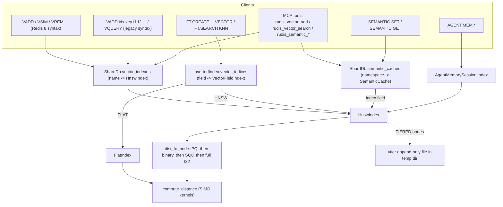

# Component 08: Vector Search Engine — HNSW, Quantization, Vector Sets, Tiering & Semantic Cache

> **High-level design**: [`docs/design/08_vector_engine.md`](../design/08_vector_engine.md)
> **Consolidated implementation spec**: [`components.md`](components.md)
> **Related**: [09 RediSearch](09_redisearch.md) (FT `VECTOR` fields), [20 Agent memory](20_agent_memory.md), [21 MCP server](21_mcp_server.md), [14 Persistence](14_persistence_replication.md), [07 NVMe tiering](07_nvme_tiering.md)

---

## 1. What this subsystem does

Rudis can store **embeddings**: fixed-length arrays of `f32` numbers that ML models produce for text, images and so on. It can then answer **nearest-neighbour** queries such as "which stored vectors are most similar to this one?". Four kinds of user rely on this:

| User | Entry point | Storage owner |
| :--- | :--- | :--- |
| Redis 8 **Vector Sets** clients (`VADD`, `VSIM`, `VREM`, `VEMB`, …) and the older rudis `VADD`/`VQUERY` syntax | `src/resp.rs` → `src/connection.rs` → `ShardDb::vadd_ext` / `vsim_ext` | `ShardDb.vector_indexes: HashMap<String, HnswIndex>` |
| RediSearch `FT.CREATE … VECTOR FLAT\|HNSW` fields (KNN and `VECTOR_RANGE` queries) | `src/search.rs` (`build_vector_index`) | `InvertedIndex.vector_indices: HashMap<String, VectorFieldIndex>` |
| LLM **semantic cache** (`SEMANTIC.SET/GET/DEL/FLUSH/INFO`): "has a prompt *like this one* been answered before?" | `ShardDb::semantic_*` | `ShardDb.semantic_caches: HashMap<Bytes, SemanticCache>` |
| Agent episodic memory (`AGENT.MEM.*`) | `src/agent.rs` | `AgentMemorySession.index: Option<HnswIndex>` |

All four use **the same two index types**, which live in `src/vector.rs`:

- **`HnswIndex`**: an approximate nearest-neighbour graph. **HNSW** stands for *Hierarchical Navigable Small World*. Queries are fast (roughly logarithmic in the number of vectors), but results are approximate.
- **`FlatIndex`**: an exact brute-force scan. It is used only for FT `FLAT` fields.

`src/vector.rs` also contains:

- the SIMD distance kernels (AVX-512 / AVX2+FMA / portable);
- three compression schemes: SQ8, 1-bit binary and product quantization;
- an optional on-disk "`.vtier`" spill file for full-precision vectors;
- the `VSIM … FILTER` expression language;
- the `SemanticCache` type.

There is no separate `VectorSet` value type and no `RudisValue` variant. A Redis 8 vector set is simply an `HnswIndex` whose `is_redis_vset` flag is `true`.

---

## 2. Mental model



Each consumer owns separate instances with its own parameters. Changing a default for vector sets does not affect FT indexes or semantic caches.

Two concepts appear throughout the doc:

- **Distance, not similarity.** Every metric is converted to a *distance*, where smaller means closer. Commands that report a *similarity score* convert the distance back afterwards (§10).
- **Representation priority.** A graph node can carry several encodings of its vector at once (full `f32`, SQ8, binary, PQ). During graph traversal, `dist_to_node` always uses the most compressed encoding the node has. An optional **rerank** pass then recomputes exact distances for the final candidates.

---

## 3. Limits and constants

The constants at the top of `src/vector.rs` bound every size a client can choose. The parsers in `src/resp.rs` and `src/search.rs` enforce them.

| Constant | Value | Enforced where |
| :--- | :--- | :--- |
| `MAX_VECTOR_DIM` | `1 << 16` (65,536) | Redis 8 `VADD` (error `invalid vector specification`), `FT.CREATE`/`FT.ALTER … DIM` |
| `MAX_HNSW_M` | 4096 | `VADD … M` (error `invalid M`), FT `M`; `HnswIndex::with_params` also clamps `m` to `[2, MAX_HNSW_M]` |
| `MAX_VSET_EF` | 1,000,000 | `VADD … EF` and `VSIM … EF` (error `invalid EF`) |
| `MAX_PROJECTION_ENTRIES` | `1 << 24` (64 MiB of `f32`) | `VADD … REDUCE`: input dim × reduced dim must not exceed it |
| `FLAT_INITIAL_RESERVE_FLOATS` (private) | `1 << 24` | Caps how many floats `FlatIndex::new` preallocates for `INITIAL_CAP` |

`VRANDMEMBER` counts are parsed by `parse_random_count` in `resp.rs`. A negative count whose magnitude exceeds `MAX_RANDOM_REPEATS` (`1 << 20`) is rejected with `value is out of range`.

---

## 4. Data structures

### 4.1 `VectorMetric`

```rust
pub enum VectorMetric { #[default] Cosine, L2, IP }
```

`FromStr` is case-insensitive and accepts `COSINE`, `L2`/`EUCLIDEAN`, and `IP`/`DOT`/`INNERPRODUCT`. `as_str` returns `COSINE`/`L2`/`IP`. `compute_distance(a, b, metric)` maps each metric to a distance:

| Metric | Distance | Range |
| :--- | :--- | :--- |
| `L2` | `sqrt(l2_distance_sq(a, b))` (true Euclidean, not squared) | `[0, ∞)` |
| `IP` | `-dot_product(a, b)` (negated, so a larger dot product gives a smaller distance) | `(-∞, ∞)` |
| `Cosine` | `cosine_distance(a, b) = max(0, 1 − a·b / (‖a‖‖b‖))`; defined as `1.0` if either vector has zero norm | `[0, 2]` |

### 4.2 `HnswNode`: one stored vector

| Field | Type | Meaning |
| :--- | :--- | :--- |
| `id` | `usize` | Slot index in `HnswIndex.nodes` |
| `key` | `Bytes` | Element name (vector-set element, FT document vector key, semantic-cache id, agent turn id) |
| `vector` | `Vec<f32>` | Full-precision vector. It is **emptied** (`Vec::new()`) once the node is spilled to the `.vtier` file. |
| `quantized` | `Option<QuantizedVector>` | SQ8 encoding (§6.1) |
| `binary` | `Option<Vec<u64>>` | 1-bit sign encoding, `dim.div_ceil(64)` words (§6.2) |
| `pq` | `Option<PQVector>` | Product-quantization codes, one byte per subspace (§6.3) |
| `is_tiered` | `bool` | Inserted with `TIERED` |
| `tier_offset` | `Option<u64>` | Byte offset of this vector inside `tier_path` |
| `neighbors` | `Vec<Vec<usize>>` | `neighbors[layer]` is the adjacency list at that layer. Its length minus one is the node's top layer. |

### 4.3 `HnswIndex`: the graph

```rust
pub struct HnswIndex {
    pub name: String, pub dim: usize, pub metric: VectorMetric,
    pub m: usize, pub m0: usize,            // max degree above layer 0 / at layer 0
    pub ef_construction: usize, pub ef_search: usize,
    pub ml: f64,                            // level multiplier = 1 / ln(m)
    pub entry_point: Option<usize>, pub max_layer: usize,
    pub nodes: Vec<Option<HnswNode>>,       // None = freed slot
    pub free_ids: Vec<usize>,               // freed slots, reused LIFO
    pub key_to_id: HashMap<Bytes, usize>,
    pub pq_quantizer: Option<ProductQuantizer>, pub pq_trained: bool,
    pub quant: VQuant,                      // vector-set mode: NoQuant | Q8 | Bin
    pub attributes: HashMap<Bytes, String>, // per-element JSON (VSETATTR / FILTER)
    pub projection: Option<Vec<f32>>, pub input_dim: usize, // VADD ... REDUCE
    pub uid: u64, pub is_redis_vset: bool,
    pub tier_path: Option<PathBuf>, pub tiered_bytes: u64,
    rng_state: u64,                         // private xorshift64 state
}
```

Construction:

- **`HnswIndex::new(name, dim, metric)`** sets `m = 16`, `m0 = 32`, `ef_construction = 64`, `ef_search = 32`, `ml = 1/ln(16) ≈ 0.361`, `quant = NoQuant`, and seeds `rng_state` with the fixed constant `0x853c49e6748fea9b`. Level assignment is therefore deterministic for a fresh index. `uid` comes from the process-global atomic counter `NEXT_VSET_UID`, which starts at 1. Every `HnswIndex` takes a uid, including FT, semantic and agent indexes.
- **`HnswIndex::with_params(name, dim, metric, m, ef_construction, ef_runtime)`** is used by FT `HNSW` fields. It clamps `m` to `[2, MAX_HNSW_M]`, always sets `m0 = 2·m` and recomputes `ml`. It also applies `ef_construction.max(1)` and `ef_search = ef_runtime.max(1)`. There is no independent `M0` setting.
- **`ShardDb::vadd_ext`** builds Redis 8 vector sets with `new` and then overrides some fields (§9.2).

`VQuant` (`NoQuant`, the default, / `Q8` / `Bin`) is the vector-set quantization mode. `VQuant::as_str` returns `"f32"`, `"int8"` or `"bin"` for `VINFO quant-type`.

### 4.4 Heap helpers: `Candidate` and `FurthestCandidate`

Both are private `{ id, distance }` structs. They exist only to get opposite orderings out of `BinaryHeap`, which is a max-heap:

- `Candidate`'s `Ord` is reversed, so `BinaryHeap<Candidate>` pops the **nearest** element first. Searches use it for the frontier of nodes still to expand.
- `FurthestCandidate`'s `Ord` is natural, so `BinaryHeap<FurthestCandidate>` pops the **farthest** element first. Searches use it as the bounded "best `ef` found so far" set `W`, which keeps the worst member on top where it is cheap to evict.

### 4.5 `FlatIndex`: exact search with structure-of-arrays storage

| Field | Type | Meaning |
| :--- | :--- | :--- |
| `name`, `dim`, `metric` | | as above |
| `keys` | `Vec<Bytes>` (private) | Row `i`'s key |
| `data` | `Vec<f32>` (private) | All rows stored contiguously, `keys.len() × dim` floats |
| `key_to_pos` | `HashMap<Bytes, usize>` (private) | key → row |

How it works:

- **`new`** preallocates `min(initial_cap, 1<<20, FLAT_INITIAL_RESERVE_FLOATS / dim)` rows. A client-chosen `INITIAL_CAP` therefore cannot force a huge allocation, and the index still grows on demand.
- **`add`** rejects a wrong dimension (`vector dimension mismatch`). It overwrites an existing key's row in place, or appends a new row.
- **`remove`** is a swap-remove: the last row is copied into the hole and `key_to_pos` is patched. Nothing is tombstoned.
- **`search_filtered(query, k, filter)`** scans every row with `compute_distance` and keeps a size-`k` `FurthestCandidate` heap, so cost is O(N·dim + N log k). It returns an empty result for `k == 0` or a wrong query dimension.
- **`range_filtered(query, radius, filter)`** returns every row with distance ≤ `radius`, sorted by distance.
- **`memory_usage`** returns `data.len()·4 + Σ(key.len() + 32)`.

### 4.6 `VectorFieldIndex`: the FT wrapper

```rust
pub enum VectorFieldIndex { Flat(FlatIndex), Hnsw(HnswIndex) }
```

Every method (`metric`, `dim`, `len`, `algorithm` → `"FLAT"`/`"HNSW"`, `add`, `remove`, `get_vector`, `search`, `search_filtered`, `range_filtered`, `memory_usage`) is a two-arm forwarder. The HNSW arm of `search_filtered` always passes `rerank = false`. The HNSW arm of `memory_usage` sums, for each node, `vector.len()·4 + key.len() + Σ(layer.len()·8 + 24) + 64`. It ignores quantized payloads (§13).

### 4.7 `SemanticCache` and its entries

```rust
pub struct SemanticEntry { id, prompt, response: Bytes, scope: Option<Bytes>,
                           expire_at: Option<Instant>, tokens: u64 }
pub struct SemanticHit   { id, prompt, response: Bytes, score: f32 }
pub struct SemanticCache {
    pub namespace: String,
    pub index: HnswIndex,                       // always VectorMetric::Cosine
    pub entries: HashMap<Bytes, SemanticEntry>, // keyed by the same id as the graph
    pub hits: u64, pub misses: u64, pub tokens_saved: u64, pub evicted_expired: u64,
}
```

One namespace corresponds to one private HNSW graph plus a metadata map. §11 describes the algorithms.

---

## 5. Distance kernels and SIMD dispatch

`dot_product`, `l2_distance_sq` and `cosine_distance` each choose an implementation **at runtime** on every call, using `is_x86_feature_detected!`. The binary contains all three tiers:

1. **AVX-512F** (`*_avx512`). `dot_product`/`l2` use two `__m512` accumulators and handle 32 lanes per loop iteration via `_mm512_fmadd_ps`. An optional 16-lane step and a scalar tail follow. Cosine computes `dot`, `‖a‖²` and `‖b‖²` in one pass with three accumulators at 16 lanes per iteration. The horizontal sum `hsum512_ps` uses `_mm512_reduce_add_ps`, which is AVX-512F only, so no AVX-512DQ instruction is needed.
2. **AVX2 + FMA** (`*_avx2`). This tier requires both features. It uses two `__m256` accumulators at 16 lanes per iteration (cosine: three accumulators, 8 lanes), reduced by `hsum256_ps`.
3. **Portable** (`*_portable`, safe code). It uses `as_chunks::<8>()` manual unrolling plus a scalar remainder. Non-x86 targets such as ARM always use this tier. There is no NEON kernel.

All kernels read `min(a.len(), b.len())` elements, so mismatched lengths cannot read out of bounds. Every `unsafe` block carries a `SAFETY` comment explaining the feature check and the bounds.

Two further AVX2+FMA kernels compute **asymmetric** distances between an `f32` query and SQ8 `u8` data without first dequantizing the data:

- `dot_f32_u8_avx2` widens 8 bytes to `f32` (`_mm256_cvtepu8_epi32` + `_mm256_cvtepi32_ps`) and accumulates with FMA.
- `l2_f32_u8_avx2` also fuses the dequantization into one FMA: `b = q·scale + min_val`.

Both fall back to scalar loops. There is no AVX-512 version of either.

Binary (Hamming) distance has no SIMD path. It uses `u64::count_ones` (hardware POPCNT) once per word.

---

## 6. Quantization (vector compression)

### 6.1 SQ8: 8-bit scalar quantization (`QuantizedVector`)

```rust
pub struct QuantizedVector { pub min_val: f32, pub scale: f32, pub sum_q: f32, pub sum_q_sq: f32, pub data: Vec<u8> }
```

**Encoding** (`QuantizedVector::quantize`):

1. Find `min_val` and `max_val`. Set `scale = (max − min) / 255`, or `1.0` if the vector is constant.
2. Encode each component as `q = round((x − min_val) / scale)`, clamped to `0..=255`.
3. Precompute `sum_q = Σq` and `sum_q_sq = Σq²`.

*Worked example*: `[-1.0, 0.0, 0.5, 1.0]` gives `min = -1` and `scale = 2/255 ≈ 0.00784`. The codes are `[0, 128, 191, 255]` (0.0 maps to 127.5, which rounds to 128). Then `sum_q = 574` and `sum_q_sq = 117,890`. Storage is 1 byte per dimension plus a 16-byte header, about a 75% saving compared with `f32`.

**Distance** (`QuantizedVector::compute_distance(query, metric)`) works directly on the codes and never builds a dequantized vector:

- `IP`: `dot = min_val·Σquery + scale·Σ(query_i·q_i)`, distance `= −dot`.
- `L2`: `sqrt(Σ(query_i − (min_val + q_i·scale))²)`.
- `Cosine`: uses the same `dot`. It gets `‖b‖² = dim·min² + 2·min·scale·sum_q + scale²·sum_q_sq` from the precomputed sums and `‖a‖²` from `dot_product(query, query)`. The result is `max(0, 1 − dot/(‖a‖‖b‖))`, or `1.0` if either norm is zero.

`dequantize()` rebuilds `min_val + q·scale` per component. It is used for `VEMB`, and as a fallback when a tiered vector cannot be read back from disk.

### 6.2 Binary: 1-bit sign quantization

`quantize_binary(v)` sets bit `i` (word `i/64`, bit `i%64`) iff `v[i] > 0.0`. A value of exactly `0.0` encodes as 0. `binary_hamming_cosine_distance(a, b, dim)` returns `2 · popcount(a XOR b) / dim`, which lies in `[0, 2]` like cosine distance (0 when `dim == 0`).

*Worked example*: `[0.3, -0.2, 0.0, 0.9]` encodes as `0b1001`, and `[0.1, 0.4, -0.5, 0.2]` encodes as `0b1011`. Their XOR, `0b0010`, has 1 bit set, so the distance is `2·1/4 = 0.5`. A 128-dim vector takes 16 bytes instead of 512.

Binary distance is always Hamming, **whatever the index metric is**.

### 6.3 PQ: product quantization with asymmetric distance computation (ADC)

```rust
pub struct ProductQuantizer { pub dim: usize, pub m: usize, pub d_sub: usize, pub codebooks: Vec<Vec<Vec<f32>>> }
pub struct PQVector { pub codes: Vec<u8> }
```

The vector is split into `m` **subspaces** of `d_sub = max(1, dim/m)` dimensions each. Each subspace has a **codebook** of exactly 256 **centroids** (representative sub-vectors), and each sub-vector is stored as the one-byte index of its nearest centroid. With `dim = 128` and `m = 16`, 512 bytes compress to 16 bytes.

- **`ProductQuantizer::new(dim, m)`** builds a deterministic, untrained codebook for each subspace:
  - centroid 0 is the zero vector;
  - centroids `1..=d_sub` are the `+1` unit basis vectors;
  - centroids `d_sub+1..=2·d_sub` are the `−1` unit basis vectors;
  - the remaining centroids come from a SplitMix-style hash of `(code, subspace, component)`, mapped into `[-1, 1]`.
- **`encode(v)`**: for each subspace, linearly scans all 256 centroids for the smallest squared L2 distance and stores the winner's index.
- **ADC**: `compute_distance_table(query)` precomputes an `m × 256` table of squared distances from each query sub-vector to each centroid. `compute_distance_adc(table, pq)` then sums `table[s][codes[s]]`, which costs O(m) per candidate. `compute_distance_with_vec` builds a fresh table and looks up a single vector. **`dist_to_node` calls it once per candidate, so the table is rebuilt for every node visited.**
- **`reconstruct(pq)`** concatenates the chosen centroids and truncates the result to `dim`. **`distortion(samples)`** returns the mean squared reconstruction error. Only the tests use these two.
- **`ProductQuantizer::train(dim, m, samples, max_iters)`** runs per subspace. It skips any sample whose slice is shorter than `d_sub`.
  1. **Furthest-first seeding** (a deterministic k-means++ variant). Centroid 0 is the first sample. Each following centroid, up to `k_active = clamp(samples.len(), 1, 256)`, is the sample farthest from all centroids chosen so far. A running `min_sq_dist` array tracks this. Seeding stops early if the farthest remaining sample is within `1e-12` of a chosen centroid, which happens with duplicate data.
  2. **Lloyd iterations** (`max(max_iters, 1)` rounds). Each round assigns every sample to its nearest active centroid, then moves each centroid to the mean of its samples. The loop stops early when no assignment changes. Centroids beyond the active count keep their deterministic seed values.

**PQ inside `HnswIndex`.** In `add_quantized_ext` with `quantize_pq = true`:

1. If no quantizer exists yet, an untrained `ProductQuantizer::new(dim, (dim/8).clamp(1, 16))` is installed.
2. If the quantizer has never been trained and the index already holds at least **15** elements, it trains once with `max_iters = 10`. The samples are every current node's full vector plus the new one. Afterwards, every node that already has `pq` codes is re-encoded.
3. The new vector is encoded with the current quantizer.

`enable_pq(m)` and `train_pq(max_iters)` do the same thing explicitly. Only tests call them. Both re-encode **only nodes that already have `pq` codes** (§13).

---

## 7. HNSW algorithms

### 7.1 Layer assignment

`random_level()` draws `r` from the private xorshift64 generator (`x ^= x<<13; x ^= x>>7; x ^= x<<17`), floored at `1e-15`. It returns `floor(−ln(r)·ml)`, capped at **16**. Most nodes therefore live only on layer 0, and each higher layer holds roughly `1/m` of the nodes below it.

### 7.2 Insertion: `add_quantized_ext(key, vector, quantize_sq8, quantize_pq, tiered)`

`add(key, v)` is `add_quantized(key, v, false, false)`, and `add_quantized(key, v, q, tiered)` is `add_quantized_ext(key, v, q, false, tiered)`.

1. Reject `vector.len() != dim` with `"vector dimension mismatch"`.
2. If `key` already exists, call `remove(&key)` first. An update is a full delete followed by a reinsert.
3. Draw `target_level`. Take the slot `free_ids.pop()`, or `nodes.len()` if there is no free slot.
4. Build the compressed encodings:
   - SQ8 if `quantize_sq8 || quant == Q8 || (tiered && !quantize_pq)`;
   - binary if `quant == Bin`;
   - PQ if `quantize_pq` (§6.3).

   The full `vector` is **always kept in RAM**, unless the node is tiered (step 9).
5. **Empty graph**: the node becomes `entry_point`, `max_layer = target_level`, and insertion is done (after the spill, if tiered).
6. **Greedy descent**: start from `entry_point` and, for each layer from `max_layer` down to `target_level + 1`, repeatedly move to any neighbour closer to the new vector until no neighbour improves.
7. **Link**: store the node. Then for each layer from `min(target_level, max_layer)` down to 0:
   1. run `search_layer(vector, curr, ef_construction, layer)`;
   2. choose up to `m0` neighbours (layer 0) or `m` neighbours (above layer 0) with `select_neighbors_heuristic` (§7.3);
   3. set the new node's adjacency list, and add the new node to each neighbour's list;
   4. if a neighbour now exceeds its maximum degree, call `prune_neighbors` on it immediately;
   5. use the closest chosen neighbour as the entry point for the next layer down.
8. If `target_level > max_layer`, the new node becomes `entry_point` and `max_layer` rises.
9. If `tiered`, call `spill_node_to_tier` (§8).

### 7.3 Neighbour selection: diversity heuristic

`select_neighbors_heuristic(candidates, m_max)` implements Algorithm 4 of Malkov & Yashunin with `keepPrunedConnections = true`. The candidates arrive sorted by ascending distance to the base point.

1. If there are at most `m_max` candidates, keep them all.
2. Otherwise go through them in order. Accept a candidate only if it is at least as close to the base point as it is to every neighbour already accepted: `cand.distance <= dist(selected, cand)`. Put rejected candidates on a `pruned` list.
3. Fill any remaining slots from `pruned`, nearest first.

This spreads edges across different directions instead of linking a node to `m` near-duplicates, while still keeping the degree up. `prune_neighbors(node, layer, max)` re-sorts a node's current neighbours by distance and runs the same heuristic. Insertion uses this one function for all re-pruning.

### 7.4 Search

**`search_layer(query, entry, ef, layer)`** is a bounded best-first search:

1. Allocate a new `HashSet` of visited nodes. It is not reused across calls.
2. Seed both the frontier (`Candidate` heap) and `W` (`FurthestCandidate` heap, at most `ef` entries) with the entry node.
3. Pop the nearest frontier node. Stop if it is farther than `W`'s worst member and `W` already holds `ef` entries.
4. For each unvisited neighbour at `layer`, compute its distance. If it beats `W`'s worst member, or `W` is not full, push it onto both heaps and trim `W` back to `ef`.
5. Return `W` sorted by ascending distance.

**`search_layer_filtered(query, entry, ef, filter)`** does the same at layer 0 only. Nodes rejected by `filter` are still **traversed**: they go onto the frontier so the graph stays navigable. Only accepted nodes enter `W`.

**`search_filtered(query, k, ef_runtime, rerank, filter)`** is the main top-k entry point. `search(q, k)`, `search_tiered(q, k, rerank)` and `search_ext(q, k, ef, rerank)` all call it.

1. Return empty if the graph is empty or `k == 0`.
2. Run a greedy descent through layers `max_layer..=1`.
3. Search layer 0 with beam width `search_ef = max(ef_runtime.unwrap_or(ef_search), 1)`, raised to at least `3·k` if `rerank` and to at least `k` otherwise (multiplication saturates). Use `search_layer_filtered` when a filter is present.
4. With `rerank`, recompute **every** beam candidate's distance with `compute_distance(query, node_vector_cow(node))`, using full precision and reading from disk for tiered nodes. Sort, then truncate to `k`. Without `rerank`, return the first `k` beam entries with whatever distance traversal produced.

**`search_exact(query, k, filter)`** (`VSIM … TRUTH`) scores every live node with `dist_to_node`, so compressed encodings are still used, then sorts and truncates.

**`range_filtered(query, radius, epsilon, filter)`** (FT `VECTOR_RANGE`) works as follows:

1. Return empty for an empty graph, a wrong query dimension, or `radius < 0`.
2. Run the same greedy descent through layers `max_layer..=1`.
3. Seed a queue from `search_layer(query, curr, max(ef_search, 32), 0)`, so the search reaches the query's neighbourhood even when the entry point is far outside the radius.
4. Expand layer-0 neighbours whose distance is ≤ `radius·(1 + epsilon)` (`epsilon` defaults to `0.01`). Emit only nodes with distance ≤ `radius` that pass the filter. Sort by distance.

### 7.5 Distance dispatch: `dist_to_node(query, node)`

```rust
if node.pq.is_some() && self.pq_quantizer.is_some() { /* PQ ADC (table rebuilt per call) */ }
else if node.binary.is_some()                       { /* quantize_binary(query) then Hamming */ }
else if node.quantized.is_some()                    { /* SQ8 asymmetric */ }
else                                                { /* compute_distance(query, node_vector_cow(node)) */ }
```

The first available encoding always wins. For example, a node with both SQ8 and PQ codes is always compared with PQ.

### 7.6 Deletion: `remove(key)`

1. Remove `key` from `key_to_id`, set `nodes[id] = None`, and push `id` onto `free_ids`. The `nodes` vector never shrinks.
2. For each layer where the deleted node had neighbours:
   1. Remove `id` from every former neighbour's list at that layer.
   2. **Repair**: for each former neighbour `u` that is now below the layer's maximum degree, compute its distance to each *other* former neighbour `v` that it is not already linked to. Sort those, then append the nearest until `u` is full again. The deleted node's neighbourhood is stitched back together locally.
3. If the deleted node was `entry_point`, or the index is now empty, scan all live nodes (O(N)). Promote the one with the largest `neighbors.len() − 1` to `entry_point`/`max_layer`. If no nodes remain, `entry_point` becomes `None`.

*Example*: suppose B is linked at layer 0 to A, C and D, A is linked only to B, and `m0 = 32`. Deleting B removes B from the lists of A, C and D. A now has no links, is below `m0`, and gets C and D appended, nearest first. C and D are topped up the same way. Slot B's id is reused by the next insert.

### 7.7 Other `HnswIndex` helpers

| Method | Behaviour |
| :--- | :--- |
| `set_projection(input_dim)` | Builds a deterministic Gaussian random-projection matrix (`dim × input_dim`, row-major). It uses Box–Muller over a xorshift stream seeded from both dimensions, and scales entries by `1/sqrt(dim)`. Sets `input_dim`. |
| `project(v)` | Multiplies `v` by the matrix if a projection exists and `v.len() == input_dim`. Otherwise returns `v` unchanged. |
| `client_dim()` | `input_dim` for projected sets, otherwise `dim` (`VDIM` reports this) |
| `stored_vector(key)` | `VEMB`: the SQ8-dequantized vector for `Q8` sets, `±1.0` per bit for `Bin` sets, otherwise the full vector |
| `raw_embedding(key)` | `VEMB … RAW`, see §10 |
| `links(key)` | `VLINKS`: neighbour lists from layer 0 up to the node's top layer, each neighbour scored as `clamp(1 − d/2, 0, 1)` using the full-precision distance |
| `random_members(count)` | `VRANDMEMBER`. Sorts all keys for a deterministic starting order. A positive count runs a partial Fisher–Yates shuffle, giving distinct keys, at most `len`. A negative count makes `|count|` independent draws, so duplicates are possible. Both use the index's RNG. |
| `max_node_uid()` | `nodes.len()` (`VINFO hnsw-max-node-uid`) |
| `get_vector(key)` | Borrows the in-RAM `vector`. **Returns an empty slice for tiered nodes.** |
| `get_vector_cow(key)` | Like `get_vector`, but reads tiered vectors back from disk |

---

## 8. NVMe `.vtier` spilling (`TIERED`)

`TIERED` keeps the full-precision vector on disk and only the SQ8 encoding in RAM. The graph is traversed using SQ8 distances, and a rerank reads the exact vectors back from disk.

1. On insertion, `tiered && !quantize_pq` forces an SQ8 encoding (§7.2 step 4).
2. **`spill_node_to_tier(node_id, full_vector)`**:
   1. On first use, set `tier_path` to `{temp_dir}/rudis-vtier-{pid}-{uid}.bin`.
   2. Open the file with `create + append`. The file is reopened on every call; no handle is cached.
   3. Record the current file length as `tier_offset`.
   4. Append the vector as little-endian `f32`s and add the byte count to `tiered_bytes`.
   5. Set `node.vector = Vec::new()`.

   If any I/O step fails, the vector simply stays in RAM.
3. **`node_vector_cow(node)`** reads the vector back:
   1. Borrow `node.vector` if it is non-empty.
   2. Otherwise, if the node is tiered, open the file (again, a fresh `File::open`) and `read_exact_at` (a positional `pread`, no seek or lock) `dim·4` bytes at `tier_offset`.
   3. If that fails, use `quantized.dequantize()`.
   4. As a last resort, return an all-zero vector.

*Example*: two 4-dim vectors inserted with `TIERED` leave both `node.vector`s empty and `tiered_bytes == 32`. `search_tiered(q, 2, true)` reranks from disk and returns an exact distance of 0 for an identical query.

This file has nothing to do with the key-value tiering machinery in [07 NVMe tiering](07_nvme_tiering.md). It is append-only, never compacted and never deleted (§13).

---

## 9. Redis 8 Vector Sets: command flow

### 9.1 Parsing (`src/resp.rs`)

`VADD` chooses its grammar from the third argument:

- **Redis 8 form**, used when argument 3 is `REDUCE`, `FP32` or `VALUES`:
  `VADD key [REDUCE dim] (FP32 blob | VALUES n v1..vn) element [CAS] [TIERED] [NOQUANT|Q8|BIN] [EF n] [SETATTR json] [M n]`
  - `FP32` requires a non-empty blob whose length is a multiple of 4. `FP32` and `VALUES` both reject NaN and Inf.
  - `REDUCE` must be > 0 and ≤ the input dimension, and input × reduced must be ≤ `MAX_PROJECTION_ENTRIES`.
  - `M` must be in `[2, 4096]`. `EF` must be ≤ 1,000,000 and is floored to 1.
  - `SETATTR` must be empty or valid JSON.
  - Any unknown token is a `syntax error`.
  - The parsed command has `metric: None`, `quantize = (quant is None or Q8)` and `is_redis_vset: true`.
- **Legacy form**: `VADD index element tok…`. Each token is either a metric name, `QUANTIZE`/`SQ8`, `PQ`, `TIERED`, or a float. This form does not reject non-finite values. Its reply is `+OK` instead of an integer.

The other vector-set commands parse as follows:

- `VQUERY index k f1..fn [RERANK]` (legacy) calls `vquery` → `project` + `search_tiered`. The reply alternates elements and distances (`{:.6}`).
- `VSIM key (ELE e | FP32 blob | VALUES n …) [WITHSCORES] [WITHATTRIBS] [COUNT n] [EPSILON e] [EF n] [FILTER expr] [FILTER-EF n] [TRUTH] [NOTHREAD]`:
  - `COUNT` defaults to 10 and must be > 0.
  - `EPSILON` must be in `[0, 1]`.
  - `FILTER` is syntax-checked at parse time with `validate_vset_filter`.
  - `FILTER-EF` is floored to 1 and has no upper bound.
- `VSIM key k1 k2 [metric]`: if argument 3 is not `ELE`/`FP32`/`VALUES`, the command becomes `Command::Vdist` and returns the raw **distance** between two stored elements (`{:.6}`).

### 9.2 Execution (`ShardDb::vadd_ext`)

Vector commands are single-key commands. They are routed to the shard that owns the key, like other keyed commands. `vadd_ext` then:

1. Returns `WRONGTYPE` if a normal key with the same name exists in the main table, and errors on an empty vector.
2. **Creates the index on first use**:
   - `HnswIndex::new(name, reduce.unwrap_or(len), metric.unwrap_or(Cosine))`.
   - For Redis 8 syntax it also sets `is_redis_vset = true` and `quant = quant.unwrap_or(Q8)`.
   - `M` sets `m`, `m0 = 2m` and `ml`.
   - `EF` sets `ef_construction`. `ef_search` stays at 32.
   - `REDUCE` calls `set_projection(len)`.
3. **On an existing vector set**, rejects:
   - a different `quant` (`Quantization type mismatch`);
   - `REDUCE` on an unprojected set, or with a different dimension (`Projection dimension mismatch`);
   - a wrong client dimension (`vector dimension mismatch`).

   `EF` updates `ef_construction`.
4. Calls `project(vector)`, then `add_quantized_ext(element, projected, quantize || quant == Q8, pq, tiered)`.
5. Applies `SETATTR`: an empty or whitespace-only value removes the attribute.
6. Returns `true` if the element is new. The connection replies `:1`/`:0` for Redis 8 syntax, then records the change for AOF/replication and sends client-tracking invalidations for both the key and the element.

`CAS` is parsed and carried in the command, but the executor ignores it (`cas: _`).

### 9.3 `VSIM` execution (`ShardDb::vsim_ext`)

1. Check `WRONGTYPE`. A missing set returns an empty array.
2. Build the query:
   - `ELE` uses the stored full-precision vector (already projected) and errors with `Element not found` if absent;
   - `FP32`/`VALUES` must match `client_dim()` and are then projected.
3. Build the filter closure: `eval_vset_filter(expr, attributes.get(elem))`, where any evaluation error counts as "reject".
4. Set `rerank = (quant == NoQuant)`.
5. Choose the search path:
   - `TRUTH` → `search_exact(query, count, filter)`.
   - `FILTER` → `search_filtered(query, count, FILTER-EF or EF or max(count·10, 64), rerank, filter)`. If this returns fewer than `count` hits, **fall back to `search_exact`**.
   - Otherwise → `search_ext(query, count, EF, rerank)`.
6. Convert each distance to `score = clamp(1 − dist/2, 0, 1)`. With `EPSILON e`, drop hits whose score is below `1 − e`.
7. `connection.rs` writes one of four reply shapes:
   - plain array of elements;
   - `WITHSCORES`: RESP3 map / RESP2 flat pairs;
   - `WITHATTRIBS`: map / pairs, with null for a missing attribute;
   - both: RESP3 map to a 2-element array / RESP2 flat triples.

   `NOTHREAD` is parsed and then ignored.

*Worked example*: take a `Q8` set `movies` with 10k elements and run `VSIM movies VALUES 3 0.1 0.2 0.3 COUNT 3 FILTER '.year > 2000' WITHSCORES`.

1. The query has dimension 3, which matches `client_dim()`.
2. `rerank` is false, because the set is `Q8`.
3. Layer 0 runs `search_layer_filtered` with `ef = max(30, 64) = 64`. Elements whose JSON lacks `year`, or has `year ≤ 2000`, are traversed but not collected.
4. Distances are SQ8 cosine distances. A distance of 0.2 becomes a score of 0.9.
5. If fewer than 3 matches were reachable, the shard scans all 10k exactly.

### 9.4 Other vector-set commands

| Command | Behaviour |
| :--- | :--- |
| `VREM` / `VDEL key elem` | `WRONGTYPE` check. Removes the attribute and the node. **If the set becomes empty, the whole index is dropped** from `vector_indexes`. Replies `:1`/`:0`. |
| `VCARD key` | Element count, 0 if missing |
| `VDIM key` | `client_dim()`, error `key does not exist` if missing |
| `VINFO key` | Vector sets reply with a 9-pair map (RESP3) or 18-element array: `quant-type`, `hnsw-m`, `vector-dim`, `projection-input-dim`, `size`, `max-level`, `attributes-count`, `vset-uid`, `hnsw-max-node-uid`. Legacy indexes reply `num_elements`, `dimension`, `metric`, `max_layer`. Missing key: null. |
| `VEMB key elem [RAW]` | Without `RAW`: `stored_vector` as an array of doubles. With `RAW`: `raw_embedding`, see §10. |
| `VLINKS key elem [WITHSCORES]` | One array per layer (layer 0 first). With scores: map/pairs per layer. |
| `VRANDMEMBER key [count]` | No count: one bulk string or null. With count: array (empty if missing). |
| `VSETATTR key elem json` | `:1` if the element exists (empty JSON clears), `:0` otherwise |
| `VGETATTR key elem` | The JSON string, or null |
| `VISMEMBER key elem` | Membership check |

**Keyspace integration** (`src/shard.rs`):

- `DEL` (`ShardDb::del` / `del_with_hash`) falls through to `vector_indexes.remove(name)` when the main table has no such key.
- `EXISTS` sees non-empty vector sets.
- `TYPE` returns `"vectorset"`.
- The `INFO` keyspace count for db 0 includes `vector_indexes.len()`.
- `FLUSHDB` clears vector sets and semantic caches only when the current db is 0. `FLUSHALL` always clears them.

### 9.5 The `VSIM … FILTER` expression language

`FilterParser` is a recursive-descent parser that evaluates the expression **while parsing**. Every call to `eval_vset_filter` re-parses the expression string against one element's JSON. `validate_vset_filter` runs the same parser with no JSON (all fields evaluate to null) and also rejects trailing tokens.

Precedence, lowest first:

| Level | Operators |
| :--- | :--- |
| or | `\|\|`, `or` |
| and | `&&`, `and` |
| not | `!` (but not `!=`), `not` |
| comparison (left-assoc, chainable) | `==` `!=` `<` `<=` `>` `>=` `in` |
| additive | `+` `-` |
| multiplicative | `*` `/` `%` |
| power (right-assoc) | `^`, `**` |
| unary | `-` `+` |
| primary | `( expr )`, tuple `(a, b, …)`, list `[a, b, …]`, string `'…'`/`"…"`, field `.a.b` (characters: alphanumeric, `_`, `-`), number, `true`, `false`, `null`/`nil` |

Values are `FilterVal::{Null, Bool, Num(f64), Str, List}`. JSON objects become `Null`. The rules:

- **Truthiness**: false, 0, NaN, `""`, `[]` and null are falsy.
- **Arithmetic** works on numbers and booleans (true = 1). Anything else, and division or modulo by zero, gives `Null`.
- **Equality**: numbers are equal within `1e-9`; a number equals a bool if `(n != 0) == b`; lists compare element-wise.
- **Ordering** (`<`, `>`, …) is defined only for number vs number and string vs string. Other comparisons are false.
- **`in`** is list membership (`x in [1,2]`) or substring (`"ab" in .name`).
- An element **with no attributes, or with unparseable JSON, never matches**.

*Example*: `.genre in ["drama","comedy"] and (.year >= 2000 or .rating > 8.5)`.

---

## 10. Scores, `VEMB RAW`, and the score formulas

| Path | Formula | Correct for |
| :--- | :--- | :--- |
| `VSIM` scores and `EPSILON` (`vsim_ext`), `VLINKS` (`HnswIndex::links`) | `clamp(1 − dist/2, 0, 1)` | Cosine and binary distances (range `[0, 2]`) |
| `SEMANTIC.GET` (`SemanticCache::get`) | `clamp(1 − dist, 0, 1)` | Cosine similarity |
| `VSIM k1 k2` (`Vdist`), `VQUERY` | raw distance | any metric |

`raw_embedding(key)` returns `(type, blob, norm, range)`, where `norm = max(‖full vector‖, 1e-12)`:

- `Q8` sets: `("q8", codes, norm, Some(scale·255))`. The SQ8 encoding is computed on the fly if missing.
- `Bin` sets: `("bin", first dim.div_ceil(8) bytes of the little-endian words, norm, None)`.
- `NoQuant` sets: `("fp32", little-endian bytes of v/norm, norm, None)`. This is the **normalized** vector.

The reply has 4 elements when the range is present, otherwise 3.

---

## 11. Semantic cache (`SEMANTIC.*`)

**What it is for**: before calling an LLM, a client embeds the prompt and asks `SEMANTIC.GET`. If a cached prompt has cosine similarity ≥ threshold, the cached response is returned and the LLM call is skipped. Token savings are tracked.

Parsing (`resp.rs`):

- `SEMANTIC.SET ns id prompt response VECTOR (dim f1..fdim | blob) [EX s | PX ms] [SCOPE s] [QUANTIZE|SQ8] [TOKENS n]`. A zero `EX`/`PX` is rejected. If the token after `VECTOR` is not an integer, it is decoded as an FP32 blob via `search::decode_vector`.
- `SEMANTIC.GET ns VECTOR … [THRESHOLD t] [SCOPE s] [WITHSCORE|WITHSCORES] [WITHPROMPT] [WITHID]`. `t` must be in `[0, 1]` and defaults to `0.90`.
- `SEMANTIC.DEL ns id [id …]`, `SEMANTIC.FLUSH ns`, `SEMANTIC.INFO ns`.

Algorithms (`SemanticCache`, `src/vector.rs`):

1. **`purge_expired`** runs at the start of `set` and `get`, and in `ShardDb::semantic_info`. It removes every entry with `now >= expire_at` from both the map and the graph, and increments `evicted_expired` for each one. There is no background expiry.
2. **`set`**:
   1. Reject an empty vector.
   2. Purge expired entries.
   3. If the cache is empty and the dimension differs, rebuild the graph at the new dimension. Otherwise a dimension mismatch is an error.
   4. Estimate tokens as `TOKENS`, or `ceil(response.len()/4)` with a minimum of 1.
   5. Insert with `index.add_quantized(id, v, quantize, false)`, then store the entry.
3. **`get(query, threshold, scope)`**:
   1. Purge expired entries.
   2. If the cache is empty, count a miss and return none.
   3. Error on a dimension mismatch.
   4. Run `search_filtered(query, k = 4, None, rerank = true, filter)`, where the filter accepts only ids that are in `entries` and, if a scope was given, whose scope matches exactly.
   5. Take the best hit. If `1 − dist ≥ threshold`, count a hit and add the entry's tokens to `tokens_saved`. Otherwise count a miss.
4. **`del`** removes the id from the map and the graph. **`flush`** clears entries and builds a fresh graph at the same dimension. Counters are kept.

*Worked example*: `SEMANTIC.SET faq q1 "reset pw?" "Use reset link" VECTOR 3 0.1 0.9 0.2 EX 60 SCOPE en` stores the entry, with tokens = ceil(14/4) = 4. A later `SEMANTIC.GET faq VECTOR 3 0.12 0.88 0.21 SCOPE en WITHSCORE` finds `q1` at cosine distance ≈ 0.0004. Similarity ≈ 0.9996 ≥ 0.90, so the reply is `["Use reset link", "0.999596"]` (approximately), `hits` becomes 1 and `tokens_saved` becomes 4.

Replies (`connection.rs`):

- `SET` → `+OK`.
- `GET` → the bare response string, or an array of response plus whichever of score (`{:.6}`), prompt and id were requested; a miss is a null bulk string.
- `DEL` → the number removed.
- `INFO` → 9 pairs: `namespace`, `entries`, `dimension`, `metric` (always `COSINE`), `hits`, `misses`, `hit_rate` (`{:.4}`), `tokens_saved`, `evicted_expired`.

---

## 12. Persistence and other consumers

- **Snapshot (RDB-style)**. `ShardDb::save_ext_item` (`ExtKind::Vector`) writes one record of type **9** per element:
  - key `vec:{index}:{element}`, then the index name and element;
  - a metric byte (`Cosine`=0, `L2`=1, `IP`=2) with bit `0x80` set to mark that extension fields follow;
  - the full vector, read back from disk if tiered, as `f32` bits;
  - a flags byte (`0x01` vector set, `0x02` has SQ8, `0x04` has PQ, `0x08` tiered);
  - a quant byte (0/1/2), `m` as `u32`, and the attribute JSON.

  On load, `table.rs` replays each record through `ShardDb::vadd_ext`, or through `vadd` for old records without bit `0x80`, on the owning shard. Semantic caches are written as type **15** records: dimension, the four counters, then each entry with an absolute Unix-ms expiry. On load they are replayed through `semantic_set`; expired entries are skipped and counted in `evicted_expired`.
- **AOF rewrite** (`src/aof.rs`) emits one `VADD` per element and one `SEMANTIC.SET` per live entry, with the TTL recomputed as the time remaining. Through `command_to_resp`, vector sets are written in Redis 8 form (`FP32` blob, quant, `SETATTR`, `M`) and legacy indexes in legacy form (floats, metric, `QUANTIZE`/`PQ`/`TIERED`).
- **RediSearch** ([09](09_redisearch.md)). `build_vector_index` creates `Flat(FlatIndex::new(…, INITIAL_CAP))` for `FLAT` and `Hnsw(HnswIndex::with_params(…, M, EF_CONSTRUCTION, EF_RUNTIME))` for anything else. The defaults come from `VectorFieldAttrs`: `M = 16`, `EF_CONSTRUCTION = 200`, `EF_RUNTIME = 10`, `INITIAL_CAP = 1024`. KNN with a pre-filter uses brute force when the filtered set is small or the field is `FLAT`. Otherwise it calls `search_filtered`, and falls back to brute force if too few results come back. `VECTOR_RANGE` calls `range_filtered`.
- **Agent memory** ([20](20_agent_memory.md)). Each session lazily creates `HnswIndex::new(session_id, dim, Cosine)` on the first turn that has an embedding, and adds turns with `add`.
- **MCP** ([21](21_mcp_server.md)). `rudis_vector_add` builds a Redis 8 `VADD` (default `Q8`, optional `attr`). `rudis_vector_search` builds a `VSIM` with `count` (default 5), optional `filter` and `with_scores` (default true). `rudis_semantic_set` and `rudis_semantic_get` map to the semantic cache.
- **Benchmark**. `src/bin/vector_bench.rs` measures ingestion, QPS, latency percentiles, memory and recall@k for float32, SQ8 and tiered indexes, using `search_tiered` with and without rerank.

---

## 13. Invariants & gotchas

- **One implementation, many owners.** Vector sets, FT fields, semantic caches and agent sessions are independent `HnswIndex`/`FlatIndex` instances with different defaults: `ef_construction` is 64 for `new` and 200 for FT; `ef_search` is 32 for `new` and 10 for FT.
- **Encoding priority** is PQ, then binary, then SQ8, then full precision (§7.5). Check which `Option` fields are `Some` before assuming which distance a node uses.
- **Rerank applies only to `NoQuant` vector sets.** `vsim_ext` sets `rerank = (quant == NoQuant)`, so:
  - **`Q8`/`BIN` sets never get an exact rerank**, even though their full `f32` vectors are still in RAM. Their results and scores come from SQ8 or Hamming distances.
  - For non-tiered `NoQuant` sets the rerank recomputes distances that are already exact. It only matters for `NoQuant` + `TIERED`, where traversal uses the SQ8 encoding that tiering forces.
- **`Q8`/`BIN` do not save RAM by themselves.** `add_quantized_ext` always keeps `node.vector`. Only `TIERED` drops it.
- **The `1 − d/2` score assumes a distance in `[0, 2]`.** Redis 8 sets are always Cosine (the parser passes `metric: None`), so this holds for them. Legacy indexes created with `L2`/`IP` and then queried through `VSIM` get meaningless clamped scores.
- **`get_vector` returns an empty slice for tiered nodes.** Use `get_vector_cow` or `node_vector_cow`. `VectorFieldIndex::get_vector` forwards to `get_vector`, but FT indexes never use tiering.
- **The graph only grows.** `nodes` is never compacted. Freed slots are reused LIFO through `free_ids`, so `hnsw-max-node-uid` is a high-water mark.
- **Deleting the entry point costs O(N)**, because all nodes are scanned to elect a new one.
- **An update is delete + insert.** Re-adding an existing element pays the full repair cost and, if tiered, appends another copy to the `.vtier` file.
- **Vector sets are per shard, not per database.** `vector_indexes` is a single map per shard, regardless of `SELECT`. `FLUSHDB` clears it only from db 0.
- **Index names are converted to `String`.** Commands use `String::from_utf8_lossy(key)`, so non-UTF-8 key bytes are replaced with U+FFFD. `DEL`/`EXISTS`/`TYPE` use strict `from_utf8` and skip vector sets whose names are not UTF-8.
- **Filter string literals are read byte by byte as Latin-1.** Each byte becomes one `char`, so a non-ASCII literal (for example `"café"`) never equals the matching JSON string. A backslash keeps the next byte verbatim: `\n` becomes `n`. Numbers must start with a digit, because `.5` parses as a field selector.
- **A filter is re-parsed for every candidate.** It is evaluated during traversal, once per visited node that has to be tested.

---

## 14. Limitations / not implemented

- **The `.vtier` file is never reclaimed.** Removed or updated vectors leave dead bytes behind. The file lives in the system temp directory, is never deleted when the index is dropped (there is no `Drop` impl), and is reopened on every spill and every disk read.
- **The PQ ADC table is rebuilt per candidate** inside `dist_to_node`. No per-query table is shared.
- **PQ never encodes existing nodes after the fact.** Auto-training, `enable_pq` and `train_pq` re-encode only nodes that already have `pq` codes. If `dim % m != 0`, the trailing `dim − m·d_sub` dimensions never affect PQ distance. Calling `enable_pq(m)` with `m > dim` gives subspaces past the end of the vector, and `encode` would panic when slicing. Only tests call `enable_pq`. No command can produce PQ on a vector set: Redis 8 `VADD` always passes `pq: false`, and only legacy `VADD … PQ` enables it.
- **The visited set is not reused.** Every `search_layer` call allocates a fresh `HashSet`.
- **No SIMD for Hamming distance, no AVX-512 for SQ8, no NEON.**
- **`memory_usage` undercounts.** The HNSW arm counts only `vector.len()·4` for payloads, so tiered or quantized data is under-reported, and SQ8/binary/PQ bytes are ignored.
- **`VADD … CAS` and `VSIM … NOTHREAD`** are accepted and ignored. Each shard runs on a single thread, so there is no threaded path for `NOTHREAD` to switch off.
- **Some state is lost on persistence:**
  - The `REDUCE` projection: the stored vector is the projected one, and it is reloaded with `reduce: None`. A restored set has `dim` = the reduced dimension and no projection, so later `VADD`s at the original input dimension fail with `vector dimension mismatch`.
  - `ef_construction` (from `EF`) is not saved.
  - AOF rewrite of a **vector set** drops `TIERED`, because the Redis 8 form in `command_to_resp` does not emit it. The snapshot path keeps it.
- **Legacy `VADD` accepts non-finite floats** such as `inf` and `nan`. Only the Redis 8 forms reject them.
- **Semantic-cache entries expire lazily.** They are purged only by `SET`, `GET` and `INFO` on that namespace. Idle namespaces keep expired entries in memory.

---

## 15. Code map

| File | Key symbols | What they do |
| :--- | :--- | :--- |
| `src/vector.rs` | `MAX_VECTOR_DIM`, `MAX_HNSW_M`, `MAX_VSET_EF`, `MAX_PROJECTION_ENTRIES`, `FLAT_INITIAL_RESERVE_FLOATS` | Client size limits |
| `src/vector.rs` | `VectorMetric`, `compute_distance`, `dot_product`, `l2_distance_sq`, `cosine_distance`, `*_avx512` / `*_avx2` / `*_portable`, `hsum256_ps`, `hsum512_ps`, `dot_f32_u8_avx2`, `l2_f32_u8_avx2` | Metrics and runtime-dispatched SIMD kernels |
| `src/vector.rs` | `QuantizedVector` (`quantize`, `dequantize`, `compute_distance`), `quantize_binary`, `binary_hamming_cosine_distance` | SQ8 and 1-bit quantization |
| `src/vector.rs` | `ProductQuantizer` (`new`, `train`, `encode`, `compute_distance_table`, `compute_distance_adc`, `compute_distance_with_vec`, `reconstruct`, `distortion`), `PQVector` | Product quantization and k-means training |
| `src/vector.rs` | `HnswNode`, `HnswIndex` (`new`, `with_params`, `add*`, `add_quantized_ext`, `select_neighbors_heuristic`, `prune_neighbors`, `search_layer`, `search_layer_filtered`, `search*`, `search_filtered`, `search_exact`, `range_filtered`, `remove`, `dist_to_node`) | The HNSW graph |
| `src/vector.rs` | `HnswIndex::spill_node_to_tier`, `node_vector_cow`, `get_vector_cow`, `tier_path`, `tiered_bytes` | `.vtier` disk spilling |
| `src/vector.rs` | `VQuant`, `HnswIndex::{set_projection, project, client_dim, stored_vector, raw_embedding, links, random_members, max_node_uid}`, `NEXT_VSET_UID` | Redis 8 vector-set support |
| `src/vector.rs` | `FilterVal`, `FilterParser`, `validate_vset_filter`, `eval_vset_filter` | `VSIM … FILTER` language |
| `src/vector.rs` | `FlatIndex`, `VectorFieldIndex` | Exact index and the FT field wrapper |
| `src/vector.rs` | `SemanticCache` (`set`, `get`, `del`, `flush`, `purge_expired`), `SemanticEntry`, `SemanticHit` | LLM semantic cache |
| `src/vector.rs` | `mod tests` (10 tests: CRUD/search, SQ8 + tiered rerank, PQ + ADC, SIMD parity, semantic cache, filter + quantization, diversity heuristic + slot reuse, PQ k-means distortion, NVMe spill and disk rerank, client-size bounds) | Unit coverage |
| `src/resp.rs` | `"VADD"`, `"VQUERY"`, `"VSIM"`, `"VDEL"`/`"VREM"`, `"VINFO"`, `"VCARD"`, `"VDIM"`, `"VEMB"`, `"VLINKS"`, `"VRANDMEMBER"`, `"VSETATTR"`, `"VGETATTR"`, `"VISMEMBER"`, `"SEMANTIC.*"` arms; `VsimTarget`; `parse_random_count`, `MAX_RANDOM_REPEATS` | Grammar and validation |
| `src/shard.rs` | `ShardDb.vector_indexes`, `ShardDb.semantic_caches`, `vadd`, `vadd_ext`, `vquery`, `vsim`, `vsim_ext`, `vdel`, `vinfo`, `vsetattr`, `vgetattr`, `semantic_set/get/del/flush/info`, `del`/`exists`/`type_of`/`flushdb`/`flushall`, `save_ext_item` (`ExtKind::Vector`) | Command glue, keyspace integration, snapshot writer |
| `src/connection.rs` | `Command::Vadd`/`Vquery`/`Vdist`/`Vsim`/`Vdel`/`Vinfo`/`Vcard`/`Vdim`/`Vemb`/`Vlinks`/`Vrandmember`/`Vsetattr`/`Vgetattr`/`Vismember`/`Semantic*` execution arms; `target_shard_of_cmd` | Reply encoding (RESP2/RESP3), WRONGTYPE checks, AOF recording, routing |
| `src/table.rs` | snapshot loader, type-9 records | Replays vector elements through `vadd_ext`/`vadd` |
| `src/aof.rs` | rewrite loop over `db.vector_indexes` / `db.semantic_caches`; `command_to_resp` for `Command::Vadd` | AOF rewrite |
| `src/search.rs` | `build_vector_index`, `VectorFieldAttrs` defaults, `InvertedIndex.vector_indices`, KNN / `VECTOR_RANGE` paths | FT vector fields |
| `src/agent.rs` | `AgentMemorySession.index` | Per-session episodic recall |
| `src/mcp.rs` | `rudis_vector_add`, `rudis_vector_search`, `rudis_semantic_set`, `rudis_semantic_get` | MCP tool → `Command` builders |
| `src/bin/vector_bench.rs` | standalone benchmark | QPS, latency, memory, recall for f32 / SQ8 / tiered |
