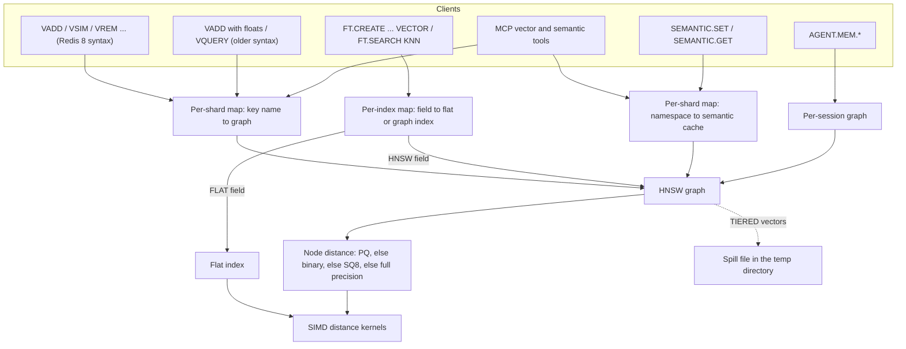

# Component 08: Vector Search Engine

> **High-Level Design Spec**: [docs/design/08_vector_engine.md](../design/08_vector_engine.md)
> **Consolidated Implementation Spec**: [docs/internal/components.md](components.md)
> **Main source files**: src/vector.rs (the graph and flat indexes, distance kernels,
> compression, the filter language and the semantic cache), src/resp.rs (command grammar),
> src/shard.rs (command execution and keyspace integration), src/connection.rs (replies and
> logging), src/table.rs and src/aof.rs (persistence), src/search.rs (RediSearch vector fields).
> The [Code map](#14-code-map) lists the key symbols. Related components:
> [09 RediSearch](09_redisearch.md), [20 Agent memory](20_agent_memory.md),
> [21 MCP server](21_mcp_server.md), [14 Persistence](14_persistence_replication.md) and
> [07 NVMe tiering](07_nvme_tiering.md).

---

## 1. What this subsystem does

Rudis can store **embeddings**: fixed-length arrays of 32-bit floats that machine-learning models
produce for text, images and other content. It can then answer **nearest-neighbour** questions,
such as "which stored vectors are most similar to this one?".

Four features use this ability, each with its own storage:

| Feature | How clients reach it | Where its vectors live |
| :--- | :--- | :--- |
| Redis 8 **Vector Sets** (`VADD`, `VSIM`, `VREM`, `VEMB` and friends), plus an older Rudis syntax (`VADD` with a float list, `VQUERY`) | Commands parsed in resp.rs and run by the owning shard | A per-shard map from key name to graph index |
| RediSearch `FT.CREATE ... VECTOR FLAT\|HNSW` fields (KNN and range queries) | The search engine (Component 09) | A per-index map from field name to a vector index |
| The LLM **semantic cache** (`SEMANTIC.*`): "has a prompt like this one been answered before?" | Commands run by the owning shard | A per-shard map from namespace to cache |
| Agent episodic memory (`AGENT.MEM.*`, Component 20) | Agent commands | One graph per conversation session |

All four are built from the **same two index types**, defined in src/vector.rs:

* The **HNSW graph** is an approximate index. HNSW stands for Hierarchical Navigable Small World.
  A query walks a layered graph of neighbouring vectors, so its cost grows roughly with the
  logarithm of the number of vectors, but it can miss the true nearest neighbour.
* The **flat index** is an exact brute-force scan. Only FT `FLAT` fields use it.

The same file also holds the pieces they share: SIMD distance kernels, three compression schemes
(8-bit scalar, 1-bit binary and product quantization), an optional on-disk spill file for
full-precision vectors, the expression language behind `VSIM ... FILTER`, and the semantic cache.

There is no separate vector-set value type. A Redis 8 vector set is simply a graph index whose
"is a Redis vector set" flag is on. Vector sets are not part of the ordinary key table, so the
keyspace commands (`DEL`, `EXISTS`, `TYPE`) have explicit fallbacks for them (§7.4).

---

## 2. Mental model



Each consumer owns separate index instances with their own parameters. Changing a default for
vector sets does not change FT fields or semantic caches.

Four ideas explain most of this document:

* **Distance, not similarity.** Every metric is turned into a **distance** where smaller means
  closer. Commands that report a similarity score convert the distance back afterwards (§9).
* **Several encodings per node.** A graph node can carry its vector in up to four forms at once:
  full precision, 8-bit scalar (SQ8), 1-bit binary, and product-quantized (PQ) codes. While
  walking the graph, Rudis compares the query against the most compressed form the node has. An
  optional **rerank** step then recomputes exact distances for the final candidates.
* **Compression rarely saves memory.** Even with SQ8 or binary encodings, the full-precision
  vector normally stays in RAM. Only the `TIERED` option removes it, by spilling it to disk
  (§6).
* **Updates are delete plus insert.** The graph has no in-place update. Re-adding an element
  removes it and inserts it again.

| Term | Meaning |
| :--- | :--- |
| **Embedding / vector** | A fixed-length array of `f32` numbers. |
| **Dimension** | The array length. Every vector in one index must match. |
| **Layer** | HNSW stacks sparse graphs on top of a dense bottom one. Layer 0 holds every node; higher layers hold fewer. |
| **Entry point** | The node where every search begins, on the top layer. |
| **ef** | The width of the candidate list during a search or insertion. Larger means slower and more accurate. |
| **M** | The maximum number of links per node above layer 0. Layer 0 allows twice as many. |
| **Recall** | The fraction of the true nearest neighbours that a search actually returns. |
| **Rerank** | Recomputing exact distances for the best candidates after an approximate search. |

---

## 3. Limits and index structures

### 3.1 Limits clients cannot exceed

A few constants bound every size a client can choose, and the parsers in resp.rs and search.rs
enforce them: a vector may have up to 65,536 dimensions, a graph's M is at most 4096, a search's
ef is at most 1,000,000, and a `REDUCE` projection matrix may not exceed 16,777,216 entries
(64 MiB of floats). A negative `VRANDMEMBER` count whose size exceeds about a million is rejected
with a range error. [Reference details](#151-limits-and-constants) lists the constants and the
error messages.

### 3.2 Metrics and distances

Three metrics exist: cosine (the default), Euclidean (L2) and inner product (IP). The names are
case-insensitive, and several spellings are accepted (for example `EUCLIDEAN`, `DOT`).

| Metric | Distance used | Range |
| :--- | :--- | :--- |
| L2 | The true Euclidean distance (square root taken) | 0 and up |
| IP | The negated dot product, so a larger dot product means a smaller distance | any value |
| Cosine | One minus the cosine similarity, floored at 0. Defined as 1 if either vector has zero length. | 0 to 2 |

### 3.3 The graph index and its nodes

A graph index stores its nodes in a growable array. Each node holds:

* the element's name (the vector-set element, FT document key, semantic-cache id or agent turn
  id);
* the full-precision vector, which is **emptied** if the node is spilled to disk;
* optional SQ8, binary and PQ encodings (§4);
* whether it is tiered and where its vector sits in the spill file;
* its adjacency lists: one list of neighbour ids per layer, so the node's top layer is the number
  of lists minus one.

Deleting a node leaves a hole (`None`) in the array and puts its slot on a free list; the next
insert reuses the most recently freed slot. The array never shrinks, which makes the array length
a high-water mark.

Besides the nodes, the index records its parameters (dimension, metric, M, ef values), the entry
point and top layer, a name-to-slot map, and the extras that Redis 8 vector sets need: a
quantization mode, per-element JSON attributes, an optional random projection, and a unique id.
[Reference details](#152-graph-index-fields) lists every field.

**Creating an index.** There are two constructors:

* The default constructor sets M to 16 (so 32 at layer 0), ef for building to 64, ef for
  searching to 32, and a level multiplier of 1/ln(16). Its random-number generator starts from a
  fixed constant, so level assignment for a fresh index is deterministic. Vector sets, semantic
  caches and agent sessions use it.
* The parameterized constructor is used by FT `HNSW` fields. It takes M, the build ef and the
  search ef from the field definition, clamps M to between 2 and 4096, and always sets the layer-0
  limit to twice M. There is no independent layer-0 setting.

Every graph index also takes a unique id from a process-wide counter that starts at 1. `VINFO`
reports it for vector sets.

A vector set's **quantization mode** says how its vectors are compressed: none (reported as
`f32`), 8-bit (`int8`) or 1-bit (`bin`).

### 3.4 Two heaps for searching

Searching needs a heap that pops the nearest candidate first and another that pops the farthest
first. Rust's heap is a max-heap, so two tiny wrapper types flip the ordering. The nearest-first
heap holds the frontier of nodes still to expand. The farthest-first heap holds the best `ef`
results so far, with the worst on top where it is cheap to evict.

### 3.5 The flat index

The flat index keeps all vectors in one contiguous array, row after row, next to a list of keys
and a key-to-row map. This layout makes the exact scan cache-friendly.

* Creating one preallocates at most the smaller of the requested initial capacity, about a
  million rows, and 16,777,216 floats divided by the dimension, so a client-chosen
  `INITIAL_CAP` cannot force a huge allocation. It still grows on demand.
* Adding a vector with the wrong dimension is an error. An existing key is overwritten in place;
  a new key is appended.
* Removing swaps the last row into the hole and fixes the key map. Nothing is tombstoned.
* A top-k search scans every row and keeps a heap of size k, so it costs O(N·dim + N log k). A
  range search returns every row within the radius, sorted by distance.
* Memory use is the float data plus each key's length and 32 bytes of overhead.

### 3.6 The FT wrapper

FT vector fields hold either a flat or a graph index behind a small two-variant wrapper. Every
operation (add, remove, search, filtered search, range search, memory use) simply forwards to the
inner index. Two details: the wrapper's graph search never asks for a rerank, and its graph
memory estimate counts only full-precision vectors, keys and adjacency lists, ignoring the
compressed encodings (§12).

### 3.7 The semantic cache

A semantic cache pairs one private cosine graph with a map of entries (prompt, response, optional
scope, optional expiry and a token estimate), keyed by the same ids as the graph. It also keeps
four counters: hits, misses, tokens saved and expired entries evicted. One namespace is one
cache. §10 describes the algorithms.

---

## 4. Distance kernels and compression

### 4.1 SIMD kernels

The dot product, squared L2 distance and cosine distance each pick an implementation at runtime
on every call, using CPU feature detection. The binary contains three tiers:

1. **AVX-512.** Dot product and L2 run 32 floats per loop iteration on two accumulators. Cosine
   computes the dot product and both squared norms in one pass. The horizontal sum uses an
   instruction available in plain AVX-512F, so nothing needs AVX-512DQ.
2. **AVX2 with FMA.** Both features are required. It runs 16 floats per iteration (8 for cosine,
   which carries three accumulators).
3. **Portable.** Safe Rust with manual unrolling by eight and a scalar tail. Non-x86 targets, such
   as ARM, always use this tier; there is no NEON kernel.

All kernels read only as many elements as the shorter input has, so mismatched lengths cannot
read out of bounds. Every unsafe block carries a safety comment.

Two more AVX2+FMA kernels compare an `f32` query with SQ8 byte data **without decompressing it
first**: one for the dot product and one for L2 that fuses the decompression into a single FMA.
Both fall back to scalar loops, and neither has an AVX-512 version. Binary (Hamming) distance
has no SIMD path; it counts set bits one 64-bit word at a time with the hardware population-count
instruction.

### 4.2 SQ8: 8-bit scalar quantization

SQ8 stores each component as one byte. To encode a vector:

1. Find its smallest and largest components. The step size is (max − min) / 255, or 1 if all
   components are equal.
2. Store each component as the rounded number of steps above the minimum, clamped to 0–255.
3. Precompute the sum of the codes and the sum of their squares, which later make cosine
   distance cheap.

The result takes one byte per dimension plus a 16-byte header, about 75% less than `f32`.

**Worked example.** The vector `[-1.0, 0.0, 0.5, 1.0]` has min −1 and step 2/255 ≈ 0.00784. Its
codes are `[0, 128, 191, 255]` (0.0 maps to 127.5, which rounds up to 128). The sums are 574 and
117,890.

**Distance.** Distances are computed straight from the codes. A dot product expands algebraically
into `min × (sum of query) + step × (sum of query × code)`. L2 sums the squared difference
between each query component and its decoded value. Cosine reuses that dot product and gets the
stored vector's squared norm from the precomputed sums, so no decoded vector is ever built.

A decoding routine exists for `VEMB` and as a fallback when a spilled vector cannot be read back.

### 4.3 Binary: 1-bit quantization

A binary encoding sets bit i if component i is greater than zero; exactly 0.0 encodes as 0. The
distance is twice the number of differing bits divided by the dimension, which has the same 0–2
range as cosine distance. A 128-dimension vector takes 16 bytes instead of 512.

**Worked example.** `[0.3, -0.2, 0.0, 0.9]` encodes as bits `1001`, and `[0.1, 0.4, -0.5, 0.2]`
as `1011`. They differ in one bit, so the distance is 2 × 1 / 4 = 0.5.

Binary distance is always Hamming, **whatever metric the index was created with**.

### 4.4 PQ: product quantization

Product quantization splits each vector into `m` **subspaces** of equal width. Each subspace has
a **codebook** of exactly 256 **centroids** (representative sub-vectors), and a vector is stored
as one byte per subspace: the index of the closest centroid. With 128 dimensions and 16
subspaces, 512 bytes shrink to 16.

**Untrained codebooks.** A new quantizer starts with deterministic centroids per subspace: the
zero vector, then the unit vector along each axis in the positive and then the negative
direction, then pseudo-random vectors from a hash. These are placeholders until training.

**Encoding** scans all 256 centroids of each subspace for the nearest one.

**Asymmetric distance computation (ADC).** To compare a full-precision query with PQ codes, Rudis
builds a table of squared distances from each query sub-vector to each of the 256 centroids of
that subspace, then sums one table entry per subspace. That is O(m) per candidate. The node
distance routine currently rebuilds the table for every candidate instead of sharing it across
the query (§13).

**Training** runs per subspace on a sample of vectors:

1. **Furthest-first seeding**, a deterministic variant of k-means++. The first sample becomes the
   first centroid; each next centroid is the sample farthest from all chosen so far, up to 256 or
   the sample count. Seeding stops early if the farthest sample is a duplicate of an existing
   centroid.
2. **Lloyd iterations.** Assign every sample to its nearest centroid, then move each centroid to
   the mean of its samples. Stop when no assignment changes or the iteration limit is reached.
   Unused centroids keep their untrained values.

**PQ inside the graph.** When a vector is added with PQ requested:

1. If the index has no quantizer, an untrained one is installed with `m` = dimension / 8,
   clamped to 1–16.
2. If the quantizer has never been trained and the index already holds at least **15** elements,
   it trains once with 10 iterations on every current vector plus the new one, then re-encodes
   every node that already has PQ codes.
3. The new vector is encoded with the current quantizer.

Only nodes that already have PQ codes are ever re-encoded; a node added without PQ never gains
them later (§13).

---

## 5. HNSW algorithms

### 5.1 Layer assignment

A new node's top layer is `floor(−ln(r) × ml)` for a random `r` in (0, 1], capped at 16, using a
small xorshift generator. With the default M, most nodes live only on layer 0 and each higher
layer holds about 1/M of the layer below.

### 5.2 Insertion

Adding an element works as follows:

1. Reject a vector whose length differs from the index's dimension.
2. If the element already exists, remove it first (§5.6).
3. Draw the node's top layer and take a slot from the free list, or append a new one.
4. Build the compressed encodings. SQ8 is built if SQ8 was requested, the mode is 8-bit, or the
   node is tiered without PQ. Binary is built in 1-bit mode. PQ is built when requested (§4.4).
   The full vector is **always kept in RAM** unless the node is tiered.
5. If the graph is empty, the node becomes the entry point and insertion ends (after any spill).
6. Otherwise descend greedily from the entry point: for each layer from the top down to one above
   the new node's top layer, repeatedly move to any neighbour closer to the new vector until none
   is closer.
7. Link the node. For each layer from the new node's top layer (or the graph's, if lower) down to
   0: search the layer with the build ef, choose neighbours with the heuristic in §5.3, set the
   node's list, add the node to each chosen neighbour's list, immediately re-prune any neighbour
   that now has too many links, and use the closest chosen neighbour as the entry for the next
   layer down.
8. If the new node's top layer exceeds the graph's, it becomes the entry point.
9. If the node is tiered, spill its vector to disk (§6).

### 5.3 Choosing neighbours: the diversity heuristic

Linking a node to its M closest candidates would often link it to M near-duplicates. Rudis
instead follows Algorithm 4 of the HNSW paper, with the "keep pruned connections" option.
Candidates arrive sorted by distance to the base node:

1. If there are no more than the limit, keep all of them.
2. Otherwise walk them nearest first. Accept a candidate only if it is at least as close to the
   base node as it is to every candidate already accepted. Rejected ones go on a "pruned" list.
3. If slots remain, fill them from the pruned list, nearest first.

This spreads a node's links across different directions. Re-pruning a node that grew too many
links runs the same heuristic on its current neighbours, so insertion uses one function for both
purposes.

### 5.4 Searching

**One layer.** A bounded best-first search starts from an entry node:

1. Keep a fresh set of visited nodes (it is allocated per call, not reused).
2. Seed the frontier heap and the result heap with the entry node.
3. Pop the nearest frontier node. Stop if it is farther than the worst result and the result
   heap is already full.
4. Visit each unvisited neighbour on this layer. If it beats the worst result, or the result heap
   has room, add it to both heaps and trim the result heap back to `ef`.
5. Return the results sorted nearest first.

The filtered variant works on layer 0 only. Nodes rejected by the filter are still **traversed**,
so the graph stays navigable, but only accepted nodes enter the results.

**Top-k search.** The main entry point works like this:

1. Return nothing for an empty graph or `k = 0`.
2. Descend greedily through the upper layers.
3. Search layer 0 with a beam width equal to the requested `ef` (or the index default), but at
   least `k`, and at least 3 × `k` when reranking.
4. With rerank, recompute **every** beam candidate's distance at full precision (reading from disk
   for tiered nodes), sort and cut to `k`. Without rerank, return the first `k` beam entries with
   the distances traversal produced.

**Exact search** (`VSIM ... TRUTH`) scores every live node using the node distance routine, so it
still uses compressed encodings, then sorts and cuts to `k`.

**Range search** (FT `VECTOR_RANGE`) finds all nodes within a radius:

1. Return nothing for an empty graph, a wrong query dimension or a negative radius.
2. Descend greedily through the upper layers.
3. Seed a queue from a layer-0 search with ef of at least 32, so the search reaches the query's
   neighbourhood even when the entry point is far outside the radius.
4. Expand layer-0 neighbours whose distance is within radius × (1 + epsilon), where epsilon
   defaults to 0.01. Emit only nodes within the radius that pass the filter, sorted by distance.

### 5.5 Which encoding a distance uses

The routine that measures a query against one node takes the **first** encoding available, in
this order: PQ (if the node has codes and the index has a quantizer), then binary (quantizing the
query on the fly and using Hamming distance), then SQ8, then the full vector (read from disk if
tiered). A node with both SQ8 and PQ codes is therefore always compared with PQ.

### 5.6 Deletion

Removing an element:

1. Delete it from the name map, leave a hole in the node array and push the slot on the free
   list.
2. For each layer where the node had neighbours: remove it from every former neighbour's list,
   then **repair** the neighbourhood. Each former neighbour that is now below the maximum degree
   computes its distance to the *other* former neighbours it is not already linked to, and links
   to the nearest ones until full again.
3. If the deleted node was the entry point, or the graph is now empty, scan all live nodes
   (O(N)) and promote the one with the highest top layer. If none remain, there is no entry
   point.

**Example.** B is linked at layer 0 to A, C and D; A is linked only to B; the layer-0 limit is
32. Deleting B removes B from the lists of A, C and D. A is left with no links, so it links to C
and D, nearest first. C and D are topped up the same way. B's slot is reused by the next insert.

### 5.7 Helpers for vector sets

| Helper | What it does |
| :--- | :--- |
| Set projection | Builds a deterministic Gaussian random-projection matrix (reduced dimension × input dimension) for `VADD ... REDUCE`, seeded from both dimensions and scaled by 1/√reduced. |
| Project | Multiplies a vector by the matrix when a projection exists and the length equals the input dimension; otherwise returns the vector unchanged. |
| Client dimension | The input dimension for projected sets, otherwise the stored dimension. `VDIM` reports it. |
| Stored vector | What `VEMB` returns: the decoded SQ8 vector for 8-bit sets, ±1.0 per bit for binary sets, otherwise the full vector. |
| Links | What `VLINKS` returns: the neighbour lists of a node, layer 0 up to its top layer, each neighbour scored as `clamp(1 − d/2, 0, 1)`. |
| Random members | `VRANDMEMBER`. Keys are sorted for a deterministic start. A positive count does a partial Fisher–Yates shuffle (distinct keys, at most the set size); a negative count makes that many independent draws, so duplicates are possible. |
| Max node uid | The node-array length, reported by `VINFO`. |

---

## 6. Spilling vectors to disk (TIERED)

`TIERED` keeps only the SQ8 encoding of a vector in RAM and moves the full-precision `f32` data
to an append-only file. The graph is walked using SQ8 distances, and a rerank reads the exact
vectors back from disk.

**Spilling.** When a tiered node is inserted (which forces an SQ8 encoding unless PQ is used):

1. On first use the index picks a file path in the system temp directory, named with the process
   id and the index's unique id.
2. It opens the file in append mode. The file is reopened on every spill; no handle is cached.
3. It records the current file length as the node's offset, appends the vector as little-endian
   floats, and adds the byte count to a running total.
4. It empties the node's in-memory vector.

If any I/O step fails, the vector simply stays in RAM.

**Reading back.** To get a spilled vector, Rudis:

1. Borrows the in-memory vector if it is non-empty.
2. Otherwise opens the file again and reads exactly dimension × 4 bytes at the node's offset with
   a positional read (no seek, no lock).
3. If that fails, decodes the SQ8 encoding.
4. As a last resort, uses an all-zero vector.

**Example.** Two 4-dimension vectors inserted with `TIERED` leave both in-memory vectors empty
and the byte total at 32. A reranked search for a vector identical to one of them returns an
exact distance of 0 for it, read from disk.

This file is unrelated to the key-value tier of [Component 07](07_nvme_tiering.md). It is never
compacted or deleted (§13).

---

## 7. Redis 8 Vector Sets: command flow

### 7.1 Parsing

`VADD` chooses its grammar from the third argument.

**Redis 8 form**, used when the third argument is `REDUCE`, `FP32` or `VALUES`:

```text
VADD key [REDUCE dim] (FP32 blob | VALUES n v1..vn) element
     [CAS] [TIERED] [NOQUANT|Q8|BIN] [EF n] [SETATTR json] [M n]
```

* `FP32` needs a non-empty blob whose length is a multiple of 4. Both `FP32` and `VALUES` reject
  NaN and infinity.
* `REDUCE` must be positive and at most the input dimension, and input × reduced must stay within
  the projection limit.
* `M` must be 2–4096. `EF` must be at most 1,000,000 and is floored to 1.
* `SETATTR` must be empty or valid JSON. Any unknown token is a syntax error.
* The parsed command carries no metric (so cosine), asks for SQ8 unless the mode says otherwise,
  and is marked as a Redis vector set.

**Older form**: `VADD index element token...`, where each token is a metric name, `QUANTIZE` or
`SQ8`, `PQ`, `TIERED`, or a float. This form does not reject non-finite floats, and it replies
`+OK` instead of an integer.

The other commands parse like this:

* `VQUERY index k f1..fn [RERANK]` (older form) projects the query, runs the tiered search and
  replies with elements alternating with distances printed to 6 decimals.
* `VSIM key (ELE e | FP32 blob | VALUES n ...) [WITHSCORES] [WITHATTRIBS] [COUNT n] [EPSILON e]
  [EF n] [FILTER expr] [FILTER-EF n] [TRUTH] [NOTHREAD]`. `COUNT` defaults to 10 and must be
  positive. `EPSILON` must be 0–1. `FILTER` is syntax-checked at parse time. `FILTER-EF` is
  floored to 1 and has no upper bound.
* `VSIM key e1 e2 [metric]` — when the third argument is not `ELE`, `FP32` or `VALUES`, the
  command becomes a distance query and returns the raw **distance** between two stored elements.

### 7.2 Adding an element

Vector commands are single-key commands, routed to the shard that owns the key like any other
keyed command. On that shard, adding an element does the following:

1. Return `WRONGTYPE` if an ordinary key with that name exists, and an error for an empty vector.
2. **First use creates the index.** It starts from the default constructor with the reduced (or
   given) dimension and the requested metric (cosine by default). For Redis 8 syntax it marks the
   index as a vector set and sets the quantization mode, defaulting to 8-bit. `M` sets M and the
   layer-0 limit; `EF` sets the build ef (the search ef stays 32); `REDUCE` installs the
   projection.
3. **An existing set** rejects a different quantization mode (`Quantization type mismatch`),
   `REDUCE` on an unprojected set or with a different dimension (`Projection dimension
   mismatch`), and a wrong client dimension (`vector dimension mismatch`). `EF` updates the build
   ef.
4. Project the vector, then insert it (§5.2) with SQ8 if requested or if the mode is 8-bit.
5. Apply `SETATTR`; an empty or whitespace-only value removes the attribute.
6. Reply `1` if the element is new, else `0` (Redis 8 form). The connection then logs the change
   for the AOF and replication and sends client-tracking invalidations for both the key and the
   element.

`CAS` is parsed and carried along, but execution ignores it.

### 7.3 Similarity search

`VSIM` runs on the owning shard:

1. Check `WRONGTYPE`. A missing set returns an empty array.
2. Build the query: `ELE` uses the stored (already projected) full-precision vector and fails
   with `Element not found` if absent; `FP32` and `VALUES` must match the client dimension and
   are then projected.
3. Build the filter: it evaluates the `FILTER` expression against each element's JSON attributes,
   and any evaluation error counts as "reject".
4. Decide on rerank: only sets with **no quantization** rerank.
5. Pick a search path:
   * `TRUTH` runs the exact search.
   * `FILTER` runs the filtered graph search with ef equal to `FILTER-EF`, else `EF`, else the
     larger of 10 × `COUNT` and 64. If it finds fewer than `COUNT` results, it **falls back to the
     exact search** so the answer is complete.
   * Otherwise the ordinary graph search runs with the requested `EF`.
6. Convert each distance to a score, `clamp(1 − dist/2, 0, 1)`. With `EPSILON e`, drop hits whose
   score is below 1 − e.
7. The connection writes one of four reply shapes: a plain array of elements; with `WITHSCORES`,
   a RESP3 map or RESP2 flat pairs; with `WITHATTRIBS`, the same with the attribute JSON (null if
   missing); with both, a RESP3 map to a two-element array or RESP2 flat triples.

`NOTHREAD` is parsed and ignored.

**Worked example.** A set `movies` with 10,000 elements and 8-bit quantization receives
`VSIM movies VALUES 3 0.1 0.2 0.3 COUNT 3 FILTER '.year > 2000' WITHSCORES`.

1. The query has dimension 3, matching the client dimension.
2. Rerank is off, because the set is quantized.
3. Layer 0 is searched with ef = max(30, 64) = 64. Elements whose JSON has no `year`, or a `year`
   of 2000 or less, are traversed but not collected.
4. Distances come from SQ8 codes. A cosine distance of 0.2 becomes a score of 0.9.
5. If fewer than 3 matches were reachable, the shard scans all 10,000 elements exactly.

### 7.4 Other commands and the keyspace

| Command | Behaviour |
| :--- | :--- |
| `VREM` / `VDEL key elem` | `WRONGTYPE` check. Removes the attribute and the node. **If the set becomes empty, the whole index is dropped.** Replies 1 or 0. |
| `VCARD key` | Element count; 0 if missing. |
| `VDIM key` | The client dimension; an error if the key does not exist. |
| `VINFO key` | Vector sets: nine fields (`quant-type`, `hnsw-m`, `vector-dim`, `projection-input-dim`, `size`, `max-level`, `attributes-count`, `vset-uid`, `hnsw-max-node-uid`) as a RESP3 map or an 18-element array. Older indexes: `num_elements`, `dimension`, `metric`, `max_layer`. Missing key: null. |
| `VEMB key elem [RAW]` | Without `RAW`: the stored vector as doubles. With `RAW`: see §9. |
| `VLINKS key elem [WITHSCORES]` | One array per layer, layer 0 first; with scores, a map or pairs per layer. |
| `VRANDMEMBER key [count]` | No count: one bulk string or null. With a count: an array (empty if missing). |
| `VSETATTR key elem json` | 1 if the element exists (empty JSON clears), else 0. |
| `VGETATTR key elem` | The JSON string, or null. |
| `VISMEMBER key elem` | Membership check. |

**Keyspace integration.** Because vector sets live outside the key table, the shard's keyspace
code has fallbacks for them: `DEL` removes a vector set when the main table has no such key,
`EXISTS` sees non-empty sets, `TYPE` returns `vectorset`, and the database-0 key count in `INFO`
includes them. `FLUSHDB` clears vector sets and semantic caches only when the current database is
0, while `FLUSHALL` always does.

---

## 8. The filter language (VSIM ... FILTER)

A filter is a small expression evaluated against one element's JSON attributes, for example
`.genre in ["drama","comedy"] and (.year >= 2000 or .rating > 8.5)`.

The parser is recursive descent and **evaluates while it parses**: each evaluation re-parses the
expression text against one element's JSON. A validation pass runs the same parser with no JSON
(every field evaluates to null) and also rejects trailing tokens; the command parser uses it to
reject bad expressions up front.

Operators, from lowest to highest precedence:

| Level | Operators |
| :--- | :--- |
| or | `\|\|`, `or` |
| and | `&&`, `and` |
| not | `!` (but not `!=`), `not` |
| comparison (left-associative, chainable) | `==` `!=` `<` `<=` `>` `>=` `in` |
| additive | `+` `-` |
| multiplicative | `*` `/` `%` |
| power (right-associative) | `^`, `**` |
| unary | `-` `+` |
| primary | parentheses, tuple `(a, b)`, list `[a, b]`, string literal, field `.a.b`, number, `true`, `false`, `null` / `nil` |

Values are null, boolean, number, string or list; a JSON object becomes null. The rules:

* **Truthiness.** False, 0, NaN, the empty string, the empty list and null are falsy.
* **Arithmetic** works on numbers and booleans (true is 1). Anything else, and any division or
  modulo by zero, gives null.
* **Equality.** Numbers are equal within 1e-9; a number equals a boolean when its truthiness
  matches; lists compare element by element.
* **Ordering** is defined only for number against number and string against string. Other
  comparisons are false.
* **`in`** tests list membership (`x in [1,2]`) or substring (`"ab" in .name`).
* An element with **no attributes, or unparseable JSON, never matches**.

Field names may contain letters, digits, underscores and hyphens.

---

## 9. Scores and VEMB RAW

Different features convert distances to scores differently:

| Where | Formula | Correct for |
| :--- | :--- | :--- |
| `VSIM` scores and `EPSILON`; `VLINKS` | `clamp(1 − dist/2, 0, 1)` | Cosine and binary distances, which range from 0 to 2 |
| `SEMANTIC.GET` | `clamp(1 − dist, 0, 1)` | Cosine similarity |
| `VSIM` with two elements; `VQUERY` | the raw distance | any metric |

`VEMB ... RAW` returns the vector in its stored form, plus its length:

* An 8-bit set returns the type `q8`, the byte codes, the vector's norm and the value range (step
  × 255); the SQ8 encoding is computed on the fly if missing.
* A binary set returns `bin`, the first dimension/8 (rounded up) bytes of the bit words, and the
  norm.
* An unquantized set returns `fp32` and the little-endian bytes of the **normalized** vector (the
  vector divided by its norm), plus the norm.

The norm is floored at 1e-12. The reply has four elements when a range exists, otherwise three.

---

## 10. The semantic cache

**Purpose.** Before calling an LLM, a client embeds the prompt and calls `SEMANTIC.GET`. If a
cached prompt has cosine similarity at or above a threshold, the cached response is returned and
the LLM call is skipped. Rudis tracks how many tokens that saved.

### 10.1 Commands

* `SEMANTIC.SET ns id prompt response VECTOR (dim f1..fdim | blob) [EX s | PX ms] [SCOPE s]
  [QUANTIZE|SQ8] [TOKENS n]`. A zero expiry is rejected. If the token after `VECTOR` is not an
  integer, it is decoded as an FP32 blob.
* `SEMANTIC.GET ns VECTOR ... [THRESHOLD t] [SCOPE s] [WITHSCORE|WITHSCORES] [WITHPROMPT]
  [WITHID]`. The threshold must be 0–1 and defaults to 0.90.
* `SEMANTIC.DEL ns id [id ...]`, `SEMANTIC.FLUSH ns` and `SEMANTIC.INFO ns`.

### 10.2 Algorithms

**Expiry is lazy.** Expired entries are removed from both the entry map and the graph at the
start of set, get and info, and each removal increments the evicted counter. There is no
background sweep.

**Set:**

1. Reject an empty vector and purge expired entries.
2. If the cache is empty and the dimension differs, rebuild the graph at the new dimension;
   otherwise a dimension mismatch is an error.
3. Estimate tokens as the given `TOKENS`, or the response length divided by 4 rounded up (at least
   1).
4. Insert into the graph (with SQ8 if requested), then store the entry.

**Get:**

1. Purge expired entries. If the cache is empty, count a miss and return nothing.
2. Fail on a dimension mismatch.
3. Search for 4 candidates with rerank, accepting only ids that are in the entry map and, if a
   scope was given, whose scope matches exactly.
4. Take the best candidate. If `1 − distance` is at least the threshold, count a hit and add the
   entry's tokens to the savings; otherwise count a miss.

**Delete** removes an id from the map and graph. **Flush** clears the entries and builds a fresh
graph at the same dimension, keeping the counters.

**Worked example.** `SEMANTIC.SET faq q1 "reset pw?" "Use reset link" VECTOR 3 0.1 0.9 0.2 EX 60
SCOPE en` stores the entry with an estimated 4 tokens (14 bytes ÷ 4, rounded up). A later
`SEMANTIC.GET faq VECTOR 3 0.12 0.88 0.21 SCOPE en WITHSCORE` finds `q1` at a cosine distance of
about 0.0004. The similarity of about 0.9996 is above 0.90, so the reply is the response and the
score `0.999596` (approximately), hits becomes 1 and tokens saved becomes 4.

### 10.3 Replies

`SET` replies `+OK`. `GET` replies with the bare response string, or an array of the response
plus whichever of score (6 decimals), prompt and id were requested; a miss is a null bulk string.
`DEL` replies with the number removed. `INFO` replies with nine pairs: `namespace`, `entries`,
`dimension`, `metric` (always `COSINE`), `hits`, `misses`, `hit_rate` (4 decimals),
`tokens_saved` and `evicted_expired`.

---

## 11. Persistence and other consumers

**Snapshots.** Each vector element is written as one type-9 record: the key `vec:{index}:{element}`,
the index and element names, a metric byte (with the top bit set to mark that extension fields
follow), the full vector (read back from disk if tiered), a flags byte (vector set, has SQ8, has
PQ, tiered), a quantization byte, M, and the attribute JSON. On load, each record is replayed on
its owning shard through the normal add path (or the older one for records without the extension
bit). Semantic caches are written as type-15 records: the dimension, the four counters, then each
entry with an absolute Unix-millisecond expiry. On load they are replayed through the set path;
entries that have already expired are skipped and counted as evicted.

**AOF rewrite** (Component 14) emits one `VADD` per element and one `SEMANTIC.SET` per live
entry, with the remaining time as the TTL. Vector sets are written in Redis 8 form (blob,
quantization, attributes, M), older indexes in the older form.

**RediSearch** (Component 09). A `FLAT` field creates a flat index and any other algorithm creates
a graph with the field's parameters. The defaults are M = 16, build ef = 200, search ef = 10 and
initial capacity 1024. KNN with a pre-filter uses brute force when the filtered set is small or
the field is flat; otherwise it runs the filtered graph search and falls back to brute force if
too few results come back. `VECTOR_RANGE` uses the range search.

**Agent memory** (Component 20). Each session lazily creates a cosine graph on the first turn that
has an embedding and adds each turn to it.

**MCP** (Component 21). The vector-add tool builds a Redis 8 `VADD` (8-bit by default, optional
attributes). The vector-search tool builds a `VSIM` with a count (default 5), an optional filter
and scores (on by default). The two semantic tools map to the semantic cache.

**Benchmark.** A standalone program measures ingestion, queries per second, latency percentiles,
memory and recall for full-precision, SQ8 and tiered indexes, with and without rerank.

---

## 12. Invariants & gotchas

1. **One implementation, many owners.** Vector sets, FT fields, semantic caches and agent sessions
   are independent index instances with different defaults: build ef is 64 by default and 200
   for FT; search ef is 32 by default and 10 for FT.
2. **Encoding priority is PQ, then binary, then SQ8, then full precision** (§5.5). Check which
   encodings a node has before assuming how a distance is computed.
3. **Rerank applies only to unquantized vector sets.** 8-bit and binary sets never get an exact
   rerank, even though their full vectors are still in RAM; their results and scores come from
   SQ8 or Hamming distances. For a non-tiered unquantized set the rerank recomputes distances
   that are already exact, so it matters only for unquantized plus `TIERED`.
4. **Quantization does not save RAM by itself.** The full vector is always kept; only `TIERED`
   drops it.
5. **The 1 − d/2 score assumes a distance between 0 and 2.** Redis 8 sets are always cosine, so
   this holds for them. An older index created with L2 or IP and then queried through `VSIM` gets
   meaningless clamped scores.
6. **Tiered nodes have an empty in-memory vector.** Use the routines that read from disk. FT
   indexes never use tiering.
7. **The graph only grows.** The node array is never compacted; freed slots are reused most recent
   first, so the max node uid is a high-water mark.
8. **Deleting the entry point costs O(N)**, because every node is scanned to elect a new one.
9. **An update is delete plus insert.** Re-adding an element pays the full repair cost and, if
   tiered, appends another copy to the spill file.
10. **Vector sets are per shard, not per database.** One map per shard serves every `SELECT`ed
    database, and `FLUSHDB` clears it only from database 0.
11. **Index names are converted lossily.** Commands convert key bytes with UTF-8 replacement, but
    `DEL`, `EXISTS` and `TYPE` use strict conversion and skip vector sets whose names are not
    UTF-8.
12. **Filter strings are read as Latin-1.** Each byte becomes one character, so a non-ASCII literal
    such as `"café"` never equals the matching JSON string. A backslash keeps the next byte
    verbatim (`\n` becomes `n`). Numbers must start with a digit, because `.5` parses as a field.
13. **A filter is re-parsed for every candidate**, once per visited node that has to be tested.

---

## 13. Limitations / not implemented

* **The spill file is never reclaimed.** Removed or updated vectors leave dead bytes behind. The
  file lives in the system temp directory, is never deleted when the index is dropped, and is
  reopened on every spill and every disk read.
* **The PQ distance table is rebuilt per candidate** rather than once per query.
* **PQ never re-encodes nodes that lack codes.** Auto-training, the enable and train helpers
  re-encode only nodes that already have PQ codes. If the dimension is not a multiple of `m`, the
  trailing dimensions never affect PQ distance. Enabling PQ with `m` greater than the dimension
  would panic when slicing. Only tests call the enable helper, and only the older `VADD ... PQ`
  syntax ever produces PQ: Redis 8 `VADD` never does.
* **The visited set is not reused.** Every layer search allocates a fresh one.
* **No SIMD for Hamming distance, no AVX-512 for SQ8, no NEON.**
* **Memory estimates undercount.** The graph estimate in the FT wrapper counts only full vectors,
  keys and adjacency lists, so tiered or compressed data is under-reported.
* **`VADD ... CAS` and `VSIM ... NOTHREAD` are accepted and ignored.** Each shard is single
  threaded, so there is no threaded path to switch off.
* **Some state is lost on persistence:**
  * The `REDUCE` projection. The stored vector is the projected one and is reloaded without a
    projection, so a restored set has the reduced dimension and later adds at the original
    dimension fail with `vector dimension mismatch`.
  * The build ef set with `EF` is not saved.
  * The AOF rewrite of a vector set drops `TIERED`, because the Redis 8 form it writes cannot
    express it. The snapshot path keeps it.
* **The older `VADD` accepts non-finite floats** such as `inf` and `nan`; only the Redis 8 forms
  reject them.
* **Semantic-cache entries expire lazily.** Only set, get and info on that namespace purge them,
  so idle namespaces keep expired entries in memory.

---

## 14. Code map

| File | Key symbols | Role |
| :--- | :--- | :--- |
| `src/vector.rs` | `MAX_VECTOR_DIM`, `MAX_HNSW_M`, `MAX_VSET_EF`, `MAX_PROJECTION_ENTRIES`, `FLAT_INITIAL_RESERVE_FLOATS` | Client size limits. |
| `src/vector.rs` | `VectorMetric`, `compute_distance`, `dot_product`, `l2_distance_sq`, `cosine_distance`, `*_avx512`, `*_avx2`, `*_portable`, `hsum256_ps`, `hsum512_ps`, `dot_f32_u8_avx2`, `l2_f32_u8_avx2` | Metrics and runtime-dispatched SIMD kernels. |
| `src/vector.rs` | `QuantizedVector` (`quantize`, `dequantize`, `compute_distance`), `quantize_binary`, `binary_hamming_cosine_distance` | SQ8 and 1-bit quantization. |
| `src/vector.rs` | `ProductQuantizer` (`new`, `train`, `encode`, `compute_distance_table`, `compute_distance_adc`, `compute_distance_with_vec`, `reconstruct`, `distortion`), `PQVector` | Product quantization and k-means training. |
| `src/vector.rs` | `HnswNode`, `HnswIndex` (`new`, `with_params`, `add`, `add_quantized`, `add_quantized_ext`, `select_neighbors_heuristic`, `prune_neighbors`, `search_layer`, `search_layer_filtered`, `search`, `search_tiered`, `search_ext`, `search_filtered`, `search_exact`, `range_filtered`, `remove`, `dist_to_node`) | The HNSW graph. |
| `src/vector.rs` | `spill_node_to_tier`, `node_vector_cow`, `get_vector_cow`, `tier_path`, `tiered_bytes` | Spill file. |
| `src/vector.rs` | `VQuant`, `set_projection`, `project`, `client_dim`, `stored_vector`, `raw_embedding`, `links`, `random_members`, `max_node_uid`, `NEXT_VSET_UID` | Redis 8 vector-set support. |
| `src/vector.rs` | `FilterVal`, `FilterParser`, `validate_vset_filter`, `eval_vset_filter` | The `VSIM ... FILTER` language. |
| `src/vector.rs` | `FlatIndex`, `VectorFieldIndex` | Exact index and the FT field wrapper. |
| `src/vector.rs` | `SemanticCache` (`set`, `get`, `del`, `flush`, `purge_expired`), `SemanticEntry`, `SemanticHit` | The LLM semantic cache. |
| `src/vector.rs` | `mod tests` (10 tests) | CRUD and search, SQ8 plus tiered rerank, PQ and ADC, SIMD parity, semantic cache, filter plus quantization, diversity heuristic and slot reuse, PQ k-means distortion, NVMe spill and disk rerank, client-size bounds. |
| `src/resp.rs` | the `VADD`, `VQUERY`, `VSIM`, `VDEL`/`VREM`, `VINFO`, `VCARD`, `VDIM`, `VEMB`, `VLINKS`, `VRANDMEMBER`, `VSETATTR`, `VGETATTR`, `VISMEMBER` and `SEMANTIC.*` arms; `VsimTarget`; `parse_random_count`, `MAX_RANDOM_REPEATS` | Grammar and validation. |
| `src/shard.rs` | `ShardDb.vector_indexes`, `ShardDb.semantic_caches`, `vadd`, `vadd_ext`, `vquery`, `vsim`, `vsim_ext`, `vdel`, `vinfo`, `vsetattr`, `vgetattr`, `semantic_set`, `semantic_get`, `semantic_del`, `semantic_flush`, `semantic_info`, `del`, `exists`, `type_of`, `flushdb`, `flushall`, `save_ext_item` | Command glue, keyspace integration and the snapshot writer. |
| `src/connection.rs` | the `Vadd`, `Vquery`, `Vdist`, `Vsim`, `Vdel`, `Vinfo`, `Vcard`, `Vdim`, `Vemb`, `Vlinks`, `Vrandmember`, `Vsetattr`, `Vgetattr`, `Vismember` and `Semantic*` execution arms; `target_shard_of_cmd` | RESP2/RESP3 replies, `WRONGTYPE` checks, AOF recording, routing. |
| `src/table.rs` | snapshot loader, type-9 records | Replays vector elements through the add path. |
| `src/aof.rs` | the rewrite loop over `vector_indexes` and `semantic_caches`; `command_to_resp` for `Command::Vadd` | AOF rewrite. |
| `src/search.rs` | `build_vector_index`, `VectorFieldAttrs` defaults, `InvertedIndex.vector_indices`, KNN and `VECTOR_RANGE` paths | FT vector fields. |
| `src/agent.rs` | `AgentMemorySession.index` | Per-session episodic recall. |
| `src/mcp.rs` | `rudis_vector_add`, `rudis_vector_search`, `rudis_semantic_set`, `rudis_semantic_get` | MCP tool to command builders. |
| `src/bin/vector_bench.rs` | standalone benchmark | QPS, latency, memory and recall for f32, SQ8 and tiered. |

---

## 15. Reference details

### 15.1 Limits and constants

| Name | Value | Enforced where |
| :--- | :--- | :--- |
| `MAX_VECTOR_DIM` | 65,536 (`1 << 16`) | Redis 8 `VADD` (`invalid vector specification`); `FT.CREATE` and `FT.ALTER ... DIM`. |
| `MAX_HNSW_M` | 4096 | `VADD ... M` (`invalid M`); FT `M`. The parameterized constructor also clamps M to 2–4096. |
| `MAX_VSET_EF` | 1,000,000 | `VADD ... EF` and `VSIM ... EF` (`invalid EF`). |
| `MAX_PROJECTION_ENTRIES` | 16,777,216 (`1 << 24`) | `VADD ... REDUCE`: input dimension × reduced dimension must not exceed it. |
| `FLAT_INITIAL_RESERVE_FLOATS` (private) | 16,777,216 | Caps how many floats a new flat index preallocates. |
| `MAX_RANDOM_REPEATS` | 1,048,576 (`1 << 20`) | Negative `VRANDMEMBER` counts beyond it fail with `value is out of range`. |
| Default graph parameters | M 16, layer-0 limit 32, build ef 64, search ef 32, level multiplier 1/ln 16 ≈ 0.361 | The default constructor. |
| Maximum layer | 16 | Layer assignment. |
| PQ codebook size | 256 centroids per subspace | Fixed. |
| PQ auto-train threshold | 15 elements, 10 iterations | First PQ insert beyond it. |
| Semantic threshold default | 0.90 | `SEMANTIC.GET`. |
| Semantic candidates | 4 | Searched per `SEMANTIC.GET`. |
| FT field defaults | M 16, build ef 200, search ef 10, initial capacity 1024 | `VectorFieldAttrs`. |

### 15.2 Graph index fields

```rust
pub struct HnswIndex {
    pub name: String, pub dim: usize, pub metric: VectorMetric,
    pub m: usize, pub m0: usize,            // max degree above layer 0 / at layer 0
    pub ef_construction: usize, pub ef_search: usize,
    pub ml: f64,                            // level multiplier = 1 / ln(m)
    pub entry_point: Option<usize>, pub max_layer: usize,
    pub nodes: Vec<Option<HnswNode>>,       // None = freed slot
    pub free_ids: Vec<usize>,               // freed slots, reused LIFO
    pub key_to_id: HashMap<Bytes, usize>,
    pub pq_quantizer: Option<ProductQuantizer>, pub pq_trained: bool,
    pub quant: VQuant,                      // vector-set mode: NoQuant | Q8 | Bin
    pub attributes: HashMap<Bytes, String>, // per-element JSON (VSETATTR / FILTER)
    pub projection: Option<Vec<f32>>, pub input_dim: usize, // VADD ... REDUCE
    pub uid: u64, pub is_redis_vset: bool,
    pub tier_path: Option<PathBuf>, pub tiered_bytes: u64,
    rng_state: u64,                         // private xorshift64 state
}
```

The random-number generator starts at the fixed constant `0x853c49e6748fea9b`. The unique id comes
from `NEXT_VSET_UID`.

| Node field | Type | Meaning |
| :--- | :--- | :--- |
| `id` | `usize` | Slot index in the node array. |
| `key` | `Bytes` | Element name. |
| `vector` | `Vec<f32>` | Full vector; emptied once spilled. |
| `quantized` | `Option<QuantizedVector>` | SQ8 encoding. |
| `binary` | `Option<Vec<u64>>` | Sign bits, `dim.div_ceil(64)` words. |
| `pq` | `Option<PQVector>` | One code byte per subspace. |
| `is_tiered`, `tier_offset` | `bool`, `Option<u64>` | Tiered flag and byte offset in the spill file. |
| `neighbors` | `Vec<Vec<usize>>` | Adjacency list per layer. |

### 15.3 Other types

```rust
pub struct QuantizedVector { pub min_val: f32, pub scale: f32, pub sum_q: f32, pub sum_q_sq: f32, pub data: Vec<u8> }
pub struct ProductQuantizer { pub dim: usize, pub m: usize, pub d_sub: usize, pub codebooks: Vec<Vec<Vec<f32>>> }
pub struct PQVector { pub codes: Vec<u8> }
pub enum VectorMetric { #[default] Cosine, L2, IP }
pub enum VectorFieldIndex { Flat(FlatIndex), Hnsw(HnswIndex) }
pub struct SemanticEntry { id, prompt, response: Bytes, scope: Option<Bytes>,
                           expire_at: Option<Instant>, tokens: u64 }
pub struct SemanticHit   { id, prompt, response: Bytes, score: f32 }
pub struct SemanticCache {
    pub namespace: String,
    pub index: HnswIndex,                       // always VectorMetric::Cosine
    pub entries: HashMap<Bytes, SemanticEntry>, // keyed by the same id as the graph
    pub hits: u64, pub misses: u64, pub tokens_saved: u64, pub evicted_expired: u64,
}
```

The flat index keeps `keys`, `data` (all rows contiguous, `keys.len() × dim` floats) and
`key_to_pos` as private fields.

### 15.4 Metric names and distance formulas

`VectorMetric` parses `COSINE`, `L2` or `EUCLIDEAN`, and `IP`, `DOT` or `INNERPRODUCT`,
case-insensitively. The distance formulas are `sqrt(l2_distance_sq(a, b))` for L2,
`-dot_product(a, b)` for IP and `max(0, 1 − a·b / (‖a‖‖b‖))` for cosine (1.0 if either norm is
zero).

SQ8 distance expands as follows: for IP, `dot = min_val·Σquery + scale·Σ(query_i·q_i)` and the
distance is `−dot`; for L2, `sqrt(Σ(query_i − (min_val + q_i·scale))²)`; for cosine, the same
`dot` with `‖b‖² = dim·min² + 2·min·scale·sum_q + scale²·sum_q_sq` and `‖a‖²` from
`dot_product(query, query)`.

### 15.5 Tests that pin the behaviour

The module's ten unit tests are listed in the [Code map](#14-code-map). They cover basic CRUD and
search, SQ8 with tiered rerank, PQ with ADC, SIMD parity against the portable kernels, the
semantic cache, filtering together with quantization, the diversity heuristic and slot reuse, PQ
k-means distortion, NVMe spill with disk rerank, and the client-size bounds.
