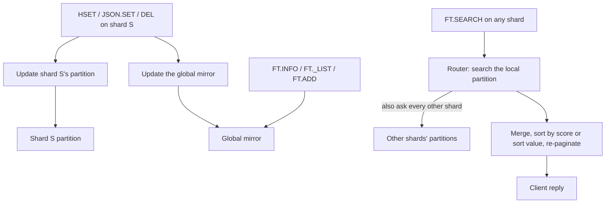
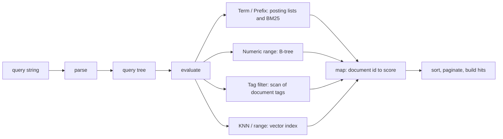

# Component 09: RediSearch Full-Text Engine and Hybrid Vector Fusion

> **High-Level Design Spec**: [docs/design/09_redisearch.md](../design/09_redisearch.md)
> **Consolidated Implementation Spec**: [docs/internal/components.md](components.md)
> **Main source files**: src/search.rs (the whole engine: schema, indexing, query parsing and
> evaluation, fusion, aggregation), src/router.rs (index lifecycle and scatter/gather across
> shards), src/shard.rs (per-shard partitions and messages), src/server.rs (the remote side of
> those messages), src/connection.rs (command dispatch and write hooks), src/resp.rs (argument
> parsing), src/aof.rs and src/table.rs (persistence), src/vector.rs (vector indexes). The
> [Code map](#14-code-map) lists the key symbols.

---

## 1. What this subsystem does

Rudis implements a RediSearch-compatible secondary index over ordinary **HASH** and **RedisJSON**
keys. A client defines an index once, for example:

```text
FT.CREATE idx ON HASH PREFIX 1 doc: SCHEMA title TEXT price NUMERIC tags TAG emb VECTOR HNSW ...
```

It then keeps writing keys with normal commands (`HSET`, `JSON.SET`, `DEL`) and queries them with:

* **`FT.SEARCH`** — full-text search ranked by BM25, numeric ranges, tag filters, boolean
  combinations, vector **KNN** (the k nearest neighbours), **`VECTOR_RANGE`** (every vector
  within a radius), and **hybrid** text-plus-vector search with score fusion.
* **`FT.HYBRID`** — a convenience front end that builds a hybrid `FT.SEARCH`.
* **`FT.AGGREGATE`** — a small analytics pipeline (group, reduce, apply, filter, sort, limit) over
  the matching documents.
* Administration and introspection: `FT.INFO`, `FT._LIST`, `FT.ALTER`, `FT.DROPINDEX`,
  `FT.EXPLAIN`, `FT.PROFILE` and the legacy `FT.ADD`.

The users are application developers doing product search, retrieval-augmented generation
(vector plus keyword) and filtering. The MCP server ([Component 21](21_mcp_server.md)) also exposes
`FT.SEARCH` to LLM agents.

Under the hood the engine is an in-memory **inverted index** (each term maps to the documents that
contain it), a **B-tree numeric index**, a **vector index** per vector field (a brute-force
FLAT index or an HNSW graph from [Component 08](08_vector_engine.md)), and a hand-written query
parser and evaluator. Only index *definitions* are persisted. Documents are ordinary keys, and
they are re-indexed from the keyspace on load.

---

## 2. Mental model

Every index exists in **two copies**:

1. **Per-shard partitions.** Each shard owns an index entry covering the keys *it* owns. Because a
   shard's data is touched only by its own thread, partitions need no locks. **`FT.SEARCH` and
   `FT.AGGREGATE` read the partitions**, by scatter and gather across shards.
2. **The global mirror.** A process-wide registry, guarded by read-write locks, holds one copy of
   each index covering the union of all shards. Every write hook updates it too. **`FT.INFO`,
   `FT._LIST` and `FT.ADD` use only the mirror**, and `FT.SEARCH` falls back to it only when the
   local shard has no partition of that name.



Inside one index, a query string is parsed into a tree, the tree is evaluated into a map from
document id to score, the candidates are sorted (by BM25 score, vector distance, or a numeric
`SORTBY` field), paginated, and turned into result hits.



| Term | Meaning |
| :--- | :--- |
| **Inverted index** | A map from each term to the list of documents containing it (a **posting list**). |
| **Posting** | One entry in a posting list: a document id and how often the term occurs there. |
| **BM25** | A standard ranking formula: frequent-in-document terms score higher, common terms and long documents are discounted. |
| **KNN** | "K nearest neighbours": the K stored vectors closest to a query vector. |
| **Hybrid search** | Combining a text ranking and a vector ranking into one list. |
| **RRF** | Reciprocal Rank Fusion, a way to combine ranked lists by rank alone. |
| **Chunk** | An extra vector for the same document and field (JSON documents only). |
| **Identifier / alias** | The raw field name (or JSONPath) in the document, and the `AS` name given in the schema. |

---

## 3. Schemas and index structures

### 3.1 Schema

A schema field has an **identifier** (the HASH field name, or a JSONPath such as `$.title`) and an
**alias** (the `AS` name). The alias defaults to the identifier; for a JSONPath with no `AS`, the
parser derives it by stripping a leading `$.` and a trailing `.*` or `[*]`, so `$.title` becomes
`title`.

There are four field types:

* **Text** — full-text indexed, with a weight, a sortable flag and a no-stemming flag.
* **Numeric** — a floating-point value, optionally sortable.
* **Tag** — a set of exact labels, with a separator character (default comma) and a case-sensitivity
  flag.
* **Vector** — a fixed-dimension embedding with an algorithm (`FLAT` or `HNSW`), a distance
  metric and tuning attributes.

An index definition carries its name, whether it covers HASH or JSON keys, a list of key prefixes
(empty means every key of that type) and the ordered list of fields. Fields are also looked up by
a map keyed by **both** alias and identifier.

Persistence needs the schema as text, so there is a canonical form: `FT.CREATE name ON <type>
[PREFIX n ...] SCHEMA ...`, with every field written as `identifier AS alias <type> ...`, and
vector fields always listing their type, dimension, metric and initial capacity plus the
algorithm-specific tuning. It must parse back to the same schema. A matching function writes
`FT.ALTER` in canonical form. Two schemas are the "same definition" if their names, kinds (compared
case-insensitively), prefixes and ordered fields are equal. `FT.ALTER ... SCHEMA ADD` merges new
fields into the old list: a new field whose alias **or** identifier matches an existing one
replaces it, and anything else is appended.

### 3.2 Vector field attributes

Vector fields take these tuning knobs (defaults in parentheses): the element data type
(`FLOAT32`; also `FLOAT64`, `FLOAT16`, `BFLOAT16`, `INT8` and `UINT8`), M (16), the build-time
beam width (200), the query-time beam width (10), initial capacity (1024), and the stored but
never-used epsilon and block size. `DIM` must be between 1 and 65,536 and the metric one of `L2`,
`IP` or `COSINE`; `FT.CREATE` enforces both and requires `TYPE`. [Reference
details](#151-vector-field-attributes) has the full table.

### 3.3 Documents, postings and the numeric index

Documents are identified internally by a dense 32-bit **document id**, not by their key string, so
posting lists stay compact (8 bytes per posting). Ids start at 1, and ids freed by deleted
documents are recycled.

For each document the index keeps its key, its token count across all text fields, the raw field
values (which `FT.SEARCH` returns), its numeric values, its tag sets, its vectors per field and
every extra chunk, and the list of terms it contributed (so deleting it never needs to scan the
vocabulary).

The **numeric index** is a sorted B-tree from value to the sorted list of documents with exactly
that value. Adding and removing do a B-tree lookup and a binary search inside the bucket; empty
buckets are deleted. A range lookup is O(log N + K) for K results, with inclusive bounds. It
returns nothing when a bound is NaN or the minimum exceeds the maximum, because a NaN bound would
otherwise panic the B-tree.

### 3.4 The index itself

An index holds its schema, the posting lists, one numeric tree per numeric field, the map from key
to document id and from id to document data, one vector index per vector field, the next fresh id
and the list of recycled ids, running totals (document count and total tokens, used for average
document length) and a count of **indexing failures** (documents rejected for bad vectors,
reported as `hash_indexing_failures`).

The vector indexes are keyed by the document's **key**, not its document id. Extra chunks use the
key `<doc_key>\x00<chunk_index>`. A vector index is created from the field definition: `FLAT`
makes a flat index with the given initial capacity; anything else makes an HNSW graph with the
field's M and beam widths. All of them are built up front; if a schema built in code has dimension
0 (impossible through `FT.CREATE`), the index is built lazily from the first document's vector
length. [Reference details](#152-index-fields-and-document-data) lists the fields.

### 3.5 Query and result types

A query becomes a tree of nodes: term, prefix, exact phrase (never produced by the parser),
field scope, numeric range, tag filter, and, or, not, KNN, vector range and match-all. The KNN and
range nodes hold their K, radius, beam width, epsilon and alias either as literals or as `$name`
references, resolved at execution time against `PARAMS` (a `$name` is looked up as `name`, then
as `$name`).

Four helpers on the tree matter later: finding the vector clause (descending through and, or and
field scope), working out the effective K, naming the distance field in results (the `AS` alias
or `__<field>_score`), and recognizing a **hybrid shape**: an `And` containing a vector clause
**and** at least one sibling that is not match-all, which it splits into a text part and a vector
part.

Parsed `FT.SEARCH` options include offset and limit (default 0 and 10), `NOCONTENT`,
`WITHSCORES`, the fusion settings, `SORTBY`, `RETURN`, `PARAMS`, `DIALECT` (validated as 1–4 but
never read) and `TIMEOUT` (parsed, never read). [Reference details](#153-query-tree-and-search-options)
has the full list. Shards return **hits** carrying a document key, a score, an optional sort value
and the fields to show; the router merges them.

---

## 4. Indexing

### 4.1 Tokenization and stemming

Text is tokenized in three steps:

1. Split on every non-alphanumeric character.
2. Lowercase each piece (ASCII only), and drop empty pieces and words on a fixed English stop-word
   list (articles, pronouns, auxiliary verbs, contractions such as "you're").
3. If stemming is on, apply a small suffix-stripping stemmer.

The stemmer is five rules, checked in order. It is not Porter or Snowball:

| Rule | Example |
| :--- | :--- |
| Longer than 5 letters and ends in "ing": drop 3 | running becomes runn; indexing becomes index |
| Longer than 4 and ends in "ies": replace with "y" | studies becomes study |
| Longer than 4 and ends in "es": drop 2 | boxes becomes box |
| Longer than 3 and ends in "ed": drop 2 | played becomes play |
| Longer than 3, ends in "s" but not "ss": drop 1 | cats becomes cat; class is unchanged |

The same function runs at index time and for bare query words, so the two normally agree.

### 4.2 Indexing a HASH document

The entry point receives the key and the full `HGETALL` of the hash, as binary-safe pairs.

1. For each pair, if the field name matches a vector field's identifier or alias, the value is
   decoded as a vector (below). Success stores the vector under the alias; failure marks the
   document as failed.
2. Every value, including vector blobs, is also stored as a lossily converted UTF-8 string.
3. If any vector failed, the previous version of the document is removed, the failure counter is
   incremented, and indexing stops: **the whole document is rejected**.
4. Otherwise the shared indexing core (§4.3) runs.

**Decoding a vector** tries two formats:

1. A **text** form, tried only if every byte is an ASCII digit, `.`, `,`, `-`, `+`, `e`, `E`, `[`,
   `]` or whitespace. It accepts `1,2,3` and `[1, 2, 3]`, and is used if the field's dimension is
   unspecified or the component count matches.
2. Otherwise a **little-endian binary blob** whose length must equal dimension × element size.
   Elements are decoded as `f32`, `f64`, IEEE half precision, bfloat16 (shifted into the high half
   of an `f32`) or `i8`/`u8`.

A vector is rejected if its length differs from the dimension or any component is not finite.

**Example.** `HSET doc:1 emb <16 bytes>` for a `TYPE FLOAT32 DIM 4` field. The bytes are not all
ASCII-numeric, so the text form fails; 16 equals 4 × 4, so they decode as four `f32` values.

### 4.3 The shared indexing core

Indexing a HASH, a JSON document or a legacy `FT.ADD` all end up in one routine taking the key, a
map of field values and an optional map of vectors. It works as follows:

1. If the key is already indexed, remove the old version first. Re-indexing is remove plus add.
2. **Vectors first.** For each vector field, take the vector from the vector map (by alias, then
   identifier), or decode the field's string value. When the primary vector has the right
   dimension, also collect extra chunks named `<alias>#1`, `<alias>#2`, ... (or with the
   identifier) until one is missing. A wrong dimension on the primary or any chunk increments the
   failure counter and **rejects the document**. The old version was already removed in step 1,
   so the document disappears from the index.
3. For each other field, look up its type:
   * Text: tokenize (with stemming unless the field is no-stem) and count term frequencies and the
     token total.
   * Numeric: trim and parse as a number; unparsable values are silently skipped.
   * Tag: split on the separator, trim, drop empties, lowercase unless case-sensitive, and store
     as a set.
   * A field **not in the schema** (and not the JSON `$` key) is indexed as stemmed text anyway.
4. Allocate a document id (a recycled one if available).
5. Append a posting to each term's list and remember the terms.
6. For each vector field, create the vector index if missing, add the primary vector, then each
   chunk under its chunk key.
7. Insert each numeric value into its tree.
8. Store the document data and update the totals.

### 4.4 Indexing a JSON document

A JSON document is converted to the same inputs:

1. The whole document is serialized under the key `$`, so `FT.SEARCH` returns it unless `RETURN`
   narrows the fields. It is not tokenized.
2. For each schema field, the identifier is parsed as a JSONPath and evaluated; no match skips
   the field.
3. By type:
   * Text: strings, numbers, booleans and array elements are joined with spaces.
   * Numeric: the first match, as a JSON number or numeric string.
   * Tag: strings or array elements joined with the field's separator.
   * Vector: every match that is a numeric array (or a string decodable as `FLOAT32` of any
     dimension) is a candidate. The first becomes the primary vector, stored under both the alias
     and the identifier; later ones become chunks `<alias>#1`, `<alias>#2`, ... The primary is
     also stored as a comma-joined string field.
4. Each value is stored under the alias **and**, if different, the identifier.

**Multi-vector (chunked) fields** come from a JSONPath matching several arrays, such as
`$.chunks[*].emb`. A document with three chunk embeddings gets one primary vector and two chunks in
the vector index, all mapping back to the same document id.

### 4.5 Removing a document

Removal costs O(terms in the document), not O(vocabulary):

1. Remove the key from the id map, take the document data, update the totals and recycle the id.
2. For each term the document contributed, drop its postings from that term's list; delete the list
   if it becomes empty.
3. Remove each numeric value from its tree, deleting empty trees.
4. Remove the primary vector and every chunk from each vector index.

### 4.6 Which writes update the indexes

| Trigger | Shard partition | Global mirror |
| :--- | :--- | :--- |
| `HSET`, `HMSET` (re-reads the whole hash and re-indexes it, or deletes the document if the hash is now empty) | yes | yes |
| `JSON.SET`, `JSON.DEL` | yes | yes |
| `JSON.NUMINCRBY`, `JSON.NUMMULTBY`, `JSON.STRAPPEND`, `JSON.ARRAPPEND`, `JSON.ARRPOP`, `JSON.TOGGLE`, `JSON.CLEAR` | **no** | yes |
| `DEL` and `UNLINK` (local and cross-shard paths) | yes | yes |
| `FT.ADD` | **no** | yes |
| `FT.CREATE` and `FT.ALTER` backfill | yes | yes |
| `HDEL`, `HINCRBY`, key expiry, eviction, `FLUSHDB` and `FLUSHALL` | **no** | **no** |

The hooks run only when the shard has an index or the process-wide index counter is non-zero; the
counter is an atomic, so the check is cheap when no index exists. While any index exists, several
write fast paths in server.rs and connection.rs (single-key `DEL` and `UNLINK`, `HDEL` batching)
are disabled so the slower path with hooks runs.

---

## 5. Index lifecycle across shards

### 5.1 FT.CREATE

The router creates an index in these steps:

1. Fail with `Index already exists: <name>` if the local partition or the mirror has the name.
2. Register an empty index in the mirror.
3. On the local shard, build a fresh index and **backfill** it: for a HASH index, scan this shard's
   *current database* for non-expired keys matching a prefix and read each hash; for a JSON index,
   scan its JSON store. Each document is indexed into both the new partition and the mirror.
   Documents that were in a previous partition of the same name but are not found by the scan are
   carried over.
4. Log the command to this shard's AOF and the replication stream.
5. Send an "initialize index" message to each other shard **one at a time**, waiting for each
   reply. Each shard backfills from its own keys and appends the canonical `FT.CREATE` to its own
   AOF.

When `FT.CREATE` returns `+OK`, every shard has a backfilled partition.

### 5.2 FT.ALTER

1. Load the current schema (local partition, else mirror; `Unknown Index name` if neither).
2. Merge the new fields into it.
3. Replace the mirror's entry with an **empty** index.
4. Rebuild and backfill locally, log the command, then broadcast the merged schema to every other
   shard.

While the broadcast runs, the mirror holds only documents from shards that have finished.

### 5.3 FT.DROPINDEX

Drop the local partition, send a drop message to every other shard (each appends the AOF record
only if it had the index, and replies whether it dropped one), then drop the mirror entry. The
reply is `Unknown Index name` if no shard had it, and the command is logged only on success. The
`DD` flag is carried into the AOF record, but **no keys are deleted**.

### 5.4 Persistence, replication and reload

Only definitions are persisted.

* **AOF.** `FT.CREATE` is written in canonical form, as are `FT.ALTER` and `FT.DROPINDEX [DD]`.
  Each shard's AOF holds the definitions, because each shard replays only its own file. On replay,
  `FT.CREATE` defines the index in the mirror (keeping an existing entry with the same
  definition), discards any stale partition and backfills; `FT.ALTER` and `FT.DROPINDEX` apply
  locally and to the mirror. An AOF rewrite emits one `FT.CREATE` per index **before** any key, so
  replaying the keys re-indexes them, and AOF resharding copies the definitions into every new
  file.
* **RDB.** Each shard writes one search-index extension record (type 20) per index: the name and
  the canonical `FT.CREATE`. On load, the record is parsed back and an empty index is inserted;
  after the whole file is loaded, every index is re-defined (switching to database 0) and
  backfilled. AOF files with an RDB preamble and chunked restores do the same.
* **Reload safety.** Before parallel reloads (full sync, `DEBUG LOADAOF`), the server's names are
  dropped from the mirror and each loading shard clears its partitions. Each shard then keeps an
  existing mirror entry with the same definition, so all shards backfill into one shared mirror
  without stale documents.
* **Replication.** A replica applies the three definition commands from its master through the
  router, so they reach all shards.
* `FT.ADD` is neither persisted nor replicated.

---

## 6. The query language

The parser is hand-written and works on whitespace-split words. It first strips one layer of
balanced outer parentheses. `*` or an empty string means match-all.

**KNN suffix.** If the string contains `=>[KNN`, it splits there. The part before (parentheses
stripped; `*` or empty means match-all) is parsed recursively as the base. The clause after has the
form `K @field $param [EF_RUNTIME e] [AS alias | YIELD_DISTANCE_AS alias]`, plus an older trailing
block `=>{$YIELD_DISTANCE_AS: d; $EF_RUNTIME: 20}`. K may be a literal or `$name` (default 10).
The result is an `And` of the base and the KNN node.

Otherwise each word is handled in order:

| Syntax | Result | Notes |
| :--- | :--- | :--- |
| `-x` | Not of the parse of x | |
| `@f:[VECTOR_RANGE r $blob ...]` | Vector range | `r` is a literal or `$name`; optional `EPSILON e`, `AS` or `YIELD_DISTANCE_AS alias`, or a trailing `=>{$EPSILON: ..; $YIELD_DISTANCE_AS: ..}` block. Words are re-joined until the closing `]` (and `}` for the block). |
| `@f:[min max]` | Numeric range | Inclusive. An unparsable bound becomes minus or plus infinity, so exclusive `(10` syntax is not supported. |
| `@f:{a \| b}` | Tag filter | Tags are trimmed and **always lowercased**. |
| `@f:rest` | Field scope over the parse of rest | |
| `\|` as a standalone word | Or | Everything before is the left side; everything after is parsed recursively as the right. |
| `word*` | Prefix | Lowercased, not stemmed. |
| other | Term, or And of terms | Quotes stripped, then tokenized with stemming; several tokens become an And; if everything was a stop word, the stemmed raw word is used. |

Several top-level items become an `And`. The exact-phrase node is evaluated but never produced by
the parser: the quoted phrase `"rust systems"` is just two terms.

**Example.** `@title:rust @price:[10 100] -@tag:{old}=>[KNN 5 @emb $vec AS dist]` parses as:

```text
And([
  And([ FieldScope{title, Term("rust")}, NumericRange{price, 10, 100}, Not(TagFilter{tag, ["old"]}) ]),
  KnnVector{ field: "emb", k: 5, param_name: "vec", yield_as: Some("dist"), .. }
])
```

---

## 7. Query evaluation

Evaluating a query tree produces a map from document id to score. The rules by node type:

| Node | Behaviour | Cost |
| :--- | :--- | :--- |
| Match-all | Every document, score 1.0 | O(N) |
| Term or exact | The term's postings, each scored with BM25 | O(postings) |
| Prefix | Every vocabulary term starting with the prefix; BM25 scores summed per document | O(vocabulary) |
| Field scope | Evaluate the inner query over the **whole** document, then keep documents that **have** the field | inner plus O(hits) |
| Numeric range | The B-tree range if a tree exists (the field is also tried with `$.` added or removed); otherwise a linear scan. Score 1.0 | O(log N + K) |
| Tag filter | Scan every document's tags for the field and match if any tag is present. Score 1.0 | O(N) |
| And without a vector clause | Intersect left to right, adding scores; stop early once empty | |
| And with a vector clause | **Pre-filtered hybrid:** intersect the non-match-all siblings into a filter set, then run the vector clause restricted to it (§7.2). With no siblings, run it unfiltered | |
| Or | Union, adding scores | |
| Not | Every document not matched by the inner query, score 1.0 | O(N) |
| KNN or range at top level | The vector search with no filter | |

### 7.1 BM25 scoring

BM25 ranks a document by how often a query term appears in it, discounted for terms that appear
everywhere and for long documents. For one term and one document:

```text
n     = number of documents containing the term
idf   = ln( (N − n + 0.5) / (n + 0.5) + 1 )          (0.0001 if idf <= 0)
avgdl = max(total_terms / total_docs, 1.0)
tf    = f·(k1 + 1) / ( f + k1·(1 − b + b·doc_len/avgdl) ),   k1 = 1.2, b = 0.75
score = idf · tf
```

Here `f` is the term's frequency in the document and `doc_len` its token count over all text
fields. A multi-term query adds the scores of each term through `And`. The text field's `WEIGHT`
is **not** used.

**Worked example.** With 3 documents, a term that occurs once in one document of average length
gives `idf = ln(2.5/1.5 + 1) ≈ 0.981` and `tf = 2.2 / 2.2 = 1.0`, so the score is about 0.981.

### 7.2 KNN search

1. Resolve the query vector: an inline vector if present, else the `PARAMS` entry decoded with the
   field's type and dimension. An empty vector or K of 0 returns nothing.
2. Resolve K (a `$K` is allowed; default 10) and the optional beam width.
3. Resolve the field (alias, identifier or a `$.`-prefixed path) and its metric.
4. Choose how many neighbours to fetch: 4 × K if any document has more than one chunk for this
   field, else K. The over-fetch makes sure chunk de-duplication still yields K documents.
5. Pick a strategy:

| Vector index | Filter | Strategy |
| :--- | :--- | :--- |
| none | any | Brute force over all (or the filtered) documents, using each document's minimum distance over its chunks; sort and keep K. |
| present | none | Ask the vector index for the neighbours, map keys back to documents (stripping the chunk suffix), keep the smallest distance per document, keep K. |
| present | present | If the filter set has at most max(10% of the index size, K) documents, **or** the index is FLAT: brute force over the filter set. Otherwise run the graph search with a predicate "the key's document is in the filter", and fall back to brute force if it returns fewer than min(K, filter size) documents (the graph traversal starved). |

6. Convert distances to scores: cosine gives `max(1 − d, 0)`; L2 and IP give `1 / (1 + max(d, 0))`.

Distances come from the shared distance function: L2 is the Euclidean distance, IP is the negated
dot product and cosine is the cosine distance.

### 7.3 VECTOR_RANGE search

The same resolution and dispatch applies, but without K. Brute force keeps documents whose minimum
chunk distance is at most the radius. With an index, the range search runs with the radius, the
epsilon and the filter, and results are de-duplicated by document. The per-query `EPSILON` only
affects HNSW (default 0.01); FLAT and brute force ignore it. A negative radius returns nothing.

---

## 8. One shard's answer

A shard answers a search like this:

1. **Hybrid short-circuit.** If a fusion option is set and the query has the hybrid shape, run the
   text part and the vector part separately (unpaginated), fuse them (§9) and paginate. In the
   server the router fuses across shards first and clears these options on the sub-queries, so
   this branch is mostly used by direct callers and unit tests.
2. Evaluate the tree to get candidates; the total match count is the candidate count.
3. If the query has a vector clause, compute the exact distance of every candidate.
4. **Sort:**
   * by distance, if there is a vector clause and either no `SORTBY` or `SORTBY` names the distance
     field (direction from `SORTBY`, default ascending);
   * else by the `SORTBY` field — **numeric values only**, with missing values counted as minus
     infinity;
   * else by score, highest first.
5. Skip the offset and take the limit.
6. Build the hits. When sorting by distance, the score is the negated distance (so the router's
   "highest score first" merge keeps the nearest first), and the sort value is the distance if
   `SORTBY` was given. Otherwise the sort value is the numeric `SORTBY` value. Unless
   `NOCONTENT`, copy all stored fields (or only the `RETURN` list) and add the distance field,
   formatted as the shortest round-trip number with `-0` normalized to `0`.

---

## 9. Hybrid fusion

A hybrid query has a text or filter part and a vector part, for example
`(rust db)=>[KNN 10 @emb $v]` with `RRF` or `LINEAR`. Two independent ranked lists are produced
and merged.

### 9.1 Reciprocal Rank Fusion

Each list contributes `1 / (k + rank + 1)` (rank counted from 0) to a document's score. Scores are
summed per document and sorted highest first. Fields come from whichever list saw the document
first, text list first. The default k is 60.

**Worked example.** With k = 60, a text list `[A, B, C]` and a vector list `[B, D]`:

| Document | Text contribution | Vector contribution | Total |
| :--- | :--- | :--- | :--- |
| B | 1/62 = 0.01613 | 1/61 = 0.01639 | **0.03252** |
| A | 1/61 = 0.01639 | none | 0.01639 |
| D | none | 1/62 = 0.01613 | 0.01613 |
| C | 1/63 = 0.01587 | none | 0.01587 |

The result order is B, A, D, C. B wins because both lists ranked it.

### 9.2 Linear fusion

1. Text list: min-max normalize scores to 0–1; if all scores are equal (span of 1e-12 or less)
   each gets **1.0**. Add alpha × normalized score.
2. Vector list: convert each score to a similarity. A score of zero or less is a negated distance,
   so the similarity is `1 / (1 + distance)`; a positive score is used as is. Min-max normalize;
   if all are equal, each gets its **raw similarity** (not 1.0). Add beta × normalized score.
3. A document missing from one list gets 0 from it. Fields come from the text side first, with
   missing fields filled from the vector side. Sort highest first. The defaults are alpha = beta =
   0.5.

### 9.3 Orchestration across shards

When a fusion option is set and the query has the hybrid shape, the router:

1. Searches for the text part and then for the vector part, each a **full scatter/gather** with
   offset 0, a limit of max(offset + limit, K, 100) and the fusion options cleared.
2. Fuses the two merged lists with RRF or linear fusion, reports the number of fused documents as
   the total, and paginates.

A hybrid query therefore costs two scatters instead of one. A fusion option on a query without the
hybrid shape (for example a pure `*=>[KNN ...]`) is silently ignored.

---

## 10. Distributed search and aggregation

### 10.1 Scatter and gather

For an ordinary (non-hybrid) search, the router:

1. Builds the options for the shards: offset 0 and a limit of offset + limit, so each shard returns
   enough hits for the final page.
2. Runs the search on the local partition (or the mirror, if this shard has no partition of that
   name).
3. If there is more than one shard, sends a search message to every other shard first and then
   waits for the replies, so shards work in parallel. Each remote shard queries **only its own
   partition**, and returns nothing if it has none.
4. Sums the totals and concatenates the hits. It sorts by sort value (when `SORTBY` is given) or by
   score, highest first.
5. For a KNN query, caps the page size at min(limit, K) and the reported total at min(total, K).
6. Skips the offset and takes the page.

**Worked example.** With three shards, `FT.SEARCH idx "rust" LIMIT 10 5` asks each shard for its
top 15 by BM25. The router receives up to 45 hits and three totals, sorts them all by score, skips
10, returns 5 and reports the summed total.

### 10.2 FT.AGGREGATE

1. Parse the query and run an ordinary search with a limit of 100,000, no sort and the `LOAD` list
   as the fields to return (all fields if there is no `LOAD`).
2. On the coordinating shard only, build one row per hit: the key, the score, then the loaded
   fields. A leading `@` on a field name is ignored.
3. Run the stages **in command order**:

| Stage | Behaviour |
| :--- | :--- |
| Filter | Exactly `@field op value` with `==` or `=`, `!=`, `>`, `>=`, `<`, `<=`. Numeric if both sides parse, otherwise string comparison; quotes are stripped from the value. A malformed expression or unknown operator keeps the row. There is no `&&` or `\|\|`. |
| Apply | Recursive-descent arithmetic with `+ - * /`, parentheses, unary minus, numbers and `@field` (or bare identifier) references. Missing or non-numeric fields are 0, and division by zero gives 0. The result is an integer string if whole, otherwise up to four decimals with trailing zeros trimmed. On a parse error the alias gets the value of the field named by the expression. |
| Group | Buckets rows by the string values of the group fields and emits one row per bucket with the group fields plus the reducers `COUNT`, `SUM`, `AVG` (two decimals unless whole), `MIN` and `MAX`. Non-numeric values are skipped; `MIN` or `MAX` of nothing is `"0"`. The default reducer alias is the lowercase function name. Bucket order is unspecified. |
| Sort | Stable multi-key sort; numeric when both values parse, otherwise string order. The maximum is always unset from the parser. |
| Limit | Skip and take. |

The reply is the output row count followed by the rows.

---

## 11. Command surface

The full grammar of each command is in [Reference details](#154-command-grammar). The behaviours
that matter most:

* **`FT.CREATE`** defaults to `ON HASH`. Unknown options before `SCHEMA` are skipped and unknown
  field types dropped. For a vector field, `TYPE`, `DIM` and `DISTANCE_METRIC` are mandatory, the
  attribute count must be even and fit, attributes specific to an algorithm are only accepted for
  that algorithm, and epsilon must be positive. It backfills existing keys (§5.1).
* **`FT.SEARCH`** treats `RRF` and `LINEAR` as mutually exclusive (the last wins) and skips unknown
  tokens. The reply is the total followed by, per hit, the id, the score if requested, and the
  field and value pairs; scores print with six decimals. It replies `Unknown Index name` if
  neither copy exists.
* **`FT.HYBRID`** is rewritten into an `FT.SEARCH`. A vector query starting `*=>`, `=>` or `[KNN`
  becomes `(text)=><knn>`; anything else, such as a `VECTOR_RANGE` clause, is appended with a
  space. RRF with k = 60 is on by default.
* **`FT.AGGREGATE`** strips `@` from field names and skips `DIALECT` and `TIMEOUT` (§10.2).
* **`FT.ALTER`** needs at least one valid field. Its vector parsing is **lenient**: no mandatory
  attributes (defaults are dimension 1, cosine and `FLOAT32`), no algorithm check and unknown
  attributes ignored. Only the dimension and M limits are enforced.
* **`FT.DROPINDEX`** accepts `DD`, which does not delete keys.
* **`FT.INFO`** reads the mirror only and replies with ten pairs. Two are misleading:
  `total_inverted_index_blocks` is actually the total token count, and `indexing` is always
  `"0"`. Vector attributes list `num_vectors`, which counts chunks too.
* **`FT._LIST`** lists sorted names from the mirror.
* **`FT.EXPLAIN`** returns the debug print of the parsed tree and ignores the index name.
* **`FT.PROFILE`** ignores everything before `QUERY`, runs the search, and replies with the
  results plus total profile time, parsing time, the debug-printed plan and the shard count; times
  are wall-clock seconds with six decimals.
* **`FT.ADD`** is a legacy command that writes only the mirror, ignores its score and never indexes
  vectors.

---

## 12. Invariants & gotchas

1. **The two copies must stay in sync.** Every code path that changes documents must touch both
   the shard partition and the mirror, or `FT.INFO` and `FT.SEARCH` disagree. The paths in §4.6
   that touch only one are real divergences: `FT.ADD` and the JSON in-place mutators update only
   the mirror, so `FT.SEARCH` does not see them.
2. **Indexes go stale on unhooked writes.** `HDEL`, `HINCRBY`, key expiry, eviction and
   `FLUSHDB`/`FLUSHALL` do not touch indexes. Deleted or expired documents stay searchable until
   the key is rewritten or the index is rebuilt.
3. **Indexes are not per database.** Hooks fire for writes in any logical database; the backfill
   scans the shard's current database; the rebuild after loading uses database 0.
4. **Field scope does not restrict where a term matched.** `@title:rust` returns documents
   containing `rust` in *any* text field, provided the document has a `title` field.
5. **HASH aliases are not query names.** For HASH documents the stored text, numeric and tag
   fields are keyed by the raw hash field name. `@alias:...` clauses for those types look the
   name up as written, so use the identifier. Vector clauses do resolve aliases.
6. **JSON text fields with `AS` count twice.** The value is stored under the alias and the
   identifier, and both are in the schema, so the text is tokenized twice (double term frequency
   and token count).
7. **Unknown HASH fields are searchable.** Fields not in the schema are indexed as stemmed text and
   returned in results (vector blobs appear as lossy UTF-8).
8. **Query terms are always stemmed**, even for a `NOSTEM` field. Prefix queries are never
   stemmed. A no-stem field containing `cats` does not match the query `cats` (stemmed to `cat`).
9. **Tag case sensitivity is index-side only.** The parser lowercases query tags, so mixed-case
   values in a case-sensitive field can never match.
10. **`SORTBY` sorts numeric fields only.** A text field sorts as all minus infinity, in arbitrary
    order.
11. **KNN totals are capped at K** by the router, and a hybrid query's total is the size of the
    fused list, not the true match count.
12. **Vector indexes are keyed by document key; everything else by document id.** Chunk keys
    contain a NUL byte, and mapping chunk keys back relies on document keys not containing one.
13. **A bad vector deletes the old version.** Rewriting a document with an undecodable or
    wrong-dimension vector removes it from the index and counts a failure instead of keeping the
    previous version.
14. **IP similarity saturates.** IP distance is the negated dot product, and the similarity
    conversion clamps negative distances, so every positive dot product maps to similarity 1.0.
15. **Lock pattern.** Mirror hooks take the registry read lock and then each index's write lock,
    from every shard, so the mirror is a cross-shard contention point; partitions are lock-free.

---

## 13. Limitations / not implemented

* `WEIGHT`, `SORTABLE`, schema-level `EPSILON` and `BLOCK_SIZE` are stored and round-tripped by
  persistence but have no effect.
* `DIALECT` is validated by `FT.SEARCH` and otherwise ignored; `TIMEOUT` is parsed and never
  enforced.
* There is no phrase or positional matching (the exact node is never produced), no slop, no fuzzy
  matching, no exclusive numeric bounds, no geo fields, no parenthesized sub-expressions beyond one
  outer pair, no `INKEYS`, `INFIELDS`, `HIGHLIGHT` or `SUMMARIZE`, and no scorer other than BM25
  for text.
* Prefix queries scan the whole vocabulary; tag filters, `Not` and match-all scan every document
  (there is no tag inverted index and no trie).
* Multi-vector chunks only come from JSON documents; HASH documents always have one vector per
  field.
* `FT.AGGREGATE` is not distributed: it fetches up to 100,000 hits and runs every stage on one
  shard. It has only five reducers, and `FILTER` supports a single comparison.
* `FT.EXPLAIN` and `FT.PROFILE` report a debug-printed tree and wall-clock timings, not a real
  iterator plan.
* `FT.DROPINDEX DD` does not delete documents; `FT.ADD` is mirror-only and not persisted.
* Every document is indexed twice (partition and mirror), doubling indexing CPU and memory.
* The MCP tool `rudis_ft_search` exposes only the index, the query and a limit (default 10).

---

## 14. Code map

| File | Key symbols | Role |
| :--- | :--- | :--- |
| `src/search.rs` | `FieldType`, `VectorDataType`, `VectorFieldAttrs`, `SchemaField`, `IndexSchema`, `ft_create_args`, `ft_alter_args`, `merge_schema_fields` | Schema model and canonical `FT.CREATE`/`FT.ALTER` serialization. |
| `src/search.rs` | `decode_vector`, `decode_typed_blob`, `parse_vector_text`, `f16_to_f32`, `f32_to_f16`, `parse_vector_blob` | Text and typed little-endian vector decoding. |
| `src/search.rs` | `Posting`, `DocMeta`, `OrderedF64`, `RangeTree`, `InvertedIndex`, `get_numeric_tree`, `build_vector_index` | Core index structures. |
| `src/search.rs` | `tokenize_text`, `simple_stem`, `ENGLISH_STOP_WORDS` | Text analysis. |
| `src/search.rs` | `InvertedIndex::{new, add_hash_document, add_document, remove_document, bm25_score, resolve_vector_field}` | Document indexing and scoring. |
| `src/search.rs` | `SEARCH_INDICES`, `SEARCH_INDICES_COUNT`, `create_search_index`, `reset_search_index`, `ensure_search_index`, `drop_search_index`, `list_search_indices`, `get_search_index`, `has_active_search_indices`, `index_document_hook`, `index_json_document_hook`, `delete_document_hook`, `extract_json_fields` | Global mirror registry and write hooks. |
| `src/search.rs` | `QueryAst`, `parse_query`, `parse_knn_clause`, `parse_vector_range_clause`, `strip_outer_parens`, `resolve_*_param` | Query parsing. |
| `src/search.rs` | `evaluate_ast`, `knn_search`, `vector_range_search`, `knn_query_vector`, `knn_distances`, `min_doc_vector_distance`, `dedup_min_distance`, `resolve_vec_key_doc_id`, `distance_to_similarity`, `KNN_ADHOC_BF_RATIO` | Query evaluation and vector search. |
| `src/search.rs` | `SearchOptions`, `SearchHit`, `execute_search`, `format_distance`, `reciprocal_rank_fusion`, `linear_score_fusion` | Per-shard execution and fusion. |
| `src/search.rs` | `AggregateOptions`, `AggregateStage`, `GroupByStage`, `Reducer`, `ApplyStage`, `SortByStage`, `AggregateRow`, `execute_aggregate_pipeline`, `evaluate_expr`, `evaluate_filter` | `FT.AGGREGATE` pipeline. |
| `src/router.rs` | `Router::{create_search_index, alter_search_index, drop_search_index, ft_search, ft_aggregate, has_search_index, forget_global_search_indices, search_aof_record}` | Cross-shard lifecycle, scatter/gather, hybrid orchestration. |
| `src/shard.rs` | `ShardDb.search_indices`, `ShardDb::{init_search_index, define_search_index, alter_search_index, drop_search_index, rebuild_search_indices, reindex_hash_local, delete_document_local, index_json_document_local}`, `ShardMessage::{InitSearchIndex, DropSearchIndex, SearchQuery}`, the RDB writer for `EXT_TYPE_SEARCH_INDEX` records | Per-shard partitions, backfill, persistence hooks. |
| `src/server.rs` | `ShardMessage::{InitSearchIndex, DropSearchIndex, SearchQuery}` handlers | Remote-shard side of the mesh. |
| `src/connection.rs` | `Command::Ft*` arms, `reindex_hash_for_search`, HSET/JSON/DEL hook call sites, AOF replay arms in `execute_local_command`, `execute_cross_shard_replica_command` | Command dispatch, reply formatting, write hooks, replay and replica application. |
| `src/resp.rs` | `"FT.CREATE"`, `"FT.SEARCH"`, `"FT.AGGREGATE"`, `"FT.ALTER"`, `"FT.PROFILE"`, `"FT.HYBRID"`, `"FT.ADD"` arms, `parse_ft_params`, `counted_args`, `strip_field_sigil` | Argument parsing into `Command`, `IndexSchema`, `SearchOptions` and `AggregateOptions`. |
| `src/aof.rs` | `command_to_resp` (`FT.CREATE`, `FT.ALTER`, `FT.DROPINDEX`), AOF rewrite and reshard handling | Definition persistence in the AOF. |
| `src/table.rs` | `load_rdb_bytes` (the `EXT_TYPE_SEARCH_INDEX` reader) | Definition restore from RDB. |
| `src/redis_rdb.rs` | `EXT_TYPE_SEARCH_INDEX` (= 20) | RDB extension record type. |
| `src/debug_cmd.rs` | `DEBUG LOADAOF` shard handler | Clears partitions before replay. |
| `src/vector.rs` | `VectorFieldIndex`, `FlatIndex`, `HnswIndex`, `compute_distance`, `MAX_VECTOR_DIM`, `MAX_HNSW_M` | Vector indexes and distance kernels (Component 08). |
| `src/mcp.rs` | the `rudis_ft_search` tool | `FT.SEARCH` for MCP agents (Component 21). |

---

## 15. Reference details

### 15.1 Vector field attributes

| Field | Type | Default | Meaning |
| :--- | :--- | :--- | :--- |
| `data_type` | `VectorDataType` | `Float32` | Element type: `Float32`, `Float64`, `Float16`, `BFloat16`, `Int8`, `Uint8` (4, 8, 2, 2, 1, 1 bytes). |
| `m` | `usize` | 16 | HNSW maximum neighbours per node (the parser caps it at `MAX_HNSW_M`, 4096). |
| `ef_construction` | `usize` | 200 | HNSW build-time beam width. |
| `ef_runtime` | `usize` | 10 | HNSW default query beam width. |
| `initial_cap` | `usize` | 1024 | Preallocated capacity (FLAT). |
| `epsilon` | `f64` | 0.01 | Stored and echoed, never read. |
| `block_size` | `usize` | 1024 | Stored and echoed, never read. |

`DIM` must be in `1..=MAX_VECTOR_DIM` (65,536). `DISTANCE_METRIC` must be `L2`, `IP` or `COSINE`.

### 15.2 Index fields and document data

```rust
pub enum FieldType {
    Text    { weight: f64, sortable: bool, nostem: bool },
    Numeric { sortable: bool },
    Tag     { separator: char, casesensitive: bool },
    Vector  { dim: usize, distance_metric: String, algorithm: String, attrs: VectorFieldAttrs },
}
pub struct SchemaField { pub identifier: String, pub alias: String, pub field_type: FieldType }
pub struct IndexSchema {
    pub name: String,
    pub on_type: String,                    // "HASH" or "JSON"
    pub prefixes: Vec<String>,              // empty = every key of that type
    pub fields: HashMap<String, FieldType>, // keyed by BOTH alias and identifier
    pub schema_fields: Vec<SchemaField>,    // ordered list (FT.INFO, persistence)
}
pub struct Posting { pub doc_id: DocId, pub term_freq: u32 }   // 8 bytes
pub struct DocMeta {
    pub key: Bytes,
    pub doc_len: usize,                                    // token count across ALL text fields
    pub fields: HashMap<String, String>,                   // raw field values (returned by FT.SEARCH)
    pub numeric_fields: HashMap<String, f64>,
    pub tag_fields: HashMap<String, HashSet<String>>,
    pub vector_fields: HashMap<String, Vec<f32>>,          // primary vector per vector field (by alias)
    pub multi_vector_fields: HashMap<String, Vec<Vec<f32>>>, // all chunks; chunk 0 is the primary
    pub terms: Vec<String>,                                // terms this document contributed
}
```

`DocId` is a `u32`. The numeric tree is a `BTreeMap<OrderedF64, Vec<DocId>>` plus a
`total_entries` counter; `OrderedF64` wraps `f64` with a `total_cmp`-based `Ord`.

| `InvertedIndex` field | Type | Meaning |
| :--- | :--- | :--- |
| `schema` | `Option<IndexSchema>` | The definition (always `Some` when built by `InvertedIndex::new`). |
| `inverted` | `HashMap<String, Vec<Posting>>` | Term to postings (unsorted, appended on insert). |
| `numeric_trees` | `HashMap<String, RangeTree>` | Numeric field to tree. |
| `key_to_id` | `HashMap<Bytes, DocId>` | Document key to id. |
| `id_to_meta` | `HashMap<DocId, DocMeta>` | Id to document data. |
| `vector_indices` | `HashMap<String, VectorFieldIndex>` | Vector field alias to FLAT or HNSW index. |
| `next_doc_id`, `free_ids` | `DocId`, `Vec<DocId>` | Next fresh id (starts at 1) and recycled ids. |
| `total_docs`, `total_terms` | `usize` | Document count and token total. |
| `indexing_failures` | `usize` | Documents rejected for bad vectors. |

The per-shard partitions live in `ShardDb.search_indices` (`HashMap<String, InvertedIndex>`); the
mirror is `SEARCH_INDICES`, a `RwLock<HashMap<String, Arc<RwLock<InvertedIndex>>>>` with
`parking_lot` locks.

### 15.3 Query tree and search options

```rust
pub enum QueryAst {
    Term(String), Prefix(String), Exact(String),
    FieldScope { field: String, inner: Box<QueryAst> },
    NumericRange { field: String, min: f64, max: f64 },
    TagFilter { field: String, tags: Vec<String> },
    And(Vec<QueryAst>), Or(Vec<QueryAst>), Not(Box<QueryAst>),
    KnnVector { field, k: usize, query_vec: Vec<f32>, param_name: String,
                k_param: Option<String>, ef_runtime: Option<String>, yield_as: Option<String> },
    VectorRange { field, radius: f32, radius_param: Option<String>, param_name: String,
                  epsilon: Option<String>, yield_as: Option<String> },
    MatchAll,
}
```

Parameters are resolved by `resolve_usize_param`, `resolve_f32_param` and `resolve_str_param`.
Useful methods are `knn_clause()`, `knn_k(opts)`, `knn_score_field()` and `as_hybrid_rrf()`.

| `SearchOptions` field | Type | Default | Meaning |
| :--- | :--- | :--- | :--- |
| `offset`, `limit` | `usize` | 0, 10 | `LIMIT off n`. |
| `nocontent` | `bool` | false | Return ids only. |
| `withscores` | `bool` | false | Include the score after each id. |
| `rrf_k` | `Option<f64>` | None | RRF constant (enables hybrid RRF). |
| `linear_weights` | `Option<(f64, f64)>` | None | Alpha and beta for linear fusion. |
| `sortby` | `Option<(String, bool)>` | None | Field and ascending flag. |
| `return_fields` | `Option<Vec<String>>` | None | `RETURN n f...`. |
| `params` | `HashMap<String, Vec<u8>>` | empty | `PARAMS n name value ...` (binary-safe values). |
| `dialect` | `Option<u32>` | None | Validated 1–4, never read. |
| `timeout_ms` | `Option<u64>` | None | Parsed, never read. |

`SearchHit` is `{ doc_id: String, score: f64, sort_val: Option<f64>, fields: HashMap<String, String> }`.

### 15.4 Command grammar

| Command | Syntax as parsed (src/resp.rs) |
| :--- | :--- |
| `FT.CREATE` | `idx [ON HASH\|JSON] [PREFIX n p...] SCHEMA (id [AS alias] TEXT [WEIGHT w] [SORTABLE] [NOSTEM] \| NUMERIC [SORTABLE] \| TAG [SEPARATOR c] [CASESENSITIVE] \| VECTOR FLAT\|HNSW [nargs] TYPE t DIM d DISTANCE_METRIC m [INITIAL_CAP c] [BLOCK_SIZE b] [M m] [EF_CONSTRUCTION e] [EF_RUNTIME e] [EPSILON e])...` |
| `FT.SEARCH` | `idx query [NOCONTENT] [WITHSCORES] [RRF [k]] [LINEAR [a b]] [SCORER RRF [K k] \| SCORER LINEAR [ALPHA a] [BETA b]] [LIMIT off n] [SORTBY f [ASC\|DESC]] [RETURN n f...] [PARAMS n k v...] [DIALECT 1-4] [TIMEOUT ms]` |
| `FT.HYBRID` | `idx text_query vector_query [RRF [k]] [LINEAR [a b]] [SCORER RRF [K k \| k] \| SCORER LINEAR ...] [LIMIT] [RETURN] [PARAMS] [WITHSCORES] [NOCONTENT] [DIALECT x] [TIMEOUT x]` |
| `FT.AGGREGATE` | `idx query [LOAD n @f...] [GROUPBY n @f... [REDUCE COUNT\|SUM\|AVG\|MIN\|MAX n args [AS a]]...] [APPLY expr [AS a]] [SORTBY n @f [ASC\|DESC]...] [LIMIT off n] [FILTER expr] [DIALECT x] [TIMEOUT x]` |
| `FT.ALTER` | `idx ... SCHEMA [ADD] (id [AS alias] type ...)+` |
| `FT.DROPINDEX` | `idx [DD]` |
| `FT.INFO` | `idx` |
| `FT._LIST` | none |
| `FT.EXPLAIN` | `idx query` |
| `FT.PROFILE` | `idx SEARCH [LIMITED] QUERY q [NOCONTENT] [WITHSCORES] [LIMIT off n] [PARAMS n ...] [DIALECT x] [TIMEOUT x]` |
| `FT.ADD` | `idx doc_id score [...] FIELDS f v ...` |

`FT.INFO` returns ten pairs: `index_name`, `index_options` (empty), `index_definition`
(`key_type`, `prefixes`), `attributes`, `num_docs`, `num_terms` (distinct terms),
`total_inverted_index_blocks` (actually the token total), `vector_index_sz_mb` (sum of memory
use), `indexing` (`"0"`) and `hash_indexing_failures`. Attributes list the identifier, attribute
and type, plus `WEIGHT` for text, `SEPARATOR` for tags, or the algorithm, data type, dimension,
metric, M, build and runtime beam widths and `num_vectors` for vectors.

### 15.5 Constants

| Name | Value | Meaning |
| :--- | :--- | :--- |
| BM25 `k1`, `b` | 1.2, 0.75 | Term-frequency saturation and length normalization. |
| Minimum IDF | 0.0001 | Used when the IDF would be zero or negative. |
| RRF default `k` | 60 | Fusion constant. |
| Linear fusion defaults | alpha 0.5, beta 0.5 | Text and vector weights. |
| `KNN_ADHOC_BF_RATIO` | 0.1 | Filter-size fraction below which KNN uses brute force. |
| Chunk over-fetch | 4 × K | When any document has several chunks. |
| Hybrid sub-query limit | max(offset + limit, K, 100) | Per part. |
| `FT.AGGREGATE` fetch | 100,000 hits | Before the pipeline runs. |
| `EXT_TYPE_SEARCH_INDEX` | 20 | RDB extension record type. |
| `FT.PROFILE` timing | seconds, six decimals | Wall clock. |

### 15.6 Tests that pin the behaviour

Unit tests in src/search.rs cover BM25 and CRUD, dense ids and term-directed deletion, the range
tree (including NaN bounds), typed vector decoding, FLAT binary ingest and dimension validation,
KNN with parameters, aliases and distance sort, pre-filtered hybrid KNN, `VECTOR_RANGE`, JSON
documents, multi-vector chunks with linear fusion, RRF and the aggregate pipeline. Persistence of
definitions is tested in src/aof.rs and src/shard.rs.
