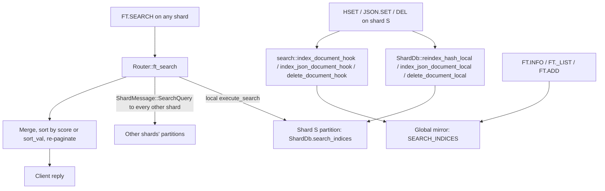
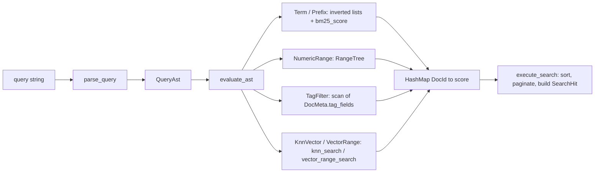

# Component 09: RediSearch Full-Text Engine & Hybrid Vector Fusion

> **High-level design**: [`docs/design/09_redisearch.md`](../design/09_redisearch.md)
> **Consolidated implementation spec**: [`components.md`](components.md)
> **Main source**: `src/search.rs` (engine), with glue in `src/router.rs`, `src/shard.rs`, `src/server.rs`, `src/connection.rs`, `src/resp.rs`, `src/aof.rs`, `src/table.rs`, `src/vector.rs`.

---

## 1. What this subsystem does

Rudis implements a RediSearch-compatible secondary index over ordinary **HASH** and **RedisJSON** keys. A client defines an index once (`FT.CREATE idx ON HASH PREFIX 1 doc: SCHEMA title TEXT price NUMERIC tags TAG emb VECTOR HNSW ...`), keeps writing keys with normal commands (`HSET`, `JSON.SET`, `DEL`, ...), and then queries them with:

- **`FT.SEARCH`** – full-text search (BM25 ranking), numeric ranges, tag filters, boolean combinations, vector **KNN** (k nearest neighbours) and **`VECTOR_RANGE`** (all vectors within a radius), and **hybrid** text+vector search with score fusion.
- **`FT.HYBRID`** – a convenience front-end that builds a hybrid `FT.SEARCH`.
- **`FT.AGGREGATE`** – a small analytics pipeline (`GROUPBY`/`REDUCE`, `APPLY`, `FILTER`, `SORTBY`, `LIMIT`) over the matching documents.
- Admin/introspection: `FT.INFO`, `FT._LIST`, `FT.ALTER`, `FT.DROPINDEX`, `FT.EXPLAIN`, `FT.PROFILE`, legacy `FT.ADD`.

Users are application developers doing product search, RAG retrieval (vector + keyword), and filtering; the MCP server (Component 20) also exposes `FT.SEARCH` to LLM agents as the `rudis_ft_search` tool.

The engine is an in-memory **inverted index** (term → list of documents containing it), a **B-tree numeric index**, a per-field **vector index** (FLAT brute force or HNSW graph from `src/vector.rs`), and a hand-written query parser/evaluator. Only index *definitions* are persisted; documents are re-indexed from the keyspace on load.

---

## 2. Mental model

Every index exists in **two copies**:

1. **Per-shard partitions** – `ShardDb.search_indices: HashMap<String, InvertedIndex>`. Each shard thread owns the index entries for the keys *it* owns. No locking (a `ShardDb` is confined to its shard thread). **`FT.SEARCH` and `FT.AGGREGATE` read these**, by scatter/gather across shards.
2. **The global mirror** – a process-wide registry `SEARCH_INDICES` in `src/search.rs` (`RwLock<HashMap<String, Arc<RwLock<InvertedIndex>>>>`, `parking_lot` locks). Every write hook indexes documents here too, so it holds the union of all shards. **`FT.INFO`, `FT._LIST` and `FT.ADD` use only the mirror**; `FT.SEARCH` falls back to it only when the local shard has no partition with that name.



Inside one `InvertedIndex`, a query string is parsed into a `QueryAst` tree, the tree is evaluated into a `HashMap<DocId, score>`, the candidates are sorted (by BM25 score, by vector distance, or by a numeric `SORTBY` field), paginated, and turned into `SearchHit`s.



---

## 3. Data structures

### 3.1 Schema: `FieldType`, `SchemaField`, `IndexSchema`

A schema field has an **identifier** (the HASH field name, or a JSONPath such as `$.title`) and an **alias** (the name given with `AS`; defaults to the identifier, and for a JSONPath without `AS` the parser derives it by stripping `$.` and a trailing `.*`/`[*]`, so `$.title` becomes `title`).

```rust
pub enum FieldType {
    Text    { weight: f64, sortable: bool, nostem: bool },
    Numeric { sortable: bool },
    Tag     { separator: char, casesensitive: bool },
    Vector  { dim: usize, distance_metric: String, algorithm: String, attrs: VectorFieldAttrs },
}
pub struct SchemaField { pub identifier: String, pub alias: String, pub field_type: FieldType }
pub struct IndexSchema {
    pub name: String,
    pub on_type: String,                    // "HASH" or "JSON"
    pub prefixes: Vec<String>,              // empty = every key of that type
    pub fields: HashMap<String, FieldType>, // keyed by BOTH alias and identifier
    pub schema_fields: Vec<SchemaField>,    // ordered list (FT.INFO, persistence)
}
```

`IndexSchema` helpers used by persistence:

| Function | Purpose |
| :--- | :--- |
| `IndexSchema::ft_create_args` / free fn `ft_create_args` | Produces the **canonical** `FT.CREATE name ON <type> [PREFIX n ...] SCHEMA ...` argv. Every field is written as `identifier AS alias <type> ...`; vector fields always list `TYPE`, `DIM`, `DISTANCE_METRIC`, `INITIAL_CAP` plus `M`/`EF_CONSTRUCTION`/`EF_RUNTIME`/`EPSILON` (HNSW) or `BLOCK_SIZE` (FLAT). It must parse back to the same schema. |
| `ft_alter_args` | Canonical `FT.ALTER name SCHEMA ADD ...` argv. |
| `IndexSchema::same_definition` | Equality on name, `on_type` (case-insensitive), prefixes and `schema_fields`. Used by `ensure_search_index`. |
| `merge_schema_fields` | Applies `FT.ALTER ... SCHEMA ADD`: a new field whose alias **or** identifier matches an existing one replaces it; otherwise it is appended. |

### 3.2 Vector field attributes

`VectorFieldAttrs` holds the tuning knobs from `FT.CREATE ... VECTOR <algo> <nargs> ...`:

| Field | Type | Default | Meaning |
| :--- | :--- | :--- | :--- |
| `data_type` | `VectorDataType` | `Float32` | Element type: `Float32`, `Float64`, `Float16`, `BFloat16`, `Int8`, `Uint8` (`elem_size` = 4, 8, 2, 2, 1, 1 bytes). |
| `m` | `usize` | 16 | HNSW max neighbours per node (capped at `vector::MAX_HNSW_M` = 4096 by the parser). |
| `ef_construction` | `usize` | 200 | HNSW build-time beam width. |
| `ef_runtime` | `usize` | 10 | HNSW default query beam width. |
| `initial_cap` | `usize` | 1024 | Pre-allocated capacity (FLAT). |
| `epsilon` | `f64` | 0.01 | Stored and echoed, **never read** (see §11). |
| `block_size` | `usize` | 1024 | Stored and echoed, **never read**. |

`DIM` must be in `1..=vector::MAX_VECTOR_DIM` (65,536) and `DISTANCE_METRIC` one of `L2`, `IP`, `COSINE` (`FT.CREATE` enforces both and requires `TYPE`).

### 3.3 Per-document state: `DocId`, `Posting`, `DocMeta`

Documents are identified internally by a dense **`DocId` (`u32`)** rather than their key string, so posting lists stay compact. IDs start at 1 and freed IDs are recycled.

```rust
pub struct Posting { pub doc_id: DocId, pub term_freq: u32 }   // 8 bytes
pub struct DocMeta {
    pub key: Bytes,
    pub doc_len: usize,                                    // token count across ALL text fields
    pub fields: HashMap<String, String>,                   // raw field values (returned by FT.SEARCH)
    pub numeric_fields: HashMap<String, f64>,
    pub tag_fields: HashMap<String, HashSet<String>>,
    pub vector_fields: HashMap<String, Vec<f32>>,          // primary vector per vector field (keyed by alias)
    pub multi_vector_fields: HashMap<String, Vec<Vec<f32>>>, // all chunks; chunk 0 == primary
    pub terms: Vec<String>,                                // terms this doc contributed (for deletion)
}
```

### 3.4 Numeric index: `RangeTree`

`RangeTree` is a `BTreeMap<OrderedF64, Vec<DocId>>` plus a `total_entries` counter. `OrderedF64` wraps `f64` with a `total_cmp`-based `Ord`, so floats can be B-tree keys. Each bucket holds the sorted list of documents with exactly that value.

- `add` / `remove`: B-tree lookup, then `binary_search` inside the bucket; empty buckets are deleted.
- `range(min, max)`: `BTreeMap::range(min..=max)` — **O(log N + K)** (inclusive bounds). Returns empty when either bound is NaN or `min > max` (a NaN bound would otherwise panic `BTreeMap::range`).
- `min()` / `max()`: first/last key.

### 3.5 The index: `InvertedIndex`

| Field | Type | Meaning |
| :--- | :--- | :--- |
| `schema` | `Option<IndexSchema>` | The definition (always `Some` when built via `InvertedIndex::new`). |
| `inverted` | `HashMap<String, Vec<Posting>>` | Term → postings (unsorted, appended on insert). |
| `numeric_trees` | `HashMap<String, RangeTree>` | Numeric field name → tree. |
| `key_to_id` | `HashMap<Bytes, DocId>` | Document key → dense id. |
| `id_to_meta` | `HashMap<DocId, DocMeta>` | Dense id → metadata. |
| `vector_indices` | `HashMap<String, vector::VectorFieldIndex>` | Vector field **alias** → FLAT or HNSW index. |
| `next_doc_id` | `DocId` | Next fresh id (starts at 1). |
| `free_ids` | `Vec<DocId>` | Recycled ids from deleted documents. |
| `total_docs` | `usize` | Document count. |
| `total_terms` | `usize` | Sum of `doc_len` over all docs (for average document length). |
| `indexing_failures` | `usize` | Documents rejected for bad vectors (`hash_indexing_failures` in `FT.INFO`). |

`VectorFieldIndex` (in `src/vector.rs`) is an enum over `FlatIndex` and `HnswIndex` with `add`, `remove`, `search(query, k, ef)`, `search_filtered(query, k, ef, filter)`, `range_filtered(query, radius, epsilon, filter)`, `metric`, `dim`, `len`, `memory_usage`. Vector entries are keyed by **`Bytes` document key**, not `DocId`; extra chunks use the key `"<doc_key>\x00<chunk_idx>"`.

`build_vector_index` creates the backing index from a `FieldType::Vector`: `FLAT` → `FlatIndex::new(name, dim, metric, initial_cap)`, anything else → `HnswIndex::with_params(name, dim, metric, m, ef_construction, ef_runtime)`. `InvertedIndex::new` builds one per vector field up front; if `dim` is 0 (only possible for schemas built in code, not via `FT.CREATE`), it is built lazily on the first document using that vector's length.

### 3.6 Query and result types

```rust
pub enum QueryAst {
    Term(String), Prefix(String), Exact(String),
    FieldScope { field: String, inner: Box<QueryAst> },
    NumericRange { field: String, min: f64, max: f64 },
    TagFilter { field: String, tags: Vec<String> },
    And(Vec<QueryAst>), Or(Vec<QueryAst>), Not(Box<QueryAst>),
    KnnVector { field, k: usize, query_vec: Vec<f32>, param_name: String,
                k_param: Option<String>, ef_runtime: Option<String>, yield_as: Option<String> },
    VectorRange { field, radius: f32, radius_param: Option<String>, param_name: String,
                  epsilon: Option<String>, yield_as: Option<String> },
    MatchAll,
}
```

`k_param`, `ef_runtime`, `radius_param` and `epsilon` hold either a literal or a `$name` reference, resolved at **execution** time against `PARAMS` by `resolve_usize_param` / `resolve_f32_param` / `resolve_str_param` (a `$name` is looked up as `name`, then as `$name`). Useful `QueryAst` methods:

- `knn_clause()` – finds the first `KnnVector`/`VectorRange` node (descending into `And`, `Or`, `FieldScope`).
- `knn_k(opts)` – effective K of the KNN clause (`$K` resolved).
- `knn_score_field()` – name of the distance field in results: the `AS`/`YIELD_DISTANCE_AS` alias, else `__<field>_score`.
- `as_hybrid_rrf()` – if the AST is an `And` containing a vector clause **and** at least one non-`MatchAll` sibling, returns `(text_part, vector_part)` for fusion.

`SearchOptions` (parsed from `FT.SEARCH` arguments):

| Field | Type | Default | Meaning |
| :--- | :--- | :--- | :--- |
| `offset`, `limit` | `usize` | 0, 10 | `LIMIT off n`. |
| `nocontent` | `bool` | false | Return ids only. |
| `withscores` | `bool` | false | Include score after each id. |
| `rrf_k` | `Option<f64>` | None | RRF fusion constant (enables hybrid RRF). |
| `linear_weights` | `Option<(f64, f64)>` | None | `(alpha, beta)` for linear fusion. |
| `sortby` | `Option<(String, bool)>` | None | `(field, ascending)`. |
| `return_fields` | `Option<Vec<String>>` | None | `RETURN n f...`. |
| `params` | `HashMap<String, Vec<u8>>` | empty | `PARAMS n name value ...` (binary-safe values). |
| `dialect` | `Option<u32>` | None | Validated `1..=4`, never read. |
| `timeout_ms` | `Option<u64>` | None | Parsed, never read. |

`SearchHit { doc_id: String, score: f64, sort_val: Option<f64>, fields: HashMap<String, String> }` is what shards return and the router merges.

---

## 4. Indexing

### 4.1 Tokenization and stemming

`tokenize_text(text, stem)`:

1. Split on every non-alphanumeric character.
2. ASCII-lowercase each piece; drop empty pieces and words in `ENGLISH_STOP_WORDS` (a fixed English list: articles, pronouns, auxiliaries, contractions such as `you're`).
3. If `stem`, apply `simple_stem`.

`simple_stem` is five suffix rules, checked in order (not Porter/Snowball):

| Rule | Example |
| :--- | :--- |
| length > 5 and ends `ing` → drop 3 | `running` → `runn`, `indexing` → `index` |
| length > 4 and ends `ies` → replace with `y` | `studies` → `study` |
| length > 4 and ends `es` → drop 2 | `boxes` → `box` |
| length > 3 and ends `ed` → drop 2 | `played` → `play` |
| length > 3, ends `s` but not `ss` → drop 1 | `cats` → `cat`, `class` unchanged |

The same function runs at index time and for bare query words, so they normally agree.

### 4.2 Indexing a HASH document

Entry point: `InvertedIndex::add_hash_document(key, raw: &[(Bytes, Bytes)])`, which receives the full `HGETALL` of the key (binary-safe).

1. For each `(field, value)`: if the field name matches a `VECTOR` schema field's identifier or alias, decode it with `decode_vector(value, TYPE, DIM)`. Success puts the vector into a `vectors` map under the alias; failure marks the document as failed.
2. Every value (including vector blobs) is also stored lossily as a UTF-8 `String` in a field map.
3. If any vector failed: remove any previous version of the document from the index, increment `indexing_failures`, and stop — **the whole document is rejected**.
4. Otherwise call `add_document(key, fields, Some(vectors))`.

`decode_vector(bytes, data_type, dim)`:

1. Try a **text** parse (`parse_vector_text`) — only if every byte is an ASCII digit, `.`, `,`, `-`, `+`, `e`, `E`, `[`, `]` or whitespace; accepts `"1,2,3"` and `"[1, 2, 3]"`. Use it if `dim == 0` or it has exactly `dim` components.
2. Otherwise require `bytes.len() == dim * elem_size` and decode a **little-endian binary blob** via `decode_typed_blob` (`f32/f64::from_le_bytes`, IEEE half-precision via `f16_to_f32`, bfloat16 by shifting into the high half of an `f32`, `i8`/`u8` cast directly).
3. Reject if the length differs from `dim` or any component is not finite.

Example: `HSET doc:1 emb <16 bytes>` for a `TYPE FLOAT32 DIM 4` field. The bytes are not all ASCII-numeric, so the text parse fails; 16 == 4 × 4, so they decode as four `f32`s.

### 4.3 `add_document` — the common indexing core

`add_document(key, fields: HashMap<String,String>, vectors: Option<HashMap<String, Vec<f32>>>)` is shared by HASH, JSON and `FT.ADD`:

1. If the key is already indexed, `remove_document` it first (re-index = remove + add).
2. **Vectors first.** For each `VECTOR` schema field, take the vector from `vectors` (by alias, then identifier), else decode the field's string value. If it has the right dimension, also collect extra chunks `"<alias>#1"`, `"<alias>#2"`, … (or `"<identifier>#n"`) from `vectors` until one is missing. A wrong dimension on the primary or any chunk increments `indexing_failures` and **rejects the document** (note the old version was already removed in step 1).
3. For each field: look up its type in `schema.fields` (keyed by alias and identifier):
   - `TEXT` → `tokenize_text(value, !nostem)`, add to per-term frequency map and `doc_len`.
   - `NUMERIC` → `trim().parse::<f64>()`; unparsable values are silently skipped.
   - `TAG` → split on `separator`, trim, drop empties, lowercase unless `casesensitive`, store as a set.
   - `VECTOR` → nothing here (handled in step 2).
   - **Not in the schema** (and not the JSON `"$"` key) → indexed as stemmed text anyway (untyped fallback).
4. Allocate a `DocId` (`free_ids.pop()` or `next_doc_id++`).
5. Append `Posting { doc_id, term_freq }` to each term's list; remember the terms in `DocMeta.terms`.
6. For each vector field: build the vector index if missing, `add(key, primary)`, then `add("<key>\x00<i>", chunk_i)` for each extra chunk.
7. Insert each numeric value into `numeric_trees[field]`.
8. Store `DocMeta`, update `key_to_id`, `total_docs`, `total_terms`.

### 4.4 Indexing a JSON document

`extract_json_fields(schema, root)` turns a JSON value into the `(fields, vectors)` pair for `add_document`:

1. Always stores the whole document serialized under the key `"$"` (so it is returned by `FT.SEARCH` unless `RETURN` is used; it is not tokenized).
2. For each schema field, parse its identifier as a JSONPath (`json::parse_json_path`) and evaluate it (`json::query_json_path`). No match → skip.
3. By type:
   - `TEXT`: strings, numbers, bools, and array elements are joined with spaces.
   - `NUMERIC`: the first match, as a JSON number or numeric string.
   - `TAG`: strings / array elements joined with the field's separator.
   - `VECTOR`: every match that is a numeric array (or a string decodable by `parse_vector_blob`, i.e. `decode_vector` as FLOAT32 with any dim) becomes a candidate. The first is the primary vector (stored under alias and identifier); later ones become chunks `"<alias>#1"`, `"<alias>#2"`, … The primary is also stored as a comma-joined string field.
4. Each value is stored under the alias **and**, if different, the identifier.

**Multi-vector (chunked) fields** come from a JSONPath that matches several arrays, e.g. `$.chunks[*].emb`: a document with three chunk embeddings gets one primary vector and two chunks in the vector index, all mapping back to the same `DocId`.

### 4.5 Removing a document

`remove_document(key)` costs O(terms in the document), not O(vocabulary):

1. Remove `key_to_id[key]`, take the `DocMeta`, decrement counters, push the id onto `free_ids`.
2. For each term in `DocMeta.terms`, `retain` the postings without this id; drop empty lists.
3. Remove each numeric value from its `RangeTree`; drop empty trees.
4. Remove the primary vector and every `"<key>\x00<i>"` chunk from each vector index.

### 4.6 Which writes update the indexes

| Trigger | Per-shard partition | Global mirror |
| :--- | :--- | :--- |
| `HSET`, `HMSET` (via `reindex_hash_for_search`: re-reads `HGETALL`, re-indexes or deletes if the hash is now empty) | yes | yes |
| `JSON.SET`, `JSON.DEL` | yes | yes |
| `JSON.NUMINCRBY`, `JSON.NUMMULTBY`, `JSON.STRAPPEND`, `JSON.ARRAPPEND`, `JSON.ARRPOP`, `JSON.TOGGLE`, `JSON.CLEAR` | **no** | yes |
| `DEL` / `UNLINK` (local and cross-shard paths, `Router::del_local`, `ShardMessage::Del`) | yes | yes |
| `FT.ADD` | **no** | yes |
| `FT.CREATE` / `FT.ALTER` backfill (`ShardDb::init_search_index`) | yes | yes |
| `HDEL`, `HINCRBY`, key expiry, eviction, `FLUSHDB`/`FLUSHALL` | **no** | **no** |

HASH hooks only run when `db.has_search_indices() || search::has_active_search_indices()` (the latter is an atomic counter, `SEARCH_INDICES_COUNT`, so it is cheap when no index exists). While any index exists, several write fast paths in `src/server.rs` and `src/connection.rs` (single-key `DEL`/`UNLINK`, `HDEL` batching) are disabled so the slow path with hooks runs.

---

## 5. Index lifecycle across shards

### 5.1 `FT.CREATE` — `Router::create_search_index`

1. Fail with `Index already exists: <name>` if the local partition or the mirror has the name (`Router::has_search_index`).
2. Register an empty index in the mirror (`search::create_search_index`).
3. `ShardDb::init_search_index(schema)` on the local shard: build a fresh `InvertedIndex`, scan this shard's **current DB** table (non-expired keys matching a prefix; `HGETALL` each) for HASH indexes, or its `json_store` for JSON indexes, and index each document into both the new partition and the mirror. Documents that were in a previous partition of the same name but are not found by the scan are carried over.
4. Log the command (`log_mutation`) to this shard's AOF and the replication stream.
5. Send `ShardMessage::InitSearchIndex { schema, aof_record, responder }` to each other shard **one at a time**, awaiting each reply. Each shard runs `init_search_index` on its own keys and appends `aof_record` (the canonical `FT.CREATE` RESP) to its own AOF.

When `FT.CREATE` returns `+OK`, every shard has a backfilled partition.

### 5.2 `FT.ALTER` — `Router::alter_search_index`

1. Load the current schema (local partition, else mirror; `Unknown Index name` if neither).
2. `merge_schema_fields` with the new fields.
3. `search::reset_search_index` replaces the mirror entry with an **empty** index.
4. Local `init_search_index(merged)` (rebuild + backfill into partition and mirror), log, then broadcast `InitSearchIndex` with the merged schema to every other shard.

While the broadcast runs, the mirror only contains documents from shards that have finished.

### 5.3 `FT.DROPINDEX` — `Router::drop_search_index`

Drop the local partition, send `ShardMessage::DropSearchIndex` to every other shard (each appends the AOF record only if it had the index and replies whether it dropped), then drop the mirror entry. Returns `Unknown Index name` if no shard had it; logs the command only on success. The `DD` flag is carried into the AOF record but **no keys are deleted**.

### 5.4 Persistence, replication and reload

Only definitions are persisted; documents are ordinary keys and are re-indexed on load.

- **AOF**: `aof::command_to_resp` encodes `FT.CREATE` (canonical form via `search::ft_create_args`), `FT.ALTER` (`ft_alter_args`) and `FT.DROPINDEX [DD]`. Every shard's AOF holds the definitions because each shard replays only its own file. On replay (`execute_local_command`), `FT.CREATE` → `ShardDb::define_search_index` (`ensure_search_index` in the mirror, discard any stale partition, `init_search_index`), `FT.ALTER` → `ShardDb::alter_search_index`, `FT.DROPINDEX` → drop locally and in the mirror. An AOF rewrite emits one `FT.CREATE` per index **before** any key, so replaying the keys re-indexes them; AOF resharding copies the definitions into every new file.
- **RDB**: each shard writes one `EXT_TYPE_SEARCH_INDEX` (= 20) extension record per index: the index name plus the canonical `FT.CREATE` RESP. On load (`table::load_rdb_bytes`), the record is parsed back with `resp::parse_command` and an empty `InvertedIndex` is inserted into `search_indices`; after the whole file is loaded, `ShardDb::rebuild_search_indices` re-defines every index (switching to DB 0) and backfills. AOF files with an RDB preamble and `restore_rdb_chunk` also call `rebuild_search_indices`.
- **Reload safety**: before parallel reloads (full sync, `DEBUG LOADAOF`), `Router::forget_global_search_indices` drops this server's names from the mirror, and each loading shard clears its partitions. Each shard then calls `ensure_search_index`, which keeps an existing mirror entry with the same definition, so all shards backfill into one shared mirror without stale documents.
- **Replication**: a replica applies `FT.CREATE`/`FT.ALTER`/`FT.DROPINDEX` from the master through the router (`execute_cross_shard_replica_command`), so they reach all shards.
- `FT.ADD` is not persisted or replicated.

---

## 6. Query language — `parse_query`

The parser is hand-written and works on whitespace-split words. It first strips one layer of balanced outer parentheses (`strip_outer_parens`); `*` or an empty string is `MatchAll`.

**KNN suffix.** If the string contains `=>[KNN`, it splits there. The part before (parens stripped; `*` or empty → `MatchAll`) is parsed recursively as the base; `parse_knn_clause` parses `K @field $param [EF_RUNTIME e] [AS alias | YIELD_DISTANCE_AS alias]`, plus a legacy trailing block `=>{$YIELD_DISTANCE_AS: d; $EF_RUNTIME: 20}`. K can be a literal or `$name` (default 10). Result: `And([base, KnnVector])`.

Otherwise each word is handled in order:

| Syntax | AST | Notes |
| :--- | :--- | :--- |
| `-x` | `Not(parse_query(x))` | |
| `@f:[VECTOR_RANGE r $blob ...]` | `VectorRange` | `r` literal or `$name`; optional `EPSILON e`, `AS`/`YIELD_DISTANCE_AS alias`, or a trailing `=>{$EPSILON: ..; $YIELD_DISTANCE_AS: ..}` block. Words are re-joined until `]` (and `}` for the block). |
| `@f:[min max]` | `NumericRange` | Inclusive. An unparsable bound becomes −∞ / +∞, so exclusive `(10` syntax is not supported. |
| `@f:{a \| b}` | `TagFilter` | Tags are trimmed and **always lowercased**. |
| `@f:rest` | `FieldScope { f, parse_query(rest) }` | |
| `\|` (a standalone word) | `Or([left, right])` | Everything before is the left side (one term or an `And`), everything after is parsed recursively as the right side. |
| `word*` | `Prefix(lowercased word)` | Not stemmed. |
| other | `Term` / `And` of `Term`s | Surrounding quotes stripped, then `tokenize_text(word, stem = true)`; several tokens become an `And`; if everything was a stop word, `Term(simple_stem(word))`. |

Several top-level items become `And(items)`. `QueryAst::Exact` exists and is evaluated, but the parser never produces it: a quoted phrase `"rust systems"` is just two terms.

**Example.** `@title:rust @price:[10 100] -@tag:{old}=>[KNN 5 @emb $vec AS dist]` parses as:

```
And([
  And([ FieldScope{title, Term("rust")}, NumericRange{price, 10, 100}, Not(TagFilter{tag, ["old"]}) ]),
  KnnVector{ field: "emb", k: 5, param_name: "vec", yield_as: Some("dist"), .. }
])
```

---

## 7. Query evaluation — `evaluate_ast`

`evaluate_ast(index, ast, opts) -> HashMap<DocId, f64>` walks the tree recursively:

| Node | Behaviour | Cost |
| :--- | :--- | :--- |
| `MatchAll` | every document, score 1.0 | O(N) |
| `Term(t)` / `Exact(t)` | postings of `t`, each scored with `bm25_score` | O(postings) |
| `Prefix(p)` | every term in the vocabulary starting with `p`; BM25 scores summed per doc | O(vocabulary) |
| `FieldScope{f, inner}` | evaluate `inner` over the **whole** document, then keep documents that **have** field `f` (or `f` without `$.`) | inner + O(hits) |
| `NumericRange` | `RangeTree::range` if a tree exists (`get_numeric_tree` tries `f`, then with `$.` removed or added); otherwise linear scan; score 1.0 | O(log N + K) |
| `TagFilter` | scan every document's `tag_fields[f]`, match if any tag is present; score 1.0 | O(N) |
| `And` without vector clause | intersect left to right, adding scores; stops early once empty | |
| `And` with a vector clause | **pre-filtered hybrid**: intersect the non-`MatchAll` siblings into a filter set, then run the vector clause restricted to it (§7.2). If there are no siblings, run it unfiltered. | |
| `Or` | union, adding scores | |
| `Not(x)` | every document not matched by `x`, score 1.0 | O(N) |
| `KnnVector` / `VectorRange` (top level) | `knn_search` / `vector_range_search` with no filter | |

### 7.1 BM25 scoring

BM25 ("Best Matching 25") ranks a document by how often a query term appears in it, discounted for common terms and long documents. `bm25_score(term, posting, doc_len)`:

```
n     = number of documents containing term
idf   = ln( (N − n + 0.5) / (n + 0.5) + 1 )        // returns 0.0001 if idf <= 0
avgdl = max(total_terms / total_docs, 1.0)
tf    = f·(k1 + 1) / ( f + k1·(1 − b + b·doc_len/avgdl) ),   k1 = 1.2, b = 0.75
score = idf · tf
```

`doc_len` is the document's total token count over all text fields. Worked example: 3 documents, the term occurs once in one document of average length → `idf = ln(2.5/1.5 + 1) ≈ 0.981`, `tf = 2.2 / 2.2 = 1.0`, score ≈ 0.981. A multi-term query adds the scores of each term (via `And`). The `WEIGHT` of a text field is **not** used.

### 7.2 KNN search — `knn_search`

1. Resolve the query vector (`knn_query_vector`): an inline vector if present, else `PARAMS[param_name]` decoded with the field's `TYPE`/`DIM` (`decode_vector`). An empty vector or K = 0 returns nothing.
2. Resolve K (`$K` allowed, default 10) and optional `EF_RUNTIME`.
3. Resolve the field (`resolve_vector_field` accepts alias, identifier, or `$.`-prefixed path) and its metric.
4. `k_fetch = 4·K` if any document has more than one chunk for this field, else K (over-fetch so chunk de-duplication still yields K documents).
5. Dispatch on (vector index present?, filter present?):

| Index | Filter | Strategy |
| :--- | :--- | :--- |
| none | none / some | Brute force over all / filtered docs using `min_doc_vector_distance` (minimum over all chunks), sort, keep K. |
| yes | none | `vi.search(query, k_fetch, ef)`; map keys back to `DocId` (`resolve_vec_key_doc_id` strips `\x00<chunk>`); keep min distance per doc (`dedup_min_distance`); keep K. |
| yes | some | If `|filter| <= max(0.1 · vi.len(), K)` (`KNN_ADHOC_BF_RATIO` = 0.1) **or** the index is FLAT → brute force over the filter set. Otherwise `vi.search_filtered` with a predicate "key's doc is in the filter"; if it returns fewer than `min(K, |filter|)` docs (the graph traversal starved), fall back to brute force. |

6. Return `DocId → distance_to_similarity(metric, d)`: COSINE → `max(1 − d, 0)`; L2 and IP → `1 / (1 + max(d, 0))`.

Distances come from `vector::compute_distance`: L2 is Euclidean (square root of squared L2), IP is `−dot`, COSINE is cosine distance.

### 7.3 `VECTOR_RANGE` search — `vector_range_search`

Same resolution and dispatch, but no K: brute force keeps documents whose minimum chunk distance is `<= radius`; with an index it calls `vi.range_filtered(query, radius, epsilon, filter)` and de-duplicates by document. The per-query `EPSILON` only affects HNSW (which defaults to 0.01 when absent); FLAT and brute force ignore it. A negative radius returns nothing.

---

## 8. `execute_search` — one shard's answer

`execute_search(index, ast, opts) -> (total_matches, Vec<SearchHit>)`:

1. **Hybrid short-circuit.** If `rrf_k` or `linear_weights` is set and `as_hybrid_rrf()` matches, run the text part and the vector part separately (unpaginated), fuse them (§9), and paginate. (In the server the router fuses across shards first and clears these options on the sub-queries, so this branch is mainly exercised by direct callers and unit tests.)
2. `evaluate_ast` → candidates; `total_matches` = candidate count.
3. If the query has a vector clause, compute the exact distance of every candidate (`knn_distances`).
4. **Sort**:
   - by distance if there is a vector clause and either no `SORTBY` or `SORTBY` names the distance field (direction from `SORTBY`, default ascending);
   - else by `SORTBY` field — **numeric values only** (from `numeric_fields`, `$.` tolerated; missing → −∞);
   - else by score descending.
5. Skip `offset`, take `limit`.
6. Build hits. When sorting by distance, `score = −distance` (so the router's "score descending" merge keeps nearest first) and, if `SORTBY` was given, `sort_val = distance`. Otherwise `sort_val` = the numeric `SORTBY` value. Unless `NOCONTENT`: copy all `DocMeta.fields` (or only the `RETURN` list), and add the distance field (`knn_score_field`, formatted by `format_distance` as the shortest round-trip number, `-0` normalized to `0`) when it is wanted.

---

## 9. Hybrid fusion

A hybrid query has a text/filter part and a vector part, e.g. `(rust db)=>[KNN 10 @emb $v]` with `RRF` or `LINEAR`. Two independent ranked lists are produced and merged.

### 9.1 Reciprocal Rank Fusion — `reciprocal_rank_fusion(bm25_hits, vector_hits, k)`

Each list contributes `1 / (k + rank + 1)` (rank 0-based) to a document's score; scores are summed per document and sorted descending. Fields come from whichever list saw the document first (text list first). Default `k` = 60.

Worked example, k = 60: text list `[A, B, C]`, vector list `[B, D]`.

| Doc | Text contribution | Vector contribution | Total |
| :--- | :--- | :--- | :--- |
| B | 1/62 = 0.01613 | 1/61 = 0.01639 | **0.03252** |
| A | 1/61 = 0.01639 | – | 0.01639 |
| D | – | 1/62 = 0.01613 | 0.01613 |
| C | 1/63 = 0.01587 | – | 0.01587 |

Result order: B, A, D, C.

### 9.2 Linear fusion — `linear_score_fusion(bm25_hits, vector_hits, alpha, beta)`

1. Text list: min-max normalize scores to `[0, 1]`; if all scores are equal (span ≤ 1e-12) each gets **1.0**. Add `alpha · norm`.
2. Vector list: convert each score to a similarity — a score `<= 0` is a negated distance, so `sim = 1 / (1 + distance)`; a positive score is used as is. Min-max normalize; if all equal, each gets its **raw similarity** (not 1.0). Add `beta · norm`.
3. A document missing from one list gets 0 from that list. Fields: text-side first, then missing fields filled from the vector side. Sort descending. Defaults: `alpha = beta = 0.5`.

### 9.3 Cross-shard orchestration — `Router::ft_search`

When `rrf_k`/`linear_weights` is set and `as_hybrid_rrf()` matches, the router:

1. Recursively calls `ft_search` for the text part and then for the vector part, each a **full scatter/gather** with `offset = 0`, `limit = max(offset + limit, K, 100)`, fusion options cleared.
2. Fuses the two merged lists with RRF or linear fusion, reports `total` = number of fused documents, and paginates.

So a hybrid query costs two scatters instead of one. If a fusion option is given but the query does not have the hybrid shape (e.g. a pure `*=>[KNN ...]`), it is silently ignored.

---

## 10. Distributed search and aggregation

### 10.1 `Router::ft_search` (non-hybrid)

1. `scatter_opts` = the client options with `offset = 0`, `limit = offset + limit` (each shard must return enough hits for the final page).
2. Run `execute_search` on the local partition (or the mirror if this shard has no partition of that name).
3. If `num_shards > 1`: send `ShardMessage::SearchQuery { index, ast, options, responder }` to every other shard first, then await the replies (so shards work in parallel). Each remote shard queries **only its own partition** (empty result if it has none).
4. Sum totals, concatenate hits. Sort by `sort_val` (if `SORTBY`; ascending/descending) or by score descending.
5. If the query has a KNN clause, cap the page size at `min(limit, K)` and the reported total at `min(total, K)`.
6. Skip `offset`, take the page.

Worked example (3 shards, `FT.SEARCH idx "rust" LIMIT 10 5`): each shard is asked for its top 15 by BM25; the router receives up to 45 hits plus three totals, sorts all by score, skips 10, returns 5, and reports the summed total.

### 10.2 `FT.AGGREGATE` — `Router::ft_aggregate` + `execute_aggregate_pipeline`

1. Parse the query, then call `ft_search` with `limit = 100_000`, no sort, and `return_fields` = the `LOAD` list (or all fields if no `LOAD`).
2. On the coordinating shard only, build one row per hit: `__key`, `__score`, then the loaded fields (`AggregateRow` = ordered `Vec<(String, String)>`; `get_row_field`/`set_row_field` ignore a leading `@`).
3. Run the stages **in command order**:

| Stage | Behaviour |
| :--- | :--- |
| `Filter(expr)` | `evaluate_filter`: exactly `@field op value` with `==`/`=`, `!=`, `>`, `>=`, `<`, `<=`; numeric if both sides parse, else string comparison; quotes stripped from the value; anything malformed or an unknown operator keeps the row. No `&&`/`\|\|`. |
| `Apply{expr, alias}` | `evaluate_expr`: recursive-descent arithmetic with `+ - * /`, parentheses, unary minus, numbers, and `@field` (or bare identifier) references; missing/non-numeric fields are 0; division by zero gives 0. Result is an integer string if whole, else up to 4 decimals with trailing zeros trimmed. On a parse error the alias gets the value of the field named by `expr`. |
| `Group{fields, reducers}` | Bucket rows by the string values of the group fields, emit one row per bucket with the group fields plus reducers: `COUNT`, `SUM`, `AVG` (2 decimals unless whole), `MIN`, `MAX`. Non-numeric values are skipped; `MIN`/`MAX` of nothing is `"0"`. Default reducer alias is the lowercase function name. Bucket order is unspecified. |
| `Sort{fields, max}` | Stable multi-key sort; numeric when both values parse, else string order. `max` is always `None` from the parser. |
| `Limit{offset, num}` | Skip/take. |

The reply is `[row_count, row, row, ...]` where the count is the number of output rows.

---

## 11. Command surface

| Command | Syntax as parsed (`src/resp.rs`) | Notes |
| :--- | :--- | :--- |
| `FT.CREATE` | `idx [ON HASH\|JSON] [PREFIX n p...] SCHEMA (id [AS alias] TEXT [WEIGHT w] [SORTABLE] [NOSTEM] \| NUMERIC [SORTABLE] \| TAG [SEPARATOR c] [CASESENSITIVE] \| VECTOR FLAT\|HNSW [nargs] TYPE t DIM d DISTANCE_METRIC m [INITIAL_CAP c] [BLOCK_SIZE b] [M m] [EF_CONSTRUCTION e] [EF_RUNTIME e] [EPSILON e])...` | Default `ON HASH`. Unknown options before `SCHEMA` are skipped; unknown field types are dropped. For `VECTOR`, `TYPE`/`DIM`/`DISTANCE_METRIC` are mandatory, `nargs` must be even and fit, algorithm-specific attributes are only accepted for their algorithm, `EPSILON > 0`. Backfills existing keys (§5.1). |
| `FT.SEARCH` | `idx query [NOCONTENT] [WITHSCORES] [RRF [k]] [LINEAR [a b]] [SCORER RRF [K k] \| SCORER LINEAR [ALPHA a] [BETA b]] [LIMIT off n] [SORTBY f [ASC\|DESC]] [RETURN n f...] [PARAMS n k v...] [DIALECT 1-4] [TIMEOUT ms]` | `RRF` and `LINEAR` are mutually exclusive (last wins). Unknown tokens are skipped. Reply: `[total, id, [score], [field, value, ...], ...]`; scores printed with 6 decimals. `Unknown Index name` if neither copy exists. |
| `FT.HYBRID` | `idx text_query vector_query [RRF [k]] [LINEAR [a b]] [SCORER RRF [K k \| k] \| SCORER LINEAR ...] [LIMIT] [RETURN] [PARAMS] [WITHSCORES] [NOCONTENT] [DIALECT x] [TIMEOUT x]` | Rewritten into an `FT.SEARCH`: a vector query starting `*=>`/`=>`/`[KNN` becomes `(text)=><knn>`, anything else (e.g. `@v:[VECTOR_RANGE ...]`) is appended with a space. RRF with k = 60 is on by default. `DIALECT`/`TIMEOUT` skipped. |
| `FT.AGGREGATE` | `idx query [LOAD n @f...] [GROUPBY n @f... [REDUCE COUNT\|SUM\|AVG\|MIN\|MAX n args [AS a]]...] [APPLY expr [AS a]] [SORTBY n @f [ASC\|DESC]...] [LIMIT off n] [FILTER expr] [DIALECT x] [TIMEOUT x]` | `@` stripped from field names; `DIALECT`/`TIMEOUT` skipped. §10.2. |
| `FT.ALTER` | `idx ... SCHEMA [ADD] (id [AS alias] type ...)+` | At least one valid field required. Vector parsing here is **lenient**: no mandatory attributes (defaults `DIM 1`, `COSINE`, `FLOAT32`), no algorithm check, unknown attributes ignored; only `DIM <= MAX_VECTOR_DIM` and `M <= MAX_HNSW_M` are enforced. §5.2. |
| `FT.DROPINDEX` | `idx [DD]` | `DD` does not delete keys. |
| `FT.INFO` | `idx` | Mirror only. 10 key/value pairs: `index_name`, `index_options` (empty), `index_definition` (`key_type`, `prefixes`), `attributes`, `num_docs`, `num_terms` (distinct terms), `total_inverted_index_blocks` (actually `total_terms`, the token total), `vector_index_sz_mb` (sum of `memory_usage`), `indexing` (`"0"`), `hash_indexing_failures`. Attributes list identifier/attribute/type plus `WEIGHT` (TEXT), `SEPARATOR` (TAG), or algorithm, data_type, dim, distance_metric, M, ef_construction, ef_runtime, num_vectors (VECTOR; `num_vectors` counts chunks too). |
| `FT._LIST` | – | Sorted names from the mirror. |
| `FT.EXPLAIN` | `idx query` | Returns `format!("{:?}", parse_query(query))`; `idx` is ignored. |
| `FT.PROFILE` | `idx SEARCH [LIMITED] QUERY q [NOCONTENT] [WITHSCORES] [LIMIT off n] [PARAMS n ...] [DIALECT x] [TIMEOUT x]` | Everything before `QUERY` is ignored. Reply: `[search_results, ["Total profile time", s, "Parsing time", s, "Query plan", debug_ast, "Shards", num_shards]]`; times are wall clock in seconds with 6 decimals. |
| `FT.ADD` | `idx doc_id score [...] FIELDS f v ...` | Legacy; writes only the mirror, ignores `score`, never indexes vectors. |

---

## 12. Invariants & gotchas

- **Two copies must stay in sync.** Every code path that mutates documents must touch both `ShardDb.search_indices` and the mirror, or `FT.INFO` and `FT.SEARCH` disagree. Paths that touch only one (§4.6) are real divergences: `FT.ADD` and the JSON in-place mutators (`JSON.NUMINCRBY` etc.) update only the mirror, so `FT.SEARCH` does not see their changes.
- **Indexes go stale on non-hooked writes.** `HDEL`, `HINCRBY`, key expiry, eviction and `FLUSHDB`/`FLUSHALL` do not touch indexes; deleted/expired documents stay searchable until the key is re-written or the index is rebuilt.
- **Indexes are not per-DB.** Hooks fire for writes in any logical DB; the backfill scans the shard's current DB; `rebuild_search_indices` uses DB 0.
- **`FieldScope` does not restrict where a term matched.** `@title:rust` returns documents containing `rust` in *any* text field, provided the document has a `title` field.
- **HASH aliases are not query names.** For HASH documents, `fields`/`numeric_fields`/`tag_fields` are keyed by the raw hash field name (the identifier). `@alias:...` clauses for TEXT/NUMERIC/TAG look up the name as written, so use the identifier. Vector clauses do resolve aliases (`resolve_vector_field`).
- **JSON text fields with `AS` count twice.** `extract_json_fields` stores the value under alias and identifier, and both are in `schema.fields`, so the text is tokenized twice (double term frequency and `doc_len`).
- **Unknown HASH fields are searchable.** Fields not in the schema are indexed as stemmed text and are returned in results (vector blobs appear as lossy UTF-8).
- **Query terms are always stemmed** even when the field is `NOSTEM`; prefix queries are never stemmed. A `NOSTEM` field containing `cats` does not match the query `cats` (stemmed to `cat`).
- **Tag case sensitivity is index-side only.** The parser lowercases query tags, so mixed-case values in a `CASESENSITIVE` field can never match.
- **`SORTBY` only sorts numeric fields** in `execute_search`; a text field sorts as all −∞ (arbitrary order).
- **KNN totals are capped at K** by the router, and a hybrid query's total is the size of the fused list, not the true match count.
- **`VectorFieldIndex` is keyed by document key, everything else by `DocId`.** Chunk keys contain a NUL byte; `resolve_vec_key_doc_id` relies on document keys not containing `\x00`.
- **A bad vector deletes the old version.** Re-writing a document with an undecodable or wrong-dimension vector removes it from the index (and counts a failure) instead of keeping the previous version.
- **IP similarity saturates.** IP distance is `−dot`; `distance_to_similarity` clamps negative distances, so every positive dot product maps to similarity 1.0.
- **Lock pattern.** Mirror hooks take the registry read lock and then each index's write lock, across all shards, so the mirror is a cross-shard contention point; partitions are lock-free.

---

## 13. Limitations / not implemented

- `WEIGHT`, `SORTABLE`, schema-level `EPSILON` and `BLOCK_SIZE` are stored (and round-tripped by persistence) but have no effect.
- `DIALECT` is validated by `FT.SEARCH` and otherwise ignored; `TIMEOUT` is parsed and never enforced.
- No phrase/positional or exact matching (`Exact` is never produced), no slop, no fuzzy (`%term%`), no exclusive numeric bounds, no geo fields, no parenthesized sub-expressions beyond one outer pair, no `INKEYS`/`INFIELDS`/`HIGHLIGHT`/`SUMMARIZE`, no `SCORER` other than BM25 for text.
- `Prefix` scans the whole vocabulary; `TagFilter`, `Not` and `MatchAll` scan every document (no tag inverted index, no trie).
- Multi-vector chunks only come from JSON documents; HASH documents always have one vector per field.
- `FT.AGGREGATE` is not distributed: it fetches up to 100,000 hits and runs all stages on one shard. Only five reducers; `FILTER` supports a single comparison.
- `FT.EXPLAIN` and `FT.PROFILE` report a `Debug`-printed AST and wall-clock timings, not a real iterator plan.
- `FT.DROPINDEX DD` does not delete documents; `FT.ADD` is mirror-only and not persisted.
- Every document is indexed twice (partition + mirror), doubling indexing CPU and memory.
- The MCP tool `rudis_ft_search` exposes only `index`, `query` and `limit` (default 10).

---

## 14. Code map

| File | Key symbols | What they do |
| :--- | :--- | :--- |
| `src/search.rs` | `FieldType`, `VectorDataType`, `VectorFieldAttrs`, `SchemaField`, `IndexSchema`, `ft_create_args`, `ft_alter_args`, `merge_schema_fields` | Schema model and canonical `FT.CREATE`/`FT.ALTER` serialization. |
| `src/search.rs` | `decode_vector`, `decode_typed_blob`, `parse_vector_text`, `f16_to_f32`, `f32_to_f16`, `parse_vector_blob` | Text and typed little-endian vector decoding. |
| `src/search.rs` | `Posting`, `DocMeta`, `OrderedF64`, `RangeTree`, `InvertedIndex`, `get_numeric_tree`, `build_vector_index` | Core index structures. |
| `src/search.rs` | `tokenize_text`, `simple_stem`, `ENGLISH_STOP_WORDS` | Text analysis. |
| `src/search.rs` | `InvertedIndex::{new, add_hash_document, add_document, remove_document, bm25_score, resolve_vector_field}` | Document indexing and scoring. |
| `src/search.rs` | `SEARCH_INDICES`, `SEARCH_INDICES_COUNT`, `create_search_index`, `reset_search_index`, `ensure_search_index`, `drop_search_index`, `list_search_indices`, `get_search_index`, `has_active_search_indices`, `index_document_hook`, `index_json_document_hook`, `delete_document_hook`, `extract_json_fields` | Global mirror registry and write hooks. |
| `src/search.rs` | `QueryAst`, `parse_query`, `parse_knn_clause`, `parse_vector_range_clause`, `strip_outer_parens`, `resolve_*_param` | Query parsing. |
| `src/search.rs` | `evaluate_ast`, `knn_search`, `vector_range_search`, `knn_query_vector`, `knn_distances`, `min_doc_vector_distance`, `dedup_min_distance`, `resolve_vec_key_doc_id`, `distance_to_similarity`, `KNN_ADHOC_BF_RATIO` | Query evaluation and vector search. |
| `src/search.rs` | `SearchOptions`, `SearchHit`, `execute_search`, `format_distance`, `reciprocal_rank_fusion`, `linear_score_fusion` | Per-shard execution and fusion. |
| `src/search.rs` | `AggregateOptions`, `AggregateStage`, `GroupByStage`, `Reducer`, `ApplyStage`, `SortByStage`, `AggregateRow`, `execute_aggregate_pipeline`, `evaluate_expr`, `evaluate_filter` | `FT.AGGREGATE` pipeline. |
| `src/router.rs` | `Router::{create_search_index, alter_search_index, drop_search_index, ft_search, ft_aggregate, has_search_index, forget_global_search_indices, search_aof_record}` | Cross-shard lifecycle, scatter/gather, hybrid orchestration. |
| `src/shard.rs` | `ShardDb.search_indices`, `ShardDb::{init_search_index, define_search_index, alter_search_index, drop_search_index, rebuild_search_indices, reindex_hash_local, delete_document_local, index_json_document_local}`, `ShardMessage::{InitSearchIndex, DropSearchIndex, SearchQuery}`, RDB writer (`EXT_TYPE_SEARCH_INDEX` records) | Per-shard partitions, backfill, persistence hooks. |
| `src/server.rs` | `ShardMessage::{InitSearchIndex, DropSearchIndex, SearchQuery}` handlers | Remote-shard side of the mesh. |
| `src/connection.rs` | `Command::Ft*` arms, `reindex_hash_for_search`, HSET/JSON/DEL hook call sites, AOF replay arms in `execute_local_command`, `execute_cross_shard_replica_command` | Command dispatch, reply formatting, write hooks, replay and replica application. |
| `src/resp.rs` | `"FT.CREATE"`, `"FT.SEARCH"`, `"FT.AGGREGATE"`, `"FT.ALTER"`, `"FT.PROFILE"`, `"FT.HYBRID"`, `"FT.ADD"`, ... arms, `parse_ft_params`, `counted_args`, `strip_field_sigil` | Argument parsing into `Command`, `IndexSchema`, `SearchOptions`, `AggregateOptions`. |
| `src/aof.rs` | `command_to_resp` (`FT.CREATE`/`FT.ALTER`/`FT.DROPINDEX`), AOF rewrite and reshard handling | Definition persistence in the AOF. |
| `src/table.rs` | `load_rdb_bytes` (`EXT_TYPE_SEARCH_INDEX` reader) | Definition restore from RDB. |
| `src/redis_rdb.rs` | `EXT_TYPE_SEARCH_INDEX` (= 20) | RDB extension record type. |
| `src/debug_cmd.rs` | `DEBUG LOADAOF` shard handler | Clears partitions before replay. |
| `src/vector.rs` | `VectorFieldIndex`, `FlatIndex`, `HnswIndex`, `compute_distance`, `MAX_VECTOR_DIM`, `MAX_HNSW_M` | Vector indexes and distance kernels (Component 08). |
| `src/mcp.rs` | `"rudis_ft_search"` tool | `FT.SEARCH` for MCP agents (Component 20). |

Unit tests in `src/search.rs` (`mod tests`) cover BM25/CRUD, dense IDs and term-directed deletion, the range tree (including NaN bounds), typed vector decoding, FLAT binary ingest and dim validation, KNN with params/alias/distance sort, pre-filtered hybrid KNN, `VECTOR_RANGE`, JSON documents, multi-vector chunks with linear fusion, RRF, and the aggregate pipeline. Persistence of definitions is tested in `src/aof.rs` and `src/shard.rs`.
