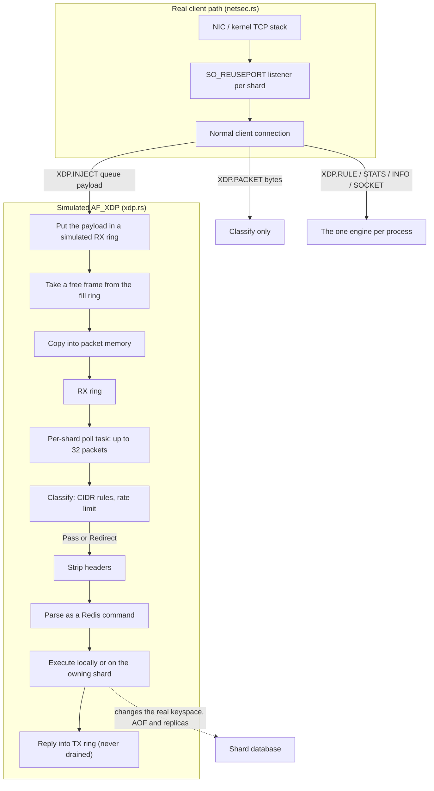
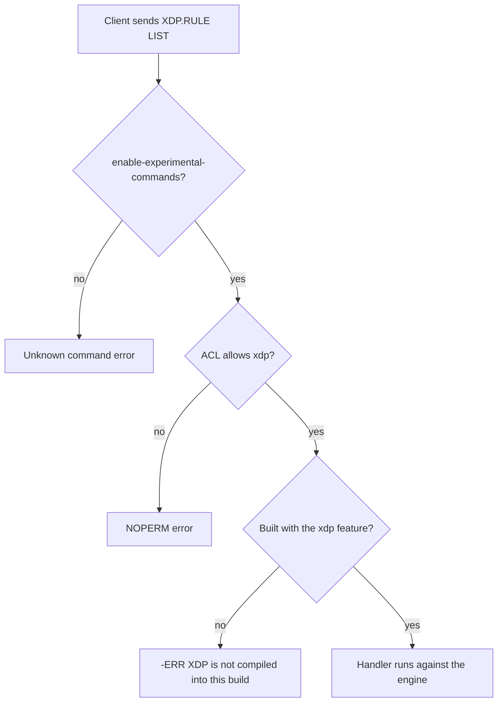

# Component 10: Kernel Bypass and Zero-Copy Networking

> **High-Level Design Spec**: [docs/design/10_kernel_bypass_xdp.md](../design/10_kernel_bypass_xdp.md)
> **Consolidated Implementation Spec**: [docs/internal/components.md](components.md)
> **Main source files**: src/xdp.rs (the simulated AF_XDP engine), src/zerocopy.rs (zero-copy send
> primitives), src/netsec.rs (the *real* listener path, covered here for contrast). Integration
> points: src/server.rs (the per-shard XDP poll task), src/connection.rs (`XDP.*` execution and
> routing), src/resp.rs (parsing and the experimental-command gate), src/acl_categories.rs,
> src/main.rs and src/config.rs (`enable-experimental-commands`), Cargo.toml (the `xdp` cargo
> feature) and src/aof.rs (the writer slot the poll task reads). The [Code map](#11-code-map)
> lists the key symbols.

---

## 1. What this subsystem does

Real "kernel bypass" networking on Linux (**AF_XDP**) lets a program receive packets straight from
the network card into a shared memory area, skipping most of the kernel's TCP/IP stack. A small
verified program the kernel runs on every incoming packet (an **eBPF/XDP program**) decides per
packet whether to drop it, pass it to the normal stack, bounce it back out, or *redirect* it into a
user-space socket (an **XSK**). Zero-copy *sending* (`MSG_ZEROCOPY`, and io_uring's `SendZc`) is
the outbound counterpart: the kernel transmits directly from the application's pages instead of
copying them first.

Rudis has three pieces related to this area. It is important to be clear about what each one
really is:

| Piece | What it really is | Who uses it |
| :--- | :--- | :--- |
| src/xdp.rs | An **in-process simulation** of AF_XDP: packet memory, the four socket rings, a CIDR filter, a per-IP rate limiter and a hand-written Ethernet/IPv4/TCP parser. There is no eBPF program, no AF_XDP socket and no network card. It is compiled only with the `xdp` cargo feature, on by default. | The experimental `XDP.*` commands, and one background task per shard that executes commands found in packets injected with `XDP.INJECT`. |
| src/zerocopy.rs | Correct wrappers around `SO_ZEROCOPY`, `send` with `MSG_ZEROCOPY`, an io_uring `SendZc` builder, and a page-aligned buffer pool for io_uring buffer registration. | Nobody; only its own unit tests. |
| src/netsec.rs | The **real** network ingress path: bind-address parsing, listener creation with `SO_REUSEPORT`, the port-in-use probe and protected mode. | The main thread and every shard. All real client traffic arrives here. |

So: **no Rudis client traffic ever goes through kernel bypass.** Clients connect to ordinary TCP
listeners built by netsec.rs. The XDP engine is a packet-classification and command-injection
harness reachable only through admin commands, and only when experimental commands are enabled.

---

## 2. Mental model



Read the picture as two worlds. The top box is how every real client reaches Rudis. The bottom box
is a self-contained imitation of the AF_XDP data path whose *only* entry point is a client running
`XDP.INJECT` over a normal connection. Once a payload sits in the simulated RX ring, though, the
command inside it is executed for real against the shard's database.

| Term | Meaning |
| :--- | :--- |
| **XDP** | eXpress Data Path: a kernel hook that runs a small program on each packet as early as possible. |
| **AF_XDP / XSK** | A socket type that receives packets the XDP program redirects to it, through shared-memory rings. |
| **UMEM** | The shared memory region, divided into fixed-size **frames**, that holds packet bytes. |
| **Fill / RX / TX / completion rings** | The four queues of an XSK: free frames for receiving, received packets, packets to send, and sent frames. |
| **CIDR** | Classless Inter-Domain Routing notation, `a.b.c.d/n`: "the first n bits of the address". |
| **Token bucket** | A rate limiter that lets a burst through, then a steady rate. |

---

## 3. Enablement and access control

Two independent switches control XDP: a **compile-time** cargo feature decides whether the engine
exists in the binary at all, and a **runtime** flag decides whether clients may use the commands.



### 3.1 The xdp cargo feature

Cargo.toml declares two optional experimental subsystems that a production build can leave out:
`mcp` and `xdp`. Both are in the default feature set.

* A **default build** includes everything in this document.
* A **`--no-default-features` build** does not compile the engine. src/xdp.rs keeps only the
  action type outside the gate, because the command parser's `XdpRuleAdd` variant needs it.
  Everything else (modes, rules, rings, packet memory, sockets, the engine, the payload extractor
  and the global engine) lives in a private module guarded by the feature and re-exported.
* In such a build the `XDP.*` commands still **parse**, so the same command variants exist
  everywhere, and they still pass the experimental gate and the ACL check. But every handler
  collapses into one arm that replies `-ERR XDP is not compiled into this build (cargo feature
  xdp)` — even with `enable-experimental-commands yes`.
* No shard starts the XDP poll task (§6.2) in such a build.

`MCP.*` follows the same pattern under the `mcp` feature. The other experimental families stay
compiled in, because their data lives in RDB and AOF files that a build without them could not
load. XDP has no persisted state, so leaving it out is safe.

### 3.2 The runtime gate

The `XDP.*` commands belong to the **experimental command families** and are off by default.

* **Config.** `enable-experimental-commands yes|no` in the config file (default `false`) or on the
  command line. The main thread passes the result to the command parser.
* **Gate.** For any command name containing a dot, the parser checks whether experimental commands
  are disabled and whether the name starts with an experimental prefix (`JSON.`, `BF.`, `CF.`,
  `CMS.`, `TOPK.`, `FT.`, `SEMANTIC.`, `CRDT.`, `LLM.`, `MCP.`, `XDP.`). If so, the command
  becomes an unknown command and the client gets the usual "unknown command" error, exactly as if
  it did not exist. The crate's own unit tests default the flag to on.
* **ACL.** All `XDP.*` commands are reported under one family name, `XDP`, and the generated ACL
  table lists `xdp` in the categories `@admin`, `@slow` and `@dangerous`. A user without those
  permissions cannot run them.
* **The engine and poll tasks exist in every build with the feature.** The runtime gate controls
  only the commands. The global engine is created lazily on first use, and every shard starts its
  poll task (§6.2); with experimental commands disabled, that task finds no socket and sleeps
  200 ms between checks.

---

## 4. The simulated engine

Apart from the action type, everything in this section lives behind the `xdp` cargo feature.

### 4.1 Actions and modes

An **action** mirrors the real XDP verdicts: pass, drop, redirect, or transmit back out. Its text
form (`PASS`, `DROP`, `REDIRECT`, `TX`) is what `XDP.RULE ADD` accepts, in any case, and what
`XDP.PACKET` replies with.

A **mode** names the three ways a real XDP program can be attached: *driver* (native, inside the
NIC driver), *SKB* or generic (after the kernel has built a socket buffer: slower but works
everywhere) and *simulated*. The mode is chosen once when the global engine is first created: if
the directory `/sys/class/net` exists the engine is labelled SKB, otherwise simulated. On
essentially every Linux host that directory exists, so the mode is **SKB in practice**. This is
purely a label plus a sizing decision (§4.5): nothing attaches an eBPF program or binds to `eth0`,
which may not even exist. The driver mode is never used.

There is exactly one engine for the whole process, and every shard and connection shares it.

### 4.2 CIDR rules

A rule has an id, an action, the CIDR text exactly as typed, and the network address and mask
derived from it. Ids start at 1 and are never reused. Parsing a CIDR works like this:

1. Split on `/`; more than one slash is an error.
2. Parse the left side as an IPv4 address; IPv6 is not supported.
3. The prefix length is the right side, or 32 if absent; more than 32 is an error.
4. The mask is all zeros for a prefix of 0 (this avoids shifting by 32), otherwise the top
   `n` bits set.
5. The network is the address ANDed with the mask.

**Example.** `10.1.2.3/8` gives the mask `0xFF000000` and the network `0x0A000000`. A packet from
`10.200.0.9` matches because `0x0AC80009 & 0xFF000000 == 0x0A000000`.

Rules are evaluated by **linear scan, first match wins**, in insertion order. There is no priority
field and no trie.

### 4.3 The per-IP rate limiter

Each source IP gets a **token bucket**: it holds up to a capacity of tokens and gains tokens at a
steady rate. On each packet, the elapsed time since the last check is converted to new tokens (up
to the capacity), and the packet is allowed if at least one token is available, which it then
spends. Every packet costs exactly one token regardless of size.

The engine creates a bucket the first time it sees a source IP, with a capacity of 50,000 tokens
and a refill rate of 100,000 tokens per second. Buckets are keyed by the address as a 32-bit
number and are **never evicted**. No command changes the defaults.

### 4.4 Descriptors and rings

A **descriptor** points at a packet inside packet memory: a byte offset (frame index times frame
size), a length and an options field that is always 0.

A ring is a classic index-based circular buffer modelled on the real AF_XDP rings. Its size is
rounded up to a power of two, with a producer index, a consumer index and one slot per entry, each
guarded by its own read-write lock.

* **Producing** fails when the ring is full (the producer is a full lap ahead of the consumer).
  Otherwise it writes the slot and publishes the new producer index with release ordering. A ring
  holds exactly its capacity.
* **Consuming** returns nothing if the indices are equal; otherwise it clones the slot and
  advances the consumer index.

The design is **single-producer, single-consumer**: the indices are updated without
compare-and-swap, so two concurrent producers, or two concurrent consumers, can claim the same
slot. The source comments call the ring "lock-free", but each slot has its own lock.

### 4.5 Packet memory (UMEM)

In real AF_XDP, UMEM is one big pinned region shared by the kernel and user space, divided into
fixed frames. The simulation uses a list of per-frame buffers.

* The frame size is fixed at 2048 bytes. The frame count is 128 for the simulated mode and 4096
  for every other mode.
* Buffers start empty and are allocated on first write, sized to the packet, so an unused socket
  costs only the buffer headers, not frames × 2048 bytes.
* Writing a frame copies at most 2048 bytes; longer data is **silently truncated**. An out-of-range
  index is a silent no-op.
* Reading a frame returns at most the requested length, the frame size and the stored length; an
  out-of-range index returns nothing.

A frame description type with an address, length and buffer is also declared but never used.

### 4.6 The simulated socket

A socket belongs to a (port, queue id) pair. By convention the queue id equals the id of the shard
that polls it. It holds four rings and its own private packet memory:

| Ring | Contents | Notes |
| :--- | :--- | :--- |
| RX | Received packets waiting for the poll task | Descriptors |
| Fill | Free frame indices available for receiving | Starts full with every frame index |
| TX | "Transmitted" responses | Nothing ever consumes it |
| Completion | Frame indices whose transmit "finished" | Nothing ever consumes it |

All four rings are sized to the larger of the frame count and 64, rounded up to a power of two
(4096 in SKB mode, 128 in simulated mode). Each socket also counts received and transmitted
packets, but no command shows them.

Three operations move packets:

1. **Inject.** Take a free frame index from the fill ring (none left means failure). Copy the
   packet into that frame. Push a descriptor onto the RX ring; if the ring is full, return the
   frame index to the fill ring and fail. This is the **only** producer of RX entries anywhere in
   the code, and only `XDP.INJECT` calls it.
2. **Receive burst.** Pop up to a maximum number of descriptors, copy each frame's bytes out, and
   return the frame index to the fill ring.
3. **Transmit burst.** For the *i*-th packet in the batch, write it into frame *i* (frame indices
   are just positions in the batch, not taken from any free list), push a descriptor onto the TX
   ring and, if that worked, push *i* onto the completion ring immediately ("instant completion").
   Stop at the first full TX ring.

### 4.7 The engine

The engine holds a label for the interface name (always `eth0`), the mode, the frame geometry, the
rule list and its id counter, the rate-limiter map, the two default rate settings, a registry of
sockets keyed by (port, queue id), and six counters: packets received, bytes received, dropped,
redirected, passed and rate-limit drops.

Its operations are add, delete (error `Rule ID <id> not found`) and list rules, classify a packet
(§5.1), get-or-create a socket, look a socket up without creating it (the poll task uses this),
and produce the text block `XDP.INFO` returns.

The registry is shared by all shards. **No socket exists at boot.** One is created only when
`XDP.SOCKET`, `XDP.INJECT` or `XDP.INFO` asks for it.

---

## 5. Packet handling

### 5.1 Classifying one packet

1. **Count.** Add the packet to the received-packet and received-byte counters, even if it is
   empty.
2. **Empty input** counts as dropped and returns Drop.
3. **Detect the shape** and find the source IPv4 address:
   * *Ethernet plus IPv4*: at least 14 bytes and the EtherType bytes 12–13 are `08 00`. If at least
     20 bytes follow, the source IP is bytes 12–15 of the IP header.
   * *Bare IPv4*: otherwise, if there are at least 20 bytes and the top nibble of byte 0 is 4 (IP
     version 4), the source IP is bytes 12–15.
   * *Anything else* (for example raw RESP starting with `*`) has no source IP.

   For TCP (protocol byte 6) with enough bytes, the destination port is also read, assuming a fixed
   20-byte IP header, but it is never used.
4. **CIDR rules** apply only when there is a source IP. On the first match, return its action and
   bump the matching counter (dropped, passed or redirected; Tx bumps none).
5. **Rate limit** applies only with a source IP and no matching rule. Fetch or create the IP's
   bucket; if it denies the packet, count a rate-limit drop and a drop and return Drop.
6. **Default.** Count a redirect and return Redirect. A comment in the code talks about
   demultiplexing "Redis port 6379 or cluster bus", but no port check happens: every packet that
   reaches this step is redirected.

**Worked example.** With the rule `XDP.RULE ADD DROP 10.0.0.0/8` installed:

| Input | Shape | Source IP | Result |
| :--- | :--- | :--- | :--- |
| 40-byte IPv4 header, source `10.1.2.3` | bare IPv4 | `10.1.2.3` | rule 1 matches, so Drop |
| 40-byte IPv4 header, source `172.16.0.1` | bare IPv4 | `172.16.0.1` | no rule; the bucket allows it, so Redirect |
| `*2\r\n$3\r\nGET\r\n$1\r\na\r\n` | none (`*` is `0x2A`) | none | skips rules and limiter, so Redirect |

### 5.2 Stripping headers to get the command

The payload extractor returns a copy of the bytes that hold the command:

1. Empty input returns nothing.
2. *Ethernet plus IPv4 plus TCP*: at least 54 bytes, EtherType `08 00`, and the protocol byte at
   offset 23 equal to 6. The IP header length comes from the IHL nibble (low nibble of byte 14,
   times 4) and the TCP header length from the TCP data-offset nibble; the result is everything
   after both. If the declared lengths run past the end of the buffer, or leave no payload, the
   result is nothing.
3. *Bare IPv4 plus TCP*: at least 40 bytes, version nibble 4 and protocol 6; the same computation
   without the 14-byte Ethernet header.
4. *Direct RESP* (first byte `*`, `+`, `$`, `:` or `-`): the whole input.
5. *Anything else*: the whole input, treated as an inline text command.

Unlike the classifier, this function honours the IP and TCP header-length fields.

---

## 6. Integration with the server

### 6.1 The XDP commands

There are six command names and eight command variants (`XDP.RULE` has three subcommands). Parsing
is in resp.rs and execution in connection.rs; every handler goes through the one engine. The
"port" below is the **shard port** of the connection's shard: the base port normally, base port
plus shard id in cluster mode.

| Command | Behaviour and reply |
| :--- | :--- |
| `XDP.INFO` | First creates a socket on the shard port for every queue in `0..num_shards`, then returns the engine's text block as a bulk string: a `# XDP Kernel Bypass` header plus interface, mode, frame size, frame count, active rule count, active socket count and the six counters. |
| `XDP.RULE ADD <action> <cidr>` | Needs at least 4 arguments (extras are ignored). The action is `DROP`, `PASS`, `REDIRECT` or `TX` in any case, otherwise `Unknown XDP action: ..`. Replies with the new rule id, or `-ERR` with the CIDR parse error. |
| `XDP.RULE DEL <id>` | Exactly 3 arguments; a non-numeric id gives `Invalid rule ID`. Replies `+OK` or `-ERR Rule ID <id> not found`. |
| `XDP.RULE LIST` | An array of bulk strings `id:<id> action:<ACTION> cidr:<cidr>`. |
| `XDP.STATS` | A 12-element array: the six counter names, each followed by its integer value. |
| `XDP.PACKET <bytes>` | Classifies the bytes directly (no ring, no command execution) and replies `+PASS`, `+DROP`, `+REDIRECT` or `+TX`. Updates the engine counters and rate limiters. |
| `XDP.SOCKET <queue_id>` | Creates the socket if missing and replies with an 8-element array: `queue_id`, `rx_len`, `fill_len`, `tx_len` and their values. |
| `XDP.INJECT <queue_id> <bytes>` | Creates the socket if missing and injects the payload. Replies `+OK`, or `-ERR ring full` when there is no free frame or the RX ring is full. |

A non-numeric queue id for `XDP.SOCKET` or `XDP.INJECT` is silently treated as 0. In a build
without the feature, all eight variants reply `-ERR XDP is not compiled into this build (cargo
feature xdp)` (§3.1).

### 6.2 The per-shard poll task

In builds with the feature, every shard starts one task at startup that pretends to be the
user-space half of AF_XDP. Each iteration:

1. Look up the socket for this shard's port and queue (its shard id). The task does **not**
   create it; a socket created later by a command is picked up on the next iteration.
2. If the socket exists, drain up to 32 packets from its RX ring.
3. If nothing was drained (or there is no socket), sleep **5 ms** when experimental commands are
   enabled and **200 ms** when they are disabled, then loop.
4. For each frame, classify it. Only Pass and Redirect continue; Drop and Tx are discarded
   silently.
5. Strip the headers, then parse the result with the same parser that serves client connections,
   so RESP arrays, inline commands and the memcached storage syntax all parse. A parse error or
   incomplete command drops the frame with no log or counter.
6. Pick the target shard. A routing function maps a list of single-key commands (`GET`, `SET`,
   `HSET`, `SADD`, single-key `DEL` and `EXISTS`, and so on) to the key's owner and returns
   nothing for everything else; nothing means the polling shard itself.
7. Execute. On the local shard the command runs through the same local-execution routine used for
   AOF replay, against the real shard database. On another shard it goes through the normal
   cross-shard remote-execution path. The AOF writer is read from the shard's writer slot for
   every command, so `CONFIG SET appendonly` is honoured immediately. Writes are logged through
   the usual change-logging function, which appends them to the AOF (when on) and propagates them
   to any connected replicas.
8. If there is a reply, write it into the same socket's TX and completion rings, where it stays
   forever.

**Worked example.** A single-shard server (shard 0, port 6379) is started with
`--enable-experimental-commands yes`.

1. A client sends `XDP.INJECT 0 "*3\r\n$3\r\nSET\r\n$1\r\na\r\n$1\r\nb\r\n"`.
2. The handler creates the socket for (6379, 0) with 4096-entry rings and a full fill ring. The
   inject takes frame 0, copies the 27 bytes in, pushes a descriptor with address 0 and length 27,
   and the client gets `+OK`.
3. Within about 5 ms the shard's poll task finds the socket, drains one frame and returns frame 0
   to the fill ring.
4. Classification sees `*`, so there is no source IP and the packet is redirected (the redirected
   counter goes up by 1).
5. Header stripping returns the bytes unchanged; the parser yields `SET a b`; routing gives shard 0.
6. Local execution sets `a` to `b`, appends it to the AOF if on, and sends it to any replicas.
   `GET a` from any client now returns `b`.
7. `+OK\r\n` is written to frame 0 and the TX ring; `XDP.SOCKET 0` now reports a `tx_len` of 1.

### 6.3 Which socket an injection reaches

Sockets are keyed by (port, queue id), and shard *N* polls only (its port, *N*).

* **Non-cluster mode.** All shards share the base port, so `XDP.INJECT <N> ...` from a connection
  on *any* shard lands in shard *N*'s ring. Nothing ties the queue id to the issuing connection.
* **Cluster mode.** Each shard has its own port (base port plus shard id), and the connection uses
  its own shard's port. Only `XDP.INJECT <own shard id>` reaches a polled ring; other queue ids
  create sockets that nothing polls. `XDP.INFO` likewise creates one socket per shard on the
  connection's port, only one of which is polled.
* A queue id that matches no shard creates an orphan socket. Injected packets sit in its RX ring
  until it fills, then injections fail with `-ERR ring full`.

---

## 7. Zero-copy send primitives (unused)

src/zerocopy.rs is compiled into every build (there is no cargo feature) but has **no callers
outside its own tests**. Real connections are monoio streams whose file descriptors are never
handed to it.

### 7.1 Counters

Five atomic counters, shared by reference count between the engine and the pool if a caller
chooses to: zero-copy send calls, bytes sent, registered-buffer hits, registered-buffer misses and
fallback sends.

### 7.2 The registered buffer pool

io_uring can **register** buffers with the kernel ahead of time ("fixed buffers"), so later I/O
skips per-call page pinning and address translation. The pool prepares memory for that:

1. Creation rejects a zero slot count or size (invalid input), a size that overflows (invalid
   input) and an allocation failure (out of memory). It makes one zeroed allocation of
   `slot_count × slot_size` bytes, aligned to 4096, and builds one iovec per slot.
2. Acquiring a slot pops the free list (a hit) or returns nothing (a miss).
3. Releasing a slot pushes it back, unless the index is out of range or already free (an O(n)
   check); both cases are silently ignored.
4. Getting a slot's bytes returns a slice (nothing if out of range). The mutable version needs
   exclusive access to the pool, so two mutable slices cannot coexist.

The pool is marked safe to send and share between threads, because it owns its allocation
exclusively and every method that hands out mutable access needs exclusive access. Nothing
actually registers the iovecs with a ring.

### 7.3 The engine

The zero-copy engine holds only the shared counters and offers three things:

* **Enable `SO_ZEROCOPY`** on a socket. Linux requires this before `MSG_ZEROCOPY` sends take effect.
* **Send** (unsafe):
  1. Empty data returns 0 without a system call.
  2. The flags are no-signal plus zero-copy when the data is at least one page (below that, page
     pinning costs more than copying), otherwise just no-signal.
  3. After the `send` call, a success counts the call and the bytes.
  4. On an error, if the error is `ENOBUFS` **or** zero-copy was requested, count a fallback and
     retry with only no-signal. A successful retry adds the bytes (not a call); a failed retry
     returns the *original* error.

  It is unsafe because with zero-copy the kernel may keep reading the data's pages after the call
  returns, until a completion notice appears on the socket's error queue. The caller must keep the
  buffer alive and unchanged until then, and the module has no error-queue reader.
* **Build an io_uring `SendZc` entry**, setting the buffer index when a registered slot is given.
  The entry is never submitted anywhere.

---

## 8. The real network path (for contrast)

netsec.rs is how clients actually reach Rudis; [Component 01](01_reactor_runtime.md) covers it in
depth. In brief:

* **Bind parsing.** Redis-style whitespace-separated addresses become a list of address and
  "optional" pairs. `*` means all IPv4 interfaces, `::*` all IPv6 interfaces, brackets are
  stripped, duplicates collapse, and a leading `-` marks an address as optional (skip it if it
  cannot be bound). The default is `* -::*`.
* **Listeners.** A non-blocking TCP socket is created with `SO_REUSEPORT` and `SO_REUSEADDR`,
  IPv6-only mode for IPv6 (so `::` does not collide with `*`) and 512 KiB buffers. Each shard binds
  every address with a backlog of 4096, so the kernel spreads connections across shards. A failed
  optional address is skipped; a failed required address, or nothing bound, is an error.
* **Port probe.** A probe socket is bound *without* `SO_REUSEPORT` (which would silently join
  another process's listener) to detect a port already in use. A graceful variant retries every
  20 ms until a grace period expires (the main thread uses 3 s), covering listeners a crashed
  io_uring instance leaves behind for a moment.
* **Per-port settings.** Process-wide maps keyed by base port keep in-process test servers apart:
  the bind addresses, protected mode (on by default; non-loopback peers are refused while the
  default user has no password), and the `enable-debug-command` and `enable-module-command`
  settings (no, yes or local; local allows loopback peers only; the default is no).

None of this interacts with xdp.rs or zerocopy.rs.

---

## 9. Invariants & gotchas

1. **`XDP.INJECT` executes real commands.** A payload that parses and is classified Pass or
   Redirect changes the real keyspace, is written to the AOF and is propagated to replicas. It runs
   through the local-execution routine directly, so it skips the per-connection checks a normal
   client goes through (key and command ACL permissions, auth, MULTI state). Only the `XDP.INJECT`
   call itself is ACL-checked. The database used is whatever the shard thread's current database is
   at the time.
2. **`XDP.PACKET` and `XDP.INJECT` take different paths.** `XDP.PACKET` only classifies; it never
   touches a ring or executes anything. Both update the same engine counters.
3. **Inline text can look like IPv4.** The classifier treats any input of 20 or more bytes whose
   first byte's high nibble is 4 as an IPv4 header, which includes ASCII `@` and `A`–`O`. An
   injected inline command such as `GET aaaaaaaaaaaaaaaa\r\n` (`G` is `0x47`) is "from"
   `97.97.97.97` (bytes 12–15 are `aaaa`), so CIDR rules and the rate limiter apply and a bucket is
   created for it. RESP arrays (`*` is `0x2A`) and lowercase inline commands are not affected.
4. **Packets over 2048 bytes are truncated.** A larger injected command arrives incomplete and is
   dropped by the parser without any error.
5. **TX rings fill up and stay full.** Nothing consumes the TX or completion rings. After one ring's
   worth of replies (4096 in SKB mode), transmit stops accepting and later replies are discarded
   silently, although the command still executes.
6. **TX reuses RX frames.** A transmit burst writes reply *i* into frame *i*; the poll task always
   sends one reply, so every reply overwrites frame 0. Frame 0 is also in the RX free list, so a
   packet injected into frame 0 that has not yet been drained (for example while the task waits on a
   cross-shard execution) can be overwritten.
7. **Rings are single-producer and single-consumer, but injection is not.** `XDP.INJECT` can run
   concurrently from connections on several shard threads against the same socket, making the fill
   ring multi-consumer and the RX ring multi-producer. Without compare-and-swap on the indices,
   simultaneous injections can collide (a lost packet or a duplicated frame index).
8. **Injection routing is a whitelist.** Commands outside the routing function's single-key list
   (multi-key commands, admin commands and so on) run on the polling shard whether or not it owns
   the keys.
9. **The classifier assumes a 20-byte IP header** when reading the (unused) TCP port, while the
   payload extractor honours the header-length fields.
10. **State is unbounded.** The rate-limiter map gains one bucket per distinct source IP, and the
    socket registry gains one socket per distinct (port, queue id), and neither shrinks.
11. **Memory per socket is small until used.** Frames are allocated on first write, but the four
    rings (4096 slots each in SKB mode) and the frame buffer headers are allocated when the socket
    is created. Sockets are created only by `XDP.*` commands.
12. **One engine per process.** Rules, rate limiters, counters and sockets are shared by all shards
    and by all servers started in the same process, unlike the netsec.rs settings, which are keyed
    by port.
13. **Two gates, two different errors.** With experimental commands disabled, `XDP.*` is an unknown
    command. With them enabled but the binary built without the feature, the command is known,
    ACL-checked and refused with the "not compiled" error. Code that names any engine type
    (anything except the action type) must itself be guarded by the feature, or
    `--no-default-features` builds stop compiling.

---

## 10. Limitations / not implemented

* No real AF_XDP: no eBPF program, no AF_XDP socket, no UMEM registration with the kernel and no
  NIC queue binding. The interface name (`eth0`) and the mode are labels only, and the driver mode
  is never used.
* No path from the network into the rings; `XDP.INJECT` is the only producer.
* The default verdict ignores the destination port; there is no "demux to the Redis port" logic.
* IPv4 only (no IPv6 rules or parsing). No rule priorities, no rule persistence (rules live in
  memory and vanish on restart) and no command to tune the rate-limiter defaults.
* Responses are never transmitted anywhere, and there is no way to read the TX ring's contents
  back.
* The per-socket packet counters, the socket-listing method and the unused frame type have no
  users.
* zerocopy.rs is not wired into any I/O path, has no error-queue completion handling, and its
  buffer pool is never registered with an io_uring instance.

---

## 11. Code map

| File | Key symbols | Role |
| :--- | :--- | :--- |
| `src/xdp.rs` | `XdpAction` | Verdicts; the only item compiled without the `xdp` feature. |
| `src/xdp.rs` | `mod engine` (`#[cfg(feature = "xdp")]`, `pub use engine::*`) | Holds everything below; absent from `--no-default-features` builds. |
| `src/xdp.rs` | `XdpMode` | Attachment-mode labels. |
| `src/xdp.rs` | `XdpRule`, `parse_cidr` | IPv4 CIDR filter entries and parsing. |
| `src/xdp.rs` | `TokenBucket` | Per-source-IP rate limiter (one token per packet). |
| `src/xdp.rs` | `XdpDesc`, `XskRing<T>` | Descriptor and single-producer, single-consumer ring modelled on the AF_XDP rings. |
| `src/xdp.rs` | `XskUmem`, `UmemFrame` | Lazily allocated frame memory; `UmemFrame` is unused. |
| `src/xdp.rs` | `XskSocket` (`inject_rx`, `rx_burst`, `tx_burst`) | Simulated socket with RX, fill, TX and completion rings. |
| `src/xdp.rs` | `XdpEngine` (`process_packet`, `add_rule`, `del_rule`, `list_rules`, `get_or_create_socket`, `get_socket`, `info`) | Process-wide engine: rules, limiter, socket registry, counters. |
| `src/xdp.rs` | `extract_transport_payload` | Strips Ethernet/IPv4/TCP headers to get command bytes. |
| `src/xdp.rs` | `GLOBAL_XDP_ENGINE`, `get_xdp_engine` | Singleton creation (mode picked from `/sys/class/net`) and access. |
| `src/xdp.rs` | `feature_tests::test_xdp_commands_parse_in_every_build` | Checks that `XDP.*` parses and the action type exists with or without the feature. |
| `Cargo.toml` | `[features]` with `default = ["mcp", "xdp"]` and `xdp = []` | Compile-time switch for the engine, handlers and poll task. |
| `src/server.rs` | `run_shard_worker` (the XDP poll task, behind `#[cfg(feature = "xdp")]`) | Drains the shard's socket, classifies, parses and executes injected commands. |
| `src/aof.rs` | `AofSlot` | The shard's current AOF writer, read by the poll task per command. |
| `src/connection.rs` | `Command::Xdp*` handlers (plus the refusal arm behind `#[cfg(not(feature = "xdp"))]`), `get_cmd_name`, `target_shard_of_cmd`, `execute_local_command`, `log_change` | Command execution, the ACL family name, routing, local execution reused by the poll task, AOF and replica logging. |
| `src/resp.rs` | `build_command` (`XDP.*` arms), `Command::Xdp*`, `EXPERIMENTAL_PREFIXES`, `is_experimental_command_name`, `set_experimental_commands`, `experimental_commands_enabled` | Parsing and the experimental-command gate. |
| `src/acl_categories.rs` | the `xdp` entry | ACL categories `@admin @slow @dangerous`. |
| `src/config.rs`, `src/main.rs` | `enable_experimental_commands` | Config and command-line switch for the `XDP.*` commands. |
| `src/zerocopy.rs` | `ZeroCopyStats`, `RegisteredBufferPool`, `ZeroCopyEngine` (`enable_so_zerocopy`, `send_zc`, `build_io_uring_send_zc`), `PAGE_SIZE`, `MSG_ZEROCOPY` | Unused zero-copy send and fixed-buffer primitives. |
| `src/netsec.rs` | `parse_bind_spec`, `format_bind_spec`, `bind_reuseport_listener`, `bind_all`, `ensure_port_free`, `ensure_port_free_with_grace`, `protected_mode_denies`, `ProtectedAction` | The real listener path, port probe and protected mode. |
| `tests/e2e_experimental.rs` | `test_af_xdp_ebpf_kernel_bypass_e2e`, `test_af_xdp_kernel_bypass_zero_copy_rings_e2e` (ignored without `xdp`), `test_mcp_and_xdp_follow_their_cargo_features_e2e` | End-to-end coverage of the commands, the injection path and the feature refusal. |

### How to verify changes

```bash
cargo fmt --check
cargo clippy --all-targets -- -D warnings
cargo clippy --all-targets --no-default-features -- -D warnings
cargo test --lib -- xdp:: zerocopy:: netsec::
cargo test --lib --no-default-features -- xdp::
cargo test --test e2e_experimental -- xdp
```

CI and `scripts/gate.sh` run clippy without default features too; CI also runs the unit tests
that way.

---

## 12. Reference details

### 12.1 Types

```rust
pub enum XdpAction { Pass, Drop, Redirect, Tx }
pub enum XdpMode   { Driver, Skb, Simulated }

pub struct XdpDesc { pub addr: u64, pub len: u32, pub options: u32 }

pub struct XskRing<T> {
    pub producer: AtomicU32,
    pub consumer: AtomicU32,
    pub mask: u32,                 // capacity - 1 (capacity is a power of two)
    pub entries: Vec<RwLock<T>>,   // one parking_lot RwLock per slot
}

pub struct XskUmem {
    pub frame_size: usize,                 // 2048
    pub num_frames: usize,                 // 4096 (Skb/Driver) or 128 (Simulated)
    pub frames: RwLock<Vec<Vec<u8>>>,      // one Vec per frame, allocated lazily
}

pub struct XdpEngine {
    pub ifname: String,                     // "eth0" (label only)
    pub mode: XdpMode,                      // Skb in practice
    pub frame_size: usize,                  // 2048
    pub num_frames: usize,                  // 4096 or 128
    pub rules: RwLock<Vec<XdpRule>>,
    pub next_rule_id: AtomicU32,            // starts at 1
    pub rate_limiters: RwLock<HashMap<u32, TokenBucket>>,
    pub default_rate_limit: f64,            // 100_000 tokens/s
    pub default_rate_capacity: f64,         // 50_000 tokens
    pub sockets: RwLock<HashMap<(u16, u32), Arc<XskSocket>>>,  // (port, queue_id)
    // counters: rx_packets, rx_bytes, dropped_packets,
    //           redirected_packets, pass_packets, rate_limit_drops (all AtomicU64)
}
```

The mode display strings are `driver`, `skb (generic)` and `simulated (userspace bypass)`. The
global engine is created like this:

```rust
static GLOBAL_XDP_ENGINE: LazyLock<Arc<XdpEngine>> = LazyLock::new(|| {
    let mode = if std::path::Path::new("/sys/class/net").exists() {
        XdpMode::Skb
    } else {
        XdpMode::Simulated
    };
    Arc::new(XdpEngine::new("eth0", mode))
});
```

### 12.2 Rule and bucket fields

| Rule field | Type | Meaning |
| :--- | :--- | :--- |
| `id` | `u32` | From `next_rule_id` (starts at 1, never reused). |
| `action` | `XdpAction` | Verdict returned when the rule matches. |
| `cidr` | `String` | The CIDR text as typed (shown by `XDP.RULE LIST`). |
| `network` | `u32` | Address already masked with `netmask`. |
| `netmask` | `u32` | Prefix mask. |

| Bucket field | Type | Meaning |
| :--- | :--- | :--- |
| `tokens` | `f64` | Tokens currently available (starts full). |
| `capacity` | `f64` | Maximum tokens (burst size). |
| `refill_rate` | `f64` | Tokens added per second. |
| `last_update` | `Instant` | Time of the previous check. |

### 12.3 Socket fields

| Field | Type | Meaning |
| :--- | :--- | :--- |
| `queue_id` | `u32` | Simulated NIC queue; by convention the polling shard's id. |
| `rx_ring` | `XskRing<XdpDesc>` | Received packets waiting for the poll task. |
| `fill_ring` | `XskRing<u64>` | Free frame indices available for receiving. |
| `tx_ring` | `XskRing<XdpDesc>` | "Transmitted" responses; never consumed. |
| `comp_ring` | `XskRing<u64>` | Frame indices whose transmit "finished"; never consumed. |
| `umem` | `Arc<XskUmem>` | This socket's private frame memory. |
| `rx_packets`, `tx_packets` | `AtomicU64` | Per-socket counters (not exposed by any command). |

### 12.4 Constants

| Name | Value | Meaning |
| :--- | :--- | :--- |
| Frame size | 2048 bytes | Fixed. Longer packets are truncated. |
| Frame count | 4096 (SKB, driver) or 128 (simulated) | Per socket. |
| Ring size | `max(frames, 64)` rounded up to a power of two | All four rings. |
| Poll burst | 32 packets | Per iteration. |
| Poll sleep | 5 ms enabled, 200 ms disabled | When idle. |
| Rate-limit capacity | 50,000 tokens | Per source IP. |
| Rate-limit refill | 100,000 tokens/s | Per source IP. |
| `PAGE_SIZE` | 4096 | Pool alignment; threshold for using `MSG_ZEROCOPY`. |
| `DEFAULT_SLOT_SIZE` | 64 KiB | Suggested pool slot size. |
| `DEFAULT_SLOT_COUNT` | 16 | Suggested slot count (16 × 64 KiB = 1 MiB). |
| `MSG_ZEROCOPY` | `0x0400_0000` | Linux `send` flag, defined locally. |
| `DEFAULT_BIND` | `* -::*` | Default bind addresses. |
| Port-probe grace | 3 s, retry every 20 ms | The main thread's use of the graceful probe. |
