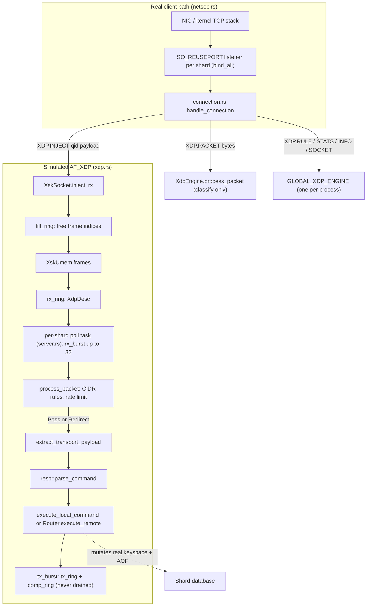

# Component 10: Kernel Bypass & Zero-Copy Networking — Implementation Reference

> **High-Level Design Spec**: [`docs/design/10_kernel_bypass_xdp.md`](../design/10_kernel_bypass_xdp.md)
> **Consolidated Implementation Spec**: [`docs/internal/components.md`](components.md)
> **Main source files**: `src/xdp.rs` (simulated AF_XDP engine), `src/zerocopy.rs` (`MSG_ZEROCOPY` /
> `io_uring` primitives), `src/netsec.rs` (the *real* listener path, for contrast). Integration points:
> `src/server.rs` (per-shard XDP poll task), `src/connection.rs` (`XDP.*` dispatch,
> `target_shard_of_cmd`, `execute_local_command`), `src/resp.rs` (`XDP.*` parsing, experimental-command
> gate), `src/acl_categories.rs`, `src/main.rs` / `src/config.rs` (`enable-experimental-commands`).

---

## 1. What this subsystem does

Real "kernel bypass" networking (Linux **AF_XDP**) lets a program receive packets straight from the
NIC into a shared memory area, skipping most of the kernel TCP/IP stack. An **eBPF/XDP program** (a
small verified program the kernel runs on each incoming packet) decides per packet whether to drop
it, pass it to the normal stack, bounce it back out (TX), or *redirect* it into a user-space socket
(an **XSK**). Zero-copy *sending* (`MSG_ZEROCOPY`, `io_uring` `SendZc`) is the outbound counterpart:
the kernel transmits directly from the application's pages instead of copying them.

Rudis contains three pieces related to this area, and it is important to be clear about what each
one really is:

| Piece | What it really is | Who uses it |
| :--- | :--- | :--- |
| `src/xdp.rs` | An **in-process simulation** of AF_XDP: UMEM, the four XSK rings, a CIDR filter, a per-IP rate limiter and a hand-written Ethernet/IPv4/TCP parser. No eBPF program, no AF_XDP socket, no NIC. | The experimental `XDP.*` commands, and one background task per shard that executes commands found in packets injected with `XDP.INJECT`. |
| `src/zerocopy.rs` | Real, correct wrappers around `SO_ZEROCOPY`, `send(..., MSG_ZEROCOPY)`, an `io_uring` `SendZc` builder and a page-aligned buffer pool for `io_uring` buffer registration. | Nobody — only its own unit tests. |
| `src/netsec.rs` | The **real** network ingress path: `bind` parsing, `SO_REUSEPORT` listener creation, the port-in-use probe, and protected mode. | `main.rs` and every shard in `server.rs`. All real client traffic arrives here. |

So: **no Rudis client traffic ever goes through kernel bypass.** Clients connect to ordinary TCP
listeners built by `netsec.rs`. The XDP engine is a packet-classification and command-injection
harness reachable only through admin commands, and only when experimental commands are enabled.

---

## 2. Mental model



Read the diagram as two worlds. The top box is how every real client reaches Rudis. The bottom box
is a self-contained imitation of the AF_XDP data path whose *only* entry point is a client running
`XDP.INJECT` over a normal connection. Once a payload is in the simulated RX ring, though, the
command inside it is executed for real against the shard's database.

---

## 3. Enablement and access control

The `XDP.*` commands belong to the **experimental command families**. They are off by default.

- **Config**: `enable-experimental-commands yes|no` in the config file (`RudisConfig::
  enable_experimental_commands`, default `false`) or `--enable-experimental-commands yes|no` on the
  command line. `main.rs` passes the result to `resp::set_experimental_commands`.
- **Gate**: `resp::build_command` checks, for any command name containing a `.`, whether experimental
  commands are disabled and `resp::is_experimental_command_name` matches one of
  `EXPERIMENTAL_PREFIXES` (`JSON.`, `BF.`, `CF.`, `CMS.`, `TOPK.`, `FT.`, `SEMANTIC.`, `CRDT.`, `LLM.`,
  `MCP.`, `XDP.`). If so, the command becomes `Command::Unknown` and the client gets an
  "unknown command" error, exactly as if the command did not exist. In this crate's unit tests the
  flag (`EXPERIMENTAL_COMMANDS`) defaults to on (`cfg!(test)`).
- **ACL**: all `XDP.*` commands are reported under one command family name, `XDP`
  (`connection::get_cmd_name`, which the ACL check `acl_cmd_name` falls back to), and the generated
  ACL table (`acl_categories.rs`) lists `xdp` in
  categories `@admin`, `@slow` and `@dangerous`. A user without those permissions cannot run them.
- **Engine and poll tasks always exist.** The gate controls only the commands. The global engine is
  created lazily on first use, and every shard always spawns its XDP poll task (§6.2); with
  experimental commands disabled that task simply finds no socket and sleeps 200 ms between checks.

---

## 4. Data structures (`src/xdp.rs`)

### 4.1 `XdpAction` and `XdpMode`

```rust
pub enum XdpAction { Pass, Drop, Redirect, Tx }
pub enum XdpMode   { Driver, Skb, Simulated }
```

- `XdpAction` mirrors the real XDP verdicts. Its `Display` prints `PASS` / `DROP` / `REDIRECT` /
  `TX`; these are the strings `XDP.RULE ADD` accepts (case-insensitively) and what `XDP.PACKET`
  replies with.
- `XdpMode` names the three ways a real XDP program can be attached: **driver** (native, in the NIC
  driver), **SKB / generic** (after the kernel has built a socket buffer — slower but works
  everywhere), and **simulated**. `Display` prints `driver`, `skb (generic)` and
  `simulated (userspace bypass)`.

The mode is chosen once by the global engine initializer:

```rust
static GLOBAL_XDP_ENGINE: LazyLock<Arc<XdpEngine>> = LazyLock::new(|| {
    let mode = if std::path::Path::new("/sys/class/net").exists() {
        XdpMode::Skb
    } else {
        XdpMode::Simulated
    };
    Arc::new(XdpEngine::new("eth0", mode))
});
```

On essentially every Linux host `/sys/class/net` exists, so the mode is **`Skb` in practice**.
This is purely a label plus a sizing decision (§4.5): nothing attaches an eBPF program or binds to
`eth0` (which may not even exist). `XdpMode::Driver` is never constructed anywhere.
`get_xdp_engine()` returns a clone of this one `Arc`, so every shard and every connection shares a
single `XdpEngine`.

### 4.2 `XdpRule` and `parse_cidr` — the CIDR filter

| Field | Type | Meaning |
| :--- | :--- | :--- |
| `id` | `u32` | Rule id from `XdpEngine::next_rule_id` (starts at 1, `fetch_add` per rule, never reused). |
| `action` | `XdpAction` | Verdict returned when the rule matches. |
| `cidr` | `String` | The CIDR string exactly as the user typed it (shown by `XDP.RULE LIST`). |
| `network` | `u32` | Address already masked with `netmask`. |
| `netmask` | `u32` | Prefix mask. |

**CIDR** ("Classless Inter-Domain Routing") notation `a.b.c.d/n` means "the first `n` bits of the
address". `parse_cidr` works like this:

1. Split on `/`; more than one `/` is an error.
2. Parse the left side as an `Ipv4Addr` (IPv6 is not supported).
3. Prefix length `n` is the right side, or 32 if absent; `n > 32` is an error.
4. `netmask = 0` if `n == 0` (avoids a shift-by-32), else `!0u32 << (32 - n)`.
5. `network = ip & netmask`.

*Example*: `10.1.2.3/8` → `netmask = 0xFF00_0000`, `network = 0x0A00_0000`. A packet from
`10.200.0.9` matches because `0x0AC8_0009 & 0xFF00_0000 == 0x0A00_0000`.

Rules live in `XdpEngine::rules: RwLock<Vec<XdpRule>>` and are evaluated by **linear scan, first
match wins**, in insertion order. There is no priority field and no trie.

### 4.3 `TokenBucket` — per-source-IP rate limiter

| Field | Type | Meaning |
| :--- | :--- | :--- |
| `tokens` | `f64` | Tokens currently available (starts full). |
| `capacity` | `f64` | Maximum tokens (burst size). |
| `refill_rate` | `f64` | Tokens added per second. |
| `last_update` | `Instant` | Time of the previous `allow()` call. |

`allow()`:

1. `elapsed` = seconds since `last_update`; set `last_update = now`.
2. `tokens = min(tokens + elapsed * refill_rate, capacity)`.
3. If `tokens >= 1`, subtract 1 and return `true`; otherwise return `false`.

Every packet costs exactly one token regardless of size. The engine's default bucket, created the
first time a source IP is seen, has `capacity = 50_000.0` (`default_rate_capacity`) and
`refill_rate = 100_000.0` tokens/s (`default_rate_limit`). Buckets live in
`XdpEngine::rate_limiters: RwLock<HashMap<u32, TokenBucket>>`, keyed by IPv4 address as `u32`, and
are **never evicted**. There is no command to change the defaults.

### 4.4 `XdpDesc` and `XskRing<T>` — descriptors and rings

```rust
pub struct XdpDesc { pub addr: u64, pub len: u32, pub options: u32 }

pub struct XskRing<T> {
    pub producer: AtomicU32,
    pub consumer: AtomicU32,
    pub mask: u32,                 // capacity - 1 (capacity is a power of two)
    pub entries: Vec<RwLock<T>>,   // one parking_lot RwLock per slot
}
```

A **descriptor** (`XdpDesc`) points at a packet inside UMEM: `addr` is a byte offset
(`frame_index * frame_size`), `len` the packet length; `options` is always 0.

`XskRing<T>` (requires `T: Clone + Default`) is a classic index-based circular buffer, modelled on
the real AF_XDP rings:

- `new(size)` rounds `size` up to a power of two and fills every slot with `T::default()`.
- `produce(item)`: if `producer - consumer > mask` (wrapping), the ring is full → `false`. Otherwise
  write the slot `producer & mask` under its write lock and store `producer + 1` with `Release`.
  The ring holds exactly `capacity` items.
- `consume()`: if `consumer == producer` → `None`. Otherwise clone the slot `consumer & mask` and
  store `consumer + 1` with `Release`.
- `len()` / `is_empty()` are `Relaxed` reads of the two indices.

The design is **single-producer / single-consumer (SPSC)**: there is no compare-and-swap on the
indices, so two concurrent producers (or two concurrent consumers) can claim the same slot. The doc
comment calls it "lock-free", but each slot is guarded by its own `RwLock`.

### 4.5 `XskUmem` — the simulated packet memory

**UMEM** in real AF_XDP is one big, pinned memory region shared between kernel and user space and
divided into fixed-size frames. The simulation:

```rust
pub struct XskUmem {
    pub frame_size: usize,                 // 2048
    pub num_frames: usize,                 // 4096 (Skb/Driver) or 128 (Simulated)
    pub frames: RwLock<Vec<Vec<u8>>>,      // one Vec per frame, allocated lazily
}
```

- `XdpEngine::new` fixes `frame_size = 2048` and picks `num_frames = 128` for `Simulated`, `4096`
  for every other mode.
- `XskUmem::new` creates `num_frames` **empty** `Vec`s. A frame's buffer is allocated on first
  write, sized to the packet, so an unused socket costs only the `Vec` headers, not
  `num_frames * frame_size` bytes.
- `write_frame(idx, data)` clears the frame and copies in at most `frame_size` bytes; longer data is
  **silently truncated**. An out-of-range `idx` is a silent no-op.
- `read_frame(idx, len)` returns `min(len, frame_size, frame.len())` bytes, or an empty `Vec` for an
  out-of-range index.

`UmemFrame { addr, len, buffer }` is also declared in `xdp.rs` but is never constructed or used.

### 4.6 `XskSocket` — the simulated AF_XDP socket

| Field | Type | Meaning |
| :--- | :--- | :--- |
| `queue_id` | `u32` | Simulated NIC queue; by convention equals the shard id that polls it. |
| `rx_ring` | `XskRing<XdpDesc>` | Received packets waiting for the poll task. |
| `fill_ring` | `XskRing<u64>` | Free UMEM frame indices available for receiving. |
| `tx_ring` | `XskRing<XdpDesc>` | "Transmitted" responses. Nothing ever consumes it. |
| `comp_ring` | `XskRing<u64>` | Completion ring: frame indices whose TX "finished". Nothing ever consumes it. |
| `umem` | `Arc<XskUmem>` | This socket's private frame memory. |
| `rx_packets` / `tx_packets` | `AtomicU64` | Per-socket counters (not exposed by any command). |

`XskSocket::new(queue_id, frame_size, num_frames)` sizes all four rings to
`max(num_frames, 64).next_power_of_two()` (4096 in `Skb` mode, 128 in `Simulated`) and pre-loads
`fill_ring` with every frame index `0..num_frames`, so the fill ring starts full.

Methods:

1. **`inject_rx(packet) -> bool`** — take a free frame index from `fill_ring` (none → `false`);
   copy the packet into that frame; push `XdpDesc { addr: idx * frame_size, len: packet.len() }`
   onto `rx_ring`. If `rx_ring` is full, return the frame index to `fill_ring` and return `false`.
   On success increment `rx_packets`. This is the **only** producer of `rx_ring` entries in the
   codebase, and it is called only by `XDP.INJECT`.
2. **`rx_burst(out, max_batch) -> usize`** — pop up to `max_batch` descriptors, compute
   `idx = addr / frame_size`, copy the frame bytes (`read_frame(idx, len)`) into `out`, and return
   `idx` to `fill_ring`. Returns the number of packets moved.
3. **`tx_burst(packets) -> usize`** — for the *i*-th packet in the batch, write it into UMEM frame
   *i* (frame indices are just positions in the batch, not taken from any free list), push a
   descriptor onto `tx_ring` and, if that succeeded, push `i` onto `comp_ring` immediately
   ("instant completion") and bump `tx_packets`. Stops at the first full `tx_ring`.

### 4.7 `XdpEngine` — the process-wide engine

```rust
pub struct XdpEngine {
    pub ifname: String,                     // "eth0" (label only)
    pub mode: XdpMode,                      // Skb in practice
    pub frame_size: usize,                  // 2048
    pub num_frames: usize,                  // 4096 or 128
    pub rules: RwLock<Vec<XdpRule>>,
    pub next_rule_id: AtomicU32,            // starts at 1
    pub rate_limiters: RwLock<HashMap<u32, TokenBucket>>,
    pub default_rate_limit: f64,            // 100_000 tokens/s
    pub default_rate_capacity: f64,         // 50_000 tokens
    pub sockets: RwLock<HashMap<(u16, u32), Arc<XskSocket>>>,  // (port, queue_id)
    // counters: rx_packets, rx_bytes, dropped_packets,
    //           redirected_packets, pass_packets, rate_limit_drops (all AtomicU64)
}
```

Methods: `add_rule`, `del_rule` (error `Rule ID <id> not found`), `list_rules` (clone),
`process_packet` (§5.1), `get_or_create_socket(port, queue_id)` (creates on first use),
`get_socket(port, queue_id)` (lookup only, used by the poll task), `list_sockets` (unused), and
`info()` (the text block returned by `XDP.INFO`).

The `sockets` registry is keyed by `(port, queue_id)` and shared by all shards. **No socket exists
at boot**; one is created only when `XDP.SOCKET`, `XDP.INJECT` or `XDP.INFO` asks for it.

---

## 5. Algorithms (`src/xdp.rs`)

### 5.1 `XdpEngine::process_packet` — classify one packet

1. **Count**: increment `rx_packets` and add `packet.len()` to `rx_bytes` (always, even for empty
   input).
2. **Empty** input → increment `dropped_packets`, return `Drop`.
3. **Detect the frame shape** and extract the source IPv4 address:
   - *Ethernet + IPv4*: `len >= 14` and bytes 12–13 are `08 00` (the IPv4 EtherType). If at least 20
     bytes follow, the source IP is bytes 12–15 of the IP header.
   - *Bare IPv4*: otherwise, if `len >= 20` and the top nibble of byte 0 is 4 (IP version 4), the
     source IP is bytes 12–15.
   - *Anything else* (e.g. raw RESP starting with `*`): no source IP.

   For TCP (protocol byte 9 == 6) with enough bytes, the destination port is also read — assuming a
   fixed 20-byte IP header — but it is never used.
4. **CIDR rules** (only with a source IP): scan `rules`; on the first match return its action and
   bump the matching counter (`dropped_packets`, `pass_packets`, `redirected_packets`; `Tx` bumps
   none).
5. **Rate limit** (only with a source IP and no matching rule): fetch or create the IP's
   `TokenBucket`; if `allow()` fails, bump `rate_limit_drops` and `dropped_packets`, return `Drop`.
6. **Default**: bump `redirected_packets` and return `Redirect`. The inline comment talks about
   demuxing "Redis port 6379 or cluster bus", but no port check happens: every packet that reaches
   this step is redirected.

*Worked example* (rule `XDP.RULE ADD DROP 10.0.0.0/8` installed):

| Input | Shape | Source IP | Result |
| :--- | :--- | :--- | :--- |
| 40-byte IPv4 header, src `10.1.2.3` | bare IPv4 | `10.1.2.3` | rule 1 matches → `Drop` |
| 40-byte IPv4 header, src `172.16.0.1` | bare IPv4 | `172.16.0.1` | no rule, bucket allows → `Redirect` |
| `*2\r\n$3\r\nGET\r\n$1\r\na\r\n` | none (`*` is `0x2A`) | — | skips rules and limiter → `Redirect` |

### 5.2 `extract_transport_payload` — strip headers to get the command bytes

Returns `Option<Bytes>` (always a copy):

1. Empty input → `None`.
2. *Ethernet + IPv4 + TCP*: `len >= 54`, EtherType `08 00`, protocol byte (offset 23) == 6. The IP
   header length comes from the IHL nibble (`(byte14 & 0x0F) * 4`), the TCP header length from the
   TCP data-offset nibble; return everything after both. If the declared lengths run past the end of
   the buffer (or leave no payload), return `None`.
3. *Bare IPv4 + TCP*: `len >= 40`, version nibble 4, protocol 6 — same computation without the
   14-byte Ethernet header.
4. *Direct RESP* (first byte `*`, `+`, `$`, `:` or `-`) → the whole input.
5. *Anything else* → the whole input, treated as an inline text command.

Unlike `process_packet`, this function honours IP and TCP header-length fields.

---

## 6. Integration with the server

### 6.1 The `XDP.*` commands

Six command names, eight `Command` variants (`XDP.RULE` has three subcommands). Parsing is in
`resp::build_command`; execution is in `connection.rs`. Every handler goes through
`get_xdp_engine()`. `router.port` is the **shard port** of the connection's shard (the base port
normally; `base_port + shard_id` in cluster mode).

| Command | `Command` variant | Behaviour and reply |
| :--- | :--- | :--- |
| `XDP.INFO` | `XdpInfo` | First calls `get_or_create_socket(router.port, qid)` for every `qid` in `0..num_shards`, then returns `XdpEngine::info()` as a bulk string: `# XDP Kernel Bypass` header plus `interface`, `mode`, `umem_frame_size`, `umem_num_frames`, `active_ebpf_rules`, `active_xsk_queues` and the six counters. |
| `XDP.RULE ADD <action> <cidr>` | `XdpRuleAdd { action, cidr }` | Needs at least 4 arguments (extra ones are ignored). `<action>` is `DROP`/`PASS`/`REDIRECT`/`TX` (any case), else `Unknown XDP action: ..`. Replies with the new rule id (integer), or `-ERR <parse_cidr error>`. |
| `XDP.RULE DEL <id>` | `XdpRuleDel(u32)` | Exactly 3 arguments; non-numeric id → `Invalid rule ID`. `+OK` or `-ERR Rule ID <id> not found`. |
| `XDP.RULE LIST` | `XdpRuleList` | Array of bulk strings `id:<id> action:<ACTION> cidr:<cidr>`. |
| `XDP.STATS` | `XdpStats` | 12-element array: `rx_packets`, `rx_bytes`, `dropped_packets`, `redirected_packets`, `pass_packets`, `rate_limit_drops`, each followed by its integer value. |
| `XDP.PACKET <bytes>` | `XdpPacket(Bytes)` | Runs `process_packet` directly (no ring, no command execution) and replies `+PASS`, `+DROP`, `+REDIRECT` or `+TX`. Updates the engine counters and rate limiters. |
| `XDP.SOCKET <queue_id>` | `XdpSocket(u32)` | `get_or_create_socket(router.port, qid)` (creates if missing); 8-element array `queue_id`, `rx_len`, `fill_len`, `tx_len`. |
| `XDP.INJECT <queue_id> <bytes>` | `XdpInject { queue_id, payload }` | `get_or_create_socket(router.port, qid).inject_rx(payload)`; `+OK`, or `-ERR ring full` when there is no free frame or `rx_ring` is full. |

A non-numeric `<queue_id>` for `XDP.SOCKET` / `XDP.INJECT` is silently treated as `0`.

### 6.2 The per-shard poll task (`server.rs`, `run_shard_worker`)

Every shard spawns one `monoio` task at startup that pretends to be the user-space half of AF_XDP:

1. Each iteration, look up `xdp_engine.get_socket(shard_port, shard_id)`. It does **not** create
   the socket; a socket created later by a command is picked up on the next iteration.
2. If the socket exists, `rx_burst(&mut frames, 32)` drains up to 32 packets.
3. If nothing was drained (or there is no socket), sleep **5 ms** when experimental commands are
   enabled, **200 ms** when they are disabled, then loop.
4. For each frame: `process_packet`. Only `Pass` and `Redirect` continue; `Drop` and `Tx` are
   discarded silently.
5. `extract_transport_payload`, then `resp::parse_command` on the result (the same parser used for
   client connections, so RESP arrays, inline commands and the memcached storage syntax all parse).
   A parse error or incomplete command drops the frame with no log or counter.
6. Pick the target shard: `connection::target_shard_of_cmd(&cmd, num_shards)`, which maps a list of
   single-key commands (`GET`, `SET`, `HSET`, `SADD`, single-key `DEL`/`EXISTS`, …) to the key's
   owner and returns `None` for everything else. `None` becomes the polling shard's own id.
7. Execute: on the local shard via `connection::execute_local_command(&cmd, &mut db, &mut out,
   aof)` — the real shard database, with AOF logging — or on another shard via
   `Router::execute_remote(target_sid, cmd).await` (the normal cross-shard mailbox).
8. If there is a reply, `tx_burst(&[&out])` writes it into the same socket's `tx_ring` and
   `comp_ring`, where it stays forever.

*Worked example* — single-shard server (shard 0, port 6379) started with
`--enable-experimental-commands yes`:

1. A client sends `XDP.INJECT 0 "*3\r\n$3\r\nSET\r\n$1\r\na\r\n$1\r\nb\r\n"`.
2. The handler calls `get_or_create_socket(6379, 0)`, which builds the socket (4096-entry rings,
   fill ring full). `inject_rx` takes frame 0, copies the 27 bytes in, pushes
   `XdpDesc { addr: 0, len: 27 }` onto `rx_ring`, and the client gets `+OK`.
3. Within about 5 ms the shard's poll task finds the socket, drains one frame and returns frame 0
   to the fill ring.
4. `process_packet` sees `*` → no source IP → `Redirect` (`redirected_packets` += 1).
5. `extract_transport_payload` returns the bytes unchanged; `parse_command` yields `SET a b`;
   `target_shard_of_cmd` gives shard 0.
6. `execute_local_command` sets `a` = `b` and appends it to the AOF. `GET a` from any client now
   returns `b`.
7. `+OK\r\n` is written to UMEM frame 0 and to `tx_ring`; `XDP.SOCKET 0` now reports `tx_len 1`.

### 6.3 Which socket does an injection reach?

Sockets are keyed by `(port, queue_id)`, and shard *N* polls only `(shard_port_N, N)`.

- **Non-cluster mode**: all shards share the base port, so `XDP.INJECT <N> ...` from a connection on
  *any* shard lands in shard *N*'s ring. Nothing ties the queue id to the issuing connection.
- **Cluster mode**: each shard has its own port (`base_port + shard_id`), and `router.port` is the
  connection's own shard port. Only `XDP.INJECT <own shard id>` reaches a polled ring; other queue
  ids create sockets that nothing polls. `XDP.INFO` likewise creates `num_shards` sockets on the
  connection's port, only one of which is polled.
- A queue id that matches no shard creates an orphan socket: injected packets sit in its `rx_ring`
  until it fills, then injections fail with `-ERR ring full`.

---

## 7. `src/zerocopy.rs` — zero-copy send primitives (unused)

The module is compiled into every build (`pub mod zerocopy` in `lib.rs`, no Cargo feature) but has
**no callers outside its own tests**. Real connections are `monoio` streams whose file descriptors
are never handed to it.

### 7.1 Constants

| Constant | Value | Meaning |
| :--- | :--- | :--- |
| `PAGE_SIZE` | 4096 | Alignment of the buffer pool; threshold for using `MSG_ZEROCOPY`. |
| `DEFAULT_SLOT_SIZE` | 64 KiB | Suggested pool slot size. |
| `DEFAULT_SLOT_COUNT` | 16 | Suggested slot count (16 × 64 KiB = 1 MiB). |
| `MSG_ZEROCOPY` | `0x0400_0000` | Linux `send` flag, defined locally. |

### 7.2 `ZeroCopyStats`

Five `AtomicU64` counters: `zc_send_calls`, `zc_bytes_sent`, `registered_buffer_hits`,
`registered_buffer_misses`, `fallback_sends`. Shared via `Arc` between the engine and pool if a
caller chooses to.

### 7.3 `RegisteredBufferPool`

`io_uring` can **register** buffers with the kernel ahead of time ("fixed buffers"), so later I/O
skips per-call page pinning and address translation. The pool prepares memory for that:

| Field | Type | Meaning |
| :--- | :--- | :--- |
| `ptr` | `*mut u8` | One `alloc_zeroed` allocation of `slot_count * slot_size` bytes, aligned to `PAGE_SIZE`. |
| `layout` | `Layout` | The allocation layout, reused by `Drop` for `dealloc`. |
| `slot_size`, `slot_count` | `usize` | Geometry. |
| `free_slots` | `Vec<usize>` | Free list (stack), initially `0..slot_count`. |
| `iovecs` | `Vec<libc::iovec>` | One iovec per slot, ready for `io_uring::Submitter::register_buffers`. |
| `stats` | `Arc<ZeroCopyStats>` | Hit/miss counters. |

1. `new(slot_count, slot_size, stats)`: zero count or size → `InvalidInput`; product overflow
   (`checked_mul`) → `InvalidInput`; allocation failure → `OutOfMemory`. Then build one iovec per
   slot at `ptr + i * slot_size`.
2. `acquire_slot()` pops the free list (`registered_buffer_hits` += 1) or returns `None`
   (`registered_buffer_misses` += 1).
3. `release_slot(idx)` pushes `idx` back unless it is out of range or already free (an O(n)
   `contains` check); both cases are ignored silently.
4. `get_slot(idx)` / `get_slot_mut(idx)` return slices over the slot (`None` if out of range);
   `get_slot_mut` needs `&mut self`, so no two mutable slices can coexist.
5. Accessors: `iovecs()`, `slot_size()`, `slot_count()`, `available_slots()`.

`Send`/`Sync` are implemented manually: the pool owns its allocation exclusively, and every method
that hands out mutable access takes `&mut self`. Nothing actually registers the iovecs with a ring.

### 7.4 `ZeroCopyEngine`

Holds only `stats: Arc<ZeroCopyStats>`.

- **`enable_so_zerocopy(fd)`** — `setsockopt(SOL_SOCKET, SO_ZEROCOPY, 1)`. Linux requires this
  before `MSG_ZEROCOPY` sends take effect.
- **`unsafe fn send_zc(&self, fd, data)`**:
  1. Empty `data` → `Ok(0)` without a syscall.
  2. Flags: `MSG_NOSIGNAL | MSG_ZEROCOPY` when `data.len() >= PAGE_SIZE` (below one page, page
     pinning costs more than copying), otherwise just `MSG_NOSIGNAL`.
  3. `libc::send`. On success: `zc_send_calls` += 1, `zc_bytes_sent` += bytes sent.
  4. On error, if the error is `ENOBUFS` **or** `MSG_ZEROCOPY` was requested, increment
     `fallback_sends` and retry with only `MSG_NOSIGNAL`. A successful retry adds to `zc_bytes_sent`
     (not `zc_send_calls`); a failed retry returns the *original* error.

  It is `unsafe` because with `MSG_ZEROCOPY` the kernel may keep reading `data`'s pages after the
  call returns, until a completion notification appears on the socket's error queue
  (`recvmsg(..., MSG_ERRQUEUE)`). The caller must keep the buffer alive and unchanged until then.
  The module itself has no error-queue reader.
- **`build_io_uring_send_zc(fd, buf_ptr, len, slot_index)`** — builds an
  `io_uring::opcode::SendZc` submission entry, setting `buf_index` when a registered slot is given.
  The entry is never submitted anywhere.
- `stats()` returns the shared counters.

---

## 8. The real network path: `src/netsec.rs` (for contrast)

This module is how clients actually reach Rudis; it is documented in depth in
[`01_reactor_runtime.md`](01_reactor_runtime.md). In brief:

- **`bind` parsing** — `parse_bind_spec` accepts Redis-style whitespace-separated addresses into
  `BindAddr { ip, optional }`. `*` means all IPv4 interfaces, `::*` all IPv6 interfaces, brackets
  are stripped, duplicates collapse, and a leading `-` marks an address optional (skip it if it
  cannot be bound). The default is `DEFAULT_BIND = "* -::*"`. `format_bind_spec` renders it back for
  `CONFIG GET bind`.
- **Listeners** — `bind_reuseport_listener(ip, port, backlog)` creates a non-blocking TCP socket
  with `SO_REUSEPORT` and `SO_REUSEADDR`, `IPV6_V6ONLY` for IPv6 (so `::` does not collide with
  `*`), and 512 KiB send/receive buffers. `bind_all` binds every address; each shard calls it with
  backlog 4096, so the kernel spreads incoming connections across shards. A failed optional address
  is skipped; a failed required address, or nothing bound, is an error.
- **Port probe** — `ensure_port_free` binds a probe socket *without* `SO_REUSEPORT` (which would
  silently join another process's listener) to detect a port already in use.
  `ensure_port_free_with_grace` retries it every 20 ms until a grace period expires (`main.rs` uses
  3 s), covering listeners a crashed `io_uring` instance leaves behind briefly.
- **Per-port settings** — process-wide maps keyed by base port so in-process test servers do not
  interfere: `BIND_ADDRS`, `PROTECTED_MODE` (default on; `protected_mode_denies` refuses
  non-loopback peers while the default user has no password, replying `PROTECTED_MODE_DENIED`), and
  `enable-debug-command` / `enable-module-command` as `ProtectedAction::{No, Yes, Local}` (default
  `No`; `Local` allows loopback peers only).

None of this interacts with `xdp.rs` or `zerocopy.rs`.

---

## 9. Invariants & gotchas

- **`XDP.INJECT` executes real commands.** A payload that parses and is classified `Pass` or
  `Redirect` mutates the real keyspace and is written to the AOF. It runs through
  `execute_local_command` directly, so it skips the per-connection checks a normal client goes
  through (ACL key/command permissions, auth, MULTI state) — only the `XDP.INJECT` call itself is
  ACL-checked. The database index used is whatever `connection::CURRENT_DB` holds on that shard
  thread at the time.
- **`XDP.PACKET` and `XDP.INJECT` take different paths.** `XDP.PACKET` only classifies; it never
  touches a ring or executes anything. Both update the same engine counters.
- **Inline text can look like IPv4.** `process_packet` treats any input of 20+ bytes whose first
  byte's high nibble is 4 as an IPv4 header — that includes ASCII `@` and `A`–`O`. An injected inline
  command such as `GET aaaaaaaaaaaaaaaa\r\n` (`G` = `0x47`) is "from" `97.97.97.97` (bytes 12–15 are
  `aaaa`), so CIDR rules and the rate limiter apply to it and it gets a `TokenBucket`. RESP arrays
  (`*` = `0x2A`) and lower-case inline commands are not affected.
- **Packets over 2048 bytes are truncated.** `write_frame` keeps only `frame_size` bytes and
  `read_frame` returns at most that, so a larger injected command arrives incomplete and is dropped
  by the parser without any error.
- **TX rings fill up and stay full.** Nothing consumes `tx_ring` or `comp_ring`. After `ring_size`
  replies (4096 in `Skb` mode) `tx_burst` stops accepting, and later replies are discarded silently
  (the command still executes).
- **TX reuses RX frames.** `tx_burst` writes reply *i* into UMEM frame *i*; the poll task always
  sends one reply, so every reply overwrites frame 0. Frame 0 is also in the RX free list, so a
  packet injected into frame 0 that has not yet been drained (for example while the task awaits a
  cross-shard `execute_remote`) can be overwritten.
- **Rings are SPSC, injection is not.** `XDP.INJECT` can run concurrently from connections on
  several shard threads against the same socket, making `fill_ring` multi-consumer and `rx_ring`
  multi-producer. Without CAS on the indices, simultaneous injections can collide (a lost packet or
  a duplicated frame index).
- **Injection routing is a whitelist.** Commands outside `target_shard_of_cmd`'s single-key list
  (multi-key commands, admin commands, and so on) run on the polling shard whether or not it owns the
  keys.
- **`process_packet` assumes a 20-byte IP header** when reading the (unused) TCP port, while
  `extract_transport_payload` honours IHL and the TCP data offset.
- **Unbounded state.** `rate_limiters` gains one bucket per distinct source IP and never shrinks;
  the `sockets` map gains one socket per distinct `(port, queue_id)` requested and never shrinks.
- **Memory per socket is small until used.** Frames are allocated on first write, but the four rings
  (4096 slots each in `Skb` mode) and the frame `Vec` headers are allocated when the socket is
  created. Sockets are created only by `XDP.*` commands.
- **One engine per process.** Rules, rate limiters, counters and sockets are shared by all shards,
  and by all servers started in the same process (unlike `netsec.rs` settings, which are keyed by
  port).

## 10. Limitations / not implemented

- No real AF_XDP: no eBPF program, no `AF_XDP` socket, no UMEM registration with the kernel, no NIC
  queue binding. `ifname` (`eth0`) and `mode` are labels only; `XdpMode::Driver` is never used.
- No path from the network into the rings — `XDP.INJECT` is the only producer.
- The default verdict ignores the destination port; there is no "demux to Redis port" logic.
- IPv4 only (no IPv6 rules or parsing); no rule priorities, no rule persistence (rules live in
  memory and vanish on restart), no command to tune the rate-limiter defaults.
- Responses are never transmitted anywhere; there is no way to read `tx_ring` contents back.
- `XdpSocket.rx_packets`/`tx_packets`, `list_sockets` and `UmemFrame` are unused.
- `zerocopy.rs` is not wired into any I/O path; it has no `MSG_ERRQUEUE` completion handling, and
  the buffer pool is never registered with an `io_uring` instance.

---

## 11. Code map

| File | Key symbols | What they do |
| :--- | :--- | :--- |
| `src/xdp.rs` | `XdpAction`, `XdpMode` | Verdicts and attachment-mode labels. |
| `src/xdp.rs` | `XdpRule`, `parse_cidr` | IPv4 CIDR filter entries and parsing. |
| `src/xdp.rs` | `TokenBucket` | Per-source-IP rate limiter (1 token per packet). |
| `src/xdp.rs` | `XdpDesc`, `XskRing<T>` | Descriptor and SPSC ring modelled on AF_XDP rings. |
| `src/xdp.rs` | `XskUmem`, `UmemFrame` | Lazily allocated frame memory; `UmemFrame` is unused. |
| `src/xdp.rs` | `XskSocket` (`inject_rx`, `rx_burst`, `tx_burst`) | Simulated XSK with rx/fill/tx/comp rings. |
| `src/xdp.rs` | `XdpEngine` (`process_packet`, `add_rule`, `del_rule`, `list_rules`, `get_or_create_socket`, `get_socket`, `info`) | Process-wide engine: rules, limiter, socket registry, counters. |
| `src/xdp.rs` | `extract_transport_payload` | Strips Ethernet/IPv4/TCP headers to get command bytes. |
| `src/xdp.rs` | `GLOBAL_XDP_ENGINE`, `get_xdp_engine` | Singleton creation (mode picked from `/sys/class/net`) and access. |
| `src/server.rs` | `run_shard_worker` (XDP poll task) | Drains the shard's socket, classifies, parses and executes injected commands. |
| `src/connection.rs` | `Command::Xdp*` handlers, `get_cmd_name`, `target_shard_of_cmd`, `execute_local_command` | Command execution, ACL family name, routing and local execution reused by the poll task. |
| `src/resp.rs` | `build_command` (`XDP.*` arms), `Command::Xdp*`, `EXPERIMENTAL_PREFIXES`, `is_experimental_command_name`, `set_experimental_commands`, `experimental_commands_enabled` | Parsing and the experimental-command gate. |
| `src/acl_categories.rs` | `xdp` entry | ACL categories `@admin @slow @dangerous`. |
| `src/config.rs`, `src/main.rs` | `enable_experimental_commands` | Config / CLI switch for the `XDP.*` commands. |
| `src/zerocopy.rs` | `ZeroCopyStats`, `RegisteredBufferPool`, `ZeroCopyEngine` (`enable_so_zerocopy`, `send_zc`, `build_io_uring_send_zc`), `PAGE_SIZE`, `MSG_ZEROCOPY` | Unused zero-copy send and fixed-buffer primitives. |
| `src/netsec.rs` | `parse_bind_spec`, `format_bind_spec`, `bind_reuseport_listener`, `bind_all`, `ensure_port_free`, `ensure_port_free_with_grace`, `protected_mode_denies`, `ProtectedAction` | The real listener path, port probe and protected mode. |

### How to verify changes

```bash
cargo fmt --check
cargo clippy --all-targets -- -D warnings
cargo test --lib -- xdp:: zerocopy:: netsec::
```
