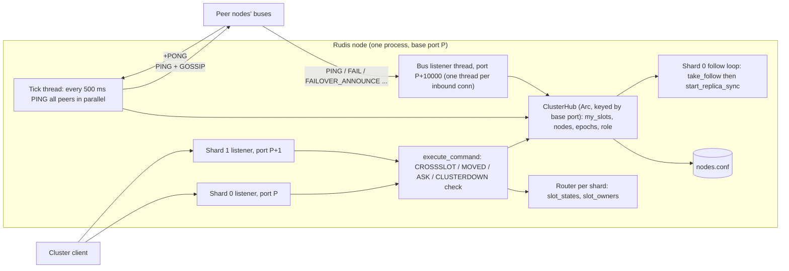
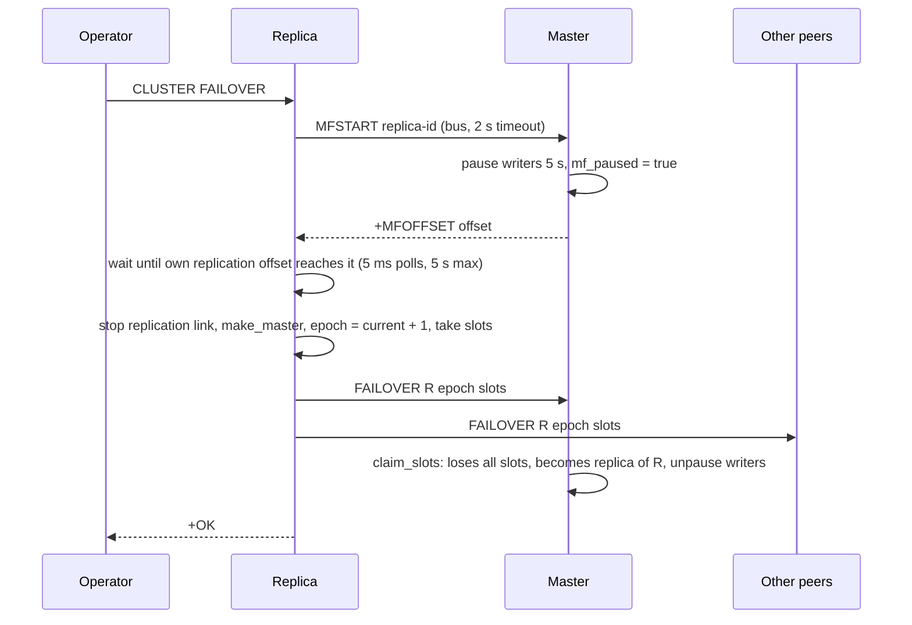

# Component 11: Redis Cluster Topology & Gossip Protocol — Implementation Reference

> **High-Level Design Spec**: [`docs/design/11_cluster_topology.md`](../design/11_cluster_topology.md)
> **Consolidated Implementation Spec**: [`docs/internal/components.md`](components.md)
> **Main source files**: `src/cluster.rs` (node table, gossip bus, failure detection, elections,
> slot-ownership rules, `nodes.conf`, rebalance planning); `src/connection.rs` (`CLUSTER` /
> `DFLYCLUSTER` / `DFLYMIGRATE` command handlers, the per-command `-MOVED`/`-ASK`/`-CROSSSLOT`
> check, key migration); `src/router.rs` (`key_slot`, `slot_to_shard`, the per-shard slot tables);
> `src/server.rs` and `src/main.rs` (startup wiring, per-shard client ports).

---

## 1. What this subsystem does

Redis Cluster splits the keyspace into **16384 hash slots**. Every key belongs to exactly one slot
(`CRC16(key) mod 16384`, or the CRC16 of the `{hash tag}` part when the key has one), and every
slot is served by exactly one **master** node. Clients ("cluster-aware" clients such as
`redis-cli -c`, Jedis, redis-py's `RedisCluster`) ask a node which slots it serves, send each
command to the right node, and follow `-MOVED` / `-ASK` redirects when they guess wrong.

This component makes a Rudis process behave like one node of such a cluster. It:

- keeps the node's view of the cluster: which other nodes exist, which slots each serves, which
  are masters and which are replicas of whom, and which seem dead;
- runs the **cluster bus**: a second TCP port (client port + 10000) on which nodes exchange
  heartbeats ("PING"/"PONG") that carry slot claims and **gossip** (what each node knows about
  third parties);
- detects failed nodes (suspected → confirmed by a majority of masters) and lets a replica of a
  failed master win an **election** and take over its slots;
- decides who owns a slot when two nodes claim it, using **config epochs** (a version number per
  node's slot claim; the newest wins);
- persists the node's view in `nodes.conf` so a restart keeps its identity and slots;
- answers the introspection commands (`CLUSTER NODES`, `SLOTS`, `SHARDS`, `INFO`, ...) and
  performs slot migration / rebalancing.

A Rudis-specific twist: one Rudis process runs several **shards** (one per core). In cluster mode
each shard listens on its **own client port** (`base_port + shard_id`), and each shard owns a fixed
part of the node's slots. The cluster code therefore advertises, and redirects to, the exact shard
port that serves a slot.

### Jargon used below

| Term | Meaning |
| :--- | :--- |
| **Node** | One Rudis process. Identified by a 40-hex-char **node id**. |
| **Base port / shard port** | The node's configured client port, and `base_port + shard_id` for each of its shards (cluster mode only). |
| **cport** | The cluster-bus port: client port + 10000. |
| **Slot** | One of 16384 key buckets; `key_slot` in `src/router.rs`. |
| **Config epoch** | Version of a node's slot claim. A higher epoch wins a disputed slot. |
| **Current epoch** | The highest epoch this node has seen anywhere; new epochs (failover, bump) are picked above it. |
| **PFAIL / FAIL** | "This node got no reply from the peer within the node timeout" / "a majority of masters agree the peer is unreachable". Modelled by `FailState`. |
| **MOVED / ASK** | Redirect replies: "this slot lives at X" (permanent) / "this one key is being migrated, try X once, preceded by `ASKING`". |
| **Gossip** | The list of known nodes (id, address, flags, epoch) piggy-backed on every PING. |
| **Hub** | `ClusterHub`, the one shared struct holding this node's cluster state. |

---

## 2. Mental model



Read it as three loops sharing one `ClusterHub`:

1. **Client loop** (async, per shard): every keyed command consults the hub (does this node serve
   the slot?) and the shard's `Router` slot tables (is the slot migrating? which local shard owns
   it?) before executing or redirecting.
2. **Bus loop** (blocking OS threads, outside the async runtime): a listener accepts peer
   connections and applies their frames to the hub; a tick thread sends a PING to every peer every
   500 ms and applies the PONG replies.
3. **Reaction loop**: the tick notices failures, starts elections on a fresh thread, and any
   change in slot ownership is saved to `nodes.conf`; if this node is demoted to a replica, shard 0
   notices via `take_follow` and starts replicating the new master.

---

## 3. Startup and process layout

1. **Config** (`src/main.rs`): `cluster-enabled yes` sets `RudisConfig.cluster_enabled`. The hub for
   the base port is created with `get_cluster_hub(port)`, and its `nodes.conf` path is set from
   `cluster-config-file` (default `nodes.conf`, relative to `dir`). This happens whether or not
   cluster mode is on.
2. If cluster mode is on: `hub.cluster_enabled = true`, the global `HAS_ACTIVE_CLUSTER = true`,
   `hub.num_shards = <threads>`, and `hub.load_config(path)` runs:
   - file found with a `myself` line → identity, role, epochs, slots restored; if this node is a
     replica, its master's address is queued as a startup `replicaof`;
   - no file → `save_config` writes a fresh one;
   - parse error → logged, the node starts with fresh state.
3. `cluster-node-timeout` (and any other directive) in the config file is applied through
   `apply_config_value`, which stores it in `hub.node_timeout_ms`. It is also settable with
   `CONFIG SET cluster-node-timeout <ms>` (must be > 0) and readable with `CONFIG GET`.
4. **Per-shard ports** (`src/server.rs`): each shard binds `base_port + shard_id` in cluster mode
   (just `base_port`, shared via `SO_REUSEPORT`, otherwise). `set_node_port(shard_port, base_port)`
   records the mapping so per-node registries (WATCH, MONITOR, CLIENT KILL lookups, pub/sub
   presence, ACLs, maxmemory accounting) treat all shard ports as one node. Connection
   rebalancing between shards is disabled in cluster mode: the client chose the port on purpose.
5. Shard 0 calls `start_cluster_bus(port)` (cluster mode only), and spawns the **follow loop**:
   every 100 ms it calls `hub.take_follow()`; when that returns a master address it starts
   replication from it (unless already replicating from it).
6. Every `Router` looks up the hub by its **base port** (`router.base_port`), never its shard
   port, so all shards of a node share one identity, one node table, and one replication hub.

---

## 4. Data structures

### 4.1 `ClusterHub` — the node's whole cluster state

One `ClusterHub` per base port, held as `Arc<ClusterHub>` in the global `CLUSTER_HUBS` map and
created lazily by `get_cluster_hub(port)`. Hubs are never removed or replaced. Locks are
`parking_lot::RwLock`.

| Field | Type | Meaning |
| :--- | :--- | :--- |
| `port` / `cport` | `u16` | Base client port; bus port = `port + 10000`. |
| `my_id` | `RwLock<String>` | Node id (from `generate_node_id`, or loaded from `nodes.conf`). |
| `current_epoch` | `AtomicU64` | Highest epoch seen anywhere (starts at 1). |
| `config_epoch` | `AtomicU64` | Epoch of this node's own slot claim (starts at 0). |
| `last_vote_epoch` | `AtomicU64` | Last epoch in which this master granted a failover vote (one vote per epoch). |
| `election_in_progress` | `AtomicBool` | Ensures at most one election thread per node. |
| `role` | `RwLock<String>` | `"master"` or `"slave"`. |
| `master_id` | `RwLock<String>` | `"-"` for a master, else the id of the master it replicates. |
| `has_nodes` | `AtomicBool` | Set once any peer has been added (MEET or loaded config). |
| `nodes` | `RwLock<HashMap<String, ClusterNodeInfo>>` | Known peers (never contains `myself`). |
| `my_slots` | `RwLock<Vec<(u16,u16)>>` | Slots this node serves, as sorted, merged inclusive ranges. Starts as `[(0,16383)]`. |
| `pfail_reports` | `RwLock<HashMap<String, HashSet<String>>>` | For each suspect node id, the peers whose gossip reported it as failing. |
| `bus_running` / `cancel_bus` | `AtomicBool` / `RwLock<Option<flume::Sender<()>>>` | Bus started once; the cancel channel stops the listener and tick threads. |
| `active_migration` | `RwLock<Option<ActiveMigration>>` | Dragonfly `DFLYMIGRATE` status only (§13). |
| `slot_states` | `RwLock<HashMap<u16,(String,String)>>` | Slot → (`"migrating"` or `"importing"`, peer id). Reporting only: `CLUSTER NODES` markers, `CLUSTER CHECK`, `nodes.conf`. |
| `cluster_enabled` | `AtomicBool` | Cluster mode on (set at startup). |
| `num_shards` | `AtomicUsize` | Shards (= consecutive client ports) this node runs. |
| `config_file` | `RwLock<Option<PathBuf>>` | Where `nodes.conf` lives. |
| `follow` | `Mutex<Option<(String,u16)>>` | Master address this node must start replicating; consumed by `take_follow`. |
| `node_timeout_ms` | `AtomicU64` | `cluster-node-timeout`; default `NODE_TIMEOUT_MS` = 5000. |
| `mf_paused` | `AtomicBool` | This master paused its writers for a replica's manual failover. |

**Lock-order rule**: never take `my_slots` while holding `nodes`. Code that needs both reads
`my_slots` first (`claim_slots`, `cluster_bus_tick`, the `Stable` branch of the redirect check).
The bus thread and client threads would otherwise deadlock.

### 4.2 `ClusterNodeInfo` — one peer

```rust
pub struct ClusterNodeInfo {
    pub id: String,
    pub ip: String,
    pub port: u16,          // peer's base client port
    pub cport: u16,         // peer's bus port
    pub flags: String,      // role only: "master" or "slave"
    pub fail: FailState,    // health, kept apart from the role: Ok | PFail | Fail
    pub shards: u16,        // shards (consecutive client ports) it announced; 0 = unknown
    pub master_id: String,  // "-" or the master it replicates (learned from `of=`)
    pub ping_sent: u64,     // epoch-ms of our last PING to it
    pub pong_recv: u64,     // epoch-ms of the last sign of life from it
    pub config_epoch: u64,
    pub link_state: String, // "connected" | "disconnected"
    pub slots: Vec<(u16, u16)>,
}
```

Helpers: `is_master()` (role is not `"slave"`), `flags_repr()` (role plus `,fail?` / `,fail`, as
`CLUSTER NODES` shows it), and `port_for_slot(slot)` — the shard port that serves `slot` on that
peer: `port + slot_to_shard(slot, shards)` when it announced more than one shard, else `port`.
`parse_flags` does the reverse of `flags_repr`, accepting `,` or `|` separators and
`slave`/`replica`, `fail`, `fail?`.

### 4.3 Other types

| Type | Purpose |
| :--- | :--- |
| `FailState` | `Ok` (default), `PFail`, `Fail`. |
| `SlotMigrationPlan` | One planned move: `slot`, `source_node_id`, `source_addr`, `target_node_id`, `target_addr`. |
| `RebalanceOptions` | `weights` (node id → weight), `simulate`, `threshold` (percent, default 1.25), `pipeline` (keys per batch, default 16), `target_host_port: Option<(host, port, Option<slot count>)>`. |
| `ClusterCheckReport` | Result of `CLUSTER CHECK`: `ok`, `masters`, `replicas`, `total_slots_assigned`, `open_slots`, `duplicate_slots`, `migrating_slots`, `importing_slots`; `format_report()` renders it. |
| `ActiveMigration` | Dragonfly migration status: `state`, `source_id`, `num_shards`, `slots`, `keys_migrated`. |

### 4.4 Global registry and the "is cluster active?" fast check

- `CLUSTER_HUBS`: `LazyLock<RwLock<HashMap<u16, Arc<ClusterHub>>>>`. `CLUSTER_HUBS_GEN` is bumped
  whenever a hub is inserted.
- `has_active_cluster(port)` runs on every keyed command. To avoid the shared read lock, each
  thread keeps a copy of the map in `CLUSTER_HUBS_TLS` and refreshes it only when the generation
  changed. It returns `hub.has_nodes || hub.cluster_enabled`, or the global `HAS_ACTIVE_CLUSTER`
  if no hub exists for the port. `HAS_ACTIVE_CLUSTER` is set at startup in cluster mode and by
  `cluster_meet`.
- When the cluster is active, `Router::target_shard` routes keys **by slot**
  (`target_shard_for_slot(key_slot(key))`) instead of by key hash, so a slot's keys all live on one
  shard.

### 4.5 Node ids

`generate_node_id(port)` formats `fxhash(port)` (16 hex) + `fxhash(now_ns)` (16 hex) + `port`
(8 hex): 40 characters like a real Redis id, but not random. Pseudo ids for the shards of a
peerless node are `format!("{:040x}", shard + 1)` (i.e. `000…0001`, `000…0002`, ...).

---

## 5. Multi-shard ports and the single-node view

A cluster-mode node with `N` shards owns slot `s` on shard `slot_to_shard(s, N) = s * N / 16384`
and serves it on port `base_port + that shard`. This shows up in three places:

1. **Announcement**: every PING and PONG carries `shards=N` (see §6.2). Peers store it in
   `ClusterNodeInfo.shards`, so their `-MOVED` replies and `CLUSTER SLOTS` point at the exact
   shard port (`port_for_slot`). A client therefore needs at most one redirect.
2. **Local redirect**: a command for a slot this node serves, arriving on the wrong shard port,
   gets `-MOVED <slot> 127.0.0.1:<base_port + owning shard>` (§10).
3. **Single-node view**: before any peer is known, the introspection commands present each shard
   as if it were a separate master:
   - `CLUSTER NODES` (`render_nodes(true)`): only when cluster mode is on, `nodes` is empty and
     `my_slots` is still the default `0-16383`. The `myself` line shows `0-(16384/N - 1)`, then one
     line per extra shard: pseudo id `{:040x}` of `shard+1`, `127.0.0.1:<port+shard>@<port+shard+10000>`,
     range `shard*16384/N .. (shard+1)*16384/N - 1` (last one ends at 16383).
   - `CLUSTER SLOTS`: whenever `nodes` is empty, one entry per shard with the same ranges and
     pseudo ids; the port is `port + shard` in cluster mode, else `port`.
   - `CLUSTER SHARDS`: in cluster mode with no peers, one shard entry per local shard (shard 0
     uses the real id).
   - `CLUSTER CHECK`: in cluster mode with no peers and `N > 1`, the pseudo peers' ranges are
     counted (see the gotcha in §17).

   This view is never written to `nodes.conf` (`save_config` uses `render_nodes(false)`), and
   `load_config` skips any pseudo-shard entry written by older versions
   (`is_own_shard_pseudo_node`: a port within 1024 above ours whose id is the matching pseudo id).

**Worked example.** Base port 7000, 4 shards, no peers: `CLUSTER SLOTS` returns
`0-4095 → 7000`, `4096-8191 → 7001`, `8192-12287 → 7002`, `12288-16383 → 7003`. `GET foo` (slot
12182) sent to 7000 is answered `-MOVED 12182 127.0.0.1:7002`.

---

## 6. The cluster bus

### 6.1 Threads and framing

`start_cluster_bus(port)` (once per hub, guarded by `bus_running`) spawns thread
`cluster-bus-<cport>`:

1. Binds the bus port on the same interfaces as the client port (`netsec::bind_addrs`), backlog
   128 — never a blanket `0.0.0.0`.
2. Spawns thread `cluster-tick-<cport>`, which calls `cluster_bus_tick` and sleeps so ticks start
   every 500 ms. Heartbeats live on their own thread so accepting connections never waits behind
   slow peers.
3. Loops accepting connections (sleeping 5 ms when nothing was pending). Each accepted connection
   gets its own OS thread with 500 ms read/write timeouts running `handle_cluster_bus_conn`. At
   most `MAX_BUS_CONNS` (256) are open; extra connections are dropped.

The protocol is **plain text, one frame per `\n`-terminated line**, space-separated tokens.
`handle_cluster_bus_conn` reads lines of at most `MAX_BUS_LINE` (1 MiB; a longer line drops the
connection) and passes each to `handle_cluster_bus_line`, writing back its reply if any. Outbound
messages use blocking `std::net::TcpStream`s opened per exchange (there are no persistent links).

Input validation: slot lists go through `parse_slot_ranges` (reversed ranges or ranges past 16383
are dropped, the rest merged); ports go through `bus_port` (rejects 0 and ports whose `+10000`
overflows); the node table never grows past `MAX_CLUSTER_NODES` (1000) via MEET or gossip.

### 6.2 Message reference

| Frame | Sent by | Handler effect | Reply |
| :--- | :--- | :--- | :--- |
| `MEET <ip> <port> <id> <epoch> [<slots>]` | `cluster_meet` | Inserts/refreshes the sender as a `master` (keeping any epoch and slots already known), then `claim_slots(sender, epoch, slots)`. Refused if the table is full and the sender is new. | `+PONG ...` or `-ERR too many cluster nodes` / `-ERR invalid port` |
| `PING <id> <epoch> <role> [<slots>] shards=N [of=<master>] GOSSIP <entries>` | tick thread, `refresh_peer` | For a **known** sender: `pong_recv = now`, link connected, `fail = Ok`, role and announce tokens applied; then `claim_slots(sender, epoch, slots)`; then gossip ingestion (§6.3). Unknown senders are not added. | `+PONG ...` |
| `+PONG <id> <epoch> <role> [<slots>] shards=N [of=<master>]` | reply to MEET/PING | `apply_pong`: if the id differs from the key we used (a MEET placeholder), the entry is renamed to the real id; role and tokens applied; `claim_slots`. | — |
| `FAIL <id>` | `note_unreachable` via `broadcast_to_peers` | Marks the node `Fail`, link disconnected. | `+OK` |
| `FAILOVER <id> <epoch> <slots>` | `cluster_failover` (manual failover) | Marks the sender a healthy master, then `claim_slots(sender, epoch, slots)`. | `+OK` |
| `FAILOVER_ANNOUNCE <id> <epoch> <slots>` | election winner | Same as `FAILOVER`. Older claims (the failed master's) give way through `claim_slots`. | `+OK` |
| `FAILOVER_AUTH_REQUEST <replica> <epoch> <master>` | election candidate | Vote rules in §9.1. | `+FAILOVER_AUTH_ACK <my_id> <epoch>` or `-ERR vote rejected` |
| `MFSTART <replica>` | `manual_failover_start` | Only on a master: pauses writers for `MANUAL_FAILOVER_TIMEOUT_MS`, sets `mf_paused`. | `+MFOFFSET <master_repl_offset>` or `-ERR not a master` |
| anything else | — | — | `-ERR unknown clusterbus command` |

Slot lists are `start-end,start-end,...` (single slots as `s-s`). **Announce tokens**
(`announce_tokens`): `shards=N` (N = `num_shards` in cluster mode, else 1) and, for a replica,
`of=<master id>`. `apply_announce` stores them and forces `master_id = "-"` for masters. Because a
slotless node's slot field is empty, a PING's 5th token is treated as a slot list only if it is not
`GOSSIP` and contains no `=`.

### 6.3 Gossip

The tick builds one payload per tick: every known node as
`id,ip,port,cport,flags,config_epoch`, entries joined by `;` (one token, so flags use `|`, e.g.
`master|fail?`). On receipt, for each entry whose id is not our own:

1. If we know that node: an entry flagged `fail?` or `fail` adds the **sender** to
   `pfail_reports[node]`; an entry without a failure flag removes the sender from it (a
   retraction). Reports about unknown nodes are ignored.
2. If we know the node and the entry says `fail`, we mark it `Fail` too (FAIL spreads through
   gossip as well as through the `FAIL` broadcast).
3. If we don't know the node, the port is non-zero and the table has room, we insert it with the
   gossiped role, health and config epoch and **no slots** — its slots arrive in its own PONGs
   once our tick pings it. This is how a node learns about peers it never MEETs directly.

### 6.4 `CLUSTER MEET`

`cluster_meet(ip, port)` runs synchronously in the client command handler:

1. Returns `Ok` immediately if `port == self.port`.
2. Inserts a placeholder entry under a temporary id (unless some node already has that port),
   epoch 0, no slots; sets `has_nodes` and `HAS_ACTIVE_CLUSTER`.
3. Connects to `ip:port+10000` (300 ms connect, 300 ms read/write timeouts), sends
   `MEET 127.0.0.1 <my port> <my id> <config epoch> <my slots>` and, on a `+PONG`, replaces the
   placeholder with the real id, role, epoch and slots.
4. Saves `nodes.conf`. If the handshake failed, the placeholder stays; the next tick's PONG renames
   it (`apply_pong`).

`CLUSTER FORGET <id>` removes the node and every PFAIL report by or about it. `CLUSTER RESET`
clears the node table and reports; `RESET HARD` additionally generates a new id, resets epochs
(current 1, config 0), role to master and clears `my_slots`.

---

## 7. Heartbeats and failure detection

### 7.1 One tick (`cluster_bus_tick`)

1. Compute `me_serves` (master with non-empty `my_slots`, read before `nodes`), snapshot the peer
   list, and compute the **failure quorum** (`failure_quorum`): `(masters serving slots, counting
   me if me_serves) / 2 + 1`.
2. Build the gossip payload (§6.3).
3. Split peers into batches of 64. For each batch, stamp `ping_sent = now`, then exchange with all
   peers of the batch **in parallel** (scoped threads): connect (500 ms), write the PING (built per
   peer so it carries current slots), read one reply (1000 ms timeouts), `apply_pong`.
4. For each success: `pong_recv = now`, link connected, `fail = Ok`.
5. For each failure: `note_unreachable(peer)`:
   - nothing happens until `now - pong_recv > node_timeout_ms`, and nothing happens if already
     `Fail`;
   - `reports` = members of `pfail_reports[peer]` that are known masters; `me` = 1 if this node is a
     master;
   - `reports + me >= quorum` → `Fail`, link disconnected, and `FAIL <peer>` broadcast to every
     known peer (200 ms connect each, no reply read);
   - otherwise → `PFail`.
6. **Election trigger**: if this node is a replica whose master is `Fail` **and still has slots**
   (no one has taken over yet), and `election_in_progress` was false, spawn `start_election` on a
   new thread.

A peer returns to `Ok` when our PING to it succeeds, when it PINGs us, or when a
`FAILOVER`/`FAILOVER_ANNOUNCE` names it.

### 7.2 Worked example

Masters A, B, C each serve slots; node timeout 5000 ms. C crashes.

1. At A, C's PINGs fail. After 5 s of silence, A computes quorum `3/2 + 1 = 2`. A has no reports
   yet, `me = 1` → `1 < 2` → C is `PFail` at A. B reaches the same state.
2. A's next PING to B carries gossip entry `C,…,master|fail?,…`. B records A in
   `pfail_reports[C]`.
3. On B's next failed PING to C: `reports = 1` (A) + `me = 1` = 2 ≥ 2 → B marks C `Fail` and
   broadcasts `FAIL C`. A marks C `Fail` on receipt.
4. C's replica C' sees its master `Fail` with slots and starts an election (§9.1).

`CLUSTER INFO` reports `cluster_state:fail` while any `Fail` master still has slots, and counts
`PFail`/`Fail` nodes in `cluster_slots_pfail`/`cluster_slots_fail`.

---

## 8. Slot ownership and config epochs

### 8.1 Where slot ownership is recorded

| Record | Lives in | Who reads it |
| :--- | :--- | :--- |
| `hub.my_slots` | `ClusterHub` | Is the slot served by **this node**? Redirect check, PING/PONG claims, introspection, `nodes.conf`. |
| `hub.nodes[*].slots` | `ClusterHub` | Which **peer** serves a slot: `-MOVED` targets, introspection. |
| `router.slot_states` | each shard's `Router` (`HashMap<u16, SlotState>`) | Live migration redirects: `Migrating(addr)`, `Importing(addr)`, `Moved(addr)`; absent = `Stable`. |
| `router.slot_owners` | each shard's `Router` (`Vec<usize>`, empty until first written) | Which **local shard** owns a slot; falls back to `slot_to_shard`. |
| `hub.slot_states` | `ClusterHub` | Reporting copy of migrating/importing slots. |

`Router::set_slot_state` / `set_slot_owner` update the calling shard's tables and post
`ShardMessage::SetSlotState` / `SetSlotOwner` to the other shards. Command handlers then call
`Router::sync_slot_tables`, which sends a `SlotBarrier` to every other shard and waits, so all
shards have applied the change before the client gets `+OK`.

### 8.2 `claim_slots` — the conflict rule

Every MEET, PING, PONG, `FAILOVER` and `FAILOVER_ANNOUNCE` ends in
`claim_slots(id, epoch, slots)`: "node `id` says it serves `slots` at config epoch `epoch`".

1. `current_epoch = max(current_epoch, epoch)`.
2. Read our own `config_epoch` and `my_slots` (before locking `nodes`).
3. If `id` is unknown, stop. If `epoch` is older than the epoch we already recorded for `id`, stop
   (stale message).
4. Mark every slot held by **another** node whose config epoch is `>= epoch`, and our own slots if
   our config epoch is `>= epoch`. A claimed slot is **accepted** only if unmarked. Ties go to the
   current holder, so a slot never has two owners.
5. Remove the accepted slots from every other peer whose config epoch is `< epoch`.
6. If we are a replica, our master had slots, it now has none, and `id` just gained some: our
   master was failed over to `id` — set `master_id = id` and `follow = id's address`.
7. If our config epoch is `< epoch`, the accepted slots we held are **lost**.
8. Record `id`'s new epoch and replace its slot list with the accepted slots.
9. If anything was lost: remove it from `my_slots`. If that empties `my_slots` and we are a master,
   **demote**: role `slave`, `master_id = id`, `follow = id's address`, and if a manual failover had
   paused our writers, unpause them (they will now get `-MOVED`). Save `nodes.conf`.

**Worked example.** Master B (config epoch 2, slots 8192-16383) is failed over to its replica B',
which wins epoch 5 and broadcasts `FAILOVER_ANNOUNCE B' 5 8192-16383`.

- At master A (epoch 3, slots 0-8191): no one holds those slots at epoch ≥ 5, so all are accepted;
  B (epoch 2 < 5) loses them; B' now owns 8192-16383 at epoch 5.
- B restarts and PINGs A: `B 2 master 8192-16383`. B' holds those slots at 5 ≥ 2 → nothing
  accepted; B's slot list becomes empty at A.
- B receives a PONG from B' (epoch 5 > its own 2): all its slots are lost, `my_slots` is empty, so
  B becomes a replica of B' and shard 0's follow loop starts replicating from B'.

### 8.3 Changing epochs on purpose

- `bump_config_epoch()`: `config_epoch = max(config_epoch, current_epoch) + 1`, raises
  `current_epoch`, saves. Called after this node's slot set changes through migration
  (`SETSLOT ... NODE`, rebalance), and by `CLUSTER BUMPEPOCH` (reply `+BUMPED <epoch>`).
- `set_config_epoch(e)` (`CLUSTER SET-CONFIG-EPOCH`): only if `e != 0`, the current config epoch
  is 0, and the node has no explicit slots (the default `0-16383` counts as none and is cleared).
- `assign_slot(slot, owner)`: local bookkeeping — adds the slot to `owner` (us or a peer) and
  removes it from everyone else; saves.

### 8.4 Assigning slots by hand

- `CLUSTER ADDSLOTS` / `ADDSLOTSRANGE`: validate (< 16384, start ≤ end), clear the default
  `0-16383` first, add to `my_slots`, save. `Router::cluster_addslots[range]` also sets each slot
  `Stable` and `set_slot_owner(slot, slot_to_shard(slot, N))`, followed by `sync_slot_tables`. The
  config epoch is **not** bumped.
- `CLUSTER DELSLOTS` / `DELSLOTSRANGE`: remove from `my_slots`, save. Router tables untouched.
- `CLUSTER FLUSHSLOTS`: clears `my_slots` and `hub.slot_states` (keys are not deleted), saves.

---

## 9. Failover

### 9.1 Automatic election (`start_election`)

1. Bail out if there is no master, or if the replication hub says this replica never got its
   master's data (`holds_master_data`) — it would serve the slots empty.
2. Sleep 500 ms + random(0..500) (`random_below`) so the FAIL verdict spreads and sibling replicas
   don't split votes; bail out if the master is no longer `Fail` or our master changed.
3. `req_epoch = ++current_epoch`.
4. Voters = masters that serve slots (or are the failed master). `total_masters` counts all of
   them, the failed master included; requests go to the live ones. The candidate does not vote for
   itself.
5. Send `FAILOVER_AUTH_REQUEST <me> <req_epoch> <master>` to each (500 ms connect, 1000 ms I/O),
   count `+FAILOVER_AUTH_ACK` replies.
6. **Win** if `votes >= total_masters / 2 + 1`:
   1. stop the replication link (`stop_sync_and_wait_blocking`, up to 5 s) and `make_master()` —
      becoming a replication master **before** claiming slots, so anyone who sees it serving the
      slots also sees `role:master`;
   2. role `master`, `master_id = "-"`, `config_epoch = req_epoch`;
   3. take the old master's slots from its `nodes` entry, mark that entry as our replica;
   4. broadcast `FAILOVER_ANNOUNCE <me> <req_epoch> <slots>`.
7. **Lose**: sleep 1000 ms + random(0..1000) before a later tick may retry.
8. Clear `election_in_progress`.

A master **grants** a vote only if all hold: it is a master; `req_epoch > last_vote_epoch` (it then
stores `req_epoch`, so one vote per epoch); and the claimed master is `Fail` **and still has
slots** (once someone took them over, a second replica cannot).

Example with 3 masters A, B, C (C failed, replica C'): `total_masters = 3`, majority 2. C' asks A
and B; both ACK → C' wins at epoch `current+1`.

### 9.2 Manual failover (`CLUSTER FAILOVER [FORCE|TAKEOVER]`)



- Without `FORCE`, and when the replica knows its master's address, the handler first runs
  `manual_failover_start` (async, over the bus): the master pauses writers
  (`set_client_pause(MANUAL_FAILOVER_TIMEOUT_MS, write_only = true)`) and returns its replication
  offset; the replica waits until it has processed that much, or fails with
  `-ERR Manual failover timed out` / `-ERR master did not answer the manual failover (use FORCE)`.
  No acknowledged write is lost.
- `FORCE` and `TAKEOVER` (treated the same) skip that step.
- Then the replication link is stopped and `cluster_failover` runs: requires role `slave`
  (else `-ERR You should send CLUSTER FAILOVER to a replica`), `make_master()` first, new epoch =
  `current_epoch + 1`, takes the old master's slots, marks the old master as its replica, sends
  `FAILOVER` to every peer (200 ms connect, no reply), saves. No vote is held.

### 9.3 `CLUSTER REPLICATE <id>`

`cluster_replicate` refuses to replicate itself, an unknown node, or a replica, and refuses if this
node is a master that still serves slots. It then sets role `slave`, `master_id`, clears
`my_slots`, saves, and returns the master's address; the handler starts `start_replica_sync` to it
(unless already replicating from it) — the cluster role and the data link always change together.
`replication_master_addr()` gives the same address after a restart.

---

## 10. Request routing and redirects

Order of checks in `execute_command_inner` (`src/connection.rs`) for each command:

1. `ASKING` sets a one-shot flag and replies `+OK`. `is_asking` is true for the next command if the
   flag was set, or for `RESTORE-ASKING`. The flag is cleared either way.
2. **CROSSSLOT** (cluster mode only): if the command has several keys in different slots →
   `-CROSSSLOT Keys in request don't hash to the same slot`.
3. Take the command's **primary key** (`cmd_primary_key`) and its slot; match
   `router.get_slot_state(slot)`:
   - `Moved(addr)` → `-MOVED <slot> <addr>`.
   - `Importing(src)` → without `is_asking`: `-MOVED <slot> <src>`; with it: execute.
   - `Migrating(dst)` → if the key exists locally, execute; else `-ASK <slot> <dst>`.
   - `Stable` → only if cluster mode is on or `has_active_cluster`:
     - "served here" = `hub.owns_slot(slot)`, **or** the command is a read, the client sent
       `READONLY`, and this node is a replica of the slot's master (`replicates_slot`);
     - served here and cluster mode on: if `router.target_shard_for_slot(slot)` is another shard →
       `-MOVED <slot> 127.0.0.1:<base_port + that shard>`; else execute;
     - not served here: the first known non-`Fail` master peer whose slots include it →
       `-MOVED <slot> <peer ip>:<peer.port_for_slot(slot)>`; none → `-CLUSTERDOWN Hash slot not served`.

`READONLY` / `READWRITE` set or clear `ClientInfo.readonly` on the connection.

**Worked example.** Node X (base 7000, 2 shards) serves 0-8191; node Y (base 7100, 2 shards)
serves 8192-16383; X has learned `Y.shards = 2`.

- `MGET a b c` on any port → `-CROSSSLOT` (slots 15495, 3300, 7365). `MGET {u}a {u}b` is fine.
- `GET foo` (slot 12182) sent to 7000: not served by X; Y serves it; `slot_to_shard(12182, 2) = 1`
  → `-MOVED 12182 <Y ip>:7101`. At 7101 Y owns it and shard 1 is the owner → executed.
- `GET k` with slot 3000 sent to 7001 (X's shard 1): X serves it but shard 0 owns it →
  `-MOVED 3000 127.0.0.1:7000`.

The pipeline-squashing fast path (Component 04) performs its own cluster checks and falls back to
running commands one by one through `execute_command` when the pipeline mixes slots, touches a
slot that is not `Stable`, or (when peers are known) touches a slot this node does not serve.

---

## 11. Slot migration

All data movement goes through `migrate_keys_to_node(router, keys, host, port, MigrateOpts)` in
`src/connection.rs`, shared with the `MIGRATE` command.

### 11.1 `migrate_keys_to_node`

1. For each key, on its owning shard: `DUMP` (skip if missing; abort on an error reply) and
   `PEXPIRETIME` (absolute expiry in ms, `-1`/`-2` treated as none).
2. Build one pipelined request: `ASKING`, then per key
   `RESTORE <key> <abs-expiry-ms or 0> <payload> [REPLACE] [ABSTTL]`.
3. Connect to the target (`opts.timeout`), send, then read until one reply per command has arrived
   (`take_simple_replies`), each read bounded by `opts.timeout`.
4. For each key the target answered `+OK`: unless `copy`, delete it locally with
   `Router::del_if_unchanged(key, payload)` — deleted only if its current DUMP still equals what was
   sent, checked and deleted on the owning shard in one step.
5. Any error reply → `Err("ERR Target instance replied with error: ...")`; I/O problems →
   `IOERR ...`. Keys not confirmed stay on the source.

`DUMP` works from the tier record, so keys spilled to NVMe migrate too. Slot migration uses
`copy = false`, `replace = true`, `timeout = SLOT_MIGRATION_TIMEOUT` (5 s).

### 11.2 `CLUSTER MIGRATE-SLOT <slot> <host> <port>` (also `MIGRATESLOT`)

Run on the source node:

1. `Migrating(host:port)` locally, `sync_slot_tables`.
2. Send `CLUSTER SETSLOT <slot> IMPORTING <my id>` to the target's client port (1 s timeouts).
3. Repeat `get_keys_in_slot(slot, 100)` → `migrate_keys_to_node` until empty. On error reply
   `-ERR migration failed: ...` and stop (the slot stays `Migrating`).
4. Send `CLUSTER SETSLOT <slot> NODE myself` to the target.
5. `Moved(host:port)` locally; `+OK`.

This path does not edit `hub.my_slots`: the target's `SETSLOT ... NODE myself` bumps its config
epoch and claims the slot, and the source drops it when the target's next PING/PONG reaches
`claim_slots`.

### 11.3 `CLUSTER SETSLOT` (manual, Redis-compatible)

- `MIGRATING <node>` / `IMPORTING <node>`: `node` is an `ip:port` or a known id (resolved to
  `ip:port`). Sets the router state and the `hub.slot_states` entry. No keys move.
- `STABLE`: clears both.
- `NODE <node>`: clears `hub.slot_states[slot]`, then
  - if `node` is `myself`, our id, or one of our pseudo-shard ids: `set_slot_owner(slot, shard)`
    (the named pseudo shard, else `slot_to_shard`), `Stable`, `assign_slot(slot, me)`,
    `bump_config_epoch`;
  - otherwise: `assign_slot(slot, owner)` if the owner is a known id or address (else just drop it
    from `my_slots`), bump the epoch if we had owned it, and set `Moved(<owner ip:port>)`.

  Then `sync_slot_tables`, `+OK`.

### 11.4 `CLUSTER REBALANCE` and `CLUSTER RESHARD`

Syntax: `CLUSTER REBALANCE [<host> <port> [<slots>]] [WEIGHTS id=w ...] [SIMULATE] [THRESHOLD t]
[PIPELINE n]` (defaults: threshold 1.25, pipeline 16) and
`CLUSTER RESHARD <target-id> <source-id> <count>`.

1. A plan is computed (§12). `SIMULATE` replies with up to 5 lines
   `Moving slot S from <id> (<addr>) to <id> (<addr>)`, or
   `*** No rebalancing needed! All nodes balanced. ***`.
2. Otherwise `execute_rebalance_plans(router, hub, plans, batch)` runs (batch = `PIPELINE`
   clamped to 1..1000; RESHARD uses 100) and replies with the number of plans it applied. Per plan:
   - **we are the source**: mark `migrating` (hub) and `Migrating` (router); `SETSLOT IMPORTING`
     to the target; move keys in batches until the slot is empty or a batch fails; `SETSLOT NODE
     myself` to the target; `Moved` locally; `assign_slot(slot, target)`; clear the hub state;
     `bump_config_epoch`; `refresh_peer(target)` (an immediate PING/PONG so both sides learn each
     other's new epoch).
   - **we are the target**: mark importing, then immediately `assign_slot(slot, me)` and bump the
     epoch. No keys are fetched.
   - **neither**: skipped.

---

## 12. Rebalance planning (pure functions)

`compute_rebalance_plan(&RebalanceOptions)` and `compute_reshard_plan(target, source, n)` only read
the hub and return `Vec<SlotMigrationPlan>`.

**Masters considered**: this node if its role is master, plus every peer with `is_master()` (healthy
or not, with or without slots). None → `Err("No master nodes found in cluster")`.

**Targeted mode** (`<host> <port>` given): the target is the master matching that port or
`host:port` (if none, a placeholder id from `generate_node_id`). The donor is the largest other
master if the target is us, else us (or the first master). Up to `<slots>` (default 1) slots are
popped from the end of the donor's list.

**Auto / weighted mode** (one master → empty plan):

1. weight `w_i` = `WEIGHTS` entry for the id, default 1.0, floor 0.01;
2. `target_i = floor(w_i / Σw * 16384)`; the leftover slots go one each to the masters with the
   largest fractional remainders, so targets sum to exactly 16384;
3. `threshold_slots = ceil(threshold / 100 * 16384 / n)`; if every `|have_i - target_i|` is within
   it, return an empty plan;
4. repeat: take the most over-allocated donor and the most under-allocated receiver, move
   `min(surplus, deficit)` slots (popped from the end of the donor's list), until no pair remains.

Example: 2 masters, A holds all 16384, B none, equal weights → targets 8192/8192,
`threshold_slots = ceil(0.0125 * 8192) = 103`, delta 8192 > 103 → 8192 plans A→B (the highest
8192 slots of A). Run again once both hold 8192 → empty plan.

`compute_reshard_plan`: pops `min(n, source slots)` slots from the end of the source's list
(`Source node ... not found` / `Target node ... not found` errors).

---

## 13. Introspection and compatibility commands

| Command | Source of truth / notes |
| :--- | :--- |
| `CLUSTER NODES` | `render_nodes(true)`: `myself` line (`127.0.0.1:<port>@<cport> myself,<role> <master> 0 0 <epoch> connected <slots> [s->-id] [s-<-id]`), then peers sorted by id with `flags_repr`, `ping_sent`, `pong_recv`, epoch, link state, slots. Single-node view per §5. |
| `CLUSTER SLOTS` | Peerless: §5. Otherwise one entry per contiguous range per master (us if master, plus peer masters), split at shard boundaries for multi-shard nodes so each points at the serving shard port; replicas (nodes whose `master_id` is that master) listed with their own shard port. |
| `CLUSTER SHARDS` | One entry per master with its replicas; per node `id`, `port`, `ip`, `endpoint` (= ip), `role`, `replication-offset` (always 0), `health` (`fail` if `Fail`, else `online`). |
| `CLUSTER INFO` | `cluster_state` (§7.2), pfail/fail counts, `cluster_known_nodes` = `cluster_size` = peers + 1, epochs. `cluster_slots_assigned`/`ok` are fixed at 16384 and message stats at 0. |
| `CLUSTER LINKS` | One `direction to` entry per peer with fixed placeholder fields. |
| `CLUSTER MYID`, `KEYSLOT`, `COUNTKEYSINSLOT`, `GETKEYSINSLOT` | Id; `key_slot`; router key scans. |
| `CLUSTER CHECK` | `cluster_check` → `format_report` (§14). |
| `CLUSTER SAVECONFIG` | `save_config`. |
| `DFLYCLUSTER MYID / CONFIG <json> / GETSLOTINFO / FLUSHSLOTS / SLOT-MIGRATION-STATUS` | `CONFIG` replaces `my_slots` with the ranges addressed to this node (`master_id`/`id` equal to ours or empty; `[s,e]` pairs or `{start,end}` objects) — no epoch bump, router untouched. `GETSLOTINFO` reports key count and `count * 128` bytes. `FLUSHSLOTS` deletes the keys of the ranges (`router.flush_slots`). |
| `DFLYMIGRATE INIT / FLOW / ACK` | Status bookkeeping only: `INIT` creates `ActiveMigration{state: MIGRATING}`, `FLOW` sets `SYNCING` and adds `flow_id` (min 1) to `keys_migrated`, `ACK` clears it. No keys move. |

---

## 14. `CLUSTER CHECK`

`cluster_check` rebuilds a slot → claimants map on each call:

1. If we are a master, each slot of `my_slots` is claimed by us.
2. Cluster mode, no peers, `num_shards > 1`: the pseudo shards 1..N claim their §5 ranges, and
   `masters = N`. Otherwise every peer master claims its slots; replicas are counted.
3. Over all 16384 slots: no claimant → `open_slots`; more than one → `duplicate_slots`; at least
   one → `total_slots_assigned`.
4. `hub.slot_states` fills `migrating_slots` / `importing_slots` (they don't affect `ok`).
5. `ok = open_slots.is_empty() && duplicate_slots.is_empty()`.

`format_report` prints `[OK] All 16384 slots covered by N master nodes. ...` or a `[WARNING] ...`
line with up to 20 open and 20 duplicate slots, then migrating/importing lines.

---

## 15. `nodes.conf`

`save_config` writes `render_nodes(false)` plus a trailer line:

```text
<my id> 127.0.0.1:7000@17000 myself,master - 0 0 3 connected 0-8191 [42->-<peer id>]
<peer id> 10.0.0.2:7100@17100 master - 1729... 1729... 4 connected 8192-16383
vars currentEpoch 5 lastVoteEpoch 4
```

It writes to a temporary file beside the target (the extension is replaced with `tmp.<port>`) and
renames it, so a crash never leaves a half-written file. It is a no-op if no path is configured.
Saves happen after MEET, FORGET, REPLICATE, manual failover, slot add/delete/flush, reset,
`assign_slot`, epoch changes, and when `claim_slots` takes slots away from us.

`load_config` skips blank/`#` lines and lines with fewer than 8 fields; reads `vars`; parses
`ip:port@cport` (cport defaults to port + 10000); restores slot ranges and the `[s->-id]` /
`[s-<-id]` migration markers; applies the `myself` line to the hub; skips pseudo-shard entries;
loads other lines as peers (`shards = 0` until they announce). Returns whether a `myself` line was
found.

---

## 16. Constants

| Constant | Value | Where |
| :--- | :--- | :--- |
| Slots | 16384 | throughout |
| Bus port | client port + 10000 | `ClusterHub::new`, `bus_port` |
| `NODE_TIMEOUT_MS` (default `cluster-node-timeout`) | 5000 ms | `cluster.rs` |
| `MANUAL_FAILOVER_TIMEOUT_MS` | 5000 ms | writer pause and replica catch-up limit |
| Tick period | 500 ms | `start_cluster_bus` |
| Tick fan-out | batches of 64 peers in parallel; 500 ms connect, 1000 ms I/O | `cluster_bus_tick` |
| Inbound connection timeouts | 500 ms read/write | `start_cluster_bus` |
| `MAX_BUS_CONNS` | 256 | inbound connections |
| `MAX_BUS_LINE` | 1 MiB | longest frame |
| `MAX_CLUSTER_NODES` | 1000 | node table cap |
| MEET timeouts | 300 ms connect / 300 ms I/O | `cluster_meet` |
| `FAIL` / `FAILOVER` broadcast connect | 200 ms | `broadcast_to_peers`, `cluster_failover` |
| Election delay / loser back-off | 500 + rand(500) ms / 1000 + rand(1000) ms | `start_election` |
| Vote request timeouts | 500 ms connect / 1000 ms I/O | `start_election` |
| `MFSTART` exchange | 2 s | `manual_failover_start` |
| `refresh_peer` exchange | 500 ms | after each rebalance plan |
| Failure quorum / election majority | `n / 2 + 1` of masters serving slots | `failure_quorum`, `start_election` |
| `SLOT_MIGRATION_TIMEOUT` | 5 s | `connection.rs` |
| Keys per migration batch | 100 (MIGRATE-SLOT, RESHARD); `PIPELINE` clamped 1..1000 (REBALANCE, default 16) | `connection.rs` |
| Default rebalance threshold | 1.25 % | `RebalanceOptions::default` |
| Follow-loop poll | 100 ms | `server.rs` |

---

## 17. Invariants & gotchas

- **One identity per node.** All cluster and replication lookups use `router.base_port`. Code that
  looks up the hub by `router.port` (the shard port) would create a separate, phantom hub claiming
  all 16384 slots.
- **Lock order:** `my_slots` before `nodes`, never the reverse (see §4.1).
- **Role and health are separate.** `flags` is only `"master"`/`"slave"`; health is `fail`. A
  failing master keeps its role and its slots stay visible until someone claims them.
- **A slot has at most one owner in any node's view**: `claim_slots` gives ties to the current
  holder and removes accepted slots from older claimants.
- **The default `my_slots = 0-16383` claims everything at epoch 0.** Two fresh nodes that MEET each
  both keep all slots (the tie goes to the holder), so neither redirects. Assign slots with
  `ADDSLOTS`/`ADDSLOTSRANGE` (which clear the default) before relying on routing. `CLUSTER NODES`
  and `SET-CONFIG-EPOCH` treat the default as "no explicit slots".
- **`CLUSTER CHECK` on a fresh multi-shard node** counts the default `0-16383` for `myself` *and*
  the pseudo shards' ranges, so every slot above shard 0's range is reported duplicate until slots
  are assigned explicitly.
- **Single-node-view boundaries vs. real routing.** The views in §5 use `s * 16384 / N`, while
  routing uses `slot_to_shard` (`slot * N / 16384`). When `N` does not divide 16384 (e.g. 3 or 6
  shards) a boundary slot can be advertised on one shard port and served by the neighbour, costing
  one extra `-MOVED`. Multi-node `CLUSTER SLOTS` uses `slot_to_shard` and is exact.
- **Two kinds of MOVED target.** The `Stable`-branch peer redirect uses the exact shard port
  (`port_for_slot`); `SlotState::Moved(addr)` and `Importing(addr)` redirects use the peer's base
  `ip:port`, so a multi-shard target may redirect once more. The local-shard redirect always says
  `127.0.0.1`.
- **Health only recovers through direct contact** (our PING succeeds, its PING arrives, or a
  FAILOVER message names it). PFAIL reports never expire by time; they are retracted only by a
  later gossip entry from the same reporter, or by FORGET/RESET.
- **A master counts its own opinion** in `note_unreachable` even if it serves no slots, while the
  quorum only counts masters that do.
- **No `nodes.conf` save after an election win or a vote**; the new role/epoch is written by the
  next save.
- **Elections need data**: a replica that never completed a sync with its master
  (`holds_master_data` false) never takes over.
- **REBALANCE moves data only from the source node.** Run it on the donor. On the receiving node a
  plan is pure bookkeeping, and the router slot state is left at `Importing`, so non-`ASKING`
  clients are redirected back to the source.
- **Slot migration finalises even after a failed batch** in `execute_rebalance_plans`: the loop
  stops, but the slot is still handed over (`SETSLOT NODE`, `Moved`), so unmoved keys stay on the
  source behind a `-MOVED`. `MIGRATE-SLOT` instead stops with an error and leaves the slot
  `Migrating`.
- **Bus code runs on blocking OS threads**, outside the async runtime. It must not `await` or touch
  shard-local (`Rc`/`RefCell`) state; it reaches shards only through the hub and through
  `take_follow` / pause flags.

---

## 18. Limitations / not implemented

- **Single-host addressing.** A node always advertises itself as `127.0.0.1` (in `MEET`,
  `CLUSTER NODES`, `CLUSTER SLOTS`, `CLUSTER SHARDS` and local MOVEDs), `CLUSTER MEET` to a port
  equal to our own is silently ignored, and the MEET placeholder is matched by port only.
  Multi-host clusters, or several hosts using the same port, are not supported. The
  `cluster-announce-*` names are in the config parser's list of known Redis directives but
  nothing in the cluster code reads them.
- **No bus outside cluster mode.** `start_cluster_bus` only runs with `cluster-enabled yes`; a
  non-cluster node can send `CLUSTER MEET` but cannot receive heartbeats.
- **Unauthenticated, text bus.** Any client that can reach the bus port can send `FAIL`,
  `FAILOVER_ANNOUNCE`, gossip, etc. Frames are validated (size, slot ranges, ports, node cap) but
  not authenticated; TLS is not used on the bus.
- **Full-state gossip and short-lived connections**: every tick opens one TCP connection per peer
  and sends the whole node table.
- **Simplified failover**: no replica rank or offset-based delay, no replica migration, no
  `cluster-require-full-coverage` / `allow-reads-when-down` handling (`-CLUSTERDOWN` only when no
  live owner is known).
- **`CLUSTER FAILOVER` holds no vote**, with or without `FORCE`.
- **Not implemented**: `CLUSTER COUNT-FAILURE-REPORTS`, `REPLICAS`/`SLAVES`, real `CLUSTER LINKS`
  statistics, real `cluster_stats_*` counters and
  replication offsets in `CLUSTER SHARDS`. Unknown subcommands parse as
  `Command::Unknown("CLUSTER <sub>")`.
- **`DFLYMIGRATE` moves no data**; `DFLYCLUSTER CONFIG` and `ADDSLOTS` don't bump the config epoch,
  so their claims win only where nobody holds the slots at an equal or newer epoch.
- **`Router::check_slot_redirection`** duplicates the inline redirect logic of
  `execute_command_inner` and has no callers.
- Node ids are derived from `fxhash(port, time)`, not random 160-bit values.

---

## 19. Code map

| File | Key symbols | What they do |
| :--- | :--- | :--- |
| `src/cluster.rs` | `ClusterHub`, `ClusterNodeInfo`, `FailState`, `parse_flags` | Node state and peer records. |
| `src/cluster.rs` | `get_cluster_hub`, `CLUSTER_HUBS`, `has_active_cluster`, `HAS_ACTIVE_CLUSTER`, `generate_node_id` | Hub registry, per-thread fast check, ids. |
| `src/cluster.rs` | `claim_slots`, `assign_slot`, `bump_config_epoch`, `set_config_epoch`, `owns_slot`, `replicates_slot`, `take_follow` | Slot ownership rules and epochs; demotion hand-off. |
| `src/cluster.rs` | `start_cluster_bus`, `handle_cluster_bus_conn`, `handle_cluster_bus_line`, `pong_reply`, `ping_frame`, `announce_tokens`, `apply_announce`, `apply_pong`, `refresh_peer`, `broadcast_to_peers` | Bus threads, wire protocol, announcements. |
| `src/cluster.rs` | `cluster_bus_tick`, `note_unreachable`, `failure_quorum` | Heartbeats and PFAIL/FAIL. |
| `src/cluster.rs` | `start_election`, `random_below`, `cluster_failover`, `manual_failover_start` | Automatic and manual failover. |
| `src/cluster.rs` | `cluster_meet`, `cluster_forget`, `cluster_replicate`, `replication_master_addr`, `cluster_reset`, `cluster_addslots[range]`, `cluster_delslots[range]` | CLUSTER topology commands. |
| `src/cluster.rs` | `cluster_nodes`, `render_nodes`, `cluster_slots`, `cluster_shards`, `cluster_info`, `cluster_links`, `cluster_check`, `ClusterCheckReport` | Introspection. |
| `src/cluster.rs` | `save_config`, `load_config`, `is_own_shard_pseudo_node` | `nodes.conf`. |
| `src/cluster.rs` | `compute_rebalance_plan`, `compute_reshard_plan`, `SlotMigrationPlan`, `RebalanceOptions` | Planning. |
| `src/cluster.rs` | `dfly_cluster_config`, `dfly_slot_migration_status`, `dfly_migrate_init/flow/ack`, `ActiveMigration` | Dragonfly compatibility. |
| `src/cluster.rs` | `parse_slot_ranges`, `compact_slots`, `remove_slots`, `slots_repr`, `bus_port`, constants | Helpers and limits. |
| `src/connection.rs` | `execute_command_inner` (ASKING, CROSSSLOT, `SlotState` match, `Stable` branch) | Per-command redirect decision. |
| `src/connection.rs` | `Command::Cluster` / `DflyCluster` / `DflyMigrate` arms, `Readonly` / `Readwrite` arms | Command handlers. |
| `src/connection.rs` | `migrate_keys_to_node`, `MigrateOpts`, `take_simple_replies`, `execute_rebalance_plans`, `SLOT_MIGRATION_TIMEOUT` | Key migration. |
| `src/connection.rs` | `apply_config_value` (`cluster-node-timeout`, `cluster-config-file`), `set_node_port`, `node_port`, `set_client_pause`, `unpause_clients` | Config, shard-port → node mapping, manual-failover pause. |
| `src/router.rs` | `key_slot`, `slot_to_shard`, `Router::target_shard`, `target_shard_for_slot`, `get_slot_state`, `set_slot_state`, `set_slot_owner`, `sync_slot_tables`, `get_keys_in_slot`, `del_if_unchanged`, `Router::cluster_*` | Slot math, per-shard slot tables, passthroughs into the hub. |
| `src/shard.rs` | `SlotState`, `ShardMessage::SetSlotState` / `SetSlotOwner` / `SlotBarrier` | Migration states and cross-shard propagation. |
| `src/server.rs` | per-shard port binding, `start_cluster_bus` call, follow loop | Process wiring. |
| `src/main.rs` | cluster setup block (`cluster-config-file`, `load_config`) | Startup. |
| `src/resp.rs` | `ClusterSubcommand`, `SetSlotSubcommand`, `DflyClusterSubcommand`, `DflyMigrateSubcommand` | Command parsing (`REBALANCE` options, `FAILOVER FORCE` / `TAKEOVER`, `RESTORE-ASKING`). |
| `src/cluster.rs` tests | e.g. `test_newer_claim_takes_slots_and_demotes_an_emptied_master`, `test_election_needs_data_and_a_majority_of_masters`, `test_peer_shards_give_single_hop_redirects`, `test_cluster_bus_rejects_hostile_frames`, `test_cluster_save_and_load_nodes_conf` | Executable specs of the behaviour above. |
