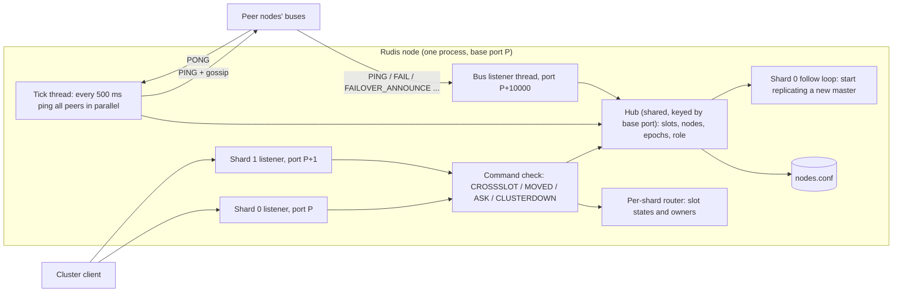
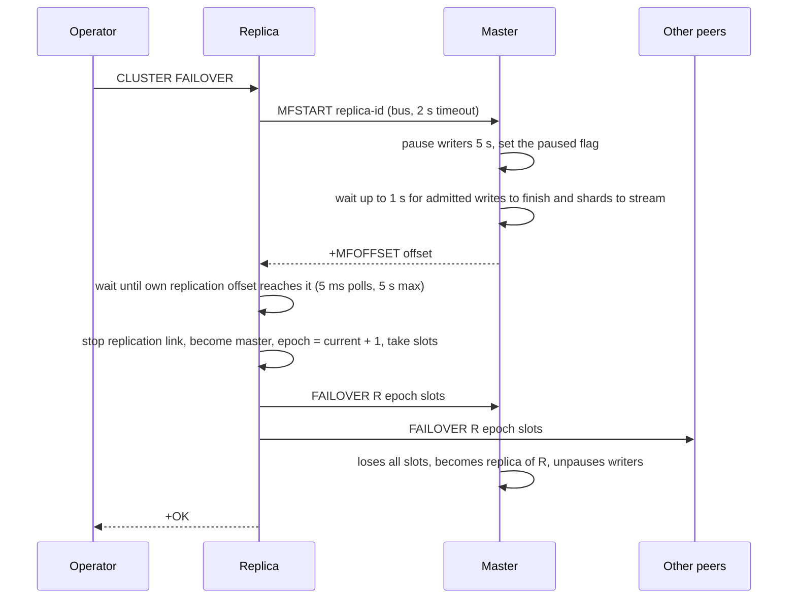

# Component 11: Redis Cluster Topology and the Gossip Protocol

> **High-Level Design Spec**: [docs/design/11_cluster_topology.md](../design/11_cluster_topology.md)
> **Consolidated Implementation Spec**: [docs/internal/components.md](components.md)
> **Main source files**: src/cluster.rs (node table, gossip bus, failure detection, elections,
> slot-ownership rules, `nodes.conf`, rebalance planning), src/connection.rs (the `CLUSTER`,
> `DFLYCLUSTER` and `DFLYMIGRATE` handlers, the per-command redirect check, key migration),
> src/router.rs (slot math and the per-shard slot tables), src/server.rs and src/main.rs (startup
> wiring and per-shard client ports). The [Code map](#18-code-map) lists the key symbols.

---

## 1. What this subsystem does

Redis Cluster splits the keyspace into **16384 hash slots**. Every key belongs to exactly one slot
(the CRC16 of the key modulo 16384, or the CRC16 of the `{hash tag}` part when the key has one),
and every slot is served by exactly one **master** node. Cluster-aware clients such as
`redis-cli -c`, Jedis or redis-py's `RedisCluster` ask a node which slots it serves, send each
command to the right node, and follow `-MOVED` and `-ASK` redirects when they guess wrong.

This component makes a Rudis process behave like one node of such a cluster. It:

* keeps the node's view of the cluster: which other nodes exist, which slots each serves, which
  are masters and which are replicas of whom, and which seem dead;
* runs the **cluster bus**: a second TCP port (the client port plus 10000) on which nodes exchange
  heartbeats ("PING" and "PONG") that carry slot claims and **gossip** (what each node knows about
  third parties);
* detects failed nodes (suspected, then confirmed by a majority of masters) and lets a replica of a
  failed master win an **election** and take over its slots;
* decides who owns a slot when two nodes claim it, using **config epochs** (a version number per
  node's slot claim; the newest wins);
* saves the node's view in `nodes.conf` so a restart keeps its identity and slots;
* answers the introspection commands (`CLUSTER NODES`, `SLOTS`, `SHARDS`, `INFO` and others) and
  performs slot migration and rebalancing.

A Rudis-specific twist: one Rudis process runs several **shards**, one per core. In cluster mode
each shard listens on its **own client port** (the base port plus the shard number), and each
shard owns a fixed part of the node's slots. The cluster code therefore advertises, and redirects
to, the exact shard port that serves a slot.

| Term | Meaning |
| :--- | :--- |
| **Node** | One Rudis process, identified by a 40-hex-character **node id**. |
| **Base port / shard port** | The node's configured client port, and (in cluster mode only) the base port plus the shard number for each shard. |
| **Cluster bus port** | The client port plus 10000. |
| **Slot** | One of 16384 key buckets. |
| **Config epoch** | The version of a node's slot claim. A higher epoch wins a disputed slot. |
| **Current epoch** | The highest epoch this node has seen anywhere. New epochs (failover, bump) are chosen above it. |
| **PFAIL / FAIL** | "This node got no reply from the peer within the node timeout" and "a majority of masters agree the peer is unreachable". |
| **MOVED / ASK** | Redirect replies: "this slot lives at X" (permanent) and "this one key is being migrated, try X once, preceded by `ASKING`". |
| **Gossip** | The list of known nodes (id, address, flags, epoch) piggy-backed on every PING. |
| **Hub** | The one shared structure that holds this node's cluster state. |

---

## 2. Mental model



Three loops share one hub:

1. **The client loop** (asynchronous, per shard). Every keyed command consults the hub (does this
   node serve the slot?) and the shard's router tables (is the slot migrating? which local shard
   owns it?) before executing or redirecting.
2. **The bus loop** (blocking operating-system threads, outside the async runtime). A listener
   accepts peer connections and applies their frames to the hub; a tick thread sends a PING to
   every peer every 500 ms and applies the PONG replies.
3. **The reaction loop.** The tick notices failures and starts elections on a fresh thread; any
   change in slot ownership is saved to `nodes.conf`; and if this node is demoted to a replica,
   shard 0 notices and starts replicating the new master.

---

## 3. Startup and process layout

1. **Config.** In src/main.rs, `cluster-enabled yes` turns on cluster mode. The hub for the base
   port is created, and its `nodes.conf` path is set from `cluster-config-file` (default
   `nodes.conf`, relative to the data directory). This happens whether or not cluster mode is on.
2. If cluster mode is on, the hub is flagged enabled, the process-wide "a cluster is active" flag
   is set, the hub learns the shard count (the thread count), and the node file is loaded:
   * a file with a `myself` line restores the identity, role, epochs and slots; if this node is a
     replica, its master's address is queued as a startup `replicaof`;
   * no file means a fresh one is written;
   * a parse error is logged and the node starts with fresh state.
3. `cluster-node-timeout` (and any other directive) in the config file is applied through the same
   code as `CONFIG SET`, which stores it in the hub. `CONFIG SET cluster-node-timeout <ms>` needs a
   positive value, and `CONFIG GET` reads it back.
4. **Per-shard ports.** Each shard binds the base port plus its shard number in cluster mode (just
   the base port, shared through `SO_REUSEPORT`, otherwise). The mapping from shard port to base
   port is recorded, so per-node registries (`WATCH`, `MONITOR`, `CLIENT KILL` lookups, pub/sub
   presence, ACLs, memory accounting) treat all shard ports as one node. Connection rebalancing
   between shards is off in cluster mode, because the client chose the port on purpose.
5. Shard 0 starts the cluster bus (cluster mode only) and a **follow loop**: every 100 ms it asks
   the hub whether a new master address is waiting, and if so starts replication from it (unless it
   is already replicating from it).
6. Every router looks up the hub by its **base port**, never its shard port, so all shards of a
   node share one identity, one node table and one replication hub.

---

## 4. Cluster state

### 4.1 The hub

There is one hub per base port, held in a process-wide map and created on first use. Hubs are never
removed or replaced. It holds, behind read-write locks and atomics:

* the node's id, role (master or replica), its master's id, and the three epoch counters: the
  current epoch (highest seen, starting at 1), its own config epoch (starting at 0), and the last
  epoch in which this master granted a failover vote (one vote per epoch);
* the table of known peers (never including the node itself);
* the slots this node serves, as sorted, merged inclusive ranges, starting as the single range
  0–16383;
* for each suspect node, the set of peers whose gossip reported it as failing;
* bookkeeping flags: whether an election is running (at most one per node), whether the bus has
  started, whether any peer has ever been added, and whether this master has paused its writers for
  a replica's manual failover;
* the shard count, the node-timeout setting (default 5000 ms), the `nodes.conf` path, and a
  one-slot "follow" mailbox holding the master address this node must start replicating.

[Reference details](#191-hub-fields) lists every field.

**Lock-order rule: never take the slot list while holding the node table.** Code that needs both
reads the slot list first. The bus thread and client threads would otherwise deadlock.

### 4.2 A peer record

Each peer record holds the id, IP, base client port, bus port, role (`master` or `slave` only),
health, the number of shards it announced (0 if unknown), the master it replicates (or `-`), the
time of our last PING to it and of the last sign of life from it, its config epoch, the link state
(connected or disconnected) and its slot ranges. The fields are in
[Reference details](#192-peer-record-and-other-types).

**Health is kept apart from role.** It is one of OK, PFAIL or FAIL. The text form used by
`CLUSTER NODES` is the role plus `,fail?` or `,fail`.

To find the exact port serving a slot on a peer, the record uses the base port plus
`slot * shards / 16384` when the peer announced more than one shard, and the base port otherwise.

### 4.3 The fast "is a cluster active?" check

The check runs on every keyed command. To avoid a shared read lock, each thread keeps its own copy
of the hub map and refreshes it only when a generation counter changes (it is bumped whenever a hub
is inserted). The answer is "the hub has known peers, or cluster mode is on", or the process-wide
flag if no hub exists for the port. The flag is set at startup in cluster mode and by `CLUSTER
MEET`.

When a cluster is active, the router sends keys to shards **by slot** instead of by key hash, so
all of a slot's keys live on one shard.

### 4.4 Node ids

A node id is built from a hash of the port (16 hex digits), a hash of the current time in
nanoseconds (16 hex digits) and the port (8 hex digits): 40 characters like a real Redis id, but
not random. The pseudo ids shown for the shards of a peerless node are the shard number plus one,
written as 40 hex digits (`000...0001`, `000...0002`, and so on).

---

## 5. Multi-shard ports and the single-node view

A cluster-mode node with *N* shards owns slot *s* on shard `s × N / 16384` and serves it on the
base port plus that shard number. This shows up in three places:

1. **Announcement.** Every PING and PONG carries `shards=N`. Peers store it, so their `-MOVED`
   replies and `CLUSTER SLOTS` point at the exact shard port. A client therefore needs at most one
   redirect.
2. **Local redirect.** A command for a slot this node serves, arriving on the wrong shard port, gets
   `-MOVED <slot> 127.0.0.1:<base port + owning shard>` (§10).
3. **Single-node view.** Before any peer is known, the introspection commands present each shard as
   if it were a separate master:
   * `CLUSTER NODES` shows this view only when cluster mode is on, the peer table is empty and the
     slot list is still the default 0–16383. The `myself` line shows the first shard's range,
     then there is one line per extra shard with its pseudo id, its address
     (`127.0.0.1:<port+shard>@<port+shard+10000>`) and its range (`shard × 16384 / N` up to
     `(shard + 1) × 16384 / N − 1`, the last ending at 16383).
   * `CLUSTER SLOTS` shows one entry per shard with the same ranges and pseudo ids whenever the
     peer table is empty; the port is the base port plus the shard in cluster mode, else the base
     port.
   * `CLUSTER SHARDS` shows one shard entry per local shard (shard 0 uses the real id).
   * `CLUSTER CHECK` counts the pseudo peers' ranges (see the gotcha in §16).

   This view is never written to `nodes.conf`, and loading skips any pseudo-shard entry written by
   older versions (a port within 1024 above ours whose id is the matching pseudo id).

**Worked example.** With base port 7000, 4 shards and no peers, `CLUSTER SLOTS` returns
`0-4095` on 7000, `4096-8191` on 7001, `8192-12287` on 7002 and `12288-16383` on 7003. `GET foo`
(slot 12182) sent to 7000 is answered `-MOVED 12182 127.0.0.1:7002`.

---

## 6. The cluster bus

### 6.1 Threads and framing

Starting the bus (once per hub) spawns a thread named for the bus port. It:

1. Binds the bus port on the same interfaces as the client port, with a backlog of 128, never a
   blanket `0.0.0.0`.
2. Starts the tick thread, which sends heartbeats and sleeps so ticks start every 500 ms. Heartbeats
   live on their own thread so that accepting connections never waits behind slow peers.
3. Loops accepting connections, sleeping 5 ms when none are pending. Each accepted connection gets
   its own operating-system thread with 500 ms read and write timeouts. At most 256 are open; extra
   connections are dropped.

The protocol is **plain text, one frame per newline-terminated line**, with space-separated tokens.
A connection thread reads lines of at most 1 MiB (a longer line drops the connection), applies each
and writes back its reply if any. Outbound messages use blocking sockets opened per exchange; there
are no persistent links.

**Input validation.** Slot lists drop reversed ranges and ranges past 16383 and merge the rest.
Ports are rejected if they are 0 or if adding 10000 would overflow. The node table never grows past
1000 entries through `MEET` or gossip. Malformed frames (missing fields, non-numeric epochs or
ports, binary junk) are ignored or refused with an error reply, and they never add a node. The line
handler is public (but hidden from the docs) so that the `cluster_bus` fuzz target and
tests/test_fuzz_parsers.rs can feed it arbitrary bytes: bus peers are unauthenticated, so applying
any line must never panic.

### 6.2 Messages

| Frame | Sent by | Effect at the receiver | Reply |
| :--- | :--- | :--- | :--- |
| `MEET <ip> <port> <id> <epoch> [<slots>]` | `CLUSTER MEET` | Inserts or refreshes the sender as a master (keeping any epoch and slots already known), then applies its slot claim. Refused if the table is full and the sender is new. | `+PONG ...`, or `-ERR too many cluster nodes` or `-ERR invalid port` |
| `PING <id> <epoch> <role> [<slots>] shards=N [of=<master>] GOSSIP <entries>` | tick thread, peer refresh | For a **known** sender: records the sign of life, sets the link connected and health OK, applies the role and announce tokens, applies the slot claim, then ingests gossip (§6.3). Unknown senders are not added. | `+PONG ...` |
| `+PONG <id> <epoch> <role> [<slots>] shards=N [of=<master>]` | reply to MEET and PING | If the id differs from the key we used (a MEET placeholder), the entry is renamed to the real id. Applies the role, tokens and slot claim. | none |
| `FAIL <id>` | a node that confirmed a failure | Marks the node FAIL and its link disconnected. | `+OK` |
| `FAILOVER <id> <epoch> <slots>` | manual failover | Marks the sender a healthy master and applies its slot claim. | `+OK` |
| `FAILOVER_ANNOUNCE <id> <epoch> <slots>` | election winner | Same as `FAILOVER`. Older claims (the failed master's) give way through the claim rule. | `+OK` |
| `FAILOVER_AUTH_REQUEST <replica> <epoch> <master>` | election candidate | Vote rules in §9.1. | `+FAILOVER_AUTH_ACK <my_id> <epoch>`, or `-ERR vote rejected` |
| `MFSTART <replica>` | a replica starting a manual failover | Only on a master: pauses writers for 5 s, sets the paused flag, then waits up to 1 s until no already-admitted write is still running and every shard has streamed what it holds, and reads the replication offset. | `+MFOFFSET <master_repl_offset>`, `-ERR not a master`, or `-ERR writes did not settle for the manual failover` |
| anything else | | | `-ERR unknown clusterbus command` |

Slot lists are written `start-end,start-end,...` (a single slot as `s-s`). **Announce tokens** are
`shards=N` (the shard count in cluster mode, else 1) and, for a replica, `of=<master id>`. The
receiver stores them and forces the master id to `-` for masters. Because a slotless node's slot
field is empty, a PING's fifth token counts as a slot list only if it is not `GOSSIP` and contains
no `=`.

### 6.3 Gossip

Each tick builds one payload: every known node written as `id,ip,port,cport,flags,config_epoch`,
joined by `;` (one token, so flags use `|`, for example `master|fail?`). For each entry whose id is
not our own, the receiver:

1. **Knows the node:** an entry flagged `fail?` or `fail` adds the **sender** to that node's
   failure reports; an entry without a failure flag removes the sender (a retraction). Reports about
   unknown nodes are ignored.
2. **Knows the node and the entry says `fail`:** marks it FAIL too, so FAIL spreads through gossip
   as well as through the `FAIL` broadcast.
3. **Does not know the node**, the port is non-zero and the table has room: inserts it with the
   gossiped role, health and config epoch and **no slots**. Its slots arrive in its own PONGs once
   our tick pings it. This is how a node learns about peers it never meets directly.

### 6.4 CLUSTER MEET, FORGET and RESET

`CLUSTER MEET` runs synchronously in the client command handler:

1. It returns at once if the port is our own.
2. It inserts a placeholder entry under a temporary id (unless some node already has that port) with
   epoch 0 and no slots, and flags the hub as having peers and a cluster as active.
3. It connects to the peer's bus port (300 ms connect and I/O timeouts), sends `MEET 127.0.0.1 <my
   port> <my id> <config epoch> <my slots>` and, on a `+PONG`, replaces the placeholder with the
   real id, role, epoch and slots.
4. It saves `nodes.conf`. If the handshake failed, the placeholder stays, and the next tick's PONG
   renames it.

`CLUSTER FORGET <id>` removes the node and every failure report by or about it. `CLUSTER RESET`
clears the node table and reports; `RESET HARD` also generates a new id, resets the epochs (current
1, config 0), sets the role to master and clears the slot list.

---

## 7. Heartbeats and failure detection

### 7.1 One tick

1. Work out whether this node serves slots as a master (read before the peer table), snapshot the
   peer list, and compute the **failure quorum**: the number of masters serving slots (counting this
   node if it does), divided by 2, plus 1.
2. Build the gossip payload (§6.3).
3. Split the peers into batches of 64. For each batch, stamp the ping-sent time, then exchange with
   all peers of the batch **in parallel**: connect (500 ms), write the PING (built per peer so it
   carries current slots), read one reply (1000 ms timeouts), and apply the PONG.
4. For each success, record the sign of life, mark the link connected and set health OK.
5. For each failure, run the unreachable check:
   * nothing happens until the time since the last sign of life exceeds the node timeout, and
     nothing happens if the peer is already FAIL;
   * count the reports from known masters, plus 1 if this node is a master;
   * if the count reaches the quorum, mark the peer FAIL, disconnect its link, and broadcast
     `FAIL <peer>` to every known peer (200 ms connect each, no reply read);
   * otherwise mark it PFAIL.
6. **Election trigger.** If this node is a replica whose master is FAIL **and still has slots** (no
   one has taken over yet), and no election is running, start an election on a new thread.

A peer returns to OK when our PING to it succeeds, when it PINGs us, or when a `FAILOVER` or
`FAILOVER_ANNOUNCE` names it.

### 7.2 Worked example

Masters A, B and C each serve slots; the node timeout is 5000 ms. C crashes.

1. At A, C's heartbeats fail. After 5 s of silence A computes a quorum of `3/2 + 1 = 2`. A has no
   reports yet and counts itself as 1, so 1 is less than 2 and C is PFAIL at A. B reaches the same
   state.
2. A's next PING to B carries the gossip entry for C flagged `master|fail?`. B records A as a
   reporter.
3. On B's next failed PING to C, B has 1 report (A) plus itself, so 2 reaches the quorum. B marks C
   FAIL and broadcasts `FAIL C`. A marks C FAIL on receipt.
4. C's replica C' sees its master FAIL with slots and starts an election (§9.1).

`CLUSTER INFO` reports `cluster_state:fail` while any FAIL master still has slots, and counts the
PFAIL and FAIL nodes.

---

## 8. Slot ownership and config epochs

### 8.1 Where ownership is recorded

| Record | Lives in | Who reads it |
| :--- | :--- | :--- |
| The hub's slot list | the hub | "Is the slot served by **this node**?" Redirect check, PING and PONG claims, introspection, `nodes.conf`. |
| Each peer's slot list | the hub | "Which **peer** serves a slot?" `-MOVED` targets, introspection. |
| The router's slot states | each shard's router | Live migration redirects: migrating, importing or moved (with the other node's address). Absent means stable. |
| The router's slot owners | each shard's router (empty until first written) | Which **local shard** owns a slot; falls back to the default layout. |
| The hub's slot-state copy | the hub | A reporting copy of migrating and importing slots, for `CLUSTER NODES` markers, `CLUSTER CHECK` and `nodes.conf`. |

Changing a slot's state or owner updates the calling shard's tables and posts the change to the
other shards. Command handlers then wait on a barrier, which sends a marker to every other shard and
waits, so all shards have applied the change before the client gets `+OK`.

### 8.2 The conflict rule

Every `MEET`, `PING`, `PONG`, `FAILOVER` and `FAILOVER_ANNOUNCE` ends in the same rule: "node *id*
says it serves *slots* at config epoch *epoch*". The rule is:

1. Raise the current epoch to at least *epoch*.
2. Read our own config epoch and slots (before locking the peer table).
3. If *id* is unknown, stop. If *epoch* is older than the epoch already recorded for *id*, stop (a
   stale message).
4. Mark every slot held by **another** node whose config epoch is at least *epoch*, and our own
   slots if our config epoch is at least *epoch*. A claimed slot is **accepted** only if unmarked.
   Ties go to the current holder, so a slot never has two owners.
5. Remove the accepted slots from every other peer whose config epoch is lower than *epoch*.
6. If we are a replica, our master had slots, it now has none, and *id* just gained some, our master
   was failed over to *id*: set our master to *id* and queue its address to follow.
7. If our config epoch is lower than *epoch*, the accepted slots we held are **lost**.
8. Record *id*'s new epoch and replace its slot list with the accepted slots.
9. If anything was lost, remove it from our slot list. If that empties the list and we are a master,
   **demote**: become a replica of *id*, queue its address to follow, and, if a manual failover had
   paused our writers, unpause them (they will now get `-MOVED`). Save `nodes.conf`.

**Worked example.** Master B (config epoch 2, slots 8192–16383) is failed over to its replica B',
which wins epoch 5 and broadcasts `FAILOVER_ANNOUNCE B' 5 8192-16383`.

* At master A (epoch 3, slots 0–8191), no one holds those slots at epoch 5 or higher, so all are
  accepted. B (epoch 2) loses them, and B' now owns 8192–16383 at epoch 5.
* B restarts and PINGs A with `B 2 master 8192-16383`. B' holds those slots at 5, which beats 2, so
  nothing is accepted and B's slot list at A becomes empty.
* B receives a PONG from B' (epoch 5, greater than its own 2). All its slots are lost, its list is
  empty, so B becomes a replica of B', and shard 0's follow loop starts replicating from B'.

### 8.3 Changing epochs on purpose

* **Bump:** the config epoch becomes the larger of the config and current epochs, plus 1; the current
  epoch is raised to match; the node file is saved. This runs after this node's slot set changes
  through migration (`SETSLOT ... NODE`, rebalance) and for `CLUSTER BUMPEPOCH` (reply `+BUMPED
  <epoch>`).
* **Set:** `CLUSTER SET-CONFIG-EPOCH` works only if the value is non-zero, the current config epoch
  is 0, and the node has no explicit slots (the default 0–16383 counts as none and is cleared).
* **Assign:** local bookkeeping that adds a slot to an owner (us or a peer) and removes it from
  everyone else, then saves.

### 8.4 Assigning slots by hand

* `CLUSTER ADDSLOTS` and `ADDSLOTSRANGE` validate (below 16384, start not after end), clear the
  default 0–16383 first, add to the slot list and save. The router version also marks each slot
  stable, sets its local owner to the default shard for that slot, and waits on the barrier. The
  config epoch is **not** bumped.
* `CLUSTER DELSLOTS` and `DELSLOTSRANGE` remove slots from the list and save; router tables are
  untouched.
* `CLUSTER FLUSHSLOTS` clears the slot list and the reporting copy of slot states (keys are not
  deleted), then saves.

---

## 9. Failover

### 9.1 Automatic election

1. Bail out if there is no master, or if the replication hub says this replica never got its
   master's data: it would serve the slots empty.
2. Sleep 500 ms plus a random 0–500 ms, so the FAIL verdict spreads and sibling replicas do not split
   votes. Bail out if the master is no longer FAIL or our master changed.
3. Take a new request epoch, one above the current epoch.
4. The voters are the masters that serve slots (or are the failed master). The total counts all of
   them, the failed master included; requests go to the live ones. The candidate does not vote for
   itself.
5. Send `FAILOVER_AUTH_REQUEST <me> <epoch> <master>` to each (500 ms connect, 1000 ms I/O) and count
   the `+FAILOVER_AUTH_ACK` replies.
6. **Win** if the votes reach `total / 2 + 1`:
   1. Stop the replication link (waiting up to 5 s) and become a replication master **before**
      claiming slots, so anyone who sees this node serving the slots also sees it as a master.
   2. Set the role to master, clear the master id and take the request epoch as the config epoch.
   3. Take the old master's slots from its entry and mark that entry as our replica.
   4. Broadcast `FAILOVER_ANNOUNCE <me> <epoch> <slots>`.
7. **Lose:** sleep 1000 ms plus a random 0–1000 ms before a later tick may retry.
8. Clear the election-running flag.

A master **grants** a vote only if all of these hold: it is a master; the request epoch is above its
last vote epoch (it then stores the request epoch, so there is one vote per epoch); and the claimed
master is FAIL **and still has slots** (once someone has taken them over, a second replica cannot).

**Example.** With masters A, B and C (C failed, replica C'), the total is 3 and the majority is 2. C'
asks A and B; both ACK, so C' wins at epoch current + 1.

### 9.2 Manual failover (CLUSTER FAILOVER)



* Without `FORCE`, and when the replica knows its master's address, the handler first runs the
  `MFSTART` exchange over the bus. The master pauses writers and returns its replication offset; the
  replica waits until it has processed that much, or fails with `-ERR Manual failover timed out`,
  `-ERR master did not answer the manual failover (use FORCE)` or `-ERR master refused the manual
  failover: <master's reply>`.
* **No acknowledged write is lost.** Before reading its offset, the master waits until every write
  that passed the pause gate just before it closed has finished, and every shard has streamed the
  replication bytes it still holds (100 µs polls, 1 s limit). Otherwise a write could be
  acknowledged to its client yet missing from the offset the replica catches up to. If the writes
  do not settle in 1 s, the master answers `-ERR writes did not settle for the manual failover`; the
  operator can retry or use `FORCE`.
* `FORCE` and `TAKEOVER` (treated the same) skip that step.
* The replication link is then stopped and the failover runs. It requires the role replica (else
  `-ERR You should send CLUSTER FAILOVER to a replica`), becomes a master first, takes a new epoch of
  current + 1, takes the old master's slots, marks the old master as its replica, sends `FAILOVER` to
  every peer (200 ms connect, no reply) and saves. No vote is held.
* The standalone replication command `FAILOVER [TO host port] ...` (Component 14) is refused in
  cluster mode with `-ERR FAILOVER not allowed in cluster mode.`, as in Redis. Cluster nodes switch
  roles only through `CLUSTER FAILOVER` or an election.

### 9.3 CLUSTER REPLICATE

This refuses to replicate itself, an unknown node or a replica, and refuses if this node is a master
that still serves slots. Otherwise it sets the role to replica, records the master, clears the slot
list, saves, and returns the master's address. The handler then starts replication to it (unless it
is already replicating from it), so the cluster role and the data link always change together. After
a restart, the same address is available from the saved config.

---

## 10. Request routing and redirects

For each command, the checks run in this order:

1. `ASKING` sets a one-shot flag and replies `+OK`. The flag makes the next command "asking" (as
   does `RESTORE-ASKING`) and is cleared either way.
2. **CROSSSLOT.** In cluster mode, a command with several keys in different slots gets
   `-CROSSSLOT Keys in request don't hash to the same slot`. Outside cluster mode the same error is
   given when `cross-shard-strict yes` is set (config file, `--cross-shard-strict` or `CONFIG SET`;
   default `no`), the node has more than one shard, and the command's keys live on different shards.
   Placement uses the key's hash tag, or the slot mapping if a cluster is active. That opt-in lets a
   standalone multi-shard node refuse the multi-key commands whose cross-shard atomicity is weaker
   than Redis's, exactly as a cluster would. Keys sharing a `{hash tag}` share a shard and keep
   working.
3. Take the command's **primary key** and its slot, and match the router's state for the slot:
   * **Moved** gives `-MOVED <slot> <addr>`.
   * **Importing** gives `-MOVED <slot> <source>` unless the command is asking, in which case it
     executes.
   * **Migrating** executes if the key exists locally, else gives `-ASK <slot> <target>`.
   * **Stable** matters only if cluster mode is on or a cluster is active. The slot is "served here"
     if the hub owns it, **or** the command is a read, the client sent `READONLY`, and this node is a
     replica of the slot's master. If it is served here and cluster mode is on, then another local
     shard owning the slot gives `-MOVED <slot> 127.0.0.1:<base port + that shard>`, and otherwise the
     command executes. If it is not served here, the first known non-FAIL master peer whose slots
     include it gives `-MOVED <slot> <peer ip>:<exact shard port>`, and no such peer gives
     `-CLUSTERDOWN Hash slot not served`.

`READONLY` and `READWRITE` set or clear a read-only flag on the connection.

**Transactions.** At `EXEC`, if cluster mode is on and the queued commands' keys span more than one
slot, or, outside cluster mode with `cross-shard-strict yes` and several shards, span more than one
shard, the transaction is discarded (queue cleared, WATCHes dropped) and the reply is
`-CROSSSLOT Keys in request don't hash to the same slot`.

**Worked example.** Node X (base 7000, 2 shards) serves 0–8191; node Y (base 7100, 2 shards) serves
8192–16383; X has learned that Y announced 2 shards.

* `MGET a b c` on any port gives `-CROSSSLOT` (slots 15495, 3300 and 7365). `MGET {u}a {u}b` is fine.
* `GET foo` (slot 12182) sent to 7000: X does not serve it, Y does, and the slot maps to Y's shard 1,
  so the reply is `-MOVED 12182 <Y ip>:7101`. At 7101, Y owns the slot and shard 1 is the owner, so
  the command executes.
* `GET k` with slot 3000 sent to 7001 (X's shard 1): X serves it but shard 0 owns it, so the reply is
  `-MOVED 3000 127.0.0.1:7000`.

The pipeline-squashing fast path (Component 04) performs its own cluster checks and falls back to
running commands one by one through the normal path when the pipeline mixes slots, touches a slot
that is not stable, or (when peers are known) touches a slot this node does not serve.

---

## 11. Slot migration

All data movement goes through one function that also backs the `MIGRATE` command. It takes the
router, a list of keys, the target host and port, options, and a slot for an optional connection to
the target. The slot exists because a slot moves in many batches:

* If it holds no connection, the call opens one, and on full success leaves the stream there for the
  next batch.
* After any error the stream is dropped, so the next batch reconnects rather than reading a
  half-consumed reply stream.

Slot migration (`MIGRATE-SLOT`, `REBALANCE`, `RESHARD`) creates one such slot per migrating slot and
drops it when that slot's keys are moved, so all batches of a slot share one TCP connection instead
of paying a handshake per batch. `MIGRATE` passes a throwaway empty slot, so each `MIGRATE` uses its
own connection.

### 11.1 Moving a batch of keys

1. For each key, on its owning shard: `DUMP` it (skip if missing; abort on an error reply) and read
   its `PEXPIRETIME` (absolute expiry in ms; -1 and -2 count as none).
2. Build one pipelined request: `ASKING`, then per key `RESTORE <key> <abs-expiry-ms or 0> <payload>
   [REPLACE] [ABSTTL]`.
3. Take the stream from the slot or connect to the target (with the option timeout), send, and read
   until one reply per command has arrived, each read bounded by the timeout.
4. For each key the target answered `+OK`: unless this is a copy, delete it locally, but only if its
   current dump still equals what was sent. The check and the delete happen on the owning shard in
   one step.
5. Any error reply gives `ERR Target instance replied with error: ...`; I/O problems give `IOERR ...`.
   Keys not confirmed stay on the source, and the connection is not handed back. With no error, the
   stream goes back into the slot.

**Worked example.** A slot holding 1000 keys is moved by `MIGRATE-SLOT` (100 keys per batch): ten
batches over **one** connection, then an eleventh key scan returns nothing and the connection is
dropped. If batch 4 times out, its stream is dropped, the handler stops with `-ERR migration failed:
IOERR ...`, and a retry opens a new connection.

`DUMP` works from the tier record, so keys spilled to NVMe migrate too. Slot migration uses
replace-on-restore and a 5 s timeout, and never copies.

### 11.2 CLUSTER MIGRATE-SLOT

`CLUSTER MIGRATE-SLOT <slot> <host> <port>` (also `MIGRATESLOT`) runs on the source node:

1. Mark the slot migrating locally and wait on the barrier.
2. Send `CLUSTER SETSLOT <slot> IMPORTING <my id>` to the target's client port (1 s timeouts).
3. Repeatedly list up to 100 keys in the slot and migrate them (all batches over one connection)
   until none are left. On error reply `-ERR migration failed: ...` and stop; the slot stays
   migrating.
4. Send `CLUSTER SETSLOT <slot> NODE myself` to the target.
5. Mark the slot moved locally and reply `+OK`.

This path does not edit the hub's slot list. The target's `SETSLOT ... NODE myself` bumps its config
epoch and claims the slot, and the source drops it when the target's next PING or PONG reaches the
conflict rule.

### 11.3 CLUSTER SETSLOT

This is the manual, Redis-compatible form:

* `MIGRATING <node>` and `IMPORTING <node>` take an `ip:port` or a known id (resolved to `ip:port`).
  They set the router state and the hub's reporting copy. No keys move.
* `STABLE` clears both.
* `NODE <node>` clears the hub's copy for the slot, then:
  * if the node is `myself`, our id, or one of our pseudo-shard ids: set the slot's local owner (the
    named pseudo shard, else the default shard), mark it stable, assign it to us and bump the config
    epoch;
  * otherwise: assign it to the owner if that is a known id or address (else just drop it from our
    list), bump the epoch if we had owned it, and mark it moved to the owner's `ip:port`.

  Then it waits on the barrier and replies `+OK`.

### 11.4 CLUSTER REBALANCE and CLUSTER RESHARD

The syntax is `CLUSTER REBALANCE [<host> <port> [<slots>]] [WEIGHTS id=w ...] [SIMULATE] [THRESHOLD t]
[PIPELINE n]` (defaults: threshold 1.25, pipeline 16) and `CLUSTER RESHARD <target-id> <source-id>
<count>`.

1. A plan is computed (§12). `SIMULATE` replies with up to 5 lines `Moving slot S from <id> (<addr>) to
   <id> (<addr>)`, or `*** No rebalancing needed! All nodes balanced. ***`.
2. Otherwise the plan runs (batch size is `PIPELINE` clamped to 1–1000; `RESHARD` uses 100) and the
   reply is the number of plans applied. For each plan:
   * **We are the source:** mark the slot migrating (hub and router); send `SETSLOT IMPORTING` to the
     target; move keys in batches over one connection until the slot is empty or a batch fails; send
     `SETSLOT NODE myself` to the target; mark the slot moved locally; assign it to the target; clear
     the hub state; bump the config epoch; and refresh the target (an immediate PING and PONG, so both
     sides learn each other's new epoch).
   * **We are the target:** mark the slot importing, then immediately assign it to us and bump the
     epoch. No keys are fetched.
   * **Neither:** skipped.

---

## 12. Rebalance planning

Two pure functions read the hub and return a list of planned moves (slot, source node and address,
target node and address). They change nothing.

**Masters considered:** this node if it is a master, plus every peer that is a master (healthy or
not, with or without slots). If there are none, the error is `No master nodes found in cluster`.

**Targeted mode** (`<host> <port>` given): the target is the master matching that port or
`host:port` (if none, a placeholder id). The donor is the largest other master if the target is us,
else us (or the first master). Up to the requested slot count (default 1) are popped from the end of
the donor's list.

**Auto or weighted mode** (a single master gives an empty plan):

1. Each master's weight is its `WEIGHTS` entry, default 1.0, floored at 0.01.
2. Its target is `floor(weight / total weight × 16384)`; leftover slots go one each to the masters
   with the largest fractional remainders, so the targets sum to exactly 16384.
3. The threshold in slots is `ceil(threshold / 100 × 16384 / n)`. If every master's slot count is
   within that of its target, the plan is empty.
4. Otherwise repeat: take the most over-allocated donor and the most under-allocated receiver, move
   the smaller of the surplus and the deficit (popped from the end of the donor's list), until no
   pair remains.

**Example.** With 2 masters where A holds all 16384 slots, B holds none and weights are equal, the
targets are 8192 each and the threshold is `ceil(0.0125 × 8192) = 103`. The difference of 8192 exceeds
103, so there are 8192 plans moving A's highest 8192 slots to B. Run again once both hold 8192 and the
plan is empty.

The reshard plan pops `min(count, source slots)` slots from the end of the source's list, with
`Source node ... not found` and `Target node ... not found` errors.

---

## 13. Introspection and compatibility commands

| Command | Source of truth and notes |
| :--- | :--- |
| `CLUSTER NODES` | The `myself` line (`127.0.0.1:<port>@<cport> myself,<role> <master> 0 0 <epoch> connected <slots>` plus migration markers `[s->-id]` and `[s-<-id]`), then peers sorted by id with flags, ping and pong times, epoch, link state and slots. Single-node view per §5. |
| `CLUSTER SLOTS` | Peerless: §5. Otherwise one entry per contiguous range per master (us if a master, plus peer masters), split at shard boundaries for multi-shard nodes so each points at the serving shard port; replicas (nodes whose master id is that master) are listed with their own shard port. |
| `CLUSTER SHARDS` | One entry per master with its replicas; per node `id`, `port`, `ip`, `endpoint` (equal to ip), `role`, `replication-offset` (always 0) and `health` (`fail` if FAIL, else `online`). |
| `CLUSTER INFO` | `cluster_state` (§7.2), PFAIL and FAIL counts, `cluster_known_nodes` and `cluster_size` (both peers + 1), epochs. `cluster_slots_assigned` and `cluster_slots_ok` are fixed at 16384 and the message stats at 0. |
| `CLUSTER LINKS` | One `direction to` entry per peer with fixed placeholder fields. |
| `CLUSTER MYID`, `KEYSLOT`, `COUNTKEYSINSLOT`, `GETKEYSINSLOT` | The id; the slot of a key; key scans through the router. |
| `CLUSTER CHECK` | Builds and prints the report in §14. |
| `CLUSTER SAVECONFIG` | Writes `nodes.conf`. |
| `DFLYCLUSTER MYID / CONFIG <json> / GETSLOTINFO / FLUSHSLOTS / SLOT-MIGRATION-STATUS` | `CONFIG` replaces the slot list with the ranges addressed to this node (master id or id equal to ours or empty; `[s,e]` pairs or `{start,end}` objects), with no epoch bump and the router untouched. `GETSLOTINFO` reports key counts and `count × 128` bytes. `FLUSHSLOTS` deletes the keys of the ranges. |
| `DFLYMIGRATE INIT / FLOW / ACK` | Status bookkeeping only: `INIT` creates an active migration in the migrating state, `FLOW` sets it syncing and adds the flow id (minimum 1) to the key count, `ACK` clears it. No keys move. |

---

## 14. CLUSTER CHECK

The check rebuilds a map from slot to claimants each time:

1. If we are a master, each slot in our list is claimed by us.
2. In cluster mode with no peers and more than one shard, the pseudo shards 1 to N claim their §5
   ranges and the master count is N. Otherwise every peer master claims its slots, and replicas are
   counted.
3. Over all 16384 slots: no claimant is an **open** slot, more than one is a **duplicate**, and at
   least one counts toward the assigned total.
4. The hub's reporting copy fills the migrating and importing lists (they do not affect `ok`).
5. `ok` is true when there are no open and no duplicate slots.

The report prints `[OK] All 16384 slots covered by N master nodes. ...` or a `[WARNING] ...` line
with up to 20 open and 20 duplicate slots, then migrating and importing lines.

---

## 15. nodes.conf

The save writes the node table (without the single-node view) plus a trailer line:

```text
<my id> 127.0.0.1:7000@17000 myself,master - 0 0 3 connected 0-8191 [42->-<peer id>]
<peer id> 10.0.0.2:7100@17100 master - 1729... 1729... 4 connected 8192-16383
vars currentEpoch 5 lastVoteEpoch 4
```

It writes to a temporary file beside the target (the extension is replaced with `tmp.<port>`) and
renames it, so a crash never leaves a half-written file. It does nothing if no path is configured.
Saves happen after `MEET`, `FORGET`, `REPLICATE`, a manual failover, slot add, delete and flush,
reset, slot assignment, epoch changes, and when the conflict rule takes slots away from us.

Loading skips blank and `#` lines and lines with fewer than 8 fields. It reads the `vars` line;
parses `ip:port@cport` (the bus port defaults to the port plus 10000); restores slot ranges and the
migration markers; applies the `myself` line to the hub; skips pseudo-shard entries; and loads other
lines as peers (with an unknown shard count until they announce one). It reports whether a `myself`
line was found.

---

## 16. Invariants & gotchas

1. **One identity per node.** All cluster and replication lookups use the base port. Code that looked
   up the hub by the shard port would create a separate, phantom hub claiming all 16384 slots.
2. **Lock order:** the slot list before the node table, never the reverse (§4.1).
3. **Role and health are separate.** The role is only `master` or `slave`; health is tracked
   separately. A failing master keeps its role, and its slots stay visible until someone claims them.
4. **A slot has at most one owner in any node's view.** The conflict rule gives ties to the current
   holder and removes accepted slots from older claimants.
5. **The default slot list claims everything at epoch 0.** Two fresh nodes that MEET each keep all
   slots (the tie goes to the holder), so neither redirects. Assign slots with `ADDSLOTS` or
   `ADDSLOTSRANGE` (which clear the default) before relying on routing. `CLUSTER NODES` and
   `SET-CONFIG-EPOCH` treat the default as "no explicit slots".
6. **`CLUSTER CHECK` on a fresh multi-shard node** counts the default 0–16383 for `myself` *and* the
   pseudo shards' ranges, so every slot above shard 0's range is reported as a duplicate until slots
   are assigned explicitly.
7. **Single-node-view boundaries versus real routing.** The views in §5 use `s × 16384 / N`, while
   routing uses `slot × N / 16384`. When *N* does not divide 16384 (for example 3 or 6 shards), a
   boundary slot can be advertised on one shard port and served by its neighbour, costing one extra
   `-MOVED`. Multi-node `CLUSTER SLOTS` uses the routing formula and is exact.
8. **Two kinds of MOVED target.** The stable-branch peer redirect uses the exact shard port; the
   moved and importing redirects use the peer's base `ip:port`, so a multi-shard target may redirect
   once more. The local-shard redirect always says `127.0.0.1`.
9. **Health recovers only through direct contact:** our PING succeeds, its PING arrives, or a
   failover message names it. Failure reports never expire by time; they are retracted only by a later
   gossip entry from the same reporter, or by `FORGET` or `RESET`.
10. **A master counts its own opinion** when judging an unreachable peer, even if it serves no slots,
    while the quorum counts only masters that do.
11. **No `nodes.conf` save after an election win or a vote.** The new role and epoch are written by
    the next save.
12. **Elections need data.** A replica that never completed a sync with its master never takes over.
13. **`REBALANCE` moves data only from the source node.** Run it on the donor. On the receiving node a
    plan is pure bookkeeping, and the router's slot state is left at importing, so clients that do not
    send `ASKING` are redirected back to the source.
14. **Slot migration finalises even after a failed batch** in the rebalance executor: the loop stops,
    but the slot is still handed over (`SETSLOT NODE`, moved), so unmoved keys stay on the source behind
    a `-MOVED`. `MIGRATE-SLOT` instead stops with an error and leaves the slot migrating.
15. **Bus code runs on blocking operating-system threads**, outside the async runtime. It must not
    `await` or touch shard-local (`Rc`/`RefCell`) state; it reaches shards only through the hub and
    through the follow mailbox and pause flags. That is why `MFSTART` uses the blocking, sleep-polling
    wait rather than the async one.
16. **A refused `MFSTART` leaves the master paused.** The pause and the paused flag are set before the
    write-settle wait. If that wait times out, the master replies with an error but its writers stay
    paused until the 5 s pause expires (or it steps down).
17. **Slot-migration connections are reused only after a clean exchange.** A stream goes back into the
    slot only when every reply of the batch was read, so a batch never reads a previous batch's
    leftover replies.
18. **`cross-shard-strict` is shard-based, while cluster CROSSSLOT is slot-based.** Outside cluster
    mode keys are placed by the hash of their hash tag, so two keys in different slots may still share
    a shard and be accepted. In cluster mode any two different slots are refused even if one shard
    serves both.

---

## 17. Limitations / not implemented

* **Single-host addressing.** A node always advertises itself as `127.0.0.1` (in `MEET`, `CLUSTER
  NODES`, `CLUSTER SLOTS`, `CLUSTER SHARDS` and local MOVED replies), `CLUSTER MEET` to a port equal
  to our own is silently ignored, and the MEET placeholder is matched by port only. Multi-host
  clusters, or several hosts using the same port, are not supported. The `cluster-announce-*` names
  are in the config parser's list of known Redis directives, but nothing in the cluster code reads
  them.
* **No bus outside cluster mode.** The bus starts only with `cluster-enabled yes`; a non-cluster node
  can send `CLUSTER MEET` but cannot receive heartbeats.
* **Unauthenticated, text bus.** Any client that can reach the bus port can send `FAIL`,
  `FAILOVER_ANNOUNCE`, gossip and so on. Frames are validated (size, slot ranges, ports, node cap) but
  not authenticated, and TLS is not used on the bus.
* **Full-state gossip and short-lived connections.** Every tick opens one TCP connection per peer and
  sends the whole node table.
* **Simplified failover.** There is no replica rank or offset-based delay, no replica migration, and
  no `cluster-require-full-coverage` or `allow-reads-when-down` handling (`-CLUSTERDOWN` is given only
  when no live owner is known).
* **`CLUSTER FAILOVER` holds no vote**, with or without `FORCE`.
* **Not implemented:** `CLUSTER COUNT-FAILURE-REPORTS`, `REPLICAS` and `SLAVES`, real `CLUSTER LINKS`
  statistics, real `cluster_stats_*` counters, and replication offsets in `CLUSTER SHARDS`. Unknown
  subcommands parse as an unknown `CLUSTER <sub>` command.
* **`DFLYMIGRATE` moves no data.** `DFLYCLUSTER CONFIG` and `ADDSLOTS` do not bump the config epoch, so
  their claims win only where nobody holds the slots at an equal or newer epoch.
* **The router's reusable redirect check** duplicates the inline redirect logic and has no callers.
* Node ids are derived from a hash of the port and the time, not random 160-bit values.

---

## 18. Code map

| File | Key symbols | Role |
| :--- | :--- | :--- |
| `src/cluster.rs` | `ClusterHub`, `ClusterNodeInfo`, `FailState`, `parse_flags` | Node state and peer records. |
| `src/cluster.rs` | `get_cluster_hub`, `CLUSTER_HUBS`, `has_active_cluster`, `HAS_ACTIVE_CLUSTER`, `generate_node_id` | Hub registry, per-thread fast check, ids. |
| `src/cluster.rs` | `claim_slots`, `assign_slot`, `bump_config_epoch`, `set_config_epoch`, `owns_slot`, `replicates_slot`, `take_follow` | Slot ownership rules and epochs; the demotion hand-off. |
| `src/cluster.rs` | `start_cluster_bus`, `handle_cluster_bus_conn`, `handle_cluster_bus_line`, `pong_reply`, `ping_frame`, `announce_tokens`, `apply_announce`, `apply_pong`, `refresh_peer`, `broadcast_to_peers` | Bus threads, wire protocol, announcements. |
| `src/cluster.rs` | `cluster_bus_tick`, `note_unreachable`, `failure_quorum` | Heartbeats and PFAIL/FAIL. |
| `src/cluster.rs` | `start_election`, `random_below`, `cluster_failover`, `manual_failover_start` | Automatic and manual failover. |
| `src/cluster.rs` | `cluster_meet`, `cluster_forget`, `cluster_replicate`, `replication_master_addr`, `cluster_reset`, `cluster_addslots`, `cluster_addslotsrange`, `cluster_delslots`, `cluster_delslotsrange` | `CLUSTER` topology commands. |
| `src/cluster.rs` | `cluster_nodes`, `render_nodes`, `cluster_slots`, `cluster_shards`, `cluster_info`, `cluster_links`, `cluster_check`, `ClusterCheckReport` | Introspection. |
| `src/cluster.rs` | `save_config`, `load_config`, `is_own_shard_pseudo_node` | `nodes.conf`. |
| `src/cluster.rs` | `compute_rebalance_plan`, `compute_reshard_plan`, `SlotMigrationPlan`, `RebalanceOptions` | Planning. |
| `src/cluster.rs` | `dfly_cluster_config`, `dfly_slot_migration_status`, `dfly_migrate_init`, `dfly_migrate_flow`, `dfly_migrate_ack`, `ActiveMigration` | Dragonfly compatibility. |
| `src/cluster.rs` | `parse_slot_ranges`, `compact_slots`, `remove_slots`, `slots_repr`, `bus_port`, constants | Helpers and limits. |
| `src/connection.rs` | `execute_command_inner` (`ASKING`, CROSSSLOT and `cross_shard_strict`, the `SlotState` match, the stable branch) | Per-command redirect decision. |
| `src/connection.rs` | `cross_shard_strict`, `set_cross_shard_strict`, `keys_on_several_shards`, `tx_has_cross_slot`, the `EXEC` arm | The `cross-shard-strict` switch and the per-command and per-transaction CROSSSLOT checks. |
| `src/connection.rs` | the `Command::Cluster`, `DflyCluster` and `DflyMigrate` arms, the `Readonly` and `Readwrite` arms, the `Command::Failover` arm (refused in cluster mode) | Command handlers. |
| `src/connection.rs` | `migrate_keys_to_node` (with its reusable connection slot), `MigrateOpts`, `take_simple_replies`, `execute_rebalance_plans`, `SLOT_MIGRATION_TIMEOUT` | Key migration. |
| `src/connection.rs` | `apply_config_value` (`cluster-node-timeout`, `cluster-config-file`, `cross-shard-strict`), `set_node_port`, `node_port`, `set_client_pause`, `unpause_clients`, `writes_running` | Config, the shard-port to node mapping, the manual-failover pause and the running-write count. |
| `src/replication.rs` | `wait_writes_streamed_blocking`, `streams_flushed` | `MFSTART`'s write-settle wait. |
| `src/router.rs` | `key_slot`, `slot_to_shard`, `Router::target_shard`, `target_shard_for_slot`, `get_slot_state`, `set_slot_state`, `set_slot_owner`, `sync_slot_tables`, `get_keys_in_slot`, `del_if_unchanged`, the `Router::cluster_*` methods | Slot math, per-shard slot tables, passthroughs into the hub. |
| `src/shard.rs` | `SlotState`, `ShardMessage::SetSlotState`, `SetSlotOwner`, `SlotBarrier` | Migration states and cross-shard propagation. |
| `src/server.rs` | per-shard port binding, the bus start, the follow loop | Process wiring. |
| `src/main.rs` | the cluster setup block (`cluster-config-file`, `load_config`), `--cross-shard-strict` | Startup. |
| `src/resp.rs` | `ClusterSubcommand`, `SetSlotSubcommand`, `DflyClusterSubcommand`, `DflyMigrateSubcommand` | Command parsing (`REBALANCE` options, `FAILOVER FORCE` and `TAKEOVER`, `RESTORE-ASKING`). |
| `src/cluster.rs` tests | for example `test_newer_claim_takes_slots_and_demotes_an_emptied_master`, `test_election_needs_data_and_a_majority_of_masters`, `test_mfstart_pauses_a_masters_writers_until_it_steps_down`, `test_peer_shards_give_single_hop_redirects`, `test_cluster_bus_rejects_hostile_frames`, `test_malformed_bus_lines_are_ignored`, `test_cluster_save_and_load_nodes_conf` | Executable specs of the behaviour above. |
| `tests/e2e_cluster.rs` | for example `test_cluster_mode_moved_redirection_and_per_shard_ports_e2e`, `test_cluster_master_failure_promotes_its_replica_e2e`, `test_cluster_manual_failover_loses_no_acknowledged_write_e2e`, `test_cluster_multi_exec_crossslot_e2e`, `test_slot_migration_reuses_one_connection_e2e`, `test_cluster_rebalance_pipeline_e2e` | End-to-end cluster tests (`cargo test --test e2e_cluster`). |
| `tests/test_fuzz_parsers.rs`, `fuzz/fuzz_targets/cluster_bus.rs` | `test_fuzz_cluster_bus_lines`, the `cluster_bus` target | Arbitrary bytes through the bus line handler. |

---

## 19. Reference details

### 19.1 Hub fields

One `ClusterHub` exists per base port, held as `Arc<ClusterHub>` in the global `CLUSTER_HUBS` map and
created lazily by `get_cluster_hub(port)`. Locks are `parking_lot::RwLock`.

| Field | Type | Meaning |
| :--- | :--- | :--- |
| `port`, `cport` | `u16` | Base client port; bus port is `port + 10000`. |
| `my_id` | `RwLock<String>` | Node id (from `generate_node_id`, or loaded from `nodes.conf`). |
| `current_epoch` | `AtomicU64` | Highest epoch seen anywhere (starts at 1). |
| `config_epoch` | `AtomicU64` | Epoch of this node's own slot claim (starts at 0). |
| `last_vote_epoch` | `AtomicU64` | Last epoch in which this master granted a failover vote. |
| `election_in_progress` | `AtomicBool` | Ensures at most one election thread per node. |
| `role` | `RwLock<String>` | `"master"` or `"slave"`. |
| `master_id` | `RwLock<String>` | `"-"` for a master, else the id of the master it replicates. |
| `has_nodes` | `AtomicBool` | Set once any peer has been added (MEET or loaded config). |
| `nodes` | `RwLock<HashMap<String, ClusterNodeInfo>>` | Known peers (never contains `myself`). |
| `my_slots` | `RwLock<Vec<(u16,u16)>>` | Slots this node serves, as sorted, merged inclusive ranges. Starts as `[(0,16383)]`. |
| `pfail_reports` | `RwLock<HashMap<String, HashSet<String>>>` | For each suspect node id, the peers whose gossip reported it as failing. |
| `bus_running`, `cancel_bus` | `AtomicBool`, `RwLock<Option<flume::Sender<()>>>` | Bus started once; the cancel channel stops the listener and tick threads. |
| `active_migration` | `RwLock<Option<ActiveMigration>>` | Dragonfly `DFLYMIGRATE` status only. |
| `slot_states` | `RwLock<HashMap<u16,(String,String)>>` | Slot to (`"migrating"` or `"importing"`, peer id). Reporting only. |
| `cluster_enabled` | `AtomicBool` | Cluster mode on (set at startup). |
| `num_shards` | `AtomicUsize` | Shards (consecutive client ports) this node runs. |
| `config_file` | `RwLock<Option<PathBuf>>` | Where `nodes.conf` lives. |
| `follow` | `Mutex<Option<(String,u16)>>` | Master address this node must start replicating; consumed by `take_follow`. |
| `node_timeout_ms` | `AtomicU64` | `cluster-node-timeout`; default 5000. |
| `mf_paused` | `AtomicBool` | This master paused its writers for a replica's manual failover. |

### 19.2 Peer record and other types

```rust
pub struct ClusterNodeInfo {
    pub id: String,
    pub ip: String,
    pub port: u16,          // peer's base client port
    pub cport: u16,         // peer's bus port
    pub flags: String,      // role only: "master" or "slave"
    pub fail: FailState,    // health, kept apart from the role: Ok | PFail | Fail
    pub shards: u16,        // shards (consecutive client ports) it announced; 0 = unknown
    pub master_id: String,  // "-" or the master it replicates (learned from `of=`)
    pub ping_sent: u64,     // epoch-ms of our last PING to it
    pub pong_recv: u64,     // epoch-ms of the last sign of life from it
    pub config_epoch: u64,
    pub link_state: String, // "connected" | "disconnected"
    pub slots: Vec<(u16, u16)>,
}
```

Helpers: `is_master()` (role is not `"slave"`), `flags_repr()` (role plus `,fail?` or `,fail`, as
`CLUSTER NODES` shows it), and `port_for_slot(slot)`. `parse_flags` does the reverse of `flags_repr`,
accepting `,` or `|` separators and `slave`, `replica`, `fail` and `fail?`.

| Type | Purpose |
| :--- | :--- |
| `FailState` | `Ok` (default), `PFail`, `Fail`. |
| `SlotMigrationPlan` | One planned move: `slot`, `source_node_id`, `source_addr`, `target_node_id`, `target_addr`. |
| `RebalanceOptions` | `weights` (node id to weight), `simulate`, `threshold` (percent, default 1.25), `pipeline` (keys per batch, default 16), `target_host_port` (host, port, optional slot count). |
| `ClusterCheckReport` | Result of `CLUSTER CHECK`: `ok`, `masters`, `replicas`, `total_slots_assigned`, `open_slots`, `duplicate_slots`, `migrating_slots`, `importing_slots`. |
| `ActiveMigration` | Dragonfly migration status: `state`, `source_id`, `num_shards`, `slots`, `keys_migrated`. |

### 19.3 Constants

| Constant | Value | Where |
| :--- | :--- | :--- |
| Slots | 16384 | throughout |
| Bus port | client port + 10000 | `ClusterHub::new`, `bus_port` |
| `NODE_TIMEOUT_MS` (default `cluster-node-timeout`) | 5000 ms | cluster.rs |
| `MANUAL_FAILOVER_TIMEOUT_MS` | 5000 ms | Writer pause and replica catch-up limit. |
| Tick period | 500 ms | Bus start. |
| Tick fan-out | batches of 64 peers in parallel; 500 ms connect, 1000 ms I/O | `cluster_bus_tick` |
| Inbound connection timeouts | 500 ms read and write | Bus start. |
| `MAX_BUS_CONNS` | 256 | Inbound connections. |
| `MAX_BUS_LINE` | 1 MiB | Longest frame. |
| `MAX_CLUSTER_NODES` | 1000 | Node table cap. |
| MEET timeouts | 300 ms connect, 300 ms I/O | `cluster_meet` |
| `FAIL` and `FAILOVER` broadcast connect | 200 ms | `broadcast_to_peers`, `cluster_failover` |
| Election delay, loser back-off | 500 + rand(500) ms, 1000 + rand(1000) ms | `start_election` |
| Vote request timeouts | 500 ms connect, 1000 ms I/O | `start_election` |
| `MFSTART` exchange | 2 s | `manual_failover_start` |
| `MFSTART` write-settle wait | 1 s (100 µs polls) | The bus line handler's write-settle wait |
| `refresh_peer` exchange | 500 ms | After each rebalance plan. |
| Failure quorum, election majority | `n / 2 + 1` of masters serving slots | `failure_quorum`, `start_election` |
| `SLOT_MIGRATION_TIMEOUT` | 5 s | connection.rs |
| Keys per migration batch | 100 (`MIGRATE-SLOT`, `RESHARD`); `PIPELINE` clamped to 1–1000 (`REBALANCE`, default 16) | connection.rs |
| Default rebalance threshold | 1.25 % | `RebalanceOptions::default` |
| Follow-loop poll | 100 ms | server.rs |
