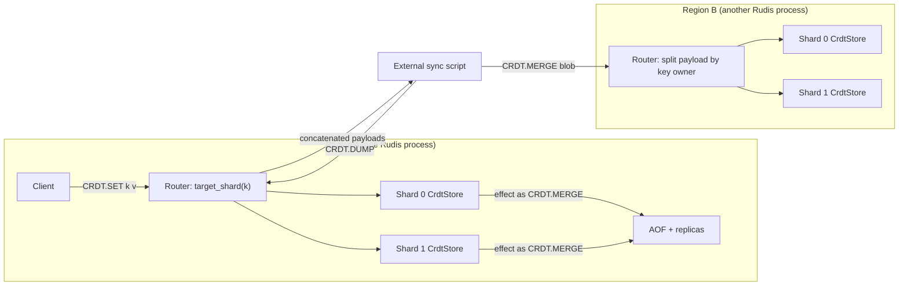

# Component 12: CRDT Data Types & Manual Multi-Region Sync — Implementation Reference

> **High-Level Design Spec**: [`docs/design/12_crdt_types.md`](../design/12_crdt_types.md)
> **Consolidated Implementation Spec**: [`docs/internal/components.md`](components.md)
> **Primary source**: `src/crdt.rs` (plus touchpoints in `src/resp.rs`, `src/connection.rs`,
> `src/router.rs`, `src/shard.rs`, `src/aof.rs`, `src/table.rs`, `src/replication.rs`)

---

## 1. What this subsystem does

Rudis can run as several independent deployments ("regions") that each accept writes. Ordinary
Redis keys cannot be merged safely once two regions have both changed them. The `CRDT.*` command
family offers three value types that *can* be merged in any order, any number of times, and
always converge to the same result. A **CRDT** (Conflict-free Replicated Data Type) is a data
structure with a merge function that is commutative, associative and idempotent. Replicas that
have seen the same set of updates therefore hold the same state, whatever order they saw them in.

The three types are:

| Type | Commands | Conflict rule |
| :--- | :--- | :--- |
| **LWW-Register** (Last-Write-Wins) — a string value | `CRDT.SET`, `CRDT.GET`, `CRDT.DEL` | The write with the highest timestamp wins. |
| **OR-Set** (Observed-Remove Set) — a set of byte strings | `CRDT.SADD`, `CRDT.SMEMBERS`, `CRDT.SREM` | A remove cancels only the adds it has seen; a concurrent add survives ("add wins"). |
| **PN-Counter** (Positive-Negative Counter) — a signed integer | `CRDT.INCRBY` | Each node keeps its own running totals; merge takes per-node maxima and the value is the sum. |

Ordering comes from a **Hybrid Logical Clock** (HLC): a timestamp made of wall-clock
milliseconds plus a logical counter. It never runs backwards and moves past any timestamp it
has observed from a peer.

Sync between regions is **manual**. `CRDT.DUMP` returns the whole CRDT state of a server as one
binary blob; `CRDT.MERGE <blob>` merges such a blob into another server. Something outside Rudis
(an operator script or a sidecar) has to move the bytes. `CRDT.GC` prunes old deletion markers.

Inside one deployment, CRDT state is durable and replicated like other data: it is written to
RDB snapshots, logged to the AOF, and streamed to replicas.

The whole `CRDT.` family is **experimental**. It is off by default: unless the server runs
with `enable-experimental-commands yes`, `build_command` in `src/resp.rs` turns any `CRDT.*`
name into `Command::Unknown`, so the client gets an unknown-command error
(`is_experimental_command_name`, prefix list `EXPERIMENTAL_PREFIXES`).

---

## 2. Mental model

Every shard (one per core) owns a private `CrdtStore`, the same way it owns its slice of the
keyspace. Single-key commands go to the owning shard by the normal key hash. The whole-store
commands (`DUMP`, `MERGE`, `GC`) are fanned out by the connection's router.



Three ideas to hold on to:

1. **State-based CRDTs.** Sync ships full state (per key), never operations. Merging the same
   payload twice is harmless.
2. **Writes are logged as their effect.** `CRDT.SET` stamps a fresh HLC timestamp, so replaying
   the command later would produce a different timestamp. Instead, each write logs a
   `CRDT.MERGE` of the changed key's new state to the AOF and replicas.
3. **The node id is the listening port.** Every timestamp and every counter slot is tagged with
   a `node_id`, and `node_id` is the server's TCP port (see §8).

---

## 3. Data structures

All types live in `src/crdt.rs`. They are concrete and `Bytes`-keyed (not generic).

### 3.1 `HlcTimestamp`

| Field | Type | Meaning |
| :--- | :--- | :--- |
| `physical_ms` | `u64` | Unix wall-clock milliseconds (or a value pushed forward by a peer). |
| `logical` | `u32` | Tie-break counter for events in the same millisecond. |
| `node_id` | `u16` | Identity of the node that generated the timestamp (the listening port). |

Ordering (`Ord`) is lexicographic: `physical_ms`, then `logical`, then `node_id`. So `node_id`
only decides between two timestamps whose time and logical parts are identical. On the wire a
timestamp is 14 bytes.

### 3.2 `HybridLogicalClock`

```rust
pub struct HybridLogicalClock {
    pub node_id: u16,
    latest_physical_ms: AtomicU64, // last physical part handed out
    latest_logical: AtomicU32,     // last logical part handed out
}
const MAX_REMOTE_CLOCK_AHEAD_MS: u64 = 60 * 60 * 1000; // 1 hour
```

`HybridLogicalClock::new(node_id)` starts at the current wall-clock time with logical `0`.
The state is held in atomics, but each `CrdtStore` is owned by a single shard thread, so in
practice the clock is never contended.

### 3.3 `LwwRegister`

| Field | Type | Meaning |
| :--- | :--- | :--- |
| `value` | `Bytes` | Current value (empty for a tombstone). |
| `timestamp` | `HlcTimestamp` | When the value (or the deletion) was written. |
| `tombstone` | `bool` | `true` means "deleted". A **tombstone** is a marker kept after a delete so that merging an older live copy does not bring the value back. |

Constructors: `LwwRegister::new(value, ts)` (live) and `LwwRegister::tombstone(ts)` (deleted,
empty value).

### 3.4 `OrSet`

```rust
pub struct OrSet {
    /// member -> every add "tag" (timestamp) currently observing it
    pub elements: HashMap<Bytes, HashSet<HlcTimestamp>>,
    /// tags known to have been removed
    pub tombstones: HashSet<HlcTimestamp>,
}
```

Each `SADD` attaches a fresh HLC timestamp (a "tag") to the member, so re-adding a member that
is already present adds a second tag. A member is present iff at least one of its tags is not
in `tombstones`.

### 3.5 `PnCounter`

| Field | Type | Meaning |
| :--- | :--- | :--- |
| `p` | `HashMap<u16, i64>` | Per-node total of increments (always `>= 0`). |
| `n` | `HashMap<u16, i64>` | Per-node total of decrement magnitudes (always `>= 0`). |

Value = `sum(p) - sum(n)`. Both maps only grow; no node entry is ever removed.

### 3.6 `CrdtStore`

| Field | Type | Meaning |
| :--- | :--- | :--- |
| `clock` | `HybridLogicalClock` | Stamps local writes; advanced by merges. |
| `registers` | `HashMap<Bytes, LwwRegister>` | LWW registers, including tombstoned ones. |
| `sets` | `HashMap<Bytes, OrSet>` | OR-Sets. |
| `counters` | `HashMap<Bytes, PnCounter>` | PN-Counters. |

The three maps are independent namespaces: the same key name can be a register, a set and a
counter at once. They are also separate from the ordinary keyspace (`RudisTable`): `TYPE`,
`EXISTS`, `EXPIRE`, `SCAN`, `DBSIZE` and friends never see CRDT keys, and CRDT keys have no TTL.

One `CrdtStore` lives in each shard as the field `ShardDb.crdt_store`; `ShardDb::new(port)`
builds it with `CrdtStore::new(port)`. It is per shard, not per logical database, so `SELECT`
has no effect on it.

### 3.7 `CrdtEntry` and `GcHorizon`

```rust
pub enum CrdtEntry {             // one keyed item of a sync payload
    Register(Bytes, LwwRegister),
    Counter(Bytes, PnCounter),
    Set(Bytes, OrSet),
}
pub enum GcHorizon {             // which tombstones CRDT.GC prunes
    Ttl(Option<u64>),            // CRDT.GC [ttl-ms]; None = DEFAULT_TTL_MS (86_400_000 = 24 h)
    Before(u64),                 // CRDT.GC BEFORE <unix-ms>
}
```

`CrdtEntry::key()` returns the entry's key and `CrdtEntry::encode()` serializes it again.
`GcHorizon::cutoff_ms()` turns either form into an absolute unix-millisecond cutoff (`Ttl`
computes `now - ttl`, saturating at 0).

---

## 4. Algorithms

### 4.1 HLC: generating a local timestamp (`HybridLogicalClock::now`)

1. Read the wall clock `phys_now` (ms).
2. Load the current `(cur_phys, cur_log)`.
3. If `phys_now > cur_phys`, the next timestamp is `(phys_now, 0)`. Otherwise it is
   `next_tick(cur_phys, cur_log)`.
4. Compare-and-swap (CAS) `latest_physical_ms` from `cur_phys` to the new value. On success,
   store the new logical value and return `(phys, log, node_id)`. On CAS failure, retry from
   step 2.

`next_tick(phys, log)` is `(phys, log + 1)`, except when `log == u32::MAX`: then the logical part
carries into the physical part, giving `(phys + 1, 0)` (saturating). The logical counter never
overflows.

Example: the clock holds `(1000, 4)`. A write at wall time `1000` gets `(1000, 5)`. A write at
wall time `999` (the system clock stepped back) gets `(1000, 6)`. A write at `1003` gets
`(1003, 0)`.

### 4.2 HLC: observing a remote timestamp (`HybridLogicalClock::update`)

Every merge calls this for each timestamp it brings in.

1. Read `phys_now`; load `(cur_phys, cur_log)`.
2. **Clamp** the remote physical part: `remote_phys = min(remote.physical_ms, phys_now +
   MAX_REMOTE_CLOCK_AHEAD_MS)`. A peer can push this clock at most one hour ahead of local time.
3. `max_phys = max(phys_now, cur_phys, remote_phys)`.
4. Pick the next value:
   - `max_phys` equals both `cur_phys` and `remote_phys` → `next_tick(max_phys, max(cur_log, remote.logical))`
   - equals only `cur_phys` → `next_tick(max_phys, cur_log)`
   - equals only `remote_phys` → `next_tick(max_phys, remote.logical)`
   - otherwise the local wall clock alone is ahead → `(max_phys, 0)`
5. CAS as in `now()`, retrying on failure; return the new timestamp.

After a merge the local clock is past every merged timestamp (unless one was clamped), so the
next local write sorts after anything merged. Example: local clock `(1000, 2)`, wall time
`1000`, remote tag `(1500, 7)` → new clock `(1500, 8)`. A remote tag `(u64::MAX, u32::MAX)` is
clamped to `now + 1 h`, so a hostile or broken peer cannot pin the clock at the end of time.

### 4.3 LWW-Register

- **Local write** (`CrdtStore::set`): stamp `clock.now()` and **insert unconditionally** a new
  `LwwRegister::new(val, ts)`. It does not go through `merge`. Returns the timestamp.
- **Read** (`CrdtStore::get`): `None` if the key is missing or tombstoned.
- **Delete** (`CrdtStore::del`): stamp `clock.now()` (always, even when nothing is deleted). If
  the register exists and is live, set `tombstone = true` and `timestamp = ts` and return
  `true`. A missing or already-deleted key returns `false` and is left unchanged. The old value
  bytes stay in `value`; they are not cleared.
- **Merge** (`LwwRegister::merge`): if `other.timestamp > self.timestamp`, copy value,
  timestamp and tombstone flag and return `true`; otherwise keep `self` (equal timestamps keep
  the existing value).

### 4.4 OR-Set

- **Add** (`OrSet::add`): insert the tag into `elements[member]`. `CrdtStore::set_add` stamps a
  fresh `clock.now()` tag and returns whether the member was absent *before* the add.
- **Remove** (`OrSet::remove`): take the member out of `elements`, move all its tags into
  `tombstones`, and return those tags (empty if the member was absent).
  `CrdtStore::set_rem` returns the same list (empty if the key does not exist).
- **Read** (`OrSet::read`, `OrSet::contains`): a member is present iff some tag is not tombstoned.
- **Merge** (`OrSet::merge`):
  1. Union the other side's tombstones into ours.
  2. Union each member's tags into ours.
  3. Drop every tag that is now tombstoned; drop members left with no tags.

Worked example (add wins), mirroring the `test_orset_add_wins` unit test:

1. Replica A adds `apple` with tag `t1 = (100,0,1)`; B copies A's state.
2. B removes `apple`: B's tombstones = `{t1}`.
3. Concurrently, A re-adds `apple` with tag `t2 = (101,0,1)`: A's `apple` tags = `{t1, t2}`.
4. A merges B: tombstones = `{t1}`, `apple` tags = `{t1, t2}` → `t1` dropped → `{t2}`.
   `apple` is still present, because B's remove never saw `t2`.

### 4.5 PN-Counter

- **Increment** (`PnCounter::inc(node_id, delta)`):
  1. Compute the exact new total in `i128`; if it does not fit in `i64`, refuse.
  2. Pick the side: `p` for `delta >= 0`, `n` for `delta < 0`.
  3. Add `|delta|` to that side's entry for `node_id`; if the entry would exceed `i64::MAX`,
     refuse. A refusal returns `Err("increment or decrement would overflow")` (the constant
     `PN_OVERFLOW`) and leaves the counter untouched.
- **Decrement** (`PnCounter::dec`): `inc(node_id, -delta)`; `delta == i64::MIN` is refused.
- **Merge** (`PnCounter::merge`): per node id, take the maximum on `p` and on `n` separately.
- **Value** (`PnCounter::value`): sum both sides in `i128`, then clamp into `i64` (per-node
  maxima merged from many nodes can together exceed `i64`).

`CrdtStore::counter_incr(key, delta)` uses `clock.node_id` as the slot; no timestamp is
involved. A new counter is built aside and only inserted if the first increment succeeds, so a
refused increment never leaves an empty counter behind. `CrdtStore::counter_get` returns `0` for
a missing key; no client command calls it (clients read a counter with `CRDT.INCRBY key 0`).

Worked example: node 1 does `+10, -2` → `p{1:10}, n{1:2}`. Node 2 does `+5, -1` → `p{2:5},
n{2:1}`. After merging in either direction: `p{1:10, 2:5}, n{1:2, 2:1}`, value `15 - 3 = 12`.
Merging again changes nothing, because `max` is idempotent.

### 4.6 Tombstone garbage collection (`CrdtStore::gc_tombstones`)

Given an absolute `cutoff_physical_ms`:

1. Drop every register with `tombstone == true` and `timestamp.physical_ms < cutoff`.
2. For each set, `OrSet::prune_tombstones(cutoff)` drops tombstone tags with
   `physical_ms < cutoff`.
3. Return `(registers_pruned, set_tombstones_pruned)`. Counters are never touched.

GC runs on demand only; nothing schedules it. Pruning is safe only once every peer has merged
the deletions: a peer that still holds the live register, or the add tag, resurrects it on the
next merge after the tombstone is gone.

---

## 5. Sync payload format

`CrdtStore::export_sync_payload` serializes the whole store: all registers, then all counters,
then all sets (each group in unspecified `HashMap` order). A payload is just entries
concatenated back to back: no header, no version byte, no checksum, no compression. That is why
payloads from several shards (or several servers) can be concatenated into one valid payload.

All integers are little-endian. `ts` = `physical_ms:u64 · logical:u32 · node_id:u16` (14 bytes).
Every entry starts with `type:u8 · key_len:u32 · key`, followed by:

| Type byte | Entry | Body |
| :--- | :--- | :--- |
| `1` | Register | `value_len:u32 · value · ts · tombstone:u8` (`0` or `1`) |
| `2` | Counter | `p_len:u32 · p_len × (node_id:u16 · count:i64) · n_len:u32 · n_len × (node_id:u16 · count:i64)` |
| `3` | Set | `elem_count:u32 · elem_count × (elem_len:u32 · elem · tag_count:u32 · tag_count × ts) · tomb_count:u32 · tomb_count × ts` |

Example: register `k = "v"` at `(1000, 0, 7)`, live, encodes to 26 bytes:
`01 | 01000000 6B | 01000000 76 | E803000000000000 00000000 0700 | 00`.

The private encoders are `encode_register`, `encode_counter` and `encode_set`. `encode_set`
takes iterators of elements and tombstones, so callers can encode a subset of a set.

### 5.1 Partial payloads (used for logging)

| Function | Produces |
| :--- | :--- |
| `register_payload(key)` | The register at `key` (including a tombstone); empty if none. |
| `counter_payload(key)` | The full counter at `key`; empty if none. |
| `set_member_payload(key, member)` | A set entry holding only `member` with all its tags, and no tombstones. |
| `set_removal_payload(key, tags)` (associated fn) | A set entry with no elements and `tags` as tombstones. Merging it undoes exactly what the `set_rem` call that returned `tags` removed. |
| `export_entry_payloads()` | An iterator yielding one payload per register, counter and set (the whole store, split up). |

### 5.2 Decoding (`decode_sync_payload`)

Decoding uses a bounds-checked cursor (`Reader`) and never panics on malformed input. The whole
payload is decoded into a `Vec<CrdtEntry>` **before** anything is applied, so a bad payload is an
error that changes nothing. Errors:

| Error text | Cause |
| :--- | :--- |
| `truncated CRDT payload` | A length or fixed-width field runs past the end. |
| `Unknown CRDT item type: N` | Type byte is not `1`/`2`/`3`. |
| `invalid CRDT register tombstone flag: N` | Tombstone byte is not `0`/`1`. |
| `negative CRDT counter component` | A `p` or `n` count is `< 0`. |

Duplicate node ids within one counter side are folded with `max`; duplicate set members have
their tags unioned. An empty payload decodes to zero entries. Because the decoder never
pre-allocates from a claimed count, a tiny payload that claims billions of elements fails with
`truncated CRDT payload` instead of allocating.

`for_each_payload_key(data, f)` walks a payload and calls `f` with each entry's key as a slice of
`data`, without building the entries. It stops silently at the first malformed entry. It exists
so that `for_each_cmd_key` (in `src/connection.rs`) can report the keys a `CRDT.MERGE` touches.

### 5.3 Merging (`merge_sync_payload`, `merge_entries`)

`merge_sync_payload(data)` = `decode_sync_payload`, then `merge_entries`. For each entry:

- **Register**: `clock.update(ts)`, then insert it if the key is new, else `LwwRegister::merge`.
- **Counter**: `PnCounter::merge` into the existing (or a new, empty) counter. No clock update:
  counters carry no timestamps.
- **Set**: `clock.update` for every add tag and every tombstone, then `OrSet::merge`.

The return value is the number of entries processed, not the number that changed anything.

---

## 6. Commands and request flow

### 6.1 Command reference

Parsed by `build_command` in `src/resp.rs` into `Command::Crdt*` variants.

| Command | Variant | Reply | Notes |
| :--- | :--- | :--- | :--- |
| `CRDT.SET key value` | `CrdtSet { key, val }` | `+OK <physical_ms>:<logical>:<node_id>` | Status reply carries the write's timestamp. |
| `CRDT.GET key` | `CrdtGet(key)` | bulk or nil | |
| `CRDT.DEL key` | `CrdtDel(key)` | `:1` / `:0` | `0` if missing or already deleted. |
| `CRDT.INCRBY key delta` | `CrdtIncrby { key, delta }` | new value | `delta` must parse as `i64` (else `value is not an integer or out of range`); overflow → `-ERR increment or decrement would overflow`. |
| `CRDT.SADD key member` | `CrdtSadd { key, member }` | `:1` new / `:0` already present | Only the first member is used; extra arguments are accepted and ignored. |
| `CRDT.SMEMBERS key` | `CrdtSmembers(key)` | array | Unordered. |
| `CRDT.SREM key member` | `CrdtSrem { key, member }` | `:1` / `:0` | Exactly one member. |
| `CRDT.DUMP` | `CrdtDump` | bulk payload | Whole server, all shards. Extra arguments are ignored. |
| `CRDT.MERGE payload` | `CrdtMerge(payload)` | entries merged | `-ERR <decode error>` on malformed input. |
| `CRDT.GC [ttl-ms]` / `CRDT.GC BEFORE unix-ms` | `CrdtGc(GcHorizon)` | `["registers_pruned", n, "set_tombstones_pruned", m]` | Default TTL 24 h. |

Parsing details for `CRDT.GC`: exactly three arguments with `BEFORE` (case-insensitive) as the
first gives `Before`; any other non-empty argument list parses its first argument as the TTL
(extra arguments are ignored), so `CRDT.GC BEFORE` alone fails with `value is not an integer or
out of range`. Values are `u64`, so negative numbers are rejected.

Arity errors use the standard `wrong number of arguments for 'crdt.xxx' command` text.
`CRDT.GET`, `CRDT.SMEMBERS` and `CRDT.DUMP` are classified as reads (`Command::is_family_read`);
the other commands are writes.

For command stats and ACLs every variant reports the single name `CRDT` (`get_cmd_name`, used
by `acl_cmd_name` as its fallback). The ACL table in `src/acl_categories.rs` lists `crdt` in
the `@write`, `@admin`, `@slow` and `@dangerous` categories and requires read and write key
permission, so ACL rules cannot tell `CRDT.GET` apart from `CRDT.MERGE`.

### 6.2 Single-key commands

The seven keyed commands are routed like any other keyed command: `cmd_primary_key` and
`target_shard_of_cmd` pick the owning shard from the key hash (hash tags like `{user1}` work),
and that shard runs them in `execute_local_command` (`src/connection.rs`). Those handlers call
thin wrappers on `ShardDb` in `src/shard.rs` (`crdt_set`, `crdt_get`, `crdt_del`,
`crdt_incrby`, `crdt_sadd`, `crdt_smembers`, `crdt_srem`, plus `crdt_dump`, `crdt_merge`,
`crdt_gc`, and the test-only reader `crdt_counter_get`).

### 6.3 Whole-store commands (router fan-out)

`target_shard_of_cmd` returns `None` for `CRDT.DUMP`, `CRDT.MERGE` and `CRDT.GC`; they run in
the connection's async router path (`execute_command_inner` in `src/connection.rs`):

- **`CRDT.DUMP`**: take the local shard's `crdt_dump()`. For each other shard, call
  `router.execute_remote(sid, CrdtDump)`, strip the RESP bulk header and trailing CRLF from the
  reply, and append the bytes. Reply with the concatenation as one bulk string.
- **`CRDT.MERGE`**:
  1. `Router::split_crdt_payload` decodes the whole payload (an error here replies `-ERR` and
     nothing is applied anywhere) and re-encodes each entry into a per-shard buffer chosen by
     `router.target_shard(entry.key())`. Empty buffers are dropped.
  2. Each non-empty part is sent as its own `CrdtMerge(part)` to its shard with
     `execute_on_shard`; that shard merges and logs only keys it owns.
  3. The integer replies are summed. An empty payload replies `:0`.
- **`CRDT.GC`**: compute one absolute cutoff with `horizon.cutoff_ms()` and send
  `CrdtGc(GcHorizon::Before(cutoff))` to every shard (including the local one). Sum both counts
  from each shard's 4-element reply.

Worked example: a 2-shard server receives `CRDT.MERGE` with a payload holding register `a`
(owned by shard 0), counter `b` (shard 1) and set `c` (shard 1). The router decodes 3 entries,
builds part 0 = `[a]` and part 1 = `[b, c]`, sends them to shards 0 and 1, gets `:1` and `:2`,
and replies `:3`. Shard 0 logs `CRDT.MERGE [a]` and shard 1 logs `CRDT.MERGE [b, c]`.

The split only happens when the keyspace check before dispatch lets the command through. That
check uses the payload's keys (`cmd_keys`, see below): in cluster mode a payload whose keys hash
to different slots gets `-CROSSSLOT Keys in request don't hash to the same slot`, and with
`cross-shard-strict yes` (config file, `--cross-shard-strict`, or `CONFIG SET`; default `no`) on
a multi-shard server, a payload whose keys live on different shards gets the same error. So the
worked example above runs only with `cross-shard-strict no`; keys that share a hash tag (such as
`{doc}a`, `{doc}b`) always land on one shard and pass both checks.

Inside Lua scripts, `execute_local_command` is reached without the router split. To keep foreign
keys out, `for_each_cmd_key` yields every key in a `CRDT.MERGE` payload (via
`for_each_payload_key`), so the standard non-local-key check (`script_touches_non_local_key`)
rejects a script merge that touches another shard's keys. The same key list (directly or via
`cmd_keys`) feeds ACL key checks, `COMMAND GETKEYS`, WATCH invalidation and client tracking, and
the shard set that `MULTI/EXEC` locks. Commands queued in `MULTI` run through the normal router
path at `EXEC`, so a queued `CRDT.MERGE` is split the same way.

---

## 7. Persistence and replication

### 7.1 Logging writes as effects

`command_to_resp` (`src/aof.rs`) returns `None` for `CrdtSet`, `CrdtDel`, `CrdtIncrby`,
`CrdtSadd` and `CrdtSrem`, because replaying them would stamp new timestamps. Their handlers in
`execute_local_command` use the `record_crdt_effect!` macro instead, which:

1. runs `record_change!` in its non-logging form (dirty counter, `WATCH` invalidation, client
   tracking);
2. calls `replication::log_shard_mutation`, which (only if an AOF is open or replicas are
   connected) builds a `CrdtMerge` of the effect payload and appends it to the shard's AOF and
   replication stream.

| Command | Logged effect | Logged when |
| :--- | :--- | :--- |
| `CRDT.SET` | `register_payload(key)` | always |
| `CRDT.DEL` | `register_payload(key)` (the tombstone) | only if it returned `1` |
| `CRDT.INCRBY` | `counter_payload(key)` (whole counter) | only if not refused (includes `delta = 0`) |
| `CRDT.SADD` | `set_member_payload(key, member)` | always (a re-add still adds a tag) |
| `CRDT.SREM` | `set_removal_payload(key, removed_tags)` | only if it returned `1` |
| `CRDT.MERGE` | the command as issued (the per-shard part), via `record_change!` | only on success |
| `CRDT.GC` | `CRDT.GC BEFORE <cutoff>` | only if something was pruned |

Because merge is idempotent and deterministic, replaying the log (or applying it on a replica)
rebuilds the writer's exact state, and the replayed merges advance the replica's HLC past every
logged timestamp. `CRDT.GC` is logged with an absolute cutoff so that a later replay prunes
exactly what the original did, not "everything older than 24 h measured from replay time".

### 7.2 Replica apply

A replica receives all of a primary's shards on one stream. In the router's replica apply loop
(`Router::execute_replica_command` in `src/router.rs`):

- `CrdtMerge(payload)` is re-split with `split_crdt_payload` and each part is applied on its
  owning shard (`apply_replica_on`). A payload that fails to decode is dropped silently.
- `CrdtGc(horizon)` is applied on every shard. Every primary shard logged the same cutoff, so
  this is exact and idempotent.

### 7.3 RDB snapshots, full sync and AOF rewrite

`ShardDb::save_extended_small_records` (`src/shard.rs`) writes the shard's
`export_sync_payload()` (if non-empty) as a legacy extended record: name length + name
`__rudis_crdt_sync__`, type byte `13`, `payload_len:u32`, payload. Extended records are wrapped
in a `rudis-ext` AUX field (`redis_rdb::write_ext_aux`) that Redis and Valkey skip.

Every RDB image the server produces goes through this function: `SAVE`/`BGSAVE` (one
point-in-time `AofImage::start_chunk` per shard, started by `start_save_image`), the point-in-time
image streamed to a replica at full sync (`AofImage::start_chunk`), the one-pass
`ShardDb::save_rdb_chunk` (via `save_extended_rdb_chunk`) behind `Router::generate_full_rdb` and
`ShardMessage::SaveRdbChunk`, and the RDB preamble that a normal `BGREWRITEAOF` writes
(`write_rewritten_aof` → `AofImage::start`). An `AofImage` takes the CRDT payload once, when the
image starts; later CRDT writes reach the new AOF (or the replica) through the command stream that
follows the image, and are not in a `SAVE`/`BGSAVE` file.

On load (`load_legacy_records` in `src/table.rs`), a file holds one type-13 record per saved
shard. Each loading shard decodes every record and merges only entries whose key maps to itself
(`router::target_shard(key, num_shards) == shard_id`). A record that fails to decode is skipped
silently.

### 7.4 Canonical AOF (resharding)

When the shard count changes, `reshard_aof_dir` (and `import_external_aof`) replay all old AOF
files into one combined `ShardDb`, write it out with `rewrite_shard_aof_canonical`, and split the
result by key owner with `split_rewritten_aof_to_shards`. In this canonical form
(`write_canonical_aof`), the CRDT store is written as one `CRDT.MERGE` per register, counter and
set using `export_entry_payloads()` — the same form live writes are logged in. Tombstones are
included. See the gotcha about how these lines are routed in §9.

### 7.5 FLUSHDB / FLUSHALL

`ShardDb::flushdb` (only when the current database is 0) and `ShardDb::flushall` clear
`registers`, `sets` and `counters`. The clock is kept, so timestamps never go backwards.

---

## 8. Node identity

`ShardDb::new(port)` passes the server's listening port to `CrdtStore::new`, so
`node_id = port`:

- All shards of one process share the same `node_id`. That is fine for counters because each key
  lives on exactly one shard.
- Two servers in different regions that listen on the **same port** (for example both on 6379)
  also share a `node_id`. For PN-Counters this is wrong: their increments land in the same slot,
  and merge takes the **maximum** instead of adding them, losing counts. For timestamps it only
  weakens the final tie-break. Give every region a distinct port if counters are used.

---

## 9. Invariants & gotchas

- **Merge is commutative, associative and idempotent** for all three types. That is what makes
  effect logging and repeated `CRDT.MERGE` safe.
- **Local `CRDT.SET`/`CRDT.DEL` do not compare timestamps.** They overwrite the local register.
  This is normally correct because merges advance the clock past every merged timestamp. The
  exception is a peer timestamp more than one hour in the future (clamped in
  `HybridLogicalClock::update`): a later local write then carries a *smaller* timestamp than the
  stored one but still replaces it locally. Peers, replicas and AOF replay that receive both
  states keep the future-dated value, so they disagree with this node until it next merges.
- **Clock skew is bounded only from above.** A remote timestamp can push the local clock up to
  one hour ahead of wall time, and the clock never moves back.
- **`CRDT.SADD` grows memory on re-adds.** Each call adds a tag even if the member is present
  (reply `0`). Tags are only removed by `CRDT.SREM` (moved to tombstones), and tombstones only by
  `CRDT.GC`.
- **PN-Counter maps never shrink.** There is one entry per node id that ever wrote the key;
  `CRDT.GC` does not touch counters.
- **`CRDT.INCRBY key 0` is a write.** It creates the counter if missing and logs it.
- **`CRDT.DEL` advances the clock** even when it deletes nothing.
- **`CRDT.MERGE` reply counts entries**, not entries that changed state.
- **Malformed payloads are all-or-nothing.** Client `CRDT.MERGE` validates the whole payload
  before touching any shard; replica apply and RDB load drop a bad payload without an error.
- **GC is unsafe if run before peers sync.** Dropping a tombstone lets an older live copy from
  an unsynced peer reappear on the next merge.
- **Key ownership** is decided by the router (`target_shard`), never inside `ShardDb`, which does
  not know the shard count.
- **AOF resharding routes `CRDT.MERGE` lines by their payload, not their key.**
  `split_rewritten_aof_to_shards` places each command with `target_shard_of_cmd`, which returns
  `None` for `CrdtMerge`, and then falls back to hashing the command's first argument — here
  the whole payload bytes. Each canonical `CRDT.MERGE` holds one key, but that key can end up in
  a per-shard AOF file whose shard does not own it, where routed `CRDT.*` commands will not find
  it.
- **RDB load uses the plain key hash.** `load_legacy_records` filters with
  `router::target_shard(key, num_shards)`, while the live router's `Router::target_shard` uses
  CRC16 slots when cluster mode is active.

---

## 10. Limitations / not implemented

- **No automatic multi-region sync.** No peer list, discovery, gossip, timer or streaming.
  `CRDT.DUMP`/`CRDT.MERGE` must be driven externally.
- **No delta or per-key sync.** `CRDT.DUMP` re-serializes the entire store on every call (all
  shards, tombstones included); payload size grows with history until `CRDT.GC` runs.
- **No automatic GC.** `CRDT.GC` runs only when called.
- **No integrity or versioning** in the payload format (no magic, version or checksum).
- **No reads beyond the listed commands**: no counter-get command, no `SCARD`/`SISMEMBER`
  equivalent, no TTLs, and CRDT keys are invisible to keyspace commands.
- **`CRDT.SADD` and `CRDT.SREM` take one member**; `SADD` ignores extra members.
- **Node identity is the port**, not a configurable region id (§8).
- **ACLs see one command**: all `CRDT.*` commands share the ACL name `crdt` (§6.1).
- **Experimental**: gated behind `enable-experimental-commands`.

---

## 11. Code map

| File | Key symbols | What they do |
| :--- | :--- | :--- |
| `src/crdt.rs` | `HlcTimestamp`, `HybridLogicalClock` (`now`, `update`), `next_tick`, `MAX_REMOTE_CLOCK_AHEAD_MS` | Hybrid logical clock. |
| `src/crdt.rs` | `LwwRegister`, `OrSet`, `PnCounter`, `PN_OVERFLOW` | The three CRDT types and their merge rules. |
| `src/crdt.rs` | `CrdtStore` (`set`, `get`, `del`, `counter_incr`, `counter_get`, `set_add`, `set_members`, `set_rem`, `gc_tombstones`) | Per-shard store and local operations. |
| `src/crdt.rs` | `export_sync_payload`, `export_entry_payloads`, `register_payload`, `counter_payload`, `set_member_payload`, `set_removal_payload`, `encode_register`/`encode_counter`/`encode_set` | Building full and partial payloads. |
| `src/crdt.rs` | `merge_sync_payload`, `merge_entries`, `decode_sync_payload`, `for_each_payload_key`, `Reader`, `CrdtEntry`, `GcHorizon` | Decoding, merging, key walking, GC horizon. |
| `src/resp.rs` | `Command::Crdt*`, `CRDT.*` arms of `build_command`, `is_family_read`, `EXPERIMENTAL_PREFIXES`, `is_experimental_command_name` | Parsing, read/write classification, experimental gate. |
| `src/connection.rs` | CRDT arms of `execute_local_command`, `record_crdt_effect!`, `CrdtDump`/`CrdtMerge`/`CrdtGc` arms of `execute_command_inner`, `for_each_cmd_key`, `target_shard_of_cmd`, `get_cmd_name` | Execution, effect logging, fan-out, key reporting, naming. |
| `src/router.rs` | `Router::split_crdt_payload`, `Router::execute_replica_command` CRDT arms, `Router::target_shard` | Per-shard payload splitting and replica apply. |
| `src/shard.rs` | `ShardDb.crdt_store`, `crdt_*` wrappers, `save_extended_small_records`, `AofImage`, `start_save_image`, `flushdb`, `flushall` | Ownership, RDB/image save, flush. |
| `src/table.rs` | `load_legacy_records` (type byte `13`) | RDB load with ownership filter. |
| `src/aof.rs` | `command_to_resp` CRDT arms, `write_canonical_aof`, `split_rewritten_aof_to_shards`, `reshard_aof_dir` | What is logged; canonical snapshot and resharding. |
| `src/replication.rs` | `log_shard_mutation` | Lazily builds a logged command and appends it to the AOF and replica stream. |
| `src/acl_categories.rs` | `crdt` entry | ACL categories and key permissions for all `CRDT.*` commands. |

### How to verify changes

```bash
cargo fmt --check
cargo clippy --all-targets -- -D warnings
cargo test --lib crdt -- --test-threads=1
cargo test --tests crdt
```
