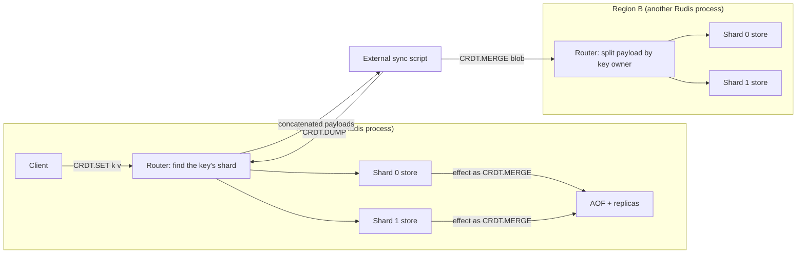

# Component 12: CRDT Data Types and Manual Multi-Region Sync

> **High-Level Design Spec**: [docs/design/12_crdt_types.md](../design/12_crdt_types.md)
> **Consolidated Implementation Spec**: [docs/internal/components.md](components.md)
> **Main source files**: src/crdt.rs (the clock, the three types, the store, the sync payload
> format), src/resp.rs (parsing and the experimental gate), src/connection.rs (execution, effect
> logging and the fan-out commands), src/router.rs (splitting payloads by key owner, replica
> apply), src/shard.rs (per-shard ownership and RDB records), src/aof.rs (what is logged,
> canonical rewrite), src/table.rs (RDB load), src/replication.rs (log helper). The
> [Code map](#11-code-map) lists the key symbols.

---

## 1. What this subsystem does

Rudis can run as several independent deployments, called "regions", that each accept writes.
Ordinary Redis keys cannot be merged safely once two regions have both changed them. The `CRDT.*`
command family offers three value types that *can* be merged in any order, any number of times, and
always converge to the same result.

A **CRDT** (Conflict-free Replicated Data Type) is a data structure with a merge function that is
commutative, associative and idempotent. Replicas that have seen the same set of updates therefore
hold the same state, whatever order they saw them in.

The three types are:

| Type | Commands | Conflict rule |
| :--- | :--- | :--- |
| **LWW-Register** (Last-Write-Wins), a string value | `CRDT.SET`, `CRDT.GET`, `CRDT.DEL` | The write with the highest timestamp wins. |
| **OR-Set** (Observed-Remove Set), a set of byte strings | `CRDT.SADD`, `CRDT.SMEMBERS`, `CRDT.SREM` | A remove cancels only the adds it has seen; a concurrent add survives ("add wins"). |
| **PN-Counter** (Positive-Negative Counter), a signed integer | `CRDT.INCRBY` | Each node keeps its own running totals; merge takes per-node maxima and the value is the sum. |

Ordering comes from a **Hybrid Logical Clock** (HLC): a timestamp made of wall-clock milliseconds
plus a logical counter. It never runs backwards and moves past any timestamp it has observed from a
peer.

Sync between regions is **manual**. `CRDT.DUMP` returns the whole CRDT state of a server as one
binary blob, and `CRDT.MERGE <blob>` merges such a blob into another server. Something outside Rudis
(an operator script or a sidecar) has to move the bytes. `CRDT.GC` prunes old deletion markers.

Inside one deployment, CRDT state is durable and replicated like other data: it is written to RDB
snapshots, logged to the AOF and streamed to replicas.

The whole family is **experimental**. It is off by default: unless the server runs with
`enable-experimental-commands yes`, the command parser turns any `CRDT.*` name into an unknown
command, so the client gets an unknown-command error.

---

## 2. Mental model

Every shard (one per core) owns a private CRDT store, the same way it owns its slice of the
keyspace. Single-key commands go to the owning shard by the normal key hash. The whole-store
commands (`DUMP`, `MERGE`, `GC`) are fanned out by the connection's router.



Three ideas to hold on to:

1. **State-based CRDTs.** Sync ships full state (per key), never operations. Merging the same
   payload twice is harmless.
2. **Writes are logged as their effect.** `CRDT.SET` stamps a fresh timestamp, so replaying the
   command later would produce a different one. Instead, each write logs a `CRDT.MERGE` of the
   changed key's new state to the AOF and replicas.
3. **The node id is the listening port.** Every timestamp and every counter slot is tagged with a
   node id, and the node id is the server's TCP port (§8).

| Term | Meaning |
| :--- | :--- |
| **Region** | One independent Rudis deployment that accepts writes. |
| **Tombstone** | A marker kept after a delete so that merging an older live copy does not bring the value back. |
| **Tag** | The unique timestamp attached to one OR-Set add. |
| **HLC** | Hybrid Logical Clock: wall-clock milliseconds plus a logical tie-break counter. |
| **Effect** | The state change a write produced, logged as a mergeable payload instead of as the original command. |

---

## 3. Types and the store

All types live in src/crdt.rs. They are concrete and keyed by byte strings, not generic.
[Reference details](#121-type-definitions) lists the fields.

### 3.1 Timestamps and the clock

A **timestamp** has three parts: physical milliseconds (Unix wall-clock time, or a value pushed
forward by a peer), a 32-bit logical counter that breaks ties within one millisecond, and a 16-bit
node id naming the node that generated it. Ordering is lexicographic: physical time, then logical
counter, then node id. So the node id only decides between two timestamps whose time and logical
parts are identical. On the wire a timestamp is 14 bytes.

The **clock** holds the node id and the last physical and logical parts it handed out, in atomics.
It starts at the current wall-clock time with logical 0. In practice it is never contended, because
each store is owned by a single shard thread. A peer can push it forward by at most one hour (§4.2).

### 3.2 LWW-Register

A register holds a value, the timestamp of the write, and a tombstone flag. A tombstone register has
an empty value and means "deleted".

### 3.3 OR-Set

An OR-Set maps each member to the set of **tags** (timestamps) that currently observe it, and keeps a
set of tombstoned tags. Each add attaches a fresh timestamp to the member, so re-adding a member that
is already present adds a second tag. A member is present exactly when at least one of its tags is
not in the tombstone set.

### 3.4 PN-Counter

A counter holds two maps from node id to a non-negative total: one for increments and one for the
magnitudes of decrements. The value is the sum of the first minus the sum of the second. Both maps
only grow; no node entry is ever removed.

### 3.5 The store

Each shard has one store holding the clock and three independent maps: registers (including
tombstoned ones), sets and counters. The maps are separate namespaces, so the same key name can be a
register, a set and a counter at once. They are also separate from the ordinary keyspace: `TYPE`,
`EXISTS`, `EXPIRE`, `SCAN`, `DBSIZE` and friends never see CRDT keys, and CRDT keys have no TTL.

The store lives in each shard as `ShardDb.crdt_store`, built with the server's port. It is per shard,
not per logical database, so `SELECT` has no effect on it.

---

## 4. Algorithms

### 4.1 Generating a local timestamp

1. Read the wall clock in milliseconds.
2. Load the current physical and logical parts.
3. If the wall clock is ahead of the stored physical part, the next timestamp is the wall clock with
   logical 0. Otherwise it is the "next tick" of the stored pair.
4. Compare-and-swap the stored physical part to the new value. On success, store the logical part and
   return the timestamp with the node id. On failure, retry from step 2.

The **next tick** of a pair adds 1 to the logical part, except when the logical part is already at its
maximum: then it carries into the physical part, giving the next millisecond with logical 0
(saturating). The logical counter never overflows.

**Example.** The clock holds `(1000, 4)`. A write at wall time 1000 gets `(1000, 5)`. A write at wall
time 999 (the system clock stepped back) gets `(1000, 6)`. A write at 1003 gets `(1003, 0)`.

### 4.2 Observing a remote timestamp

Every merge calls this for each timestamp it brings in.

1. Read the wall clock and the current pair.
2. **Clamp** the remote physical part to at most the wall clock plus one hour. A peer can push this
   clock at most one hour ahead of local time.
3. Take the largest of the wall clock, the current physical part and the clamped remote part.
4. Pick the next value:
   * if that largest value equals both the current and remote physical parts: the next tick of it
     with the larger of the two logical parts;
   * if it equals only the current part: the next tick with the current logical part;
   * if it equals only the remote part: the next tick with the remote logical part;
   * otherwise the local wall clock alone is ahead: the wall clock with logical 0.
5. Compare-and-swap as in §4.1, retrying on failure, and return the new timestamp.

After a merge the local clock is past every merged timestamp (unless one was clamped), so the next
local write sorts after anything merged.

**Example.** The local clock is `(1000, 2)`, the wall time is 1000, and the remote tag is `(1500, 7)`.
The new clock is `(1500, 8)`. A remote tag of the maximum possible time is clamped to now plus one
hour, so a hostile or broken peer cannot pin the clock at the end of time.

### 4.3 LWW-Register

* **Local write** stamps a fresh timestamp and **inserts unconditionally** a new live register. It
  does not go through merge. It returns the timestamp.
* **Read** returns nothing if the key is missing or tombstoned.
* **Delete** stamps a timestamp (always, even when nothing is deleted). If the register exists and is
  live, it sets the tombstone flag and the timestamp and returns true. A missing or already-deleted
  key returns false and is left unchanged. The old value bytes stay in the register; they are not
  cleared.
* **Merge**: if the other timestamp is greater, copy its value, timestamp and tombstone flag and
  report a change. Otherwise keep the existing register (equal timestamps keep the existing value).

### 4.4 OR-Set

* **Add** inserts the tag under the member. The store stamps a fresh tag and returns whether the
  member was absent *before* the add.
* **Remove** takes the member out of the map, moves all its tags into the tombstone set, and returns
  those tags (empty if the member was absent; also empty if the key does not exist).
* **Read** and **contains**: a member is present exactly when some tag is not tombstoned.
* **Merge:**
  1. Union the other side's tombstones into ours.
  2. Union each member's tags into ours.
  3. Drop every tag that is now tombstoned, and drop members left with no tags.

**Worked example (add wins).** This mirrors the unit test for add-wins.

1. Replica A adds `apple` with tag `t1 = (100,0,1)`; B copies A's state.
2. B removes `apple`: B's tombstones are `{t1}`.
3. Concurrently A re-adds `apple` with tag `t2 = (101,0,1)`, so A's tags for `apple` are `{t1, t2}`.
4. A merges B: tombstones `{t1}`, tags `{t1, t2}`, and dropping `t1` leaves `{t2}`. `apple` is still
   present, because B's remove never saw `t2`.

### 4.5 PN-Counter

* **Increment** by a delta:
  1. Compute the exact new total in 128-bit arithmetic; if it does not fit in a signed 64-bit
     integer, refuse.
  2. Pick the side: the increments map for a non-negative delta, the decrements map for a negative
     one.
  3. Add the magnitude to that side's entry for the node id; if the entry would exceed the 64-bit
     maximum, refuse.

  A refusal returns the error `increment or decrement would overflow` and leaves the counter
  untouched.
* **Decrement** is an increment of the negated delta; the most negative 64-bit value is refused.
* **Merge** takes, per node id, the maximum on each side separately.
* **Value** sums both sides in 128-bit arithmetic, then clamps into a signed 64-bit integer (maxima
  merged from many nodes can together exceed it).

The store's increment uses the clock's node id as the slot; no timestamp is involved. A new counter
is built aside and only inserted if the first increment succeeds, so a refused increment never leaves
an empty counter behind. The store can read a counter (0 for a missing key), but no client command
does; clients read a counter with `CRDT.INCRBY key 0`.

**Worked example.** Node 1 does `+10, -2`, giving increments `{1:10}` and decrements `{1:2}`. Node 2
does `+5, -1`, giving `{2:5}` and `{2:1}`. After merging in either direction the counter is increments
`{1:10, 2:5}` and decrements `{1:2, 2:1}`, with value 15 − 3 = 12. Merging again changes nothing,
because taking the maximum is idempotent.

### 4.6 Tombstone garbage collection

Given an absolute cutoff in milliseconds:

1. Drop every tombstoned register whose timestamp is older than the cutoff.
2. For each set, drop tombstone tags older than the cutoff.
3. Return the count of registers pruned and set tombstones pruned. Counters are never touched.

GC runs on demand only; nothing schedules it. Pruning is safe only once every peer has merged the
deletions: a peer that still holds the live register, or the add tag, resurrects it on the next merge
after the tombstone is gone.

---

## 5. Sync payload format

Exporting serializes the whole store: all registers, then all counters, then all sets (each group in
unspecified map order). A payload is simply entries concatenated back to back, with no header, no
version byte, no checksum and no compression. That is why payloads from several shards, or several
servers, can be concatenated into one valid payload.

All integers are little-endian. Every entry starts with a type byte, a 4-byte key length and the key,
followed by a body that depends on the type (see [Reference details](#122-wire-format)):

* **Register** (type 1): the value, a timestamp and a tombstone byte (0 or 1).
* **Counter** (type 2): the increment entries and the decrement entries, each a count followed by
  pairs of node id and total.
* **Set** (type 3): the members, each with its tags, then the tombstone tags.

**Example.** The register `k = "v"` at `(1000, 0, 7)`, live, encodes to 26 bytes:
`01 | 01000000 6B | 01000000 76 | E803000000000000 00000000 0700 | 00`.

The set encoder takes iterators of elements and tombstones, so callers can encode a subset of a set.

### 5.1 Partial payloads (used for logging)

| Function | Produces |
| :--- | :--- |
| `register_payload(key)` | The register at the key (including a tombstone); empty if none. |
| `counter_payload(key)` | The full counter at the key; empty if none. |
| `set_member_payload(key, member)` | A set entry holding only that member with all its tags, and no tombstones. |
| `set_removal_payload(key, tags)` | A set entry with no elements and the tags as tombstones. Merging it undoes exactly what the removal that returned those tags did. |
| `export_entry_payloads()` | An iterator yielding one payload per register, counter and set (the whole store, split up). |

### 5.2 Decoding

Decoding uses a bounds-checked cursor and never panics on malformed input. The whole payload is
decoded into a list of entries **before** anything is applied, so a bad payload is an error that
changes nothing. The errors are:

| Error text | Cause |
| :--- | :--- |
| `truncated CRDT payload` | A length or fixed-width field runs past the end. |
| `Unknown CRDT item type: N` | The type byte is not 1, 2 or 3. |
| `invalid CRDT register tombstone flag: N` | The tombstone byte is not 0 or 1. |
| `negative CRDT counter component` | An increment or decrement total is below 0. |

Duplicate node ids within one counter side are folded with the maximum; duplicate set members have
their tags unioned. An empty payload decodes to zero entries. Because the decoder never preallocates
from a claimed count, a tiny payload that claims billions of elements fails with `truncated CRDT
payload` instead of allocating.

A key walker visits a payload and hands each entry's key (as a slice of the payload) to a callback,
without building the entries. It stops silently at the first malformed entry. It exists so the
command-key reporter in connection.rs can report the keys a `CRDT.MERGE` touches.

### 5.3 Merging

Merging a payload decodes it and then merges each entry:

* **Register:** observe its timestamp (§4.2), then insert it if the key is new, else merge.
* **Counter:** merge into the existing (or a new, empty) counter. No clock update, because counters
  carry no timestamps.
* **Set:** observe every add tag and every tombstone, then merge.

The return value is the number of entries processed, not the number that changed anything.

---

## 6. Commands and request flow

### 6.1 Command reference

The commands are parsed in resp.rs into `Command::Crdt*` variants.

| Command | Reply | Notes |
| :--- | :--- | :--- |
| `CRDT.SET key value` | `+OK <physical_ms>:<logical>:<node_id>` | The status reply carries the write's timestamp. |
| `CRDT.GET key` | bulk string or nil | |
| `CRDT.DEL key` | `:1` or `:0` | 0 if missing or already deleted. |
| `CRDT.INCRBY key delta` | the new value | `delta` must parse as a signed 64-bit integer (else `value is not an integer or out of range`); overflow gives `-ERR increment or decrement would overflow`. |
| `CRDT.SADD key member` | `:1` new, `:0` already present | Only the first member is used; extra arguments are accepted and ignored. |
| `CRDT.SMEMBERS key` | array | Unordered. |
| `CRDT.SREM key member` | `:1` or `:0` | Exactly one member. |
| `CRDT.DUMP` | bulk payload | Whole server, all shards. Extra arguments are ignored. |
| `CRDT.MERGE payload` | entries merged | `-ERR <decode error>` on malformed input. |
| `CRDT.GC [ttl-ms]` or `CRDT.GC BEFORE unix-ms` | `["registers_pruned", n, "set_tombstones_pruned", m]` | Default TTL 24 hours. |

**Parsing `CRDT.GC`.** Exactly three arguments with `BEFORE` (case-insensitive) first gives a
before-cutoff. Any other non-empty argument list parses its first argument as the TTL (extra
arguments are ignored), so `CRDT.GC BEFORE` alone fails with `value is not an integer or out of
range`. Values are unsigned, so negative numbers are rejected.

Arity errors use the standard `wrong number of arguments for 'crdt.xxx' command` text. `CRDT.GET`,
`CRDT.SMEMBERS` and `CRDT.DUMP` are classified as reads; the other commands are writes.

**Names and ACLs.** For command statistics and ACLs every variant reports the single name `CRDT`. The
ACL table lists `crdt` in the `@write`, `@admin`, `@slow` and `@dangerous` categories and requires read
and write key permission, so ACL rules cannot tell `CRDT.GET` apart from `CRDT.MERGE`.

### 6.2 Single-key commands

The seven keyed commands are routed like any other keyed command: the owning shard comes from the key
hash (hash tags like `{user1}` work), and that shard runs them in the local-execution routine. Those
handlers call thin wrappers on the shard's data (`crdt_set`, `crdt_get`, `crdt_del`, `crdt_incrby`,
`crdt_sadd`, `crdt_smembers`, `crdt_srem`, plus `crdt_dump`, `crdt_merge`, `crdt_gc` and a test-only
counter reader).

### 6.3 Whole-store commands (router fan-out)

The router returns no single owner for `CRDT.DUMP`, `CRDT.MERGE` and `CRDT.GC`, so they run in the
connection's async router path:

* **`CRDT.DUMP`.** Take the local shard's dump. For each other shard, run the dump remotely, strip the
  RESP bulk header and trailing CRLF from the reply, and append the bytes. Reply with the concatenation
  as one bulk string.
* **`CRDT.MERGE`:**
  1. The router decodes the whole payload (an error here replies `-ERR` and nothing is applied
     anywhere) and re-encodes each entry into a per-shard buffer chosen by the key's owner. Empty
     buffers are dropped.
  2. Each non-empty part is sent as its own merge to its shard; that shard merges and logs only keys it
     owns.
  3. The integer replies are summed. An empty payload replies `:0`.
* **`CRDT.GC`.** Compute one absolute cutoff and send a before-cutoff GC to every shard (including the
  local one). Sum both counts from each shard's four-element reply.

**Worked example.** A 2-shard server receives `CRDT.MERGE` with a payload holding register `a` (owned
by shard 0), counter `b` (shard 1) and set `c` (shard 1). The router decodes 3 entries, builds part 0
as `[a]` and part 1 as `[b, c]`, sends them to shards 0 and 1, gets `:1` and `:2`, and replies `:3`.
Shard 0 logs `CRDT.MERGE [a]` and shard 1 logs `CRDT.MERGE [b, c]`.

**Cross-slot and cross-shard checks.** The split happens only when the keyspace check before dispatch
lets the command through. That check uses the payload's keys: in cluster mode a payload whose keys hash
to different slots gets `-CROSSSLOT Keys in request don't hash to the same slot`, and with
`cross-shard-strict yes` (config file, `--cross-shard-strict` or `CONFIG SET`; default `no`) on a
multi-shard server, a payload whose keys live on different shards gets the same error. So the worked
example above runs only with `cross-shard-strict no`; keys that share a hash tag (such as `{doc}a` and
`{doc}b`) always land on one shard and pass both checks.

**Scripts and transactions.** Inside Lua scripts the local-execution routine is reached without the
router split. To keep foreign keys out, the command-key reporter yields every key in a `CRDT.MERGE`
payload, so the standard non-local-key check rejects a script merge that touches another shard's keys.
The same key list feeds ACL key checks, `COMMAND GETKEYS`, WATCH invalidation and client tracking, and
the shard set that `MULTI/EXEC` locks. Commands queued in `MULTI` run through the normal router path at
`EXEC`, so a queued `CRDT.MERGE` is split the same way.

---

## 7. Persistence and replication

### 7.1 Logging writes as effects

The AOF encoder returns nothing for `CRDT.SET`, `CRDT.DEL`, `CRDT.INCRBY`, `CRDT.SADD` and
`CRDT.SREM`, because replaying them would stamp new timestamps. Their handlers use a dedicated macro
instead, which:

1. records the change in its non-logging form (dirty counter, `WATCH` invalidation, client tracking);
2. calls the shard-mutation logger, which (only if an AOF is open or replicas are connected) builds a
   merge of the effect payload and appends it to the shard's AOF and replication stream.

| Command | Logged effect | Logged when |
| :--- | :--- | :--- |
| `CRDT.SET` | The key's register payload | Always. |
| `CRDT.DEL` | The key's register payload (the tombstone) | Only if it returned 1. |
| `CRDT.INCRBY` | The whole counter payload | Only if not refused (includes a delta of 0). |
| `CRDT.SADD` | The member payload | Always (a re-add still adds a tag). |
| `CRDT.SREM` | The removal payload for the removed tags | Only if it returned 1. |
| `CRDT.MERGE` | The command as issued (the per-shard part) | Only on success. |
| `CRDT.GC` | `CRDT.GC BEFORE <cutoff>` | Only if something was pruned. |

Because merge is idempotent and deterministic, replaying the log (or applying it on a replica)
rebuilds the writer's exact state, and the replayed merges advance the replica's clock past every
logged timestamp. `CRDT.GC` is logged with an absolute cutoff so that a later replay prunes exactly
what the original did, not "everything older than 24 hours measured from replay time".

### 7.2 Replica apply

A replica receives all of a primary's shards on one stream. In the router's replica apply loop:

* A merge is re-split by key owner and each part is applied on its owning shard. A payload that fails
  to decode is dropped silently.
* A GC is applied on every shard. Every primary shard logged the same cutoff, so this is exact and
  idempotent.

### 7.3 RDB snapshots, full sync and AOF rewrite

The shard's extended-record writer saves the store's export (if non-empty) as a legacy extended record:
the name `__rudis_crdt_sync__`, type byte 13, a 4-byte payload length and the payload. Extended records
are wrapped in a `rudis-ext` AUX field that Redis and Valkey skip.

Every RDB image the server produces goes through this function: `SAVE` and `BGSAVE` (one point-in-time
image chunk per shard), the point-in-time image streamed to a replica at full sync, the one-pass chunk
behind the full-RDB generator and the save-chunk message, and the RDB preamble that a normal
`BGREWRITEAOF` writes. An image takes the CRDT payload once, when it starts. Later CRDT writes reach
the new AOF (or the replica) through the command stream that follows the image, and are not in a
`SAVE` or `BGSAVE` file.

On load, a file holds one type-13 record per saved shard. Each loading shard decodes every record and
merges only entries whose key maps to itself under the plain key hash. A record that fails to decode is
skipped silently.

### 7.4 Canonical AOF (resharding)

When the shard count changes, the resharding code (and the external-AOF importer) replays all old AOF
files into one combined database, writes it out in canonical form, and splits the result by key owner.
In this canonical form, the CRDT store is written as one `CRDT.MERGE` per register, counter and set,
the same form live writes are logged in. Tombstones are included. See the gotcha in §9 about how these
lines are routed.

### 7.5 FLUSHDB and FLUSHALL

`FLUSHDB` (only when the current database is 0) and `FLUSHALL` clear the three maps. The clock is kept,
so timestamps never go backwards.

---

## 8. Node identity

The server's listening port is passed to the store, so the node id is the port:

* All shards of one process share the same node id. That is fine for counters, because each key lives
  on exactly one shard.
* Two servers in different regions that listen on the **same port** (for example both on 6379) also
  share a node id. For PN-Counters this is wrong: their increments land in the same slot, and merge
  takes the **maximum** instead of adding them, losing counts. For timestamps it only weakens the final
  tie-break. Give every region a distinct port if counters are used.

---

## 9. Invariants & gotchas

1. **Merge is commutative, associative and idempotent** for all three types. That is what makes effect
   logging and repeated `CRDT.MERGE` safe.
2. **Local `CRDT.SET` and `CRDT.DEL` do not compare timestamps.** They overwrite the local register.
   This is normally correct because merges advance the clock past every merged timestamp. The exception
   is a peer timestamp more than one hour in the future (clamped when observed): a later local write
   then carries a *smaller* timestamp than the stored one but still replaces it locally. Peers,
   replicas and AOF replay that receive both states keep the future-dated value, so they disagree with
   this node until it next merges.
3. **Clock skew is bounded only from above.** A remote timestamp can push the local clock up to one hour
   ahead of wall time, and the clock never moves back.
4. **`CRDT.SADD` grows memory on re-adds.** Each call adds a tag even if the member is present (reply
   0). Tags are removed only by `CRDT.SREM` (moved to tombstones), and tombstones only by `CRDT.GC`.
5. **PN-Counter maps never shrink.** There is one entry per node id that ever wrote the key; `CRDT.GC`
   does not touch counters.
6. **`CRDT.INCRBY key 0` is a write.** It creates the counter if missing and logs it.
7. **`CRDT.DEL` advances the clock** even when it deletes nothing.
8. **`CRDT.MERGE` replies with the number of entries**, not the number that changed state.
9. **Malformed payloads are all-or-nothing.** Client `CRDT.MERGE` validates the whole payload before
   touching any shard; replica apply and RDB load drop a bad payload without an error.
10. **GC is unsafe if run before peers sync.** Dropping a tombstone lets an older live copy from an
    unsynced peer reappear on the next merge.
11. **Key ownership is decided by the router**, never inside the shard data, which does not know the
    shard count.
12. **AOF resharding routes `CRDT.MERGE` lines by their payload, not their key.** The splitter places
    each command with the key-based router, which returns nothing for a merge, and then falls back to
    hashing the command's first argument, here the whole payload bytes. Each canonical `CRDT.MERGE`
    holds one key, but that key can end up in a per-shard AOF file whose shard does not own it, where
    routed `CRDT.*` commands will not find it.
13. **RDB load uses the plain key hash.** It filters with the standalone key-to-shard function, while the
    live router uses CRC16 slots when cluster mode is active.

---

## 10. Limitations / not implemented

* **No automatic multi-region sync.** There is no peer list, discovery, gossip, timer or streaming.
  `CRDT.DUMP` and `CRDT.MERGE` must be driven externally.
* **No delta or per-key sync.** `CRDT.DUMP` re-serializes the entire store on every call (all shards,
  tombstones included); payload size grows with history until `CRDT.GC` runs.
* **No automatic GC.** `CRDT.GC` runs only when called.
* **No integrity or versioning** in the payload format (no magic, version or checksum).
* **No reads beyond the listed commands:** no counter-get command, no `SCARD` or `SISMEMBER`
  equivalent, no TTLs, and CRDT keys are invisible to keyspace commands.
* **`CRDT.SADD` and `CRDT.SREM` take one member**, and `SADD` ignores extra members.
* **Node identity is the port**, not a configurable region id (§8).
* **ACLs see one command:** all `CRDT.*` commands share the ACL name `crdt` (§6.1).
* **Experimental:** gated behind `enable-experimental-commands`.

---

## 11. Code map

| File | Key symbols | Role |
| :--- | :--- | :--- |
| `src/crdt.rs` | `HlcTimestamp`, `HybridLogicalClock` (`now`, `update`), `next_tick`, `MAX_REMOTE_CLOCK_AHEAD_MS` | Hybrid logical clock. |
| `src/crdt.rs` | `LwwRegister`, `OrSet`, `PnCounter`, `PN_OVERFLOW` | The three CRDT types and their merge rules. |
| `src/crdt.rs` | `CrdtStore` (`set`, `get`, `del`, `counter_incr`, `counter_get`, `set_add`, `set_members`, `set_rem`, `gc_tombstones`) | Per-shard store and local operations. |
| `src/crdt.rs` | `export_sync_payload`, `export_entry_payloads`, `register_payload`, `counter_payload`, `set_member_payload`, `set_removal_payload`, `encode_register`, `encode_counter`, `encode_set` | Building full and partial payloads. |
| `src/crdt.rs` | `merge_sync_payload`, `merge_entries`, `decode_sync_payload`, `for_each_payload_key`, `Reader`, `CrdtEntry`, `GcHorizon` | Decoding, merging, key walking, the GC horizon. |
| `src/resp.rs` | `Command::Crdt*`, the `CRDT.*` arms of `build_command`, `is_family_read`, `EXPERIMENTAL_PREFIXES`, `is_experimental_command_name` | Parsing, read/write classification, the experimental gate. |
| `src/connection.rs` | the CRDT arms of `execute_local_command`, `record_crdt_effect!`, the `CrdtDump`, `CrdtMerge` and `CrdtGc` arms of `execute_command_inner`, `for_each_cmd_key`, `target_shard_of_cmd`, `get_cmd_name` | Execution, effect logging, fan-out, key reporting, naming. |
| `src/router.rs` | `Router::split_crdt_payload`, the CRDT arms of `Router::execute_replica_command`, `Router::target_shard` | Per-shard payload splitting and replica apply. |
| `src/shard.rs` | `ShardDb.crdt_store`, the `crdt_*` wrappers, `save_extended_small_records`, `AofImage`, `start_save_image`, `flushdb`, `flushall` | Ownership, RDB and image save, flush. |
| `src/table.rs` | `load_legacy_records` (type byte 13) | RDB load with the ownership filter. |
| `src/aof.rs` | the CRDT arms of `command_to_resp`, `write_canonical_aof`, `split_rewritten_aof_to_shards`, `reshard_aof_dir` | What is logged; the canonical snapshot and resharding. |
| `src/replication.rs` | `log_shard_mutation` | Lazily builds a logged command and appends it to the AOF and replica stream. |
| `src/acl_categories.rs` | the `crdt` entry | ACL categories and key permissions for all `CRDT.*` commands. |

### How to verify changes

```bash
cargo fmt --check
cargo clippy --all-targets -- -D warnings
cargo test --lib crdt -- --test-threads=1
cargo test --tests crdt
```

---

## 12. Reference details

### 12.1 Type definitions

| Timestamp field | Type | Meaning |
| :--- | :--- | :--- |
| `physical_ms` | `u64` | Unix wall-clock milliseconds (or a value pushed forward by a peer). |
| `logical` | `u32` | Tie-break counter for events in the same millisecond. |
| `node_id` | `u16` | Identity of the node that generated the timestamp (the listening port). |

```rust
pub struct HybridLogicalClock {
    pub node_id: u16,
    latest_physical_ms: AtomicU64, // last physical part handed out
    latest_logical: AtomicU32,     // last logical part handed out
}
const MAX_REMOTE_CLOCK_AHEAD_MS: u64 = 60 * 60 * 1000; // 1 hour

pub struct OrSet {
    /// member -> every add "tag" (timestamp) currently observing it
    pub elements: HashMap<Bytes, HashSet<HlcTimestamp>>,
    /// tags known to have been removed
    pub tombstones: HashSet<HlcTimestamp>,
}

pub enum CrdtEntry {             // one keyed item of a sync payload
    Register(Bytes, LwwRegister),
    Counter(Bytes, PnCounter),
    Set(Bytes, OrSet),
}
pub enum GcHorizon {             // which tombstones CRDT.GC prunes
    Ttl(Option<u64>),            // CRDT.GC [ttl-ms]; None = DEFAULT_TTL_MS (86_400_000 = 24 h)
    Before(u64),                 // CRDT.GC BEFORE <unix-ms>
}
```

| `LwwRegister` field | Type | Meaning |
| :--- | :--- | :--- |
| `value` | `Bytes` | Current value (empty for a tombstone). |
| `timestamp` | `HlcTimestamp` | When the value (or the deletion) was written. |
| `tombstone` | `bool` | True means "deleted". |

Constructors: `LwwRegister::new(value, ts)` (live) and `LwwRegister::tombstone(ts)` (deleted, empty
value).

| `PnCounter` field | Type | Meaning |
| :--- | :--- | :--- |
| `p` | `HashMap<u16, i64>` | Per-node total of increments (always at least 0). |
| `n` | `HashMap<u16, i64>` | Per-node total of decrement magnitudes (always at least 0). |

| `CrdtStore` field | Type | Meaning |
| :--- | :--- | :--- |
| `clock` | `HybridLogicalClock` | Stamps local writes; advanced by merges. |
| `registers` | `HashMap<Bytes, LwwRegister>` | LWW registers, including tombstoned ones. |
| `sets` | `HashMap<Bytes, OrSet>` | OR-Sets. |
| `counters` | `HashMap<Bytes, PnCounter>` | PN-Counters. |

`CrdtEntry::key()` returns an entry's key and `CrdtEntry::encode()` serializes it again.
`GcHorizon::cutoff_ms()` turns either form into an absolute Unix-millisecond cutoff (`Ttl` computes now
minus the TTL, saturating at 0).

### 12.2 Wire format

All integers are little-endian. `ts` is `physical_ms:u64 · logical:u32 · node_id:u16` (14 bytes). Every
entry starts with `type:u8 · key_len:u32 · key`, followed by:

| Type byte | Entry | Body |
| :--- | :--- | :--- |
| 1 | Register | `value_len:u32 · value · ts · tombstone:u8` (0 or 1) |
| 2 | Counter | `p_len:u32 · p_len × (node_id:u16 · count:i64) · n_len:u32 · n_len × (node_id:u16 · count:i64)` |
| 3 | Set | `elem_count:u32 · elem_count × (elem_len:u32 · elem · tag_count:u32 · tag_count × ts) · tomb_count:u32 · tomb_count × ts` |

### 12.3 Constants

| Name | Value | Meaning |
| :--- | :--- | :--- |
| `MAX_REMOTE_CLOCK_AHEAD_MS` | 3,600,000 (1 hour) | The most a remote timestamp can push the local clock ahead. |
| `DEFAULT_TTL_MS` | 86,400,000 (24 hours) | Default tombstone age for `CRDT.GC`. |
| `PN_OVERFLOW` | `increment or decrement would overflow` | Error for a refused counter update. |
| RDB extended record | name `__rudis_crdt_sync__`, type byte 13 | CRDT state in snapshots. |
| Timestamp wire size | 14 bytes | `u64 + u32 + u16`. |
