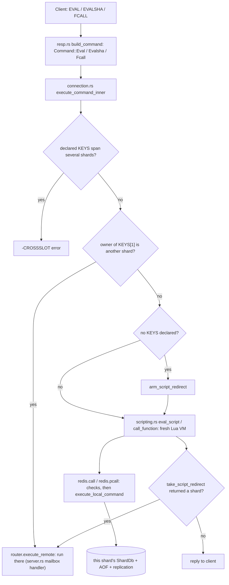
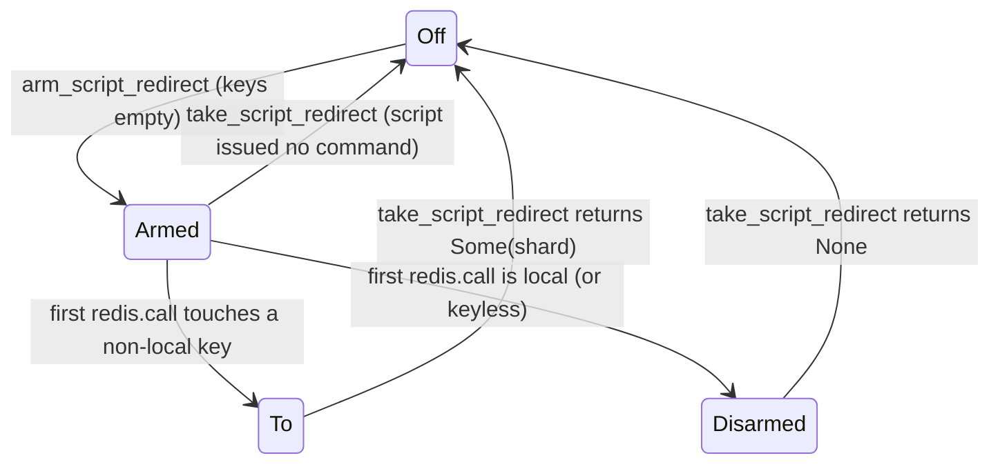

# Component 13: Lua Scripting & Redis 7 Functions — Implementation Reference

> **High-Level Design Spec**: [`docs/design/13_scripting_functions.md`](../design/13_scripting_functions.md)
> **Consolidated Implementation Spec**: [`docs/internal/components.md`](components.md)
> **Primary source**: `src/scripting.rs` (plus touchpoints in `src/connection.rs`, `src/resp.rs`,
> `src/server.rs`, `src/aof.rs`, `src/redis_rdb.rs`, `src/router.rs`, `src/allocator.rs`)

---

## 1. What this subsystem does

Redis clients can ship small Lua programs to the server and run them next to the data:

* **`EVAL script numkeys key… arg…`** runs a script once. **`EVALSHA sha1 …`** runs a script
  that was cached earlier (by `EVAL` or `SCRIPT LOAD`), identified by the SHA-1 of its source.
* **Redis 7 Functions**: `FUNCTION LOAD` installs a named *library* of Lua functions on the
  server, and `FCALL name numkeys key… arg…` calls one of them. Libraries are listed, deleted,
  flushed, dumped and restored with the other `FUNCTION` subcommands.
* `_RO` variants (`EVAL_RO`, `EVALSHA_RO`, `FCALL_RO`) promise that the script does not write.

Inside a script, `redis.call(...)` / `redis.pcall(...)` run ordinary Redis commands against
the shard's data. Rudis embeds a real Lua 5.4 interpreter through the `mlua` crate
(`mlua = { version = "0.12.1", features = ["lua54", "vendored"] }`; the Lua C source is
compiled into the binary) and adds the Redis-specific environment around it: a sandboxed
global table, the `redis` API table, and the `bit`, `cjson` and `cmsgpack` helper libraries
that Redis scripts expect.

The hard part in Rudis — compared with single-threaded Redis — is that data is **sharded across
threads** (Component 04). A script runs synchronously on one shard thread against that shard's
`ShardDb`, so the dispatcher must make sure the script runs on the shard that owns its keys, and
`redis.call` must refuse to touch keys owned by any other shard.

---

## 2. Mental model



Key ideas to keep in mind while reading:

1. **One fresh VM per call.** Every `EVAL`, `EVALSHA` and `FCALL` builds a new `mlua::Lua`
   state, installs the sandbox, runs, converts the result to RESP, and drops the VM. Nothing Lua-
   side survives between calls; there is no bytecode cache and no VM pool.
2. **Caches hold source text, process-wide.** `SCRIPT_CACHE` (SHA-1 → source) and
   `FUNCTION_LIBS` (library name → `FunctionLib`) are `LazyLock<parking_lot::RwLock<HashMap>>`
   statics shared by every shard thread. A script loaded through one shard's connection is
   immediately `EVALSHA`-able through any other; a function library is callable from every shard.
   Only *execution* is per-shard.
3. **`redis.call` is a real command.** It is parsed with the same `build_command` the wire uses
   and executed with the same `execute_local_command` the shard uses for normal commands, so
   each write is AOF-logged and replicated as its own command ("effects replication").
4. **Functions re-run their library on every `FCALL`.** `FUNCTION LOAD` runs the library once to
   validate it and record its function names; every `FCALL` re-runs the whole library in a new
   VM to obtain a callable closure for the requested function.

---

## 3. Data structures

### 3.1 Script cache

```rust
static SCRIPT_CACHE: LazyLock<RwLock<HashMap<String, String>>>;  // lowercase sha1 hex -> source
```

* `load_script(bytes)` computes `sha1_hex(bytes)` (lowercase hex of a SHA-1 digest), stores the
  source (lossily converted to UTF-8) and returns the SHA.
* `get_script(sha)` and `script_exists(shas)` lowercase the SHA before lookup, so `EVALSHA` is
  case-insensitive.
* `flush_scripts()` clears it; `cached_scripts_count()` feeds `INFO`'s
  `number_of_cached_scripts`.
* There is no size cap or eviction: entries live until `SCRIPT FLUSH` or restart. The cache is
  not persisted and `SCRIPT FLUSH` is not propagated to the AOF or replicas.

### 3.2 Function libraries

```rust
#[derive(Clone, Debug, serde::Serialize, serde::Deserialize)]
pub struct FunctionDef {
    pub name: String,
    pub description: String,
    pub flags: Vec<String>,      // subset of: no-writes, allow-oom, allow-stale,
}                                //   no-cluster, allow-cross-slot-keys

#[derive(Clone, Debug, serde::Serialize, serde::Deserialize)]
pub struct FunctionLib {
    pub name: String,
    pub engine: String,          // always "LUA"
    pub raw_code: String,        // source with the "#!lua" line turned into a "--" comment
    #[serde(default)]
    pub original_code: String,   // source exactly as given to FUNCTION LOAD
    pub functions: Vec<FunctionDef>,
}

static FUNCTION_LIBS: LazyLock<RwLock<HashMap<String, FunctionLib>>>;  // library name -> lib
```

| Field | Type | Meaning |
| :-- | :-- | :-- |
| `FunctionLib::name` | `String` | Library name from `#!lua name=<lib>`; also the map key. Lookups compare case-insensitively. |
| `FunctionLib::engine` | `String` | Always `"LUA"`; any other engine is rejected at load. |
| `FunctionLib::raw_code` | `String` | What is actually executed (first line commented out). |
| `FunctionLib::original_code` | `String` | Returned by `FUNCTION LIST WITHCODE` and written to RDB `FUNCTION2` records. |
| `FunctionLib::functions` | `Vec<FunctionDef>` | Functions the library registered at load time. |
| `FunctionDef::flags` | `Vec<String>` | Only `no-writes` changes behaviour (see §6.3); the others are accepted and stored. |

There is no compiled closure stored anywhere: a `FunctionLib` is just text plus metadata.

Helpers over `FUNCTION_LIBS`: `list_functions()` (clones every library, in hash-map order),
`delete_function(name)` (case-insensitive), `flush_functions()`, `count_functions()`,
`count_libraries()`, `is_function_read_only(name)` (true if that function carries `no-writes`),
`library_codes()` (every non-empty `original_code`, sorted by library name, for RDB), and
`dump_functions()` / `restore_functions()` (§7.3).

### 3.3 Per-thread script state

Two `thread_local!` cells live in `scripting.rs`. Because each shard is one OS thread and a
script runs to completion without yielding, a thread-local is effectively "the currently running
script on this shard".

| Item | Type | Meaning |
| :-- | :-- | :-- |
| `SCRIPT_REDIRECT` | `Cell<ScriptRedirect>` | Redirect state machine for keyless scripts (§5.3). |
| `SCRIPT_RECORDED_ERROR` | `Cell<bool>` (pub) | Set when a command inside the script already counted an error in `INFO errorstats`; the dispatcher's error accounting then skips counting the script's own error a second time (it still counts the failed call). Reset to `false` at the start of `eval_script` / `call_function`. |

```rust
enum ScriptRedirect {
    Off,        // not a keyless script: normal non-local-key checks apply
    Armed,      // keyless script, no command issued yet
    Disarmed,   // first command was local; non-local keys are now errors
    To(usize),  // first command hit shard N: rerun there, fail every further command
}
```

---

## 4. Wire commands and their `Command` variants

Parsed in `src/resp.rs` (`build_command`):

| Wire | Variant | Notes |
| :-- | :-- | :-- |
| `EVAL` / `EVAL_RO` | `Command::Eval { script, keys, args, read_only, auth_user }` | `numkeys` must be a non-negative integer ≤ remaining args (`ERR Number of keys can't be negative`, `ERR Number of keys can't be greater than number of args`). |
| `EVALSHA` / `EVALSHA_RO` | `Command::Evalsha { sha, keys, args, read_only, auth_user }` | Same validation. Unknown SHA → `-NOSCRIPT No matching script. Please use EVAL.` |
| `FCALL` / `FCALL_RO` | `Command::Fcall { function, keys, args, read_only, auth_user }` | A non-numeric `numkeys` gives `ERR Bad number of keys provided, please give a non negative number`. |
| `SCRIPT LOAD` / `EXISTS` / `FLUSH` / `KILL` | `ScriptLoad`, `ScriptExists`, `ScriptFlush`, `ScriptKill` | `SCRIPT FLUSH` ignores any extra argument. `SCRIPT HELP` maps to `Command::Unknown("SCRIPT HELP")`. |
| `FUNCTION LOAD [REPLACE] code` | `FunctionLoad { replace, code }` | Any option other than `REPLACE` → `ERR Unknown option given`. |
| `FUNCTION LIST [WITHCODE] [LIBRARYNAME pat]` | `FunctionList { library_name_pattern, with_code }` | Pattern is a glob (`pubsub::glob_match`). |
| `FUNCTION DELETE lib` | `FunctionDelete(String)` | |
| `FUNCTION FLUSH [ASYNC\|SYNC]` | `FunctionFlush` | The mode is validated, then ignored. |
| `FUNCTION DUMP` | `FunctionDump` | |
| `FUNCTION RESTORE payload [FLUSH\|APPEND\|REPLACE]` | `FunctionRestore { payload, policy }` | Default policy `APPEND`. |
| `FUNCTION STATS` / `KILL` | `FunctionStats`, `FunctionKill` | `FUNCTION HELP` → `Command::Unknown("FUNCTION HELP")`. |

`auth_user` is always empty when parsed from the wire. The dispatcher fills it with the
connection's authenticated user before forwarding the command to another shard, so the remote
shard checks `redis.call` against the **caller's** ACL (§6.2).

The parser marks `_RO` with `read_only: true`; enforcement happens at execution time (§6.3).

---

## 5. Dispatch: getting the script to the right shard

### 5.1 The dispatcher arms (`execute_command_inner` in `src/connection.rs`)

`EVAL`, `EVALSHA` and `FCALL` share one shape:

1. Compute the effective user (`auth_user` carried in the command, else the connection's user)
   and store it in the thread-local `CURRENT_AUTH_USER`.
2. **Cross-shard keys** — `keys_span_shards(keys, router.target_shard)`: if the declared keys
   are owned by more than one shard, reply `-CROSSSLOT Keys in request don't hash to the same
   slot` (`SCRIPT_CROSS_SHARD_ERR`) and stop. Clients use hash tags (`{user1}:a`, `{user1}:b`)
   to co-locate keys.
3. **Forward** — if `KEYS[1]` is owned by another shard, send the whole command (with
   `auth_user` filled in) through `router.execute_remote` and relay its reply.
4. Otherwise run locally:
   * `EVAL` first calls `load_script` (every `EVAL` caches its source, so it becomes
     `EVALSHA`-able immediately). `EVALSHA` looks up the source; missing → `NOSCRIPT`.
   * If **no keys** were declared, call `arm_script_redirect()` (§5.3).
   * Save `CURRENT_DB`, call `eval_script(..)` / `call_function(..)` with `&router.local_db`,
     `router.aof.as_deref()` and `read_only`, then restore `CURRENT_DB` and `select_db` — a
     `SELECT` inside the script does not leak into the connection.
   * If `take_script_redirect()` returns a shard, **discard** the local result and re-execute the
     same command on that shard with `execute_remote`.
   * Otherwise write the result, or the error via `write_resp_err` (which keeps known prefixes
     such as `ERR`, `NOPERM`, `OOM`, `NOREPLICAS`, `WRONGTYPE`, `NOSCRIPT` and prefixes anything
     else with `ERR `).
5. `FCALL` only: after success, call `notify_key_invalidation` for each declared key (RESP3
   client-side caching, Component 02). `EVAL`/`EVALSHA` rely on the invalidation done inside
   each `redis.call`.

The receiving shard (the cross-shard request handling inside `run_shard_worker` in
`src/server.rs`) runs forwarded
`Eval`/`Evalsha`/`Fcall` directly: it sets `CURRENT_AUTH_USER` from the command's `auth_user`,
releases its own `ShardDb` borrow, calls `eval_script` / `call_function` against its own
database and AOF, and restores the selected DB. It never arms a redirect, so a script that was
already redirected cannot bounce again.

### 5.2 Worked example

Two shards. `{u1}` hashes to shard 1, the client is attached to shard 0.

```
EVAL "redis.call('SET', KEYS[1], ARGV[1]); return redis.call('GET', KEYS[2])" 2 {u1}:a {u1}:b hello
```

1. Both keys share the hash tag `{u1}` → same owner (shard 1), so no CROSSSLOT.
2. `KEYS[1]` belongs to shard 1 ≠ 0 → `execute_remote(1, Eval{…, auth_user: "alice"})`.
3. Shard 1's mailbox handler sets `CURRENT_AUTH_USER = "alice"`, caches the source, runs
   `eval_script` against shard 1's `ShardDb`. `SET` passes the ACL and locality checks, is
   executed and logged to shard 1's AOF / replication stream as a plain `SET`.
4. The reply `$-1` (key `{u1}:b` does not exist → Lua `false` → nil bulk) travels back to shard
   0 and on to the client.

Had the keys been `a` and `b` without a tag, landing on different shards, step 1 would have
replied `-CROSSSLOT` and nothing would have run.

### 5.3 Keyless scripts and the redirect state machine

A script that declares no keys (`EVAL "return redis.call('GET','x')" 0`) gives the dispatcher
nothing to route on, so it runs on the client's shard. If its **first** command touches a key
owned by another shard, nothing has happened yet, so the script can be safely rerun on that
shard. `ScriptRedirect` implements this:



Algorithm (`script_redirects(cmd)`, called from `redis.call`/`redis.pcall` before executing):

1. `Off` or `Disarmed` → no redirect; the normal non-local check (§6.1) applies.
2. `To(_)` → fail the command with `SCRIPT_NON_LOCAL_KEY_ERR` (no stats recorded).
3. `Armed` → ask `connection::script_non_local_target(cmd)` for the shard of the first key the
   command touches that this shard does not own. If there is one, switch to `To(shard)` and fail
   the command; otherwise switch to `Disarmed` and let it run.

After the script returns, the dispatcher calls `take_script_redirect()`, which resets the state
to `Off` and returns the target shard if the state was `To`. The local result (usually the
error raised by the failed first command) is thrown away and the command is rerun remotely.
`script_non_local_target` and `script_touches_non_local_key` both return "local" when the server
has a single shard.

Example: `EVAL "local v = redis.call('GET','x'); return v" 0` on shard 0, `x` owned by shard 1 →
state `Armed` → `GET x` is non-local → `To(1)`, `GET` fails → script ends with an error →
`take_script_redirect()` = `Some(1)` → the dispatcher discards the error and reruns the `EVAL`
on shard 1, which returns the value.

---

## 6. Inside a script

### 6.1 `redis.call` / `redis.pcall`

Both are created by `register_redis_module` with `mlua::Scope::create_function`, so the closures
can borrow the caller's `Option<&RefCell<AofWriter>>` for exactly the duration of the run (the
scope ends before `eval_script` / `call_function` return). Each call goes through these steps:

1. **Arguments → bytes**: Lua strings as-is, integers and floats via `to_string()`. Anything else
   (tables, booleans, nil, functions) → `ERR Lua redis lib command arguments must be strings or
   integers`. No arguments → `ERR Please specify at least one argument for redis.call()`.
2. **Parse** with `resp::build_command`. A parse error mentioning "wrong number of arguments"
   becomes `ERR Wrong number of args calling Redis command from script`; other parse errors are
   prefixed with `ERR `. `Command::Unknown` → `Unknown Redis command called from script`.
3. **DEBUG gate** (`script_debug_denied`): `DEBUG` is allowed only when `enable-debug-command`
   is `yes` for this port; `local` is not enough because a script has no client address.
4. **ACL** (`script_acl_denied`): `connection::acl_denied_in_context(port, user, cmd,
   Some(("lua", "eval")))` with the user from `CURRENT_AUTH_USER` (empty → `default`). Command,
   key and channel permissions all apply. Denials surface as `NOPERM …` and are counted as
   rejected calls.
5. **Redirect** (`script_redirects`, §5.3).
6. **Locality** (`connection::script_touches_non_local_key`): if any key of the command belongs to
   another shard → `SCRIPT_NON_LOCAL_KEY_ERR` = `ERR Script attempted to access a non local key:
   pass every key the script uses in KEYS, and use hash tags so they all map to one shard`.
7. **Forbidden commands**: `CLUSTER`, `REPLICAOF`, `SHUTDOWN`, `SAVE`, `BGSAVE`,
   `BGREWRITEAOF` → `ERR This Redis command is not allowed from script`.
8. **min-replicas**: if `MIN_REPLICAS_TO_WRITE > 0`, the command is a write and
   `not_enough_good_replicas(port)` → `NOREPLICAS Not enough good replicas to write.`
9. **Read-only scripts**: if the script is read-only (§6.3) and the command is a write (or
   `PUBLISH`, `SPUBLISH`, `PFCOUNT`) → `ERR Write commands are not allowed from read-only
   scripts.`
10. **maxmemory**: with `maxmemory > 0`, policy `noeviction`, and a write command whose
    `allows_oom()` is false, sum this shard's allocator-measured usage
    (`router::local_real_used`) with every other shard's published usage; above the limit →
    `OOM command not allowed when used memory > 'maxmemory'.`
11. **Bookkeeping**: `record_cmd_stat`, `snapshot::note_write` for writes whose dirty count is not
    computed by change (`dirty_counted_on_change`), `inc_active_client_tot_cmds`, and — when
    `MONITOR` clients exist — a MONITOR line with source `lua`.
12. **Execute**: `execute_local_command(&cmd, &mut db.borrow_mut(), &mut out, aof)`.
13. **Error reply** (`out` starts with `-`): count it (`record_failed_stat`,
    `record_error_stat` by prefix), set `SCRIPT_RECORDED_ERROR`, rewrite "wrong number of
    arguments" as above. `redis.call` raises a Lua error with the message; `redis.pcall` returns
    `{err = "..."}`.
14. **Success**: convert `out` to a Lua value with `resp_bytes_to_lua` (§6.5).

`redis.pcall` performs the identical sequence but turns every failure from steps 1–10 into a
returned `{err = "..."}` table instead of raising. Steps 4, 6, 9 and 10 also bump the rejected
and error counters and set `SCRIPT_RECORDED_ERROR`.

### 6.2 The script environment

`setup_redis_lua_env` builds the environment for `EVAL`, `EVALSHA` and `FCALL`:

1. `Lua::new()` — mlua's safe standard-library set: `coroutine`, `table`, `io`, `os`, `string`,
   `utf8`, `math`, `package` (no `debug`).
2. Copy every global into a private table `real_g`.
3. Seed `math.randomseed` with wall-clock nanoseconds XOR a process-wide counter (so
   `math.random` differs per call).
4. Lua 5.1 compatibility shims: global `unpack` = `table.unpack`; `loadstring(code, name)` wraps
   `load(code, name, "t")` (text chunks only).
5. Remove `dofile`, `loadfile`, `print`; strip `os` down to `os.clock`.
6. Register `bit`, `cjson`, `cmsgpack` (§6.6) and the `redis` table, each wrapped by
   `make_table_readonly_proxy` (reads pass through, writes raise `Attempt to modify a readonly
   table`, `pairs` and `#` work).
7. Store `real_g` and the raw `redis` table in the Lua registry (`__real_G`, `__real_redis`).
8. Run a Lua sandbox snippet that: replaces `getmetatable` so that `getmetatable(_G)` returns a
   write-protected empty table and `getmetatable("s")` returns a read-only proxy of `string`;
   replaces `setmetatable` so it refuses `_G`; empties `_G`; and gives `_G` a metatable whose
   `__index` reads from `real_g` (unknown names raise `Script attempted to access nonexistent
   global variable '<name>'`) and whose `__newindex` raises `Attempt to modify a readonly table`.
   Scripts therefore cannot create globals; they must use `local`.

`eval_script` then sets `KEYS` and `ARGV` (1-indexed tables of Lua strings) in `real_g`.
`call_function` does **not** set them; the function receives them as its two parameters.

The `redis` table available at run time:

| Member | Behaviour |
| :-- | :-- |
| `call`, `pcall` | §6.1. |
| `setresp(n)` | Sets the script's protocol version (default 2). Only `3` changes behaviour (§6.5); the value is not validated. |
| `status_reply(s)` | Returns `{ok = s}`. |
| `error_reply(s)` | Returns `{err = s}` with CR/LF replaced by spaces (empty → `"ERR"`) and a `__tostring` metamethod. |
| `sha1hex(s)` | Lowercase SHA-1 hex of a string argument; otherwise `ERR wrong number of arguments for redis.sha1hex()`. |
| `log(level, msg)` | Accepted and **discarded** (no server log line). |
| `LOG_DEBUG`/`LOG_VERBOSE`/`LOG_NOTICE`/`LOG_WARNING` | 0/1/2/3. |
| `REDIS_VERSION`, `REDIS_VERSION_NUM` | `"7.2.0"`, `0x00070200`. |
| `acl_check_cmd(cmd, ...)` | Parses the command and returns `1` if the caller's ACL allows it, `nil` otherwise; invalid commands raise `ERR Invalid command passed to redis.acl_check_cmd()`. |

`redis.register_function` is absent at run time; calling it from `EVAL` fails with
`attempt to call field 'register_function' (a nil value)`.

### 6.3 Read-only enforcement and script flags

A run is **read-only** when:

* `EVAL`/`EVALSHA`: the command was an `_RO` variant, **or** the script's shebang declares
  `flags=no-writes`.
* `FCALL`: the command was `FCALL_RO` or the function has the `no-writes` flag. `FCALL_RO` of a
  function **without** `no-writes` is rejected before running: `ERR Can not execute a script
  with write flag using *_ro command.` (`EVAL_RO` of an unflagged script is not rejected up
  front; only its writes fail.)

`eval_script` parses an optional shebang on the first line (`#!lua flags=no-writes,allow-oom`):

1. The engine must be `lua` (case-insensitive) → else `ERR Unexpected engine in script shebang`.
2. Every further token must be `key=value` with key `flags` → else `ERR Unknown lua shebang
   option: '<key>'`.
3. Allowed flags: `no-writes`, `allow-oom`, `allow-stale`, `no-cluster` → else `ERR Unexpected
   flag in script shebang: '<flag>'`.
4. The shebang line is turned into a `--` comment before compiling.

Top-level classification uses the flags without running the script:

* `Command::is_write_command` (in `resp.rs`) treats `EVAL`/`EVALSHA` as a write only if the
  script has a shebang whose first line does not contain `no-writes`; a script with no shebang is
  classified as **not** a write. `FCALL` is a write unless `_RO` or the function is `no-writes`.
* `Command::allows_oom` is true for `EVAL`/`EVALSHA` whose shebang line contains `allow-oom`.
* `should_pause_command` (`CLIENT PAUSE WRITE`) pauses scripts unless they are `_RO` or flagged
  read-only (`is_script_read_only`, `is_sha_read_only`, `is_function_read_only`) — so shebang-less
  scripts are paused.

### 6.4 Errors and how they are formatted

* **EVAL/EVALSHA** run the compiled chunk (named `@user_script`) through a Lua `xpcall` whose
  handler turns an error table into its `err` field. On failure, `format_eval_error` keeps the
  first line, strips a `runtime error: ` prefix, returns `NOREPLICAS …`/`OOM …` messages
  verbatim, rewrites nil-call messages to Redis's wording, prefixes `ERR ` unless the message
  already starts with `ERR`, `NOSCRIPT`, `WRONGTYPE` or `NOPERM`, and appends
  ` script: <sha>, on @user_script:1.` Compile errors go through `format_lua_error` instead
  (no SHA suffix).
* **FCALL** errors go through `format_lua_error` (first line, keep from `ERR `/`NOSCRIPT `/
  `WRONGTYPE ` onward, rewrite nil-call messages, ensure an `ERR ` prefix). Missing function:
  `ERR Function not found`.

### 6.5 RESP ⇄ Lua conversion

**Command reply → Lua** (`resp_bytes_to_lua`, used on every `redis.call` result):

| RESP reply | Lua value |
| :-- | :-- |
| empty output | `nil` |
| `+OK` | `{ok = "OK"}` |
| `-ERR …` | Lua error (only reached by `redis.call`; `pcall` intercepts earlier) |
| `:n` | integer (0 if unparsable) |
| `$-1` | `false` |
| `$n …` | string |
| `*n …` | table built by `parse_resp_array_to_lua`; nested `+`/`-` become `{ok=…}`/`{err=…}`, `$-1` → `false`, nested arrays recurse |
| `*n …` from `HGETALL` when `setresp(3)` | map table (`parse_resp_array_to_map_lua`) with metatable field `__redis_proto_type = "map"` |
| any other leading byte | `nil` |

**Script result → RESP** (`lua_val_to_resp_with_depth`, applied once to the return value; "RESP3
mode" means the client negotiated RESP3 (`CURRENT_CLIENT_RESP3`) **and** the script called
`redis.setresp(3)`):

| Lua value | RESP2 mode | RESP3 mode |
| :-- | :-- | :-- |
| `nil` | `$-1` | `_` |
| `true` / `false` | `:1` / `$-1` | `#t` / `#f` |
| integer | `:n` | `:n` |
| float | `:n` (truncated) | `,n` |
| string | bulk string | bulk string |
| table with string `ok` | `+ok` | `+ok` |
| table with string `err` | `-err` (CR/LF → spaces; empty or `"ERR"` → `"ERR "`) | same |
| table with number `double` | bulk string of the number | `,n` |
| map-tagged table | flat `*2n` array of key/value | `%n` map |
| other table | array of `t[1..#t]` | same |
| function, userdata, thread | `$-1` | `$-1` |

Nesting deeper than 1000 levels fails with `reached lua stack limit`. The public
`lua_val_to_resp(val, out)` is the RESP2 entry point.

### 6.6 Helper libraries

* **`bit`** (LuaBitOp-compatible, 32-bit): `tobit`, `tohex(x [, n])` (negative `n` = uppercase,
  width clamped to 1..8), `bnot`, `band`, `bor`, `bxor`, `lshift`, `rshift`, `arshift`, `rol`,
  `ror`, `bswap`. Shift counts are masked to 0–31.
* **`cjson`**: `encode`, `decode` (via `serde_json`), `null` (a sentinel table whose
  `tostring` is `"null"`), `decode_array_with_array_mt`, `encode_max_depth` /
  `decode_max_depth` (defaults 1000 — state in `CJsonConfig`, per VM), `encode_invalid_numbers`
  (NaN/Inf → `null` instead of an error), `encode_keep_buffer` (no-op). A table encodes as a JSON
  array when its keys are exactly `1..#t`, else as an object; non-string/non-integer keys error.
  Object key order is not preserved.
* **`cmsgpack`**: `pack(...)` (concatenates each argument's encoding; map keys sorted by
  descending string bytes; tables nested deeper than 16 encode as nil), `unpack(s)`,
  `unpack_one(s, offset)` and `unpack_limit(s, limit, offset)` (return the next offset, or -1 at
  end). Unsupported type bytes (e.g. bin/ext) decode as nil.

---

## 7. Functions engine

### 7.1 `FUNCTION LOAD` — `load_function(code, replace)`

1. **Metadata**: the first line must start with `#!` (`ERR Missing library metadata`). The
   token after `#!` must be `lua` (case-insensitive; else `ERR Engine '<x>' not found`). Every
   other whitespace token must be `name=<lib>` (quotes trimmed); repeats → `ERR Invalid metadata
   value, name argument was given multiple times`; anything else → `ERR Invalid metadata value
   given: <tok>`; none → `ERR Library name was not given`.
2. **Name check**: `[A-Za-z0-9_]+` (`validate_library_or_function_name`).
3. **Exists?** If a library with that name (case-insensitive) exists and `replace` is false →
   `ERR Library '<lib>' already exists`.
4. **Load-time sandbox**: a fresh `Lua::new()`; copy globals into `real_g`, add `unpack`,
   then remove `math`, `os`, `getmetatable`, `setmetatable`, `load`, `loadstring`, `dofile`,
   `loadfile`, `print`, `rawget`, `rawset`, `rawequal`, `collectgarbage`, `package`,
   `coroutine`, `io`, `debug`. Add `bit`, `cjson`, `cmsgpack`. The `redis` global is a read-only
   proxy (`create_load_redis_proxy`) exposing only `register_function`, `REDIS_VERSION`,
   `REDIS_VERSION_NUM` and the `LOG_*` constants; `_G` is locked as in §6.2.
5. **Timeout**: an instruction hook fires every 1000 VM instructions and aborts once 500 ms have
   elapsed → `ERR FUNCTION LOAD timeout`.
6. **Run** the library with its first line commented out. Errors → `ERR Error compiling
   function: <first line of the Lua error>`.
7. **`redis.register_function`** validates and records a `FunctionDef` (the closure is
   discarded):
   * `register_function(name, fn)` — `name` must be a valid name string, `fn` a function.
   * `register_function{function_name=…, callback=…, description=…, flags={…}}` — unknown keys,
     wrong types, invalid flags, or missing name/callback are errors.
   * A name already registered in this library (case-insensitive) → `Function already exists in
     the library`.
8. **No functions** → `ERR No functions registered`.
9. Under the write lock: if any registered name exists in a **different** library →
   `ERR Function <f> already exists`; otherwise remove any old library with the same name
   (case-insensitive) and insert the new `FunctionLib`.

Example:

```lua
#!lua name=counters
redis.register_function{
  function_name = 'incr_ro_safe',
  callback = function(keys, args) return redis.call('GET', keys[1]) end,
  flags = { 'no-writes' },
}
redis.register_function('bump', function(keys, args)
  return redis.call('INCRBY', keys[1], args[1])
end)
```

`FUNCTION LOAD` returns `counters`. `FCALL_RO incr_ro_safe 1 k` works; `FCALL_RO bump 1 k 5` is
rejected up front; `FCALL bump 1 k 5` increments `k`.

### 7.2 `FCALL` — `call_function(name, keys, args, db, aof, read_only)`

1. Find the library containing a function named `name` (case-insensitive) → else `ERR Function
   not found`. Apply the `FCALL_RO` / `no-writes` rules (§6.3).
2. Build a full run-time environment with `setup_redis_lua_env` (§6.2) — **not** the restricted
   load-time one.
3. Build `KEYS` and `ARGV` tables.
4. Temporarily replace the `redis` global with a load proxy whose `register_function` does no
   validation and only captures (into the Lua registry) the closure whose name matches `name`.
5. Re-run the whole `raw_code` (`ERR Failed to compile library: …` on error). There is no
   instruction hook here.
6. Restore the run-time `redis` table and switch `register_function` off (later calls raise
   `redis.register_function can only be called on FUNCTION LOAD command`).
7. If no closure was captured → `ERR Function '<name>' registered but failed to capture`.
8. Call the closure with `(keys, args)` and convert its result (§6.5).

So library top-level code runs once per `FUNCTION LOAD` and again on **every** `FCALL`, with the
run-time globals (`math`, `io`, … are visible there even though they were hidden at load time).

### 7.3 Management commands

| Command | Behaviour |
| :-- | :-- |
| `FUNCTION LIST` | One entry per library: `library_name`, `engine`, `functions` (each `name`, `description`, `flags`), plus `library_code` (the original source) with `WITHCODE`. Optional `LIBRARYNAME` glob filter. Order is hash-map order. |
| `FUNCTION DELETE lib` | Removes the library (case-insensitive) → `+OK`, else `ERR Library not found`. |
| `FUNCTION FLUSH` | Clears all libraries. If more than 64 functions were loaded, adds `functions + 1` to the `lazyfreed_objects` counter (`table::add_lazyfreed_objects`) for `INFO` compatibility; the clear itself is synchronous. |
| `FUNCTION DUMP` | `dump_functions()`: `b"RUDFUNCv1\0"` (10 bytes) + CRC-16/XMODEM of the body (2 bytes, big-endian) + a JSON array of every `FunctionLib`. |
| `FUNCTION RESTORE payload [policy]` | `restore_functions()`: checks magic, length ≥ 12 and CRC, deserialises the JSON (any failure → `ERR DUMP payload version or checksum are wrong`), then `merge_function_libs` (below). The code is **not** re-executed or re-validated. |
| `FUNCTION STATS` | `running_script` is always null; `engines.LUA` reports `libraries_count` and `functions_count`. Uses RESP3 maps for RESP3 clients. |
| `FUNCTION KILL`, `SCRIPT KILL` | `scripting::kill_running_script(port, is_eval)` looks up the running script in `RUNNING_SCRIPTS`: `-NOTBUSY` if none, `-UNKILLABLE` if it already wrote, `-BUSY` if the wrong kill command was used for its type, otherwise sets its kill flag and replies `+OK` (§9). |

`merge_function_libs(cache, libs, policy)`:

* `FLUSH` — clear, then insert every restored library.
* `APPEND` — fail with `ERR Library <l> already exists` or `ERR Function <f> already exists` if
  any restored library or function name (case-insensitive) is already present; otherwise insert
  all.
* `REPLACE` — restored libraries replace same-named existing ones; fail with `ERR Function <f>
  already exists` only if a restored function name clashes with a library that is being kept.

Checks use lowercase name `HashSet`s so a large payload is processed in linear time while holding
the global write lock (covered by `test_merge_function_libs_scales_linearly`).

---

## 8. Persistence, replication and observability

* **Script effects**: every write issued through `redis.call` is logged by
  `execute_local_command`'s change recording as its own command, to the AOF of the shard the
  script ran on and to the replication stream. The script text is never logged.
* **AOF replay of `EVAL`/`EVALSHA`** (`aof.rs` `apply_aof_command`): an AOF written by old Redis
  versions can contain verbatim scripts; replay caches the source and runs it with
  `eval_script` (no AOF writer, not read-only) through `replay_script`, which temporarily moves
  the `ShardDb` into an `Rc<RefCell<_>>`.
* **Function libraries**: `FUNCTION LOAD`, `DELETE`, `FLUSH` and `RESTORE` call
  `router.log_mutation` on success (AOF + replication). `execute_local_command` also has arms for
  these four, used when a replica applies them from its master or when the AOF is replayed (they
  call the same `scripting.rs` functions and re-record the change).
* **RDB**: `redis_rdb::write_file_header` emits one `FUNCTION2` record per `library_codes()`
  entry in every RDB header Rudis writes. On load, `FUNCTION2` records are fed to
  `load_function(code, true)` when the load context has `load_functions` set (shard 0 of a full
  RDB load, and RDB preambles); a library that fails to load is skipped with a warning. Pre-GA
  Redis 7.0 function records are skipped.
* **Stats**: each inner command is counted in `INFO commandstats` and failed/rejected counters;
  the outer `EVAL*`/`FCALL*` failure is counted as failed and, unless `SCRIPT_RECORDED_ERROR` is
  set, in `errorstats`. `INFO memory` reports `number_of_cached_scripts`, `number_of_functions`,
  `number_of_libraries` and `used_memory_vm_functions` (a synthetic `32768 + 256 × functions`).
* **MONITOR** shows each inner command with source `lua`.
* **Pipelines**: a pipeline batch containing `EVAL`/`EVALSHA`/`FCALL` is treated as containing
  writes for AOF purposes, since script effects cannot be known up front.

---

## 9. Invariants & gotchas

* **Single-shard execution.** A script only ever sees one shard's data. Declared keys must share
  an owner (`CROSSSLOT` otherwise) and every key a script touches must be local
  (`SCRIPT_NON_LOCAL_KEY_ERR` otherwise). Pass all keys in `KEYS` and use hash tags.
* **Keyless scripts are rerun, not migrated.** The redirect only works if the *first* command
  hits the foreign shard; any Lua computed before that runs twice. After a local first command
  the state is `Disarmed` and later foreign keys are errors.
* **Long-running scripts.** `eval_script`/`call_function` register the run (`ScriptRunGuard`)
  and install a count hook (`install_script_hook`, every `SCRIPT_HOOK_INSTRUCTIONS` = 10,000
  instructions). Past `busy-reply-threshold` the script is marked busy and other connections get
  `-BUSY` for commands not flagged `allow-busy`. When the kill flag is set (or a shutdown
  starts) the hook fails the script. A script that already wrote (`redis.call` of a write) is
  `-UNKILLABLE`. The script still blocks its own shard's reactor until it ends, so the kill has
  to come from a connection on another shard.
* **Cross-shard waits from scripts are bounded.** `PUBLISH`/`SPUBLISH` inside a script use
  `publish_sync`/`spublish_sync`, which wait at most `SYNC_PUBLISH_COUNT_WAIT` (1 ms) for other
  shards' subscriber counts so two shards publishing to each other cannot deadlock; the returned
  count can be short.
* **The scope invariant.** `redis.call` closures borrow the AOF writer through
  `Lua::scope`; nothing created inside the scope may outlive the call. `replay_script` relies on
  this when it unwraps the `Rc` after the run.
* **Thread-locals are the script context.** `CURRENT_AUTH_USER`, `SCRIPT_REDIRECT` and
  `SCRIPT_RECORDED_ERROR` are per thread. Any new code path that runs scripts must set the
  user and, if it arms a redirect, must call `take_script_redirect()` afterwards.
* **`SELECT` inside a script is undone** by the dispatcher after the run.
* **Nested scripting returns `nil`.** `execute_local_command` has no arm for `EVAL`, `EVALSHA`,
  `FCALL`, `SCRIPT *`, `FUNCTION LIST` or `FUNCTION DUMP`, so `redis.call('EVAL', …)` produces
  empty output and the script silently gets `nil`. By contrast `FUNCTION LOAD/DELETE/FLUSH/
  RESTORE/STATS` do execute from a script (those arms exist for replication and AOF replay), and
  `FUNCTION KILL` there replies `+OK`.
* **`allow-oom` only affects the top level.** The in-script maxmemory check calls `allows_oom()`
  on the *inner* command, which is false for ordinary writes, so an `allow-oom` script's writes
  are still refused over the limit.
* **Shebang-less scripts are "not writes" at the top level** (`is_write_command`), but each
  inner write is still checked individually (OOM, min-replicas, read-only).
* **Two read-only detectors.** `is_script_read_only` requires an exact `no-writes` token inside
  `flags=`; `is_write_command`/`allows_oom` search the first line for the substring.
* **`FUNCTION RESTORE` trusts its payload.** Libraries are inserted without re-running or
  re-validating their code; a bad library only fails later, at `FCALL`.
* **Functions see different globals at load and at call time** (§7.2).

---

## 10. Limitations / not implemented

* A busy script cannot be preempted on its own shard: clients on that shard wait for it to
  end; only connections on other shards see `-BUSY` and can issue `SCRIPT KILL`/`FUNCTION KILL`.
* Sandbox gaps compared with Redis: in the `EVAL`/`FCALL` environment `io`, `package`
  (`require`), `coroutine`, stock `load`, `rawget`/`rawset` and `collectgarbage` remain
  reachable; only `dofile`, `loadfile`, `print` and most of `os` are removed. (`FUNCTION LOAD`
  removes far more, but only while loading.)
* `redis.log` is a no-op; `redis.breakpoint`, `redis.debug`, `redis.replicate_commands`,
  `redis.set_repl` and the `REPL_*` constants do not exist; `SCRIPT DEBUG` is not implemented.
* `redis.setresp` accepts any value without validation; `resp_bytes_to_lua` understands only
  RESP2 frame types (other leading bytes become `nil`).
* The `allow-cross-slot-keys` flag is accepted for functions but rejected in `EVAL` shebangs;
  `allow-stale` and `no-cluster` are accepted and ignored.
* `FUNCTION DUMP` uses a Rudis-specific JSON payload (`RUDFUNCv1`), not Redis's binary format,
  so dumps cannot be exchanged with Redis (RDB `FUNCTION2` records are compatible).
* `FUNCTION FLUSH ASYNC` is synchronous; `FUNCTION STATS` never reports a running script.
* No VM reuse or bytecode caching; every call pays for `Lua::new()`, the sandbox setup and
  recompiling the script (and, for `FCALL`, re-running the library).
* `SCRIPT_CACHE` is unbounded and neither persisted nor replicated.
* The Redis TCL suites `unit/scripting` and `unit/functions` are part of
  `scripts/run_redis_test_suite.sh`, but run against a **single-shard** server
  (`threads=1`) because they use undeclared and cross-key access.

---

## 11. Code map

| File | Key symbols | What they do |
| :-- | :-- | :-- |
| `src/scripting.rs` | `SCRIPT_CACHE`, `sha1_hex`, `load_script`, `get_script`, `script_exists`, `flush_scripts`, `cached_scripts_count` | Script cache. |
| `src/scripting.rs` | `FunctionDef`, `FunctionLib`, `FUNCTION_LIBS`, `list_functions`, `delete_function`, `flush_functions`, `count_functions`, `count_libraries`, `library_codes` | Function library registry. |
| `src/scripting.rs` | `is_script_read_only`, `is_sha_read_only`, `is_function_read_only` | Flag-based read-only detection for dispatch/pausing. |
| `src/scripting.rs` | `ScriptRedirect`, `SCRIPT_REDIRECT`, `arm_script_redirect`, `take_script_redirect`, `script_redirects`, `SCRIPT_RECORDED_ERROR` | Per-thread script state. |
| `src/scripting.rs` | `eval_script`, `format_eval_error` | `EVAL`/`EVALSHA` engine and error formatting. |
| `src/scripting.rs` | `load_function`, `create_load_redis_proxy`, `validate_library_or_function_name`, `is_valid_function_flag` | `FUNCTION LOAD`. |
| `src/scripting.rs` | `call_function`, `format_lua_error` | `FCALL`. |
| `src/scripting.rs` | `dump_functions`, `restore_functions`, `merge_function_libs`, `function_names` | `FUNCTION DUMP`/`RESTORE`. |
| `src/scripting.rs` | `setup_redis_lua_env`, `make_table_readonly_proxy`, `register_redis_module`, `script_acl_denied`, `script_debug_denied` | Sandbox, `redis` API, per-command checks. |
| `src/scripting.rs` | `register_bit_module`, `register_cjson_module` (`CJsonConfig`, `json_val_to_lua`, `lua_val_to_json_str`), `register_cmsgpack_module` (`pack_lua_val`, `unpack_msgpack_val`) | Helper libraries. |
| `src/scripting.rs` | `resp_bytes_to_lua`, `parse_resp_array_to_lua`, `parse_resp_array_to_map_lua`, `parse_resp_element`, `lua_val_to_resp`, `lua_val_to_resp_with_depth` | RESP ⇄ Lua conversion. |
| `src/connection.rs` | `execute_command_inner` (`Eval`, `Evalsha`, `Fcall`, `Script*`, `Function*` arms), `keys_span_shards`, `SCRIPT_CROSS_SHARD_ERR` | Top-level dispatch and shard routing. |
| `src/connection.rs` | `script_touches_non_local_key`, `script_non_local_target`, `SCRIPT_NON_LOCAL_KEY_ERR`, `acl_denied_in_context`, `CURRENT_AUTH_USER`, `for_each_cmd_key` | Helpers used by `redis.call`. |
| `src/connection.rs` | `execute_local_command` (`FunctionLoad/Delete/Flush/Restore/Stats/Kill` arms), `should_pause_command` | Replica/AOF application of function changes; pause rules. |
| `src/server.rs` | `run_shard_worker` (cross-shard request handling: `Eval`/`Evalsha`/`Fcall` branches) | Runs forwarded scripts on the owning shard. |
| `src/resp.rs` | `build_command` (`EVAL*`, `SCRIPT`, `FUNCTION`, `FCALL*`), `Command::is_write_command`, `Command::allows_oom` | Parsing and top-level classification. |
| `src/router.rs` | `Router::log_mutation`, `execute_remote`, `target_shard` | Logging function changes; forwarding. |
| `src/aof.rs` | `apply_aof_command`, `replay_script` | Replaying verbatim scripts from legacy AOFs. |
| `src/redis_rdb.rs` | `write_file_header` (`OP_FUNCTION2`), RDB loader `OP_FUNCTION2` arm | Function persistence in RDB. |
| `src/allocator.rs` | `INFO memory` formatting | Script/function counters. |
| `tests/e2e_scripting.rs` | `test_lua_scripting_engine_e2e`, `test_scripts_reject_keys_on_several_shards_e2e`, `test_script_access_to_non_local_key_is_rejected_e2e`, `test_keyless_script_runs_on_owner_of_first_key_e2e`, `test_script_redis_call_enforces_caller_acl_e2e`, `test_lua_publish_from_two_shards_does_not_deadlock_e2e`, `test_fcall_mutating_aof_persistence_and_replay_e2e`, `test_functions_survive_aof_rewrite_and_restart_e2e` | End-to-end coverage. |

### How to verify changes

```bash
cargo fmt --check
cargo clippy --all-targets -- -D warnings
cargo test --lib scripting -- --test-threads=1
cargo test --test e2e_scripting script -- --test-threads=1
cargo test --test e2e_scripting function -- --test-threads=1
scripts/run_redis_test_suite.sh   # includes unit/scripting and unit/functions (single shard)
```
