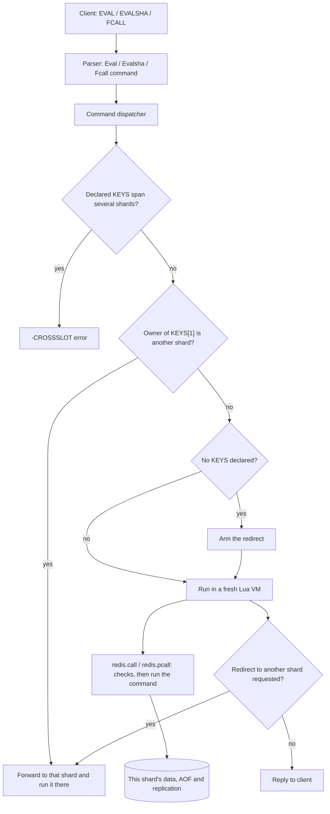
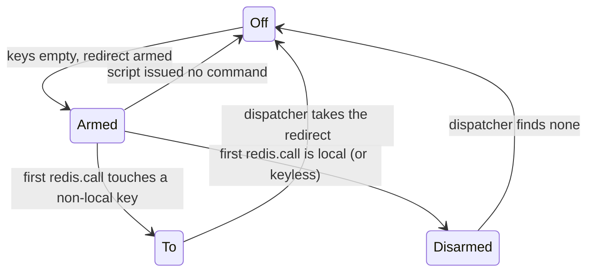
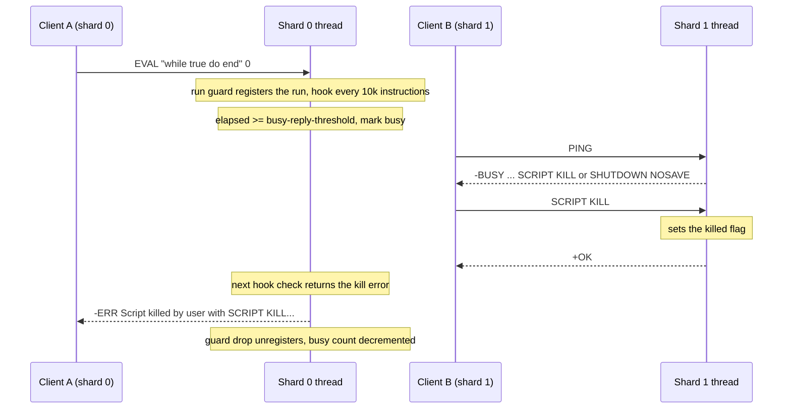

# Component 13: Lua Scripting and Redis 7 Functions

> **High-Level Design Spec**: [docs/design/13_scripting_functions.md](../design/13_scripting_functions.md)
> **Consolidated Implementation Spec**: [docs/internal/components.md](components.md)
> **Main source files**: src/scripting.rs (the Lua engine, caches, sandbox, `redis` API, function
> libraries and the running-script registry), src/connection.rs (dispatch, shard routing,
> `-BUSY` replies), src/resp.rs (parsing and classification), src/server.rs (running forwarded
> scripts on the owning shard), src/aof.rs and src/redis_rdb.rs (persistence), src/router.rs
> (forwarding and logging), src/allocator.rs (`INFO memory` fields). The [Code map](#11-code-map)
> lists the key symbols.

---

## 1. What this subsystem does

Redis clients can ship small Lua programs to the server and run them next to the data:

* **`EVAL script numkeys key... arg...`** runs a script once. **`EVALSHA sha1 ...`** runs a script
  that was cached earlier (by `EVAL` or `SCRIPT LOAD`), identified by the SHA-1 of its source.
* **Redis 7 Functions.** `FUNCTION LOAD` installs a named *library* of Lua functions on the server,
  and `FCALL name numkeys key... arg...` calls one of them. Libraries are listed, deleted, flushed,
  dumped and restored with the other `FUNCTION` subcommands.
* The `_RO` variants (`EVAL_RO`, `EVALSHA_RO`, `FCALL_RO`) promise that the script does not write.

Inside a script, `redis.call(...)` and `redis.pcall(...)` run ordinary Redis commands against the
shard's data. Rudis embeds a real Lua 5.4 interpreter through the `mlua` crate (with the Lua C source
compiled into the binary) and adds the Redis-specific environment around it: a sandboxed global
table, the `redis` API table, and the `bit`, `cjson` and `cmsgpack` helper libraries that Redis
scripts expect.

The hard part in Rudis, compared with single-threaded Redis, is that data is **sharded across
threads** ([Component 04](04_sharding_mesh.md)). A script runs synchronously on one shard thread
against that shard's data, so the dispatcher must make sure the script runs on the shard that owns
its keys, and `redis.call` must refuse to touch keys owned by any other shard.

---

## 2. Mental model



Five ideas to keep in mind while reading:

1. **One fresh VM per call.** Every `EVAL`, `EVALSHA` and `FCALL` builds a new Lua state, installs the
   sandbox, runs, converts the result to RESP and drops the VM. Nothing Lua-side survives between
   calls; there is no bytecode cache and no VM pool.
2. **Caches hold source text, process-wide.** The script cache (SHA-1 to source) and the function
   library table (library name to library) are shared by every shard thread. A script loaded through
   one shard's connection is immediately `EVALSHA`-able through any other, and a function library is
   callable from every shard. Only *execution* is per shard.
3. **`redis.call` is a real command.** It is parsed with the same parser the wire uses and executed
   with the same local-execution routine the shard uses for normal commands, so each write is
   AOF-logged and replicated as its own command ("effects replication").
4. **Functions re-run their library on every `FCALL`.** `FUNCTION LOAD` runs the library once to
   validate it and record its function names; every `FCALL` re-runs the whole library in a new VM to
   obtain a callable closure for the requested function.
5. **A running script is visible to other shards.** Each run is registered process-wide and checked by
   an instruction hook, so a script past `busy-reply-threshold` makes the other shards answer
   `-BUSY`, and `SCRIPT KILL` or `FUNCTION KILL` from another shard can end it (§6.7).

| Term | Meaning |
| :--- | :--- |
| **VM** | One Lua interpreter state. Rudis creates one per call. |
| **KEYS / ARGV** | The two tables a script receives: the declared key names, and the other arguments. |
| **Library** | A named bundle of Lua functions installed with `FUNCTION LOAD`. |
| **Effects replication** | Logging the individual writes a script performed, not the script itself. |
| **Shebang** | An optional first line such as `#!lua flags=no-writes` that declares a script's properties. |
| **Sandbox** | The restricted global environment scripts run in. |

---

## 3. State

### 3.1 The script cache

The script cache maps the lowercase SHA-1 hex of a script's source to the source.

* Loading computes the SHA-1, stores the source (lossily converted to UTF-8) and returns the SHA.
* Lookups lowercase the SHA first, so `EVALSHA` is case-insensitive.
* Flushing clears the cache, and a counter feeds `INFO`'s `number_of_cached_scripts`.
* There is no size cap or eviction: entries live until `SCRIPT FLUSH` or restart. The cache is not
  persisted, and `SCRIPT FLUSH` is not propagated to the AOF or replicas.

### 3.2 Function libraries

A library records its name, the engine (always `LUA`), the code that is actually executed (the
source with the `#!lua` line turned into a `--` comment), the original code exactly as given to
`FUNCTION LOAD`, and the list of functions it registered (each with a name, description and flags).
There is **no compiled closure** stored anywhere: a library is just text plus metadata.

Library names compare case-insensitively. Only the `no-writes` flag changes behaviour (§6.3); the
others are accepted and stored. The original code is what `FUNCTION LIST WITHCODE` returns and what
RDB `FUNCTION2` records hold. [Reference details](#121-type-definitions) lists the fields.

Helpers over the table cover listing, deleting, flushing, counting libraries and functions, asking
whether a function is read-only, collecting every non-empty original code (sorted by library name,
for RDB), and dumping and restoring (§7.3).

### 3.3 Per-thread script state

Three thread-local cells live in scripting.rs. Because each shard is one OS thread and a script runs
to completion without yielding, a thread-local is effectively "the currently running script on this
shard".

| Item | Meaning |
| :--- | :--- |
| The redirect state | A small state machine for keyless scripts (§5.3). |
| The current-script entry | This thread's entry in the running-script registry (§3.4), so `redis.call` can flag a write on it. Set and cleared by the run guard. |
| The recorded-error flag | Set when a command inside the script already counted an error in `INFO errorstats`. The dispatcher's error accounting then skips counting the script's own error a second time (it still counts the failed call). Reset at the start of every run. |

The redirect state has four values: *off* (not a keyless script, so normal non-local-key checks
apply), *armed* (keyless script, no command issued yet), *disarmed* (the first command was local, so
non-local keys are now errors), and *to shard N* (the first command hit shard N: rerun there and fail
every further command).

### 3.4 The running-script registry

While a shard runs a script it serves nothing else, so `SCRIPT KILL`, `FUNCTION KILL`, the `-BUSY`
check and shutdown reach the script from *other* threads through a process-wide registry. Each entry
records the base port of the server running it, whether it is an `EVAL` (killed by `SCRIPT KILL`) or
an `FCALL` (killed by `FUNCTION KILL`), its start time, and three flags: *killed* (set by a kill
command), *wrote* (a write command ran, so the script is now unkillable) and *busy* (it ran past
`busy-reply-threshold`).

| Item | Meaning |
| :--- | :--- |
| Base port | Every shard of one server maps to the same base port, so a kill on any shard finds the script. Several servers in one process (tests) stay apart. |
| The registry | One entry per script currently running anywhere in the process (at most one per shard thread). |
| The busy count | A fast path: while it is 0, the busy check returns at once without locking the registry, so the per-command check costs one atomic load. |
| The run guard | A scope guard. Starting it pushes a new entry and sets the current-script cell; dropping it clears the cell, removes the entry and decrements the busy count if the run had been marked busy. |

`EVAL` and `FCALL` create the guard right after creating the VM and keep it for the whole run
(including, for `FCALL`, the re-run of the library). `FUNCTION LOAD` does not register; it has its
own 500 ms timeout (§7.1). §6.7 describes how the registry is used.

---

## 4. Commands

The commands are parsed in resp.rs into command variants; the variants and their validation are
tabulated in [Reference details](#122-command-variants). In summary:

* `EVAL`, `EVALSHA` and `FCALL` (and their `_RO` forms) take a key count that must be a non-negative
  integer no greater than the remaining arguments. An unknown SHA gives `-NOSCRIPT No matching
  script. Please use EVAL.`
* The `SCRIPT` subcommands are `LOAD`, `EXISTS`, `FLUSH` and `KILL`. `SCRIPT HELP` and `FUNCTION HELP`
  parse as unknown commands.
* The `FUNCTION` subcommands are `LOAD [REPLACE]`, `LIST`, `DELETE`, `FLUSH`, `DUMP`, `RESTORE`,
  `STATS` and `KILL`.

The parser marks `_RO` commands read-only; enforcement happens at execution time (§6.3). The command
also carries an authenticated-user field that is always empty when parsed from the wire. The
dispatcher fills it with the connection's user before forwarding the command to another shard, so
the remote shard checks `redis.call` against the **caller's** ACL.

---

## 5. Dispatch: getting the script to the right shard

### 5.1 The dispatcher arms

`EVAL`, `EVALSHA` and `FCALL` share one shape:

1. Work out the effective user (the one carried in the command, else the connection's user) and store
   it in a thread-local.
2. **Cross-shard keys.** If the declared keys are owned by more than one shard, reply `-CROSSSLOT Keys
   in request don't hash to the same slot` and stop. Clients use hash tags (`{user1}:a`,
   `{user1}:b`) to co-locate keys.
3. **Forward.** If `KEYS[1]` is owned by another shard, send the whole command (with the user filled
   in) to that shard and relay its reply.
4. Otherwise run locally:
   * `EVAL` first caches its source, so it becomes `EVALSHA`-able immediately. `EVALSHA` looks up the
     source; missing gives `NOSCRIPT`.
   * If **no keys** were declared, arm the redirect (§5.3).
   * Save the current database, run the script against this shard's data and AOF, then restore the
     database: a `SELECT` inside the script does not leak into the connection.
   * If the script asked for a redirect, **discard** the local result and re-execute the same command
     on that shard.
   * Otherwise write the result, or the error: known prefixes such as `ERR`, `NOPERM`, `OOM`,
     `NOREPLICAS`, `WRONGTYPE` and `NOSCRIPT` are kept, and anything else is prefixed with `ERR `.
5. For `FCALL` only, after success, send key invalidations for each declared key (RESP3 client-side
   caching, [Component 02](02_connection_lifecycle.md)). `EVAL` and `EVALSHA` rely on the invalidation
   done inside each `redis.call`.

The receiving shard runs forwarded scripts directly: it sets the user from the command, releases its
own data borrow, runs against its own database and AOF, and restores the selected database. It never
arms a redirect, so a script that was already redirected cannot bounce again.

### 5.2 Worked example

There are two shards. `{u1}` hashes to shard 1, and the client is attached to shard 0.

```text
EVAL "redis.call('SET', KEYS[1], ARGV[1]); return redis.call('GET', KEYS[2])" 2 {u1}:a {u1}:b hello
```

1. Both keys share the hash tag `{u1}`, so they have the same owner (shard 1) and there is no
   CROSSSLOT.
2. `KEYS[1]` belongs to shard 1, which is not shard 0, so the command is forwarded with the user
   `alice` filled in.
3. Shard 1's handler sets the user to `alice`, caches the source and runs the script against shard 1's
   data. `SET` passes the ACL and locality checks, is executed, and is logged to shard 1's AOF and
   replication stream as a plain `SET`.
4. The reply `$-1` (key `{u1}:b` does not exist, so Lua sees `false`, which becomes a nil bulk) travels
   back to shard 0 and on to the client.

Had the keys been `a` and `b` with no tag, landing on different shards, step 1 would have replied
`-CROSSSLOT` and nothing would have run.

### 5.3 Keyless scripts and the redirect state machine

A script that declares no keys (`EVAL "return redis.call('GET','x')" 0`) gives the dispatcher nothing
to route on, so it runs on the client's shard. If its **first** command touches a key owned by another
shard, nothing has happened yet, so the script can be safely rerun on that shard.



The check runs from `redis.call` and `redis.pcall` before executing a command:

1. In the *off* or *disarmed* state there is no redirect, and the normal non-local check (§6.1)
   applies.
2. In the *to* state the command fails with the non-local-key error, without recording stats.
3. In the *armed* state, find the shard of the first key the command touches that this shard does not
   own. If there is one, switch to *to* that shard and fail the command; otherwise switch to
   *disarmed* and let it run.

After the script returns, the dispatcher takes the redirect, which resets the state to *off* and
returns the target shard if the state was *to*. The local result (usually the error raised by the
failed first command) is thrown away and the command is rerun remotely. On a single-shard server the
helpers always report "local".

**Example.** `EVAL "local v = redis.call('GET','x'); return v" 0` on shard 0, with `x` owned by
shard 1. The state is *armed*, `GET x` is non-local so the state becomes *to 1* and `GET` fails, the
script ends with an error, the dispatcher takes shard 1, discards the error and reruns the `EVAL` on
shard 1, which returns the value.

---

## 6. Inside a script

### 6.1 redis.call and redis.pcall

Both functions are created as scoped Lua callables, allowing their closures to borrow the shard thread's
append-only file writer safely for the duration of the script. Every invocation follows fourteen steps:

1. **Argument conversion:** Lua strings pass through unchanged, while integers and floating-point numbers
   are converted to decimal strings. Complex types such as tables, booleans, functions, or nil trigger an
   argument-type error. Invoking the call with zero arguments triggers a missing-argument error.
2. **Wire parsing:** Arguments are parsed through the standard command parser. Syntax errors (such as
   argument-count mismatches) and unrecognized command names produce standard parser errors.
3. **Debug gate:** The DEBUG command is rejected unless explicitly enabled on the server port.
4. **ACL authorization:** The command is verified against the authenticated user's permissions, checking
   command categories, key patterns, and channel permissions. Denials return permission errors and bump the
   rejected-calls counter.
5. **Keyless redirect:** For armed keyless scripts, the first remote key hit triggers a redirect to that key's
   owner shard (§5.3).
6. **Key locality:** Every key referenced by the command must belong to the current shard. Cross-shard keys
   are rejected with a non-local key error.
7. **Forbidden commands:** Administrative, replication, and persistence commands (including CLUSTER,
   REPLICAOF, SHUTDOWN, SAVE, BGSAVE, and BGREWRITEAOF) cannot be executed from inside a script.
8. **Replication safety:** If minimum healthy replicas are configured, mutating commands fail when the active
   replica count falls below the required threshold.
9. **Read-only enforcement:** If the script is marked read-only (§6.3), write commands, channel publishing,
   and probabilistic updates are rejected.
10. **Memory limit:** Under maximum memory policies with no eviction, mutating commands are rejected if total
    server memory exceeds the configured limit.
11. **Telemetry:** Command statistics are updated. Mutating commands mark the script as having written,
    increment the dirty-keys counter for background saves, update active-client totals, and publish a MONITOR
    stream line with source marked as lua.
12. **Execution:** The command is executed against the local shard storage and appended to the local transaction
    or persistence log.
13. **Error trapping:** If execution returns an error, failure metrics are updated and the error flag is set.
    While redis.call raises a Lua runtime exception, redis.pcall traps the error and returns a table containing
    an err field.
14. **Return conversion:** Successful results are translated from the protocol representation to native Lua
    tables, strings, booleans, or numbers (§6.5).

Both functions share identical validation, but redis.pcall intercepts failures across all validation steps,
returning a Lua error table instead of raising an unhandled exception.

### 6.2 The script environment

The environment for `EVAL`, `EVALSHA` and `FCALL` is built like this:

1. Create a Lua state with mlua's safe standard libraries: `coroutine`, `table`, `io`, `os`, `string`,
   `utf8`, `math` and `package` (no `debug`).
2. Copy every global into a private table.
3. Seed `math.randomseed` with the wall-clock nanoseconds XORed with a process-wide counter, so
   `math.random` differs per call.
4. Add Lua 5.1 compatibility shims: a global `unpack` equal to `table.unpack`, and `loadstring(code,
   name)` wrapping `load(code, name, "t")` (text chunks only).
5. Remove `dofile`, `loadfile` and `print`, and strip `os` down to `os.clock`.
6. Register `bit`, `cjson`, `cmsgpack` (§6.6) and the `redis` table, each wrapped in a read-only proxy
   (reads pass through, writes raise `Attempt to modify a readonly table`, and `pairs` and `#` work).
7. Store the private globals table and the raw `redis` table in the Lua registry.
8. Run a Lua sandbox snippet that replaces `getmetatable` (so `getmetatable(_G)` returns a
   write-protected empty table and `getmetatable("s")` returns a read-only proxy of `string`), replaces
   `setmetatable` so it refuses `_G`, empties `_G`, and gives `_G` a metatable whose index reads from
   the private table (unknown names raise `Script attempted to access nonexistent global variable
   '<name>'`) and whose new-index raises `Attempt to modify a readonly table`. Scripts therefore cannot
   create globals; they must use `local`.

`EVAL` then sets `KEYS` and `ARGV` (1-indexed tables of Lua strings). `FCALL` does **not**; the function
receives them as its two parameters.

The `redis` table available at run time:

| Member | Behaviour |
| :--- | :--- |
| `call`, `pcall` | §6.1. |
| `setresp(n)` | Sets the script's protocol version (default 2). Only 3 changes behaviour (§6.5); the value is not validated. |
| `status_reply(s)` | Returns `{ok = s}`. |
| `error_reply(s)` | Returns `{err = s}` with CR and LF replaced by spaces (empty becomes `"ERR"`) and a `__tostring` metamethod. |
| `sha1hex(s)` | Lowercase SHA-1 hex of a string argument; otherwise `ERR wrong number of arguments for redis.sha1hex()`. |
| `log(level, msg)` | Accepted and **discarded** (no server log line). |
| `LOG_DEBUG`, `LOG_VERBOSE`, `LOG_NOTICE`, `LOG_WARNING` | 0, 1, 2, 3. |
| `REDIS_VERSION`, `REDIS_VERSION_NUM` | `"7.2.0"`, `0x00070200`. |
| `acl_check_cmd(cmd, ...)` | Parses the command and returns 1 if the caller's ACL allows it, nil otherwise; invalid commands raise `ERR Invalid command passed to redis.acl_check_cmd()`. |

`redis.register_function` is absent at run time; calling it from `EVAL` fails with `attempt to call
field 'register_function' (a nil value)`.

### 6.3 Read-only enforcement and script flags

A run is **read-only** when:

* For `EVAL` and `EVALSHA`: the command was an `_RO` variant, **or** the script's shebang declares
  `flags=no-writes`.
* For `FCALL`: the command was `FCALL_RO` or the function has the `no-writes` flag. `FCALL_RO` of a
  function **without** `no-writes` is rejected before running: `ERR Can not execute a script with write
  flag using *_ro command.` (`EVAL_RO` of an unflagged script is not rejected up front; only its writes
  fail.)

Scripts executed through EVAL can declare an optional shebang line on the first line (such as
`#!lua flags=no-writes,allow-oom`). The parser checks four rules:

1. **Engine name:** The declared engine must be lua (case-insensitive); other engine names are rejected.
2. **Options syntax:** Subsequent options must follow key-value syntax with the key named flags.
3. **Supported flags:** Permitted flag values include no-writes, allow-oom, allow-stale, and no-cluster;
   unrecognized flags trigger validation errors.
4. **Stripping:** The shebang line is converted to a comment before compiling the Lua chunk.

**Top-level classification** uses the flags without running the script:

* The write classifier treats `EVAL` and `EVALSHA` as a write only if the script has a shebang whose
  first line does not contain `no-writes`; a script with no shebang is classified as **not** a write.
  `FCALL` is a write unless `_RO` or the function is `no-writes`.
* The OOM classifier allows `EVAL` and `EVALSHA` whose shebang line contains `allow-oom`.
* `CLIENT PAUSE WRITE` pauses scripts unless they are `_RO` or flagged read-only, so shebang-less
  scripts are paused.

### 6.4 Errors and how they are formatted

* **`EVAL` and `EVALSHA`** run the compiled chunk (named `@user_script`) through a Lua `xpcall` whose
  handler turns an error table into its `err` field. On failure the formatter keeps the first line,
  strips a `runtime error: ` prefix, returns `NOREPLICAS ...` and `OOM ...` messages verbatim, rewrites
  nil-call messages to Redis's wording, prefixes `ERR ` unless the message already starts with `ERR`,
  `NOSCRIPT`, `WRONGTYPE` or `NOPERM`, and appends ` script: <sha>, on @user_script:1.` Compile errors
  use a simpler formatter with no SHA suffix.
* **`FCALL`** errors use the simpler formatter (first line, keep from `ERR `, `NOSCRIPT ` or
  `WRONGTYPE ` onward, rewrite nil-call messages, ensure an `ERR ` prefix). A missing function gives
  `ERR Function not found`.

### 6.5 RESP and Lua conversion

**Command reply to Lua** (applied to every `redis.call` result):

| RESP reply | Lua value |
| :--- | :--- |
| empty output | `nil` |
| `+OK` | `{ok = "OK"}` |
| `-ERR ...` | A Lua error (only reached by `redis.call`; `pcall` intercepts earlier) |
| `:n` | integer (0 if unparsable) |
| `$-1` | `false` |
| `$n ...` | string |
| `*n ...` | A table built element by element; nested `+` and `-` become `{ok=...}` and `{err=...}`, `$-1` becomes `false`, and nested arrays recurse |
| `*n ...` from `HGETALL` when `setresp(3)` | A map table with the metatable field `__redis_proto_type = "map"` |
| any other leading byte | `nil` |

**Script result to RESP** (applied once to the return value). "RESP3 mode" means the client negotiated
RESP3 **and** the script called `redis.setresp(3)`.

| Lua value | RESP2 mode | RESP3 mode |
| :--- | :--- | :--- |
| `nil` | `$-1` | `_` |
| `true` / `false` | `:1` / `$-1` | `#t` / `#f` |
| integer | `:n` | `:n` |
| float | `:n` (truncated) | `,n` |
| string | bulk string | bulk string |
| table with string `ok` | `+ok` | `+ok` |
| table with string `err` | `-err` (CR and LF become spaces; empty or `"ERR"` becomes `"ERR "`) | same |
| table with number `double` | bulk string of the number | `,n` |
| map-tagged table | flat `*2n` array of keys and values | `%n` map |
| other table | array of `t[1..#t]` | same |
| function, userdata, thread | `$-1` | `$-1` |

Nesting deeper than 1000 levels fails with `reached lua stack limit`.

### 6.6 Helper libraries

* **`bit`** (LuaBitOp-compatible, 32-bit): `tobit`, `tohex(x [, n])` (negative `n` means uppercase,
  width clamped to 1–8), `bnot`, `band`, `bor`, `bxor`, `lshift`, `rshift`, `arshift`, `rol`, `ror` and
  `bswap`. Shift counts are masked to 0–31.
* **`cjson`**: `encode`, `decode` (through `serde_json`), `null` (a sentinel table whose `tostring` is
  `"null"`), `decode_array_with_array_mt`, `encode_max_depth` and `decode_max_depth` (defaults 1000,
  stored per VM), `encode_invalid_numbers` (NaN and infinity become `null` instead of an error) and
  `encode_keep_buffer` (a no-op). A table encodes as a JSON array when its keys are exactly `1..#t`,
  else as an object; keys that are neither strings nor integers raise an error. Object key order is not
  preserved.
* **`cmsgpack`**: `pack(...)` (concatenates each argument's encoding; map keys are sorted by
  descending string bytes; tables nested deeper than 16 encode as nil), `unpack(s)`,
  `unpack_one(s, offset)` and `unpack_limit(s, limit, offset)` (these return the next offset, or -1 at
  the end). Unsupported type bytes, such as binary and extension types, decode as nil.

### 6.7 Long-running scripts: -BUSY, SCRIPT KILL, FUNCTION KILL

A script runs synchronously on its shard thread, so an endless loop (`EVAL "while true do end" 0`)
would hold that shard forever. Three pieces stop that: the registry (§3.4), an instruction hook inside
the VM, and checks in the dispatcher of every other connection.

**The hook.** `EVAL` and `FCALL` install it right after registering the run. It is a *global* hook, so
coroutines the script creates inherit it, and it fires every 10,000 Lua instructions:

1. If the run was stopped (the *killed* flag is set, or the server is shutting down), replace the hook
   with one that fires on **every line and every instruction** and always errors, then return the error
   `ERR Script killed by user with SCRIPT KILL...` (or `...FUNCTION KILL...` for `FCALL`). The re-armed
   hook means a `pcall` loop cannot catch the error and keep running: the next instruction after the
   catch errors again.
2. Otherwise, if the run is not yet busy, read `busy-reply-threshold` (alias `lua-time-limit`, default
   5000 ms; 0 disables). Once the elapsed time reaches it, mark the run busy, increment the busy count
   and log a warning: `Slow script detected: still in execution after N milliseconds. You can try
   killing the script using the SCRIPT KILL command.`
3. Continue.

When the run fails, the error is replaced with the kill message if the run was stopped, because Lua may
report a hook error raised inside a handler as "error in error handling".

**-BUSY for other clients.** The busy check returns nothing while the busy count is 0. Otherwise it
looks for a busy entry with this server's base port and returns `-BUSY Redis is busy running a script.
You can only call SCRIPT KILL or SHUTDOWN NOSAVE.` (naming `FUNCTION KILL` for an `FCALL`). The
connection code calls it in three places:

| Where | Effect |
| :--- | :--- |
| Command dispatch, right after the client-pause wait | Any command not on the allow-busy list gets `-BUSY`. |
| Queuing a command inside `MULTI` | The command gets `-BUSY` (unless allowed) and the transaction is flagged, so `EXEC` aborts. |
| `EXEC` itself | The queue is discarded and the reply is `-EXECABORT Transaction discarded because of: BUSY ...`, counted as a failed `EXEC` with error `EXECABORT`. |

The allow-busy list is the set Redis flags `allow-busy`: `AUTH`, `HELLO`, `CLIENT CACHING`, `GETNAME`,
`GETREDIR`, `ID`, `NO-EVICT`, `NO-TOUCH`, `REPLY`, `SETINFO` and `SETNAME`, plus `DISCARD`, `FUNCTION
KILL`, `FUNCTION STATS`, `MULTI`, `QUIT`, `REPLCONF`, `RESET`, `SCRIPT KILL`, `SELECT`, `SHUTDOWN`,
`UNWATCH` and `WATCH`.

**Killing.** `SCRIPT KILL` (for an `EVAL`) and `FUNCTION KILL` (for an `FCALL`) find the entry for this
server's base port and answer:

| Situation | Reply |
| :--- | :--- |
| No script running | Returns a NOTBUSY error indicating no script is running. |
| Script already performed a write | Returns an UNKILLABLE error because dataset modifications have occurred. |
| Wrong kill command used (e.g., SCRIPT KILL on FCALL) | Returns a BUSY error directing the caller to the correct kill command. |
| Healthy read-only script | Sets the termination flag and replies with OK; the instruction hook terminates execution. |

The kill does not depend on the busy flag: a script can be killed before it passes the threshold. Once
a shutdown sets the process-wide shutdown flag, the hook stops the script whether or not it wrote, so
the shard can drain (§10 says when that flag is set).



**Worked example.** With `busy-reply-threshold 100`, client A runs the endless `EVAL` above. About 100 ms
later the hook marks it busy. `PING` from a connection on another shard gets `-BUSY`; `FUNCTION KILL`
gets `-BUSY` too (wrong kill command); `SCRIPT KILL` gets `+OK`, and A receives the "killed by user"
error. Had the script first run `redis.call('SET','k','v')`, `SCRIPT KILL` would answer `-UNKILLABLE` and
the script would run to its end.

Connections served by the busy shard itself are not answered at all while the script runs, because their
thread is the one executing Lua. So the kill must come from a connection on another shard. A command
whose key lives on the busy shard may also reach it through a cross-shard request and simply wait for
the script instead of getting `-BUSY`.

---

## 7. The functions engine

### 7.1 FUNCTION LOAD

1. **Metadata header:** The library payload must begin with a shebang line naming the lua engine
   and the library name (`#!lua name=<name>`). Malformed tokens, missing names, or duplicated name options
   are rejected with syntax errors.
2. **Name validation:** Library names must contain only alphanumeric characters and underscores.
3. **Collision check:** If a library with the same name already exists and the replace flag was not passed,
   the load fails with an existence error.
4. **Sandboxed execution:** The code executes inside a restricted, isolated Lua environment with access to
   system and debugging libraries stripped.
   Add `bit`, `cjson` and `cmsgpack`. The `redis` global is a read-only proxy exposing only
   `register_function`, `REDIS_VERSION`, `REDIS_VERSION_NUM` and the `LOG_*` constants; `_G` is locked as
   in §6.2.
5. **Timeout.** An instruction hook fires every 1000 VM instructions and aborts once 500 ms have elapsed
   with `ERR FUNCTION LOAD timeout`.
6. **Run** the library with its first line commented out. Errors give `ERR Error compiling function:
   <first line of the Lua error>`.
7. **`redis.register_function`** validates and records a function definition (the closure is discarded):
   * `register_function(name, fn)`: the name must be a valid name string and `fn` a function.
   * `register_function{function_name=..., callback=..., description=..., flags={...}}`: unknown keys,
     wrong types, invalid flags, and a missing name or callback are errors.
   * A name already registered in this library (case-insensitive) gives `Function already exists in the
     library`.
8. **No functions** gives `ERR No functions registered`.
9. Under the write lock: if any registered name exists in a **different** library, the error is `ERR
   Function <f> already exists`; otherwise remove any old library with the same name (case-insensitive)
   and insert the new one.

**Example.**

```lua
#!lua name=counters
redis.register_function{
  function_name = 'incr_ro_safe',
  callback = function(keys, args) return redis.call('GET', keys[1]) end,
  flags = { 'no-writes' },
}
redis.register_function('bump', function(keys, args)
  return redis.call('INCRBY', keys[1], args[1])
end)
```

`FUNCTION LOAD` returns `counters`. `FCALL_RO incr_ro_safe 1 k` works; `FCALL_RO bump 1 k 5` is rejected
up front; `FCALL bump 1 k 5` increments `k`.

### 7.2 FCALL

1. Find the library containing a function named `name` (case-insensitive), else `ERR Function not
   found`. Apply the `FCALL_RO` and `no-writes` rules (§6.3).
2. Build a full run-time environment (§6.2), **not** the restricted load-time one.
3. Build the `KEYS` and `ARGV` tables.
4. Temporarily replace the `redis` global with a load proxy whose `register_function` does no validation
   and only captures (into the Lua registry) the closure whose name matches `name`.
5. Re-run the whole library code (`ERR Failed to compile library: ...` on error). This re-run is already
   under the run's instruction hook (§6.7), so an endless loop in library top-level code is killable with
   `FUNCTION KILL` and counts toward `busy-reply-threshold`.
6. Restore the run-time `redis` table and switch `register_function` off (later calls raise
   `redis.register_function can only be called on FUNCTION LOAD command`).
7. If no closure was captured, the error is `ERR Function '<name>' registered but failed to capture`.
8. Call the closure with `(keys, args)` and convert its result (§6.5).

So library top-level code runs once per `FUNCTION LOAD` and again on **every** `FCALL`, with the run-time
globals (`math`, `io` and so on are visible there even though they were hidden at load time).

### 7.3 Management commands

| Command | Behaviour |
| :--- | :--- |
| `FUNCTION LIST` | One entry per library: `library_name`, `engine`, `functions` (each `name`, `description`, `flags`), plus `library_code` (the original source) with `WITHCODE`. An optional `LIBRARYNAME` glob filters. Order is hash-map order. |
| `FUNCTION DELETE lib` | Removes the library (case-insensitive) and replies `+OK`, else `ERR Library not found`. |
| `FUNCTION FLUSH` | Clears all libraries. If more than 64 functions were loaded, adds `functions + 1` to the `lazyfreed_objects` counter for `INFO` compatibility; the clear itself is synchronous. |
| `FUNCTION DUMP` | `b"RUDFUNCv1\0"` (10 bytes), a CRC-16/XMODEM of the body (2 bytes, big-endian), and a JSON array of every library. |
| `FUNCTION RESTORE payload [policy]` | Checks the magic, a length of at least 12 and the CRC, deserialises the JSON (any failure gives `ERR DUMP payload version or checksum are wrong`), then merges by policy (below). The code is **not** re-executed or re-validated. |
| `FUNCTION STATS` | `running_script` is always null, even while a script is registered; `engines.LUA` reports `libraries_count` and `functions_count`. RESP3 maps for RESP3 clients. |
| `FUNCTION KILL`, `SCRIPT KILL` | Look up the running script: `-NOTBUSY` if none, `-UNKILLABLE` if it already wrote, `-BUSY` if the wrong kill command was used for its type, otherwise set its kill flag and reply `+OK` (§6.7). Both are on the allow-busy list, so they are served while a script is busy. |

**Restore policies:**

* `FLUSH` clears, then inserts every restored library.
* `APPEND` (the default) fails with `ERR Library <l> already exists` or `ERR Function <f> already exists`
  if any restored library or function name (case-insensitive) is already present; otherwise it inserts
  all.
* `REPLACE` lets restored libraries replace same-named existing ones, and fails with `ERR Function <f>
  already exists` only if a restored function name clashes with a library that is being kept.

The checks use lowercase name sets, so a large payload is processed in linear time while holding the
global write lock (a unit test covers the linear scaling).

---

## 8. Persistence, replication and observability

* **Script effects.** Every write issued through `redis.call` is logged by the local-execution routine's
  change recording as its own command, to the AOF of the shard the script ran on and to the replication
  stream. The script text is never logged.
* **AOF replay of `EVAL` and `EVALSHA`.** An AOF written by old Redis versions can contain verbatim
  scripts; replay caches the source and runs it with no AOF writer and not read-only, temporarily moving
  the shard data into a shared cell.
* **Function libraries.** `FUNCTION LOAD`, `DELETE`, `FLUSH` and `RESTORE` log the mutation on success
  (AOF and replication). The local-execution routine also has arms for these four, used when a replica
  applies them from its master or when the AOF is replayed (they call the same functions and re-record
  the change).
* **RDB.** The RDB header writer emits one `FUNCTION2` record per library code in every RDB header Rudis
  writes. On load, `FUNCTION2` records are loaded with replace semantics when the load context allows it
  (shard 0 of a full RDB load, and RDB preambles); a library that fails to load is skipped with a
  warning. Pre-GA Redis 7.0 function records are skipped.
* **Stats.** Each inner command is counted in `INFO commandstats` and in the failed and rejected counters.
  The outer `EVAL*` or `FCALL*` failure is counted as failed and, unless the recorded-error flag is set,
  in `errorstats`. `INFO memory` reports `number_of_cached_scripts`, `number_of_functions`,
  `number_of_libraries` and `used_memory_vm_functions` (a synthetic 32768 + 256 × functions).
* **MONITOR** shows each inner command with source `lua`.
* **Pipelines.** A pipeline batch containing `EVAL`, `EVALSHA` or `FCALL` is treated as containing writes
  for AOF purposes, since script effects cannot be known up front.

---

## 9. Invariants and gotchas

1. **Single-shard execution.** A script only ever sees one shard's data. Declared keys must share an
   owner (`CROSSSLOT` otherwise) and every key a script touches must be local (the non-local-key error
   otherwise). Pass all keys in `KEYS` and use hash tags.
2. **Keyless scripts are rerun, not migrated.** The redirect only works if the *first* command hits the
   foreign shard; any Lua computed before that runs twice. After a local first command the state is
   *disarmed* and later foreign keys are errors.
3. **Long-running scripts (§6.7).** Every `EVAL`, `EVALSHA` and `FCALL` run is registered by the run
   guard and watched by a global count hook every 10,000 instructions. A tight loop of fewer instructions
   per check still reaches the hook, but a single long C call (one huge `string.rep`, a big
   `redis.call`) is not interrupted until it returns. Any new code path that runs Lua for a client must
   create a run guard and install the hook, or it is neither killable nor reported busy.
4. **The write flag is set before the write executes.** The bookkeeping step of `redis.call` flags every
   command classified as a write, even one that then fails, so such a script is `-UNKILLABLE` from that
   point on.
5. **Registry entries are per server, not per shard.** The entry's port is the base port, so `SCRIPT KILL`
   on any shard finds the script. Kill and busy checks act on the first matching entry.
6. **Cross-shard waits from scripts are bounded.** `PUBLISH` and `SPUBLISH` inside a script wait at most
   1 ms for other shards' subscriber counts, so two shards publishing to each other cannot deadlock; the
   returned count can be short.
7. **The scope invariant.** `redis.call` closures borrow the AOF writer through a Lua scope; nothing
   created inside the scope may outlive the call. Script replay relies on this when it unwraps the shared
   cell after the run.
8. **Thread-locals are the script context.** The current user, the redirect state and the recorded-error
   flag are per thread. Any new code path that runs scripts must set the user and, if it arms a redirect,
   must take the redirect afterwards.
9. **`SELECT` inside a script is undone** by the dispatcher after the run.
10. **Nested scripting returns `nil`.** The local-execution routine has no arm for `EVAL`, `EVALSHA`,
    `FCALL`, `SCRIPT *`, `FUNCTION LIST` or `FUNCTION DUMP`, so `redis.call('EVAL', ...)` produces empty
    output and the script silently gets `nil`. By contrast `FUNCTION LOAD`, `DELETE`, `FLUSH`, `RESTORE`
    and `STATS` do execute from a script (those arms exist for replication and AOF replay), and `FUNCTION
    KILL` there replies `+OK`.
11. **`allow-oom` only affects the top level.** The in-script maxmemory check asks whether the *inner*
    command allows OOM, which is false for ordinary writes, so an `allow-oom` script's writes are still
    refused over the limit.
12. **Shebang-less scripts are "not writes" at the top level**, but each inner write is still checked
    individually (OOM, min-replicas, read-only).
13. **Two read-only detectors.** The script check requires an exact `no-writes` token inside `flags=`; the
    write and OOM classifiers search the first line for the substring.
14. **`FUNCTION RESTORE` trusts its payload.** Libraries are inserted without re-running or re-validating
    their code; a bad library only fails later, at `FCALL`.
15. **Functions see different globals at load and at call time** (§7.2).

---

## 10. Limitations and not implemented

* A busy script cannot be preempted on its own shard: clients on that shard wait for it to end, and so
  does any cross-shard request sent to that shard. Only connections served by other shards see `-BUSY`
  and can issue `SCRIPT KILL` or `FUNCTION KILL`. With a single shard (`threads=1`) nothing can kill a
  running script.
* The hook stops a script once the process-wide shutdown flag is set, whether or not the script wrote.
  The `SHUTDOWN` handler sets that flag only at its end, after the replica wait, the client quiesce and
  the optional save. So a script that wrote ends only with a shutdown that gets that far without the busy
  shard (`SHUTDOWN NOSAVE`, as the `-BUSY` and `-UNKILLABLE` messages say) or by running to completion.
* **Sandbox gaps compared with Redis.** In the `EVAL` and `FCALL` environment, `io`, `package`
  (`require`), `coroutine`, stock `load`, `rawget`, `rawset` and `collectgarbage` remain reachable; only
  `dofile`, `loadfile`, `print` and most of `os` are removed. (`FUNCTION LOAD` removes far more, but only
  while loading.)
* `redis.log` is a no-op; `redis.breakpoint`, `redis.debug`, `redis.replicate_commands`, `redis.set_repl`
  and the `REPL_*` constants do not exist; `SCRIPT DEBUG` is not implemented.
* `redis.setresp` accepts any value without validation, and the reply converter understands only RESP2
  frame types (other leading bytes become `nil`).
* The `allow-cross-slot-keys` flag is accepted for functions but rejected in `EVAL` shebangs;
  `allow-stale` and `no-cluster` are accepted and ignored.
* `FUNCTION DUMP` uses a Rudis-specific JSON payload (`RUDFUNCv1`), not Redis's binary format, so dumps
  cannot be exchanged with Redis. (RDB `FUNCTION2` records are compatible.)
* `FUNCTION FLUSH ASYNC` is synchronous, and `FUNCTION STATS` never reports a running script.
* There is no VM reuse or bytecode caching; every call pays for creating the VM, setting up the sandbox
  and recompiling the script (and, for `FCALL`, re-running the library).
* The script cache is unbounded and neither persisted nor replicated.
* The Redis TCL suites `unit/scripting` and `unit/functions` are part of
  `scripts/run_redis_test_suite.sh`, but run against a **single-shard** server (`threads=1`) because they
  use undeclared and cross-key access.

---

## 11. Code map

| File | Key symbols | Role |
| :--- | :--- | :--- |
| `src/scripting.rs` | `SCRIPT_CACHE`, `sha1_hex`, `load_script`, `get_script`, `script_exists`, `flush_scripts`, `cached_scripts_count` | Script cache. |
| `src/scripting.rs` | `FunctionDef`, `FunctionLib`, `FUNCTION_LIBS`, `list_functions`, `delete_function`, `flush_functions`, `count_functions`, `count_libraries`, `library_codes` | Function library registry. |
| `src/scripting.rs` | `is_script_read_only`, `is_sha_read_only`, `is_function_read_only` | Flag-based read-only detection for dispatch and pausing. |
| `src/scripting.rs` | `ScriptRedirect`, `SCRIPT_REDIRECT`, `arm_script_redirect`, `take_script_redirect`, `script_redirects`, `SCRIPT_RECORDED_ERROR` | Per-thread script state. |
| `src/scripting.rs` | `RunningScript`, `RUNNING_SCRIPTS`, `BUSY_SCRIPTS`, `CURRENT_SCRIPT`, `ScriptRunGuard`, `note_script_write`, `SCRIPT_HOOK_INSTRUCTIONS`, `install_script_hook`, `busy_script_reply`, `kill_running_script` | Running-script registry, busy detection and the kill commands. |
| `src/scripting.rs` | `eval_script`, `format_eval_error` | `EVAL` and `EVALSHA` engine and error formatting. |
| `src/scripting.rs` | `load_function`, `create_load_redis_proxy`, `validate_library_or_function_name`, `is_valid_function_flag` | `FUNCTION LOAD`. |
| `src/scripting.rs` | `call_function`, `format_lua_error` | `FCALL`. |
| `src/scripting.rs` | `dump_functions`, `restore_functions`, `merge_function_libs`, `function_names` | `FUNCTION DUMP` and `RESTORE`. |
| `src/scripting.rs` | `setup_redis_lua_env`, `make_table_readonly_proxy`, `register_redis_module`, `script_acl_denied`, `script_debug_denied` | Sandbox, the `redis` API and the per-command checks. |
| `src/scripting.rs` | `register_bit_module`, `register_cjson_module` (`CJsonConfig`, `json_val_to_lua`, `lua_val_to_json_str`), `register_cmsgpack_module` (`pack_lua_val`, `unpack_msgpack_val`) | Helper libraries. |
| `src/scripting.rs` | `resp_bytes_to_lua`, `parse_resp_array_to_lua`, `parse_resp_array_to_map_lua`, `parse_resp_element`, `lua_val_to_resp`, `lua_val_to_resp_with_depth` | RESP and Lua conversion. |
| `src/connection.rs` | `execute_command_inner` (the `Eval`, `Evalsha`, `Fcall`, `Script*` and `Function*` arms), `keys_span_shards`, `SCRIPT_CROSS_SHARD_ERR` | Top-level dispatch and shard routing. |
| `src/connection.rs` | `script_touches_non_local_key`, `script_non_local_target`, `SCRIPT_NON_LOCAL_KEY_ERR`, `acl_denied_in_context`, `CURRENT_AUTH_USER`, `for_each_cmd_key` | Helpers used by `redis.call`. |
| `src/connection.rs` | `execute_local_command` (the `FunctionLoad`, `Delete`, `Flush`, `Restore`, `Stats` and `Kill` arms), `should_pause_command` | Replica and AOF application of function changes; pause rules. |
| `src/connection.rs` | `allowed_while_busy`, `busy_reply_threshold_ms` (`CONFIG_LUA_TIME_LIMIT`, config `busy-reply-threshold` and `lua-time-limit`), `node_port`, the busy checks in `execute_command_inner` and the `MULTI`/`EXEC` path | `-BUSY` replies while a script is busy. |
| `src/server.rs` | `run_shard_worker` (cross-shard request handling: the `Eval`, `Evalsha` and `Fcall` branches) | Runs forwarded scripts on the owning shard. |
| `src/resp.rs` | `build_command` (`EVAL*`, `SCRIPT`, `FUNCTION`, `FCALL*`), `Command::is_write_command`, `Command::allows_oom` | Parsing and top-level classification. |
| `src/router.rs` | `Router::log_mutation`, `execute_remote`, `target_shard` | Logging function changes; forwarding. |
| `src/aof.rs` | `apply_aof_command`, `replay_script` | Replaying verbatim scripts from legacy AOFs. |
| `src/redis_rdb.rs` | `write_file_header` (`OP_FUNCTION2`), the RDB loader's `OP_FUNCTION2` arm | Function persistence in RDB. |
| `src/allocator.rs` | `INFO memory` formatting | Script and function counters. |
| `tests/e2e_scripting.rs` | `test_lua_scripting_engine_e2e`, `test_scripts_reject_keys_on_several_shards_e2e`, `test_script_access_to_non_local_key_is_rejected_e2e`, `test_keyless_script_runs_on_owner_of_first_key_e2e`, `test_lua_publish_from_two_shards_does_not_deadlock_e2e`, `test_script_kill_ends_endless_script_e2e` | End-to-end coverage of dispatch, sandbox and kill. |
| `tests/e2e_tls.rs` | `test_script_redis_call_enforces_caller_acl_e2e` | `redis.call` under the caller's ACL. |
| `tests/e2e_persistence.rs` | `test_fcall_mutating_aof_persistence_and_replay_e2e`, `test_functions_survive_aof_rewrite_and_restart_e2e` | Function persistence through the AOF. |
| `src/scripting.rs` (unit tests) | `test_script_kill_stops_an_endless_script`, `test_script_kill_is_not_swallowed_by_pcall`, `test_script_kill_stops_endless_coroutine`, `test_script_that_wrote_is_unkillable`, `test_script_kill_without_running_script_is_notbusy` | Hook and kill semantics. |

### How to verify changes

```bash
cargo fmt --check
cargo clippy --all-targets -- -D warnings
cargo test --lib scripting -- --test-threads=1
cargo test --test e2e_scripting script -- --test-threads=1
cargo test --test e2e_scripting function -- --test-threads=1
cargo test --test e2e_persistence fcall -- --test-threads=1
cargo test --test e2e_persistence functions -- --test-threads=1
cargo test --test e2e_tls test_script_redis_call_enforces_caller_acl_e2e
scripts/run_redis_test_suite.sh   # includes unit/scripting and unit/functions (single shard)
```

---

## 12. Reference details

### 12.1 Type definitions

```rust
#[derive(Clone, Debug, serde::Serialize, serde::Deserialize)]
pub struct FunctionDef {
    pub name: String,
    pub description: String,
    pub flags: Vec<String>,      // subset of: no-writes, allow-oom, allow-stale,
}                                //   no-cluster, allow-cross-slot-keys

#[derive(Clone, Debug, serde::Serialize, serde::Deserialize)]
pub struct FunctionLib {
    pub name: String,
    pub engine: String,          // always "LUA"
    pub raw_code: String,        // source with the "#!lua" line turned into a "--" comment
    #[serde(default)]
    pub original_code: String,   // source exactly as given to FUNCTION LOAD
    pub functions: Vec<FunctionDef>,
}

static SCRIPT_CACHE: LazyLock<RwLock<HashMap<String, String>>>;        // lowercase sha1 hex -> source
static FUNCTION_LIBS: LazyLock<RwLock<HashMap<String, FunctionLib>>>;  // library name -> lib

enum ScriptRedirect {
    Off,        // not a keyless script: normal non-local-key checks apply
    Armed,      // keyless script, no command issued yet
    Disarmed,   // first command was local; non-local keys are now errors
    To(usize),  // first command hit shard N: rerun there, fail every further command
}

pub struct RunningScript {
    port: u16,              // base (node) port of the server running it
    is_eval: bool,          // EVAL/EVALSHA (SCRIPT KILL) or FCALL (FUNCTION KILL)
    start: Instant,
    killed: AtomicBool,     // set by SCRIPT KILL / FUNCTION KILL
    wrote: AtomicBool,      // a write command ran: the script is now unkillable
    busy: AtomicBool,       // ran past busy-reply-threshold
}

static RUNNING_SCRIPTS: LazyLock<Mutex<Vec<Arc<RunningScript>>>>;  // every running script
static BUSY_SCRIPTS: AtomicUsize;                                  // how many have busy = true
```

| Field | Type | Meaning |
| :--- | :--- | :--- |
| `FunctionLib::name` | `String` | Library name from `#!lua name=<lib>`; also the map key. Lookups compare case-insensitively. |
| `FunctionLib::engine` | `String` | Always `"LUA"`; any other engine is rejected at load. |
| `FunctionLib::raw_code` | `String` | What is actually executed (first line commented out). |
| `FunctionLib::original_code` | `String` | Returned by `FUNCTION LIST WITHCODE` and written to RDB `FUNCTION2` records. |
| `FunctionLib::functions` | `Vec<FunctionDef>` | Functions the library registered at load time. |
| `FunctionDef::flags` | `Vec<String>` | Only `no-writes` changes behaviour (§6.3); the others are accepted and stored. |

The thread-local cells are `SCRIPT_REDIRECT` (a `Cell<ScriptRedirect>`), `CURRENT_SCRIPT` (a
`RefCell<Option<Arc<RunningScript>>>`) and `SCRIPT_RECORDED_ERROR` (a public `Cell<bool>`).

### 12.2 Command variants

| Wire | Variant | Notes |
| :--- | :--- | :--- |
| `EVAL`, `EVAL_RO` | `Command::Eval { script, keys, args, read_only, auth_user }` | `numkeys` must be a non-negative integer no greater than the remaining arguments (`ERR Number of keys can't be negative`, `ERR Number of keys can't be greater than number of args`). |
| `EVALSHA`, `EVALSHA_RO` | `Command::Evalsha { sha, keys, args, read_only, auth_user }` | Same validation. Unknown SHA gives `-NOSCRIPT No matching script. Please use EVAL.` |
| `FCALL`, `FCALL_RO` | `Command::Fcall { function, keys, args, read_only, auth_user }` | A non-numeric `numkeys` gives `ERR Bad number of keys provided, please give a non negative number`. |
| `SCRIPT LOAD`, `EXISTS`, `FLUSH`, `KILL` | `ScriptLoad`, `ScriptExists`, `ScriptFlush`, `ScriptKill` | `SCRIPT FLUSH` ignores any extra argument. `SCRIPT HELP` maps to `Command::Unknown("SCRIPT HELP")`. |
| `FUNCTION LOAD [REPLACE] code` | `FunctionLoad { replace, code }` | Any option other than `REPLACE` gives `ERR Unknown option given`. |
| `FUNCTION LIST [WITHCODE] [LIBRARYNAME pat]` | `FunctionList { library_name_pattern, with_code }` | The pattern is a glob. |
| `FUNCTION DELETE lib` | `FunctionDelete(String)` | |
| `FUNCTION FLUSH [ASYNC\|SYNC]` | `FunctionFlush` | The mode is validated, then ignored. |
| `FUNCTION DUMP` | `FunctionDump` | |
| `FUNCTION RESTORE payload [FLUSH\|APPEND\|REPLACE]` | `FunctionRestore { payload, policy }` | Default policy `APPEND`. |
| `FUNCTION STATS`, `KILL` | `FunctionStats`, `FunctionKill` | `FUNCTION HELP` maps to `Command::Unknown("FUNCTION HELP")`. |

### 12.3 Constants

| Name | Value | Meaning |
| :--- | :--- | :--- |
| `SCRIPT_HOOK_INSTRUCTIONS` | 10,000 | Lua instructions between hook checks in `EVAL` and `FCALL`. |
| `busy-reply-threshold` (alias `lua-time-limit`) | 5000 ms; 0 disables | How long a script may run before it is busy. |
| `FUNCTION LOAD` timeout | 500 ms, checked every 1000 VM instructions | `ERR FUNCTION LOAD timeout`. |
| Lua nesting limit | 1000 levels | Result conversion (`reached lua stack limit`). |
| `cmsgpack` nesting limit | 16 levels | Deeper tables encode as nil. |
| `cjson` depth limits | 1000 | Default encode and decode depth. |
| `SYNC_PUBLISH_COUNT_WAIT` | 1 ms | Longest wait for other shards' subscriber counts. |
| `FUNCTION DUMP` magic | `RUDFUNCv1\0` (10 bytes) | Followed by a 2-byte big-endian CRC-16/XMODEM and a JSON array. |
| `used_memory_vm_functions` | 32768 + 256 × functions | Synthetic `INFO memory` value. |
| `lazyfreed_objects` threshold | more than 64 functions | `FUNCTION FLUSH` adds `functions + 1`. |
| `REDIS_VERSION` | `7.2.0` (`0x00070200`) | Reported to scripts. |
