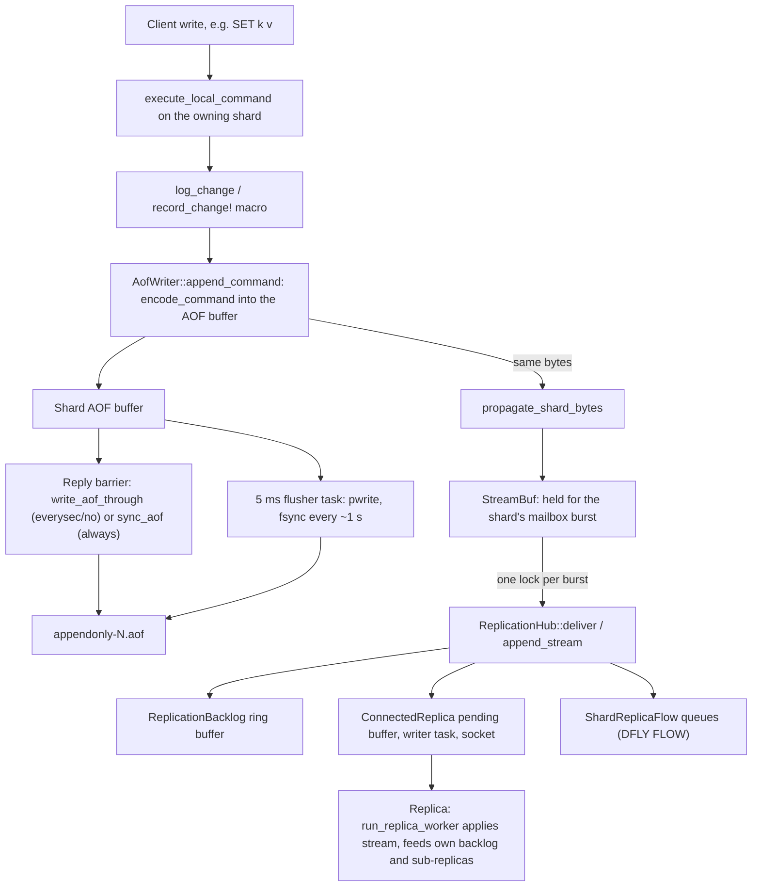
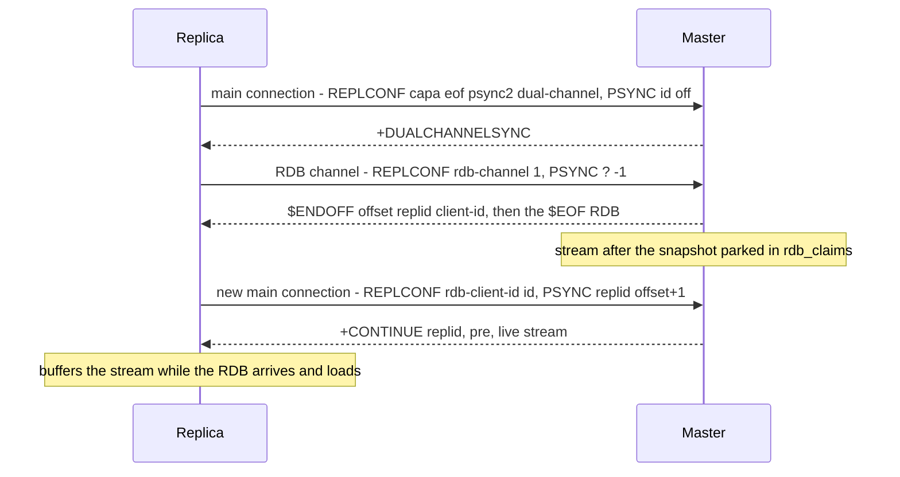
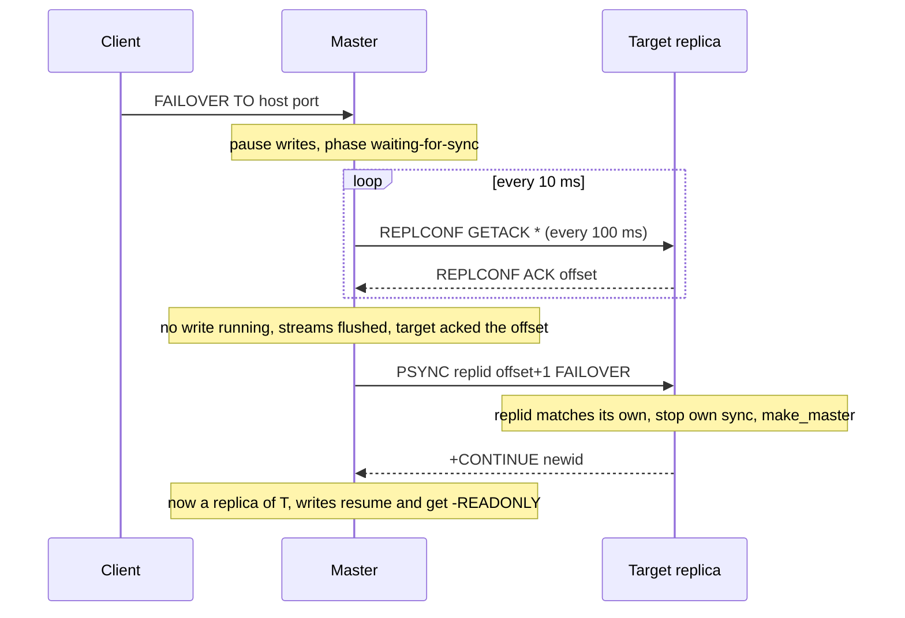

# Component 14: Persistence (AOF, RDB snapshots) & Replication

> **Source files**: `src/aof.rs`, `src/replication.rs`, `src/snapshot.rs`, `src/redis_rdb.rs`,
> `src/shutdown.rs`, plus the pieces of `src/router.rs` (save/rewrite/full-sync orchestration,
> cross-shard write pause, runtime AOF switch), `src/shard.rs` (per-shard RDB serialization,
> point-in-time `AofImage`s), `src/table.rs` (RDB loading entry point, CRC64, legacy format, DUMP
> decoding), `src/connection.rs` (`log_change`, master-side (P)SYNC handlers, `WAIT`, `REPLCONF`,
> `FAILOVER`, `SHUTDOWN`, running-write counter) and `src/server.rs` (startup load, AOF flusher,
> save/rewrite cron, signal loop).
> **High-level design spec**: [`docs/design/14_persistence_replication.md`](../design/14_persistence_replication.md)
> **Consolidated implementation spec**: [`docs/internal/components.md`](components.md)

---

## 1. What this subsystem does

Rudis keeps its whole dataset in memory, split across shard threads. This subsystem makes that data
survive a restart and keeps copies of it on other servers:

- **AOF (append-only file)**: every change is written, as a Redis command, to a per-shard log file
  `appendonly-<shard>.aof`. On restart each shard replays its file. Periodically (or on `BGREWRITEAOF`)
  the log is compacted into a snapshot plus a short tail. AOF can be turned on and off at runtime
  (`CONFIG SET appendonly`).
- **RDB snapshots**: `SAVE`, `BGSAVE`, the `save <secs> <changes>` schedule and shutdown write the whole
  dataset, as of one point in time across all shards, to one file (`dump.rdb` by default) in the
  **Redis/Valkey RDB format**, so the file loads in Redis 7.x / Valkey 8 too. Rudis also loads RDB files
  written by Redis (versions 1–12) and Valkey.
- **Replication**: a server can be a **master** that streams every change to **replicas**, Redis-style
  (`REPLICAOF`, `PSYNC`, PSYNC2 replication ids, partial resync from a backlog, `WAIT`, `WAITAOF`,
  `min-replicas-to-write`, `FAILOVER`, transactions as `MULTI` … `EXEC` blocks). A replica can itself
  serve sub-replicas (chained replication). Full syncs can use a second connection for the RDB
  (dual-channel). A Dragonfly-style per-shard `DFLY FLOW` stream exists on the master side only.
- **Shutdown**: `SHUTDOWN` and `SIGTERM` wait for replicas to catch up, then save, without a second
  shutdown racing the first.

Users: every client write (through the AOF and replication hooks), operators (`SAVE`, `BGSAVE`,
`BGREWRITEAOF`, `CONFIG SET appendonly`, `REPLICAOF`, `FAILOVER`, `SHUTDOWN`, `INFO
persistence/replication`, `ROLE`, `WAIT`), cluster failover (which promotes replicas), and startup.

The single most important idea: **one encoder decides what a change looks like on the wire**.
`aof::encode_command` turns a `Command` into RESP bytes; the AOF and the replication stream both get
exactly those bytes. A change the encoder can't express reaches neither.

---

## 2. Mental model



Three more pictures to keep in mind:

- **Offsets.** The replication stream is one byte sequence per replication *history*. Each byte has an
  offset; `master_repl_offset` is the offset of the last byte. A replica that has applied up to offset
  `N` asks for `N+1`. If the master still has byte `N+1` in its backlog and the history id matches, it
  answers `+CONTINUE` and sends the missing bytes (**partial resync**); otherwise `+FULLRESYNC` and an
  RDB (**full resync**).
- **No fork.** Redis forks a child to get a point-in-time copy for snapshots. Rudis has no fork;
  instead each shard builds a copy-on-write **image** of itself (`shard::AofImage`), a few
  milliseconds at a time between commands. A write to a key the image hasn't reached yet first copies
  the key's old value into the image. SAVE/BGSAVE, AOF rewrites and streamed full syncs all use these
  images; cross-shard writes are held back for the instant all shards start theirs.
- **"Acknowledged" means "in the stream".** Shards hold their replication bytes for one mailbox burst
  and stream them together, but a connection waits until every shard streamed what it held before
  replying to a write, and `WAIT`, `FAILOVER` and shutdown wait for it (and for writes still running)
  before reading the offset.

---

## 3. The write path: from a command to bytes

### 3.1 `encode_command` / `command_to_resp` (aof.rs)

`encode_command(cmd, buf) -> bool` appends the RESP encoding of a changed command to `buf`, or appends
nothing and returns `false` if the command has no encoding. `command_to_resp(cmd)` is the allocating
wrapper (`Option<Vec<u8>>`). Internally `encode_command_inner` is one large `match` over `Command`
variants with an explicit arm for every write it supports and `_ => None` at the end.

The encoder does not always log the command as typed. It rewrites commands whose replay would not
reproduce the same state:

| Command as issued | What is logged | Why |
| :--- | :--- | :--- |
| `SET k v EX 10`, `SET ... PX` | `SET k v PXAT <unix-ms>` | Absolute deadline, so downtime between write and replay doesn't extend the TTL |
| `EXPIRE` / `PEXPIRE` / `EXPIREAT` family | `PEXPIREAT k <unix-ms>` | Same (helper `unix_ms_after`) |
| `INCR`, `DECR`, `INCRBY`, `DECRBY` | The same verb as sent (`IncrName` tracks it) | Matches Redis's stream |
| `SPOP k [n]` | One `SREM k m1 m2 ...` per ≤1024 popped members (issued by the `SPOP` handler) | Popped members are chosen at random |
| `XCLAIM` / `XAUTOCLAIM` | One `XCLAIM` per claimed or dropped entry, `XGROUP CREATECONSUMER`, and `XGROUP SETID` when needed (`connection::stream_claim_propagation`) | Idle-time filters depend on wall-clock time |
| `BRPOPLPUSH` / `BLMOVE` | `RPOPLPUSH` / `LMOVE` | Replicas must not block |
| `CRDT.SET/DEL/INCRBY/SADD/SREM` | `CRDT.MERGE <payload>` of the effect (see §3.4) | HLC timestamps and node ids differ on replay |
| Key expired by the server | `DEL k` (`replication::log_expired_key`) | Replicas and replays never expire keys themselves |
| Hash field expired (`HEXPIRE`) | `HDEL k f...` (`replication::log_expired_fields`) | Same, for fields |
| `HGETDEL` | `HDEL` | Only the deletion matters |

Two fast paths avoid allocations: `AofWriter::append_command` special-cases a plain `SET` without TTL
(`encode_plain_set`), and most arms write straight into the target buffer using `push_len` / `push_bulk`
instead of `format!`.

Families covered (non-exhaustive): strings, bitmaps/`BITFIELD` (read-only bitfields return `None`),
hashes incl. field TTL commands, lists, sets, sorted sets, HyperLogLog, streams incl. consumer-group
state, `COPY`/`MOVE`/`RENAME`/`RESTORE`, `FLUSHDB`/`FLUSHALL`/`SWAPDB`, `FUNCTION LOAD/DELETE/FLUSH/RESTORE`,
`SORT ... STORE`, `*STORE` set/zset ops, geo `*STORE`, `FT.CREATE/ALTER/DROPINDEX`, `JSON.*` writes,
`BF/CF/CMS/TOPK` writes and `*.RESTORE`, vector sets (`VADD`/`VREM`/`VSETATTR`), `SEMANTIC.*`,
`AGENT.*`, `CRDT.MERGE`/`CRDT.GC`.

**Coverage is test-enforced.** A unit test in `aof.rs` walks the write commands and fails when one is
neither encoded nor listed in its `PROPAGATED_ELSEWHERE` / `NOT_PROPAGATED` / `NOT_IMPLEMENTED` tables.
At runtime, a change that can't be encoded calls `aof::note_unpropagated`, which counts it (INFO
persistence `unpropagated_changes`) and logs one warning per command name.

### 3.2 `log_change` and `record_change!` (connection.rs)

Every mutating handler in `execute_local_command` calls the `record_change!` macro after applying its
change. The macro does key invalidation for `WATCH`/client tracking, then calls `log_change`:

1. `need_rep = replication::has_connected_replicas(port)` (a relaxed atomic load when replication was
   never activated; otherwise the hub comes from the thread's `cached_hub`, not the global map).
2. If the shard has an AOF writer: `AofWriter::append_command(cmd)` encodes **directly into the AOF
   buffer** and returns where the bytes start. If `need_rep`, those same bytes
   (`w.buffer()[start..]`) go to `propagate_shard_bytes(port, shard_id, ..)`.
3. Without an AOF but with replicas: `command_to_resp` and propagate.
4. Unencodable → `note_unpropagated` (unless the caller passed `warn = false`).

`replication::log_shard_mutation(port, shard_id, aof, make)` is the equivalent for code outside the
macro (expiry DELs, CRDT effects); `make` builds the command only if there is somewhere to log to. It
must run on the shard that owns the data, right after the change, so the AOF, the stream and full-sync
snapshots all see each shard's changes in apply order.

The AOF writer is reached through the shard's `AofSlot` (§4.2), fetched per use, so turning AOF on or
off at runtime takes effect on the next command.

### 3.3 Holding a shard's bytes for a mailbox burst (`StreamBuf`)

With replicas attached, taking the backlog lock once per write would make eight shards spend most of
their time waiting on each other. So a shard thread holds its replication bytes while it drains its
mailbox, and streams them with one lock at the end:

1. The shard's mailbox loop (`server.rs`) calls `begin_stream_batch(port, shard)` when a burst
   starts and `end_stream_batch()` when the mailbox is empty.
2. Meanwhile `propagate_shard_bytes` → `hold_stream_bytes` appends to the thread-local `StreamBuf`
   and bumps the shard's `StreamProgress.appended` counter. Bytes from another DB than the held ones
   flush first, so each flush carries one DB.
3. `flush_stream_batch()` hands the held bytes to `ReplicationHub::propagate_shard` (with
   `CURRENT_DB` set to their DB) and raises `StreamProgress.flushed`.

Held bytes always go out before anything that could depend on them:

| Before … | Who flushes |
| :--- | :--- |
| any mailbox message other than the plain data ones (`FastGet`, `FastSet`, `Batch`, `Mget`, `Mset`, `ScatterMget`, `ScatterMset`), e.g. a flush, a full-sync cut, a cross-shard step | the mailbox loop |
| `propagate_bytes` (unsharded bytes such as PING, GETACK) | `propagate_bytes` itself |
| a full-sync image arming its cut, a buffered full-sync chunk, a DFLY FLOW snapshot | `stream_full_sync`, `generate_full_rdb`, `run_shard_replication_flow` |
| a cross-shard move's pop (§3.6) | `move_element_from_source` |
| a reply to a batch with writes | `aof_reply_barrier` → `wait_streams_flushed` |
| `WAIT`, `WAITAOF`, `FAILOVER`, a shutdown waiting for replicas, an EXEC's block | `wait_streams_flushed` / `streams_flushed` |

`wait_streams_flushed(port, shards)` snapshots each shard's `appended` and yields until `flushed`
reaches it (usually a few yields). `wait_writes_streamed_blocking` is the variant for threads outside
the runtime (the cluster bus, before a manual failover reads the offset).

### 3.4 Multi-DB: `SELECT` injection

Logged commands don't carry their DB. Both sinks inject `SELECT`:

- `AofWriter` remembers `current_db`; when `connection::CURRENT_DB` differs it first emits
  `*2 SELECT <db>` (`emit_select_db`).
- `ReplicationHub::append_stream` remembers `backlog.stream_db` and prefixes `SELECT <db>` when it
  changes. `usize::MAX` means "unknown", forcing a `SELECT` before the next command (set after full
  syncs, promotions, restored histories and skipped deliveries).

### 3.5 CRDT writes are logged by effect

`CRDT.SET/DEL/INCRBY/SADD/SREM` return `None` from the encoder. Their handler uses
`record_crdt_effect!`, which still runs `record_change!` (for invalidation, with `warn = false`) and then
logs `CRDT.MERGE <payload>` holding only the changed state (the register incl. a delete tombstone, the
whole PN-counter, the added tags, or the tombstoned tags). Merging is idempotent and deterministic, so
replays and replicas reach the master's state. On a replica (which receives every shard on one stream)
`Router::execute_replica_command` re-splits a `CRDT.MERGE` by owning shard (`split_crdt_payload`) and
applies `CRDT.GC <cutoff>` to every shard.

### 3.6 Cross-shard writes in the stream

- **Transactions** reach replicas as one `MULTI` … `EXEC` block (§6.3), as Redis sends them. An EXEC
  with a single write sends that write alone; one that streams nothing sends nothing.
- **Cross-shard `LMOVE` / `RPOPLPUSH` / `SMOVE`** replicate as one logical command, streamed by the
  destination's shard right after its push. The source half runs on the source's shard
  (`ShardMessage::MoveElement` → `move_element_from_source`):
  1. Flush what that shard holds.
  2. Pop with its own propagation suppressed (`SuppressPropagation`).
  3. Send the push to the destination as a shard `Batch` carrying `replicate_as: Some(logical)`: the
     destination applies the push without propagating it, then streams the logical command and
     flushes before answering.
  4. Block the source thread until the destination answered (10 s cap).

  No other write on the source's shard can land between the pop and the logical command, so an
  `RPUSH` racing an `RPOPLPUSH` of the same list reaches replicas on the same side of the move. It
  can't deadlock: a move holds both shards' VLL locks, taken in shard order.
- **Blocked cross-shard `BLMOVE` / `BRPOPLPUSH`**: the source's shard only wakes the client
  (`WaiterOp::Wake`, keeping one element back from the waiters behind it); the client then runs the
  same locked move. If another client took the element first, it blocks again for the rest of its
  timeout.
- `DEBUG CROSS-SHARD-MOVE-DELAY <us>` sleeps between a move's two halves (a test knob).

### 3.7 Experimental families and replay

`JSON.`, `BF.`, `CF.`, `CMS.`, `TOPK.`, `FT.`, `SEMANTIC.`, `CRDT.`, `LLM.`, `MCP.`, `XDP.` commands are
parsed only with `enable-experimental-commands` on (`resp::is_experimental_command_name`); otherwise the
parser returns `Command::Unknown`. AOF replay treats an unknown command as a fatal error ("Unknown
command '...' reading the append only file"), so **an AOF containing logged experimental writes does not
load if the server restarts with the flag off.**

---

## 4. The AOF

### 4.1 Files and layout

- One file per shard: `<dir>/appendonly-<shard>.aof`. A shard replays only its own file.
- `appendonly.shards` (`AOF_SHARDS_MANIFEST`) records the shard count and routing (`hash` for standalone
  key hashing, `slots` for cluster CRC16 slots), plus `ext_crc` after importing Redis AOF files.
- A file is either pure RESP commands, or — after any rewrite — an **RDB preamble** (a full Redis-format
  RDB image incl. `OP_EOF` and CRC64) followed by a RESP tail. Replay detects the preamble by the
  `REDIS` magic. This matches Redis's `aof-use-rdb-preamble yes` (rudis always writes preambles; the
  directive is ignored).
- While AOF is being turned on at runtime (§4.7) a shard appends to `appendonly-<shard>.aof.incr`
  instead; startup never loads that file.

### 4.2 `AofWriter` and `AofSlot` (aof.rs)

```rust
pub struct AofWriter {
    buffer: Vec<u8>,                 // appended, not yet handed to the kernel
    spare_buffer: Option<Vec<u8>>,   // recycled flush buffer (kept if <= 4 MB)
    file: Option<Rc<monoio::fs::File>>,
    path: PathBuf,
    offset: u64,                     // file offset of buffer[0]
    current_db: usize,               // DB the file's tail is in (for SELECT injection)
    inflight: usize,                 // chunks taken by take_flush_chunk, write not finished
    durable: u64,                    // everything before this offset is fsynced
    appended_total: u64,             // monotonic byte count, survives rewrites
    progress: Arc<AofProgress>,      // shared with connections
    incr_path: Option<PathBuf>,      // AOF turned on at runtime: the file actually written
}
```

`AofProgress { appended, written, fsynced, write_error }` is published per `(port, shard)`
(`aof_progress`), so a connection on any thread can tell whether a shard's appended bytes reached the
kernel (`written`) or the disk (`fsynced`, for `WAITAOF`).

**`AofSlot`** is `Rc<RefCell<Option<Rc<RefCell<AofWriter>>>>>`: one per shard, shared by everything on
the shard that appends (its router and every clone of it, the mailbox loop, the expiry log, the
flusher). `get()` returns the writer now (None with AOF off), `set()` swaps it, and `holds(w)` tells a
flusher whether its writer is still the one in the slot.

Key operations:

| Method | What it does |
| :--- | :--- |
| `open(path)` | Creates dir and file, resumes at the current file length |
| `open_incremental(target, incr)` | A writer that appends to a fresh `incr` file while its `path` is `target` (§4.7) |
| `append` / `append_command` | Adds bytes (after a `SELECT` if needed), bumps `appended_total` and `AOF_APPENDS` (only while some server runs `appendfsync always`) |
| `write_pending_sync` | Blocking `pwrite` of the whole buffer at `offset` when nothing is in flight; on error the buffer stays for a retry |
| `take_flush_chunk` / `chunk_written` | Hands the buffer out for an async `write_all_at`; a failed chunk is put back in front of the buffer so it is retried, not dropped |
| `write_through(aof)` | Group commit to the kernel (no fsync): returns once `progress.written >= appended_total` as of the call |
| `sync_durable(aof)` | Group commit with `sync_data`: returns at once if an earlier fsync already covered the target offset; marks what it covered as fsynced |
| `written_total` / `mark_fsynced(upto)` | What an fsync started now covers; record it (`fsynced` never goes back) |
| `swap_after_rewrite` / `swap_after_live_rewrite` | Re-points the writer at a freshly renamed file, marks everything fsynced, deletes the `.incr` file if any |

### 4.3 When AOF bytes hit the disk (`appendfsync`)

`appendfsync` accepts `always`, `everysec` (default) and `no`, at startup and via `CONFIG SET`
(`aof::set_appendfsync`). Flags are per port: `fsync_every_sec_flag(port)` and `fsync_always_flag(port)`;
the process-wide `APPENDFSYNC_ALWAYS_ANY` keeps the hot path to one relaxed load when nobody uses
`always`.

1. **Every write, before the reply** (`connection::aof_reply_barrier`, per command batch):
   - `everysec` / `no`: if the batch wrote, `Router::write_aof_through` makes every shard's appended
     bytes reach the kernel before replying. Its own shard writes directly; other shards normally write
     when their mailbox empties, so it yields for up to ~50 µs and then sends `ShardMessage::WriteAof`
     to stragglers. Effect: a process crash (`kill -9`) loses no acknowledged write; only an OS crash can
     lose up to ~1 s.
   - `always`: if `AOF_APPENDS` moved during the batch, `Router::sync_aof` fsyncs every shard's AOF
     (`ShardMessage::SyncAof`, `sync_durable`) before replying.
   - Then, with replicas attached, `wait_streams_flushed` (§3.3).
2. **Background flusher** (`server::spawn_aof_flusher`, one task per writer, running while
   `slot.holds(writer)`): wakes every **5 ms**; outside `always` it does `write_pending_sync`, otherwise
   an async chunk write. Every **200th** tick (~1 s) it runs `everysec_fsync` if the everysec flag is
   set: `sync_data`, then `mark_fsynced(written_total at the start)`. Under `no`, rudis never fsyncs
   on its own.

**Write errors** (e.g. `ENOSPC`) set `AofProgress::write_error`; while any shard of the server is in
error, `aof_write_misconf` makes write commands fail with `-MISCONF Errors writing to the AOF file: ...`
(checked in `connection::persistence_misconf`). The first successful write clears it and logs "AOF
write error looks solved".

### 4.4 Replay at startup (`replay_aof`)

`server::run_shard_worker` replays `appendonly-<shard>.aof` when `appendonly yes` (and then does **not**
load the RDB — the AOF is authoritative, as in Redis). `replay_aof_inner`:

1. Maps the file read-only (`aof::MappedFile`, `mmap` + `MADV_SEQUENTIAL`) instead of reading it into a
   heap buffer — page cache isn't counted against `maxmemory` and is reclaimable.
2. Sets `connection::ReplayingWrites` so nothing expires during the load.
3. If the file starts with `REDIS`, loads the preamble with `redis_rdb::load_rdb_preamble` (keeping keys
   whose deadline already passed, so a later `PERSIST` in the tail still finds them) and rebuilds search
   indexes.
4. Parses the tail **8 MB at a time** (`TAIL_CHUNK`) with `resp::parse_command_trusted` (which ignores
   `proto-max-bulk-len`: the file holds data accepted earlier, maybe under a higher limit). Skips
   `#TS:` annotations from Redis 7. Anything not starting with `*` is corruption.
5. `MULTI`…`EXEC` blocks are queued and applied at `EXEC`; `DISCARD` drops them.
6. Each command goes through `apply_aof_command`: `EVAL`/`EVALSHA` (as old Redis AOFs log them) run the
   script; everything else runs through `execute_local_command` with no AOF (nothing is re-logged).
7. Errors: an incomplete last command or an unfinished `MULTI` at EOF is truncated away (file
   `set_len`) when `aof-load-truncated yes` (default), else an error. A malformed command in the middle,
   or an unknown command, is always an error → the server refuses to start.
8. Finally `allocator::flush_thread_cache` returns the replay's freed buffers.

### 4.5 Resharding and importing Redis AOFs (`reshard_aof_dir`)

Called once from `main.rs` before the shards start:

1. Removes temp files of interrupted rewrites (`appendonly-*.aof.tmp.*`).
2. If `appendonly.reshard-in-progress` (`AOF_RESHARD_MARKER`) exists, a previous swap was interrupted:
   refuse to start, naming the backup dir to restore from.
3. **Redis AOF import**: if a Redis 7 multi-part manifest (`appendonlydir/appendonly.aof.manifest` or
   `appendonly.aof.manifest`) or a single `appendonly.aof` is present and its CRC differs from the
   recorded `ext_crc`, replay those files (base, then incrementals in `seq` order; only the newest may
   be truncated) into one in-memory `ShardDb`, write canonical commands, split them by owner shard, and
   swap them in. Refuses if non-empty rudis files exist that weren't imported from them.
4. **Shard-count change** (e.g. restarting with a different `--threads`, or switching cluster mode):
   replay every old file into one `ShardDb`, `rewrite_shard_aof_canonical`, split by owner
   (`split_rewritten_aof_to_shards`; `FT.CREATE` goes to every shard), and swap.
5. `swap_in_staged_aof`: write the marker, move old files into a backup dir
   (`aof-reshard-backup-<old>to<new>-<ms>` or `aof-import-backup-<ms>`), move staged files in, write the
   manifest last, delete the marker.

Canonical form (`write_canonical_aof`) is one command per key or structure: search index definitions
first, then per-DB key writes (`SET ... PXAT`, `HSET`, `RPUSH`, `SADD`, `ZADD`, `XADD` + group state,
...), then JSON, vector sets, semantic caches, agent memory/checkpoints/tools, `*.RESTORE` for
probabilistic structures, and one `CRDT.MERGE` per CRDT item. It exists because RDB preambles can't be
split by key owner; normal rewrites don't use it.

### 4.6 AOF rewrite (`BGREWRITEAOF`, automatic)

**Trigger.** `Router::bgrewriteaof` takes the server-wide save lock (`is_saving`, a `compare_exchange`;
shared with `SAVE`/`BGSAVE`), marks `AofRewriteState::begin` before replying, and spawns
`perform_rewrite_aof`. The cron in `server.rs` (every 100 ms, on shard 0) starts one automatically once
a second when `auto_rewrite_due(percentage, min_size, current, base)` says so: total AOF size >
`auto-aof-rewrite-min-size` (default 64 MB) and grown by ≥ `auto-aof-rewrite-percentage` (default 100%)
over the size after the last rewrite. After 3 consecutive failures, automatic rewrites back off: 60 s,
doubling per further failure, capped at 1 h (`aof_rewrite_retry_delay_secs`). Manual rewrites are never
delayed.

**Order.** `rewrite_all_shard_aofs` first `sync_aof()`s, rewrites the local shard, then sends
`ShardMessage::RewriteAof` to the other shards **one at a time** to avoid concurrent I/O and memory
spikes. On success the new total size becomes the growth base.

**Per shard: `rewrite_shard_aof_live`** — a forkless incremental rewrite:

1. **Start (synchronous).** Build an `AofImage` (a point-in-time RDB image of the shard, built lazily),
   install it on the thread (`ImageOwner::AofRewrite`), and record a `RewriteMark { file_pos, logical,
   db }`: where in the old AOF the tail after this instant starts.
2. **Build.** Loop: `img.step(db, RDB_SAVE_STEP /*1 ms*/, IMAGE_FLUSH_BYTES /*4 MB*/)` serializes a few
   table segments, sends finished pieces to an `aof-rewrite` thread (`spawn_image_writer`, which writes
   to `appendonly-<n>.aof.tmp.<pid>_live<k>`, computes the CRC64 and fsyncs), then yields to the shard's
   other work. (`rdb-key-save-delay`, a test knob, sleeps after each step, in ≤10 ms slices so a test
   can lower it to let a slowed rewrite finish.)
3. **Staying point-in-time.** While any image is installed, every command first calls
   `aof_image_before_command` → `shard::before_write` (§5.2). `SWAPDB` doesn't break the image: each
   per-DB walk remembers both the DB its keys were in at the start (what the file says) and where that
   table is now, which `shard::images_swap_dbs` updates on every shard. Only a full resync replacing
   the dataset calls `poison_aof_image`, and the rewrite falls back to one blocking pass
   (`rewrite_and_swap_shard_aof`, counted in `LIVE_REWRITE_FALLBACKS`).
4. **Catch up** (`catch_up_and_swap`). Re-open the live AOF through `/proc/self/fd/<fd>`, emit a
   `SELECT` if the mark's DB isn't 0, then copy what the old file received since the mark, 4 MB
   (`TAIL_COPY_BYTES`) per step between commands, until less than 1 MB (`TAIL_SYNC_BYTES`) remains.
5. **Switch (synchronous).** With no chunk in flight: write the writer's pending buffer, copy the last
   bytes, fsync, `rename` over `appendonly-<n>.aof`, fsync the directory (`sync_parent_dir`), and
   `swap_after_live_rewrite`. No command runs in between, so no write is lost or doubled.

The resulting file = RDB image of the shard at the start + every command logged since. The image holds
everything a snapshot holds, function libraries included.

The blocking variant `rewrite_shard_aof` (used for fallbacks and right after a replica loads a full
sync) writes the same image in one pass, via `write_rewritten_aof` and `ImageFileWriter`
(1 MB `BufWriter` + running CRC64).

**Example.** A shard holds `a=1`. Rewrite starts (mark at file offset 1000). A client runs
`APPEND a x` before the walk reaches `a`: `before_write` writes `a=1` into the image first, then
`APPEND a x` is logged to the old file at offset 1000+. Catch-up copies that `APPEND` after the image.
Replay: load `a=1`, apply `APPEND a x` → `a=1x`, the same as memory.

### 4.7 Turning AOF on and off at runtime (`CONFIG SET appendonly`)

`CONFIG SET appendonly yes|no` applies the other pairs first, then calls `Router::enable_aof` or
`Router::disable_aof`; a failure turns the reply into `-ERR CONFIG SET failed (possibly related to
argument 'appendonly') - ...`. `aof::set_aof_on(port, on)` records the state for `CONFIG REWRITE`.

**On** (`enable_aof`):

1. On every shard (`set_appendonly_everywhere`: a local call, `ShardMessage::SetAppendonly` to the
   others, each running `server::set_shard_appendonly`): delete the stale
   `appendonly-<n>.aof`, open a writer with `AofWriter::open_incremental(target, "<target>.incr")`, put
   it in the shard's `AofSlot` and start its flusher. From this moment every write is logged, into the
   `.incr` file. If any shard fails, all are turned off again.
2. `aof::set_aof_enabling(port, true)`, then a background task waits for `is_saving` (a running save or
   rewrite finishes first) and runs `perform_rewrite_aof`: the live rewrite of §4.6 treats the `.incr`
   file as "the old AOF", so the result is the dataset plus everything logged since, renamed into
   `appendonly-<n>.aof`; the swap deletes the `.incr` file.
3. `set_aof_enabling(port, false)`. If the rewrite failed, AOF is turned off again (logged "Writing the
   initial AOF failed ...").

While `aof_enabling` is set, `SHUTDOWN` refuses without `FORCE` and `SIGTERM` is ignored ("Writing
initial AOF, can't exit."), because the files on disk don't hold the dataset yet. A crash meanwhile
leaves no `appendonly-<n>.aof` at all rather than one missing the dataset.

**Off** (`disable_aof`): clear the enabling flag, then on every shard take the writer out of the slot
first (nothing appends any more; a `WAITAOF` waiting for the local copy fails with Redis's error), and
`write_through` + `sync_durable` what it holds. An initial rewrite still running finishes but is not
used.

---

## 5. RDB snapshots

### 5.1 Format (`redis_rdb.rs`)

Rudis writes **RDB version 11** (`RDB_VERSION`, Redis 7.0–7.2 / Valkey 7.2–8.1) and reads versions 1–12
(`MAX_RDB_VERSION`). A file:

```
"REDIS0011"
AUX redis-ver=7.2.4, redis-bits=64, ctime, used-mem, aof-base=0, rudis-ver   (write_file_header)
OP_FUNCTION2 <library code> ...                                              (function libraries)
SELECTDB 0
[RESIZEDB per DB]                                    (SAVE/BGSAVE only)
records: [OP_EXPIRETIME_MS <u64 ms>] <type byte> <key> <value> ...
AUX "rudis-ext" <legacy-format records>              (state Redis can't encode)
[SELECTDB n ... records for DBs 1..n] [SELECTDB 0]
AUX repl-stream-db, repl-id, repl-offset             (write_repl_aux, when known)
OP_EOF (0xFF), CRC64 (u64 LE)
```

Values use plain (non-compact) Redis types: strings as `RDB_TYPE_STRING` (integer-encoded when they fit
32 bits, never LZF-compressed), lists `TYPE_LIST`, sets `TYPE_SET`, sorted sets `TYPE_ZSET_2`, hashes
`TYPE_HASH`, HyperLogLogs as dense `HYLL` strings, streams as `TYPE_STREAM_LISTPACKS_3` (incl. groups,
PEL, consumers). On read, all compact encodings (ziplist, listpack, intset, zipmap, quicklist, LZF
strings, Redis 7.4 hash-field-TTL types) are decoded; module data (`OP_MODULE_AUX`, module types) is
rejected.

**Integrity checks on read** (RDB loads and `RESTORE`), as Redis's integrity checks do:

| Encoding | Refused when |
| :--- | :--- |
| ziplist (`ziplist_elems`) | entry count (unless 0xFFFF), tail offset, or any entry's prevlen doesn't match the entries; an entry starts with the end marker |
| listpack (`listpack_elems`) | entry count (unless 0xFFFF) or any entry's backlen doesn't match |
| quicklist | a node is empty |
| hash field TTLs | a TTL beyond `EB_EXPIRE_TIME_MAX` (2^48−1), or listpack-ex fields out of Redis's order (ascending TTL, fields without one last) |

`table::decode_dump_payload` tries the Redis format first; a payload that fails there is taken for the
legacy rudis DUMP format only if that decoder consumes every byte. Otherwise it logs "DUMP payload
integrity check failed: <reason>" and `RESTORE` answers `-ERR Bad data format`.

**`rudis-ext` AUX field.** State with no Redis encoding is written as rudis **legacy-format records**
(`[u32 LE key len][key][type byte][payload]`) inside an AUX field named `rudis-ext` (`EXT_AUX_KEY`).
Redis/Valkey skip unknown AUX fields, so the file still loads there (without that state).

| Legacy type byte | Contents | Source |
| :-: | :--- | :--- |
| 7 | JSON document (serialized text) | `json_store` |
| 8 / 10 / 11 / 12 | Bloom / Cuckoo / Count-Min Sketch / Top-K | `probabilistic_store` |
| 9 | Vector-set node (index, metric, raw f32 vector, flags, quantization, M, attributes) | `vector_indexes` |
| 13 | CRDT state of the whole shard, under key `__rudis_crdt_sync__` | `crdt_store.export_sync_payload()` |
| 14 | Hash field deadlines (incl. already-passed ones) | `hash_field_expires` |
| 15 | Semantic cache (dim, counters, entries with vectors) | `semantic_caches` |
| 16 / 17 / 18 | Agent memory session / checkpoint thread / tool-call registry | `agent_memories`, `agent_checkpoints`, `agent_tools` |
| 19 | Stream IDMP / XNACK state (`EXT_TYPE_STREAM_EXTRAS`) | streams with `stream_has_extras` |
| 20 | Search index definition as its canonical `FT.CREATE` (`EXT_TYPE_SEARCH_INDEX`) | `search_indices` |
| 21 | LLM quota bucket | `llm_quotas` |

Search-indexed documents are ordinary keys; indexes are rebuilt after the load
(`rebuild_search_indices`). Loading tag 13 merges only the keys the loading shard owns.

`DUMP` payloads use the same value encoding plus the RDB version and CRC64 (`dump_value`); streams with
extras are dumped in the legacy format so cross-shard moves keep that state.

### 5.2 Per-shard serialization and images (shard.rs)

Two ways to serialize a shard:

- **`ShardDb::save_rdb_chunk(buf)`** writes one shard's records in one pass, **without** file header
  or EOF: DB 0's entries, then `save_extended_rdb_chunk` (the `rudis-ext` field), then other DBs after
  their `SELECTDB`. Used only by the buffered full sync (§6.4).
- **`AofImage`** — a point-in-time image built a step at a time. A shard thread can build several at
  once, each tagged with an `ImageOwner`: `AofRewrite`, `FullSync(replica_id)` or `Save` (one at a
  time, `is_saving`). `start` writes a whole file (header and `OP_EOF`, for rewrites); `start_chunk`
  writes a shard's part of a multi-shard RDB (SAVE, streamed full syncs).

`AofImage` in brief:

| Field | Meaning |
| :--- | :--- |
| `walks: Vec<DbWalk>` | One walk per DB that had keys at the start: `db_idx` (DB written in the file), `src` (where that table is now, moved by SWAPDB), `epoch`, `seg`, `written: WrittenPatterns`, `skip` (keys written early) |
| `ext_pending` / `ext_keys` / `ext_done` | Large extended structures (JSON, probabilistic, vectors) written one per step, or early on first write |
| `deferred_dbs` / `deferred_ext` | Hash field deadlines of DBs ≠ 0 and the small extended state, captured at the start and written last |
| `poisoned` | Why the image is unusable (an unreadable tiered value, a full resync replacing the dataset) |
| `chunk`, `spare`, `held` | Chunk mode; a recycled piece buffer; this image's share of `SYNC_IMAGE_BYTES` |

**The write hook.** `shard::before_write(db, key)` (a single thread-local flag test when no image is
active) runs before any command may change `key`: for every image on the thread, if the walk hasn't
covered the key's segment and hasn't skipped it, write the key's current state into the image, then
add the key to `skip` (also when absent: a key created later isn't in the image). Variants:
`before_write_in` (another DB: `MOVE`, `COPY ... DB`), `before_write_table` (only a table at hand:
serving a blocked client, evicting a key). The hook runs from `execute_local_command`, shard batches'
fast paths, pipelined fast paths, MSET's local part, the `Mset`/`ScatterMset`/`FastSet`/`Del`/
`DelKeys`/`Expire`/`Persist`/`Delex` messages and eviction. A key moved by a segment split is written
once (`WrittenPatterns` skips already covered segments); a renumbered table (FLUSHDB) has its
remaining keys written in one step.

Other details:

- **Tiered values** (spilled to NVMe, `RudisValue::Tiered`) are read back with `hydrate_tiered` and
  written in their real type. If the read fails, the save **fails** (`TieredReadError`); keys are never
  silently dropped. After a restore they are ordinary hot keys.
- **Expired keys** are skipped unless `replication::snapshots_keep_expired(port)` (a master with an
  active backlog keeps them, because their `DEL` may not have been propagated yet; the load then drops
  them and `propagate_expired_on_load` feeds the `DEL`s into the backlog).
- **`SYNC_IMAGE_BYTES`**: full-sync images' buffers, pieces in flight and replica output buffers are
  left out of `maxmemory`, like Redis's replication buffers.
- `RudisTable::save_rdb_chunk` / `restore_rdb_chunk` in `table.rs` are the old legacy-format codec,
  kept for loading old files and exercised only by tests.

### 5.3 SAVE, BGSAVE, the `save` schedule

`SAVE` (`Router::save_rdb`), `BGSAVE` (`Router::bgsave`, spawned), the schedule and shutdown all take
`is_saving` (a `compare_exchange`; a second one gets "Background save already in progress"), call
`SnapshotState::begin` (returns the change count it will cover), `sync_aof()`, and then
`Router::perform_save_rdb(dirty_before)`:

1. `write_rdb_file`: spawn an `rdb-writer` thread that receives pieces through a **rendezvous channel**
   (`flume::bounded(0)`), writes them through a 1 MB `BufWriter` to `temp-<pid>-<n>.rdb`, keeps a
   running CRC64, appends `OP_EOF` + CRC, fsyncs, renames over `dbfilename` (default `dump.rdb`), and
   fsyncs the directory. CRC and disk I/O stay off the shard threads.
2. `produce_rdb_chunks`: send `RESIZEDB` hints, then **start every shard's image at one point**
   (`start_save_images`):
   1. On a replica, take the apply token (`lock_apply`, §6.6), so no batch of the master's stream
      applies meanwhile.
   2. Read `saved_history()`.
   3. `Router::pause_cross_shard_writes()`: drain lock-free MSETs (later ones take the locks) and take
      every shard's VLL lock, which EXEC, MSETNX and cross-shard key/element moves hold while they
      write. Single-key commands keep running.
   4. `shard::start_save_image` locally and `ShardMessage::StartSaveImage` on every other shard.
   5. Release the pause, read `saved_history()` again, release the apply token. The history goes in
      the file only if both reads match.
3. Stream the images **one shard after another**: `save_image_step` locally (then yield) or
   `ShardMessage::SaveImageStep`, each returning ~1 ms of work / ≤1 MB, until the shard reports done
   (its image is removed with the last piece). Shards never interleave.
4. Append the replication AUX fields if the history matched; send the terminator.
5. Clear `is_saving`, then `SnapshotState::finish(dirty_before, ok)`.

`FLUSHALL` during a save sets `connection::RDB_BGSAVE_ABORTED`; the save fails with "save aborted by
FLUSHALL". A failed or abandoned save removes every shard's image (`SaveImagesGuard`).

**Consistency.** The file holds every shard as of the moment the images started: a write spanning
shards (`MULTI`/`EXEC`, `MSET`, `LMOVE`, `RENAME`) is in it whole or not at all, as with Redis's forked
child. Keys evicted during the save are in the file (eviction runs the write hook). A key deleted on
expiry during the save is not; loading would drop it anyway, and with a replication history its `DEL`
is in the stream after the save's offset. A `SWAPDB` during the save leaves each table's keys under the
DB they were in at the start.

**Example (two shards).** `MSET a 1 b 1` spans shard 0 (`a`) and shard 1 (`b`). A BGSAVE pauses
cross-shard writes, both shards start images, the pause lifts. Now `MSET a 2 b 2` runs: before writing
`a` on shard 0 the hook copies `a=1` into shard 0's image; likewise `b=1` on shard 1. The file says
`a=1, b=1`, a state that existed; never `a=2, b=1`.

**`snapshot.rs` bookkeeping** (keyed by base port):

| Item | Meaning |
| :--- | :--- |
| `SnapshotState` | `last_save_unix`, `last_attempt_unix`, `dirty_at_last_save`, `last_save_ok`, `in_progress` (LASTSAVE, INFO) |
| `note_write` / `note_changes(n)` | Change counter, sharded over 256 cache-line-aligned slots (`WRITES`) so shards don't contend |
| `save_due(points, now)` | `save_point_reached`: some point has ≥`changes` writes and ≥`secs` since the last success; after a failure wait `SAVE_RETRY_DELAY_SECS` (5 s) |
| `any_save_failing` / `SAVES_FAILING` | Drives `stop-writes-on-bgsave-error`: with save points set, writes get `-MISCONF ... unable to persist to disk`. `failing_change(was_ok, ok)` counts each server once |
| `AofRewriteState` | Rewrite in-progress/last status, count, consecutive failures, `base_size` |

**Save points.** `config::DEFAULT_SAVE_POINTS` is Redis's `save 3600 1 300 100 60 10000`; the config
file's first `save` line replaces them, later lines add to them, and `save ""` turns autosave off. The
cron in `server.rs` checks every 100 ms on shard 0 (skipping while a save or rewrite runs, and calling
`release_idle_backlog` every 10th tick, §6.2) and calls `bgsave()` when `save_due`. Save points also
make `SHUTDOWN`/`SIGTERM` save before exiting (§7).

### 5.4 Loading an RDB

- **Startup** (`server.rs`, only when AOF is off): every shard maps the same file
  (`table::load_rdb` → `load_rdb_bytes`) and keeps only the keys it owns (`LoadCtx::owns`). Shard 0
  loads function libraries and, if `repl-id`/`repl-offset` AUX fields are present, calls
  `ReplicationHub::restore_saved_history` (§6.7).
- **Format detection** (`redis_rdb::classify`): a file starting `REDIS0011` + `SELECTDB 0` with no AUX
  fields is *ambiguous* (Redis format, or an older rudis legacy file). It is loaded as Redis format in
  strict mode (empty keys/collections are errors) and, on failure, flushed and loaded as legacy format.
- CRC64 is verified (a stored 0 means "no checksum"); data after `OP_EOF` is an error; keys in a DB ≥
  `databases` are an error.
- Already-expired keys are dropped and recorded with their DB (`record_expired_on_load`,
  `take_expired_on_load() -> Vec<(db, key)>`) for INFO and `propagate_expired_on_load`, which streams
  each `DEL` under its key's DB.

---

## 6. Replication

### 6.1 Core types (replication.rs)

```rust
pub enum ReplicationRole {
    Master,
    Slave { master_host: String, master_port: u16,
            link_status: String /* "up" | "down" */, sync_in_progress: bool },
}
pub struct ReplIds {
    pub replid: String,       // current history id (a replica's == its master's)
    pub replid2: String,      // previous history, NULL_REPLID ("000...0") if none
    pub second_offset: i64,   // first offset replid2 does NOT cover, -1 if none
}
```

Replication ids are 40 hex chars from `new_replid()` (fxhash of time, a sequence number and the pid —
unique, not cryptographic). The id and offset are **not** part of the role: masters and replicas both
have a history (PSYNC2), and a replica adopts its master's.

`ReplicationHub` — one per server (`get_replication_hub(port)`; per-write paths use
`cached_hub(port)`, a thread-local `&'static` that skips the global map), the important fields:

| Field | Type | Meaning |
| :--- | :--- | :--- |
| `role` | `RwLock<ReplicationRole>` | Master or replica of `host:port` |
| `ids` | `RwLock<ReplIds>` | History ids; changed only under the backlog lock |
| `master_repl_offset` | `AtomicU64` | Offset of the last stream byte |
| `backlog` | `RwLock<ReplicationBacklog>` | Ring buffer; **its write lock orders everything** |
| `replicas` | `RwLock<HashMap<u64, Arc<ConnectedReplica>>>` | PSYNC/SYNC replicas by client id |
| `shard_flows` | `RwLock<HashMap<usize, HashMap<u64, Arc<ShardReplicaFlow>>>>` | DFLY FLOW sessions |
| `is_slave_atomic`, `has_replicas`, `backlog_active`, `replication_active`, `has_shard_flows` | `AtomicBool` | Hot-path flags; `replication_active` is what INFO shows as `repl_backlog_active` |
| `cached_master` | `AtomicBool` | "We hold a history we can ask to continue" (Redis's cached master) |
| `psync_holes` | `Mutex<Vec<(u64,u64)>>` | Offset ranges where partial resync would be wrong (§6.4) |
| `apply_token` | bounded(1) channel | Held while a replica applies a read, or while a snapshot starts on a replica (§6.6) |
| `replica_batches_in_flight` | `AtomicUsize` | Replicated batches sent to shards and not applied yet |
| `tx_stream_token` | bounded(1) channel | Held by an EXEC while its `MULTI` … `EXEC` block is open (§6.3) |
| `cancel_sync`, `sync_conn`, `worker_exit` | — | Stop/interrupt/await the replica worker |
| `loading` | `AtomicBool` | Loading a full sync: data commands get `-LOADING` (`is_loading`) |
| `pending_peers` | `Mutex<HashMap<u64, PendingPeer>>` | `REPLCONF` details seen before PSYNC (port, ip, `capa eof`, `capa dual-channel`, `rdb-channel`, `rdb-client-id`); capped at 4096 |
| `rdb_claims` | `Mutex<HashMap<u64, RdbChannelClaim>>` | Dual-channel streams waiting for the replica's main connection (§6.4) |
| `no_replicas_since`, `restart_grace` | `AtomicU64`, `AtomicBool` | Start of the backlog TTL countdown; shorter grace after a restart (§6.2) |
| `replica_selected_db` | `AtomicUsize` | DB of the incoming stream (kept across `+CONTINUE`) |
| `link_phase` | `AtomicU8` | `LINK_CONNECTING` / `LINK_HANDSHAKE` / `LINK_SYNC` while the link is not up (ROLE) |
| `failover`, `failover_in_progress` | `Mutex<Failover>`, `AtomicBool` | The `FAILOVER` under way (§6.10) |
| `pinger_running` | `AtomicBool` | The PING/timeout task runs |
| `replica_priority`, `announce_ip`, `announce_port`, `last_master_io_secs` | — | `replica-priority`, `replica-announce-*`, INFO |

Process-wide switches: `HAS_ACTIVE_REPLICATION` (false until a replica, a flow or a history activates
replication — then `propagate_*_bytes` is a single relaxed load), `HAS_SLAVE_INSTANCE` (some server
in the process is a replica), and the thread-local `PROPAGATION_SUPPRESSED` (`SuppressPropagation`
guard, used by `DEBUG LOADAOF` and the source half of a cross-shard move).

### 6.2 The backlog (`ReplicationBacklog`)

| Field | Meaning |
| :--- | :--- |
| `buffer` | Ring storage; grows on demand up to `max_size` before wrapping |
| `write_idx` | Next write position |
| `len` | Bytes retained (≤ `max_size`) |
| `max_size` | `repl-backlog-size`, default 1 MB, minimum 16 KB; `set_repl_backlog_size` resizes live keeping the newest history |
| `first_byte_offset` | Offset of the oldest retained byte |
| `stream_db` | DB the stream last `SELECT`ed (`usize::MAX` = unknown) |
| `tx_block` | `TxBlockState::{None, Pending, Open}` of an EXEC's block (§6.3) |

`can_partial_sync(target, current)` is true when `target <= current+1` and either the backlog is empty
and `target == current+1`, or `target >= first_byte_offset`. `get_diff` copies `current+1-target` bytes
out of the ring.

The backlog is fed even with no replica connected, so a replica that reconnects within the window
resyncs partially. It is released when unused, as Redis's replication cron does:

- `repl-backlog-ttl` (`REPL_BACKLOG_TTL`, default 3600 s, 0 = never) counts from `no_replicas_since`
  (the last replica leaving, or a promotion).
- After a restart that restored a saved history (§6.7) the window is
  `min(repl-backlog-ttl, RESTART_BACKLOG_GRACE_SECS = 60)` (`restart_grace`), cleared as soon as a
  replica registers.
- `release_idle_backlog` (about once a second from the save cron): on a master with no replica and no
  flow past that window, take a new replication id, drop `replid2`, clear the backlog and set
  `replication_active = false`, so writes stop paying for appends ("Replication backlog freed after N
  seconds without connected replicas."). A replica coming later full-syncs.
- `expire_idle_backlog` applies the same rule when a partial resync is attempted.

### 6.3 Delivering a change (`deliver` / `append_stream`)

`propagate(bytes)` / `propagate_shard(shard, bytes)` → `deliver` (shard bytes usually arrive here from
`flush_stream_batch`, §3.3):

1. Return unless this server is a master (replicas never forward their own writes).
2. `append_stream(shard, bytes, from_master=false)` under the **backlog write lock**:
   1. Re-check the role (role switches take the same lock).
   2. If an EXEC's block is `Pending` (and the bytes aren't a PING), emit `MULTI` first and mark it
      `Open`.
   3. Prefix `SELECT` if the command's DB ≠ `stream_db` (not for `PING` or an explicit `SELECT`).
   4. `append_locked`: if `backlog_active` (or `from_master`), `master_repl_offset += len` and append to
      the backlog. For each replica, by its `delivery(shard)`: `Send` → `append_pending` (its output
      buffer); `Buffer` → `append_pre` (full-sync cut, §6.4); `Skip` → nothing (and `stream_db` becomes
      unknown).
3. After releasing the lock: wake each replica's writer task (a data-less message on `sender`; wakeups
   coalesce through `wake_queued`), drop the link of overflowed replicas, remove dead ones.
4. DFLY flows of that shard (or all, for `propagate`) get `try_send` on a bounded(4096) queue; a full
   queue drops the flow's socket instead of blocking the shard.

Because offset, backlog and every replica buffer are updated under one lock, every replica and the
backlog see the same byte order — an offset names the same byte for all of them.

**Transactions as blocks (`TxStreamBlock`).** An EXEC whose queue has more than one write, while
replication is active, opens a block after taking its VLL locks:

1. `open`: take `tx_stream_token` (blocks never nest; the holder only waits for shards to stream, so it
   can't deadlock), `wait_streams_flushed` (earlier held writes go out before the block), then set
   `tx_block = Pending`.
2. The transaction's writes are streamed by their shards as usual; the first byte to reach
   `append_stream` emits `MULTI` ahead of it (and of its `SELECT`), as Redis does.
3. `close`: `wait_streams_flushed`, then `tx_block_end` emits `EXEC` if `MULTI` went out, else nothing.
   Dropping the block early (QUIT, a panic) still closes it.

Writes of other clients streamed meanwhile end up inside the block, in order. Example: `MULTI; INCR a;
INCR b; EXEC` on a fresh stream in DB 0 streams `MULTI`, `SELECT 0`, `INCR a`, `INCR b`, `EXEC`; an
`EXEC` with only `INCR a` streams `SELECT 0`, `INCR a`; one with only reads streams nothing.

**`ConnectedReplica`** holds `pending` (bytes not yet taken by the writer), `inflight` (bytes being
written), `ack_offset`, `acked` (has acked at least once), `aof_ack_offset` / `aof_acks` (FACK, §6.8),
`last_ack_time`, `listening_port`, `ip` / `announced_ip`, `full_sync: Option<FullSyncCut>`, and flags
`overflowed` / `disconnected`. Its buffers are checked against `client-output-buffer-limit replica`
(hard limit, or soft limit for N seconds; checked only above 64 KB): breaking it sets `overflowed` and
the link is dropped (`drop_link` = `shutdown(2)` on the registered fd). Replica buffers are counted in
`shard::SYNC_IMAGE_BYTES` and excluded from `maxmemory`.

**Pinger** (`ensure_pinger`, started by the first (P)SYNC, ends when no replica is left): every second
`drop_timed_out_replicas(repl-timeout)` drops online replicas that acked before but not for
`repl-timeout` seconds (default 60; "Disconnecting timedout replica (streaming sync)"; old `SYNC`
replicas that never ack are left alone), and every `repl-ping-replica-period` (default 10 s) it
propagates a `PING` through the stream. `CONFIG SET` refuses 0 for either setting.

### 6.4 Full resync on the master: the stream cut

Without a fork, each shard serializes at a different moment, yet the replica needs "snapshot + exactly
the changes after it". `FullSyncCut` solves this:

```rust
pub struct FullSyncCut {
    armed: Vec<AtomicBool>,   // one per shard: has this shard serialized yet?
    all_armed: AtomicBool,    // snapshot phase over
    pre: Mutex<Vec<u8>>,      // changes from armed shards, sent right after the snapshot
}
```

Algorithm (`register_full_sync_replica`, `arm_full_sync`, `finish_full_sync`):

1. Register the replica with a cut **before** any shard serializes (refused with `-NOMASTERLINK` on a
   replica whose own link is down).
2. Each shard serializes (or starts its image) and, on its own thread in the same step, arms its flag.
   Since a shard applies and replicates its changes on its own thread — and flushes its held bytes
   first (§3.3) — everything it replicated before arming is in its snapshot and everything after is
   not.
3. Meanwhile `delivery()` routes a change from a not-yet-armed shard to `Skip` (it's in the snapshot),
   from an armed shard to `Buffer` (into `pre`), and from an unknown shard (`propagate`, e.g. PING) to
   `Buffer`.
4. `finish_full_sync`: take `pre`, set `all_armed`, and announce offset
   `start = master_repl_offset - pre.len()`. The replica receives snapshot, then `pre`, then the live
   stream, so its offset matches the master's.
5. `pre` was ordered differently from the backlog, so `[start, offset)` is recorded in `psync_holes`;
   `try_partial_resync` refuses offsets inside a hole.

Cross-shard writes are held back while the shards cut (`Router::pause_cross_shard_writes`, §5.3): a
write landing between two cuts would be half in the snapshot and half in the stream, and the replica
would never repair it (e.g. an `LMOVE` popped before the source's cut and replicated after the
destination's would pop a second element on the replica).

**Worked example (2 shards).** Offset is 500. Replica R registers. Shard 1 serializes and arms. A
client writes `SET b 1` (shard 1, 30 bytes) → offset 530, buffered in `pre`. A client writes `SET a 1`
(shard 0, 30 bytes) → offset 560, skipped for R (shard 0 not armed; it will be in shard 0's snapshot).
Shard 0 serializes (`a` included) and arms. `finish_full_sync` returns `start = 560 - 30 = 530`.
R gets `+FULLRESYNC <id> 530`, the snapshot, then `pre` (`SET b 1`), reaching offset 560 —
consistent. A later `PSYNC <id> 531..559` would be wrong (R's bytes there differ from the backlog's),
hence the hole `[530, 560)`.

**Three transports** (`connection::run_master_replica_stream`, after a failed partial resync):

- **Dual-channel**, when `dual-channel-replication-enabled yes` on both sides and the replica sent
  `REPLCONF capa dual-channel` and `capa eof` (`replica_takes_dual_channel`): reply
  `+DUALCHANNELSYNC` and end; the replica comes back on two connections (below).
- **Streamed (`$EOF:`), when the replica sent `REPLCONF capa eof`** (rudis replicas always do) —
  `stream_full_sync`:
  1. On a replica take the apply token. Hold cross-shard writes back, flush this thread's held bytes,
     and have every shard start a point-in-time chunk image and arm its cut in the same step
     (`shard::start_sync_image`, `ShardMessage::StartSyncImage`). Release the pause, then
     `finish_full_sync`, so the offset is known up front.
  2. Send `+FULLRESYNC <replid> <offset>\r\n$EOF:<40-char mark>\r\n` and the RDB header.
  3. For each shard in turn, `sync_image_step` produces ≤1 MB pieces in ~1 ms steps between that
     shard's commands; they are written to the socket as produced (buffers are recycled back to the
     shard). No shard stops for more than a step, and the snapshot is never whole in memory.
  4. Send repl AUX fields, `OP_EOF`, CRC64 and the mark. The `pre` bytes and everything queued since are
     sent **only after the replica's first `REPLCONF ACK`**: a replica detects the end by the mark being
     the last bytes of a read, so nothing may follow it until it acks.
- **Buffered (`$<len>`)** — `snapshot_for_replica` → `Router::generate_full_rdb(Some(id))` with
  cross-shard writes held back for the whole serialization: each shard serializes in one go
  (`save_rdb_chunk` + `arm_full_sync`), all chunks are concatenated in memory, then
  `+FULLRESYNC <replid> <offset>\r\n$<len>\r\n<rdb><pre>` is sent. Eviction is paused
  (`SnapshotEvictionPause`) meanwhile. Used for replicas without `capa eof`, and for legacy `SYNC`, which
  gets `$<len>\r\n<rdb><pre>` with no preamble.

Either way a serialization failure (e.g. unreadable tiered value) aborts with `-ERR full sync failed:
...` — a replica never gets a partial dataset.

**Dual-channel full sync.** The master would otherwise hold every write made during the RDB transfer
and load in the replica's output buffer, which under heavy writes overran
`client-output-buffer-limit replica` and made the replica loop through full syncs. With two
connections the stream flows to the replica, which buffers it itself:



Master side (`serve_rdb_channel` → `stream_full_sync(.., Some(wakeups))`): the cut is armed as for a
streamed sync, but instead of `+FULLRESYNC` the RDB channel gets `$ENDOFF:<offset> <replid>
<client-id>` ahead of `$EOF:`, and the registered replica, its wakeups and `pre` go into `rdb_claims`
(`RdbChannelClaim`). A connection that sent `REPLCONF rdb-client-id <id>` takes the claim
(`take_rdb_claim`) on its PSYNC and gets `+CONTINUE <replid>` + `pre` + the live stream at once. A
claim nobody takes within `repl-timeout` is withdrawn and the replica dropped; a failed RDB channel
drops the main connection too.

Replica side (`dual_channel_sync`): open the RDB channel (`open_master_channel`: AUTH, listening port,
address, capabilities, then `REPLCONF rdb-channel 1`) and `PSYNC ? -1`; parse `$ENDOFF:`; open the new
main connection with `REPLCONF rdb-client-id` and `PSYNC <replid> <offset+1>`; then receive the RDB
into the spool while `read_stream_while` reads the main connection into a buffer, and during the load
a `SideReader` thread drains the main socket (the load holds the shard thread). Both stop reading once
the buffer reaches the replica's own `client-output-buffer-limit replica` hard limit (none if 0),
logging "Dual-channel sync: buffered N bytes ..."; the rest waits at the master under the master's
limit. After the load the buffered stream is applied and streaming continues.

### 6.5 Partial resync on the master (`try_partial_resync`)

`PSYNC <replid> <offset>` where `offset` is the next byte wanted:

1. `offset < 1` → full resync. Take the backlog write lock (held until the replica is registered, so no
   change slips between diff and live stream).
2. Refuse if we can't serve replicas (a replica with its link down → `-NOMASTERLINK`) or the id doesn't
   match: `replid == ids.replid`, or `replid == ids.replid2 && offset <= second_offset`.
3. Apply the backlog TTL; refuse if `!can_partial_sync` or the offset is in a psync hole.
4. Register the replica, reply `+CONTINUE <current replid>\r\n` + `get_diff` bytes.

Before any of this `run_master_replica_stream` handles two special cases: a `PSYNC ... FAILOVER` from
our master (§6.10), and a server in the middle of its own `FAILOVER`, which answers `-NOMASTERLINK
Can't SYNC while failing over`.

### 6.6 The replica side (`start_replica_sync`, `run_replica_worker`)

`REPLICAOF host port` (or `replicaof` in the config, started after boot via `take_startup_replicaof`)
calls `start_replica_sync`:

1. `stop_sync` any previous worker. Under the backlog lock: if we were a master with history
   (offset > 0 or a `replid2`), set `cached_master` so we ask the new master to continue *our* history
   (a demoted master rejoining its promoted replica can resync partially). Switch role to
   `Slave { link_status: "down", sync_in_progress: true }`. Our own replicas stay connected. Apply the
   replica `oom-score-adj` value (`make_master` applies the master one).
2. Unblock clients blocked in `BLPOP` & co. (they would change data the master doesn't know about).
3. Spawn the worker under `supervise_replica_worker`: it waits for the previous worker to exit
   (`worker_exit`), and restarts the worker 1 s after a panic (after `forget_master_history`).

`run_replica_worker` is a hand-rolled RESP client inside a `'reconnect_loop`. Every failure marks the
link `down` and retries after **50 ms** (1 s after `AUTH` or load failures), logging at most one attempt
per second; the master address is re-resolved each attempt (DNS names that move). Every read from the
master times out after `repl-timeout` (default 60 s): in the handshake ("Timeout connecting to the
MASTER..."), during the RDB transfer ("Timeout receiving bulk data from MASTER...") and while streaming
("MASTER timeout: no data nor PING received..."); the link is then dropped. Lines longer than 64 KB
(`MAX_REPL_LINE`) drop the link. `link_phase` follows the steps for `ROLE`: connecting → handshake →
sync.

1. `PING` (accepts `+PONG` or `-NOAUTH`), then `AUTH [masteruser] masterauth` if configured.
2. `REPLCONF listening-port <replica-announce-port or own port>`, optionally `REPLCONF ip-address`.
3. `REPLCONF capa eof capa psync2` (plus `capa dual-channel` when enabled).
4. `PSYNC <replid> <offset+1>` if `psync_request()` has a cached master, else `PSYNC ? -1` (with a
   trailing `FAILOVER` while failing over, §6.10).
5. `+DUALCHANNELSYNC` → `dual_channel_sync` (§6.4), then continue as for a full resync with the RDB
   already spooled and the new main connection as the link.
6. `+CONTINUE [id]` → `continue_with_master`: if the id changed, the old one becomes `replid2` (valid to
   the current offset + 1) and sub-replicas are disconnected to learn the new id.
   `-NOMASTERLINK` / `-LOADING` → retry later, keeping our history.
7. `+FULLRESYNC <id> <offset>` →
   1. Clear `cached_master` (if this sync fails, the next is full too).
   2. Read the `$<len>` or `$EOF:<mark>` header (`take_rdb_header`, skipping bare `\n` keepalives).
   3. Spool the RDB to `<dir>/temp-repl-<port>-<pid>.rdb` (`RdbSpool`: exact length, or up to the mark,
      holding back the last 39 bytes in case they start the mark), then `mmap` it and unlink the file
      (the replica never needs the dataset twice in RAM).
   4. `attach_to_new_master` (drop sub-replicas, clear backlog), then `Router::restore_rdb_bytes` under
      a `LoadingGuard`: every shard flushes and loads its part (`ShardDb::load_full_sync_rdb`); if any
      shard fails, all are emptied, `forget_master_history` runs, and the sync retries. When AOF is on,
      each shard rewrites its AOF from the loaded data right away, so a restart doesn't replay the
      pre-sync AOF.
   5. `finish_full_resync(id, offset)`: adopt the master's id and offset, empty backlog, set
      `cached_master`.
8. Mark the link `up`. The stream DB starts at the RDB's `repl-stream-db` (full) or the remembered one
   (partial).
9. **Streaming loop** (pipelined). A separate task owns the socket's write half and sends `REPLCONF ACK
   <applied>` at once, then every second and immediately on `REPLCONF GETACK`. The loop:
   1. Reads **up to 4 MB** at a time straight into the parse buffer (`read_stream_into`).
   2. Takes the **apply token** for the read (`lock_apply_for_stream`).
   3. Finds the complete commands with a cheap frame scan (`complete_stream_prefix`, which stops
      before a `MULTI` block whose `EXEC` hasn't arrived) and feeds exactly those bytes to our own
      backlog and sub-replicas (`feed_from_master`), so a chain shares one offset space.
   4. Parses commands with `parse_command_trusted`, advancing `current_offset` by bytes consumed:
      - `PING` is ignored.
      - A `MULTI` … `EXEC` block is taken only once complete (`take_tx_block`; until then its bytes
        stay unread, so a link lost mid-block resumes from its `MULTI`). It waits for every batch
        before it, is applied command by command and flushed, and acked as a whole; a `GETACK` inside
        it is answered after it.
      - `REPLCONF GETACK` waits for every batch in flight and flushes, then acks.
      - A command for no single shard waits for every batch in flight first.
      - Everything else goes to `Router::apply_replica_command_batched`: commands for the local shard
        apply at once (`apply_replicated_command`, under `ReplayingWrites`, logging error replies as
        "== CRITICAL =="); commands for other shards are batched per shard.
   5. Sends each shard its part of the read **without waiting** (`Router::send_replica_batch`,
      counted in `replica_batches_in_flight` until the shard applied it) and queues the batch with the
      offset it completes (`ReplicaBatches`). Up to **8** reads stay in flight
      (`MAX_REPLICA_BATCHES_IN_FLIGHT`); an offset is acked only once every shard applied it, and the
      periodic ack also reaps batches that finished meanwhile.
   6. If the parser consumed a different length than the scan fed to the backlog, clear
      `cached_master` and drop the link: the next sync is a full one.
   7. A protocol error drops the link (resume from what was applied) rather than skipping bytes.

   Snapshots on the replica (a sub-replica's full sync, a SAVE) take the token with `lock_apply`, which
   also waits until `replica_batches_in_flight` is 0, so the snapshot matches one offset of the
   stream exactly.

Replicas apply with their AOF writer, so a replica's AOF logs the master's changes. A replica's own
local writes (if writable) are never fed to sub-replicas.

**Expiry on replicas.** Replicas and replays never expire their master's keys themselves
(`REPLAYING_WRITES`); the master's `DEL` does. On a read-only replica, `hide_expired_keys()` makes reads
treat an expired key as missing while it stays in memory until the `DEL` arrives. Keys a client writes
to a **writable** replica (`replica-read-only no`) are unknown to the master, so the replica notes them
on their owning shard (`writable_replica_write_keys` → `ShardDb::replica_local_keys`,
`ShardMessage::RememberReplicaKeys`), and its expiry cycle deletes those whose TTL passed and forgets
those deleted or left without one (`expire_replica_local_keys`), as Redis does with
`slaveKeysWithExpire`. A promoted replica clears the set and expires everything normally.

**`replica-serve-stale-data no`.** While a replica's link is down, `masterdown_refuses` answers every
command not flagged `stale` (`command_info::serves_stale`: INFO, REPLICAOF, CONFIG, CLIENT, ...) with
`-MASTERDOWN Link with MASTER is down and replica-serve-stale-data is set to 'no'.` Default `yes`.

### 6.7 History changes (PSYNC2)

| Event | Method | Effect |
| :--- | :--- | :--- |
| Promotion (`REPLICAOF NO ONE`, failover) | `make_master` | `shift_replid_locked`: old id → `replid2` (valid to offset+1), new id; sub-replicas disconnected; backlog TTL counts from now |
| `DEBUG CHANGE-REPL-ID` | `change_replid` | New id, no `replid2` |
| Failed/interrupted sync or worker panic | `forget_master_history` | Link down, new id, empty backlog, no cached master, sub-replicas dropped |
| Restart with RDB holding `repl-id`/`repl-offset` | `restore_saved_history` | With `replicaof` configured: continue that history with the master; as a master: it becomes `replid2`, the backlog is active from load time (60 s grace, §6.2), and `stream_db` is unknown so the next write always `SELECT`s |
| Idle master past the backlog TTL | `release_idle_backlog` | New id, no `replid2`, backlog cleared and inactive |
| RDB save | `saved_history` | AUX fields written: a master's own history, a replica's only while it has a cached master |

**Example: master restart.** A master at offset 10 000 saves (`repl-id=A`, `repl-offset=10000`) and
restarts. `restore_saved_history` makes `A` its `replid2` (`second_offset = 10001`) under a new id `B`,
and keys that expired while it was down are fed as `DEL`s (each after a `SELECT` of its DB). A replica
returning with `PSYNC A 10001` matches `replid2` and resyncs partially, receiving those `DEL`s.

### 6.8 WAIT, WAITAOF, min-replicas, acks

- `REPLCONF ACK <off> [FACK <aofoff>]` → `update_replica_ack`; acks beyond `master_repl_offset` are
  ignored.
- `WAIT` and `WAITAOF` first `wait_streams_flushed` (writes pipelined before them may still be held by
  a shard), then share `wait_acks`: it captures the master offset at call time and polls (1 ms, then
  10 ms after 100 ms; `REPLCONF GETACK *` once a second while short) until enough copies are
  acknowledged or the timeout passes. A timeout of 0 waits forever, as in Redis. A waiting client counts
  in `WAIT_BLOCKED_CLIENTS` (INFO `blocked_clients`).
- `CLIENT UNBLOCK <id> [TIMEOUT|ERROR]` ends a WAIT/WAITAOF (`unblock_waiter`): TIMEOUT replies with
  what it has, ERROR with `-UNBLOCKED client unblocked via CLIENT UNBLOCK`.
- `WAIT n timeout` replies with the number of replicas whose `ack_offset` reached the target.
- `WAITAOF numlocal numreplicas timeout` counts only AOF-fsynced copies:
  - **local**: each shard's `AofProgress` tracks `fsynced`, the appended bytes an fsync covered
    (`LocalAofTarget`). The local copy counts once every shard's `fsynced` reaches what it had appended
    when `WAITAOF` ran: at once under `appendfsync always`, at the next fsync under `everysec`, never
    under `no`. AOF turned off while waiting fails the command.
  - **replicas**: a replica with AOF on appends `FACK <offset>` to its `REPLCONF ACK` once the AOF
    bytes up to that applied offset are fsynced (it acks every 100 ms while a FACK is pending, and
    under `appendfsync always` fsyncs before acking). A replica without AOF sends no `FACK`
    (`ConnectedReplica::aof_acks` false) and never counts.
  - `numlocal` without AOF, and `WAITAOF` on a replica, are refused with Redis's errors.
- `min-replicas-to-write N` / `min-replicas-max-lag S` (default 10): on a master, writes fail with
  `-NOREPLICAS` unless `good_replicas(S) >= N` (online replicas that acked within `S` seconds).
- **EXEC checks up front.** An EXEC whose queue a stale replica would refuse (`-MASTERDOWN`), or with
  writes on a read-only replica (`-READONLY`), with too few good replicas (`-NOREPLICAS`), or over
  `maxmemory`, is discarded whole with `-EXECABORT Transaction discarded because of: <reason>`;
  commands of a running EXEC aren't checked again.
- `ROLE` and `INFO replication` are computed on demand (`format_role_resp`, `format_info_replication`):
  role, `connected_slaves`, `slaveN:ip=,port=,state=online|wait_bgsave,offset=,lag=`,
  `master_failover_state` (`no-failover` / `waiting-for-sync` / `failover-in-progress`),
  `master_replid`, `master_replid2`, `master_repl_offset`, `second_repl_offset`, `repl_backlog_active`
  (the real `replication_active`), backlog size/first byte/histlen; on a replica also link status,
  `master_last_io_seconds_ago`, sync-in-progress, `slave_repl_offset`, priority and read-only. A
  replica's `ROLE` state is `connecting`, `handshake`, `sync` (also while loading) or `connected`.
  INFO memory's `mem_total_replication_buffers` is the backlog plus every replica's buffered bytes
  (`replication_buffer_bytes`); `connected_clients` leaves replica links out.

### 6.9 DFLY FLOW (Dragonfly-style, master side only)

`REPLCONF capa dragonfly` replies `*5 [replid, "SYNC1", num_shards, 1, 0]`. The client then opens one
connection per shard with `DFLY FLOW <replid> <sync_id> <shard> [lsn]`;
`run_shard_replication_flow` flushes the thread's held bytes, replies
`+OK FLOW <shard>\r\n$<len>\r\n<shard chunk>\r\n` and streams that shard's changes
(`ShardReplicaFlow.lsn` counts bytes; `REPLCONF ACK` updates `ack_lsn`).

### 6.10 FAILOVER (coordinated switchover)

`FAILOVER [TO host port [FORCE]] [TIMEOUT ms] | ABORT` (refused in cluster mode, where `CLUSTER
FAILOVER` applies) switches master and replica without losing acknowledged writes:



1. `start_failover` validates as Redis does (not already running, not a replica, has replicas,
   `FORCE` needs `TO` and `TIMEOUT`, the target must be an online replica), sets phase `WaitForSync`
   and pauses writes with no end (`set_client_pause`).
2. `drive_failover` loops: while `writes_running() > 0` or a shard still holds stream bytes, wait;
   otherwise if the target (or, without `TO`, any replica) is online with `ack_offset ==
   master_repl_offset`, go; at the deadline, go anyway with `FORCE`, else abort ("Replica never caught
   up before timeout"). It asks for acks every 100 ms.
3. To go: phase `InProgress`, `failover_in_progress = true`, `start_replica_sync(target)`. The worker
   (as a former master it has a cached master) sends `PSYNC <replid> <offset+1> FAILOVER`.
4. The target (`run_master_replica_stream`) accepts only if it is a replica and the replid is its own;
   it stops its own sync, `make_master`, and serves the PSYNC, which matches its new `replid2`: a
   partial resync.
5. On a `+CONTINUE`/`+FULLRESYNC` reply the old master `clear_failover`s (writes resume; it is now a
   replica, so they get `-READONLY`). A refused PSYNC aborts the failover: `stop_sync`, `make_master`,
   resume writes. `FAILOVER ABORT` does the same at any phase.

**Running writes.** A write that passed the pause gate a moment before the pause can still be running
and not yet in the offset. `connection::WriteRunning` counts such writes (and pipelined batches with
writes, `enter_write_batch`) in 64 per-thread cache-padded slots, entered *before* the pause check
(both `SeqCst`), so a pause and a racing write see each other. `writes_running()` sums them. FAILOVER,
a shutdown waiting for replicas, and a cluster manual failover's `MFSTART`
(`wait_writes_streamed_blocking`, up to 1 s) read the offset only once it is 0 and every shard's
stream is flushed.

---

## 7. Shutdown

`SHUTDOWN [NOSAVE|SAVE] [NOW] [FORCE] [ABORT]` and `SIGTERM`/`SIGINT` share one sequence:

1. **Wait for replicas** (`wait_replicas_before_shutdown`, skipped by `NOW`, on a replica, without
   replicas, or with `shutdown-timeout 0`): pause writes, set `SHUTDOWN_DEADLINE_MS` (INFO
   `shutdown_in_milliseconds`), wait for running writes and held stream bytes, read the offset, then
   poll every 10 ms (GETACK every 100 ms) until every replica acked it or `shutdown-timeout` (default
   10 s) passes. Lagging replicas are logged ("Lagging replica ... reported offset N behind master"),
   then "K of N replicas are in sync when shutting down." Several shutdowns may wait at once; each
   counts as a blocked client.
2. **Refuse while writing the initial AOF** (§4.7) unless `FORCE`.
3. **Save** (`Router::save_before_shutdown(save, own_batches)`): `shutdown::quiesce` stops new command
   batches and waits (up to `CLIENT_DRAIN_TIMEOUT`, 2 s) until only the caller's own batch runs; then,
   if `should_save_on_shutdown(save, has save points)`, wait for a running BGSAVE and `save_rdb`.
4. On success `request_shutdown()`; the shards drain clients, wait for each other
   (`SHARD_BARRIER_TIMEOUT`), and `sync_durable` their AOF. If the save failed, without `FORCE` the
   server unquiesces and keeps running ("Errors trying to SHUTDOWN. Check logs.").

Details that keep it to one shutdown:

- **`SHUTDOWN ABORT`** (`abort_shutdown`) bumps `SHUTDOWN_ABORTS`: shutdowns waiting for replicas give
  up, their clients get `-ERR Errors trying to SHUTDOWN. Check logs.`, writes resume, and a server
  stopping on a signal stays up ("Shutdown manually aborted."). With none waiting it answers
  `-ERR No shutdown in progress.`
- **Signals** are handled by a loop on shard 0 (`server.rs`, every 50 ms): it stops once a shutdown is
  exiting, and while a `SHUTDOWN` command runs (`shutdown::ShutdownCommand` guard,
  `shutdown_command_running`) a signal stays pending and takes effect only if that command fails or is
  aborted. Otherwise a second shutdown would wait for replicas (moving the offset with GETACKs) and save
  again behind the first.
- **Replica links don't hold the drain.** A connection that turns into a replica link (`PSYNC`,
  `SYNC`, `DFLY FLOW`) lets go of its `BatchGuard`, so `quiesce` doesn't wait for it.

---

## 8. Invariants & gotchas

- **Encode or lose it.** A write reaches the AOF and replicas only through `encode_command` (or an
  explicit `log_shard_mutation`). New write commands need an encoder arm (or an entry in the coverage
  test's lists). If replaying the command would not reproduce the state (randomness, wall-clock,
  node ids), log its *effect* instead, as `SPOP`, `XAUTOCLAIM` and `CRDT.*` do.
- **Log on the owning shard, right after the change.** Per-shard order is what makes the AOF, the
  stream cut and the image pre-images correct.
- **Held stream bytes go out before anything that depends on them** (§3.3): non-data mailbox messages,
  DB changes, arming a cut, replies to writes, and every reader of the offset. A new path that reads
  `master_repl_offset` for a guarantee must call `wait_streams_flushed` (and wait for
  `writes_running() == 0` if writes are paused).
- **The backlog write lock orders the stream.** Offset updates, backlog appends, replica registration,
  arming, `MULTI`/`EXEC` of a block and role/id changes all happen under it. Wake writers only after
  releasing it.
- **Offsets mean "next byte wanted".** PSYNC carries `applied + 1`; `second_offset` is "first offset
  `replid2` does not cover".
- **Nothing may follow an `$EOF:` mark until the replica acks** (not an issue on a dual-channel RDB
  channel, whose stream goes over the other connection).
- **A replica never serves (P)SYNC while its own link is down** (`can_serve_replicas`), and never loads
  a partial dataset: failed full-sync loads empty every shard.
- **A `MULTI` block is applied, fed and acked whole on a replica**, never half; a replica's backlog
  never holds half of one.
- **Snapshots are point-in-time.** SAVE/BGSAVE, streamed full syncs and live rewrites use `AofImage`s
  started under `pause_cross_shard_writes`; the buffered full sync serializes each shard in one pass
  while the pause holds. Every write path that changes a key must call `before_write` (directly or via
  `execute_local_command` / `images_before_command`) while `aof_image_active()`.
- **Saves, rewrites and the initial AOF rewrite exclude each other** through one server-wide
  `is_saving` flag.
- **Tiered-value read failures fail the save/rewrite/sync** instead of dropping keys.
- **`MappedFile` safety:** a mapped load file must not be truncated while mapped (the AOF writer only
  appends after loading).
- **The AOF writer can change between commands** (`AofSlot`): fetch it per use, never cache it across
  awaits.
- **Experimental-command AOFs need the flag at restart** (§3.7).
- Changing `--threads` or cluster mode with AOF on triggers a reshard at startup; keep the backup dir it
  names until the server runs.

---

## 9. Limitations / not implemented

- **DFLY FLOW is partial**: the `lsn` argument is accepted but unused (every flow gets the full shard
  chunk), `"SYNC1"` is a fixed token, flows don't appear in `INFO replication`/`ROLE`, flows don't take
  part in the full-sync cut, and rudis's own replica never uses this protocol.
- **Dual-channel replication uses rudis's own messages** (`+DUALCHANNELSYNC`, `$ENDOFF:`,
  `REPLCONF rdb-client-id`); it works rudis-to-rudis, not with Valkey's implementation of the feature.
- **No fork-based isolation**; point-in-time snapshots cost pre-image copies of keys written during the
  snapshot, and cross-shard writes pause briefly while images start (for the whole serialization on
  the buffered full-sync path, ~110 ms per GB).
- **Keys that expire during a SAVE/BGSAVE are missing from the file** (loading would drop them anyway).
- **A replica applies a `MULTI` block shard by shard**, so a reader on the replica can see part of a
  block while it is being applied.
- **A cross-shard move stalls its source shard** for one cross-shard round trip; a woken blocked
  cross-shard `BLMOVE` can lose its element to a client that pops right then (it blocks again).
- **After a restart from an RDB, a master keeps its backlog for 60 s** (at most `repl-backlog-ttl`)
  unless a replica comes back, where Redis keeps it for `repl-backlog-ttl`.
- **CRC64** is a byte-at-a-time table lookup (`table::crc64_update`); no hardware CRC path.
- **Diskless load and related tuning directives** (`repl-diskless-load`, `repl-diskless-sync*`,
  `aof-use-rdb-preamble`, `rdbcompression`, `rdbchecksum`, `appendfilename`, `appenddirname`, ...) are
  known Redis directive names (`config::REDIS_CONFIG_NAMES`) that rudis does not implement: a config file
  may contain them and they are ignored with a warning. Behaviour is fixed: replicas always spool the
  RDB to disk, rudis-to-rudis full syncs stream with `$EOF:`, rewrites always use an RDB preamble, RDB
  strings are never compressed, AOF files are always `appendonly-<shard>.aof` in `dir`.
- **Module data** in Redis RDB files is rejected; Redis 7.0 RC function records are skipped.
- **Replication ids** are fxhash-derived, not cryptographically random.
- The AOF flush cadence (5 ms) and fsync tick (~1 s) are constants.

---

## 10. Code map

| File | Key symbols | What they do |
| :--- | :--- | :--- |
| `src/aof.rs` | `encode_command`, `command_to_resp`, `note_unpropagated` | Command → RESP for AOF and replicas; coverage accounting |
| | `AofWriter`, `AofProgress`, `AofSlot`, `aof_write_misconf` | Buffered per-shard AOF, group commit, fsynced tracking, swappable writer slot, write-error `-MISCONF` |
| | `set_appendfsync`, `appendfsync_is_always`, `APPENDFSYNC_ALWAYS_ANY`, `AOF_APPENDS` | fsync policy flags |
| | `open_incremental`, `set_aof_on` / `aof_on`, `set_aof_enabling` / `aof_enabling` | AOF turned on at runtime |
| | `replay_aof`, `MappedFile`, `apply_aof_command` | Startup replay (RDB preamble + RESP tail) |
| | `rewrite_shard_aof_live`, `catch_up_and_swap`, `rewrite_shard_aof`, `ImageFileWriter` | Non-blocking and blocking AOF rewrite |
| | `auto_rewrite_due`, `AutoRewriteConfig`, `aof_files_size` | `auto-aof-rewrite-*` |
| | `reshard_aof_dir`, `import_external_aof`, `write_canonical_aof`, `split_rewritten_aof_to_shards` | Shard-count changes, Redis AOF import |
| `src/snapshot.rs` | `SnapshotState`, `note_write`, `save_due`, `any_save_failing`, `failing_change` | Save schedule and status |
| | `AofRewriteState`, `aof_rewrite_retry_delay_secs`, `is_saving` | Rewrite status/back-off, save lock |
| `src/config.rs` | `DEFAULT_SAVE_POINTS` | Redis's default save points |
| `src/redis_rdb.rs` | `write_file_header`, `write_record`, `write_ext_aux`, `write_repl_aux`, `dump_value` | RDB/DUMP writer |
| | `load_file`, `load_chunk`, `load_rdb_preamble`, `load_records`, `decode_value`, `classify` | RDB reader |
| | `ziplist_elems`, `listpack_elems`, `EB_EXPIRE_TIME_MAX`, `take_expired_on_load`, `last_rdb_repl_stream_db` | Integrity checks, expired-on-load keys with DB, stream DB of the last load |
| `src/shard.rs` | `ShardDb::save_rdb_chunk`, `save_extended_rdb_chunk` | One-pass per-shard serialization (buffered full sync) |
| | `AofImage`, `ImageOwner`, `before_write`, `images_swap_dbs`, `poison_aof_image`, `SYNC_IMAGE_BYTES` | Point-in-time images and their write hook |
| | `start_sync_image`, `sync_image_step`, `start_save_image`, `save_image_step` | Images for streamed full syncs and SAVE/BGSAVE |
| | `ShardDb::load_full_sync_rdb`, `replica_local_keys`, `expire_replica_local_keys` | Replica-side load + AOF rewrite; writable-replica expiry |
| `src/table.rs` | `load_rdb`, `load_rdb_bytes`, `load_legacy_ext`, `crc64`, `crc64_update`, `decode_dump_payload` | Load entry point, legacy format, checksum, DUMP decoding |
| `src/router.rs` | `save_rdb`, `bgsave`, `perform_save_rdb`, `produce_rdb_chunks`, `start_save_images`, `rdb_writer` | Snapshot orchestration |
| | `bgrewriteaof`, `perform_rewrite_aof`, `enable_aof`, `disable_aof` | Rewrite orchestration, runtime AOF switch |
| | `pause_cross_shard_writes`, `generate_full_rdb`, `restore_rdb_bytes` | Cross-shard write pause, buffered full-sync build, full-sync load |
| | `apply_replica_command_batched`, `send_replica_batch`, `flush_replica_batch`, `execute_replica_command` | Applying the master's stream |
| | `write_aof_through`, `sync_aof`, `save_before_shutdown` | Reply barriers, shutdown save |
| `src/replication.rs` | `ReplicationHub`, `ReplIds`, `ReplicationBacklog`, `ConnectedReplica`, `FullSyncCut`, `ShardReplicaFlow`, `cached_hub` | Replication state |
| | `deliver`, `append_stream`, `feed_from_master`, `propagate_bytes`, `propagate_shard_bytes`, `log_shard_mutation` | Stream delivery |
| | `begin_stream_batch`, `flush_stream_batch`, `end_stream_batch`, `StreamProgress`, `wait_streams_flushed`, `wait_writes_streamed_blocking` | Per-burst holding of shard bytes |
| | `TxStreamBlock`, `TxBlockState`, `take_tx_block`, `complete_stream_prefix` | Transactions as `MULTI` … `EXEC` blocks |
| | `try_partial_resync`, `register_full_sync_replica`, `arm_full_sync`, `finish_full_sync`, `RdbChannelClaim` | Master-side sync |
| | `start_replica_sync`, `run_replica_worker`, `ReplicaBatches`, `RdbSpool`, `dual_channel_sync`, `SideReader` | Replica side |
| | `make_master`, `restore_saved_history`, `release_idle_backlog`, `drop_timed_out_replicas`, `ensure_pinger` | History, backlog lifetime, timeouts |
| | `start_failover`, `drive_failover`, `abort_failover`, `FailoverPhase` | FAILOVER |
| | `wait_replicas_before_shutdown`, `abort_shutdown`, `shutdown_in_milliseconds` | Shutdown waiting for replicas |
| | `wait_replicas_for`, `wait_aof`, `LocalAofTarget`, `unblock_waiter`, `good_replicas`, `format_info_replication`, `format_role_resp` | WAIT/WAITAOF, min-replicas, INFO/ROLE |
| `src/connection.rs` | `log_change`, `record_change!`, `stream_claim_propagation`, `persistence_misconf`, `aof_reply_barrier` | Write-path logging, MISCONF, reply barrier |
| | `run_master_replica_stream`, `stream_full_sync`, `snapshot_for_replica`, `serve_rdb_channel`, `run_shard_replication_flow` | Master-side (P)SYNC, dual-channel RDB channel, DFLY FLOW |
| | `move_element_from_source`, `images_before_command` | Cross-shard moves in the stream; image hook for fast paths |
| | `WriteRunning`, `writes_running`, `enter_write_batch` | Writes past the pause gate |
| | `masterdown_refuses`, `writable_replica_write_keys`, `not_enough_good_replicas` | Stale replicas, writable-replica keys, NOREPLICAS |
| | `Command::Replconf` / `Wait` / `WaitAof` / `Failover` / `Shutdown` handlers, `CONFIG SET appendonly` | REPLCONF, WAIT, FAILOVER, SHUTDOWN, runtime AOF |
| `src/shutdown.rs` | `ShutdownCommand`, `shutdown_command_running`, `quiesce`, `enter_batch`, `request_shutdown` | One shutdown at a time, draining batches |
| `src/server.rs` | `run_shard_worker` (startup load, mailbox burst loop, save/auto-rewrite cron, signal loop), `set_shard_appendonly`, `spawn_aof_flusher`, `everysec_fsync` | Startup and background tasks |
| `src/main.rs` | call to `aof::reshard_aof_dir` | Pre-start AOF layout fix-up |
| `tests/` | `e2e_persistence.rs`, `e2e_replication.rs`, `test_redis_rdb_compat.rs` | End-to-end persistence/replication tests, real Redis/Valkey RDB files |
