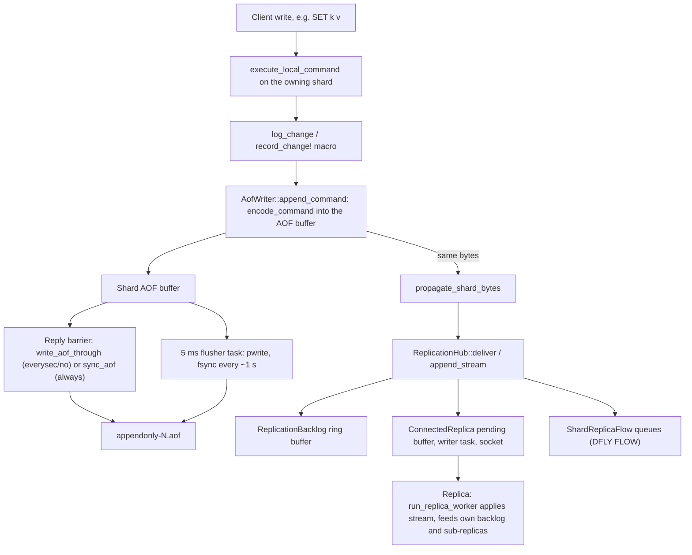

# Component 14: Persistence (AOF, RDB snapshots) & Replication

> **Source files**: `src/aof.rs`, `src/replication.rs`, `src/snapshot.rs`, `src/redis_rdb.rs`, plus the
> pieces of `src/router.rs` (save/rewrite/full-sync orchestration), `src/shard.rs` (per-shard RDB
> serialization, `AofImage`), `src/table.rs` (RDB loading entry point, CRC64, legacy format),
> `src/connection.rs` (`log_change`, master-side (P)SYNC handlers, `WAIT`, `REPLCONF`) and `src/server.rs`
> (startup load, AOF flusher, save/rewrite cron).
> **High-level design spec**: [`docs/design/14_persistence_replication.md`](../design/14_persistence_replication.md)
> **Consolidated implementation spec**: [`docs/internal/components.md`](components.md)

---

## 1. What this subsystem does

Rudis keeps its whole dataset in memory, split across shard threads. This subsystem makes that data
survive a restart and keeps copies of it on other servers:

- **AOF (append-only file)**: every change is written, as a Redis command, to a per-shard log file
  `appendonly-<shard>.aof`. On restart each shard replays its file. Periodically (or on `BGREWRITEAOF`)
  the log is compacted into a snapshot plus a short tail.
- **RDB snapshots**: `SAVE`, `BGSAVE`, the `save <secs> <changes>` schedule and shutdown write the whole
  dataset to one file (`dump.rdb` by default) in the **Redis/Valkey RDB format**, so the file loads in
  Redis 7.x / Valkey 8 too. Rudis also loads RDB files written by Redis (versions 1–12) and Valkey.
- **Replication**: a server can be a **master** that streams every change to **replicas**, Redis-style
  (`REPLICAOF`, `PSYNC`, PSYNC2 replication ids, partial resync from a backlog, `WAIT`,
  `min-replicas-to-write`). A replica can itself serve sub-replicas (chained replication). A
  Dragonfly-style per-shard `DFLY FLOW` stream exists on the master side only.

Users: every client write (through the AOF and replication hooks), operators (`SAVE`, `BGSAVE`,
`BGREWRITEAOF`, `REPLICAOF`, `INFO persistence/replication`, `ROLE`, `WAIT`), cluster failover (which
promotes replicas), and startup.

The single most important idea: **one encoder decides what a change looks like on the wire**.
`aof::encode_command` turns a `Command` into RESP bytes; the AOF and the replication stream both get
exactly those bytes. A change the encoder can't express reaches neither.

---

## 2. Mental model



Two more pictures to keep in mind:

- **Offsets.** The replication stream is one byte sequence per replication *history*. Each byte has an
  offset; `master_repl_offset` is the offset of the last byte. A replica that has applied up to offset
  `N` asks for `N+1`. If the master still has byte `N+1` in its backlog and the history id matches, it
  answers `+CONTINUE` and sends the missing bytes (**partial resync**); otherwise `+FULLRESYNC` and an
  RDB (**full resync**).
- **No fork.** Redis forks a child to get a point-in-time copy for snapshots. Rudis has no fork;
  instead shards serialize themselves cooperatively, a few milliseconds at a time between commands, and
  a few tricks (stream "cuts", pre-images) make the result consistent where it has to be.

---

## 3. The write path: from a command to bytes

### 3.1 `encode_command` / `command_to_resp` (aof.rs)

`encode_command(cmd, buf) -> bool` appends the RESP encoding of a changed command to `buf`, or appends
nothing and returns `false` if the command has no encoding. `command_to_resp(cmd)` is the allocating
wrapper (`Option<Vec<u8>>`). Internally `encode_command_inner` is one large `match` over `Command`
variants with an explicit arm for every write it supports and `_ => None` at the end.

The encoder does not always log the command as typed. It rewrites commands whose replay would not
reproduce the same state:

| Command as issued | What is logged | Why |
| :--- | :--- | :--- |
| `SET k v EX 10`, `SET ... PX` | `SET k v PXAT <unix-ms>` | Absolute deadline, so downtime between write and replay doesn't extend the TTL |
| `EXPIRE` / `PEXPIRE` / `EXPIREAT` family | `PEXPIREAT k <unix-ms>` | Same (helper `unix_ms_after`) |
| `INCR`, `DECR`, `INCRBY`, `DECRBY` | The same verb as sent (`IncrName` tracks it) | Matches Redis's stream |
| `SPOP k [n]` | One `SREM k m1 m2 ...` per ≤1024 popped members (issued by the `SPOP` handler) | Popped members are chosen at random |
| `XCLAIM` / `XAUTOCLAIM` | One `XCLAIM` per claimed or dropped entry, `XGROUP CREATECONSUMER`, and `XGROUP SETID` when needed (`connection::stream_claim_propagation`) | Idle-time filters depend on wall-clock time |
| `BRPOPLPUSH` / `BLMOVE` | `RPOPLPUSH` / `LMOVE` | Replicas must not block |
| `CRDT.SET/DEL/INCRBY/SADD/SREM` | `CRDT.MERGE <payload>` of the effect (see §3.4) | HLC timestamps and node ids differ on replay |
| Key expired by the server | `DEL k` (`replication::log_expired_key`) | Replicas and replays never expire keys themselves |
| Hash field expired (`HEXPIRE`) | `HDEL k f...` (`replication::log_expired_fields`) | Same, for fields |
| `HGETDEL` | `HDEL` | Only the deletion matters |

Two fast paths avoid allocations: `AofWriter::append_command` special-cases a plain `SET` without TTL
(`encode_plain_set`), and most arms write straight into the target buffer using `push_len` / `push_bulk`
instead of `format!`.

Families covered (non-exhaustive): strings, bitmaps/`BITFIELD` (read-only bitfields return `None`),
hashes incl. field TTL commands, lists, sets, sorted sets, HyperLogLog, streams incl. consumer-group
state, `COPY`/`MOVE`/`RENAME`/`RESTORE`, `FLUSHDB`/`FLUSHALL`/`SWAPDB`, `FUNCTION LOAD/DELETE/FLUSH/RESTORE`,
`SORT ... STORE`, `*STORE` set/zset ops, geo `*STORE`, `FT.CREATE/ALTER/DROPINDEX`, `JSON.*` writes,
`BF/CF/CMS/TOPK` writes and `*.RESTORE`, vector sets (`VADD`/`VREM`/`VSETATTR`), `SEMANTIC.*`,
`AGENT.*`, `CRDT.MERGE`/`CRDT.GC`.

**Coverage is test-enforced.** A unit test in `aof.rs` walks the write commands and fails when one is
neither encoded nor listed in its `PROPAGATED_ELSEWHERE` / `NOT_PROPAGATED` / `NOT_IMPLEMENTED` tables.
At runtime, a change that can't be encoded calls `aof::note_unpropagated`, which counts it (INFO
persistence `unpropagated_changes`) and logs one warning per command name.

### 3.2 `log_change` and `record_change!` (connection.rs)

Every mutating handler in `execute_local_command` calls the `record_change!` macro after applying its
change. The macro does key invalidation for `WATCH`/client tracking, then calls `log_change`:

1. `need_rep = replication::has_connected_replicas(port)` (a relaxed atomic load when replication was
   never activated).
2. If the shard has an AOF writer: `AofWriter::append_command(cmd)` encodes **directly into the AOF
   buffer** and returns where the bytes start. If `need_rep`, those same bytes
   (`w.buffer()[start..]`) go to `propagate_shard_bytes(port, shard_id, ..)`.
3. Without an AOF but with replicas: `command_to_resp` and propagate.
4. Unencodable → `note_unpropagated` (unless the caller passed `warn = false`).

`replication::log_shard_mutation(port, shard_id, aof, make)` is the equivalent for code outside the
macro (expiry DELs, CRDT effects); `make` builds the command only if there is somewhere to log to. It
must run on the shard that owns the data, right after the change, so the AOF, the stream and full-sync
snapshots all see each shard's changes in apply order.

### 3.3 Multi-DB: `SELECT` injection

Logged commands don't carry their DB. Both sinks inject `SELECT`:

- `AofWriter` remembers `current_db`; when `connection::CURRENT_DB` differs it first emits
  `*2 SELECT <db>` (`emit_select_db`).
- `ReplicationHub::append_stream` remembers `backlog.stream_db` and prefixes `SELECT <db>` when it
  changes. `usize::MAX` means "unknown", forcing a `SELECT` before the next command (set after full
  syncs, promotions and skipped deliveries).

### 3.4 CRDT writes are logged by effect

`CRDT.SET/DEL/INCRBY/SADD/SREM` return `None` from the encoder. Their handler uses
`record_crdt_effect!`, which still runs `record_change!` (for invalidation, with `warn = false`) and then
logs `CRDT.MERGE <payload>` holding only the changed state (the register incl. a delete tombstone, the
whole PN-counter, the added tags, or the tombstoned tags). Merging is idempotent and deterministic, so
replays and replicas reach the master's state. On a replica (which receives every shard on one stream)
`Router::execute_replica_command` re-splits a `CRDT.MERGE` by owning shard (`split_crdt_payload`) and
applies `CRDT.GC <cutoff>` to every shard.

### 3.5 Experimental families and replay

`JSON.`, `BF.`, `CF.`, `CMS.`, `TOPK.`, `FT.`, `SEMANTIC.`, `CRDT.`, `LLM.`, `MCP.`, `XDP.` commands are
parsed only with `enable-experimental-commands` on (`resp::is_experimental_command_name`); otherwise the
parser returns `Command::Unknown`. AOF replay treats an unknown command as a fatal error ("Unknown
command '...' reading the append only file"), so **an AOF containing logged experimental writes does not
load if the server restarts with the flag off.**

---

## 4. The AOF

### 4.1 Files and layout

- One file per shard: `<dir>/appendonly-<shard>.aof`. A shard replays only its own file.
- `appendonly.shards` (`AOF_SHARDS_MANIFEST`) records the shard count and routing (`hash` for standalone
  key hashing, `slots` for cluster CRC16 slots), plus `ext_crc` after importing Redis AOF files.
- A file is either pure RESP commands, or — after any rewrite — an **RDB preamble** (a full Redis-format
  RDB image incl. `OP_EOF` and CRC64) followed by a RESP tail. Replay detects the preamble by the
  `REDIS` magic. This matches Redis's `aof-use-rdb-preamble yes` (rudis always writes preambles; the
  directive is ignored).

### 4.2 `AofWriter` (aof.rs)

```rust
pub struct AofWriter {
    buffer: Vec<u8>,                 // appended, not yet handed to the kernel
    spare_buffer: Option<Vec<u8>>,   // recycled flush buffer (kept if <= 4 MB)
    file: Option<Rc<monoio::fs::File>>,
    path: PathBuf,
    offset: u64,                     // file offset of buffer[0]
    current_db: usize,               // DB the file's tail is in (for SELECT injection)
    inflight: usize,                 // chunks taken by take_flush_chunk, write not finished
    durable: u64,                    // everything before this offset is fsynced
    appended_total: u64,             // monotonic byte count, survives rewrites
    progress: Arc<AofProgress>,      // shared with connections (appended/written/write_error)
}
```

`AofProgress { appended, written, write_error }` is published per `(port, shard)` (`aof_progress`), so a
connection on any thread can tell whether a shard's appended bytes reached the kernel.

Key operations:

| Method | What it does |
| :--- | :--- |
| `open(path)` | Creates dir and file, resumes at the current file length |
| `append` / `append_command` | Adds bytes (after a `SELECT` if needed), bumps `appended_total` and `AOF_APPENDS` (only while some server runs `appendfsync always`) |
| `write_pending_sync` | Blocking `pwrite` of the whole buffer at `offset` when nothing is in flight; on error the buffer stays for a retry |
| `take_flush_chunk` / `chunk_written` | Hands the buffer out for an async `write_all_at`; a failed chunk is put back in front of the buffer so it is retried, not dropped |
| `write_through(aof)` | Group commit to the kernel (no fsync): returns once `progress.written >= appended_total` as of the call |
| `sync_durable(aof)` | Group commit with `sync_data`: returns at once if an earlier fsync already covered the target offset |
| `swap_after_rewrite` / `swap_after_live_rewrite` | Re-points the writer at a freshly renamed file |

### 4.3 When AOF bytes hit the disk (`appendfsync`)

`appendfsync` accepts `always`, `everysec` (default) and `no`, at startup and via `CONFIG SET`
(`aof::set_appendfsync`). Flags are per port: `fsync_every_sec_flag(port)` and `fsync_always_flag(port)`;
the process-wide `APPENDFSYNC_ALWAYS_ANY` keeps the hot path to one relaxed load when nobody uses
`always`.

1. **Every write, before the reply** (`connection.rs`, per command batch):
   - `everysec` / `no`: if the batch wrote, `Router::write_aof_through` makes every shard's appended
     bytes reach the kernel before replying. Its own shard writes directly; other shards normally write
     when their mailbox empties, so it yields for up to ~50 µs and then sends `ShardMessage::WriteAof`
     to stragglers. Effect: a process crash (`kill -9`) loses no acknowledged write; only an OS crash can
     lose up to ~1 s.
   - `always`: if `AOF_APPENDS` moved during the batch, `Router::sync_aof` fsyncs every shard's AOF
     (`ShardMessage::SyncAof`, `sync_durable`) before replying.
2. **Background flusher** (`server::run_shard_worker`): a task wakes every **5 ms**; outside `always`
   it does `write_pending_sync`, otherwise an async chunk write. Every **200th** tick (~1 s) it calls
   `sync_data` if the everysec flag is set. Under `no`, rudis never fsyncs on its own.

**Write errors** (e.g. `ENOSPC`) set `AofProgress::write_error`; while any shard of the server is in
error, `aof_write_misconf` makes write commands fail with `-MISCONF Errors writing to the AOF file: ...`
(checked in `connection::persistence_misconf`). The first successful write clears it and logs "AOF
write error looks solved".

### 4.4 Replay at startup (`replay_aof`)

`server::run_shard_worker` replays `appendonly-<shard>.aof` when `appendonly yes` (and then does **not**
load the RDB — the AOF is authoritative, as in Redis). `replay_aof_inner`:

1. Maps the file read-only (`aof::MappedFile`, `mmap` + `MADV_SEQUENTIAL`) instead of reading it into a
   heap buffer — page cache isn't counted against `maxmemory` and is reclaimable.
2. Sets `connection::ReplayingWrites` so nothing expires during the load.
3. If the file starts with `REDIS`, loads the preamble with `redis_rdb::load_rdb_preamble` (keeping keys
   whose deadline already passed, so a later `PERSIST` in the tail still finds them) and rebuilds search
   indexes.
4. Parses the tail **8 MB at a time** (`TAIL_CHUNK`) with `resp::parse_command_trusted` (which ignores
   `proto-max-bulk-len`: the file holds data accepted earlier, maybe under a higher limit). Skips
   `#TS:` annotations from Redis 7. Anything not starting with `*` is corruption.
5. `MULTI`…`EXEC` blocks are queued and applied at `EXEC`; `DISCARD` drops them.
6. Each command goes through `apply_aof_command`: `EVAL`/`EVALSHA` (as old Redis AOFs log them) run the
   script; everything else runs through `execute_local_command` with no AOF (nothing is re-logged).
7. Errors: an incomplete last command or an unfinished `MULTI` at EOF is truncated away (file
   `set_len`) when `aof-load-truncated yes` (default), else an error. A malformed command in the middle,
   or an unknown command, is always an error → the server refuses to start.
8. Finally `allocator::flush_thread_cache` returns the replay's freed buffers.

### 4.5 Resharding and importing Redis AOFs (`reshard_aof_dir`)

Called once from `main.rs` before the shards start:

1. Removes temp files of interrupted rewrites (`appendonly-*.aof.tmp.*`).
2. If `appendonly.reshard-in-progress` (`AOF_RESHARD_MARKER`) exists, a previous swap was interrupted:
   refuse to start, naming the backup dir to restore from.
3. **Redis AOF import**: if a Redis 7 multi-part manifest (`appendonlydir/appendonly.aof.manifest` or
   `appendonly.aof.manifest`) or a single `appendonly.aof` is present and its CRC differs from the
   recorded `ext_crc`, replay those files (base, then incrementals in `seq` order; only the newest may
   be truncated) into one in-memory `ShardDb`, write canonical commands, split them by owner shard, and
   swap them in. Refuses if non-empty rudis files exist that weren't imported from them.
4. **Shard-count change** (e.g. restarting with a different `--threads`, or switching cluster mode):
   replay every old file into one `ShardDb`, `rewrite_shard_aof_canonical`, split by owner
   (`split_rewritten_aof_to_shards`; `FT.CREATE` goes to every shard), and swap.
5. `swap_in_staged_aof`: write the marker, move old files into a backup dir
   (`aof-reshard-backup-<old>to<new>-<ms>` or `aof-import-backup-<ms>`), move staged files in, write the
   manifest last, delete the marker.

Canonical form (`write_canonical_aof`) is one command per key or structure: search index definitions
first, then per-DB key writes (`SET ... PXAT`, `HSET`, `RPUSH`, `SADD`, `ZADD`, `XADD` + group state,
...), then JSON, vector sets, semantic caches, agent memory/checkpoints/tools, `*.RESTORE` for
probabilistic structures, and one `CRDT.MERGE` per CRDT item. It exists because RDB preambles can't be
split by key owner; normal rewrites don't use it.

### 4.6 AOF rewrite (`BGREWRITEAOF`, automatic)

**Trigger.** `Router::bgrewriteaof` takes the server-wide save lock (`is_saving`, a `compare_exchange`;
shared with `SAVE`/`BGSAVE`), marks `AofRewriteState::begin` before replying, and spawns
`perform_rewrite_aof`. The cron in `server.rs` (every 100 ms, on shard 0) starts one automatically once
a second when `auto_rewrite_due(percentage, min_size, current, base)` says so: total AOF size >
`auto-aof-rewrite-min-size` (default 64 MB) and grown by ≥ `auto-aof-rewrite-percentage` (default 100%)
over the size after the last rewrite. After 3 consecutive failures, automatic rewrites back off: 60 s,
doubling per further failure, capped at 1 h (`aof_rewrite_retry_delay_secs`). Manual rewrites are never
delayed.

**Order.** `rewrite_all_shard_aofs` first `sync_aof()`s, rewrites the local shard, then sends
`ShardMessage::RewriteAof` to the other shards **one at a time** to avoid concurrent I/O and memory
spikes. On success the new total size becomes the growth base.

**Per shard: `rewrite_shard_aof_live`** — a forkless incremental rewrite:

1. **Start (synchronous).** Build an `AofImage` (a point-in-time RDB image of the shard, built lazily),
   install it on the thread, and record a `RewriteMark { file_pos, logical, db }`: where in the old AOF
   the tail after this instant starts.
2. **Build.** Loop: `img.step(db, RDB_SAVE_STEP /*1 ms*/, IMAGE_FLUSH_BYTES /*4 MB*/)` serializes a few
   table segments, sends finished pieces to an `aof-rewrite` thread (`spawn_image_writer`, which writes
   to `appendonly-<n>.aof.tmp.<pid>_live<k>`, computes the CRC64 and fsyncs), then yields to the shard's
   other work.
3. **Staying point-in-time.** While the image is installed, every command first calls
   `aof_image_before_command` → `shard::before_write`: the first write to a key the walk hasn't reached
   writes that key's *unchanged* state into the image, and the walk skips it later. Changes an image
   can't follow (`SWAPDB`, a full resync replacing the dataset) call `poison_aof_image`, and the rewrite
   falls back to one blocking pass (`rewrite_and_swap_shard_aof`, counted in `LIVE_REWRITE_FALLBACKS`).
4. **Catch up** (`catch_up_and_swap`). Re-open the live AOF through `/proc/self/fd/<fd>`, emit a
   `SELECT` if the mark's DB isn't 0, then copy what the old file received since the mark, 4 MB
   (`TAIL_COPY_BYTES`) per step between commands, until less than 1 MB (`TAIL_SYNC_BYTES`) remains.
5. **Switch (synchronous).** With no chunk in flight: write the writer's pending buffer, copy the last
   bytes, fsync, `rename` over `appendonly-<n>.aof`, fsync the directory (`sync_parent_dir`), and
   `swap_after_live_rewrite`. No command runs in between, so no write is lost or doubled.

The resulting file = RDB image of the shard at the start + every command logged since. The image holds
everything a snapshot holds, function libraries included.

The blocking variant `rewrite_shard_aof` (used for fallbacks and right after a replica loads a full
sync) writes the same image in one pass, via `write_rewritten_aof` and `ImageFileWriter`
(1 MB `BufWriter` + running CRC64).

**Example.** A shard holds `a=1`. Rewrite starts (mark at file offset 1000). A client runs
`APPEND a x` before the walk reaches `a`: `before_write` writes `a=1` into the image first, then
`APPEND a x` is logged to the old file at offset 1000+. Catch-up copies that `APPEND` after the image.
Replay: load `a=1`, apply `APPEND a x` → `a=1x`, the same as memory.

---

## 5. RDB snapshots

### 5.1 Format (`redis_rdb.rs`)

Rudis writes **RDB version 11** (`RDB_VERSION`, Redis 7.0–7.2 / Valkey 7.2–8.1) and reads versions 1–12
(`MAX_RDB_VERSION`). A file:

```
"REDIS0011"
AUX redis-ver=7.2.4, redis-bits=64, ctime, used-mem, aof-base=0, rudis-ver   (write_file_header)
OP_FUNCTION2 <library code> ...                                              (function libraries)
SELECTDB 0
[RESIZEDB per DB]                                    (SAVE/BGSAVE only)
records: [OP_EXPIRETIME_MS <u64 ms>] <type byte> <key> <value> ...
AUX "rudis-ext" <legacy-format records>              (state Redis can't encode)
[SELECTDB n ... records for DBs 1..n] [SELECTDB 0]
AUX repl-stream-db, repl-id, repl-offset             (write_repl_aux, when known)
OP_EOF (0xFF), CRC64 (u64 LE)
```

Values use plain (non-compact) Redis types: strings as `RDB_TYPE_STRING` (integer-encoded when they fit
32 bits, never LZF-compressed), lists `TYPE_LIST`, sets `TYPE_SET`, sorted sets `TYPE_ZSET_2`, hashes
`TYPE_HASH`, HyperLogLogs as dense `HYLL` strings, streams as `TYPE_STREAM_LISTPACKS_3` (incl. groups,
PEL, consumers). On read, all compact encodings (ziplist, listpack, intset, zipmap, quicklist, LZF
strings, Redis 7.4 hash-field-TTL types) are decoded; module data (`OP_MODULE_AUX`, module types) is
rejected.

**`rudis-ext` AUX field.** State with no Redis encoding is written as rudis **legacy-format records**
(`[u32 LE key len][key][type byte][payload]`) inside an AUX field named `rudis-ext` (`EXT_AUX_KEY`).
Redis/Valkey skip unknown AUX fields, so the file still loads there (without that state).

| Legacy type byte | Contents | Source |
| :-: | :--- | :--- |
| 7 | JSON document (serialized text) | `json_store` |
| 8 / 10 / 11 / 12 | Bloom / Cuckoo / Count-Min Sketch / Top-K | `probabilistic_store` |
| 9 | Vector-set node (index, metric, raw f32 vector, flags, quantization, M, attributes) | `vector_indexes` |
| 13 | CRDT state of the whole shard, under key `__rudis_crdt_sync__` | `crdt_store.export_sync_payload()` |
| 14 | Hash field deadlines (incl. already-passed ones) | `hash_field_expires` |
| 15 | Semantic cache (dim, counters, entries with vectors) | `semantic_caches` |
| 16 / 17 / 18 | Agent memory session / checkpoint thread / tool-call registry | `agent_memories`, `agent_checkpoints`, `agent_tools` |
| 19 | Stream IDMP / XNACK state (`EXT_TYPE_STREAM_EXTRAS`) | streams with `stream_has_extras` |
| 20 | Search index definition as its canonical `FT.CREATE` (`EXT_TYPE_SEARCH_INDEX`) | `search_indices` |
| 21 | LLM quota bucket | `llm_quotas` |

Search-indexed documents are ordinary keys; indexes are rebuilt after the load
(`rebuild_search_indices`). Loading tag 13 merges only the keys the loading shard owns.

`DUMP` payloads use the same value encoding plus the RDB version and CRC64 (`dump_value`); streams with
extras are dumped in the legacy format so cross-shard moves keep that state.

### 5.2 Per-shard serialization (shard.rs)

`ShardDb::save_rdb_chunk(buf)` writes one shard's records **without** file header or EOF: DB 0's
entries, then `save_extended_rdb_chunk` (the `rudis-ext` field), then other DBs after their
`SELECTDB`. Details:

- **Tiered values** (spilled to NVMe, `RudisValue::Tiered`) are read back with `hydrate_tiered` and
  written in their real type. If the read fails, the save **fails** (`TieredReadError`); keys are never
  silently dropped. After a restore they are ordinary hot keys.
- **Expired keys** are skipped unless `replication::snapshots_keep_expired(port)` (a master with an
  active backlog keeps them, because their `DEL` may not have been propagated yet; the load then drops
  them and `propagate_expired_on_load` feeds the `DEL`s into the backlog).
- `RudisTable::save_rdb_chunk` / `restore_rdb_chunk` in `table.rs` are the old legacy-format codec,
  kept for loading old files and exercised only by tests.

### 5.3 SAVE, BGSAVE, the `save` schedule, shutdown

All four funnel into `Router::perform_save_rdb(dirty_before)`:

1. Take `is_saving` (server-wide, `snapshot::is_saving(port)`), call `SnapshotState::begin` (returns the
   change count it will cover), `sync_aof()`.
2. `write_rdb_file`: spawn an `rdb-writer` thread that receives pieces through a **rendezvous channel**
   (`flume::bounded(0)`), writes them through a 1 MB `BufWriter` to `temp-<pid>-<n>.rdb`, keeps a
   running CRC64, appends `OP_EOF` + CRC, fsyncs, renames over `dbfilename` (default `dump.rdb`), and
   fsyncs the directory. CRC and disk I/O stay off the shard threads.
3. `produce_rdb_chunks`: send `RESIZEDB` hints, then stream the local shard with
   `shard::save_rdb_chunk_yielding` (1 ms steps, ~4 MB pieces, yielding between steps), then each other
   shard in turn via `ShardMessage::StreamRdbChunk`. Shards never interleave.
4. Replication AUX fields are appended only if `repl_history_for_save()` returns the same value before
   and after serializing (on a replica, read under the apply token, §6.6), i.e. the data matches that
   history.
5. Clear `is_saving`, then `SnapshotState::finish(dirty_before, ok)`.

`FLUSHALL` during a save sets `connection::RDB_BGSAVE_ABORTED`; the save fails with "save aborted by
FLUSHALL".

**`snapshot.rs` bookkeeping** (keyed by base port):

| Item | Meaning |
| :--- | :--- |
| `SnapshotState` | `last_save_unix`, `last_attempt_unix`, `dirty_at_last_save`, `last_save_ok`, `in_progress` (LASTSAVE, INFO) |
| `note_write` / `note_changes(n)` | Change counter, sharded over 256 cache-line-aligned slots (`WRITES`) so shards don't contend |
| `save_due(points, now)` | `save_point_reached`: some point has ≥`changes` writes and ≥`secs` since the last success; after a failure wait `SAVE_RETRY_DELAY_SECS` (5 s) |
| `any_save_failing` / `SAVES_FAILING` | Drives `stop-writes-on-bgsave-error`: with save points set, writes get `-MISCONF ... unable to persist to disk` |
| `AofRewriteState` | Rewrite in-progress/last status, count, consecutive failures, `base_size` |

The cron in `server.rs` checks every 100 ms (skipping while a save or rewrite runs) and calls
`bgsave()` when `save_due`. `save_before_shutdown` (SHUTDOWN and SIGTERM) first quiesces clients, waits
for a running BGSAVE, then `save_rdb`; on failure the server keeps running.

**Consistency.** A `SAVE`/`BGSAVE` is a **fuzzy snapshot**: shards are serialized one after another,
and within a shard keys are written as they are when their segment is reached. Every key that exists
for the whole save is written; a key moved by a segment split is written once (`WrittenPatterns` skips
already-covered segments).

### 5.4 Loading an RDB

- **Startup** (`server.rs`, only when AOF is off): every shard maps the same file
  (`table::load_rdb` → `load_rdb_bytes`) and keeps only the keys it owns (`LoadCtx::owns`). Shard 0
  loads function libraries and, if `repl-id`/`repl-offset` AUX fields are present, calls
  `ReplicationHub::restore_saved_history` (§6.7).
- **Format detection** (`redis_rdb::classify`): a file starting `REDIS0011` + `SELECTDB 0` with no AUX
  fields is *ambiguous* (Redis format, or an older rudis legacy file). It is loaded as Redis format in
  strict mode (empty keys/collections are errors) and, on failure, flushed and loaded as legacy format.
- CRC64 is verified (a stored 0 means "no checksum"); data after `OP_EOF` is an error; keys in a DB ≥
  `databases` are an error.
- Already-expired keys are dropped and recorded (`record_expired_on_load`) for INFO and
  `propagate_expired_on_load`.

---

## 6. Replication

### 6.1 Core types (replication.rs)

```rust
pub enum ReplicationRole {
    Master,
    Slave { master_host: String, master_port: u16,
            link_status: String /* "up" | "down" */, sync_in_progress: bool },
}
pub struct ReplIds {
    pub replid: String,       // current history id (a replica's == its master's)
    pub replid2: String,      // previous history, NULL_REPLID ("000...0") if none
    pub second_offset: i64,   // first offset replid2 does NOT cover, -1 if none
}
```

Replication ids are 40 hex chars from `new_replid()` (fxhash of time, a sequence number and the pid —
unique, not cryptographic). The id and offset are **not** part of the role: masters and replicas both
have a history (PSYNC2), and a replica adopts its master's.

`ReplicationHub` — one per server (`get_replication_hub(port)`), the important fields:

| Field | Type | Meaning |
| :--- | :--- | :--- |
| `role` | `RwLock<ReplicationRole>` | Master or replica of `host:port` |
| `ids` | `RwLock<ReplIds>` | History ids; changed only under the backlog lock |
| `master_repl_offset` | `AtomicU64` | Offset of the last stream byte |
| `backlog` | `RwLock<ReplicationBacklog>` | Ring buffer; **its write lock orders everything** |
| `replicas` | `RwLock<HashMap<u64, Arc<ConnectedReplica>>>` | PSYNC/SYNC replicas by client id |
| `shard_flows` | `RwLock<HashMap<usize, HashMap<u64, Arc<ShardReplicaFlow>>>>` | DFLY FLOW sessions |
| `is_slave_atomic`, `has_replicas`, `backlog_active`, `replication_active`, `has_shard_flows` | `AtomicBool` | Hot-path flags |
| `cached_master` | `AtomicBool` | "We hold a history we can ask to continue" (Redis's cached master) |
| `psync_holes` | `Mutex<Vec<(u64,u64)>>` | Offset ranges where partial resync would be wrong (§6.4) |
| `apply_token` | bounded(1) channel | Held while a replica applies a batch or a snapshot is taken (§6.6) |
| `cancel_sync`, `sync_conn`, `worker_exit` | — | Stop/interrupt/await the replica worker |
| `loading` | `AtomicBool` | Loading a full sync: data commands get `-LOADING` (`is_loading`) |
| `pending_peers` | `Mutex<HashMap<u64, PendingPeer>>` | `REPLCONF` details seen before PSYNC (port, ip, `capa eof`); capped at 4096 |
| `no_replicas_since` | `AtomicU64` | Start of the `repl-backlog-ttl` countdown |
| `replica_selected_db` | `AtomicUsize` | DB of the incoming stream (kept across `+CONTINUE`) |
| `suppress_propagation` | `AtomicUsize` | Cross-shard composite ops propagate one logical command |
| `replica_priority`, `announce_ip`, `announce_port`, `last_master_io_secs` | — | `replica-priority`, `replica-announce-*`, INFO |

Process-wide switches: `HAS_ACTIVE_REPLICATION` (false until a replica, a flow or a history activates
replication — then `propagate_*_bytes` is a single relaxed load), and the thread-local
`PROPAGATION_SUPPRESSED` (`SuppressPropagation` guard, used e.g. by `DEBUG LOADAOF`).

### 6.2 The backlog (`ReplicationBacklog`)

| Field | Meaning |
| :--- | :--- |
| `buffer` | Ring storage; grows on demand up to `max_size` before wrapping |
| `write_idx` | Next write position |
| `len` | Bytes retained (≤ `max_size`) |
| `max_size` | `repl-backlog-size`, default 1 MB, minimum 16 KB; `set_repl_backlog_size` resizes live keeping the newest history |
| `first_byte_offset` | Offset of the oldest retained byte |
| `stream_db` | DB the stream last `SELECT`ed (`usize::MAX` = unknown) |

`can_partial_sync(target, current)` is true when `target <= current+1` and either the backlog is empty
and `target == current+1`, or `target >= first_byte_offset`. `get_diff` copies `current+1-target` bytes
out of the ring. `repl-backlog-ttl` (default 3600 s, 0 = never): once no replica has been connected for
that long, the backlog is cleared at the next partial-resync attempt.

The backlog is fed even with no replica connected (`backlog_active`), so a replica that reconnects
within the window resyncs partially.

### 6.3 Delivering a change (`deliver` / `append_stream`)

`propagate(bytes)` / `propagate_shard(shard, bytes)` → `deliver`:

1. Return unless this server is a master (replicas never forward their own writes).
2. `append_stream(shard, bytes, from_master=false)` under the **backlog write lock**:
   1. Re-check the role (role switches take the same lock).
   2. Prefix `SELECT` if the command's DB ≠ `stream_db` (not for `PING` or an explicit `SELECT`).
   3. `master_repl_offset += len`; append to the backlog.
   4. For each replica, by its `delivery(shard)`: `Send` → `append_pending` (its output buffer);
      `Buffer` → `append_pre` (full-sync cut, §6.4); `Skip` → nothing.
3. After releasing the lock: wake each replica's writer task (a data-less message on `sender`; wakeups
   coalesce through `wake_queued`), drop the link of overflowed replicas, remove dead ones.
4. DFLY flows of that shard (or all, for `propagate`) get `try_send` on a bounded(4096) queue; a full
   queue drops the flow's socket instead of blocking the shard.

Because offset, backlog and every replica buffer are updated under one lock, every replica and the
backlog see the same byte order — an offset names the same byte for all of them.

**`ConnectedReplica`** holds `pending` (bytes not yet taken by the writer), `inflight` (bytes being
written), `ack_offset`, `last_ack_time`, `listening_port`, `ip` / `announced_ip`, `full_sync:
Option<FullSyncCut>`, and flags `overflowed` / `disconnected`. Its buffers are checked against
`client-output-buffer-limit replica` (hard limit, or soft limit for N seconds; checked only above
64 KB): breaking it sets `overflowed` and the link is dropped (`drop_link` = `shutdown(2)` on the
registered fd). Replica buffers are counted in `shard::SYNC_IMAGE_BYTES` and excluded from `maxmemory`.

Masters PING replicas every `repl-ping-replica-period` (default 10 s) through the stream
(`ensure_pinger`).

### 6.4 Full resync on the master: the stream cut

Without a fork, each shard serializes at a different moment, yet the replica needs "snapshot + exactly
the changes after it". `FullSyncCut` solves this:

```rust
pub struct FullSyncCut {
    armed: Vec<AtomicBool>,   // one per shard: has this shard serialized yet?
    all_armed: AtomicBool,    // snapshot phase over
    pre: Mutex<Vec<u8>>,      // changes from armed shards, sent right after the snapshot
}
```

Algorithm (`register_full_sync_replica`, `arm_full_sync`, `finish_full_sync`):

1. Register the replica with a cut **before** any shard serializes (refused with `-NOMASTERLINK` on a
   replica whose own link is down).
2. Each shard serializes its part and, on its own thread in the same step, arms its flag. Since a
   shard applies and replicates its changes on its own thread, everything it replicated before arming
   is in its snapshot and everything after is not.
3. Meanwhile `delivery()` routes a change from a not-yet-armed shard to `Skip` (it's in the snapshot),
   from an armed shard to `Buffer` (into `pre`), and from an unknown shard (`propagate`, e.g. PING) to
   `Buffer`.
4. `finish_full_sync`: take `pre`, set `all_armed`, and announce offset
   `start = master_repl_offset - pre.len()`. The replica receives snapshot, then `pre`, then the live
   stream, so its offset matches the master's.
5. `pre` was ordered differently from the backlog, so `[start, offset)` is recorded in `psync_holes`;
   `try_partial_resync` refuses offsets inside a hole.

**Worked example (2 shards).** Offset is 500. Replica R registers. Shard 1 serializes and arms. A
client writes `SET b 1` (shard 1, 30 bytes) → offset 530, buffered in `pre`. A client writes `SET a 1`
(shard 0, 30 bytes) → offset 560, skipped for R (shard 0 not armed; it will be in shard 0's snapshot).
Shard 0 serializes (`a` included) and arms. `finish_full_sync` returns `start = 560 - 30 = 530`.
R gets `+FULLRESYNC <id> 530`, the snapshot, then `pre` (`SET b 1`), reaching offset 560 —
consistent. A later `PSYNC <id> 531..559` would be wrong (R's bytes there differ from the backlog's),
hence the hole `[530, 560)`.

**Two transports** (`connection::run_master_replica_stream`):

- **Streamed (`$EOF:`), when the replica sent `REPLCONF capa eof`** (rudis replicas always do) —
  `stream_full_sync`:
  1. Every shard starts a point-in-time `AofImage` in "chunk" mode and arms its cut in the same step
     (`shard::start_sync_image`, `ShardMessage::StartSyncImage`). Then `finish_full_sync`, so the offset
     is known up front.
  2. Send `+FULLRESYNC <replid> <offset>\r\n$EOF:<40-char mark>\r\n` and the RDB header.
  3. For each shard in turn, `sync_image_step` produces ≤1 MB pieces in ~1 ms steps between that
     shard's commands; they are written to the socket as produced (buffers are recycled back to the
     shard). No shard stops for more than a step, and the snapshot is never whole in memory.
  4. Send repl AUX fields, `OP_EOF`, CRC64 and the mark. The `pre` bytes and everything queued since are
     sent **only after the replica's first `REPLCONF ACK`**: a replica detects the end by the mark being
     the last bytes of a read, so nothing may follow it until it acks.
- **Buffered (`$<len>`)** — `snapshot_for_replica` → `Router::generate_full_rdb(Some(id))`: each shard
  serializes in one go (`save_rdb_chunk` + `arm_full_sync`), all chunks are concatenated in memory, then
  `+FULLRESYNC <replid> <offset>\r\n$<len>\r\n<rdb><pre>` is sent. Eviction is paused
  (`SnapshotEvictionPause`) meanwhile. Used for replicas without `capa eof`, and for legacy `SYNC`, which
  gets `$<len>\r\n<rdb><pre>` with no preamble.

Either way a serialization failure (e.g. unreadable tiered value) aborts with `-ERR full sync failed:
...` — a replica never gets a partial dataset.

### 6.5 Partial resync on the master (`try_partial_resync`)

`PSYNC <replid> <offset>` where `offset` is the next byte wanted:

1. `offset < 1` → full resync. Take the backlog write lock (held until the replica is registered, so no
   change slips between diff and live stream).
2. Refuse if we can't serve replicas (a replica with its link down → `-NOMASTERLINK`) or the id doesn't
   match: `replid == ids.replid`, or `replid == ids.replid2 && offset <= second_offset`.
3. Apply `repl-backlog-ttl`; refuse if `!can_partial_sync` or the offset is in a psync hole.
4. Register the replica, reply `+CONTINUE <current replid>\r\n` + `get_diff` bytes.

### 6.6 The replica side (`start_replica_sync`, `run_replica_worker`)

`REPLICAOF host port` (or `replicaof` in the config, started after boot via `take_startup_replicaof`)
calls `start_replica_sync`:

1. `stop_sync` any previous worker. Under the backlog lock: if we were a master with history
   (offset > 0 or a `replid2`), set `cached_master` so we ask the new master to continue *our* history
   (a demoted master rejoining its promoted replica can resync partially). Switch role to
   `Slave { link_status: "down", sync_in_progress: true }`. Our own replicas stay connected.
2. Unblock clients blocked in `BLPOP` & co. (they would change data the master doesn't know about).
3. Spawn the worker under `supervise_replica_worker`: it waits for the previous worker to exit
   (`worker_exit`), and restarts the worker 1 s after a panic (after `forget_master_history`).

`run_replica_worker` is a hand-rolled RESP client inside a `'reconnect_loop`. Every failure marks the
link `down` and retries after **50 ms** (1 s after `AUTH` or load failures), logging at most one attempt
per second; the master address is re-resolved each attempt (DNS names that move). Handshake replies time
out after 60 s (`REPL_HANDSHAKE_TIMEOUT`); lines longer than 64 KB (`MAX_REPL_LINE`) drop the link.

1. `PING` (accepts `+PONG` or `-NOAUTH`), then `AUTH [masteruser] masterauth` if configured.
2. `REPLCONF listening-port <replica-announce-port or own port>`, optionally `REPLCONF ip-address`.
3. `REPLCONF capa eof capa psync2`.
4. `PSYNC <replid> <offset+1>` if `psync_request()` has a cached master, else `PSYNC ? -1`.
5. `+CONTINUE [id]` → `continue_with_master`: if the id changed, the old one becomes `replid2` (valid to
   the current offset + 1) and sub-replicas are disconnected to learn the new id.
   `-NOMASTERLINK` / `-LOADING` → retry later, keeping our history.
6. `+FULLRESYNC <id> <offset>` →
   1. Clear `cached_master` (if this sync fails, the next is full too).
   2. Read the `$<len>` or `$EOF:<mark>` header (`take_rdb_header`, skipping bare `\n` keepalives).
   3. Spool the RDB to `<dir>/temp-repl-<port>-<pid>.rdb` (`RdbSpool`: exact length, or up to the mark,
      holding back the last 39 bytes in case they start the mark), then `mmap` it and unlink the file
      (the replica never needs the dataset twice in RAM).
   4. `attach_to_new_master` (drop sub-replicas, clear backlog), then `Router::restore_rdb_bytes` under
      a `LoadingGuard`: every shard flushes and loads its part (`ShardDb::load_full_sync_rdb`); if any
      shard fails, all are emptied, `forget_master_history` runs, and the sync retries. When AOF is on,
      each shard rewrites its AOF from the loaded data right away, so a restart doesn't replay the
      pre-sync AOF.
   5. `finish_full_resync(id, offset)`: adopt the master's id and offset, empty backlog, set
      `cached_master`.
7. Mark the link `up`. The stream DB starts at the RDB's `repl-stream-db` (full) or the remembered one
   (partial).
8. **Streaming loop.** A separate task owns the socket's write half and sends `REPLCONF ACK <applied>`
   at once, then every second and immediately on `REPLCONF GETACK`. For each read:
   1. Take the **apply token** (`lock_apply`), so snapshots on this replica see whole batches.
   2. Parse commands with `parse_command_trusted`, advancing `current_offset` by bytes consumed.
      `PING` is ignored; `REPLCONF GETACK` flushes pending work, then acks; everything else goes to
      `Router::apply_replica_command_batched`: commands for the local shard apply at once
      (`apply_replicated_command`, which runs under `ReplayingWrites` and logs error replies as
      "== CRITICAL =="), commands for other shards are batched per shard and sent with one
      `ShardMessage::ExecuteReplicaCmds` each, multi-shard commands flush the batch first.
   3. Flush the batch, then `feed_from_master(raw bytes)`: the exact bytes processed go to our own
      backlog and sub-replicas, unchanged, so a chain shares one offset space.
   4. A protocol error drops the link (resume from what was applied) rather than skipping bytes.

Replicas apply with their AOF writer, so a replica's AOF logs the master's changes. A replica's own
local writes (if writable) are never fed to sub-replicas.

**Expiry on replicas.** Replicas and replays never expire keys themselves (`REPLAYING_WRITES`); the
master's `DEL` does. On a read-only replica, `hide_expired_keys()` makes reads treat an expired key as
missing while it stays in memory until the `DEL` arrives.

### 6.7 History changes (PSYNC2)

| Event | Method | Effect |
| :--- | :--- | :--- |
| Promotion (`REPLICAOF NO ONE`, failover) | `make_master` | `shift_replid_locked`: old id → `replid2` (valid to offset+1), new id; sub-replicas disconnected; backlog TTL counts from now |
| `DEBUG CHANGE-REPL-ID` | `change_replid` | New id, no `replid2` |
| Failed/interrupted sync or worker panic | `forget_master_history` | Link down, new id, empty backlog, no cached master, sub-replicas dropped |
| Restart with RDB holding `repl-id`/`repl-offset` | `restore_saved_history` | With `replicaof` configured: continue that history with the master; as a master: it becomes `replid2`, so old replicas can resync partially |
| RDB save | `saved_history` | AUX fields written: a master's own history, a replica's only while it has a cached master |

### 6.8 WAIT, WAITAOF, min-replicas, acks

- `REPLCONF ACK <off>` → `update_replica_ack`; acks beyond `master_repl_offset` are ignored.
- `WAIT` and `WAITAOF` share `wait_acks`: it captures the master offset at call time and polls
  (1 ms, then 10 ms after 100 ms; `REPLCONF GETACK *` once a second while short) until enough copies
  are acknowledged or the timeout passes. A timeout of 0 waits forever, as in Redis.
- `WAIT n timeout` replies with the number of replicas whose `ack_offset` reached the target.
- `WAITAOF numlocal numreplicas timeout` counts only AOF-fsynced copies:
  - **local**: each shard's `AofProgress` tracks `fsynced`, the appended bytes an fsync covered.
    The local copy counts once every shard's `fsynced` reaches what it had appended when `WAITAOF`
    ran: at once under `appendfsync always`, at the next fsync under `everysec`, never under `no`.
  - **replicas**: a replica with AOF on appends `FACK <offset>` to its `REPLCONF ACK` once the AOF
    bytes up to that applied offset are fsynced. A replica without AOF sends no `FACK`
    (`ConnectedReplica::aof_acks` false) and never counts.
  - `numlocal` without AOF, and `WAITAOF` on a replica, are refused with Redis's errors.
- `min-replicas-to-write N` / `min-replicas-max-lag S` (default 10): on a master, writes fail with
  `-NOREPLICAS` unless `good_replicas(S) >= N` (online replicas that acked within `S` seconds).
- `ROLE` and `INFO replication` are computed on demand (`format_role_resp`, `format_info_replication`):
  role, `connected_slaves`, `slaveN:ip=,port=,state=online|wait_bgsave,offset=,lag=`, `master_replid`,
  `master_replid2`, `master_repl_offset`, `second_repl_offset`, backlog size/first byte/histlen; on a
  replica also link status, `master_last_io_seconds_ago`, sync-in-progress, `slave_repl_offset`,
  priority and read-only.

### 6.9 DFLY FLOW (Dragonfly-style, master side only)

`REPLCONF capa dragonfly` replies `*5 [replid, "SYNC1", num_shards, 1, 0]`. The client then opens one
connection per shard with `DFLY FLOW <replid> <sync_id> <shard> [lsn]`;
`run_shard_replication_flow` replies `+OK FLOW <shard>\r\n$<len>\r\n<shard chunk>\r\n` and streams that
shard's changes (`ShardReplicaFlow.lsn` counts bytes; `REPLCONF ACK` updates `ack_lsn`).

---

## 7. Invariants & gotchas

- **Encode or lose it.** A write reaches the AOF and replicas only through `encode_command` (or an
  explicit `log_shard_mutation`). New write commands need an encoder arm (or an entry in the coverage
  test's lists). If replaying the command would not reproduce the state (randomness, wall-clock,
  node ids), log its *effect* instead, as `SPOP`, `XAUTOCLAIM` and `CRDT.*` do.
- **Log on the owning shard, right after the change.** Per-shard order is what makes the AOF, the
  stream cut and the AOF-image pre-images correct.
- **The backlog write lock orders the stream.** Offset updates, backlog appends, replica registration,
  arming and role/id changes all happen under it. Wake writers only after releasing it.
- **Offsets mean "next byte wanted".** PSYNC carries `applied + 1`; `second_offset` is "first offset
  `replid2` does not cover".
- **Nothing may follow an `$EOF:` mark until the replica acks.**
- **A replica never serves (P)SYNC while its own link is down** (`can_serve_replicas`), and never loads
  a partial dataset: failed full-sync loads empty every shard.
- **Snapshots are fuzzy; full syncs and rewrites are point-in-time.** `SAVE`/`BGSAVE` walk shards
  without pre-images; full syncs arm a cut per shard; live AOF rewrites use pre-images. Don't reuse
  `save_rdb_chunk_yielding` for a full sync.
- **Saves and rewrites exclude each other** through one server-wide `is_saving` flag.
- **Tiered-value read failures fail the save/rewrite/sync** instead of dropping keys.
- **`MappedFile` safety:** a mapped load file must not be truncated while mapped (the AOF writer only
  appends after loading).
- **Experimental-command AOFs need the flag at restart** (§3.5).
- Changing `--threads` or cluster mode with AOF on triggers a reshard at startup; keep the backup dir it
  names until the server runs.

---

## 8. Limitations / not implemented

- **DFLY FLOW is partial**: the `lsn` argument is accepted but unused (every flow gets the full shard
  chunk), `"SYNC1"` is a fixed token, flows don't appear in `INFO replication`/`ROLE`, flows don't take
  part in the full-sync cut, and rudis's own replica never uses this protocol.
- **No fork-based isolation**; `SAVE`/`BGSAVE` produce fuzzy snapshots (§5.3).
- **CRC64** is a byte-at-a-time table lookup (`table::crc64_update`); no hardware CRC path.
- **Diskless load and related tuning directives** (`repl-diskless-load`, `repl-diskless-sync*`,
  `aof-use-rdb-preamble`, `rdbcompression`, `rdbchecksum`, `appendfilename`, `appenddirname`, ...) are
  known Redis directive names (`config::REDIS_CONFIG_NAMES`) that rudis does not implement: a config file
  may contain them and they are ignored with a warning. Behaviour is fixed: replicas always spool the
  RDB to disk, rudis-to-rudis full syncs stream with `$EOF:`, rewrites always use an RDB preamble, RDB
  strings are never compressed, AOF files are always `appendonly-<shard>.aof` in `dir`.
- **Module data** in Redis RDB files is rejected; Redis 7.0 RC function records are skipped.
- **Replication ids** are fxhash-derived, not cryptographically random.
- The AOF flush cadence (5 ms) and fsync tick (~1 s) are constants.

---

## 9. Code map

| File | Key symbols | What they do |
| :--- | :--- | :--- |
| `src/aof.rs` | `encode_command`, `command_to_resp`, `note_unpropagated` | Command → RESP for AOF and replicas; coverage accounting |
| | `AofWriter`, `AofProgress`, `aof_write_misconf` | Buffered per-shard AOF, group commit, write-error `-MISCONF` |
| | `set_appendfsync`, `appendfsync_is_always`, `APPENDFSYNC_ALWAYS_ANY`, `AOF_APPENDS` | fsync policy flags |
| | `replay_aof`, `MappedFile`, `apply_aof_command` | Startup replay (RDB preamble + RESP tail) |
| | `rewrite_shard_aof_live`, `catch_up_and_swap`, `rewrite_shard_aof`, `ImageFileWriter` | Non-blocking and blocking AOF rewrite |
| | `auto_rewrite_due`, `AutoRewriteConfig`, `aof_files_size` | `auto-aof-rewrite-*` |
| | `reshard_aof_dir`, `import_external_aof`, `write_canonical_aof`, `split_rewritten_aof_to_shards` | Shard-count changes, Redis AOF import |
| `src/snapshot.rs` | `SnapshotState`, `note_write`, `save_due`, `any_save_failing` | Save schedule and status |
| | `AofRewriteState`, `aof_rewrite_retry_delay_secs`, `is_saving` | Rewrite status/back-off, save lock |
| `src/redis_rdb.rs` | `write_file_header`, `write_record`, `write_ext_aux`, `write_repl_aux`, `dump_value` | RDB/DUMP writer |
| | `load_file`, `load_chunk`, `load_rdb_preamble`, `load_records`, `decode_value`, `classify` | RDB reader |
| `src/shard.rs` | `ShardDb::save_rdb_chunk`, `save_extended_rdb_chunk`, `save_rdb_chunk_yielding` | Per-shard serialization |
| | `AofImage`, `before_write`, `poison_aof_image`, `start_sync_image`, `sync_image_step`, `SYNC_IMAGE_BYTES` | Point-in-time images for rewrites and streamed syncs |
| | `ShardDb::load_full_sync_rdb` | Replica-side load + AOF rewrite |
| `src/table.rs` | `load_rdb`, `load_rdb_bytes`, `load_legacy_ext`, `crc64`, `crc64_update` | Load entry point, legacy format, checksum |
| `src/router.rs` | `save_rdb`, `bgsave`, `perform_save_rdb`, `rdb_writer`, `bgrewriteaof`, `perform_rewrite_aof` | Snapshot and rewrite orchestration |
| | `generate_full_rdb`, `restore_rdb_bytes`, `apply_replica_command_batched`, `execute_replica_command` | Full-sync build/load, applying the master's stream |
| | `write_aof_through`, `sync_aof`, `save_before_shutdown` | Reply barriers, shutdown save |
| `src/replication.rs` | `ReplicationHub`, `ReplIds`, `ReplicationBacklog`, `ConnectedReplica`, `FullSyncCut`, `ShardReplicaFlow` | Replication state |
| | `deliver`, `append_stream`, `feed_from_master`, `propagate_bytes`, `propagate_shard_bytes`, `log_shard_mutation` | Stream delivery |
| | `try_partial_resync`, `register_full_sync_replica`, `arm_full_sync`, `finish_full_sync` | Master-side sync |
| | `start_replica_sync`, `run_replica_worker`, `RdbSpool`, `make_master`, `restore_saved_history` | Replica side and history |
| | `wait_replicas`, `good_replicas`, `format_info_replication`, `format_role_resp` | WAIT, min-replicas, INFO/ROLE |
| `src/connection.rs` | `log_change`, `record_change!`, `stream_claim_propagation`, `persistence_misconf` | Write-path logging, MISCONF |
| | `run_master_replica_stream`, `stream_full_sync`, `snapshot_for_replica`, `run_shard_replication_flow` | Master-side (P)SYNC and DFLY FLOW |
| | `Command::Replconf` / `Wait` / `WaitAof` handlers, `not_enough_good_replicas` | REPLCONF, WAIT, NOREPLICAS |
| `src/server.rs` | `run_shard_worker` (startup load, AOF flusher), save/auto-rewrite cron | Startup and background tasks |
| `src/main.rs` | call to `aof::reshard_aof_dir` | Pre-start AOF layout fix-up |
