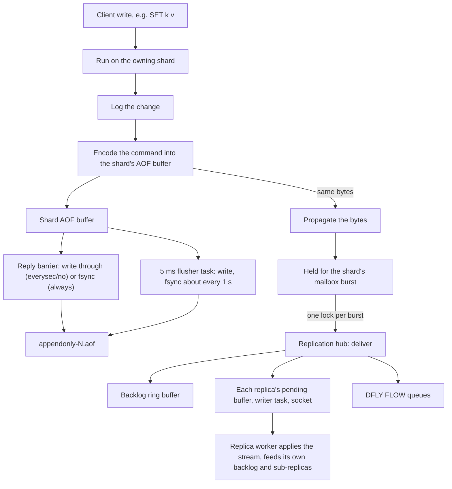
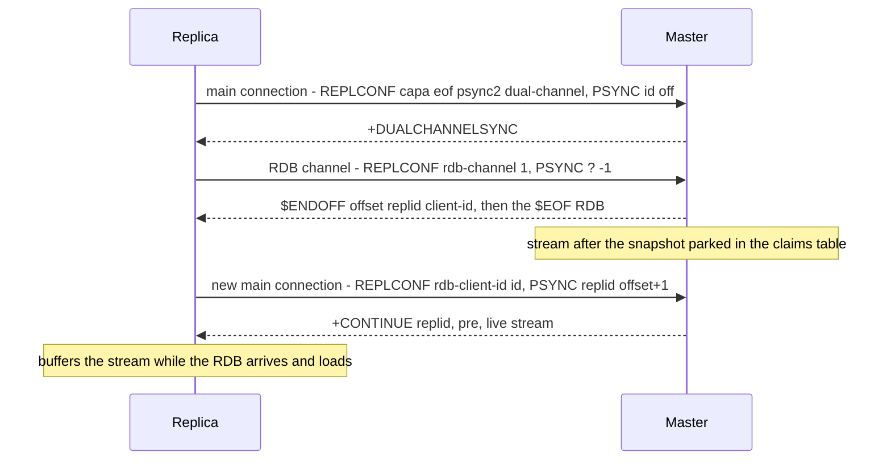
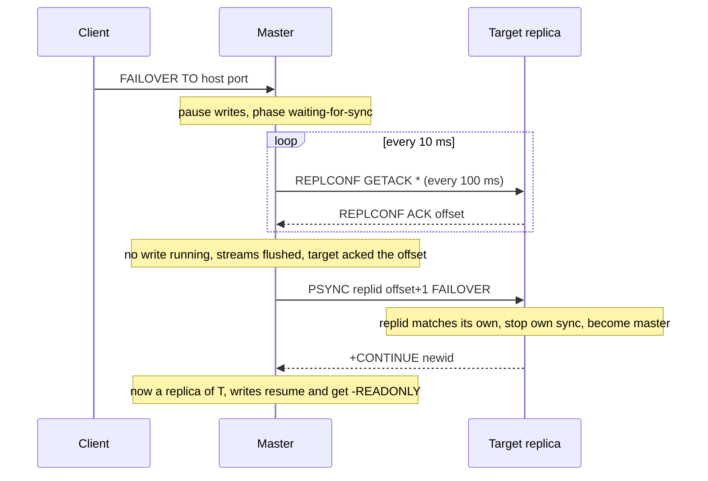

# Component 14: Persistence (AOF, RDB Snapshots) and Replication

> **High-Level Design Spec**: [docs/design/14_persistence_replication.md](../design/14_persistence_replication.md)
> **Consolidated Implementation Spec**: [docs/internal/components.md](components.md)
> **Main source files**: src/aof.rs (the append-only file and its encoder), src/replication.rs
> (the replication hub, backlog, master and replica sides), src/snapshot.rs (save bookkeeping),
> src/redis_rdb.rs (the RDB format), src/shutdown.rs (quiescing). Supporting pieces: src/router.rs
> (save, rewrite and full-sync orchestration, the cross-shard write pause, the runtime AOF switch),
> src/shard.rs (per-shard RDB serialization and point-in-time images), src/table.rs (the RDB
> loading entry point, CRC64, the legacy format, DUMP decoding), src/connection.rs (change logging,
> the master-side `PSYNC` and `SYNC` handlers, `WAIT`, `REPLCONF`, `FAILOVER`, `SHUTDOWN`, the
> running-write counter) and src/server.rs (startup load, the AOF flusher, the save and rewrite
> cron, the signal loop). The [Code map](#10-code-map) lists the key symbols.

---

## 1. What this subsystem does

Rudis keeps its whole dataset in memory, split across shard threads. This subsystem makes that data
survive a restart and keeps copies of it on other servers:

* **AOF (append-only file).** Every change is written, as a Redis command, to a per-shard log file
  `appendonly-<shard>.aof`. On restart each shard replays its file. Periodically (or on
  `BGREWRITEAOF`) the log is compacted into a snapshot plus a short tail. The AOF can be turned on and
  off at runtime (`CONFIG SET appendonly`).
* **RDB snapshots.** `SAVE`, `BGSAVE`, the `save <secs> <changes>` schedule and shutdown write the
  whole dataset, as of one point in time across all shards, to one file (`dump.rdb` by default) in the
  **Redis/Valkey RDB format**, so the file also loads in Redis 7.x and Valkey 8. Rudis also loads RDB
  files written by Redis (versions 1–12) and Valkey.
* **Replication.** A server can be a **master** that streams every change to **replicas**, Redis-style:
  `REPLICAOF`, `PSYNC`, PSYNC2 replication ids, partial resync from a backlog, `WAIT`, `WAITAOF`,
  `min-replicas-to-write`, `FAILOVER`, and transactions as `MULTI` ... `EXEC` blocks. A replica can
  itself serve sub-replicas (chained replication). Full syncs can use a second connection for the RDB
  (dual-channel). A Dragonfly-style per-shard `DFLY FLOW` stream exists on the master side only.
* **Shutdown.** `SHUTDOWN` and `SIGTERM` wait for replicas to catch up, then save, without a second
  shutdown racing the first.

The users are every client write (through the AOF and replication hooks), operators (`SAVE`,
`BGSAVE`, `BGREWRITEAOF`, `CONFIG SET appendonly`, `REPLICAOF`, `FAILOVER`, `SHUTDOWN`, `INFO
persistence`, `INFO replication`, `ROLE`, `WAIT`), cluster failover (which promotes replicas) and
startup.

The single most important idea: **one encoder decides what a change looks like on the wire.** The
encoder turns a command into RESP bytes, and the AOF and the replication stream both get exactly those
bytes. A change the encoder cannot express reaches neither.

---

## 2. Mental model



Three more pictures to keep in mind:

* **Offsets.** The replication stream is one byte sequence per replication *history*. Each byte has an
  offset, and `master_repl_offset` is the offset of the last byte. A replica that has applied up to
  offset *N* asks for *N* + 1. If the master still has byte *N* + 1 in its backlog and the history id
  matches, it answers `+CONTINUE` and sends the missing bytes (**partial resync**); otherwise it answers
  `+FULLRESYNC` and sends an RDB (**full resync**).
* **No fork.** Redis forks a child to get a point-in-time copy for snapshots. Rudis has no fork. Instead
  each shard builds a copy-on-write **image** of itself, a few milliseconds at a time between commands.
  A write to a key the image has not reached yet first copies the key's old value into the image. `SAVE`
  and `BGSAVE`, AOF rewrites and streamed full syncs all use these images; cross-shard writes are held
  back for the instant all shards start theirs.
* **"Acknowledged" means "in the stream".** Shards hold their replication bytes for one mailbox burst and
  stream them together, but a connection waits until every shard streamed what it held before replying
  to a write, and `WAIT`, `FAILOVER` and shutdown wait for it (and for writes still running) before
  reading the offset.

| Term | Meaning |
| :--- | :--- |
| **AOF rewrite** | Replacing the log with a fresh snapshot plus the commands logged since. |
| **Preamble** | An RDB image at the start of an AOF file, followed by a RESP tail. |
| **Image** | A shard's point-in-time copy, built incrementally. |
| **Backlog** | A ring buffer of the most recent replication stream, used for partial resync. |
| **History** | One continuous replication byte sequence, named by a replication id. |
| **PSYNC2** | The Redis protocol that lets a promoted replica or restarted master keep its history. |
| **Cut** | The moment each shard serializes for a full sync, which splits snapshot from stream. |

---

## 3. The write path: from a command to bytes

### 3.1 The encoder

The encoder appends the RESP encoding of a changed command to a buffer, or appends nothing and reports
that the command has no encoding. An allocating wrapper returns the bytes. Internally it is one large
match over command variants, with an explicit arm for every write it supports and "no encoding" at the
end.

The encoder does not always log the command as typed. It rewrites commands whose replay would not
reproduce the same state:

| Command as issued | What is logged | Why |
| :--- | :--- | :--- |
| `SET k v EX 10`, `SET ... PX` | `SET k v PXAT <unix-ms>` | An absolute deadline, so downtime between write and replay does not extend the TTL |
| The `EXPIRE`, `PEXPIRE`, `EXPIREAT` family | `PEXPIREAT k <unix-ms>` | Same |
| `INCR`, `DECR`, `INCRBY`, `DECRBY` | The same verb as sent | Matches Redis's stream |
| `SPOP k [n]` | One `SREM k m1 m2 ...` per 1024 or fewer popped members (issued by the `SPOP` handler) | Popped members are chosen at random |
| `XCLAIM`, `XAUTOCLAIM` | One `XCLAIM` per claimed or dropped entry, `XGROUP CREATECONSUMER`, and `XGROUP SETID` when needed | Idle-time filters depend on wall-clock time |
| `BRPOPLPUSH`, `BLMOVE` | `RPOPLPUSH`, `LMOVE` | Replicas must not block |
| `CRDT.SET`, `DEL`, `INCRBY`, `SADD`, `SREM` | `CRDT.MERGE <payload>` of the effect (§3.5) | Timestamps and node ids differ on replay |
| A key expired by the server | `DEL k` | Replicas and replays never expire keys themselves |
| A hash field expired (`HEXPIRE`) | `HDEL k f...` | Same, for fields |
| `HGETDEL` | `HDEL` | Only the deletion matters |

Two fast paths avoid allocations: a plain `SET` without a TTL is special-cased, and most arms write
straight into the target buffer with length and bulk-string helpers instead of formatting.

Families covered include strings, bitmaps and `BITFIELD` (read-only bitfields have no encoding), hashes
including field TTL commands, lists, sets, sorted sets, HyperLogLog, streams including consumer-group
state, `COPY`, `MOVE`, `RENAME` and `RESTORE`, `FLUSHDB`, `FLUSHALL` and `SWAPDB`, the `FUNCTION` writes,
`SORT ... STORE`, the `*STORE` set and sorted-set operations, geo `*STORE`, the `FT.*` definition
commands, `JSON.*` writes, Bloom, Cuckoo, Count-Min and Top-K writes and their `*.RESTORE`, vector sets,
`SEMANTIC.*`, `AGENT.*` and the `CRDT.*` merges.

**Coverage is test-enforced.** A unit test in aof.rs walks the write commands and fails when one is
neither encoded nor listed in its `PROPAGATED_ELSEWHERE`, `NOT_PROPAGATED` or `NOT_IMPLEMENTED` tables.
At runtime, a change that cannot be encoded is counted (`INFO persistence`'s `unpropagated_changes`) and
logged with one warning per command name.

### 3.2 Logging a change

Every mutating handler calls a change-recording macro after applying its change. The macro does key
invalidation for `WATCH` and client tracking, then logs the change:

1. Check whether any replica is connected (a relaxed atomic load when replication was never activated;
   otherwise the hub comes from a thread-local cache, not the global map).
2. If the shard has an AOF writer, encode **directly into the AOF buffer** and note where the bytes
   start. If a replica is connected, those same bytes go to the replication stream.
3. Without an AOF but with replicas, encode into a fresh buffer and propagate it.
4. A command with no encoding is counted as unpropagated (unless the caller said not to warn).

A matching helper serves code outside the macro (expiry `DEL`s, CRDT effects); it builds the command
only if there is somewhere to log to. It must run on the shard that owns the data, right after the
change, so the AOF, the stream and full-sync snapshots all see each shard's changes in apply order.

The AOF writer is reached through the shard's writer slot (§4.2), fetched per use, so turning the AOF
on or off at runtime takes effect on the next command.

### 3.3 Holding a shard's bytes for a mailbox burst

With replicas attached, taking the backlog lock once per write would make eight shards spend most of
their time waiting on each other. So a shard thread holds its replication bytes while it drains its
mailbox, and streams them with one lock at the end:

1. The mailbox loop marks the start of a burst and, when the mailbox is empty, its end.
2. Meanwhile propagated bytes are appended to a thread-local buffer, and the shard's "appended" counter
   is bumped. Bytes from a different database than the held ones flush first, so each flush carries one
   database.
3. A flush hands the held bytes to the hub (with the current database set to theirs) and raises the
   shard's "flushed" counter.

Held bytes always go out before anything that could depend on them:

| Before ... | Who flushes |
| :--- | :--- |
| Any mailbox message other than the plain data ones (`FastGet`, `FastSet`, `Batch`, `Mget`, `Mset`, `ScatterMget`, `ScatterMset`), for example a flush, a full-sync cut or a cross-shard step | The mailbox loop |
| Unsharded bytes such as `PING` or `GETACK` | The propagate function itself |
| A full-sync image arming its cut, a buffered full-sync chunk, a DFLY FLOW snapshot | The full-sync and flow functions |
| A cross-shard move's pop (§3.6) | The move code |
| A reply to a batch with writes | The reply barrier, which waits for streams to flush |
| `WAIT`, `WAITAOF`, `FAILOVER`, a shutdown waiting for replicas, an `EXEC`'s block | The wait-for-flush helpers |

Waiting for streams to flush records each shard's "appended" count and yields until its "flushed"
count reaches it (usually a few yields). A blocking variant exists for threads outside the runtime (the
cluster bus, before a manual failover reads the offset).

### 3.4 Multiple databases: SELECT injection

Logged commands do not carry their database. Both sinks inject `SELECT`:

* The AOF writer remembers its current database; when the connection's differs, it first emits `SELECT
  <db>`.
* The stream remembers which database it last selected and prefixes `SELECT <db>` when it changes. An
  "unknown" marker forces a `SELECT` before the next command; it is set after full syncs, promotions,
  restored histories and skipped deliveries.

### 3.5 CRDT writes are logged by effect

The five local CRDT write commands have no encoding. Their handler uses a dedicated macro that still
records the change (for invalidation, without warning) and then logs `CRDT.MERGE <payload>` holding
only the changed state: the register including a delete tombstone, the whole PN-counter, the added
tags, or the tombstoned tags. Merging is idempotent and deterministic, so replays and replicas reach the
master's state. On a replica (which receives every shard on one stream), the router re-splits a
`CRDT.MERGE` by owning shard and applies `CRDT.GC <cutoff>` to every shard. See
[Component 12](12_crdt_types.md).

### 3.6 Cross-shard writes in the stream

* **Transactions** reach replicas as one `MULTI` ... `EXEC` block (§6.3), as Redis sends them. An `EXEC`
  with a single write sends that write alone; one that streams nothing sends nothing.
* **Cross-shard `LMOVE`, `RPOPLPUSH` and `SMOVE`** replicate as one logical command, streamed by the
  destination's shard right after its push. The source half runs on the source's shard:
  1. Flush what that shard holds.
  2. Pop with that shard's own propagation suppressed.
  3. Send the push to the destination as a shard batch that carries the logical command to replicate:
     the destination applies the push without propagating it, then streams the logical command and
     flushes before answering.
  4. Block the source thread until the destination answered (10 s cap).

  No other write on the source's shard can land between the pop and the logical command, so an `RPUSH`
  racing an `RPOPLPUSH` of the same list reaches replicas on the same side of the move. It cannot
  deadlock: a move holds both shards' transaction locks, taken in shard order.
* **Blocked cross-shard `BLMOVE` and `BRPOPLPUSH`.** The source's shard only wakes the client (keeping
  one element back from the waiters behind it); the client then runs the same locked move. If another
  client took the element first, it blocks again for the rest of its timeout.
* `DEBUG CROSS-SHARD-MOVE-DELAY <us>` sleeps between a move's two halves (a test knob).

### 3.7 Experimental families and replay

`JSON.`, `BF.`, `CF.`, `CMS.`, `TOPK.`, `FT.`, `SEMANTIC.`, `CRDT.`, `LLM.`, `MCP.` and `XDP.` commands are
parsed only with `enable-experimental-commands` on; otherwise the parser returns an unknown command. AOF
replay treats an unknown command as a fatal error (`Unknown command '...' reading the append only
file`), so **an AOF containing logged experimental writes does not load if the server restarts with the
flag off.**

---

## 4. The AOF

### 4.1 Files and layout

* One file per shard: `<dir>/appendonly-<shard>.aof`. A shard replays only its own file.
* `appendonly.shards` records the shard count and routing (`hash` for standalone key hashing, `slots`
  for cluster CRC16 slots), plus `ext_crc` after importing Redis AOF files.
* A file is either pure RESP commands or, after any rewrite, an **RDB preamble** (a full Redis-format
  RDB image including `OP_EOF` and CRC64) followed by a RESP tail. Replay detects the preamble by the
  `REDIS` magic. This matches Redis's `aof-use-rdb-preamble yes`; Rudis always writes preambles and
  ignores the directive.
* While the AOF is being turned on at runtime (§4.7), a shard appends to `appendonly-<shard>.aof.incr`
  instead; startup never loads that file.

### 4.2 The writer and its slot

Each shard has a writer holding the buffer of bytes appended but not yet handed to the kernel, a recycled
flush buffer (kept if 4 MB or smaller), the file, the file offset of the buffer's first byte, the
database the file's tail is in (for `SELECT` injection), the count of chunks written but not finished,
the offset before which everything is fsynced, a monotonic appended-bytes count that survives rewrites,
a shared progress record, and, when the AOF was turned on at runtime, the incremental file it actually
writes. [Reference details](#111-aof-writer-and-progress) lists the fields.

The shared **progress** record (appended, written, fsynced, write error), published per (port, shard), lets
a connection on any thread tell whether a shard's appended bytes reached the kernel (written) or the disk
(fsynced, for `WAITAOF`).

The **writer slot** is a shared, swappable holder, one per shard, used by everything on the shard that
appends (its router and every clone of it, the mailbox loop, the expiry log, the flusher). It returns the
writer now (nothing with the AOF off), swaps it, and tells a flusher whether its writer is still the one in
the slot.

The writer exposes a focused set of operations:

* **File management:** Opening the target log path and resuming at current file length, or opening
  incremental files while an online runtime switch is active (§4.7).
* **Command appending:** Buffering incoming RESP bytes (injecting database SELECT commands across DB
  boundaries) and advancing monotonic appended byte counters.
* **Kernel commits:** Writing pending buffers synchronously to the kernel, or handing chunks off to
  asynchronous Monoio background writers with automatic retry preservation upon failure.
* **Durable fsyncs:** Driving group-committed fsync barriers that advance the shared durability progress
  record once disk synchronization succeeds.
* **Descriptor swap:** Atomically rebinding the writer to a freshly compacted file following a background
  rewrite, marking all preceding data fsynced and clearing incremental staging files.

All underlying method signatures, chunk-size limits, and structure layouts are indexed in
[Reference details](#111-aof-writer-and-progress).

### 4.3 When AOF bytes hit the disk

`appendfsync` accepts `always`, `everysec` (the default) and `no`, at startup and through `CONFIG SET`.
The flags are per port, and a process-wide "any server uses `always`" flag keeps the hot path to one
relaxed load when nobody does.

1. **Before every write reply**, the connection's reply barrier runs once per command batch:
   * `everysec` or `no`: if the batch wrote, make every shard's appended bytes reach the kernel before
     replying. The local shard writes directly; other shards normally write when their mailbox empties,
     so the barrier yields for up to about 50 µs and then sends a write message to stragglers. Effect: a
     process crash (`kill -9`) loses no acknowledged write; only an OS crash can lose up to about 1 s.
   * `always`: if the append counter moved during the batch, fsync every shard's AOF before replying.
   * Then, with replicas attached, wait for streams to flush (§3.3).
2. **The background flusher** (one task per writer, running while the slot still holds that writer) wakes
   every **5 ms**. Outside `always` it does a blocking write of the pending buffer, otherwise an async
   chunk write. Every **200th** tick (about 1 s) it runs the everysec fsync if that flag is set: `sync_data`,
   then mark everything written at the start as fsynced. Under `no`, Rudis never fsyncs on its own.

**Write errors** (for example `ENOSPC`) set the progress record's error flag. While any shard of the
server is in error, write commands fail with `-MISCONF Errors writing to the AOF file: ...`. The first
successful write clears it and logs `AOF write error looks solved`.

### 4.4 Replay at startup

The shard worker replays `appendonly-<shard>.aof` when `appendonly yes` (and then does **not** load the
RDB; the AOF is authoritative, as in Redis). Replay:

1. Maps the file read-only (`mmap` with sequential advice) instead of reading it into a heap buffer; page
   cache is not counted against `maxmemory` and is reclaimable.
2. Sets the replaying-writes flag so nothing expires during the load.
3. If the file starts with `REDIS`, loads the preamble (keeping keys whose deadline already passed, so a
   later `PERSIST` in the tail still finds them) and rebuilds search indexes.
4. Parses the tail **8 MB at a time** with the trusted parser (which ignores `proto-max-bulk-len`: the
   file holds data accepted earlier, maybe under a higher limit). It skips `#TS:` annotations from Redis
   7. Anything not starting with `*` is corruption.
5. Queues `MULTI` ... `EXEC` blocks and applies them at `EXEC`; `DISCARD` drops them.
6. Applies each command: `EVAL` and `EVALSHA` (as old Redis AOFs log them) run the script; everything else
   runs through the local-execution routine with no AOF, so nothing is re-logged.
7. Handles errors: an incomplete last command or an unfinished `MULTI` at the end of the file is truncated
   away when `aof-load-truncated yes` (the default), else it is an error. A malformed command in the
   middle, or an unknown command, is always an error, and the server refuses to start.
8. Finally returns the replay's freed buffers to the allocator.

### 4.5 Resharding and importing Redis AOFs

This runs once from the main thread before the shards start:

1. Remove temp files of interrupted rewrites (`appendonly-*.aof.tmp.*`).
2. If `appendonly.reshard-in-progress` exists, a previous swap was interrupted: refuse to start, naming
   the backup directory to restore from.
3. **Redis AOF import.** If a Redis 7 multi-part manifest (`appendonlydir/appendonly.aof.manifest` or
   `appendonly.aof.manifest`) or a single `appendonly.aof` is present and its CRC differs from the
   recorded `ext_crc`, replay those files (base, then incrementals in sequence order; only the newest may
   be truncated) into one in-memory shard database, write canonical commands, split them by owner shard,
   and swap them in. Refuse if non-empty Rudis files exist that were not imported from them.
4. **Shard-count change** (for example restarting with a different `--threads`, or switching cluster
   mode): replay every old file into one shard database, write it in canonical form, split by owner
   (`FT.CREATE` goes to every shard), and swap.
5. **The swap:** write the marker, move old files into a backup directory
   (`aof-reshard-backup-<old>to<new>-<ms>` or `aof-import-backup-<ms>`), move staged files in, write the
   manifest last, and delete the marker.

The canonical form is one command per key or structure: search index definitions first, then per-database
key writes (`SET ... PXAT`, `HSET`, `RPUSH`, `SADD`, `ZADD`, `XADD` plus group state), then JSON, vector
sets, semantic caches, agent memory, checkpoints and tools, `*.RESTORE` for probabilistic structures, and
one `CRDT.MERGE` per CRDT item. It exists because RDB preambles cannot be split by key owner; normal
rewrites do not use it.

### 4.6 AOF rewrite

**Trigger.** `BGREWRITEAOF` takes the server-wide save lock (the same one as `SAVE` and `BGSAVE`, taken
with a compare-and-swap), marks the rewrite as begun before replying, and spawns the rewrite. The cron on
shard 0 (every 100 ms) starts one automatically, at most once a second, when the total AOF size is above
`auto-aof-rewrite-min-size` (default 64 MB) and has grown by at least `auto-aof-rewrite-percentage`
(default 100%) over the size after the last rewrite. After 3 consecutive failures, automatic rewrites back
off: 60 s, doubling per further failure, capped at 1 hour. Manual rewrites are never delayed.

**Order.** The rewrite first syncs the AOFs, rewrites the local shard, then sends a rewrite message to the
other shards **one at a time**, to avoid concurrent I/O and memory spikes. On success the new total size
becomes the growth base.

**Per shard, the rewrite is forkless and incremental:**

1. **Start (synchronous).** Build an image (a point-in-time RDB image of the shard, built lazily), install
   it on the thread (owner: AOF rewrite), and record a *mark*: where in the old AOF the tail after this
   instant starts, the logical position, and the database.
2. **Build.** Loop: serialize a few table segments (about 1 ms of work, up to 4 MB of output), send finished
   pieces to an `aof-rewrite` thread (which writes to `appendonly-<n>.aof.tmp.<pid>_live<k>`, computes the
   CRC64 and fsyncs), then yield to the shard's other work. (`rdb-key-save-delay`, a test knob, sleeps
   after each step, in slices of at most 10 ms so a test can lower it to let a slowed rewrite finish.)
3. **Staying point-in-time.** While any image is installed, every command first calls the write hook (§5.2).
   `SWAPDB` does not break the image: each per-database walk remembers both the database its keys were in
   at the start (what the file says) and where that table is now, which is updated on every shard. Only a
   full resync replacing the dataset poisons the image, and the rewrite then falls back to one blocking
   pass (counted in `LIVE_REWRITE_FALLBACKS`).
4. **Catch up.** Re-open the live AOF through `/proc/self/fd/<fd>`, emit a `SELECT` if the mark's database
   is not 0, then copy what the old file received since the mark, 4 MB per step between commands, until less
   than 1 MB remains.
5. **Switch (synchronous).** With no chunk in flight: write the writer's pending buffer, copy the last bytes,
   fsync, `rename` over `appendonly-<n>.aof`, fsync the directory, and swap the writer. No command runs in
   between, so no write is lost or doubled.

The resulting file is the RDB image of the shard at the start plus every command logged since. The image
holds everything a snapshot holds, function libraries included.

The blocking variant (used for fallbacks and right after a replica loads a full sync) writes the same image
in one pass, through a 1 MB buffered writer with a running CRC64.

**Example.** A shard holds `a=1`. A rewrite starts (mark at file offset 1000). A client runs `APPEND a x`
before the walk reaches `a`: the write hook writes `a=1` into the image first, then `APPEND a x` is logged
to the old file at offset 1000 or later. Catch-up copies that `APPEND` after the image. Replay loads `a=1`
and applies `APPEND a x`, giving `a=1x`, the same as memory.

### 4.7 Turning the AOF on and off at runtime

`CONFIG SET appendonly yes|no` applies the other pairs first, then enables or disables the AOF; a failure
turns the reply into `-ERR CONFIG SET failed (possibly related to argument 'appendonly') - ...`. The state
is recorded for `CONFIG REWRITE`.

**On:**

1. On every shard (locally, and through a message to the others): delete the stale `appendonly-<n>.aof`,
   open a writer with `open_incremental(target, "<target>.incr")`, put it in the shard's slot and start its
   flusher. From this moment every write is logged, into the `.incr` file. If any shard fails, all are
   turned off again.
2. Mark the AOF as "enabling". A background task waits for the save lock (a running save or rewrite finishes
   first) and runs the live rewrite of §4.6, which treats the `.incr` file as "the old AOF": the result is
   the dataset plus everything logged since, renamed into `appendonly-<n>.aof`, and the swap deletes the
   `.incr` file.
3. Clear "enabling". If the rewrite failed, the AOF is turned off again (logged `Writing the initial AOF
   failed ...`).

While "enabling" is set, `SHUTDOWN` refuses without `FORCE` and `SIGTERM` is ignored (`Writing initial AOF,
can't exit.`), because the files on disk do not hold the dataset yet. A crash meanwhile leaves no
`appendonly-<n>.aof` at all rather than one missing the dataset.

**Off:** clear "enabling", then on every shard take the writer out of the slot first (nothing appends any
more, and a `WAITAOF` waiting for the local copy fails with Redis's error), and write through and fsync what
it holds. An initial rewrite still running finishes but is not used.

---

## 5. RDB snapshots

### 5.1 Format

Rudis writes **RDB version 11** (Redis 7.0–7.2 and Valkey 7.2–8.1) and reads versions 1–12. A file looks
like this:

```text
"REDIS0011"
AUX redis-ver=7.2.4, redis-bits=64, ctime, used-mem, aof-base=0, rudis-ver   (file header)
OP_FUNCTION2 <library code> ...                                              (function libraries)
SELECTDB 0
[RESIZEDB per DB]                                    (SAVE/BGSAVE only)
records: [OP_EXPIRETIME_MS <u64 ms>] <type byte> <key> <value> ...
AUX "rudis-ext" <legacy-format records>              (state Redis can't encode)
[SELECTDB n ... records for DBs 1..n] [SELECTDB 0]
AUX repl-stream-db, repl-id, repl-offset             (when known)
OP_EOF (0xFF), CRC64 (u64 LE)
```

Values are encoded using standard Redis type identifiers: strings (integer-encoded when fitting 32 bits,
without compression), lists, sets, sorted sets, hashes, HyperLogLogs (as dense strings), and streams
(including consumer groups, pending entry lists, and consumer metadata). On read, all standard compact
encodings (ziplists, listpacks, integer sets, zipmaps, quicklists, compressed strings, and Redis 7.4 hash field
TTL records) are accepted and decoded; unknown module records are rejected.

**Integrity checks on read** (RDB loads and `RESTORE`), as Redis's integrity checks do:

| Encoding | Refused when |
| :--- | :--- |
| Ziplist | The entry count (unless 0xFFFF), the tail offset, or any entry's previous-length does not match the entries; an entry starts with the end marker |
| Listpack | The entry count (unless 0xFFFF) or any entry's back-length does not match |
| Quicklist | A node is empty |
| Hash field TTLs | A TTL is beyond 2^48 − 1, or listpack-ex fields are out of Redis's order (ascending TTL, fields without one last) |

The DUMP decoder tries the Redis format first; a payload that fails there is taken for the legacy Rudis DUMP
format only if that decoder consumes every byte. Otherwise it logs `DUMP payload integrity check failed:
<reason>` and `RESTORE` answers `-ERR Bad data format`.

**The `rudis-ext` AUX field.** State with no Redis encoding is written as Rudis **legacy-format records**
(a 4-byte key length, the key, a type byte and a payload) inside an AUX field named `rudis-ext`.
Redis and Valkey skip unknown AUX fields, so the file still loads there, without that state. The type bytes
are listed in [Reference details](#113-legacy-extension-record-types). Search-indexed documents are ordinary
keys; indexes are rebuilt after the load. Loading type 13 merges only the keys the loading shard owns.

`DUMP` payloads use the same value encoding plus the RDB version and CRC64; streams with extras are dumped
in the legacy format so cross-shard moves keep that state.

### 5.2 Per-shard serialization and images

There are two ways to serialize a shard:

* **A one-pass chunk** writes one shard's records without a file header or end marker: database 0's entries,
  then the `rudis-ext` field, then other databases after their `SELECTDB`. It is used only by the buffered
  full sync (§6.4).
* **An image** is a point-in-time copy built a step at a time. A shard thread can build several at once,
  each tagged with an owner: AOF rewrite, full sync (for a replica id) or save (one at a time, under the save
  lock). One mode writes a whole file (header and `OP_EOF`, for rewrites); the other writes a shard's part of
  a multi-shard RDB (`SAVE`, streamed full syncs).

An image holds a walk per database that had keys at the start (the database written in the file, where that
table is now, the current segment, which segments have been written, and the keys written early), a list of
large extended structures (JSON, probabilistic, vectors) written one per step or early on first write, the
deferred state (hash field deadlines of databases other than 0 and the small extended state, captured at the
start and written last), a "poisoned" reason (an unreadable tiered value, or a full resync replacing the
dataset), and its share of the full-sync byte counter.

**The write hook.** Before any command may change a key, the hook runs (a single thread-local flag test when
no image is active). For every image on the thread, if the walk has not covered the key's segment and has not
skipped it, it writes the key's current state into the image, then adds the key to the skip set (also when the
key is absent: a key created later is not in the image). Variants cover another database (`MOVE`, `COPY ... DB`)
and the case where only a table is at hand (serving a blocked client, evicting a key). The hook runs from the
local-execution routine, shard batches' fast paths, pipelined fast paths, `MSET`'s local part, the `Mset`,
`ScatterMset`, `FastSet`, `Del`, `DelKeys`, `Expire`, `Persist` and `Delex` messages, and eviction. A key moved
by a segment split is written once; a renumbered table (`FLUSHDB`) has its remaining keys written in one step.

Other details:

* **Tiered values** (spilled to NVMe) are read back and written in their real type. If the read fails, the save
  **fails**; keys are never silently dropped. After a restore they are ordinary hot keys.
* **Expired keys** are skipped unless this is a master with an active backlog, which keeps them because their
  `DEL` may not have been propagated yet; the load then drops them and feeds the `DEL`s into the backlog.
* Full-sync images' buffers, pieces in flight and replica output buffers are left out of `maxmemory`, like
  Redis's replication buffers.
* The old legacy-format table codec is kept for loading old files and exercised only by tests.

### 5.3 SAVE, BGSAVE and the save schedule

`SAVE`, `BGSAVE` (spawned), the schedule and shutdown all take the save lock (a second one gets `Background
save already in progress`), begin a snapshot record (which returns the change count it will cover), sync the
AOFs, and then perform the save:

1. **Write the file.** Spawn an `rdb-writer` thread that receives pieces through a **rendezvous channel**,
   writes them through a 1 MB buffer to `temp-<pid>-<n>.rdb`, keeps a running CRC64, appends `OP_EOF` and the
   CRC, fsyncs, renames over `dbfilename` (default `dump.rdb`), and fsyncs the directory. CRC and disk I/O
   stay off the shard threads.
2. **Produce the chunks.** Send `RESIZEDB` hints, then **start every shard's image at one point**:
   1. On a replica, take the apply token (§6.6), so no batch of the master's stream applies meanwhile.
   2. Read the saved replication history.
   3. Pause cross-shard writes: drain lock-free `MSET`s (later ones take the locks) and take every shard's
      transaction lock, which `EXEC`, `MSETNX` and cross-shard key and element moves hold while they write.
      Single-key commands keep running.
   4. Start the image locally and on every other shard.
   5. Release the pause, read the saved history again, and release the apply token. The history goes in the
      file only if both reads match.
3. **Stream the images one shard after another:** a step locally (then yield) or by message, each returning
   about 1 ms of work and at most 1 MB, until the shard reports done (its image is removed with the last
   piece). Shards never interleave.
4. Append the replication AUX fields if the history matched, and send the terminator.
5. Clear the save lock, then finish the snapshot record with success or failure.

`FLUSHALL` during a save sets an abort flag; the save fails with `save aborted by FLUSHALL`. A failed or
abandoned save removes every shard's image.

**Consistency.** The file holds every shard as of the moment the images started: a write spanning shards
(`MULTI`/`EXEC`, `MSET`, `LMOVE`, `RENAME`) is in it whole or not at all, as with Redis's forked child. Keys
evicted during the save are in the file (eviction runs the write hook). A key deleted on expiry during the save
is not; loading would drop it anyway, and with a replication history its `DEL` is in the stream after the
save's offset. A `SWAPDB` during the save leaves each table's keys under the database they were in at the
start.

**Example (two shards).** `MSET a 1 b 1` spans shard 0 (`a`) and shard 1 (`b`). A `BGSAVE` pauses cross-shard
writes, both shards start images, and the pause lifts. Now `MSET a 2 b 2` runs: before writing `a` on shard 0
the hook copies `a=1` into shard 0's image, and likewise `b=1` on shard 1. The file says `a=1, b=1`, a state
that existed, never `a=2, b=1`.

**Save bookkeeping** (keyed by base port) is in src/snapshot.rs. It tracks the last save time and attempt, the
dirty count at the last save, whether the last save succeeded, whether one is in progress, a write counter
sharded over 256 cache-line-aligned slots so shards do not contend, and the rewrite state. A save is due when
some save point has enough writes and enough seconds since the last success; after a failure it waits 5 s.
With save points set, a failing save makes writes fail with `-MISCONF ... unable to persist to disk`
(`stop-writes-on-bgsave-error`), and each server is counted once. [Reference
details](#115-save-bookkeeping) lists the items.

**Save points.** The defaults are Redis's `save 3600 1 300 100 60 10000`; the config file's first `save` line
replaces them, later lines add to them, and `save ""` turns autosave off. The cron on shard 0 checks every
100 ms (skipping while a save or rewrite runs, and releasing an idle backlog every 10th tick, §6.2) and starts
a `BGSAVE` when a point is due. Save points also make `SHUTDOWN` and `SIGTERM` save before exiting (§7).

### 5.4 Loading an RDB

* **Startup** (only when the AOF is off): every shard maps the same file and keeps only the keys it owns. Shard
  0 loads function libraries and, if `repl-id` and `repl-offset` AUX fields are present, restores the saved
  replication history (§6.7).
* **Format detection.** A file starting `REDIS0011` + `SELECTDB 0` with no AUX fields is *ambiguous* (Redis
  format, or an older Rudis legacy file). It is loaded as Redis format in strict mode (empty keys and
  collections are errors) and, on failure, flushed and loaded as legacy format.
* The CRC64 is verified (a stored 0 means "no checksum"); data after `OP_EOF` is an error; keys in a database
  at or beyond `databases` are an error.
* Already-expired keys are dropped and recorded with their database for `INFO` and for streaming the `DEL`s,
  each under its key's database.

---

## 6. Replication

### 6.1 Core types

A server's role is either master, or replica of a `host:port` with a link status (`up` or `down`) and a flag
for a sync in progress. A history is described by three values: the current replication id (a replica's equals
its master's), the previous id (`NULL_REPLID` of 40 zeros if none), and the first offset the previous id does
**not** cover (-1 if none). Ids are 40 hex characters made from a hash of the time, a sequence number and the
process id: unique, not cryptographic. The id and offset are **not** part of the role: masters and replicas
both have a history (PSYNC2), and a replica adopts its master's.

There is one **hub** per server (per-write paths use a thread-local cached reference that skips the global
map). It holds the role, the ids (changed only under the backlog lock), the master offset, the backlog (**its
write lock orders everything**), the connected replicas by client id, the DFLY FLOW sessions, a set of hot-path
atomic flags, and a number of coordination items: the "cached master" flag (we hold a history we can ask to
continue), the partial-resync holes (§6.4), the apply token (§6.6), the in-flight replicated-batch count, the
transaction-stream token (§6.3), the sync cancellation and worker-exit handles, the loading flag (`-LOADING`),
the pending `REPLCONF` details seen before `PSYNC`, the dual-channel claims, the backlog-TTL timestamps, the
link phase, the `FAILOVER` state, and INFO settings. [Reference details](#112-replication-hub-fields) lists
them.

Three process-wide switches matter: `HAS_ACTIVE_REPLICATION` (false until a replica, a flow or a history
activates replication, after which propagation is a single relaxed load), `HAS_SLAVE_INSTANCE` (some server in
the process is a replica), and a thread-local suppression guard used by `DEBUG LOADAOF` and the source half of
a cross-shard move.

### 6.2 The backlog

The backlog is a ring buffer that grows on demand up to its maximum before wrapping. It records the next write
position, the bytes retained, the maximum (`repl-backlog-size`, default 1 MB, minimum 16 KB; resizing live
keeps the newest history), the offset of the oldest retained byte, the database the stream last `SELECT`ed
(unknown is a sentinel), and the state of an `EXEC`'s block (§6.3).

A partial sync is possible when the target offset is at most the current offset + 1 and either the backlog is
empty and the target equals the current + 1, or the target is at or past the first retained byte. The diff
copies the bytes from the target to the current offset out of the ring.

The backlog is fed even with no replica connected, so a replica that reconnects within the window resyncs
partially. It is released when unused, as Redis's replication cron does:

* `repl-backlog-ttl` (default 3600 s, 0 means never) counts from the moment the last replica left, or a
  promotion.
* After a restart that restored a saved history (§6.7), the window is the smaller of `repl-backlog-ttl` and a
  60 s restart grace, cleared as soon as a replica registers.
* About once a second, from the save cron, on a master with no replica and no flow past that window: take a new
  replication id, drop the previous id, clear the backlog and mark replication inactive, so writes stop paying
  for appends (`Replication backlog freed after N seconds without connected replicas.`). A replica coming later
  full-syncs.
* The same rule applies when a partial resync is attempted.

### 6.3 Delivering a change

Propagating bytes (for one shard, or unsharded) delivers them as follows; shard bytes usually arrive from a
burst flush (§3.3):

1. Return unless this server is a master (replicas never forward their own writes).
2. Append the bytes to the stream under the **backlog write lock**:
   1. Re-check the role (role switches take the same lock).
   2. If an `EXEC`'s block is *pending* (and the bytes are not a `PING`), emit `MULTI` first and mark it
      *open*.
   3. Prefix `SELECT` if the command's database differs from the stream's (not for `PING` or an explicit
      `SELECT`).
   4. If the backlog is active (or the bytes come from a master), add the length to the master offset and append
      to the backlog. For each replica, by its delivery mode for that shard: *send* appends to its pending output
      buffer; *buffer* appends to the full-sync cut's pre-buffer (§6.4); *skip* does nothing (and the stream's
      database becomes unknown).
3. After releasing the lock: wake each replica's writer task (a data-less message; wakeups coalesce), drop the
   link of overflowed replicas, and remove dead ones.
4. DFLY flows of that shard (or all, for unsharded bytes) get a non-blocking send on a bounded queue of 4096; a
   full queue drops the flow's socket instead of blocking the shard.

Because offset, backlog and every replica buffer are updated under one lock, every replica and the backlog see
the same byte order: an offset names the same byte for all of them.

**Transactions as blocks.** An `EXEC` whose queue has more than one write, while replication is active, opens a
block after taking its transaction locks:

1. **Open:** take the transaction-stream token (blocks never nest; the holder only waits for shards to stream,
   so it cannot deadlock), wait for streams to flush (earlier held writes go out before the block), then mark the
   block *pending*.
2. The transaction's writes are streamed by their shards as usual; the first byte to reach the stream emits
   `MULTI` ahead of it (and of its `SELECT`), as Redis does.
3. **Close:** wait for streams to flush, then emit `EXEC` if `MULTI` went out, else nothing. Dropping the block
   early (`QUIT`, a panic) still closes it.

Writes of other clients streamed meanwhile end up inside the block, in order. **Example.** `MULTI; INCR a; INCR b;
EXEC` on a fresh stream in database 0 streams `MULTI`, `SELECT 0`, `INCR a`, `INCR b`, `EXEC`. An `EXEC` with only
`INCR a` streams `SELECT 0`, `INCR a`. One with only reads streams nothing.

**A connected replica** holds a `pending` buffer (bytes not yet taken by the writer), an `inflight` count (bytes
being written), its ack offset and whether it has acked at least once, the AOF ack offset (§6.8), the last ack
time, its listening port and IP, its full-sync cut, and flags for overflow and disconnect. Its buffers are checked
against `client-output-buffer-limit replica` (a hard limit, or a soft limit for N seconds; checked only above 64
KB): breaking it marks the replica overflowed and drops the link (a `shutdown(2)` on the registered descriptor).
Replica buffers are counted in the full-sync byte counter and excluded from `maxmemory`.

**The pinger** (started by the first `PSYNC` or `SYNC`, ends when no replica is left) runs every second to drop
timed-out replicas: online replicas that acked before but not for `repl-timeout` seconds (default 60;
`Disconnecting timedout replica (streaming sync)`; old `SYNC` replicas that never ack are left alone). Every
`repl-ping-replica-period` (default 10 s) it propagates a `PING` through the stream. `CONFIG SET` refuses 0 for
either setting.

### 6.4 Full resync on the master: the stream cut

Without a fork, each shard serializes at a different moment, yet the replica needs "snapshot plus exactly the
changes after it". The **cut** solves this. It holds one armed flag per shard (has this shard serialized yet?), an
"all armed" flag (snapshot phase over), and a pre-buffer (changes from armed shards, sent right after the
snapshot).

1. Register the replica with a cut **before** any shard serializes (refused with `-NOMASTERLINK` on a replica
   whose own link is down).
2. Each shard serializes (or starts its image) and, on its own thread in the same step, arms its flag. Since a
   shard applies and replicates its changes on its own thread, and flushes its held bytes first (§3.3), everything
   it replicated before arming is in its snapshot and everything after is not.
3. Meanwhile each delivery is routed by the shard's state: a change from a not-yet-armed shard is *skipped* (it is
   in the snapshot), from an armed shard is *buffered* into the pre-buffer, and from an unknown shard (for
   example a `PING`) is *buffered*.
4. Finishing takes the pre-buffer, sets "all armed", and announces the offset `start = master_repl_offset −
   pre.len()`. The replica receives snapshot, then pre-buffer, then the live stream, so its offset matches the
   master's.
5. The pre-buffer was ordered differently from the backlog, so the range `[start, offset)` is recorded as a *hole*,
   and partial resync refuses offsets inside a hole.

Cross-shard writes are held back while the shards cut (§5.3): a write landing between two cuts would be half in the
snapshot and half in the stream, and the replica would never repair it (for example an `LMOVE` popped before the
source's cut and replicated after the destination's would pop a second element on the replica).

**Worked example (2 shards).** The offset is 500. Replica R registers. Shard 1 serializes and arms. A client writes
`SET b 1` (shard 1, 30 bytes): offset 530, buffered in the pre-buffer. A client writes `SET a 1` (shard 0, 30
bytes): offset 560, skipped for R (shard 0 is not armed; it will be in shard 0's snapshot). Shard 0 serializes (`a`
included) and arms. Finishing returns `start = 560 − 30 = 530`. R gets `+FULLRESYNC <id> 530`, the snapshot, then the
pre-buffer (`SET b 1`), reaching offset 560, consistent. A later `PSYNC <id> 531..559` would be wrong (R's bytes
there differ from the backlog's), hence the hole `[530, 560)`.

**Three transports** (chosen after a failed partial resync):

* **Dual-channel**, when `dual-channel-replication-enabled yes` on both sides and the replica sent `REPLCONF capa
  dual-channel` and `capa eof`: reply `+DUALCHANNELSYNC` and end; the replica comes back on two connections (below).
* **Streamed (`$EOF:`)**, when the replica sent `REPLCONF capa eof` (Rudis replicas always do):
  1. On a replica take the apply token. Hold cross-shard writes back, flush this thread's held bytes, and have every
     shard start a point-in-time chunk image and arm its cut in the same step. Release the pause, then finish the
     cut, so the offset is known up front.
  2. Send `+FULLRESYNC <replid> <offset>\r\n$EOF:<40-char mark>\r\n` and the RDB header.
  3. For each shard in turn, produce pieces of at most 1 MB in steps of about 1 ms between that shard's commands;
     they are written to the socket as produced (buffers are recycled back to the shard). No shard stops for more
     than a step, and the snapshot is never whole in memory.
  4. Send the replication AUX fields, `OP_EOF`, the CRC64 and the mark. The pre-buffer and everything queued since
     are sent **only after the replica's first `REPLCONF ACK`**: a replica detects the end by the mark being the
     last bytes of a read, so nothing may follow it until it acks.
* **Buffered (`$<len>`)**: build the full RDB with cross-shard writes held back for the whole serialization. Each
  shard serializes in one go, all chunks are concatenated in memory, then `+FULLRESYNC <replid>
  <offset>\r\n$<len>\r\n<rdb><pre>` is sent. Eviction is paused meanwhile. This is used for replicas without `capa
  eof`, and for legacy `SYNC`, which gets `$<len>\r\n<rdb><pre>` with no preamble.

Either way a serialization failure (for example an unreadable tiered value) aborts with `-ERR full sync failed: ...`;
a replica never gets a partial dataset.

**Dual-channel full sync.** The master would otherwise hold every write made during the RDB transfer and load in the
replica's output buffer, which under heavy writes overran `client-output-buffer-limit replica` and made the replica
loop through full syncs. With two connections the stream flows to the replica, which buffers it itself:



*Master side.* The cut is armed as for a streamed sync, but instead of `+FULLRESYNC` the RDB channel gets
`$ENDOFF:<offset> <replid> <client-id>` ahead of `$EOF:`, and the registered replica, its wakeups and the
pre-buffer go into the claims table. A connection that sent `REPLCONF rdb-client-id <id>` takes the claim on its
`PSYNC` and gets `+CONTINUE <replid>` plus the pre-buffer and the live stream at once. A claim nobody takes within
`repl-timeout` is withdrawn and the replica dropped; a failed RDB channel drops the main connection too.

*Replica side.* Open the RDB channel (AUTH, listening port, address, capabilities, then `REPLCONF rdb-channel 1`) and
`PSYNC ? -1`; parse `$ENDOFF:`; open the new main connection with `REPLCONF rdb-client-id` and `PSYNC <replid>
<offset+1>`; then receive the RDB into the spool while the main connection is read into a buffer, and during the
load a side-reader thread drains the main socket (the load holds the shard thread). Both stop reading once the
buffer reaches the replica's own `client-output-buffer-limit replica` hard limit (none if 0), logging `Dual-channel
sync: buffered N bytes ...`; the rest waits at the master under the master's limit. After the load the buffered
stream is applied and streaming continues.

### 6.5 Partial resync on the master

`PSYNC <replid> <offset>`, where `offset` is the next byte wanted:

1. An offset below 1 means a full resync. Otherwise take the backlog write lock (held until the replica is
   registered, so no change slips between diff and live stream).
2. Refuse if we cannot serve replicas (a replica with its link down answers `-NOMASTERLINK`) or the id does not
   match: it must equal the current id, or equal the previous id with an offset no greater than the second offset.
3. Apply the backlog TTL; refuse if a partial sync is not possible or the offset is in a hole.
4. Register the replica and reply `+CONTINUE <current replid>\r\n` plus the diff bytes.

Before any of this, the master handler deals with two special cases: a `PSYNC ... FAILOVER` from our master (§6.10),
and a server in the middle of its own `FAILOVER`, which answers `-NOMASTERLINK Can't SYNC while failing over`.

### 6.6 The replica side

`REPLICAOF host port` (or `replicaof` in the config, started after boot) starts a sync:

1. Stop any previous worker. Under the backlog lock: if we were a master with history (offset above 0 or a previous
   id), set the cached-master flag so we ask the new master to continue *our* history (a demoted master rejoining its
   promoted replica can resync partially). Switch the role to replica with the link `down` and a sync in progress.
   Our own replicas stay connected. Apply the replica `oom-score-adj` value (becoming a master applies the master
   one).
2. Unblock clients blocked in `BLPOP` and friends (they would change data the master does not know about).
3. Spawn the worker under a supervisor: it waits for the previous worker to exit and restarts the worker 1 s after a
   panic (after forgetting the master history).

The worker is a hand-rolled RESP client inside a reconnect loop. Every failure marks the link `down` and retries
after **50 ms** (1 s after `AUTH` or load failures), logging at most one attempt per second; the master address is
re-resolved each attempt (DNS names that move). Every read from the master times out after `repl-timeout` (default
60 s): in the handshake (`Timeout connecting to the MASTER...`), during the RDB transfer (`Timeout receiving bulk
data from MASTER...`) and while streaming (`MASTER timeout: no data nor PING received...`); the link is then dropped.
Lines longer than 64 KB drop the link. The link phase follows the steps for `ROLE`: connecting, handshake, sync.

1. `PING` (accepts `+PONG` or `-NOAUTH`), then `AUTH [masteruser] masterauth` if configured.
2. `REPLCONF listening-port <replica-announce-port or own port>`, optionally `REPLCONF ip-address`.
3. `REPLCONF capa eof capa psync2` (plus `capa dual-channel` when enabled).
4. `PSYNC <replid> <offset+1>` if there is a cached master, else `PSYNC ? -1` (with a trailing `FAILOVER` while failing
   over, §6.10).
5. `+DUALCHANNELSYNC` runs the dual-channel sync (§6.4), then continues as for a full resync with the RDB already
   spooled and the new main connection as the link.
6. `+CONTINUE [id]`: if the id changed, the old one becomes the previous id (valid to the current offset + 1) and
   sub-replicas are disconnected to learn the new id. `-NOMASTERLINK` and `-LOADING` retry later, keeping our history.
7. `+FULLRESYNC <id> <offset>`:
   1. Clear the cached-master flag (if this sync fails, the next is full too).
   2. Read the `$<len>` or `$EOF:<mark>` header, skipping bare `\n` keepalives.
   3. Spool the RDB to `<dir>/temp-repl-<port>-<pid>.rdb` (exact length, or up to the mark, holding back the last 39
      bytes in case they start the mark), then `mmap` it and unlink the file (the replica never needs the dataset twice
      in RAM).
   4. Attach to the new master (drop sub-replicas, clear the backlog), then restore the RDB under a loading guard:
      every shard flushes and loads its part; if any shard fails, all are emptied, the master history is forgotten,
      and the sync retries. When the AOF is on, each shard rewrites its AOF from the loaded data right away, so a
      restart does not replay the pre-sync AOF.
   5. Finish the full resync: adopt the master's id and offset, empty the backlog, set the cached-master flag.
8. Mark the link `up`. The stream database starts at the RDB's `repl-stream-db` (full) or the remembered one
   (partial).
9. **Streaming loop** (pipelined). A separate task owns the socket's write half and sends `REPLCONF ACK <applied>` at
   once, then every second and immediately on `REPLCONF GETACK`. The loop:
   1. Reads **up to 4 MB** at a time straight into the parse buffer.
   2. Takes the **apply token** for the read.
   3. Finds the complete commands with a cheap frame scan (which stops before a `MULTI` block whose `EXEC` has not
      arrived) and feeds exactly those bytes to our own backlog and sub-replicas, so a chain shares one offset space.
   4. Parses commands with the trusted parser, advancing the current offset by bytes consumed:
      * `PING` is ignored.
      * A `MULTI` ... `EXEC` block is taken only once complete (until then its bytes stay unread, so a link lost
        mid-block resumes from its `MULTI`). It waits for every batch before it, is applied command by command and
        flushed, and acked as a whole; a `GETACK` inside it is answered after it.
      * `REPLCONF GETACK` waits for every batch in flight and flushes, then acks.
      * A command for no single shard waits for every batch in flight first.
      * Everything else is applied in batches: commands for the local shard apply at once (under the
        replaying-writes flag, logging error replies as `== CRITICAL ==`); commands for other shards are batched per
        shard.
   5. Sends each shard its part of the read **without waiting**, counted as in flight until the shard applied it, and
      queues the batch with the offset it completes. Up to **8** reads stay in flight; an offset is acked only once
      every shard applied it, and the periodic ack also reaps batches that finished meanwhile.
   6. If the parser consumed a different length than the scan fed to the backlog, clear the cached-master flag and
      drop the link: the next sync is a full one.
   7. A protocol error drops the link (resume from what was applied) rather than skipping bytes.

   Snapshots on the replica (a sub-replica's full sync, a `SAVE`) take the token in a mode that also waits until no
   batches are in flight, so the snapshot matches one offset of the stream exactly.

Replicas apply with their AOF writer, so a replica's AOF logs the master's changes. A replica's own local writes (if
writable) are never fed to sub-replicas.

**Expiry on replicas.** Replicas and replays never expire their master's keys themselves; the master's `DEL` does. On
a read-only replica, reads treat an expired key as missing while it stays in memory until the `DEL` arrives. Keys a
client writes to a **writable** replica (`replica-read-only no`) are unknown to the master, so the replica notes them on
their owning shard, and its expiry cycle deletes those whose TTL passed and forgets those deleted or left without one,
as Redis does with `slaveKeysWithExpire`. A promoted replica clears the set and expires everything normally.

**`replica-serve-stale-data no`.** While a replica's link is down, every command not flagged `stale` (`INFO`,
`REPLICAOF`, `CONFIG`, `CLIENT` and so on) is answered `-MASTERDOWN Link with MASTER is down and replica-serve-stale-data
is set to 'no'.` The default is `yes`.

### 6.7 History changes (PSYNC2)

| Event | Effect |
| :--- | :--- |
| Promotion (`REPLICAOF NO ONE`, failover) | The old id becomes the previous id (valid to offset + 1) and a new id is taken; sub-replicas are disconnected; the backlog TTL counts from now |
| `DEBUG CHANGE-REPL-ID` | New id, no previous id |
| A failed or interrupted sync, or a worker panic | Link down, new id, empty backlog, no cached master, sub-replicas dropped |
| A restart with an RDB holding `repl-id` and `repl-offset` | With `replicaof` configured: continue that history with the master. As a master: it becomes the previous id, the backlog is active from load time (60 s grace, §6.2), and the stream database is unknown so the next write always `SELECT`s |
| An idle master past the backlog TTL | New id, no previous id, backlog cleared and inactive |
| An RDB save | AUX fields are written: a master's own history, a replica's only while it has a cached master |

**Example: master restart.** A master at offset 10,000 saves (`repl-id=A`, `repl-offset=10000`) and restarts. Restoring the
history makes `A` its previous id (second offset 10,001) under a new id `B`, and keys that expired while it was down are
fed as `DEL`s (each after a `SELECT` of its database). A replica returning with `PSYNC A 10001` matches the previous id
and resyncs partially, receiving those `DEL`s.

### 6.8 WAIT, WAITAOF, min-replicas and acks

* `REPLCONF ACK <off> [FACK <aofoff>]` updates the replica's ack; acks beyond `master_repl_offset` are ignored.
* `WAIT` and `WAITAOF` first wait for streams to flush (writes pipelined before them may still be held by a shard), then
  share one wait: it captures the master offset at call time and polls (1 ms, then 10 ms after 100 ms; `REPLCONF GETACK
  *` once a second while short) until enough copies are acknowledged or the timeout passes. A timeout of 0 waits forever,
  as in Redis. A waiting client counts in `blocked_clients`.
* `CLIENT UNBLOCK <id> [TIMEOUT|ERROR]` ends a `WAIT` or `WAITAOF`: `TIMEOUT` replies with what it has, `ERROR` with
  `-UNBLOCKED client unblocked via CLIENT UNBLOCK`.
* `WAIT n timeout` replies with the number of replicas whose ack offset reached the target.
* `WAITAOF numlocal numreplicas timeout` counts only AOF-fsynced copies:
  * **Local:** each shard's progress record tracks `fsynced`, the appended bytes an fsync covered. The local copy counts
    once every shard's fsynced mark reaches what it had appended when `WAITAOF` ran: at once under `appendfsync always`,
    at the next fsync under `everysec`, never under `no`. Turning the AOF off while waiting fails the command.
  * **Replicas:** a replica with the AOF on appends `FACK <offset>` to its `REPLCONF ACK` once the AOF bytes up to that
    applied offset are fsynced (it acks every 100 ms while a FACK is pending, and under `appendfsync always` fsyncs
    before acking). A replica without an AOF sends no `FACK` and never counts.
  * `numlocal` without an AOF, and `WAITAOF` on a replica, are refused with Redis's errors.
* `min-replicas-to-write N` and `min-replicas-max-lag S` (default 10): on a master, writes fail with `-NOREPLICAS` unless
  the number of online replicas that acked within `S` seconds is at least `N`.
* **EXEC checks up front.** An `EXEC` whose queue a stale replica would refuse (`-MASTERDOWN`), or with writes on a
  read-only replica (`-READONLY`), with too few good replicas (`-NOREPLICAS`), or over `maxmemory`, is discarded whole with
  `-EXECABORT Transaction discarded because of: <reason>`; commands of a running `EXEC` are not checked again.
* `ROLE` and `INFO replication` are computed on demand: role, `connected_slaves`, `slaveN:ip=,port=,state=online|wait_bgsave,
  offset=,lag=`, `master_failover_state` (`no-failover`, `waiting-for-sync`, `failover-in-progress`), `master_replid`,
  `master_replid2`, `master_repl_offset`, `second_repl_offset`, `repl_backlog_active` (the real replication-active flag),
  and backlog size, first byte and length; on a replica also link status, `master_last_io_seconds_ago`, sync in progress,
  `slave_repl_offset`, priority and read-only. A replica's `ROLE` state is `connecting`, `handshake`, `sync` (also while
  loading) or `connected`. `INFO memory`'s `mem_total_replication_buffers` is the backlog plus every replica's buffered
  bytes; `connected_clients` leaves replica links out.

### 6.9 DFLY FLOW (Dragonfly-style, master side only)

`REPLCONF capa dragonfly` replies `*5 [replid, "SYNC1", num_shards, 1, 0]`. The client then opens one connection per shard
with `DFLY FLOW <replid> <sync_id> <shard> [lsn]`. The flow handler flushes the thread's held bytes, replies `+OK FLOW
<shard>\r\n$<len>\r\n<shard chunk>\r\n` and streams that shard's changes (the flow's `lsn` counts bytes; `REPLCONF ACK`
updates its ack).

### 6.10 FAILOVER (coordinated switchover)

`FAILOVER [TO host port [FORCE]] [TIMEOUT ms] | ABORT` (refused in cluster mode, where `CLUSTER FAILOVER` applies) switches
master and replica without losing acknowledged writes:



1. The start validates as Redis does (not already running, not a replica, has replicas, `FORCE` needs `TO` and `TIMEOUT`, the
   target must be an online replica), sets the phase to waiting-for-sync and pauses writes with no end.
2. The driver loops: while writes are running or a shard still holds stream bytes, wait; otherwise if the target (or, without
   `TO`, any replica) is online with an ack offset equal to the master offset, go; at the deadline, go anyway with `FORCE`,
   else abort (`Replica never caught up before timeout`). It asks for acks every 100 ms.
3. To go: phase *in progress*, then start the replica sync toward the target. The worker (as a former master it has a cached
   master) sends `PSYNC <replid> <offset+1> FAILOVER`.
4. The target accepts only if it is a replica and the replid is its own; it stops its own sync, becomes a master, and serves
   the `PSYNC`, which matches its new previous id: a partial resync.
5. On a `+CONTINUE` or `+FULLRESYNC` reply the old master clears the failover (writes resume; it is now a replica, so they get
   `-READONLY`). A refused `PSYNC` aborts the failover: stop the sync, become a master again, resume writes. `FAILOVER ABORT`
   does the same at any phase.

**Running writes.** A write that passed the pause gate a moment before the pause can still be running and not yet in the offset.
A counter of such writes (and of pipelined batches with writes) lives in 64 per-thread cache-padded slots, entered *before* the
pause check (both with the strongest memory ordering), so a pause and a racing write see each other. `FAILOVER`, a shutdown
waiting for replicas, and a cluster manual failover's `MFSTART` (up to 1 s) read the offset only once the sum is 0 and every
shard's stream is flushed.

---

## 7. Shutdown

`SHUTDOWN [NOSAVE|SAVE] [NOW] [FORCE] [ABORT]` and `SIGTERM` or `SIGINT` share one sequence:

1. **Wait for replicas** (skipped by `NOW`, on a replica, without replicas, or with `shutdown-timeout 0`): pause writes, set the
   deadline shown in `INFO`'s `shutdown_in_milliseconds`, wait for running writes and held stream bytes, read the offset, then
   poll every 10 ms (GETACK every 100 ms) until every replica acked it or `shutdown-timeout` (default 10 s) passes. Lagging
   replicas are logged (`Lagging replica ... reported offset N behind master`), then `K of N replicas are in sync when shutting
   down.` Several shutdowns may wait at once; each counts as a blocked client.
2. **Refuse while writing the initial AOF** (§4.7) unless `FORCE`.
3. **Save.** Quiesce stops new command batches and waits (up to 2 s) until only the caller's own batch runs; then, if the save mode
   and the configured save points call for it, wait for a running `BGSAVE` and save.
4. On success, request the shutdown; the shards drain clients, wait for each other and fsync their AOF. If the save failed, without
   `FORCE` the server unquiesces and keeps running (`Errors trying to SHUTDOWN. Check logs.`).

Details that keep it to one shutdown:

* **`SHUTDOWN ABORT`** bumps an abort counter: shutdowns waiting for replicas give up, their clients get `-ERR Errors trying to
  SHUTDOWN. Check logs.`, writes resume, and a server stopping on a signal stays up (`Shutdown manually aborted.`). With none waiting
  it answers `-ERR No shutdown in progress.`
* **Signals** are handled by a loop on shard 0 (every 50 ms). It stops once a shutdown is exiting, and while a `SHUTDOWN` command runs
  a signal stays pending and takes effect only if that command fails or is aborted. Otherwise a second shutdown would wait for
  replicas (moving the offset with GETACKs) and save again behind the first.
* **Replica links do not hold the drain.** A connection that turns into a replica link (`PSYNC`, `SYNC`, `DFLY FLOW`) lets go of its
  batch guard, so quiescing does not wait for it. See [Component 01](01_reactor_runtime.md) for the shutdown flow as the runtime sees it.

---

## 8. Invariants and gotchas

1. **Encode or lose it.** A write reaches the AOF and replicas only through the encoder (or an explicit shard-mutation log). New
   write commands need an encoder arm (or an entry in the coverage test's lists). If replaying the command would not reproduce the
   state (randomness, wall-clock, node ids), log its *effect* instead, as `SPOP`, `XAUTOCLAIM` and `CRDT.*` do.
2. **Log on the owning shard, right after the change.** Per-shard order is what makes the AOF, the stream cut and the image
   pre-images correct.
3. **Held stream bytes go out before anything that depends on them** (§3.3): non-data mailbox messages, database changes, arming a
   cut, replies to writes, and every reader of the offset. A new path that reads `master_repl_offset` for a guarantee must wait for
   streams to flush (and for the running-write count to reach 0 if writes are paused).
4. **The backlog write lock orders the stream.** Offset updates, backlog appends, replica registration, arming, `MULTI`/`EXEC` of a
   block and role or id changes all happen under it. Wake writers only after releasing it.
5. **Offsets mean "next byte wanted".** `PSYNC` carries `applied + 1`; the second offset is "first offset the previous id does not
   cover".
6. **Nothing may follow an `$EOF:` mark until the replica acks.** (Not an issue on a dual-channel RDB channel, whose stream goes over
   the other connection.)
7. **A replica never serves `PSYNC` or `SYNC` while its own link is down**, and never loads a partial dataset: failed full-sync loads
   empty every shard.
8. **A `MULTI` block is applied, fed and acked whole on a replica**, never half; a replica's backlog never holds half of one.
9. **Snapshots are point-in-time.** `SAVE`, `BGSAVE`, streamed full syncs and live rewrites use images started under the cross-shard
   pause; the buffered full sync serializes each shard in one pass while the pause holds. Every write path that changes a key must
   call the write hook (directly or through the local-execution routine or the fast-path hook) while an image is active.
10. **Saves, rewrites and the initial AOF rewrite exclude each other** through one server-wide save flag.
11. **Tiered-value read failures fail the save, rewrite or sync** instead of dropping keys.
12. **Mapped-file safety.** A mapped load file must not be truncated while mapped (the AOF writer only appends after loading).
13. **The AOF writer can change between commands.** Fetch it from the slot per use; never cache it across awaits.
14. **Experimental-command AOFs need the flag at restart** (§3.7).
15. **Changing `--threads` or cluster mode with the AOF on triggers a reshard at startup**; keep the backup directory it names until
    the server runs.

---

## 9. Limitations and not implemented

* **DFLY FLOW is partial.** The `lsn` argument is accepted but unused (every flow gets the full shard chunk), `"SYNC1"` is a fixed
  token, flows do not appear in `INFO replication` or `ROLE`, flows do not take part in the full-sync cut, and Rudis's own replica
  never uses this protocol.
* **Dual-channel replication uses Rudis's own messages** (`+DUALCHANNELSYNC`, `$ENDOFF:`, `REPLCONF rdb-client-id`); it works
  Rudis-to-Rudis, not with Valkey's implementation of the feature.
* **No fork-based isolation.** Point-in-time snapshots cost pre-image copies of keys written during the snapshot, and cross-shard
  writes pause briefly while images start (for the whole serialization on the buffered full-sync path, about 110 ms per GB).
* **Keys that expire during a `SAVE` or `BGSAVE` are missing from the file** (loading would drop them anyway).
* **A replica applies a `MULTI` block shard by shard**, so a reader on the replica can see part of a block while it is being applied.
* **A cross-shard move stalls its source shard** for one cross-shard round trip; a woken blocked cross-shard `BLMOVE` can lose its
  element to a client that pops right then (it blocks again).
* **After a restart from an RDB, a master keeps its backlog for 60 s** (at most `repl-backlog-ttl`) unless a replica comes back,
  where Redis keeps it for `repl-backlog-ttl`.
* **CRC64** is a byte-at-a-time table lookup; there is no hardware CRC path.
* **Diskless load and related tuning directives** (`repl-diskless-load`, `repl-diskless-sync*`, `aof-use-rdb-preamble`,
  `rdbcompression`, `rdbchecksum`, `appendfilename`, `appenddirname` and others) are known Redis directive names that Rudis does not
  implement: a config file may contain them and they are ignored with a warning. Behaviour is fixed: replicas always spool the RDB to
  disk, Rudis-to-Rudis full syncs stream with `$EOF:`, rewrites always use an RDB preamble, RDB strings are never compressed, and AOF
  files are always `appendonly-<shard>.aof` in `dir`.
* **Module data** in Redis RDB files is rejected; Redis 7.0 RC function records are skipped.
* **Replication ids** are hash-derived, not cryptographically random.
* The AOF flush cadence (5 ms) and fsync tick (about 1 s) are constants.

---

## 10. Code map

| File | Key symbols | Role |
| :--- | :--- | :--- |
| `src/aof.rs` | `encode_command`, `command_to_resp`, `note_unpropagated` | Command to RESP for the AOF and replicas; coverage accounting. |
| `src/aof.rs` | `AofWriter`, `AofProgress`, `AofSlot`, `aof_write_misconf` | Buffered per-shard AOF, group commit, fsynced tracking, the swappable writer slot, write-error `-MISCONF`. |
| `src/aof.rs` | `set_appendfsync`, `appendfsync_is_always`, `APPENDFSYNC_ALWAYS_ANY`, `AOF_APPENDS` | fsync policy flags. |
| `src/aof.rs` | `open_incremental`, `set_aof_on`, `aof_on`, `set_aof_enabling`, `aof_enabling` | The AOF turned on at runtime. |
| `src/aof.rs` | `replay_aof`, `MappedFile`, `apply_aof_command` | Startup replay (RDB preamble plus RESP tail). |
| `src/aof.rs` | `rewrite_shard_aof_live`, `catch_up_and_swap`, `rewrite_shard_aof`, `ImageFileWriter` | Non-blocking and blocking AOF rewrite. |
| `src/aof.rs` | `auto_rewrite_due`, `AutoRewriteConfig`, `aof_files_size` | `auto-aof-rewrite-*`. |
| `src/aof.rs` | `reshard_aof_dir`, `import_external_aof`, `write_canonical_aof`, `split_rewritten_aof_to_shards` | Shard-count changes and Redis AOF import. |
| `src/snapshot.rs` | `SnapshotState`, `note_write`, `save_due`, `any_save_failing`, `failing_change` | Save schedule and status. |
| `src/snapshot.rs` | `AofRewriteState`, `aof_rewrite_retry_delay_secs`, `is_saving` | Rewrite status and back-off, the save lock. |
| `src/config.rs` | `DEFAULT_SAVE_POINTS` | Redis's default save points. |
| `src/redis_rdb.rs` | `write_file_header`, `write_record`, `write_ext_aux`, `write_repl_aux`, `dump_value` | RDB and DUMP writer. |
| `src/redis_rdb.rs` | `load_file`, `load_chunk`, `load_rdb_preamble`, `load_records`, `decode_value`, `classify` | RDB reader. |
| `src/redis_rdb.rs` | `ziplist_elems`, `listpack_elems`, `EB_EXPIRE_TIME_MAX`, `take_expired_on_load`, `last_rdb_repl_stream_db` | Integrity checks; expired-on-load keys with their database; the stream database of the last load. |
| `src/shard.rs` | `ShardDb::save_rdb_chunk`, `save_extended_rdb_chunk` | One-pass per-shard serialization (buffered full sync). |
| `src/shard.rs` | `AofImage`, `ImageOwner`, `before_write`, `images_swap_dbs`, `poison_aof_image`, `SYNC_IMAGE_BYTES` | Point-in-time images and their write hook. |
| `src/shard.rs` | `start_sync_image`, `sync_image_step`, `start_save_image`, `save_image_step` | Images for streamed full syncs and `SAVE`/`BGSAVE`. |
| `src/shard.rs` | `ShardDb::load_full_sync_rdb`, `replica_local_keys`, `expire_replica_local_keys` | Replica-side load and AOF rewrite; writable-replica expiry. |
| `src/table.rs` | `load_rdb`, `load_rdb_bytes`, `load_legacy_ext`, `crc64`, `crc64_update`, `decode_dump_payload` | Load entry point, the legacy format, the checksum, DUMP decoding. |
| `src/router.rs` | `save_rdb`, `bgsave`, `perform_save_rdb`, `produce_rdb_chunks`, `start_save_images`, `rdb_writer` | Snapshot orchestration. |
| `src/router.rs` | `bgrewriteaof`, `perform_rewrite_aof`, `enable_aof`, `disable_aof` | Rewrite orchestration and the runtime AOF switch. |
| `src/router.rs` | `pause_cross_shard_writes`, `generate_full_rdb`, `restore_rdb_bytes` | The cross-shard write pause, the buffered full-sync build, the full-sync load. |
| `src/router.rs` | `apply_replica_command_batched`, `send_replica_batch`, `flush_replica_batch`, `execute_replica_command` | Applying the master's stream. |
| `src/router.rs` | `write_aof_through`, `sync_aof`, `save_before_shutdown` | Reply barriers and the shutdown save. |
| `src/replication.rs` | `ReplicationHub`, `ReplIds`, `ReplicationBacklog`, `ConnectedReplica`, `FullSyncCut`, `ShardReplicaFlow`, `cached_hub` | Replication state. |
| `src/replication.rs` | `deliver`, `append_stream`, `feed_from_master`, `propagate_bytes`, `propagate_shard_bytes`, `log_shard_mutation` | Stream delivery. |
| `src/replication.rs` | `begin_stream_batch`, `flush_stream_batch`, `end_stream_batch`, `StreamProgress`, `wait_streams_flushed`, `wait_writes_streamed_blocking` | Per-burst holding of shard bytes. |
| `src/replication.rs` | `TxStreamBlock`, `TxBlockState`, `take_tx_block`, `complete_stream_prefix` | Transactions as `MULTI` ... `EXEC` blocks. |
| `src/replication.rs` | `try_partial_resync`, `register_full_sync_replica`, `arm_full_sync`, `finish_full_sync`, `RdbChannelClaim` | Master-side sync. |
| `src/replication.rs` | `start_replica_sync`, `run_replica_worker`, `ReplicaBatches`, `RdbSpool`, `dual_channel_sync`, `SideReader` | Replica side. |
| `src/replication.rs` | `make_master`, `restore_saved_history`, `release_idle_backlog`, `drop_timed_out_replicas`, `ensure_pinger` | History, backlog lifetime, timeouts. |
| `src/replication.rs` | `start_failover`, `drive_failover`, `abort_failover`, `FailoverPhase` | `FAILOVER`. |
| `src/replication.rs` | `wait_replicas_before_shutdown`, `abort_shutdown`, `shutdown_in_milliseconds` | Shutdown waiting for replicas. |
| `src/replication.rs` | `wait_replicas_for`, `wait_aof`, `LocalAofTarget`, `unblock_waiter`, `good_replicas`, `format_info_replication`, `format_role_resp` | `WAIT`/`WAITAOF`, min-replicas, `INFO` and `ROLE`. |
| `src/connection.rs` | `log_change`, `record_change!`, `stream_claim_propagation`, `persistence_misconf`, `aof_reply_barrier` | Write-path logging, `-MISCONF`, the reply barrier. |
| `src/connection.rs` | `run_master_replica_stream`, `stream_full_sync`, `snapshot_for_replica`, `serve_rdb_channel`, `run_shard_replication_flow` | Master-side `PSYNC`/`SYNC`, the dual-channel RDB channel, DFLY FLOW. |
| `src/connection.rs` | `move_element_from_source`, `images_before_command` | Cross-shard moves in the stream; the image hook for fast paths. |
| `src/connection.rs` | `WriteRunning`, `writes_running`, `enter_write_batch` | Writes past the pause gate. |
| `src/connection.rs` | `masterdown_refuses`, `writable_replica_write_keys`, `not_enough_good_replicas` | Stale replicas, writable-replica keys, `-NOREPLICAS`. |
| `src/connection.rs` | the `Command::Replconf`, `Wait`, `WaitAof`, `Failover` and `Shutdown` handlers, `CONFIG SET appendonly` | `REPLCONF`, `WAIT`, `FAILOVER`, `SHUTDOWN`, runtime AOF. |
| `src/shutdown.rs` | `ShutdownCommand`, `shutdown_command_running`, `quiesce`, `enter_batch`, `request_shutdown` | One shutdown at a time; draining batches. |
| `src/server.rs` | `run_shard_worker` (startup load, mailbox burst loop, save and auto-rewrite cron, signal loop), `set_shard_appendonly`, `spawn_aof_flusher`, `everysec_fsync` | Startup and background tasks. |
| `src/main.rs` | the call to `aof::reshard_aof_dir` | Pre-start AOF layout fix-up. |
| `tests/` | `e2e_persistence.rs`, `e2e_replication.rs`, `test_redis_rdb_compat.rs` | End-to-end persistence and replication tests, real Redis/Valkey RDB files. |

---

## 11. Reference details

### 11.1 AOF writer and progress

```rust
pub struct AofWriter {
    buffer: Vec<u8>,                 // appended, not yet handed to the kernel
    spare_buffer: Option<Vec<u8>>,   // recycled flush buffer (kept if <= 4 MB)
    file: Option<Rc<monoio::fs::File>>,
    path: PathBuf,
    offset: u64,                     // file offset of buffer[0]
    current_db: usize,               // DB the file's tail is in (for SELECT injection)
    inflight: usize,                 // chunks taken by take_flush_chunk, write not finished
    durable: u64,                    // everything before this offset is fsynced
    appended_total: u64,             // monotonic byte count, survives rewrites
    progress: Arc<AofProgress>,      // shared with connections
    incr_path: Option<PathBuf>,      // AOF turned on at runtime: the file actually written
}
```

`AofProgress { appended, written, fsynced, write_error }` is published per `(port, shard)`. The writer slot is
`Rc<RefCell<Option<Rc<RefCell<AofWriter>>>>>`.

### 11.2 Replication hub fields

```rust
pub enum ReplicationRole {
    Master,
    Slave { master_host: String, master_port: u16,
            link_status: String /* "up" | "down" */, sync_in_progress: bool },
}
pub struct ReplIds {
    pub replid: String,       // current history id (a replica's == its master's)
    pub replid2: String,      // previous history, NULL_REPLID ("000...0") if none
    pub second_offset: i64,   // first offset replid2 does NOT cover, -1 if none
}
pub struct FullSyncCut {
    armed: Vec<AtomicBool>,   // one per shard: has this shard serialized yet?
    all_armed: AtomicBool,    // snapshot phase over
    pre: Mutex<Vec<u8>>,      // changes from armed shards, sent right after the snapshot
}
```

| Field | Type | Meaning |
| :--- | :--- | :--- |
| `role` | `RwLock<ReplicationRole>` | Master or replica of `host:port`. |
| `ids` | `RwLock<ReplIds>` | History ids; changed only under the backlog lock. |
| `master_repl_offset` | `AtomicU64` | Offset of the last stream byte. |
| `backlog` | `RwLock<ReplicationBacklog>` | Ring buffer; **its write lock orders everything**. |
| `replicas` | `RwLock<HashMap<u64, Arc<ConnectedReplica>>>` | `PSYNC` and `SYNC` replicas by client id. |
| `shard_flows` | `RwLock<HashMap<usize, HashMap<u64, Arc<ShardReplicaFlow>>>>` | DFLY FLOW sessions. |
| `is_slave_atomic`, `has_replicas`, `backlog_active`, `replication_active`, `has_shard_flows` | `AtomicBool` | Hot-path flags; `replication_active` is what `INFO` shows as `repl_backlog_active`. |
| `cached_master` | `AtomicBool` | "We hold a history we can ask to continue" (Redis's cached master). |
| `psync_holes` | `Mutex<Vec<(u64,u64)>>` | Offset ranges where partial resync would be wrong (§6.4). |
| `apply_token` | bounded(1) channel | Held while a replica applies a read, or while a snapshot starts on a replica (§6.6). |
| `replica_batches_in_flight` | `AtomicUsize` | Replicated batches sent to shards and not applied yet. |
| `tx_stream_token` | bounded(1) channel | Held by an `EXEC` while its `MULTI` ... `EXEC` block is open (§6.3). |
| `cancel_sync`, `sync_conn`, `worker_exit` | | Stop, interrupt and await the replica worker. |
| `loading` | `AtomicBool` | Loading a full sync: data commands get `-LOADING`. |
| `pending_peers` | `Mutex<HashMap<u64, PendingPeer>>` | `REPLCONF` details seen before `PSYNC` (port, ip, `capa eof`, `capa dual-channel`, `rdb-channel`, `rdb-client-id`); capped at 4096. |
| `rdb_claims` | `Mutex<HashMap<u64, RdbChannelClaim>>` | Dual-channel streams waiting for the replica's main connection (§6.4). |
| `no_replicas_since`, `restart_grace` | `AtomicU64`, `AtomicBool` | Start of the backlog TTL countdown; shorter grace after a restart (§6.2). |
| `replica_selected_db` | `AtomicUsize` | Database of the incoming stream (kept across `+CONTINUE`). |
| `link_phase` | `AtomicU8` | `LINK_CONNECTING`, `LINK_HANDSHAKE` or `LINK_SYNC` while the link is not up (`ROLE`). |
| `failover`, `failover_in_progress` | `Mutex<Failover>`, `AtomicBool` | The `FAILOVER` under way (§6.10). |
| `pinger_running` | `AtomicBool` | The PING and timeout task runs. |
| `replica_priority`, `announce_ip`, `announce_port`, `last_master_io_secs` | | `replica-priority`, `replica-announce-*`, `INFO`. |

| Backlog field | Meaning |
| :--- | :--- |
| `buffer` | Ring storage; grows on demand up to `max_size` before wrapping. |
| `write_idx` | Next write position. |
| `len` | Bytes retained (at most `max_size`). |
| `max_size` | `repl-backlog-size`, default 1 MB, minimum 16 KB. |
| `first_byte_offset` | Offset of the oldest retained byte. |
| `stream_db` | Database the stream last `SELECT`ed (`usize::MAX` means unknown). |
| `tx_block` | `TxBlockState::{None, Pending, Open}` of an `EXEC`'s block. |

### 11.3 Legacy extension record types

Records inside the `rudis-ext` AUX field have the form `[u32 LE key len][key][type byte][payload]`:

| Type byte | Contents | Source |
| :-: | :--- | :--- |
| 7 | JSON document (serialized text) | `json_store` |
| 8, 10, 11, 12 | Bloom, Cuckoo, Count-Min Sketch, Top-K | `probabilistic_store` |
| 9 | Vector-set node (index, metric, raw f32 vector, flags, quantization, M, attributes) | `vector_indexes` |
| 13 | CRDT state of the whole shard, under the key `__rudis_crdt_sync__` | `crdt_store.export_sync_payload()` |
| 14 | Hash field deadlines (including already-passed ones) | `hash_field_expires` |
| 15 | Semantic cache (dimension, counters, entries with vectors) | `semantic_caches` |
| 16, 17, 18 | Agent memory session, checkpoint thread, tool-call registry | `agent_memories`, `agent_checkpoints`, `agent_tools` |
| 19 | Stream IDMP and XNACK state (`EXT_TYPE_STREAM_EXTRAS`) | streams with extras |
| 20 | Search index definition as its canonical `FT.CREATE` (`EXT_TYPE_SEARCH_INDEX`) | `search_indices` |
| 21 | LLM quota bucket | `llm_quotas` |

### 11.4 Image fields

| `AofImage` field | Meaning |
| :--- | :--- |
| `walks: Vec<DbWalk>` | One walk per database that had keys at the start: `db_idx` (database written in the file), `src` (where that table is now, moved by `SWAPDB`), `epoch`, `seg`, `written: WrittenPatterns`, `skip` (keys written early). |
| `ext_pending`, `ext_keys`, `ext_done` | Large extended structures (JSON, probabilistic, vectors) written one per step, or early on first write. |
| `deferred_dbs`, `deferred_ext` | Hash field deadlines of databases other than 0 and the small extended state, captured at the start and written last. |
| `poisoned` | Why the image is unusable (an unreadable tiered value, a full resync replacing the dataset). |
| `chunk`, `spare`, `held` | Chunk mode; a recycled piece buffer; this image's share of `SYNC_IMAGE_BYTES`. |

### 11.5 Save bookkeeping

| Item | Meaning |
| :--- | :--- |
| `SnapshotState` | `last_save_unix`, `last_attempt_unix`, `dirty_at_last_save`, `last_save_ok`, `in_progress` (`LASTSAVE`, `INFO`). |
| `note_write`, `note_changes(n)` | Change counter, sharded over 256 cache-line-aligned slots so shards do not contend. |
| `save_due(points, now)` | Some point has at least `changes` writes and at least `secs` since the last success; after a failure wait `SAVE_RETRY_DELAY_SECS` (5 s). |
| `any_save_failing`, `SAVES_FAILING` | Drives `stop-writes-on-bgsave-error`; each server is counted once. |
| `AofRewriteState` | Rewrite in-progress and last status, count, consecutive failures, `base_size`. |

### 11.6 Constants

| Name | Value | Meaning |
| :--- | :--- | :--- |
| AOF flush tick | 5 ms | Background flusher cadence. |
| AOF fsync tick | every 200th flush tick, about 1 s | `everysec` fsync. |
| `RDB_VERSION`, `MAX_RDB_VERSION` | 11, 12 | Written and read RDB versions. |
| `TAIL_CHUNK` | 8 MB | Replay tail parse size. |
| `RDB_SAVE_STEP` | 1 ms | Work per image step. |
| `IMAGE_FLUSH_BYTES` | 4 MB | Output per rewrite image step. |
| `TAIL_COPY_BYTES`, `TAIL_SYNC_BYTES` | 4 MB, 1 MB | Rewrite catch-up copy step and switch threshold. |
| `auto-aof-rewrite-min-size`, `-percentage` | 64 MB, 100% | Automatic rewrite trigger. |
| `repl-backlog-size` | 1 MB (minimum 16 KB) | Backlog capacity. |
| `repl-backlog-ttl` | 3600 s (0 means never) | Idle backlog lifetime. |
| `RESTART_BACKLOG_GRACE_SECS` | 60 | Backlog window after a restart that restored a history. |
| `repl-timeout`, `repl-ping-replica-period` | 60 s, 10 s | Replica link timeout and ping period. |
| `shutdown-timeout` | 10 s | Wait for replicas at shutdown. |
| `MAX_REPLICA_BATCHES_IN_FLIGHT` | 8 | Replica reads in flight. |
| `MAX_REPL_LINE` | 64 KB | Longest replication handshake line. |
| Replica read size | 4 MB | Per read in the streaming loop. |
| Replica output check | above 64 KB | When the output-buffer limit is checked. |
| DFLY flow queue | 4096 | Bounded per-flow queue. |
| Cross-shard move wait | 10 s | Source shard gives up. |
| `SAVE_RETRY_DELAY_SECS` | 5 s | Wait after a failed save. |
| `CLIENT_DRAIN_TIMEOUT` | 2 s | Quiesce limit. |
| `DEFAULT_SAVE_POINTS` | `3600 1 300 100 60 10000` | Redis's defaults. |
