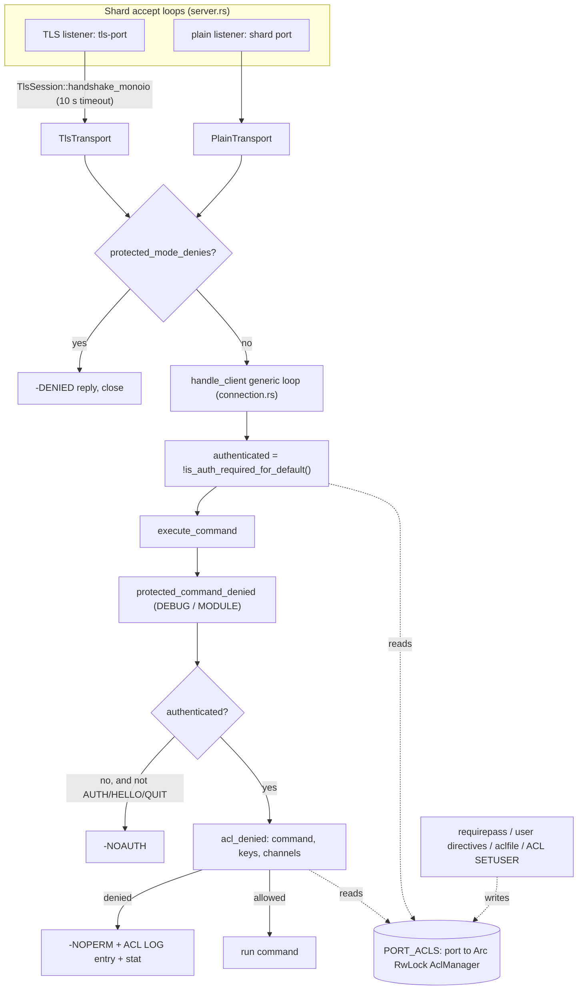
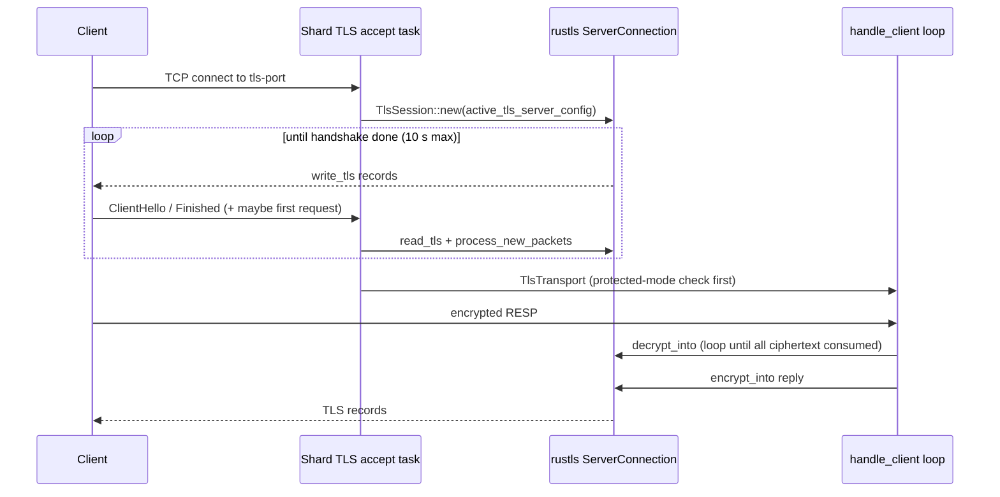

# Component 15: Security (ACL & network guards), Memory Allocator & TLS

> **Source files**: `src/acl.rs`, `src/acl_categories.rs`, `src/netsec.rs`, `src/tls.rs`,
> `src/transport.rs`, `src/allocator.rs` (plus the enforcement call sites in `src/connection.rs`,
> `src/server.rs`, `src/main.rs`, `src/config.rs`, `src/scripting.rs`)
> **High-level design spec**: [`docs/design/15_security_tls.md`](../design/15_security_tls.md)
> **Consolidated implementation spec**: [`docs/internal/components.md`](components.md)

---

## 1. What this subsystem does

Rudis is a Redis-compatible server, so it has to give operators the same access controls Redis
does. This component covers four loosely related jobs:

1. **Who may connect and what they may do** — Redis-style **ACLs** (Access Control Lists): named
   users with SHA-256-hashed passwords, per-user command permissions (by command, subcommand or
   *category* such as `@read`), key-pattern permissions with read/write granularity, and Pub/Sub
   channel permissions. `AUTH`, `HELLO … AUTH`, `ACL …`, `requirepass`, `aclfile`, `ACL LOG` and
   the `acl_access_denied_*` stats all live here.
2. **Network guards** (`netsec.rs`) — the `bind` address list, **protected mode** (refuse
   non-loopback clients while the default user has no password), the "port already in use" probe,
   and the `enable-debug-command` / `enable-module-command` gates.
3. **TLS** — an optional second listener (`tls-port`) that terminates TLS in userspace with
   `rustls`, optionally verifying client certificates (mTLS), and then runs exactly the same
   connection loop as plaintext clients.
4. **Allocator telemetry and helpers** — jemalloc is the process's global allocator;
   `allocator.rs` reads its statistics for `INFO memory`, `MEMORY STATS/DOCTOR/MALLOC-STATS`,
   exposes cheap per-thread byte counters used by `maxmemory` accounting, and hosts a small
   per-shard object pool (`SmallCollectionArena`) used by the keyspace table.

Users of this component: every client connection (auth + per-command checks), the config loader
and `CONFIG GET/SET/REWRITE`, the shard accept loops, Lua scripting (scripts are ACL-checked as the
calling user), and the memory/eviction subsystem (allocator counters).

---

## 2. Mental model



Key ideas to hold in your head:

- **One ACL table per server, looked up by port.** `PORT_ACLS` maps a port number to a shared
  `Arc<RwLock<AclManager>>`. In cluster mode every shard listens on `base_port + shard_id`, so each
  shard aliases its port to the base port's table (`share_acl_with_port`). Plain and TLS
  connections on a shard use the same `Router`, hence the same `router.port`, hence the same
  table — there is no separate "TLS ACL".
- **Free when unused.** `HAS_CUSTOM_ACL` is a process-wide flag. While it is `false` and the
  connection is the `default` user, the per-command ACL check returns immediately without taking
  any lock.
- **The command table is generated.** `acl_categories.rs` is a generated, sorted table of 469
  commands/subcommands with category bitmasks, key-permission flags and a `NO_AUTH` flag; ACL
  permission state is a bitset indexed by that table.
- **TLS is just another transport.** After the handshake, a `TlsTransport` implements the same
  `ClientTransport` trait as `PlainTransport`, so `handle_client<T>` is monomorphized for both and
  TLS clients get pipelining, MULTI/EXEC, Pub/Sub, limits, CLIENT KILL, etc.

---

## 3. ACL data model (`src/acl.rs`, `src/acl_categories.rs`)

### 3.1 Process-wide statics and the per-port registry

| Item | Type | Meaning |
| :--- | :--- | :--- |
| `HAS_CUSTOM_ACL` | `AtomicBool` | Set `true` (never reset) by `set_user`, `load_user_from_declaration`, `load_from_aclfile`, `del_user`, and by `set_requirepass` with a non-empty password. Fast-path switch for every ACL check. |
| `PORT_ACLS` | `LazyLock<Mutex<HashMap<u16, Arc<RwLock<AclManager>>>>>` | Registry of ACL tables keyed by listening port (parking_lot locks). |
| `get_acl_for_port(port)` | fn | Returns the table for `port`, creating a fresh `AclManager::new()` on first use. |
| `share_acl_with_port(port, base_port)` | fn | Makes `port` resolve to `base_port`'s table (overwriting any table created earlier for `port`). No-op when equal. Called by every shard at startup. |

Because the map is process-global, several in-process test servers on different ports each get
their own table; but `HAS_CUSTOM_ACL` is shared, so once any server customizes ACLs, every server
pays the (cheap) lookup cost.

### 3.2 The generated command table (`acl_categories.rs`)

`acl_categories.rs` is produced by `scripts/gen_acl_categories.py` from the Valkey command JSON
files plus Rudis-only commands (`agent`, `bf`, `cf`, `cms`, `mcp`, `xdp`, …). Do not edit it by
hand.

```rust
pub const CATEGORIES: &[&str] = &["keyspace", "read", "write", "set", "sortedset", "list",
    "hash", "string", "bitmap", "hyperloglog", "geo", "stream", "pubsub", "admin", "fast",
    "slow", "blocking", "dangerous", "connection", "transaction", "scripting"]; // bit i = CATEGORIES[i]

pub struct CmdInfo {
    pub name: &'static str,     // lowercase; subcommands are "parent|sub"
    pub cats: u32,              // category bitmask
    pub key_flags: u8,          // bit0 = needs read (%R), bit1 = needs write (%W)
    pub no_auth: bool,          // NO_AUTH flag: exempt from command ACLs
    pub parent: Option<u16>,    // index of the container, for subcommands
    pub subs: (u16, u16),       // index range of this container's subcommands (empty otherwise)
}
pub const NUM_COMMANDS: usize = 469;
pub const WORDS: usize = 8;     // 8 x 64 bits >= 469 commands
pub static COMMANDS: [CmdInfo; NUM_COMMANDS] = [ /* sorted by name */ ];
```

Because `COMMANDS` is sorted and a container's subcommands sort directly after it
(`"acl"`, `"acl|cat"`, …, `"acl|whoami"`), a container's subcommands form one contiguous index
range — that is what `subs` records. Only four commands carry `no_auth`: `auth`, `hello`, `quit`,
`reset`.

Helpers in `acl.rs`:

- `command_index(name)` — case-insensitive binary search of `COMMANDS` by name (`"get"`,
  `"config|set"`).
- `commands_in_category(cat)` — all command names whose `cats` contain that category bit (used by
  `ACL CAT <category>`); `None` for an unknown category.
- `CommandSet([u64; WORDS])` — one bit per `COMMANDS` entry; the user's effective permission set.

### 3.3 `AclUser`

| Field | Type | Meaning |
| :--- | :--- | :--- |
| `name` | `String` | Username (no spaces or NUL allowed). |
| `enabled` | `bool` | `on` / `off`. A disabled user cannot authenticate. |
| `password_hashes` | `Vec<String>` | `"#<64 lowercase hex>"` SHA-256 digests only. Plaintext is never stored. |
| `nopass` | `bool` | Any password is accepted. |
| `all_commands` | `bool` | Redis `allcommands`: set by `+@all`, cleared by any later removal. Also grants commands absent from the table. |
| `commands` (private) | `CommandSet` | Effective per-command permission bits. |
| `cmd_base_all` (private) | `bool` | Whether the rule history starts from `+@all` or `-@all` (for `ACL LIST`/`GETUSER` output). |
| `cmd_rules` (private) | `Vec<CmdRuleEntry>` | Ordered, compacted history of category / command / first-arg rules, used to render a replayable rule string. |
| `first_arg_rules` (private) | `Vec<(usize, String)>` | Allowed first arguments, e.g. `+select|0` → `(idx("select"), "0")`. |
| `all_keys` | `bool` | `allkeys` / `~*`. |
| `key_patterns` | `Vec<KeyPattern>` | `{ pattern: String, perm: u8 }` with `perm` ⊆ `KEY_READ (1) | KEY_WRITE (2)`. |
| `all_channels` | `bool` | `allchannels` / `&*`. |
| `channel_patterns` | `Vec<String>` | `&<glob>` Pub/Sub channel patterns. |
| `sanitize_payload` | `bool` | `sanitize-payload` (default) / `skip-sanitize-payload`. Stored and displayed only (see §10). |

`CmdRuleEntry` is `Category { allow, name } | Command { allow, idx } | FirstArg { parent_idx, arg }`.

Two constructors:

- `AclUser::new_default()` — the built-in `default` user: `on nopass ~* &* +@all`
  (`enabled`, `nopass`, `all_commands`, full `CommandSet`, `all_keys`, `all_channels`).
- `AclUser::new_empty_with_pubsub(name, all_channels_default)` — a brand-new user:
  `off`, no passwords and not `nopass`, `-@all`, no keys, and channel access taken from
  `acl-pubsub-default` (`false` = `resetchannels`, the Redis 7 default).

### 3.4 `AclManager`

| Field | Type | Meaning |
| :--- | :--- | :--- |
| `users` | `HashMap<String, AclUser>` | Always contains `default`. |
| `requirepass` | `Option<String>` | The plaintext `requirepass` value, kept only so `CONFIG GET requirepass` / `CONFIG REWRITE` can echo it, as Redis does. ACL commands never expose it. |
| `acl_pubsub_default_all` | `bool` | `acl-pubsub-default` (`allchannels` = `true`). Default `false`. |
| `aclfile` | `Option<PathBuf>` | `aclfile` path, if configured. |
| `acllog_max_len` | `usize` | `acllog-max-len`, default 128. 0 disables logging. |
| `acl_log` | `VecDeque<AclLogEntry>` | `ACL LOG` ring, newest first. |
| `next_log_entry_id` | `u64` | Monotonic `entry-id` counter. |

---

## 4. Authentication

### 4.1 Password hashing

There is exactly one scheme, matching Redis: `hash_password_sha256(p)` returns `"#"` followed by
the lowercase hex SHA-256 of `p` (65 characters, unsalted — so hashes are portable between
Redis-compatible servers). A `#<hash>` rule body is validated by `parse_password_hash`: exactly 64
hex digits (upper case accepted, normalized to lower case), otherwise an error.

### 4.2 `check_auth(username, password)`

1. Look up `username` (or `default` when `None`). Missing user → `WRONGPASS`.
2. Disabled user → `WRONGPASS` (the same message, so usernames are not probeable).
3. `nopass` → success immediately.
4. Compute `hash_password_sha256(password)` and compare it against every stored hash with
   `ct_eq` (constant-time byte equality, so timing does not leak a matching prefix).
5. Match → `Ok(username)`; otherwise `Err("WRONGPASS invalid username-password pair or user is disabled.")`.

A stored hash is **never** accepted as a password itself: sending `#<hash>` or the bare hex as the
`AUTH` argument fails (unit test `test_acl_passwords_stored_hashed_and_hash_not_accepted`).

### 4.3 When does a connection start authenticated?

`is_auth_required_for_default()` mirrors Redis `authRequired()`: auth is required unless the
`default` user exists, is enabled **and** is `nopass`. The generic connection loop
(`handle_client` in `connection.rs`, shared by plain and TLS) starts with:

```rust
let mut authenticated = !get_acl_for_port(router.port).read().is_auth_required_for_default();
let mut auth_user = "default".to_string();
```

`RESET` (in all its code paths: normal, inside MULTI, Pub/Sub mode) re-derives `authenticated`
with the same function and switches back to `default`.

### 4.4 `AUTH` and `HELLO … AUTH`

- `AUTH [user] pass` → `check_auth`. On success sets `authenticated = true`, `auth_user`, and
  updates the global client registry entry (so `CLIENT LIST` shows `user=`, and `ACL DELUSER`
  can find the connection). On failure records an `Auth` denial (context `toplevel` or `multi`,
  object `AUTH`) and replies `-WRONGPASS …`.
- `HELLO proto AUTH user pass` does the same (denial recorded with command `hello`). `HELLO`
  without `AUTH` on an unauthenticated connection that requires auth gets
  `-NOAUTH HELLO must be called with the client already authenticated, …`.

### 4.5 `requirepass`

`AclManager::set_requirepass(pass)` is the single implementation used by both the config file
(`main.rs`, before shards start) and `CONFIG SET requirepass`:

1. Clear the default user's hashes.
2. Empty `pass` → default user becomes `nopass`; `requirepass = None`.
3. Otherwise push `hash_password_sha256(pass)`, set `nopass = false`, set `HAS_CUSTOM_ACL`, and
   remember the plaintext in `requirepass`.

Worked example: `rudis --requirepass s3cret`, then a client connects. `is_auth_required_for_default`
is `true` (default user not `nopass`), so `authenticated = false`; `GET k` returns `-NOAUTH`;
`AUTH s3cret` hashes the input, matches the stored digest, and the connection proceeds as
`default`.

---

## 5. Authorization: rules and checks

### 5.1 `ACL SETUSER` rule grammar (`apply_rule_with_pubsub` / `apply_prefixed_rule`)

`AclManager::set_user(name, rules)` clones the existing user (or creates
`new_empty_with_pubsub`), applies every rule in order, and only then stores the result — so a bad
rule leaves the user untouched (or uncreated). All errors have the form
`Error in ACL SETUSER modifier '<rule>': <reason>`. Usernames containing a space or NUL are
rejected.

| Rule (case-insensitive keywords) | Effect |
| :--- | :--- |
| `on` / `off` | enable / disable |
| `nopass` | `nopass = true`, clear hashes |
| `resetpass` | `nopass = false`, clear hashes |
| `>pw` | `nopass = false`, add `sha256(pw)` (dedup) |
| `<pw` | remove `sha256(pw)` |
| `#hex` | `nopass = false`, add validated hash |
| `!hex` | remove validated hash |
| `allkeys` / `~*` | `all_keys = true`, clear patterns |
| `resetkeys` | `all_keys = false`, clear patterns |
| `~pat` | add pattern with read+write |
| `%R~pat`, `%W~pat`, `%RW~pat` | add pattern with those permissions; repeating a pattern ORs permissions in. Adding any pattern while `all_keys` is set is an error. |
| `allchannels` / `&*` | `all_channels = true`, clear patterns |
| `resetchannels` | `all_channels = false`, clear patterns |
| `&pat` | add channel glob (error while `all_channels`) |
| `allcommands` / `+@all` | full `CommandSet`, `all_commands = true`, reset rule history |
| `nocommands` / `-@all` | empty `CommandSet`, `all_commands = false`, reset rule history |
| `+@cat` / `-@cat` | set/clear every command whose `cats` has that bit (unknown category → error) |
| `+cmd` / `-cmd` | set/clear that command; a container rule cascades to all its subcommands (`+config` grants `config|get`, `config|set`, …) |
| `+container|sub` / `-container|sub` | precise subcommand rule (it is its own table entry) |
| `+cmd|arg` | **first-arg rule**, only for plain commands without subcommands (e.g. `+select|0`, `+debug|object`) |
| `sanitize-payload` / `skip-sanitize-payload` | set `sanitize_payload` |
| `clearselectors` | accepted, no-op (selectors don't exist) |
| `reset` | back to `new_empty_with_pubsub` (keeps name) |
| `(…)` | error: `Selectors are not supported` |
| `+cont|sub|arg` | error: `Allowing first-arg of a subcommand is not supported` |
| unknown `+x` / `-x` / `-nopass` etc. | error: `Unknown command or category name in ACL` |
| anything else | error: `Syntax error` |

Any removal (`-cmd`, `-@cat`) clears `all_commands`, as in Redis: from then on commands that are
not in the table are denied.

### 5.2 Command check: `can_execute_command_with_first_arg(name, first_arg)`

1. `command_index(name)`; if the name is not in the table → allowed only if `all_commands`.
2. If the entry is `no_auth` (`auth`/`hello`/`quit`/`reset`) or the user has `all_commands` → allow.
   Note `PING` is *not* exempt — a `-@all +get` user cannot `PING`.
3. Leaf command (empty `subs`): allowed if its bit is set; otherwise, if a first argument was
   supplied, allowed if a matching first-arg rule exists (case-insensitive).
4. Bare container name (the caller could not resolve a subcommand): allowed only if **every**
   subcommand bit is set, ignoring `…|help`.

The connection layer resolves names with `acl_cmd_name(cmd)` (e.g. `Command::Acl(SetUser)` →
`"acl|setuser"`), and `acl_first_arg(cmd)` supplies the first argument only for `SELECT` and
`DEBUG`.

Worked example: `ACL SETUSER bob on >pw -@all +@read -memory|usage +client|setname ~app:*`.
`GET app:1` → `get` is in `@read` ✓, key matches ✓. `SET app:1 v` → `set` is `@write` ✗ →
`-NOPERM this user has no permissions to run the 'set' command`. `CLIENT SETNAME x` ✓,
`CLIENT KILL …` ✗ (only that subcommand was granted).

### 5.3 Key check: `can_access_key(key, need)`

`need` comes from `acl_key_perm(cmd)`: the command's `key_flags` from the table, except `SET`
without `GET` needs only `KEY_WRITE`, and commands missing from the table need both. A key is
allowed if `all_keys`, or if **one single** pattern both glob-matches the key
(`pubsub::glob_match`, full Redis glob: `*`, `?`, `[…]`) and grants every bit in `need`.
`need == 0` (e.g. `EXISTS`) just requires a match. Every key of the command is checked
(`cmd_keys`), not just the first.

### 5.4 Channel check: `can_access_channel(channel, is_pattern)`

Used for `SUBSCRIBE`, `SSUBSCRIBE`, `PUBLISH`, `SPUBLISH` (glob-match the channel against the
user's patterns) and `PSUBSCRIBE` (the pattern must **equal** one of the user's patterns
literally, Redis `ACLCheckChannelAgainstList`). `acl_first_denied_channel` returns the first
offending channel.

### 5.5 Where the checks run (`connection.rs`)

| Path | Function | Notes |
| :--- | :--- | :--- |
| Every command in `execute_command` | `protected_command_denied`, then NOAUTH gate, then `acl_denied` | NOAUTH lets only `AUTH`, `HELLO`, `QUIT` through. |
| `acl_denied` → `acl_denied_in_context` | command → keys → channels | Returns early (`None`) when `!HAS_CUSTOM_ACL && auth_user == "default"`. A user missing from the table (deleted mid-session) also returns `None` — such connections are killed by `ACL DELUSER`/`ACL LOAD` instead. |
| Queueing inside `MULTI` | `acl_denied_in_context(.., Some(("multi", name)))` | A denied command gets its NOPERM immediately and aborts the later `EXEC`. At `EXEC` time denial messages use Redis's "ACLs rules changed between the moment the transaction was accumulated and the EXEC call…" wording. |
| Mode-switch commands (`SUBSCRIBE`, `PSUBSCRIBE`, `SSUBSCRIBE`, `PSYNC`, `SYNC`, `DFLY FLOW`) | `mode_switch_denied` | These bypass `execute_command`, so they get their own NOAUTH + command + channel gate. |
| Pipeline squashing | `acl_check_user_cmd` | When a custom ACL is active or the user isn't `default`, any command the user may not run makes the batch non-squashable; it then runs sequentially and the real NOPERM fires there. Pipelining cannot bypass ACLs. |
| Lua scripts | `scripting::script_acl_denied` | Calls `acl_denied_in_context` as the calling user with context `("lua", "eval")`. |
| Client-side tracking | `can_tracker_read_key` | Invalidations are only tracked for keys the user may read. |
| `ACL DRYRUN` | `acl_check_user_cmd` | Same checks, no log entry or stat. |

### 5.6 Denials: `ACL LOG` and stats

`record_acl_denial(port, reason, context, object, username, cmd)`:

1. Bumps one of `Stat::AclAccessDeniedAuth/Cmd/Key/Channel`, reported in `INFO stats` as
   `acl_access_denied_auth/cmd/key/channel`.
2. Calls `AclManager::add_log_entry`. If an entry with the same
   `(reason, context, object, username)` exists, it is removed, its `count` incremented,
   `timestamp_last_updated` and `client_info` refreshed, and it is moved to the front. Otherwise
   old entries are popped from the back until there is room for `acllog_max_len`, and a new entry
   with the next `entry_id` is pushed to the front.

`AclDeniedReason` is `Auth | Command | Key | Channel` (rendered `auth`, `command`, `key`,
`channel`). Contexts used: `toplevel`, `multi`, `lua`.

---

## 6. `ACL` subcommands

| Subcommand | Behaviour |
| :--- | :--- |
| `WHOAMI` | The connection's `auth_user`. |
| `USERS` | Sorted usernames. |
| `LIST` | Sorted `to_acl_list_line()` per user: `user <name> on|off nopass|#hash… sanitize-payload|skip-sanitize-payload [keys] &*|resetchannels &pat… <commands>`. The commands part is `commands_rule_string()` (`+@all`/`-@all` followed by the compacted rule history). Lines are replayable through `ACL SETUSER` (unit test `test_acl_list_line_round_trips`). |
| `GETUSER <name>` | 10-element map: `flags` (`on/off`, `nopass`, `allkeys`, `allchannels`, `allcommands`, `sanitize-payload`/`skip-sanitize-payload`), `passwords` (hex digests without `#`), `commands`, `keys` (`~*` or `~p`/`%R~p`/`%W~p` list), `channels` (`&*` or `&p` list). Unknown user → null. No `selectors` field. |
| `SETUSER <name> rules…` | §5.1; `+OK` or `-ERR <message>`. Does not disconnect existing sessions. |
| `DELUSER <names…>` | Errors if any name is empty or `default`. Otherwise deletes, returns the count, and kills every connection on this port authenticated as a deleted user (the calling connection is closed after the reply). |
| `CAT [category]` | Without argument: the 21 `CATEGORIES`. With one: the table's commands in it, or `-ERR Unknown category`. |
| `GENPASS [bits]` | `genpass_hex`: 1..=4096 bits (default 256 → 64 hex chars), from `ring::rand::SystemRandom`. |
| `DRYRUN <user> <cmd> [args…]` | Parses the command and runs `acl_check_user_cmd`; `+OK` or a bulk string `This user has no permissions to …`. If the arguments don't parse, it still checks command (and subcommand / first-arg) permission. |
| `LOG [count]` / `LOG RESET` | Entries newest first: `count`, `reason`, `context`, `object`, `username`, `age-seconds`, `client-info`, `entry-id`, `timestamp-created`, `timestamp-last-updated` (ms). RESP3 clients get maps. |
| `SAVE` | Writes `list()` lines to `aclfile`; error if no `aclfile` configured. |
| `LOAD` | `load_from_aclfile()` (below), then kills connections whose user no longer exists or is disabled. |
| `HELP` | Help text. |

### 6.1 Users from configuration: `user` directives and `aclfile`

- `user <name> rules…` lines in the config file are collected into `ServerConfig.users`
  (duplicates are a config error) and applied at startup with `load_user_from_declaration`,
  which starts every user — including `default` — from `new_empty_with_pubsub`, as Redis does.
- `aclfile <path>` (relative paths resolve against `dir`) is loaded at startup by
  `load_from_aclfile`; failures abort startup. The loader:
  1. Skips blank and `#` lines; every other line must be `user <name> …` (else
     `<path>:<line>: Unrecognized ACL file line …`).
  2. Rejects duplicate users.
  3. Builds each user from `new_empty_with_pubsub` + rules, prefixing errors with `<path>:<line>:`.
  4. If `default` was not mentioned, inserts `new_default()`.
  5. Replaces `users` wholesale only if everything succeeded (atomic).
- `CONFIG REWRITE` emits `requirepass` from `AclManager.requirepass`, and, when
  `HAS_CUSTOM_ACL` is set and no `aclfile` is configured, replaces all `user` lines with the
  current `ACL LIST` output.
- `rename-command` is rejected as a fatal config error: silently keeping a command the operator
  meant to disable would be a security hole; use ACL rules instead.

ACL-related `CONFIG SET` keys: `requirepass`, `acllog-max-len`, `acl-pubsub-default`
(`allchannels` | `resetchannels`), `aclfile`.

---

## 7. Network guards (`src/netsec.rs`)

### 7.1 `bind`

`parse_bind_spec` reads a Redis-style list: IPv4/IPv6 addresses (brackets allowed), `*` = all
IPv4, `::*` = all IPv6, a leading `-` marks an address optional; duplicates collapse.
`DEFAULT_BIND = "* -::*"`. `format_bind_spec` renders it back for `CONFIG GET bind`.
`set_bind_addrs` / `bind_addrs` keep the list per base port.

`bind_reuseport_listener(ip, port, backlog)` creates one non-blocking socket with
`SO_REUSEPORT` + `SO_REUSEADDR`, `IPV6_V6ONLY` for IPv6 (so `::` doesn't collide with `*`),
512 KiB socket buffers. `bind_all` binds every address, skipping failed optional ones and failing
on a required one or if nothing bound. Every shard calls `bind_all` for its plain port and, if
TLS is configured, for `tls-port` — `SO_REUSEPORT` lets the kernel spread connections across
shards.

### 7.2 Port-in-use probe

Because shard sockets use `SO_REUSEPORT`, binding to a port another process (same user) already
listens on would silently *join* it. `ensure_port_free` therefore binds a probe socket **without**
`SO_REUSEPORT` (Linux refuses with `EADDRINUSE` while anything listens there) and reports Redis's
`Could not create server TCP listening socket …: bind: Address already in use`.
`ensure_port_free_with_grace` retries every 20 ms for a grace period (3 s from `main.rs`) because
an abruptly killed predecessor's io_uring rings can keep its listeners alive briefly. `main.rs`
probes the base port (or every shard port in cluster mode), `tls-port`, and the cluster bus port
before starting shards.

### 7.3 Protected mode

`protected_mode_denies(port, peer)` is `true` when protected mode is on for the base port
(default on; `protected-mode` config / `CONFIG SET`), the peer is not loopback (IPv4 loopback,
`::1`, or IPv4-mapped loopback), and the `default` user is `nopass`. Both accept loops check it:
the plain loop before starting the client, the TLS loop after the handshake (so the
`-DENIED Running in protected mode …` reply is sent encrypted), then close.

### 7.4 `enable-debug-command` / `enable-module-command`

`ProtectedAction` is `No` (default) | `Yes` | `Local`. `allows(peer)` is true for `Yes`, false for
`No`, and for `Local` only when the peer is a known loopback address (a script has no peer, so
only `Yes` allows `DEBUG` from Lua). `protected_command_denied` runs before the auth checks in
`execute_command` for `DEBUG` and `MODULE …`, replying with Redis's
`-ERR DEBUG command not allowed. …` text. Settings are per base port; they are read from the
config file / command line (Redis refuses them in `CONFIG SET`).

---

## 8. TLS (`src/tls.rs`, `src/transport.rs`)

### 8.1 Configuration and certificate loading

| Setting | Where | Meaning |
| :--- | :--- | :--- |
| `tls-port` | CLI `--tls-port`, config | Enables the TLS listener on every shard. Fixed at startup. |
| `tls-cert-file`, `tls-key-file` | CLI, config, `CONFIG SET` | Server certificate chain and private key. |
| `tls-ca-cert-file` | config, `CONFIG SET` | CA roots used to verify client certificates. |
| `tls-auth-clients` | config, `CONFIG SET` | `TlsAuthClients`: `yes`/`true`/`1` (default), `no`/`false`/`0`, `optional`. |

Loading functions:

- `load_certs_from_file(path)` — if the bytes contain `-----BEGIN ` (`is_pem`), every
  `CERTIFICATE` block becomes the chain (leaf first, e.g. certbot's `fullchain.pem`); an empty
  result is an error. Otherwise the whole file is one DER certificate.
- `load_key_from_file(path)` — PEM (PKCS#8, PKCS#1 RSA or SEC1 EC via `PrivateKeyDer::from_pem_slice`)
  or raw DER. Errors name the file.
- `load_server_config_from_files(cert, key, ca, auth_clients)` → `server_config_from`.
- `server_config_from(certs, key, ca_certs, auth_clients)`:
  1. If a CA list is present **and** mode is `Yes` or `Optional`: build a `RootCertStore`, a
     `WebPkiClientVerifier` (with `allow_unauthenticated()` for `Optional`), and
     `with_client_cert_verifier(..)`.
  2. Otherwise `with_no_client_auth()`.
  3. `with_single_cert(certs, key)`.
- `generate_self_signed_cert(sans)` — `rcgen` certificate with CN `Rudis In-Memory Dev Cert`,
  O `Rudis Server`, returned as DER; `create_server_config(cert_der, key_der)` wraps it without
  client auth.

Startup (`main.rs`): the TLS runtime state is seeded from config; if `tls-port` is set, the
`ServerConfig` comes from the files when both cert and key are given (failure panics with
`Failed to load TLS cert/key/CA files`), else from a fresh in-memory self-signed certificate for
`localhost` / `127.0.0.1`. The result is stored in the runtime state and wrapped in
`TlsWorkerConfig { tls_port, server_config }` for every shard.

### 8.2 Runtime reconfiguration

`TlsRuntimeState { cert_file, key_file, ca_cert_file, auth_clients, server_config }` lives in the
per-base-port registry `TLS_RUNTIMES` (`get_tls_runtime(base_port)`). `CONFIG SET tls-…` updates
the field and calls `rebuild_server_config()`, which reloads from files when both cert and key
are set; on error the old value is restored and the command fails with
`Unable to update TLS configuration: …`. Each new TLS connection asks
`active_tls_server_config(base_port)` first and falls back to the startup config — so certificate
rotation and mTLS changes apply to new connections without restart; existing sessions keep their
keys.

### 8.3 Accepting a TLS client

Step by step (`server.rs`, TLS accept loop on each shard):

1. Accept; set `TCP_NODELAY` and keepalive.
2. Assign a client id: a per-shard counter starting at `(shard_id << 48) | (1 << 46) | 1`.
   Bit 46 keeps TLS ids disjoint from plain ids (`(shard_id << 48) + n`) and from adopted
   connections (bit 47).
3. `TlsSession::new(active config)` wraps a `rustls::ServerConnection`.
4. `handshake_monoio(&mut stream)` under `TLS_HANDSHAKE_TIMEOUT` (10 s): while handshaking,
   write everything rustls wants to write; when it wants to read, read up to 4 KiB and feed
   **all** of it to `read_tls` + `process_new_packets` (a client may pipeline its first request
   right behind `Finished`; that plaintext stays buffered in rustls). Finally flush trailing
   records (e.g. session tickets). Handshake errors and timeouts are logged at `verbose` level so
   port scanners don't flood the log.
5. Wrap as `TlsTransport::new(stream, session)` (lifts rustls's 64 KiB send-buffer limit,
   creates the push queue).
6. Protected-mode check (§7.3).
7. `connection::handle_client(transport, …)` — the generic loop.

The whole per-connection task runs under `catch_unwind_async`; a panic is counted and logged as
`Panic isolated in TLS client connection id=…`.



### 8.4 `TlsTransport` internals

| Field | Type | Meaning |
| :--- | :--- | :--- |
| `stream` | `monoio::net::TcpStream` | The socket. |
| `conn` | `rustls::ServerConnection` | Session state. |
| `fd` | `RawFd` | For non-blocking `send`/`recv` fast paths. |
| `wire_in` / `wire_out` | `Vec<u8>` | Reused ciphertext buffers (capacity `READ_BUFFER_SIZE`). |
| `check_buffered` | `bool` | First read drains plaintext that arrived with the handshake. |
| `push_tx` / `push_rx` | flume bounded channel (`PUSH_QUEUE_CAPACITY` = 4096) | Out-of-band messages from other threads. |
| `canceller` | `monoio Canceller` | Cancels an idle read when a push arrives. |

Key routines:

- `decrypt_into(conn, wire, buf)` — loops `read_tls` → `process_new_packets` → `drain_plaintext`
  until **all** of `wire` is consumed (`read_tls` takes only a few KiB per call and rustls buffers
  at most 16 KiB of plaintext). Returns bytes appended and whether the peer sent `close_notify`.
- `encrypt_into(conn, plain, wire)` — `writer().write_all(plain)` then drain `write_tls` into
  `wire` (also picks up alerts / key-update responses).
- `read_plain` — drain early plaintext once; then loop: encrypt queued pushes, `send_wire`,
  `read_wire`, `absorb` (decrypt + queue any TLS responses). If a read filled the buffer it also
  drains whatever else is already in the socket (`read_ready_plain`, `MSG_DONTWAIT` `recv`) so a
  large pipeline is decrypted in one go.
- `read_wire` — while any `MONITOR` or client-tracking client exists, races the socket read
  against the push queue with `monoio::select!`; a push cancels the read, is encrypted into
  `wire_out`, and `None` tells the caller to flush and re-read.
- `send_wire` — tries one non-blocking `libc::send`; any remainder goes through io_uring
  `write_all`, reporting the pending bytes as output-buffer memory (`omem`) meanwhile.
- `read_ready` (trait) — a corrupt record shuts the socket down so the next read fails.
- `into_split` (Pub/Sub mode) — splits the TCP stream; the `ServerConnection` is shared between
  `TlsReadHalf` and `TlsWriteHalf` as `Rc<RefCell<…>>` (single-threaded shard, never borrowed
  across an await). A spawned task forwards queued pushes into the Pub/Sub writer channel. When
  the reader sees rustls wanting to write (e.g. a key update), it sends an empty message so the
  writer task flushes.
- `into_tcp_stream` always fails: features that take over the raw socket (replication `PSYNC`,
  `SYNC`, `DFLY FLOW`) reply `-ERR replication links are only supported on the plaintext port`.

### 8.5 Out-of-band pushes: `PushTarget`

`MONITOR` lines and tracking invalidations are produced on other threads. Each client registers a
`PushTarget`: `Fd(RawFd)` for plaintext (non-blocking `send` straight to the socket, dropped if
the socket buffer is full) or `Queue(flume::Sender<Bytes>)` for TLS (bounded `try_send`, dropped
if full). The TLS connection encrypts queued messages itself; writing raw bytes to a TLS socket
would corrupt the stream.

---

## 9. Memory allocator (`src/allocator.rs`)

### 9.1 jemalloc is the global allocator

`src/lib.rs` declares `#[global_allocator] static GLOBAL: tikv_jemallocator::Jemalloc`. The
`tikv-jemallocator` crate is built with `stats` and `background_threads_runtime_support`;
`tikv-jemalloc-ctl` with `stats` and `use_std`.

### 9.2 Background purge thread

`set_background_thread(on)` / `background_thread_enabled()` wrap jemalloc's `background_thread`
control. `main.rs` turns it on at startup (Redis default `jemalloc-bg-thread yes`) so an idle
server returns freed pages to the OS on jemalloc's decay schedule instead of keeping peak RSS
after `DEL`/`FLUSHALL`. `CONFIG SET jemalloc-bg-thread yes|no` (or the config directive) toggles it.

### 9.3 Statistics

`AllocatorStats { allocated, active, resident, metadata, mapped, fragmentation_ratio }`.
`get_allocator_stats()` advances jemalloc's stats epoch, reads the five byte counters (0 on
error), and computes `fragmentation_ratio = resident / allocated` (1.0 when nothing is allocated).

### 9.4 Per-thread counters for `maxmemory` accounting

- `thread_net_bytes()` — this thread's cumulative allocated minus deallocated bytes, read from
  jemalloc's thread-local `allocatedp` / `deallocatedp` pointers (two plain loads, about 1 ns, cached
  in a `thread_local!`). Memory freed by another thread stays charged to the allocator, so only
  the sum over threads is a total, but the delta across a stretch of code on one thread is exact.
  `router::local_real_parts` publishes it per shard when real accounting is enabled.
- `global_allocated()` — process-wide `stats.allocated` after an epoch advance (about 15 µs: cron
  only). Used by `Router::calibrate_real_memory` and `SnapshotEvictionPause` to set the
  "unattributed" remainder so shard nets plus it equal the global figure (only when this is the
  sole server in the process).
- `flush_thread_cache()` — returns objects parked in this thread's jemalloc cache (tcache) to the
  arena by toggling `thread.tcache.enabled` off and on. Called after RDB loads and AOF replay:
  otherwise ~1.5 MB of freed load buffers per shard thread would count as allocated, and
  `maxmemory` eviction would wrongly evict after a restart near the limit.

### 9.5 `INFO memory` (`format_memory_info`)

| Field | Source |
| :--- | :--- |
| `used_memory(_human)` | Caller's `used_mem` (the server's own accounting, see Component 05/07). |
| `used_memory_rss(_human)` | jemalloc `resident`, or `used_mem` if 0. |
| `maxmemory(_human)` | Caller's `max_mem`. |
| `mem_not_counted_for_evict` | Constant 0. |
| `mem_fragmentation_ratio` | `rss / used_mem` (Redis semantics), 1.00 when `used_mem` is 0. |
| `mem_allocator` | `jemalloc`. |
| `allocator_allocated/active/resident/metadata/mapped` | jemalloc stats. |
| `cooled_keys`, `tiered_keys` | Tiering counters passed in. |
| `number_of_cached_scripts`, `number_of_functions`, `number_of_libraries`, `used_memory_vm_functions` | Scripting subsystem (`used_memory_vm_functions` is an estimate: 32768 + 256 per function). |
| `lazyfree_pending_objects` / `lazyfreed_objects` | 0 / `table::get_lazyfreed_objects()`. |

### 9.6 `MEMORY STATS`, `MEMORY DOCTOR`, `MEMORY MALLOC-STATS`

`MemoryReport { breakdown: table::MemoryBreakdown, used, maxmemory, alloc: AllocatorStats }`;
`untracked() = allocated − used` (saturating): memory the allocator holds that `used_memory`
(and so eviction) does not see.

`format_memory_stats` writes a flat RESP2 map of 18 pairs: `total.allocated`, `used_memory`,
`maxmemory`, `keys.count`, `keys.bytes-per-key`, `dataset.bytes`, `overhead.hashtable.main`,
`allocator.allocated/active/resident`, `rudis.dataset.exact.bytes`,
`rudis.dataset.counter.bytes`, `rudis.hashtable.exact.bytes`, `rudis.untracked.bytes`,
`rudis.free-arena.bytes`, and float strings `dataset.percentage`,
`allocator-fragmentation.ratio` (active/allocated), `fragmentation` (resident/used).

`memory_doctor` reports (Redis's "Sam" wording) any of:

1. High fragmentation: resident > 100 MB and > 1.4 × used.
2. Resident exceeds `maxmemory` by more than 20%.
3. Accounting drift: incremental dataset or table estimate differs from the recomputed exact
   value by more than 2% + 1 MB.
4. Untracked memory > 64 MB and > 10% of used.

`malloc_stats()` returns jemalloc's own `stats_print` report for `MEMORY MALLOC-STATS`.

### 9.7 `SmallCollectionArena`

A per-table free-list pool (field `RudisTable.arena`, one per shard table, no locking) that sits
*above* jemalloc to avoid allocator round-trips for "push one, pop one" churn. `MAX_ARENA_POOLED`
= 1024 per pool.

| Collection | Acquire | Recycle |
| :--- | :--- | :--- |
| List (`packedlist::PackedList`) | pop a pooled list or `PackedList::new()` (capacity hint ignored) | `clear()`, keep if pool < 1024 |
| Small hash (`smallhash::SmallHash`) | always `SmallHash::new()` — **not pooled**: it is one exactly sized allocation reallocated on each insert, so recycling saves nothing | dropped |
| Small set (`Vec<table::SmallSetEntry>`) | pooled `Vec` reserved to `min_cap`, or `with_capacity(max(min_cap, 8))` | `clear()`, keep if capacity ≤ 512 and pool < 1024 |
| Small sorted set (`Vec<(OrderedScore, CompactKey)>`) | pooled or `with_capacity(max(min_cap, 16))` | `clear()`, keep if capacity ≤ 512 and pool < 1024 |

Counters: `allocations_saved` (pool hits), `recycles_count` (containers kept). `pool_stats()`
returns `(list, 0, set, zset)` pool lengths — the hash slot is always 0. The table recycles a
value's storage when a key is deleted/emptied and acquires on `LPUSH`/`RPUSH`, `HSET`, `SADD`,
`ZADD` creating a new key.

---

## 10. Invariants & gotchas

- **ACL lookup uses `router.port`, protected mode and TLS runtime use `base_port`.** In cluster
  mode these differ; it works because `share_acl_with_port` aliases every shard port to the base
  table. A new code path that calls `get_acl_for_port` with some other port gets a fresh,
  open `default nopass` table.
- **`HAS_CUSTOM_ACL` is a one-way latch** for the whole process. Never add per-command work that
  isn't guarded by it, or the zero-cost fast path disappears.
- **Command checks need the resolved name.** Use `acl_cmd_name` (which resolves `container|sub`),
  not the display name; an unresolved container is only allowed if all its subcommands are.
- **`PING` is not ACL-exempt**; only `NO_AUTH` commands (`auth`, `hello`, `quit`, `reset`) are.
  The NOAUTH gate before authentication is separate and allows only `AUTH`, `HELLO`, `QUIT`.
- **SETUSER is atomic, DELUSER/LOAD disconnect, SETUSER does not.** Changing a logged-in user's
  rules takes effect on its next command (each check re-reads the table), but disabling a user
  with `off` does not kick its existing sessions.
- **Never write to a TLS client's fd directly.** Use the transport or `PushTarget`.
- **`TlsTransport` must consume all ciphertext per read** (`decrypt_into` loops); dropping the
  remainder would silently lose pipelined commands.
- **Default `tls-auth-clients` is `yes`, but without `tls-ca-cert-file` no client certificate is
  requested** — `server_config_from` falls back to `with_no_client_auth()`. This differs from
  Redis, which requires a CA in that case.
- **`thread_net_bytes` is only meaningful as a delta on one thread or summed across threads.**

## 11. Limitations / not implemented

- **ACL selectors** (`(…)` rules, Redis 7) are rejected; `clearselectors` is a no-op.
- **First-arg rules** work only for plain commands; `ACL GETUSER` has no `selectors` field.
- **`sanitize-payload` / `skip-sanitize-payload`** are stored and displayed but nothing consults
  them (there is no RESTORE deep-sanitization switch).
- **`ACL LOG` aggregation has no time window** (Redis only merges entries within 60 s), and the
  `client-info` field is synthetic (`addr=127.0.0.1:0 laddr=127.0.0.1:6379 …` with the real id,
  db, command and user).
- **Client certificates do not map to ACL users** (`tls-auth-clients-user` is accepted as a known
  Redis directive but not implemented); an mTLS client still authenticates as `default` or via
  `AUTH`.
- **`tls-port` cannot change at runtime**, there is no TLS on the replication link or cluster bus,
  and no TLS protocol/cipher configuration (rustls defaults apply).
- **No kernel TLS (kTLS) offload.** Deliberately: it would need rustls secret extraction,
  per-cipher `setsockopt(SOL_TLS, TLS_TX/TLS_RX)` key installation, out-of-band handling of TLS 1.3
  control records on receive, and the `tls` kernel module; Rudis doesn't use `sendfile`, so it
  would mostly move the same AES-GCM work into the kernel.
- **`genpass_hex` fallback**: if the system RNG fails, it falls back to bytes derived from the
  current time — not cryptographically strong (practically unreachable on Linux).
- **No jemalloc heap profiling**; only aggregate stats and the `stats_print` report.

---

## 12. Code map

| File | Key symbols | What they do |
| :--- | :--- | :--- |
| `src/acl.rs` | `HAS_CUSTOM_ACL`, `PORT_ACLS`, `get_acl_for_port`, `share_acl_with_port` | Global fast-path flag and per-port ACL table registry (cluster shard aliasing). |
| | `hash_password_sha256`, `parse_password_hash`, `ct_eq` | Redis SHA-256 password hashes, `#hash` validation, constant-time compare. |
| | `command_index`, `commands_in_category`, `CommandSet` | Lookups into the generated command table; per-user permission bitset. |
| | `AclUser` (`new_default`, `new_empty_with_pubsub`, `apply_rule_with_pubsub`, `can_execute_command_with_first_arg`, `can_access_key`, `can_access_channel`, `to_acl_list_line`, `commands_rule_string`, `keys_rule_string`, `channels_rule_string`, `flags`) | User model, rule parser, permission checks, ACL LIST/GETUSER rendering. |
| | `KeyPattern`, `KEY_READ`, `KEY_WRITE` | `%R~`/`%W~` key permissions. |
| | `AclManager` (`check_auth`, `is_auth_required_for_default`, `set_requirepass`, `set_user`, `del_user`, `load_user_from_declaration`, `load_from_aclfile`, `save_to_aclfile`, `add_log_entry`) | Server-wide user table, auth, config integration, ACL LOG. |
| | `AclDeniedReason`, `AclLogEntry`, `genpass_hex` | ACL LOG model; `ACL GENPASS`. |
| `src/acl_categories.rs` | `CATEGORIES`, `CmdInfo`, `COMMANDS`, `NUM_COMMANDS`, `WORDS` | Generated (by `scripts/gen_acl_categories.py`) command/category/key-flag table. |
| `src/connection.rs` | `acl_cmd_name`, `acl_key_perm`, `acl_first_arg`, `acl_denied`, `acl_denied_in_context`, `acl_check_user_cmd`, `acl_first_denied_channel`, `mode_switch_denied`, `record_acl_denial`, `protected_command_denied`, `can_tracker_read_key` | Enforcement call sites; `AUTH`/`HELLO`/`RESET`/`ACL` handlers; `CONFIG SET` for ACL, TLS, protected-mode and jemalloc keys; `REPLICATION_NEEDS_PLAINTEXT`. |
| `src/scripting.rs` | `script_acl_denied` | ACL checks for commands issued from Lua. |
| `src/config.rs` | `ServerConfig.{requirepass, users, tls_*}`, `user` / `rename-command` directives, `CONFIG REWRITE` user lines | Config-file side of ACL and TLS. |
| `src/netsec.rs` | `parse_bind_spec`, `format_bind_spec`, `bind_addrs`, `bind_reuseport_listener`, `bind_all` | `bind` handling and `SO_REUSEPORT` listeners. |
| | `ensure_port_free`, `ensure_port_free_with_grace` | Refuse to start on a busy port. |
| | `protected_mode`, `protected_mode_denies`, `PROTECTED_MODE_DENIED` | Protected mode. |
| | `ProtectedAction`, `enable_debug_command`, `enable_module_command`, `DEBUG_COMMAND_NOT_ALLOWED`, `MODULE_COMMAND_NOT_ALLOWED` | DEBUG/MODULE gates. |
| `src/tls.rs` | `generate_self_signed_cert`, `create_server_config`, `load_certs_from_file`, `load_key_from_file`, `load_server_config_from_files`, `server_config_from`, `TlsAuthClients` | Certificates, keys, mTLS verifier, rustls `ServerConfig`. |
| | `TlsSession::handshake_monoio` | Async server handshake. |
| | `TlsTransport`, `TlsReadHalf`, `TlsWriteHalf`, `decrypt_into`, `encrypt_into` | TLS `ClientTransport` implementation. |
| | `TlsWorkerConfig`, `TlsRuntimeState`, `get_tls_runtime`, `active_tls_server_config` | Startup config for shards and runtime-reloadable config. |
| `src/transport.rs` | `ClientTransport`, `TransportRead`, `TransportWrite`, `PlainTransport`, `PushTarget`, `PUSH_QUEUE_CAPACITY` | Transport abstraction shared by plain and TLS clients. |
| `src/server.rs` | TLS accept loop, `TLS_HANDSHAKE_TIMEOUT`, `share_acl_with_port` call | Per-shard listeners, handshake, protected-mode check. |
| `src/main.rs` | requirepass / aclfile / user loading, TLS config build, `set_background_thread(true)`, port probes | Startup wiring. |
| `src/allocator.rs` | `AllocatorStats`, `get_allocator_stats`, `set_background_thread`, `background_thread_enabled` | jemalloc stats and purge thread. |
| | `thread_net_bytes`, `global_allocated`, `flush_thread_cache` | Counters and tcache flush for `maxmemory` accounting. |
| | `format_memory_info`, `MemoryReport`, `format_memory_stats`, `memory_doctor`, `malloc_stats` | `INFO memory`, `MEMORY STATS/DOCTOR/MALLOC-STATS`. |
| | `SmallCollectionArena`, `MAX_ARENA_POOLED` | Per-table container pool used by `RudisTable`. |
| `src/lib.rs` | `#[global_allocator] GLOBAL` | Installs jemalloc. |
