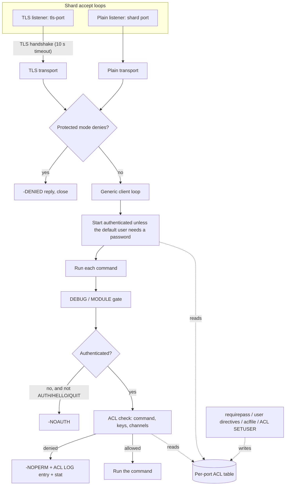
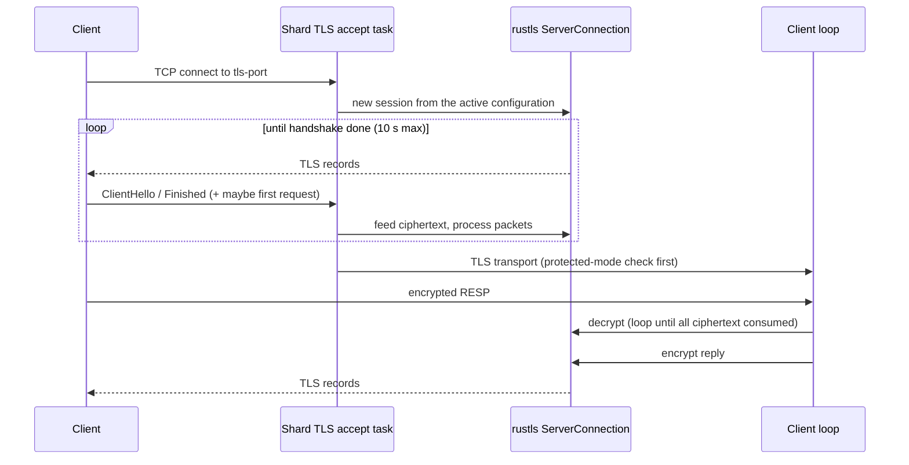

# Component 15: Security (ACL and Network Guards), Memory Allocator and TLS

> **High-Level Design Spec**: [docs/design/15_security_tls.md](../design/15_security_tls.md)
> **Consolidated Implementation Spec**: [docs/internal/components.md](components.md)
> **Main source files**: src/acl.rs (users, passwords, rule parsing and permission checks),
> src/acl_categories.rs (the generated command table), src/netsec.rs (bind addresses, the port
> probe, protected mode, the DEBUG and MODULE gates), src/tls.rs (certificates and the TLS
> transport), src/transport.rs (the transport abstraction shared with plain TCP), src/allocator.rs
> (jemalloc statistics and helpers). The enforcement call sites are in src/connection.rs,
> src/server.rs, src/main.rs, src/config.rs and src/scripting.rs. The [Code map](#12-code-map)
> lists the key symbols.

---

## 1. What this subsystem does

Rudis is a Redis-compatible server, so it has to give operators the same access controls Redis does.
This component covers four loosely related jobs:

1. **Who may connect and what they may do.** Redis-style **ACLs** (Access Control Lists): named users
   with SHA-256-hashed passwords, per-user command permissions (by command, subcommand or *category*
   such as `@read`), key-pattern permissions with read and write granularity, and Pub/Sub channel
   permissions. `AUTH`, `HELLO ... AUTH`, the `ACL` commands, `requirepass`, `aclfile`, `ACL LOG` and
   the `acl_access_denied_*` statistics all live here.
2. **Network guards** (src/netsec.rs). The `bind` address list, **protected mode** (refuse
   non-loopback clients while the default user has no password), the "port already in use" probe, and
   the `enable-debug-command` and `enable-module-command` gates.
3. **TLS.** An optional second listener (`tls-port`) that terminates TLS in user space with `rustls`,
   optionally verifying client certificates (mTLS), and then runs exactly the same connection loop as
   plaintext clients.
4. **Allocator telemetry and helpers.** jemalloc is the process's global allocator; src/allocator.rs
   reads its statistics for `INFO memory` and `MEMORY STATS`, `DOCTOR` and `MALLOC-STATS`, exposes cheap
   per-thread byte counters used by `maxmemory` accounting, and hosts a small per-shard object pool used
   by the keyspace table.

The users of this component are every client connection (authentication and per-command checks), the
config loader and `CONFIG GET/SET/REWRITE`, the shard accept loops, Lua scripting (scripts are
ACL-checked as the calling user), and the memory and eviction subsystem (allocator counters).

---

## 2. Mental model



Four ideas to hold in your head:

* **One ACL table per server, looked up by port.** A process-wide map from port number to a shared,
  locked ACL manager holds the tables. In cluster mode every shard listens on its own port, so each
  shard aliases its port to the base port's table. Plain and TLS connections on a shard use the same
  router, hence the same port, hence the same table: there is no separate "TLS ACL".
* **Free when unused.** A process-wide flag says whether any custom ACL exists. While it is false and
  the connection is the `default` user, the per-command ACL check returns immediately without taking
  any lock.
* **The command table is generated.** acl_categories.rs is a generated, sorted table of 469 commands
  and subcommands with category bitmasks, key-permission flags and a `NO_AUTH` flag; ACL permission
  state is a bitset indexed by that table.
* **TLS is just another transport.** After the handshake, the TLS transport implements the same
  interface as the plain one, so the generic client loop is compiled for both and TLS clients get
  pipelining, `MULTI`/`EXEC`, Pub/Sub, limits, `CLIENT KILL` and the rest.

| Term | Meaning |
| :--- | :--- |
| **ACL** | Access Control List: the per-user rules saying which commands, keys and channels are allowed. |
| **Category** | A named group of commands such as `@read` or `@dangerous`. |
| **Protected mode** | A safety net that refuses non-local clients while no password is set. |
| **mTLS** | Mutual TLS: the server also verifies a certificate presented by the client. |
| **jemalloc** | The memory allocator Rudis uses for the whole process. |

---

## 3. The ACL data model

### 3.1 Process-wide state and the per-port registry

* The **custom-ACL flag** is set (and never reset) by creating or changing users, loading an ACL file,
  deleting a user, and setting a non-empty `requirepass`. It is the fast-path switch for every ACL
  check.
* The **registry** maps listening port to its ACL table. Looking up a port creates a fresh table on
  first use. Sharing a port with a base port makes the first resolve to the base port's table
  (overwriting any table created earlier for it); every shard does this at startup.

Because the map is process-global, several in-process test servers on different ports each get their
own table, but the custom-ACL flag is shared, so once any server customizes ACLs, every server pays the
(cheap) lookup cost.

### 3.2 The generated command table

acl_categories.rs is produced by `scripts/gen_acl_categories.py` from the Valkey command JSON files plus
Rudis-only commands (`agent`, `bf`, `cf`, `cms`, `mcp`, `xdp` and others). Do not edit it by hand.

Each entry records the lowercase name (subcommands are written `parent|sub`), a category bitmask, key
flags (bit 0: the command needs read access, shown `%R`; bit 1: it needs write access, shown `%W`), a
`no_auth` flag (the command is exempt from command ACLs), the index of its container for subcommands,
and the index range of this container's own subcommands. There are 21 categories, 469 table entries,
and a permission set is 8 words of 64 bits. [Reference details](#131-the-command-table) shows the
declarations.

Because the table is sorted and a container's subcommands sort directly after it (`acl`, `acl|cat`,
..., `acl|whoami`), a container's subcommands form one contiguous index range. Only four commands carry
`no_auth`: `auth`, `hello`, `quit` and `reset`.

Helpers: a case-insensitive binary search by name (`get`, `config|set`), a lookup of all commands in a
category (used by `ACL CAT <category>`; none for an unknown category), and the permission bitset, one
bit per entry, which is the user's effective command permission set.

### 3.3 A user

A user has a name (no spaces or NUL), an enabled flag (`on` or `off`; a disabled user cannot
authenticate), a list of password hashes (`#` followed by 64 lowercase hex digits; **plaintext is never
stored**), a `nopass` flag (any password is accepted), and the permissions:

* **Commands.** The `allcommands` flag (set by `+@all`, cleared by any later removal, and also granting
  commands absent from the table), the effective permission bitset, whether the rule history starts from
  `+@all` or `-@all`, an ordered and compacted history of category, command and first-argument rules
  (used to print a replayable rule string), and the allowed first arguments (for example `+select|0`).
* **Keys.** An `allkeys` flag and a list of patterns, each with read and write bits.
* **Channels.** An `allchannels` flag and a list of Pub/Sub glob patterns.
* **Payload sanitizing.** `sanitize-payload` (the default) or `skip-sanitize-payload`, stored and
  displayed only (§11).

Two constructors exist:

* The built-in **default user** is `on nopass ~* &* +@all`: enabled, nopass, all commands, all keys and
  all channels.
* A **new user** is `off`, with no passwords and not `nopass`, `-@all`, no keys, and channel access taken
  from `acl-pubsub-default` (`false` means `resetchannels`, the Redis 7 default).

[Reference details](#132-user-and-manager-fields) lists the fields.

### 3.4 The manager

The manager holds the user table (always containing `default`), the plaintext `requirepass` value (kept
only so `CONFIG GET requirepass` and `CONFIG REWRITE` can echo it, as Redis does; ACL commands never
expose it), the `acl-pubsub-default` setting, the `aclfile` path, the `acllog-max-len` setting (default
128; 0 disables logging), the `ACL LOG` ring (newest first), and a monotonic entry-id counter.

---

## 4. Authentication

### 4.1 Password hashing

There is exactly one scheme, matching Redis: the hash of a password is `#` followed by the lowercase hex
SHA-256 of the password (65 characters, unsalted, so hashes are portable between Redis-compatible
servers). A `#<hash>` rule body must be exactly 64 hex digits (upper case is accepted and normalized to
lower case), otherwise it is an error.

### 4.2 Checking a login

1. Look up the user (`default` when none is given). A missing user gives `WRONGPASS`.
2. A disabled user also gives `WRONGPASS` (the same message, so usernames are not probeable).
3. `nopass` succeeds immediately.
4. Hash the supplied password and compare it against every stored hash with a constant-time byte
   comparison, so timing does not leak a matching prefix.
5. A match succeeds; otherwise the error is `WRONGPASS invalid username-password pair or user is
   disabled.`

A stored hash is **never** accepted as a password itself: sending `#<hash>` or the bare hex as the `AUTH`
argument fails (a unit test pins this).

### 4.3 When does a connection start authenticated?

Authentication is required unless the `default` user exists, is enabled **and** is `nopass`, mirroring
Redis's `authRequired()`. The generic client loop, shared by plain and TLS connections, starts a
connection authenticated exactly when it is not required, with the user set to `default`. `RESET`, in
all its code paths (normal, inside `MULTI`, in Pub/Sub mode), re-derives that state and switches back to
`default`.

### 4.4 AUTH and HELLO ... AUTH

* `AUTH [user] pass` checks the login. On success it marks the connection authenticated, records the user
  and updates the global client registry entry (so `CLIENT LIST` shows `user=`, and `ACL DELUSER` can find
  the connection). On failure it records an auth denial (context `toplevel` or `multi`, object `AUTH`) and
  replies `-WRONGPASS ...`.
* `HELLO proto AUTH user pass` does the same (the denial is recorded with command `hello`). `HELLO` without
  `AUTH` on an unauthenticated connection that requires auth gets `-NOAUTH HELLO must be called with the
  client already authenticated, ...`.

### 4.5 requirepass

A single implementation serves both the config file (before shards start) and `CONFIG SET requirepass`:

1. Clear the default user's hashes.
2. An empty password makes the default user `nopass` and forgets the stored value.
3. Otherwise add the hash of the password, clear `nopass`, set the custom-ACL flag and remember the
   plaintext.

**Worked example.** `rudis --requirepass s3cret`, then a client connects. Authentication is required (the
default user is not `nopass`), so the connection starts unauthenticated; `GET k` returns `-NOAUTH`;
`AUTH s3cret` hashes the input, matches the stored digest, and the connection proceeds as `default`.

---

## 5. Authorization: rules and checks

### 5.1 The ACL SETUSER rule grammar

Setting a user clones the existing user (or creates a new one), applies every rule in order, and only then
stores the result, so a bad rule leaves the user untouched (or uncreated). All errors have the form `Error
in ACL SETUSER modifier '<rule>': <reason>`. Usernames containing a space or NUL are rejected.

ACL configurations are composed of individual rule tokens that govern credentials,
commands, keys, and pub/sub channels:

* **Account status and credentials:** Accounts can be enabled (`on`) or disabled (`off`). Credentials
  can be marked passwordless (`nopass`, allowing unauthenticated access), configured with plaintext
  passwords (`>password`, stored as SHA-256 hashes), or assigned precomputed hex hashes (`#hex`).
  Hashes can be revoked with `<password` or `!hex`, and cleared entirely with `resetpass`.
* **Command categories and rules:** Users can be granted all commands (`+@all` or `allcommands`) or
  restricted to none (`-@all` or `nocommands`). Access can be granted or revoked by category
  (`+@read`, `-@dangerous`), by command name (`+get`, `-set`), by subcommand (`+config|get`), or by
  first argument (`+select|0`).
* **Key patterns and access types:** Key permissions encompass all keys (`~*` or `allkeys`), no keys
  (`resetkeys`), or specific glob patterns. Patterns can specify read-only (`%R~pattern`), write-only
  (`%W~pattern`), or read-write access (`~pattern` or `%RW~pattern`).
* **Pub/sub channels:** Channel access allows all channels (`&*` or `allchannels`), no channels
  (`resetchannels`), or specific channel patterns (`&pattern`).

A comprehensive table of all rule tokens, syntax modifiers, and error strings is indexed in
[Reference details](#133-acl-rule-syntax-tokens).

Any removal (`-cmd`, `-@cat`) clears the `allcommands` flag, as in Redis: from then on commands that are
not in the table are denied.

### 5.2 The command check

1. Find the command in the table; if the name is not there, it is allowed only if the user has
   `allcommands`.
2. If the entry is `no_auth` (`auth`, `hello`, `quit`, `reset`) or the user has `allcommands`, allow.
   Note `PING` is *not* exempt: a `-@all +get` user cannot `PING`.
3. For a leaf command (no subcommands): allowed if its bit is set; otherwise, if a first argument was
   supplied, allowed if a matching first-argument rule exists (case-insensitive).
4. For a bare container name (the caller could not resolve a subcommand): allowed only if **every**
   subcommand bit is set, ignoring `...|help`.

The connection layer resolves names (for example the ACL-set-user command resolves to `acl|setuser`), and
supplies a first argument only for `SELECT` and `DEBUG`.

**Worked example.** `ACL SETUSER bob on >pw -@all +@read -memory|usage +client|setname ~app:*`. `GET
app:1`: `get` is in `@read` and the key matches, so it is allowed. `SET app:1 v`: `set` is `@write`, so it
fails with `-NOPERM this user has no permissions to run the 'set' command`. `CLIENT SETNAME x` is allowed;
`CLIENT KILL ...` is not (only that subcommand was granted).

### 5.3 The key check

The needed permission comes from the command's key flags in the table, except `SET` without `GET` needs
only write, and commands missing from the table need both. A key is allowed if the user has `allkeys`, or
if **one single** pattern both glob-matches the key (full Redis glob: `*`, `?`, `[...]`) and grants every
bit needed. A need of none (for example `EXISTS`) just requires a match. Every key of the command is
checked, not just the first.

### 5.4 The channel check

This is used for `SUBSCRIBE`, `SSUBSCRIBE`, `PUBLISH` and `SPUBLISH` (the channel is glob-matched against
the user's patterns) and for `PSUBSCRIBE` (the pattern must **equal** one of the user's patterns literally,
as in Redis). A helper returns the first offending channel.

### 5.5 Where the checks run

| Path | Notes |
| :--- | :--- |
| Every command | The DEBUG and MODULE gate first, then the `NOAUTH` gate (which lets only `AUTH`, `HELLO` and `QUIT` through), then the ACL check. |
| The ACL check | Command, then keys, then channels. It returns early when no custom ACL exists and the user is `default`. A user missing from the table (deleted mid-session) also passes; such connections are killed by `ACL DELUSER` and `ACL LOAD` instead. |
| Queueing inside `MULTI` | A denied command gets its `NOPERM` immediately and aborts the later `EXEC`. At `EXEC` time, denial messages use Redis's "ACLs rules changed between the moment the transaction was accumulated and the EXEC call..." wording. |
| Mode-switch commands (`SUBSCRIBE`, `PSUBSCRIBE`, `SSUBSCRIBE`, `PSYNC`, `SYNC`, `DFLY FLOW`) | These bypass the normal path, so they get their own `NOAUTH`, command and channel gate. |
| Pipeline squashing | When a custom ACL is active or the user is not `default`, any command the user may not run makes the batch non-squashable; it then runs sequentially and the real `NOPERM` fires there. Pipelining cannot bypass ACLs. |
| Lua scripts | The ACL check runs as the calling user with context `("lua", "eval")`. |
| Client-side tracking | Invalidations are tracked only for keys the user may read. |
| `ACL DRYRUN` | The same checks, with no log entry or stat. |

### 5.6 Denials: ACL LOG and statistics

Recording a denial:

1. Bumps one of the four stats (`auth`, `cmd`, `key`, `channel`), reported in `INFO stats` as
   `acl_access_denied_auth`, `_cmd`, `_key` and `_channel`.
2. Adds a log entry. If an entry with the same (reason, context, object, username) exists, it is removed,
   its count incremented, its last-updated time and client info refreshed, and it is moved to the front.
   Otherwise old entries are popped from the back until there is room for `acllog-max-len`, and a new entry
   with the next entry id is pushed to the front.

The reasons are `auth`, `command`, `key` and `channel`. The contexts used are `toplevel`, `multi` and `lua`.

---

## 6. ACL subcommands

| Subcommand | Behaviour |
| :--- | :--- |
| `WHOAMI` | The connection's user. |
| `USERS` | Sorted usernames. |
| `LIST` | Sorted lines per user: `user <name> on\|off nopass\|#hash... sanitize-payload\|skip-sanitize-payload [keys] &*\|resetchannels &pat... <commands>`. The commands part is `+@all` or `-@all` followed by the compacted rule history. Lines are replayable through `ACL SETUSER` (a unit test pins the round trip). |
| `GETUSER <name>` | A 10-element map: `flags` (`on`/`off`, `nopass`, `allkeys`, `allchannels`, `allcommands`, the sanitize flag), `passwords` (hex digests without `#`), `commands`, `keys` (`~*` or a `~p`/`%R~p`/`%W~p` list), `channels` (`&*` or a `&p` list). An unknown user gives null. There is no `selectors` field. |
| `SETUSER <name> rules...` | §5.1; `+OK` or `-ERR <message>`. Does not disconnect existing sessions. |
| `DELUSER <names...>` | Errors if any name is empty or `default`. Otherwise deletes, returns the count, and kills every connection on this port authenticated as a deleted user (the calling connection is closed after the reply). |
| `CAT [category]` | Without an argument: the 21 categories. With one: the table's commands in it, or `-ERR Unknown category`. |
| `GENPASS [bits]` | 1–4096 bits (default 256, which is 64 hex characters), from the system secure random generator. |
| `DRYRUN <user> <cmd> [args...]` | Parses the command and runs the check; `+OK` or a bulk string `This user has no permissions to ...`. If the arguments do not parse, it still checks command (and subcommand or first-argument) permission. |
| `LOG [count]`, `LOG RESET` | Entries newest first: `count`, `reason`, `context`, `object`, `username`, `age-seconds`, `client-info`, `entry-id`, `timestamp-created`, `timestamp-last-updated` (ms). RESP3 clients get maps. |
| `SAVE` | Writes the `LIST` lines to `aclfile`; an error if no `aclfile` is configured. |
| `LOAD` | Loads `aclfile` (below), then kills connections whose user no longer exists or is disabled. |
| `HELP` | Help text. |

### 6.1 Users from configuration: user directives and aclfile

* `user <name> rules...` lines in the config file are collected (duplicates are a config error) and applied
  at startup. Every user, including `default`, starts from a new empty user, as in Redis.
* `aclfile <path>` (relative paths resolve against `dir`) is loaded at startup; failures abort startup. The
  loader:
  1. Skips blank and `#` lines; every other line must be `user <name> ...` (else `<path>:<line>:
     Unrecognized ACL file line ...`).
  2. Rejects duplicate users.
  3. Builds each user from a new empty user plus rules, prefixing errors with `<path>:<line>:`.
  4. If `default` was not mentioned, inserts the built-in default user.
  5. Replaces the user table wholesale only if everything succeeded (atomic).
* `CONFIG REWRITE` emits `requirepass` from the stored value and, when the custom-ACL flag is set and no
  `aclfile` is configured, replaces all `user` lines with the current `ACL LIST` output.
* `rename-command` is rejected as a fatal config error: silently keeping a command the operator meant to
  disable would be a security hole; use ACL rules instead.

ACL-related `CONFIG SET` keys: `requirepass`, `acllog-max-len`, `acl-pubsub-default` (`allchannels` or
`resetchannels`) and `aclfile`.

---

## 7. Network guards

### 7.1 bind

The bind parser reads a Redis-style list: IPv4 and IPv6 addresses (brackets allowed), `*` for all IPv4,
`::*` for all IPv6, and a leading `-` to mark an address optional; duplicates collapse. The default is `*
-::*`. A formatter renders it back for `CONFIG GET bind`. The list is kept per base port.

The listener helper creates one non-blocking socket with `SO_REUSEPORT` and `SO_REUSEADDR`, IPv6-only mode
for IPv6 (so `::` does not collide with `*`), and 512 KiB socket buffers. Binding all addresses skips failed
optional ones and fails on a required one or if nothing bound. Every shard binds its plain port and, if TLS is
configured, `tls-port`; `SO_REUSEPORT` lets the kernel spread connections across shards.

### 7.2 The port-in-use probe

Because shard sockets use `SO_REUSEPORT`, binding to a port another process (same user) already listens on
would silently *join* it. So the probe binds a socket **without** `SO_REUSEPORT` (Linux refuses with
`EADDRINUSE` while anything listens there) and reports Redis's `Could not create server TCP listening socket
...: bind: Address already in use`. A graceful variant retries every 20 ms for a grace period (3 s from the main
thread), because an abruptly killed predecessor's io_uring rings can keep its listeners alive briefly. The main
thread probes the base port (or every shard port in cluster mode), `tls-port` and the cluster bus port before
starting shards.

### 7.3 Protected mode

Protected mode denies a connection when it is on for the base port (default on; the `protected-mode` setting or
`CONFIG SET`), the peer is not loopback (IPv4 loopback, `::1`, or IPv4-mapped loopback), and the `default` user
is `nopass`. Both accept loops check it: the plain loop before starting the client, the TLS loop after the
handshake (so the `-DENIED Running in protected mode ...` reply is sent encrypted), then close.

### 7.4 enable-debug-command and enable-module-command

Each setting is *no* (the default), *yes* or *local*. Yes always allows; no never does; local allows only when the
peer is a known loopback address (a script has no peer, so only *yes* allows `DEBUG` from Lua). The gate runs
before the auth checks for `DEBUG` and `MODULE ...`, replying with Redis's `-ERR DEBUG command not allowed. ...`
text. Settings are per base port and are read from the config file or command line (Redis refuses them in
`CONFIG SET`).

---

## 8. TLS

### 8.1 Configuration and certificate loading

| Setting | Where | Meaning |
| :--- | :--- | :--- |
| `tls-port` | CLI `--tls-port`, config | Enables the TLS listener on every shard. Fixed at startup. |
| `tls-cert-file`, `tls-key-file` | CLI, config, `CONFIG SET` | Server certificate chain and private key. |
| `tls-ca-cert-file` | config, `CONFIG SET` | CA roots used to verify client certificates. |
| `tls-auth-clients` | config, `CONFIG SET` | `yes` / `true` / `1` (the default), `no` / `false` / `0`, or `optional`. |

Loading works like this:

* **Certificates.** If the file contains `-----BEGIN `, every `CERTIFICATE` block becomes the chain (leaf first,
  as in certbot's `fullchain.pem`); an empty result is an error. Otherwise the whole file is one DER
  certificate.
* **Private key.** PEM (PKCS#8, PKCS#1 RSA or SEC1 EC) or raw DER. Errors name the file.
* **Building the server configuration** from certificate chain, key, optional CA list and client-auth mode:
  1. If a CA list is present **and** the mode is `yes` or `optional`, build a root store and a WebPKI client
     verifier (allowing unauthenticated clients for `optional`) and install it.
  2. Otherwise, require no client authentication.
  3. Install the single server certificate and key.
* **Self-signed fallback.** An `rcgen` certificate with common name `Rudis In-Memory Dev Cert` and
  organization `Rudis Server`, returned as DER, wrapped in a server configuration without client auth.

At startup the main thread seeds the TLS runtime state from config. If `tls-port` is set, the server
configuration comes from the files when both certificate and key are given (failure panics with `Failed to load
TLS cert/key/CA files`), else from a fresh in-memory self-signed certificate for `localhost` and `127.0.0.1`.
The result is stored in the runtime state and handed to every shard along with the TLS port.

### 8.2 Runtime reconfiguration

The runtime state (certificate, key and CA paths, client-auth mode, and the current server configuration) lives in
a per-base-port registry. `CONFIG SET tls-...` updates the field and rebuilds the server configuration, reloading
from files when both certificate and key are set; on error the old value is restored and the command fails with
`Unable to update TLS configuration: ...`. Each new TLS connection asks for the active configuration first and
falls back to the startup one, so certificate rotation and mTLS changes apply to new connections without a restart.
Existing sessions keep their keys.

### 8.3 Accepting a TLS client

On each shard's TLS accept loop:

1. Accept; set `TCP_NODELAY` and keepalive.
2. Assign a client id from a per-shard counter starting at `(shard_id << 48) | (1 << 46) | 1`. Bit 46 keeps TLS
   ids disjoint from plain ids (`(shard_id << 48) + n`) and from adopted connections (bit 47).
3. Wrap a `rustls` server connection around the active configuration.
4. Run the handshake under a 10 s limit. While handshaking, write everything rustls wants to write; when it
   wants to read, read up to 4 KiB and feed **all** of it to rustls (a client may pipeline its first request
   right behind `Finished`; that plaintext stays buffered in rustls). Finally flush trailing records (for
   example session tickets). Handshake errors and timeouts are logged at `verbose` level so port scanners do
   not flood the log.
5. Wrap the stream in the TLS transport (which lifts rustls's 64 KiB send-buffer limit and creates the push
   queue).
6. Run the protected-mode check (§7.3).
7. Run the generic client loop.

The whole per-connection task runs under panic isolation; a panic is counted and logged as `Panic isolated in
TLS client connection id=...`.



### 8.4 TLS transport internals

The transport holds the socket, the rustls session, the raw descriptor (for non-blocking send and receive fast
paths), two reusable ciphertext buffers, a flag that makes the first read drain plaintext that arrived with the
handshake, a bounded push queue (4096 messages) for out-of-band messages from other threads, and a canceller that
cancels an idle read when a push arrives. [Reference details](#133-tls-transport-fields) lists the fields.

Key routines:

* **Decrypt** loops "feed ciphertext, process packets, drain plaintext" until **all** of the input is consumed
  (feeding takes only a few KiB per call and rustls buffers at most 16 KiB of plaintext). It returns the bytes
  appended and whether the peer sent `close_notify`.
* **Encrypt** writes the plaintext into the session and drains the resulting records into the output buffer (which
  also picks up alerts and key-update responses).
* **Read** drains early plaintext once; then loops: encrypt queued pushes, send, read ciphertext, and absorb it
  (decrypt and queue any TLS responses). If a read filled the buffer, it also drains whatever else is already in
  the socket (a non-blocking `recv`) so a large pipeline is decrypted in one go.
* **Wire read.** While any `MONITOR` or client-tracking client exists, the socket read races against the push
  queue; a push cancels the read, is encrypted into the output buffer, and the caller flushes and re-reads.
* **Wire send** tries one non-blocking `send`; any remainder goes through io_uring `write_all`, reporting the
  pending bytes as output-buffer memory meanwhile.
* **Read-ready.** A corrupt record shuts the socket down so the next read fails.
* **Splitting for Pub/Sub mode.** The TCP stream is split; the rustls session is shared between the read and write
  halves as a single-threaded shared cell (never borrowed across an await). A spawned task forwards queued pushes
  into the Pub/Sub writer channel. When the reader sees rustls wanting to write (for example a key update), it sends
  an empty message so the writer task flushes.
* **Taking over the raw socket** always fails: features that need it (replication `PSYNC`, `SYNC`, `DFLY FLOW`) reply
  `-ERR replication links are only supported on the plaintext port`.

### 8.5 Out-of-band pushes

`MONITOR` lines and tracking invalidations are produced on other threads. Each client registers a push target:
either a raw descriptor (plaintext: a non-blocking `send` straight to the socket, dropped if the socket buffer is
full) or a bounded queue (TLS: a non-blocking send, dropped if full). The TLS connection encrypts queued messages
itself; writing raw bytes to a TLS socket would corrupt the stream.

---

## 9. The memory allocator

### 9.1 jemalloc is the global allocator

src/lib.rs installs `tikv_jemallocator::Jemalloc` as the global allocator. The `tikv-jemallocator` crate is built
with `stats` and `background_threads_runtime_support`, and `tikv-jemalloc-ctl` with `stats` and `use_std`.

### 9.2 The background purge thread

Two helpers wrap jemalloc's `background_thread` control. The main thread turns it on at startup (Redis's default
`jemalloc-bg-thread yes`), so an idle server returns freed pages to the OS on jemalloc's decay schedule instead of
keeping peak RSS after `DEL` or `FLUSHALL`. `CONFIG SET jemalloc-bg-thread yes|no` (or the config directive)
toggles it.

### 9.3 Statistics

The statistics record holds allocated, active, resident, metadata and mapped bytes and a fragmentation ratio.
Reading it advances jemalloc's stats epoch, reads the five byte counters (0 on error), and computes the ratio as
resident divided by allocated (1.0 when nothing is allocated).

### 9.4 Per-thread counters for maxmemory accounting

* **Thread net bytes** is this thread's cumulative allocated minus deallocated bytes, read from jemalloc's
  thread-local pointers (two plain loads, about 1 ns, cached in a thread-local). Memory freed by another thread
  stays charged to the allocator, so only the sum over threads is a total, but the delta across a stretch of code
  on one thread is exact. The router publishes it per shard when real accounting is enabled.
* **Global allocated** is the process-wide allocated figure after an epoch advance (about 15 µs, so for the cron
  only). The router's calibration and the snapshot eviction pause use it to set the "unattributed" remainder so
  shard nets plus it equal the global figure (only when this is the sole server in the process).
* **Flush thread cache** returns objects parked in this thread's jemalloc cache to the arena by toggling
  `thread.tcache.enabled` off and on. It is called after RDB loads and AOF replay: otherwise about 1.5 MB of freed
  load buffers per shard thread would count as allocated, and `maxmemory` eviction would wrongly evict after a
  restart near the limit.

### 9.5 INFO memory

| Field | Source |
| :--- | :--- |
| `used_memory` (and `_human`) | The caller's `used_mem` (the server's own accounting, see Components 05 and 07). |
| `used_memory_rss` (and `_human`) | jemalloc resident, or `used_mem` if 0. |
| `maxmemory` (and `_human`) | The caller's `max_mem`. |
| `mem_not_counted_for_evict` | Constant 0. |
| `mem_fragmentation_ratio` | `rss / used_mem` (Redis semantics); 1.00 when `used_mem` is 0. |
| `mem_allocator` | `jemalloc`. |
| `allocator_allocated`, `_active`, `_resident`, `_metadata`, `_mapped` | jemalloc stats. |
| `cooled_keys`, `tiered_keys` | Tiering counters passed in. |
| `number_of_cached_scripts`, `number_of_functions`, `number_of_libraries`, `used_memory_vm_functions` | The scripting subsystem (`used_memory_vm_functions` is an estimate: 32768 + 256 per function). |
| `lazyfree_pending_objects`, `lazyfreed_objects` | 0, and the lazy-freed object counter. |

### 9.6 MEMORY STATS, DOCTOR and MALLOC-STATS

A memory report holds the table's memory breakdown, the used and `maxmemory` figures, and the allocator
statistics; its **untracked** figure is allocated minus used (saturating): memory the allocator holds that
`used_memory` (and so eviction) does not see.

`MEMORY STATS` writes a flat RESP2 map of 18 pairs: `total.allocated`, `used_memory`, `maxmemory`, `keys.count`,
`keys.bytes-per-key`, `dataset.bytes`, `overhead.hashtable.main`, `allocator.allocated`, `.active` and `.resident`,
`rudis.dataset.exact.bytes`, `rudis.dataset.counter.bytes`, `rudis.hashtable.exact.bytes`,
`rudis.untracked.bytes`, `rudis.free-arena.bytes`, and the float strings `dataset.percentage`,
`allocator-fragmentation.ratio` (active over allocated) and `fragmentation` (resident over used).

`MEMORY DOCTOR` reports (in Redis's "Sam" wording) any of:

1. High fragmentation: resident above 100 MB and above 1.4 × used.
2. Resident exceeds `maxmemory` by more than 20%.
3. Accounting drift: the incremental dataset or table estimate differs from the recomputed exact value by more
   than 2% plus 1 MB.
4. Untracked memory above 64 MB and above 10% of used.

`MEMORY MALLOC-STATS` returns jemalloc's own `stats_print` report.

### 9.7 The small-collection arena

A per-table free-list pool (one per shard table, no locking) sits *above* jemalloc to avoid allocator round trips
for "push one, pop one" churn. Each pool keeps at most 1024 entries.

| Collection | Acquire | Recycle |
| :--- | :--- | :--- |
| List | Pop a pooled list or create a new one (the capacity hint is ignored) | Clear it; keep it if the pool has fewer than 1024 |
| Small hash | Always a new one: **not pooled**, because it is one exactly sized allocation reallocated on each insert, so recycling saves nothing | Dropped |
| Small set | A pooled vector reserved to the minimum capacity, or a new one with capacity at least 8 | Clear it; keep it if its capacity is at most 512 and the pool has fewer than 1024 |
| Small sorted set | A pooled vector, or a new one with capacity at least 16 | Same as small set |

Two counters track pool hits and containers kept. The pool-statistics call returns the list, hash (always 0), set
and sorted-set pool lengths. The table recycles a value's storage when a key is deleted or emptied and acquires on
`LPUSH`/`RPUSH`, `HSET`, `SADD` and `ZADD` creating a new key.

---

## 10. Invariants and gotchas

1. **ACL lookup uses the shard port; protected mode and the TLS runtime use the base port.** In cluster mode these
   differ; it works because every shard port is aliased to the base table. A new code path that looks up an ACL
   table with some other port gets a fresh, open `default nopass` table.
2. **The custom-ACL flag is a one-way latch** for the whole process. Never add per-command work that is not guarded
   by it, or the zero-cost fast path disappears.
3. **Command checks need the resolved name.** Use the resolver (which turns a command into `container|sub`), not the
   display name; an unresolved container is only allowed if all its subcommands are.
4. **`PING` is not ACL-exempt**; only the `no_auth` commands (`auth`, `hello`, `quit`, `reset`) are. The `NOAUTH`
   gate before authentication is separate and allows only `AUTH`, `HELLO` and `QUIT`.
5. **`SETUSER` is atomic; `DELUSER` and `LOAD` disconnect, `SETUSER` does not.** Changing a logged-in user's rules
   takes effect on its next command (each check re-reads the table), but disabling a user with `off` does not kick
   its existing sessions.
6. **Never write to a TLS client's descriptor directly.** Use the transport or a push target.
7. **The TLS transport must consume all ciphertext per read** (decrypt loops); dropping the remainder would silently
   lose pipelined commands.
8. **Default `tls-auth-clients` is `yes`, but without `tls-ca-cert-file` no client certificate is requested:** the
   builder falls back to no client authentication. This differs from Redis, which requires a CA in that case.
9. **Thread net bytes is only meaningful as a delta on one thread or summed across threads.**

---

## 11. Limitations and not implemented

* **ACL selectors** (`(...)` rules, Redis 7) are rejected, and `clearselectors` is a no-op.
* **First-argument rules** work only for plain commands, and `ACL GETUSER` has no `selectors` field.
* **`sanitize-payload` and `skip-sanitize-payload`** are stored and displayed but nothing consults them (there is no
  `RESTORE` deep-sanitization switch).
* **`ACL LOG` aggregation has no time window** (Redis merges entries only within 60 s), and the client-info field is
  synthetic (`addr=127.0.0.1:0 laddr=127.0.0.1:6379 ...` with the real id, database, command and user).
* **Client certificates do not map to ACL users.** `tls-auth-clients-user` is accepted as a known Redis directive but
  not implemented; an mTLS client still authenticates as `default` or through `AUTH`.
* **`tls-port` cannot change at runtime**, there is no TLS on the replication link or the cluster bus, and there is no
  TLS protocol or cipher configuration (rustls defaults apply).
* **No kernel TLS (kTLS) offload.** Deliberately: it would need rustls secret extraction, per-cipher
  `setsockopt(SOL_TLS, TLS_TX/TLS_RX)` key installation, out-of-band handling of TLS 1.3 control records on receive, and
  the `tls` kernel module; Rudis does not use `sendfile`, so it would mostly move the same AES-GCM work into the kernel.
* **The password generator's fallback.** If the system random generator fails, `ACL GENPASS` falls back to bytes derived
  from the current time, which is not cryptographically strong (practically unreachable on Linux).
* **No jemalloc heap profiling**; only aggregate stats and the `stats_print` report.

---

## 12. Code map

| File | Key symbols | Role |
| :--- | :--- | :--- |
| `src/acl.rs` | `HAS_CUSTOM_ACL`, `PORT_ACLS`, `get_acl_for_port`, `share_acl_with_port` | The global fast-path flag and the per-port ACL table registry (cluster shard aliasing). |
| `src/acl.rs` | `hash_password_sha256`, `parse_password_hash`, `ct_eq` | Redis SHA-256 password hashes, `#hash` validation, constant-time compare. |
| `src/acl.rs` | `command_index`, `commands_in_category`, `CommandSet` | Lookups into the generated command table; the per-user permission bitset. |
| `src/acl.rs` | `AclUser` (`new_default`, `new_empty_with_pubsub`, `apply_rule_with_pubsub`, `can_execute_command_with_first_arg`, `can_access_key`, `can_access_channel`, `to_acl_list_line`, `commands_rule_string`, `keys_rule_string`, `channels_rule_string`, `flags`) | The user model, the rule parser, permission checks and `ACL LIST`/`GETUSER` rendering. |
| `src/acl.rs` | `KeyPattern`, `KEY_READ`, `KEY_WRITE` | `%R~` and `%W~` key permissions. |
| `src/acl.rs` | `AclManager` (`check_auth`, `is_auth_required_for_default`, `set_requirepass`, `set_user`, `del_user`, `load_user_from_declaration`, `load_from_aclfile`, `save_to_aclfile`, `add_log_entry`) | The server-wide user table, authentication, config integration and `ACL LOG`. |
| `src/acl.rs` | `AclDeniedReason`, `AclLogEntry`, `genpass_hex` | The `ACL LOG` model; `ACL GENPASS`. |
| `src/acl_categories.rs` | `CATEGORIES`, `CmdInfo`, `COMMANDS`, `NUM_COMMANDS`, `WORDS` | The generated (by `scripts/gen_acl_categories.py`) command, category and key-flag table. |
| `src/connection.rs` | `acl_cmd_name`, `acl_key_perm`, `acl_first_arg`, `acl_denied`, `acl_denied_in_context`, `acl_check_user_cmd`, `acl_first_denied_channel`, `mode_switch_denied`, `record_acl_denial`, `protected_command_denied`, `can_tracker_read_key` | Enforcement call sites; the `AUTH`, `HELLO`, `RESET` and `ACL` handlers; `CONFIG SET` for ACL, TLS, protected-mode and jemalloc keys; `REPLICATION_NEEDS_PLAINTEXT`. |
| `src/scripting.rs` | `script_acl_denied` | ACL checks for commands issued from Lua. |
| `src/config.rs` | `ServerConfig.{requirepass, users, tls_*}`, the `user` and `rename-command` directives, the `CONFIG REWRITE` user lines | The config-file side of ACL and TLS. |
| `src/netsec.rs` | `parse_bind_spec`, `format_bind_spec`, `bind_addrs`, `bind_reuseport_listener`, `bind_all` | `bind` handling and `SO_REUSEPORT` listeners. |
| `src/netsec.rs` | `ensure_port_free`, `ensure_port_free_with_grace` | Refuse to start on a busy port. |
| `src/netsec.rs` | `protected_mode`, `protected_mode_denies`, `PROTECTED_MODE_DENIED` | Protected mode. |
| `src/netsec.rs` | `ProtectedAction`, `enable_debug_command`, `enable_module_command`, `DEBUG_COMMAND_NOT_ALLOWED`, `MODULE_COMMAND_NOT_ALLOWED` | The `DEBUG` and `MODULE` gates. |
| `src/tls.rs` | `generate_self_signed_cert`, `create_server_config`, `load_certs_from_file`, `load_key_from_file`, `load_server_config_from_files`, `server_config_from`, `TlsAuthClients` | Certificates, keys, the mTLS verifier, the rustls server configuration. |
| `src/tls.rs` | `TlsSession::handshake_monoio` | The async server handshake. |
| `src/tls.rs` | `TlsTransport`, `TlsReadHalf`, `TlsWriteHalf`, `decrypt_into`, `encrypt_into` | The TLS `ClientTransport` implementation. |
| `src/tls.rs` | `TlsWorkerConfig`, `TlsRuntimeState`, `get_tls_runtime`, `active_tls_server_config` | Startup config for shards and runtime-reloadable config. |
| `src/transport.rs` | `ClientTransport`, `TransportRead`, `TransportWrite`, `PlainTransport`, `PushTarget`, `PUSH_QUEUE_CAPACITY` | The transport abstraction shared by plain and TLS clients. |
| `src/server.rs` | The TLS accept loop, `TLS_HANDSHAKE_TIMEOUT`, the `share_acl_with_port` call | Per-shard listeners, the handshake, the protected-mode check. |
| `src/main.rs` | requirepass, aclfile and user loading, the TLS config build, `set_background_thread(true)`, the port probes | Startup wiring. |
| `src/allocator.rs` | `AllocatorStats`, `get_allocator_stats`, `set_background_thread`, `background_thread_enabled` | jemalloc stats and the purge thread. |
| `src/allocator.rs` | `thread_net_bytes`, `global_allocated`, `flush_thread_cache` | Counters and the tcache flush for `maxmemory` accounting. |
| `src/allocator.rs` | `format_memory_info`, `MemoryReport`, `format_memory_stats`, `memory_doctor`, `malloc_stats` | `INFO memory` and `MEMORY STATS`, `DOCTOR`, `MALLOC-STATS`. |
| `src/allocator.rs` | `SmallCollectionArena`, `MAX_ARENA_POOLED` | The per-table container pool used by the keyspace table. |
| `src/lib.rs` | `#[global_allocator] GLOBAL` | Installs jemalloc. |

---

## 13. Reference details

### 13.1 The command table

```rust
pub const CATEGORIES: &[&str] = &["keyspace", "read", "write", "set", "sortedset", "list",
    "hash", "string", "bitmap", "hyperloglog", "geo", "stream", "pubsub", "admin", "fast",
    "slow", "blocking", "dangerous", "connection", "transaction", "scripting"]; // bit i = CATEGORIES[i]

pub struct CmdInfo {
    pub name: &'static str,     // lowercase; subcommands are "parent|sub"
    pub cats: u32,              // category bitmask
    pub key_flags: u8,          // bit0 = needs read (%R), bit1 = needs write (%W)
    pub no_auth: bool,          // NO_AUTH flag: exempt from command ACLs
    pub parent: Option<u16>,    // index of the container, for subcommands
    pub subs: (u16, u16),       // index range of this container's subcommands (empty otherwise)
}
pub const NUM_COMMANDS: usize = 469;
pub const WORDS: usize = 8;     // 8 x 64 bits >= 469 commands
pub static COMMANDS: [CmdInfo; NUM_COMMANDS] = [ /* sorted by name */ ];
```

### 13.2 User and manager fields

| Item | Type | Meaning |
| :--- | :--- | :--- |
| `HAS_CUSTOM_ACL` | `AtomicBool` | Set `true` (never reset) by `set_user`, `load_user_from_declaration`, `load_from_aclfile`, `del_user`, and by `set_requirepass` with a non-empty password. |
| `PORT_ACLS` | `LazyLock<Mutex<HashMap<u16, Arc<RwLock<AclManager>>>>>` | Registry of ACL tables keyed by listening port (`parking_lot` locks). |

| `AclUser` field | Type | Meaning |
| :--- | :--- | :--- |
| `name` | `String` | Username (no spaces or NUL allowed). |
| `enabled` | `bool` | `on` or `off`. |
| `password_hashes` | `Vec<String>` | `"#<64 lowercase hex>"` SHA-256 digests only. |
| `nopass` | `bool` | Any password is accepted. |
| `all_commands` | `bool` | Redis `allcommands`: set by `+@all`, cleared by any later removal. Also grants commands absent from the table. |
| `commands` (private) | `CommandSet` | Effective per-command permission bits. |
| `cmd_base_all` (private) | `bool` | Whether the rule history starts from `+@all` or `-@all`. |
| `cmd_rules` (private) | `Vec<CmdRuleEntry>` | Ordered, compacted history of category, command and first-argument rules. |
| `first_arg_rules` (private) | `Vec<(usize, String)>` | Allowed first arguments, e.g. `+select\|0` is `(idx("select"), "0")`. |
| `all_keys` | `bool` | `allkeys` or `~*`. |
| `key_patterns` | `Vec<KeyPattern>` | `{ pattern: String, perm: u8 }` with `perm` a subset of `KEY_READ (1) \| KEY_WRITE (2)`. |
| `all_channels` | `bool` | `allchannels` or `&*`. |
| `channel_patterns` | `Vec<String>` | `&<glob>` Pub/Sub channel patterns. |
| `sanitize_payload` | `bool` | Stored and displayed only. |

`CmdRuleEntry` is `Category { allow, name } | Command { allow, idx } | FirstArg { parent_idx, arg }`.

| `AclManager` field | Type | Meaning |
| :--- | :--- | :--- |
| `users` | `HashMap<String, AclUser>` | Always contains `default`. |
| `requirepass` | `Option<String>` | The plaintext value, for `CONFIG GET` and `REWRITE` only. |
| `acl_pubsub_default_all` | `bool` | `acl-pubsub-default` (`allchannels` is `true`). Default `false`. |
| `aclfile` | `Option<PathBuf>` | The `aclfile` path, if configured. |
| `acllog_max_len` | `usize` | `acllog-max-len`, default 128. 0 disables logging. |
| `acl_log` | `VecDeque<AclLogEntry>` | The `ACL LOG` ring, newest first. |
| `next_log_entry_id` | `u64` | Monotonic `entry-id` counter. |

### 13.3 TLS transport fields

| Field | Type | Meaning |
| :--- | :--- | :--- |
| `stream` | `monoio::net::TcpStream` | The socket. |
| `conn` | `rustls::ServerConnection` | Session state. |
| `fd` | `RawFd` | For non-blocking `send` and `recv` fast paths. |
| `wire_in`, `wire_out` | `Vec<u8>` | Reused ciphertext buffers (capacity `READ_BUFFER_SIZE`). |
| `check_buffered` | `bool` | The first read drains plaintext that arrived with the handshake. |
| `push_tx`, `push_rx` | flume bounded channel (`PUSH_QUEUE_CAPACITY` = 4096) | Out-of-band messages from other threads. |
| `canceller` | monoio `Canceller` | Cancels an idle read when a push arrives. |

The runtime state is `TlsRuntimeState { cert_file, key_file, ca_cert_file, auth_clients, server_config }`, kept in
the per-base-port registry `TLS_RUNTIMES`. Shards receive `TlsWorkerConfig { tls_port, server_config }`.

### 13.4 Constants

| Name | Value | Meaning |
| :--- | :--- | :--- |
| `NUM_COMMANDS`, `WORDS` | 469, 8 | The command table size and the permission-set words. |
| Categories | 21 | `CATEGORIES`. |
| `DEFAULT_BIND` | `* -::*` | Default bind addresses. |
| Port-probe grace | 3 s, retry every 20 ms | From the main thread. |
| Listener buffers | 512 KiB | Send and receive. |
| `TLS_HANDSHAKE_TIMEOUT` | 10 s | Handshake limit. |
| TLS client id range | `(shard_id << 48) \| (1 << 46) \| 1` and up | Disjoint from plain and adopted ids. |
| `PUSH_QUEUE_CAPACITY` | 4096 | TLS out-of-band queue. |
| `acllog-max-len` | 128 | Default `ACL LOG` size. |
| `ACL GENPASS` | 1–4096 bits, default 256 | Random password length. |
| `MAX_ARENA_POOLED` | 1024 | Pool size per collection kind. |
| `MEMORY DOCTOR` thresholds | 100 MB and 1.4× used; 20% over `maxmemory`; 2% plus 1 MB drift; 64 MB and 10% untracked | Warning conditions. |


### 13.3 ACL Rule Syntax Tokens

| Rule (keywords are case-insensitive) | Effect |
| :--- | :--- |
| `on`, `off` | Enable or disable. |
| `nopass` | Set `nopass`, clear hashes. |
| `resetpass` | Clear `nopass`, clear hashes. |
| `>pw` | Clear `nopass`, add the hash of `pw` (deduplicated). |
| `<pw` | Remove the hash of `pw`. |
| `#hex` | Clear `nopass`, add a validated hash. |
| `!hex` | Remove a validated hash. |
| `allkeys`, `~*` | All keys; clear patterns. |
| `resetkeys` | No keys; clear patterns. |
| `~pat` | Add a pattern with read and write. |
| `%R~pat`, `%W~pat`, `%RW~pat` | Add a pattern with those permissions; repeating a pattern ORs permissions in. Adding any pattern while `allkeys` is set is an error. |
| `allchannels`, `&*` | All channels; clear patterns. |
| `resetchannels` | No channels; clear patterns. |
| `&pat` | Add a channel glob (an error while all channels are allowed). |
| `allcommands`, `+@all` | Full permission set; reset the rule history. |
| `nocommands`, `-@all` | Empty permission set; reset the rule history. |
| `+@cat`, `-@cat` | Set or clear every command whose categories include it (unknown category is an error). |
| `+cmd`, `-cmd` | Set or clear that command; a container rule cascades to all its subcommands (`+config` grants `config\|get`, `config\|set`, ...). |
| `+container\|sub`, `-container\|sub` | A precise subcommand rule (it is its own table entry). |
| `+cmd\|arg` | A **first-argument rule**, only for plain commands without subcommands (for example `+select\|0`, `+debug\|object`). |
| `sanitize-payload`, `skip-sanitize-payload` | Set the payload-sanitizing flag. |
| `clearselectors` | Accepted, a no-op (selectors do not exist). |
| `reset` | Back to a new user (keeps the name). |
| `(...)` | Error: `Selectors are not supported`. |
| `+cont\|sub\|arg` | Error: `Allowing first-arg of a subcommand is not supported`. |
| Unknown `+x`, `-x`, `-nopass` and so on | Error: `Unknown command or category name in ACL`. |
| Anything else | Error: `Syntax error`. |
