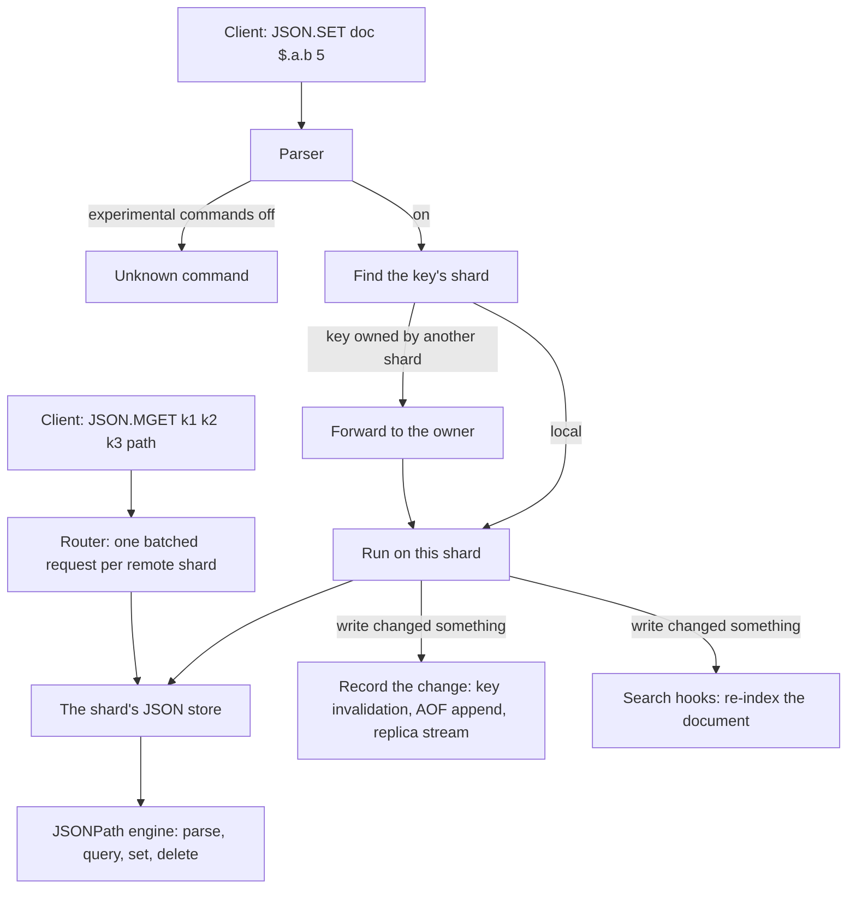

# Component 16: JSON Document Store and the JSONPath Engine

> **High-Level Design Spec**: [docs/design/16_json_store.md](../design/16_json_store.md)
> **Consolidated Implementation Spec**: [docs/internal/components.md](components.md)
> **Main source files**: src/json.rs (the JSONPath parser and evaluator, and the per-shard
> `JsonStore`). Also involved: src/resp.rs (command parsing, the experimental gate),
> src/connection.rs (routing and local execution), src/router.rs and src/server.rs (the
> `JSON.MGET` fan-out), src/aof.rs (AOF and replication encoding, AOF rewrite), src/shard.rs,
> src/table.rs and src/redis_rdb.rs (RDB persistence), src/search.rs (RediSearch indexing) and
> src/digest.rs (`DEBUG DIGEST`). The [Code map](#11-code-map) lists the key symbols.

---

## 1. What this subsystem does

Rudis offers a RedisJSON-style API. Clients store whole JSON documents under a key with `JSON.SET`,
then read or modify parts of them with a **JSONPath** expression: a small path language such as
`$.users[0].name`, where `$` is the document root. Typical users are applications that keep
structured records (profiles, product catalogues, agent state) and want to update one field without
rewriting the whole value, and RediSearch indexes declared `ON JSON`, which index fields pulled out
of these documents.

The subsystem has two parts:

* **The JSONPath engine.** Free functions in src/json.rs that parse a path string into segments and
  walk a `serde_json::Value` tree to find, set or delete nodes.
* **The JSON store.** One per shard, a hash map from key to document, with one method per `JSON.*`
  command.

JSON commands are **experimental**: they are rejected as unknown commands unless the server runs with
`enable-experimental-commands yes` (§6.1).

---

## 2. Mental model



Every shard owns its keys (key to shard by the usual hash routing), so a JSON document lives entirely
inside one shard's store, and every single-key command runs on that shard's thread without locks. Only
`JSON.MGET` touches several shards.

| Term | Meaning |
| :--- | :--- |
| **JSONPath** | A path language for addressing parts of a JSON document. |
| **Segment** | One step of a path: a field, an index, a wildcard or a slice. |
| **Auto-vivification** | Creating missing containers along a path when writing. |
| **Match** | One node a path resolves to. A path can match many nodes. |

---

## 3. Storage model

The store is a hash map (from the `hashbrown` crate) from key bytes to a parsed `serde_json::Value`.
There is no custom JSON representation: a document is a plain tree of null, boolean, number, string,
array or object. Object key order follows `serde_json`'s map, which is sorted because the crate does
not enable `preserve_order`; that is why `JSON.OBJKEYS` returns keys alphabetically.

The store is a field of the shard (`ShardDb.json_store`), next to the main table, the probabilistic
store, the CRDT store, the vector indexes and so on. **JSON documents are not `RudisValue`s**: they live
outside the main keyspace table. The consequences:

* Core commands (`GET`, `DEL`, `EXISTS`, `TYPE`, `EXPIRE`, `KEYS`, `SCAN`, `RENAME`) do not see or touch
  JSON documents. Only `JSON.*` commands, persistence, digesting and search indexing read the store.
* The same key name can exist both as a normal value and as a JSON document at once.
* There is **one store per shard, not one per logical database**: `SELECT 3` does not give a separate
  JSON namespace. Keyspace statistics count JSON documents under database 0, and `FLUSHDB` clears the
  store only when the current database is 0; `FLUSHALL` always clears it.
* There is no TTL, no eviction, and no per-document size or nesting-depth cap. The inbound payload is
  bounded by `proto-max-bulk-len` like any argument.

Non-command helper methods:

| Method | Used by |
| :--- | :--- |
| `new()` | Shard construction, flush. |
| `iter()` | RDB save, AOF rewrite, `DEBUG DIGEST`, the `FT.CREATE` backfill. |
| `insert_raw(key, val)` | RDB load: inserts a parsed document directly, with no path logic. |
| `get(key)` | Search re-indexing after writes, persistence, digest. |
| `len()`, `is_empty()` | Keyspace stats, tests. |

---

## 4. The JSONPath engine

### 4.1 Path segments

A path is a list of segments: *root* (`$`, or a leading `.`), *field* (`.name`, `["name"]`, `[name]`),
*index* (`[3]`, `[-1]`), *wildcard* (`*`, `.*`, `[*]`) and *slice* (`[1:3]`, `[:2]`, `[1:]`, `[:]`).

### 4.2 Parsing

The parser is a hand-written character scanner. In practice it **never returns an error**: anything it
does not understand becomes a field name that simply matches nothing.

1. Trim whitespace. An empty string, `$` or `.` is just the root.
2. Push the root. If the path starts with `$`, consume it and one following `.`; if it starts with `.`,
   consume that dot. (A path such as `name` with no prefix also gets an implicit root.)
3. Loop over the remaining characters:
   * `.`: consume it. If the next character is `*`, push a wildcard. Otherwise push nothing.
   * `*`: push a wildcard.
   * `[`: collect everything up to `]` (no escape handling) and trim it, then:
     `*` is a wildcard; text wrapped in matching `"..."` or `'...'` is a field with the inner text; text
     containing `:` is a slice (each side parsed as an integer, empty or unparsable meaning "not given");
     text that parses as an integer is an index; anything else is a field (an unquoted bracket name).
   * Otherwise read an identifier up to the next `.` or `[` and push it as a field.

**Worked example.** `$.items[-1]["first.name"]` becomes root, field `items`, index -1, field `first.name`.
The quoted bracket form is the only way to address a key that contains `.` or `[`.

**Recursive descent is not supported.** For `$..name`, step 2 eats `$.`, the loop then eats the second `.`
(which is not followed by `*`, so nothing is pushed), and `name` becomes a field. The result is identical to
`$.name`: it matches only a direct child of the root.

**Filter expressions are not supported.** There is no handling for `?(...)` or `@`; a path like
`$.items[?(@.price<5)]` parses into a bracket field named `?(@.price<5)` and matches nothing.

### 4.3 Querying

Two functions evaluate a segment list breadth-first. They are two hand-maintained copies of the same
algorithm: one returns shared references, the other mutable references (so mutating commands can write
through the results).

1. If the segments are empty or just the root, the result is the root.
2. Start with the root as the current set. For each non-root segment, build the next set from every node
   in the current set:
   * *Field*: if the node is an object containing the name, keep that child.
   * *Index*: if the node is an array, a negative index becomes `len + i`; keep the element if the
     resulting index is in range.
   * *Wildcard*: every value of an object, or every element of an array.
   * *Slice* (arrays only): the start defaults to 0 and the end to `len`; negative values count from the
     end and are clamped at 0, positive values are clamped at `len`; if the start is less than the end,
     keep that range, otherwise nothing.
   * Nodes of the wrong type contribute nothing (no error).
3. Replace the current set with the next one; stop early if it becomes empty.

**Worked example.** On `{"items":[{"p":10},{"p":25},{"p":50}]}` with `$.items[*].p`: after `items` the set is
the array; after `[*]` it is the three objects; after `p` it is `[10, 25, 50]`. With `$.items[-1:]` the slice
resolves to the range 2 to 3, giving `[{"p":50}]`.

**Index arithmetic note.** A negative index whose magnitude exceeds the array length computes `len + i` as a
negative signed value and casts it to unsigned, producing a huge value that fails the range check, so it just
matches nothing.

### 4.4 Setting

Setting writes exactly one location. A result of "not written" means NX or XX blocked it.

1. Parse the path. If it is the root: with `nx`, report "not written" (the root always exists); otherwise
   replace the whole document.
2. Check existence, once, for the whole path. `nx` with an existing target, or `xx` with a missing one, reports
   "not written". (Passing both always reports "not written".)
3. Split into parent segments and the last segment. Walk the parents with a single mutable cursor,
   **auto-vivifying** (creating missing containers on the way):
   * *Field*: if the cursor is not an object, **replace it with `{}`**; insert the name with `{}` if
     missing; descend.
   * *Index*: if the cursor is not an array, **replace it with `[]`**; resolve the index with the bounds
     rules below; pad with `null` up to that index; descend.
   * *Wildcard* or *slice*: the error `ERR wildcards not supported as parent path for SET`.
4. Apply the last segment: a field inserts into the (possibly freshly created) object; an index resolves with
   the bounds rules, pads with `null`, and assigns. Any other last segment gives `ERR invalid target path for
   SET`.

**Index bounds.** A client-chosen index used to drive an unbounded padding loop, so the resolver enforces:

* a negative index must land inside the array (`len − |idx|` must not underflow);
* a positive index may extend the array by at most `MAX_SET_INDEX_GAP` = 65,536 padding `null`s beyond its
  current length.

Anything else is `ERR index out of bounds`. **Example.** With `{"a":[1,2,3]}`, `$.a[5]` = 7 gives
`[1,2,3,null,null,7]`; `$.a[-4]` and `$.a[9223372036854775807]` are errors; on a missing array, `$.b[-1]` is an
error because the fresh `[]` has length 0.

**Worked example.** `JSON.SET doc $.user.tags[1] '"x"'` on `{"user":"bob"}`. `user` exists but is a string, so
it is replaced by `{}`. `tags` is created as `{}`, then (being the cursor for the last index segment and not an
array) replaced by `[]`; the index resolves to 1, so the array is padded to `[null, "x"]`. The result is
`{"user":{"tags":[null,"x"]}}`: the old string is gone without any error.

### 4.5 Deleting

Deleting returns the number of removed entries.

1. A root path sets the document to `null` and returns 1. (The store's delete intercepts the normal root forms
   `$`, `.` and no path, and removes the key instead; this branch is reached only by path strings that *parse*
   to root, such as an empty or whitespace-only string.)
2. Otherwise find all parents with the mutable query of the parent segments; for each parent, by the last
   segment:
   * *Field*: remove the key from an object.
   * *Index*: remove the element (negative counts from the end) from an array; later elements shift down.
   * *Wildcard*: **clear the whole container**, counting its former size. `JSON.DEL k $.items[*]` leaves
     `items` as `[]`.
   * *Slice*: ignored; deletes nothing.

Because parents can be multiple (`$.a[*].tmp`), one call can delete from many containers.

---

## 5. The store's command methods

Every method takes the key as bytes and copies it for the lookup. The default path for an omitted optional
path is `$`.

| Command | Path | Acts on | Returns |
| :--- | :--- | :--- | :--- |
| `JSON.SET k path json [NX\|XX]` | required | one location (§4.4) | written or not |
| `JSON.GET k [path ...]` | default `$` | all matches | a string (§5.2) |
| `JSON.DEL`, `JSON.FORGET k [path]` | default: whole key | all matches (§4.5) | a count |
| `JSON.TYPE k [path]` | default `$` | **first match** | the type name |
| `JSON.NUMINCRBY k path n` | required | all matches | the new value(s) |
| `JSON.NUMMULTBY k path n` | required | all matches | the new value(s) |
| `JSON.STRAPPEND k [path] str` | default `$` | all matches | the length of the last string |
| `JSON.STRLEN k [path]` | default `$` | **first match** | bytes |
| `JSON.ARRAPPEND k path v...` | required | all matches | the length of the last array |
| `JSON.ARRLEN k [path]` | default `$` | **first match** | the length |
| `JSON.ARRPOP k [path [index]]` | default `$` | **first match** | the popped value |
| `JSON.OBJKEYS k [path]` | default `$` | **first match** | the key list |
| `JSON.OBJLEN k [path]` | default `$` | **first match** | the key count |
| `JSON.TOGGLE k path` | required | all matches | the new boolean(s) |
| `JSON.CLEAR k [path]` | default `$` | all matches | a count |
| `JSON.MGET k... path` | required | per key, like `JSON.GET` with one path | (§7) |

The split matters for wildcard paths: the mutators (`NUMINCRBY`, `NUMMULTBY`, `STRAPPEND`, `ARRAPPEND`,
`TOGGLE`, `CLEAR`, `DEL`) touch **every** match, while the getters (`TYPE`, `STRLEN`, `ARRLEN`, `OBJKEYS`,
`OBJLEN`) and `ARRPOP` look at **only the first** match.

### 5.1 JSON.SET

1. Parse the JSON text; failure gives `ERR invalid JSON value: ...`.
2. If the key exists, set the path with the caller's `nx` and `xx`.
3. If the key is missing: `xx` reports "not written". A root path inserts the value as the new document. A
   non-root path starts from `{}`, sets the path (with NX and XX off), and inserts the result only if that
   succeeded. So `JSON.SET new $.a.b 1` creates `{"a":{"b":1}}`, whereas RedisJSON would demand a root path for
   a new key.

### 5.2 JSON.GET and the raw-versus-array rule

1. A missing key returns nil.
2. No paths, or exactly one path equal to `$` or `.`: the whole document, serialized.
3. Exactly one other path: query it.
   * No matches: the string `[]`.
   * Exactly one match **and** the path text contains neither `*` nor `:`: that value, raw.
   * Otherwise: a JSON array of all matches.
4. Several paths: a JSON object mapping each path string to an **array** of its matches, regardless of match
   count.

The raw-or-array choice looks at the **path text**, not just the count: `$.items[0]` returns `{"p":10}`, but
`$.items[*]` on a one-element array returns `[{"p":10}]`. **Example.** `JSON.GET k $.a $.b` returns
`{"$.a":[1],"$.b":[]}`.

### 5.3 Numeric mutation

`JSON.NUMINCRBY` and `JSON.NUMMULTBY` are identical except for adding versus multiplying.

1. A missing key gives `ERR could not find key`; no matches gives `ERR path does not exist`.
2. For each match in order: if it is not a number, return `ERR value at path is not a number` **immediately**
   (earlier matches stay modified). Otherwise compute the new value in floating point. If the result is a valid
   JSON number, store it as a float and record its text; if not (NaN or infinity), store the rounded value as a
   saturating integer instead.
3. One result is returned bare (`"32"`); several are returned as `"[20,50,100]"`.

**Worked example.** `{"items":[{"price":10},{"price":25},{"price":50}]}` with `JSON.NUMMULTBY k
$.items[*].price 2` replies `[20,50,100]` (the in-file test `test_json_nummultby_multi_match`).

All arithmetic goes through `f64`: integers above 2^53 lose precision, and a result is stored as a float, so
`JSON.GET` may render `32.0` even though the command replied `32` (Rust's `f64` display drops the `.0`;
`serde_json` keeps it).

### 5.4 Other mutators

* **`JSON.STRAPPEND`** appends the argument **verbatim** (it is not JSON-decoded) to every matched string; a
  non-string match gives `ERR value at path is not a string`. `JSON.STRAPPEND k $.s '"y"'` therefore appends the
  three characters `"y"`, quotes included.
* **`JSON.ARRAPPEND`** parses every value argument as JSON *before* touching the document (`ERR invalid JSON
  element: ...` leaves it unchanged), then appends clones to every matched array; a non-array match gives `ERR
  value at path is not an array`.
* **`JSON.ARRPOP`** looks at the first match only; it must be a non-empty array. The index defaults to -1 (the
  last); a negative index counts from the end; out of range returns nil. It returns the popped value serialized
  as JSON. The index is resolved strictly (no clamping as in RedisJSON).
* **`JSON.TOGGLE`** flips every matched boolean; a non-boolean match gives `ERR value at path is not a boolean`.
  It returns `"false"` or `"true"`, or `"[true,false]"`.
* **`JSON.CLEAR`**, for each match: non-empty arrays and objects are emptied, non-zero numbers are set to 0;
  strings, booleans, `null`, empty containers and zeros are left alone. It returns how many nodes changed (0 for
  a missing key).

### 5.5 Read-only getters

`JSON.TYPE` maps the first match to `null`, `boolean`, `number`, `string`, `array` or `object`. `JSON.STRLEN`
returns the **byte** length of the first match if it is a string. `JSON.ARRLEN`, `JSON.OBJLEN` and
`JSON.OBJKEYS` return the length or key list of the first match if it has the right type. Any type mismatch,
missing key or no match gives nil, never an error.

---

## 6. Command dispatch end to end

### 6.1 Parsing and the experimental gate

The parser upper-cases the command name. If the name contains a `.`, experimental commands are disabled (the
`enable-experimental-commands` config, default `no`) and the name starts with an experimental prefix (`JSON.`,
`BF.`, `CF.`, `CMS.`, `TOPK.`, `FT.`, `SEMANTIC.`, `CRDT.`, `LLM.`, `MCP.`, `XDP.`), it returns an unknown
command, and the client sees the normal unknown-command error.

Otherwise the `JSON.*` arms build one of 16 command variants (listed in
[Reference details](#121-command-variants)). Parser details worth knowing:

* `JSON.FORGET` is a pure alias of `JSON.DEL` (same arm, same variant).
* `NUMINCRBY`, `NUMMULTBY`, `ARRAPPEND` and `TOGGLE` require a path (`JSON.TOGGLE k` is a wrong-number-of-arguments
  error). The number argument must parse as a float or the error is `not a number`.
* `JSON.SET` scans every argument after the value for `NX` or `XX` case-insensitively and silently ignores
  anything else.
* `JSON.STRAPPEND` with three arguments treats the third as the value (no path); with four, the third is the path.
* `JSON.ARRPOP`'s index is read only after a path; an unparsable index becomes "not given" (pop last).
* `JSON.MGET` takes the **last** argument as the path and everything between as keys; at least one key and the
  path are required.
* Paths and values are converted with lossy UTF-8.

The read-only JSON variants (`JsonGet`, `JsonType`, `JsonStrLen`, `JsonArrLen`, `JsonObjKeys`, `JsonObjLen`,
`JsonMget`) are listed in `is_family_read`; the rest are write commands, which matters for ACL categories,
replicas and the AOF-rewrite hook.

### 6.2 Routing

Every single-key JSON variant appears in the shared key-extraction helpers:

* The primary-key and target-shard helpers find the owning shard. If the target is the local shard the command
  runs through the local-execution routine; otherwise it is shipped to the owner, which runs the same function.
* The per-key walker is used for `WATCH` and client-tracking invalidation and for the AOF-rewrite before-write
  hook. `JsonMget` is listed there with its multiple keys.
* The command-name helper maps every JSON variant (including `JsonMget`) to the string `JSON` for command stats
  and similar displays.

`JsonMget` has its own arm in the dispatcher that calls the router's batched fetch (§7) and writes a RESP array of
bulk strings and nils.

### 6.3 Execution arms

Each arm calls the matching store method and encodes the reply:

| Outcome | RESP reply |
| :--- | :--- |
| `JSON.SET` written, or skipped by NX or XX | `+OK`, or nil |
| `JSON.GET`, `ARRPOP`, `NUMINCRBY`, `NUMMULTBY`, `TOGGLE` result | bulk string (nil when none) |
| `JSON.DEL`, `CLEAR`, `STRAPPEND`, `ARRAPPEND`, `STRLEN`, `ARRLEN`, `OBJLEN` | integer (getters: nil when none) |
| `JSON.TYPE` | simple string, for example `+object` (nil when none) |
| `JSON.OBJKEYS` | array of bulk strings (nil when none) |
| Any error | error reply with the message |

On a write that changed something (a set that wrote, a delete or clear with a count above 0, a mutator that
succeeded, or an array pop that returned a value), the arm:

1. records the change (§6.4);
2. re-indexes the document for RediSearch (§8.3).

Failed or no-op writes do neither.

### 6.4 Recording a change: invalidation, AOF and replication

Recording a change does two things:

1. If any client uses `WATCH` or client-side caching, notify key invalidation for each key of the command.
2. Log the change: encode the command with the AOF encoder and append it to the shard's AOF buffer; if replicas are
   connected, the same bytes are streamed to them. Without an AOF, it encodes only when replicas exist. A command
   the encoder cannot express is reported as unpropagated.

The encoder has arms for every JSON write: `JsonSet` (with `NX`/`XX`), `JsonDel`, `JsonClear`, `JsonNumIncrBy`,
`JsonNumMultBy`, `JsonStrAppend`, `JsonArrAppend`, `JsonArrPop` (the index is emitted only when a path is present,
mirroring the parser) and `JsonToggle`. JSON writes are logged **as issued** and replayed in order; this is
deterministic because the store has no randomness or clocks. The test `test_json_writes_round_trip_through_aof_
encoding` in src/aof.rs checks that each encoded form parses back to the identical command.

---

## 7. JSON.MGET: batched cross-shard fan-out

`JSON.MGET` is the only JSON command whose keys can live on different shards. (With `cross-shard-strict yes` on a
multi-shard server outside cluster mode, the dispatcher refuses such a `JSON.MGET` up front with `-CROSSSLOT Keys
in request don't hash to the same slot`, as cluster mode does for keys in different slots; the fan-out below then
only ever sees keys of one shard.)

The router's batched fetch takes the keys and the path and returns one optional string per key:

1. An empty key list gives an empty result.
2. A single-shard server loops over the keys calling the store's get on the local shard.
3. Otherwise bucket keys by their target shard: local keys into one list, remote keys into one list of (original
   index, key) per shard.
4. Resolve local keys immediately into a pre-sized results vector.
5. For each remote shard with at least one key, send **one** `JsonMget` message with a bounded reply channel.
6. Await the replies and scatter each (index, value) back into the results. All requests are already in flight, so
   the cost is about one round trip, not one per key or per shard.

The remote side is the shard's cross-shard mailbox loop in src/server.rs: for each (index, key) it calls the
store's get and replies with a list of (index, optional string).

**Worked example.** There are 3 shards, and the client on shard 0 sends `JSON.MGET a b c $.name`, where `a` is on
shard 0 and `b` and `c` are on shard 2. `a` is answered locally into slot 0. One `JsonMget` with the entries
(1, b) and (2, c) goes to shard 2; its reply fills slots 1 and 2; the client gets a 3-element array. If sending to
a shard fails or its reply is lost, those slots stay nil. Each value follows the single-path `JSON.GET` rule in
§5.2, so a `$` path returns the whole document and a wildcard path an array.

---

## 8. Persistence, replication and integrations

### 8.1 RDB snapshots

Rudis writes Redis-compatible RDB files; state Redis cannot encode is written as Rudis "legacy-format" records
inside an AUX field named `rudis-ext`. Redis and Valkey skip unknown AUX fields, so the file still loads there
(without the JSON documents).

* **Save.** The extended-chunk writer collects records by iterating the extended items (JSON documents first, then
  Bloom filters, vector indexes, Cuckoo filters, Count-Min Sketch and Top-K) and saving each, then wraps them with
  the extension AUX writer. A JSON record is `u32 LE key_len | key | 0x07 | u32 LE json_len | compact JSON text`.
  That one-pass writer serves the one-pass chunk save. `SAVE`, `BGSAVE` and streamed full syncs instead build a
  point-in-time image per shard, which writes the same records one document per step, and writes a document's state
  as of the image's start before the first command that changes it (see §8.2).
* **Load.** The RDB reader hands the `rudis-ext` blob to the legacy-extension loader. For type byte 7 it
  UTF-8-decodes and parses the text and, if the standalone key-to-shard function names this shard, inserts the
  document directly. Whole-file loads pass the real shard id and count, so each shard keeps only its own keys;
  per-shard chunk restores (for example a replica full sync) pass `(0, 1)`, so every record is accepted. A truncated
  or unparsable JSON record is skipped. The chunk restore then rebuilds the search indexes.

So JSON documents survive `SAVE`/`BGSAVE` plus a restart and are included in a replica's initial full sync.

### 8.2 AOF and AOF rewrite

* **Incremental AOF and the replica stream.** Every successful JSON write is appended as its original command
  (§6.4), so `appendonly yes` recovers JSON mutations made after the last snapshot, and connected replicas receive
  JSON writes continuously.
* **AOF rewrite as an RDB image.** The live rewrite builds a point-in-time image a few pieces at a time between
  commands. JSON documents are part of its "larger extended structures", written one per step. To keep the image as
  of the rewrite's start, a before-command hook writes a key's unchanged state before the first write to it; JSON
  writes are covered because they are write commands with keys in the per-key walker.
* **Canonical AOF** (used, for example, for resharding splits) emits one `JSON.SET <key> $ <document>` per document.

### 8.3 RediSearch indexing

After a successful write the execution arm re-indexes the document:

| Command | Shard-local search indexes | Global search registry |
| :--- | :--- | :--- |
| `JSON.SET` | `index_json_document_local` | `index_json_document_hook` |
| `JSON.DEL` (key still exists) | `index_json_document_local` | `index_json_document_hook` |
| `JSON.DEL` (key removed) | `delete_document_local` | `delete_document_hook` |
| `NUMINCRBY`, `NUMMULTBY`, `STRAPPEND`, `ARRAPPEND`, `ARRPOP`, `TOGGLE`, `CLEAR` | none | `index_json_document_hook` |

Both index functions loop over indexes whose schema kind upper-cases to `JSON`, skip the key if the index has
prefixes and none match, then extract the document's fields (which stores the whole document under field `$` and
evaluates each schema field's identifier with the path parser and query) and add the document. `SET` and `DEL` clone
the whole document first because the local indexing function needs a mutable borrow of the shard data while the
document is borrowed from it. `FT.CREATE` backfills by iterating the store. Field-extraction rules belong to
[Component 09](09_redisearch.md).

### 8.4 DEBUG DIGEST

src/digest.rs includes JSON documents as extended keys: the JSON digest mixes the type tag `TYPE_JSON` (100) and
the document's compact JSON text. Both the shard digest and the key-value digest cover them, which is how AOF and
replica tests compare datasets.

---

## 9. Invariants and gotchas

1. **Not in the main keyspace.** Core commands ignore JSON documents; one JSON namespace per shard is shared by all
   logical databases; `FLUSHDB` clears it only from database 0.
2. **Silent destructive auto-vivification.** `JSON.SET` replaces any wrong-typed parent (or a wrong-typed container
   at the last step) with `{}` or `[]` without an error (§4.4).
3. **Partial writes on error are not logged.** A mutator that fails part-way leaves earlier matches modified (for
   example `NUMINCRBY` over `[1,"x"]` increments `1`, then errors), and a set can create intermediate containers
   before hitting `ERR index out of bounds`. Because the arm sees an error, it calls neither the change recorder nor
   the search hooks, so the in-memory document then differs from what the AOF, replicas and search indexes know.
4. **First match versus all matches.** Getters and `ARRPOP` use the first match; mutators use all matches (§5).
5. **`JSON.GET` shape depends on path text** (`*` or `:` forces an array), §5.2.
6. **Unsupported syntax fails quietly.** `$..x` acts as `$.x`; filters match nothing; the parser never errors.
7. **Numbers are floats.** Precision is lost above 2^53, and results are stored as floats (§5.3).
8. **`STRAPPEND` appends raw text**, not a decoded JSON string; `STRLEN` counts bytes.
9. **Two traversal copies.** The shared and mutable queries must be changed together.
10. **`MAX_SET_INDEX_GAP`** caps array padding at 65,536 nulls per `JSON.SET` index.

---

## 10. Limitations and not implemented

* **Experimental:** off unless `enable-experimental-commands yes`.
* **Missing commands:** `JSON.ARRINSERT`, `JSON.ARRINDEX`, `JSON.ARRTRIM`, `JSON.MERGE`, `JSON.MSET`, `JSON.DEBUG`
  and `JSON.RESP` are not parsed; they return unknown-command errors. (`JSON.STRAPPEND` exists but without
  RedisJSON's JSON-string decoding of its argument.)
* **JSONPath subset:** no recursive descent, no filters, no union (`[0,2]`), no slice step (`[::2]`), no escapes
  inside bracket names.
* **No legacy-path reply mode.** RedisJSON returns different shapes for `.a` and `$.a` paths; here both behave the
  same, with the §5.2 heuristic.
* **`JSON.GET` formatting options** (`INDENT`, `NEWLINE`, `SPACE`) are not parsed; they would be treated as paths.
* **No TTL, no per-document memory accounting, no `OBJECT`/`TYPE`/`DEL` integration.**
* **Test coverage.** Unit tests in src/json.rs (`test_json_crud_and_jsonpath`, `test_json_wildcards_and_slices`,
  `test_json_nummultby_multi_match`, `test_set_json_path_bounds_array_index`), the AOF round-trip test in
  src/aof.rs, a digest test in src/digest.rs and an RDB round trip in the src/shard.rs tests. Command parsing is
  exercised by the `parse_command` fuzz target; there is no dedicated JSONPath fuzzer.

---

## 11. Code map

| File | Key symbols | Role |
| :--- | :--- | :--- |
| `src/json.rs` | `PathSegment`, `parse_json_path` | Path grammar and parser. |
| `src/json.rs` | `query_json_path`, `query_json_path_mut` | Breadth-first evaluation, shared and mutable. |
| `src/json.rs` | `set_json_path`, `set_index`, `MAX_SET_INDEX_GAP` | Single-location write with auto-vivification and bounded padding. |
| `src/json.rs` | `delete_json_path` | Field and index removal; a wildcard clears the container. |
| `src/json.rs` | `JsonStore` and the `json_*` methods | The per-shard document map and one method per command. |
| `src/resp.rs` | `Command::Json*`, the `build_command` `JSON.*` arms | Argument parsing into commands. |
| `src/resp.rs` | `EXPERIMENTAL_PREFIXES`, `is_experimental_command_name`, `experimental_commands_enabled` | The experimental-command gate. |
| `src/resp.rs` | `Command::is_family_read` | Marks the read-only JSON commands. |
| `src/config.rs` | `enable_experimental_commands` | The `enable-experimental-commands` setting. |
| `src/connection.rs` | `cmd_primary_key`, `target_shard_of_cmd`, `for_each_cmd_key`, `get_cmd_name` | Key extraction, routing, invalidation, the stats name. |
| `src/connection.rs` | `execute_command_inner` (the `JsonMget` arm), `execute_local_command` (the JSON arms) | Dispatch and RESP reply encoding. |
| `src/connection.rs` | `record_change!`, `log_change`, `aof_image_before_command` | Invalidation, AOF append, replica stream, the rewrite hook. |
| `src/router.rs` | `Router::json_mget` | Bucketed, concurrent multi-shard `JSON.MGET`. |
| `src/shard.rs` | `ShardDb.json_store`, `ShardMessage::JsonMget` | The store field and the cross-shard message. |
| `src/server.rs` | The cross-shard mailbox loop (`ShardMessage::JsonMget` arm) | The remote side of `JSON.MGET`. |
| `src/shard.rs` | `save_extended_rdb_chunk`, `ext_item_keys`, `save_ext_item`, `ExtKind::Json`, `AofImage` | RDB and AOF-image save of documents (tag 7). |
| `src/shard.rs` | `restore_rdb_chunk`, `flushdb`, `flushall`, `keyspace_stats_by_db` | Chunk restore, clearing, stats. |
| `src/table.rs` | `load_legacy_ext`, `load_legacy_records` | Load tag-7 records with the shard-ownership filter. |
| `src/redis_rdb.rs` | `EXT_AUX_KEY`, `write_ext_aux`, `load_chunk` | The `rudis-ext` AUX wrapper. |
| `src/aof.rs` | The JSON arms of `command_to_resp`, `write_canonical_aof` | Per-command AOF and replication encoding; canonical rewrite as `JSON.SET`. |
| `src/shard.rs`, `src/search.rs` | `index_json_document_local`, `delete_document_local`, `init_search_index`; `index_json_document_hook`, `delete_document_hook`, `extract_json_fields` | RediSearch indexing of JSON documents. |
| `src/digest.rs` | `json_digest`, `TYPE_JSON`, `for_each_ext_key`, `ext_value_digest` | `DEBUG DIGEST` coverage. |

---

## 12. Reference details

### 12.1 Command variants

| Variant | Fields |
| :--- | :--- |
| `JsonSet` | `key, path: String, json_val: String, nx, xx` |
| `JsonGet` | `key, paths: Vec<String>` (defaults to `["$"]`) |
| `JsonDel` | `key, path: Option<String>` (shared by `JSON.DEL` and `JSON.FORGET`) |
| `JsonType`, `JsonStrLen`, `JsonArrLen`, `JsonObjKeys`, `JsonObjLen`, `JsonClear` | `key, path: Option<String>` |
| `JsonNumIncrBy`, `JsonNumMultBy` | `key, path: String, delta` or `factor: f64` |
| `JsonStrAppend` | `key, path: Option<String>, value: String` |
| `JsonArrAppend` | `key, path: String, values: Vec<String>` |
| `JsonArrPop` | `key, path: Option<String>, index: Option<isize>` |
| `JsonToggle` | `key, path: String` |
| `JsonMget` | `keys: Vec<Bytes>, path: String` |

### 12.2 Types

```rust
// src/json.rs
#[derive(Default, Debug)]
pub struct JsonStore {
    docs: HashMap<Bytes, Value>,   // hashbrown::HashMap; Value = serde_json::Value
}

pub enum PathSegment {
    Root,                                            // `$` or leading `.`
    Field(String),                                   // `.name`, `["name"]`, `[name]`
    Index(isize),                                    // `[3]`, `[-1]`
    Wildcard,                                        // `*`, `.*`, `[*]`
    Slice { start: Option<isize>, end: Option<isize> }, // `[1:3]`, `[:2]`, `[1:]`, `[:]`
}

// src/shard.rs — ShardMessage variant
JsonMget {
    keys: Vec<(usize, Bytes)>,                               // (position in reply, key)
    path: String,
    responder: flume::Sender<Vec<(usize, Option<String>)>>,
},
```

### 12.3 Method signatures

| Method | Returns |
| :--- | :--- |
| `json_set` | `Result<bool, String>` |
| `json_get` | `Option<String>` |
| `json_del` | `usize` |
| `json_type` | `Option<String>` |
| `json_numincrby`, `json_nummultby` | `Result<String, String>` |
| `json_strappend`, `json_arrappend` | `Result<usize, String>` |
| `json_strlen`, `json_arrlen`, `json_objlen` | `Option<usize>` |
| `json_arrpop` | `Option<String>` |
| `json_objkeys` | `Option<Vec<String>>` |
| `json_toggle` | `Result<String, String>` |
| `json_clear` | `usize` |
| `set_json_path(root, path, new_value, nx, xx)` | `Result<bool, &'static str>` (`Ok(false)` means not written because of NX or XX) |
| `delete_json_path(root, path)` | `usize` (entries removed) |

### 12.4 Constants

| Name | Value | Meaning |
| :--- | :--- | :--- |
| `MAX_SET_INDEX_GAP` | 65,536 (`1 << 16`) | Most `null` padding one `JSON.SET` index can add. |
| `TYPE_JSON` | 100 | The `DEBUG DIGEST` type tag. |
| RDB legacy type byte | 7 | JSON document record in `rudis-ext`. |
