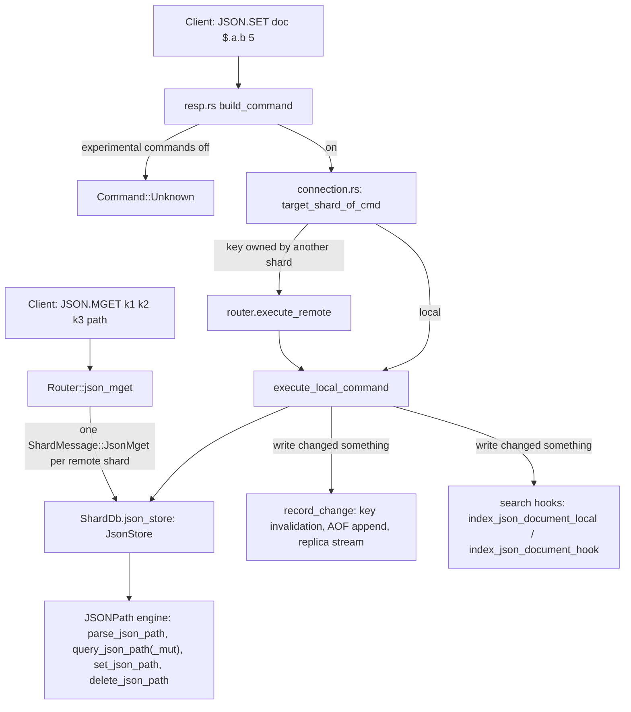

# Component 16: JSON Document Store & JSONPath Engine — Implementation Reference

> **High-Level Design Spec**: [`docs/design/16_json_store.md`](../design/16_json_store.md)
> **Consolidated Implementation Spec**: [`docs/internal/components.md`](components.md)
> **Main source file**: `src/json.rs` (JSONPath parser/evaluator and `JsonStore`).
> **Also involved**: `src/resp.rs` (command parsing, experimental gate), `src/connection.rs`
> (routing and `execute_local_command`), `src/router.rs` + `src/server.rs` (`JSON.MGET` fan-out),
> `src/aof.rs` (AOF / replication encoding, AOF rewrite), `src/shard.rs` + `src/table.rs` +
> `src/redis_rdb.rs` (RDB persistence), `src/search.rs` (RediSearch indexing), `src/digest.rs`
> (`DEBUG DIGEST`).

---

## 1. What this subsystem does

Rudis offers a RedisJSON-style API: clients store whole JSON documents under a key with
`JSON.SET`, then read or modify parts of them with a **JSONPath** expression (a small path
language such as `$.users[0].name`, where `$` is the document root). Typical users are
applications that keep structured records (profiles, product catalogues, agent state) and want
to update one field without rewriting the whole value, and RediSearch indexes declared `ON JSON`,
which index fields pulled out of these documents.

The subsystem has two parts:

- **The JSONPath engine** — free functions in `src/json.rs` that parse a path string into
  segments and walk a `serde_json::Value` tree to find, set, or delete nodes.
- **`JsonStore`** — one per shard, a hash map from key to document, with one method per
  `JSON.*` command.

JSON commands are **experimental**: they are rejected as unknown commands unless the server runs
with `enable-experimental-commands yes` (see §6.1).

## 2. Mental model



Every shard owns its keys (key → shard via the usual hash routing), so a JSON document lives
entirely inside one shard's `JsonStore` and every single-key command runs on that shard's thread
without locks. Only `JSON.MGET` touches several shards.

---

## 3. Storage model

```rust
// src/json.rs
#[derive(Default, Debug)]
pub struct JsonStore {
    docs: HashMap<Bytes, Value>,   // hashbrown::HashMap; Value = serde_json::Value
}
```

| Field | Type | Meaning |
| :--- | :--- | :--- |
| `docs` | `hashbrown::HashMap<Bytes, serde_json::Value>` | Key bytes → parsed document tree. |

There is no custom JSON representation: a document is a plain `serde_json::Value`
(`Null | Bool | Number | String | Array | Object`). Object key order follows `serde_json`'s map
(sorted, since the crate does not enable `preserve_order`), which is why `JSON.OBJKEYS` returns keys
alphabetically.

The store is a field of the shard, `ShardDb.json_store: crate::json::JsonStore`, next to the main
`table`, `probabilistic_store`, `crdt_store`, vector indexes and so on. **JSON documents are not
`RudisValue`s** — they live outside the main keyspace table. Consequences:

- Core commands (`GET`, `DEL`, `EXISTS`, `TYPE`, `EXPIRE`, `KEYS`, `SCAN`, `RENAME`) do not see or
  touch JSON documents. Only `JSON.*` commands, persistence, digesting and search indexing read
  `json_store`.
- The same key name can exist both as a normal value and as a JSON document at once.
- There is **one `JsonStore` per shard, not one per logical database**: `SELECT 3` does not give a
  separate JSON namespace. Keyspace statistics (`ShardDb::keyspace_stats_by_db`) count JSON
  documents under database 0, and `ShardDb::flushdb` only clears `json_store` when the current
  database is 0; `ShardDb::flushall` always clears it.
- No TTL, no eviction, no per-document size or nesting-depth cap. The inbound payload is bounded
  by `proto-max-bulk-len` like any argument.

Non-command helper methods on `JsonStore`:

| Method | Used by |
| :--- | :--- |
| `new()` | `ShardDb` construction, flush. |
| `iter()` | RDB save, AOF rewrite, `DEBUG DIGEST`, `FT.CREATE` backfill (`ShardDb::init_search_index`). |
| `insert_raw(key, val)` | RDB load — inserts a parsed document directly, no path logic. |
| `get(key)` | Search re-indexing after writes, persistence, digest. |
| `len()` / `is_empty()` | Keyspace stats, tests. |

---

## 4. The JSONPath engine

### 4.1 Path segments

```rust
// src/json.rs
pub enum PathSegment {
    Root,                                            // `$` or leading `.`
    Field(String),                                   // `.name`, `["name"]`, `[name]`
    Index(isize),                                    // `[3]`, `[-1]`
    Wildcard,                                        // `*`, `.*`, `[*]`
    Slice { start: Option<isize>, end: Option<isize> }, // `[1:3]`, `[:2]`, `[1:]`, `[:]`
}
```

### 4.2 Parsing (`parse_json_path`)

`parse_json_path(&str) -> Result<Vec<PathSegment>, String>` is a hand-written character scanner.
In practice it **never returns `Err`**: anything it does not understand becomes a field name that
simply matches nothing.

1. Trim whitespace. An empty string, `$` or `.` returns `[Root]`.
2. Push `Root`. If the path starts with `$`, consume it and one following `.`; if it starts with
   `.`, consume that dot. (A path such as `name` with no prefix also gets an implicit `Root`.)
3. Loop over the remaining characters:
   - `.` — consume it. If the next char is `*`, push `Wildcard`. Otherwise push nothing.
   - `*` — push `Wildcard`.
   - `[` — collect everything up to `]` (no escape handling) and trim it, then:
     `*` → `Wildcard`; text wrapped in matching `"…"` or `'…'` → `Field` of the inner text;
     text containing `:` → `Slice` (each side parsed as `isize`, empty or unparsable → `None`);
     text that parses as `isize` → `Index`; anything else → `Field` (unquoted bracket name).
   - Otherwise read an identifier up to the next `.` or `[` and push it as `Field`.

Worked example: `$.items[-1]["first.name"]` →
`[Root, Field("items"), Index(-1), Field("first.name")]`. The quoted bracket form is the only way
to address a key that contains `.` or `[`.

**Recursive descent is not supported.** For `$..name`, step 2 eats `$.`, the loop then eats the
second `.` (not followed by `*`, so nothing is pushed — the in-code comment "Could be another dot
for recursive or wildcard" refers only to the `.*` case), and `name` becomes a `Field`. The result
`[Root, Field("name")]` is identical to `$.name`: it matches only a direct child of the root.

**Filter expressions are not supported.** There is no handling for `?(...)` or `@`; a path like
`$.items[?(@.price<5)]` parses into a bracket `Field("?(@.price<5)")` and matches nothing.

### 4.3 Querying (`query_json_path` / `query_json_path_mut`)

Both functions evaluate a segment list breadth-first. They are two hand-maintained copies of the
same algorithm — one returns `Vec<&Value>`, the other `Vec<&mut Value>` (so mutating commands can
write through the results).

1. If the segments are empty or just `[Root]`, return `[root]`.
2. Start with `current = [root]`. For each non-`Root` segment, build `next` from every node in
   `current`:
   - `Field(name)` — if the node is an object containing `name`, keep that child.
   - `Index(i)` — if the node is an array: a negative `i` becomes `len + i`; keep the element if
     the resulting index is in range.
   - `Wildcard` — every value of an object, or every element of an array.
   - `Slice { start, end }` — arrays only. `start` defaults to 0 and `end` to `len`; negative
     values count from the end and are clamped at 0, positive values are clamped at `len`; if
     `start < end` keep `arr[start..end]`, otherwise nothing.
   - Nodes of the wrong type contribute nothing (no error).
3. Replace `current` with `next`; stop early if it becomes empty.

Worked example on `{"items":[{"p":10},{"p":25},{"p":50}]}` with `$.items[*].p`:
after `items` → `[array]`; after `[*]` → the three objects; after `p` → `[10, 25, 50]`.
With `$.items[-1:]` the slice resolves to `[2..3]` → `[{"p":50}]`.

Index arithmetic note: a negative index whose magnitude exceeds the array length computes
`len + i` as a negative `isize` and casts it to `usize`, producing a huge value that fails the
range check — so it just matches nothing.

### 4.4 Setting (`set_json_path`)

`set_json_path(root, path, new_value, nx, xx) -> Result<bool, &'static str>` writes exactly one
location. `Ok(false)` means "not written because of NX/XX".

1. Parse the path. If it is the root: with `nx` return `Ok(false)` (the root always exists);
   otherwise replace the whole document and return `Ok(true)`.
2. Existence check, once, for the whole path: `target_exists = !query_json_path(..).is_empty()`.
   `nx && target_exists` or `xx && !target_exists` → `Ok(false)`. (Passing both always yields
   `Ok(false)`.)
3. Split into parent segments and the last segment. Walk the parents with a single `&mut` cursor,
   **auto-vivifying** (creating missing containers on the way):
   - `Field(name)` — if the cursor is not an object, **replace it with `{}`**; insert
     `name: {}` if missing; descend.
   - `Index(i)` — if the cursor is not an array, **replace it with `[]`**; resolve `i` with
     `set_index` (below); pad with `null` up to that index; descend.
   - `Wildcard` / `Slice` → `Err("ERR wildcards not supported as parent path for SET")`.
4. Apply the last segment: `Field` inserts into the (possibly freshly created) object; `Index`
   resolves with `set_index`, pads with `null`, and assigns. Any other last segment →
   `Err("ERR invalid target path for SET")`.

**Index bounds (`set_index` and `MAX_SET_INDEX_GAP`).** A client-chosen index used to drive an
unbounded padding loop, so `set_index(len, idx)` enforces:

- negative `idx` must land inside the array (`len - |idx|` must not underflow);
- positive `idx` may extend the array by at most `MAX_SET_INDEX_GAP = 1 << 16` (65,536) padding
  `null`s beyond its current length.

Anything else is `Err("ERR index out of bounds")`. Example: with `{"a":[1,2,3]}`,
`$.a[5]` = 7 gives `[1,2,3,null,null,7]`; `$.a[-4]` and `$.a[9223372036854775807]` are errors;
on a missing array, `$.b[-1]` is an error because the fresh `[]` has length 0.

Worked example: `JSON.SET doc $.user.tags[1] '"x"'` on `{"user":"bob"}`:
`user` exists but is a string, so it is replaced by `{}`; `tags` is created as `{}`, then (being the
cursor for the last `Index` segment and not an array) replaced by `[]`; `set_index(0, 1)` → 1, the
array is padded to `[null, "x"]`. Result: `{"user":{"tags":[null,"x"]}}` — the old string is gone
without any error.

### 4.5 Deleting (`delete_json_path`)

`delete_json_path(root, path) -> usize` returns the number of removed entries.

1. Root path → set the document to `null` and return 1. (`JsonStore::json_del` intercepts the
   normal root forms `$`/`.`/no path and removes the key instead; this branch is only reached by
   path strings that *parse* to root, such as an empty or whitespace-only string.)
2. Otherwise find all parents with `query_json_path_mut(parent_segments)`; for each parent, by the
   last segment:
   - `Field(name)` — remove the key from an object.
   - `Index(i)` — remove the element (negative counts from end) from an array; later elements
     shift down.
   - `Wildcard` — **clear the whole container**, counting its former size. `JSON.DEL k $.items[*]`
     leaves `items` as `[]`.
   - `Slice` — ignored; deletes nothing.

Because parents can be multiple (`$.a[*].tmp`), one call can delete from many containers.

---

## 5. `JsonStore` command methods

Every method takes `key: &[u8]` and copies it into a `Bytes` for the lookup. Default path for
an omitted optional path is `$`.

| Command | Method | Path | Acts on | Return (method) |
| :--- | :--- | :--- | :--- | :--- |
| `JSON.SET k path json [NX\|XX]` | `json_set` | required | one location (§4.4) | `Result<bool, String>` |
| `JSON.GET k [path ...]` | `json_get` | default `$` | all matches | `Option<String>` (§5.2) |
| `JSON.DEL` / `JSON.FORGET k [path]` | `json_del` | default: whole key | all matches (§4.5) | `usize` |
| `JSON.TYPE k [path]` | `json_type` | default `$` | **first match** | `Option<String>` |
| `JSON.NUMINCRBY k path n` | `json_numincrby` | required | all matches | `Result<String, String>` |
| `JSON.NUMMULTBY k path n` | `json_nummultby` | required | all matches | `Result<String, String>` |
| `JSON.STRAPPEND k [path] str` | `json_strappend` | default `$` | all matches | `Result<usize, String>`, length of the last string |
| `JSON.STRLEN k [path]` | `json_strlen` | default `$` | **first match** | `Option<usize>` (bytes) |
| `JSON.ARRAPPEND k path v...` | `json_arrappend` | required | all matches | `Result<usize, String>`, length of the last array |
| `JSON.ARRLEN k [path]` | `json_arrlen` | default `$` | **first match** | `Option<usize>` |
| `JSON.ARRPOP k [path [index]]` | `json_arrpop` | default `$` | **first match** | `Option<String>` |
| `JSON.OBJKEYS k [path]` | `json_objkeys` | default `$` | **first match** | `Option<Vec<String>>` |
| `JSON.OBJLEN k [path]` | `json_objlen` | default `$` | **first match** | `Option<usize>` |
| `JSON.TOGGLE k path` | `json_toggle` | required | all matches | `Result<String, String>` |
| `JSON.CLEAR k [path]` | `json_clear` | default `$` | all matches | `usize` |
| `JSON.MGET k... path` | — (`Router::json_mget`, §7) | required | per key, like `JSON.GET` with one path | — |

The split matters for wildcard paths: the mutators (`NUMINCRBY`, `NUMMULTBY`, `STRAPPEND`,
`ARRAPPEND`, `TOGGLE`, `CLEAR`, `DEL`) touch **every** match, while the getters (`TYPE`, `STRLEN`,
`ARRLEN`, `OBJKEYS`, `OBJLEN`) and `ARRPOP` look at **only the first** match.

### 5.1 `json_set`

1. Parse `json_str` with `serde_json::from_str`; failure → `ERR invalid JSON value: …`.
2. If the key exists, delegate to `set_json_path` with the caller's `nx`/`xx`.
3. If the key is missing: `xx` → `Ok(false)`. Root path → insert the value as the new document.
   Non-root path → start from `{}`, run `set_json_path` (NX/XX off), and insert the result only if
   it succeeded. So `JSON.SET new $.a.b 1` creates `{"a":{"b":1}}` (RedisJSON would demand a root
   path for a new key).

### 5.2 `json_get` and the raw-vs-array rule

1. Missing key → `None` (nil reply).
2. No paths, or exactly one path equal to `$` or `.` → the whole document serialized.
3. Exactly one other path → query it:
   - no matches → the string `[]`;
   - exactly one match **and** the path text contains neither `*` nor `:` → that value, raw;
   - otherwise → a JSON array of all matches.
4. Several paths → a JSON object mapping each path string to an **array** of its matches,
   regardless of match count.

The raw/array choice looks at the **path text**, not just the count: `$.items[0]` returns `{"p":10}`
but `$.items[*]` on a one-element array returns `[{"p":10}]`. Example: `JSON.GET k $.a $.b` →
`{"$.a":[1],"$.b":[]}`.

### 5.3 Numeric mutation (`json_numincrby` / `json_nummultby`)

The two methods are identical except for `+ delta` vs `* factor`.

1. Missing key → `ERR could not find key`; no matches → `ERR path does not exist`.
2. For each match in order: if it is not a number → return `ERR value at path is not a number`
   **immediately** (earlier matches stay modified). Otherwise compute `cur (as f64) op n`.
   If `Number::from_f64` accepts the result, store it as an f64 number and record
   `new.to_string()`; if not (NaN or ±infinity), store `round() as i64` (saturating) instead.
3. One result → return it bare (`"32"`); several → `"[20,50,100]"`.

Worked example: `{"items":[{"price":10},{"price":25},{"price":50}]}` with
`JSON.NUMMULTBY k $.items[*].price 2` → reply `[20,50,100]` (this is the in-file test
`test_json_nummultby_multi_match`).

All arithmetic goes through `f64`: integers above 2^53 lose precision, and a result is stored as
a float number, so `JSON.GET` may render `32.0` even though the command replied `32` (Rust's `f64`
`Display` drops the `.0`, `serde_json` keeps it).

### 5.4 Other mutators

- **`json_strappend`** — appends the argument **verbatim** (it is not JSON-decoded) to every matched
  string; a non-string match → `ERR value at path is not a string`. `JSON.STRAPPEND k $.s '"y"'`
  therefore appends the three characters `"y"`, quotes included.
- **`json_arrappend`** — parses every value argument as JSON *before* touching the document
  (`ERR invalid JSON element: …` leaves it unchanged), then appends clones to every matched array;
  a non-array match → `ERR value at path is not an array`.
- **`json_arrpop`** — first match only; must be a non-empty array. `index` defaults to `-1` (last),
  negative counts from the end; out of range → `None`. Returns the popped value serialized as JSON.
  Note that the index is resolved strictly (no clamping as in RedisJSON).
- **`json_toggle`** — flips every matched boolean; a non-boolean match →
  `ERR value at path is not a boolean`. Returns `"false"` / `"true"` or `"[true,false]"`.
- **`json_clear`** — for each match: non-empty arrays and objects are emptied, non-zero numbers set
  to `0`; strings, booleans, `null`, empty containers and zeros are left alone. Returns how many
  nodes changed (0 for missing key).

### 5.5 Read-only getters

`json_type` maps the first match to `null | boolean | number | string | array | object`.
`json_strlen` returns the **byte** length (`String::len`) of the first match if it is a string.
`json_arrlen`, `json_objlen`, `json_objkeys` return the length / key list of the first match if it
has the right type. Any type mismatch, missing key or no match → `None` (nil reply), never an error.

---

## 6. Command dispatch end to end

### 6.1 Parsing and the experimental gate (`src/resp.rs`)

`build_command` upper-cases the command name. If the name contains a `.`,
experimental commands are disabled (`experimental_commands_enabled()` false — set from the
`enable-experimental-commands` config, default `no`) and the name starts with one of
`EXPERIMENTAL_PREFIXES` (`JSON.`, `BF.`, `CF.`, `CMS.`, `TOPK.`, `FT.`, `SEMANTIC.`, `CRDT.`, `LLM.`,
`MCP.`, `XDP.`), it returns `Command::Unknown` — the client sees the normal unknown-command error.

Otherwise the `"JSON.*"` match arms build one of 16 `Command` variants:

| Variant | Fields |
| :--- | :--- |
| `JsonSet` | `key, path: String, json_val: String, nx, xx` |
| `JsonGet` | `key, paths: Vec<String>` (defaults to `["$"]`) |
| `JsonDel` | `key, path: Option<String>` (shared by `JSON.DEL` and `JSON.FORGET`) |
| `JsonType`, `JsonStrLen`, `JsonArrLen`, `JsonObjKeys`, `JsonObjLen`, `JsonClear` | `key, path: Option<String>` |
| `JsonNumIncrBy` / `JsonNumMultBy` | `key, path: String, delta` / `factor: f64` |
| `JsonStrAppend` | `key, path: Option<String>, value: String` |
| `JsonArrAppend` | `key, path: String, values: Vec<String>` |
| `JsonArrPop` | `key, path: Option<String>, index: Option<isize>` |
| `JsonToggle` | `key, path: String` |
| `JsonMget` | `keys: Vec<Bytes>, path: String` |

Parser details worth knowing:

- `JSON.FORGET` is a pure alias of `JSON.DEL` (same arm, same variant).
- `NUMINCRBY`, `NUMMULTBY`, `ARRAPPEND` and `TOGGLE` require a path (`JSON.TOGGLE k` is a
  wrong-number-of-arguments error). The number argument must parse as `f64` or the error is
  `not a number`.
- `JSON.SET` scans every argument after the value for `NX`/`XX` case-insensitively and silently
  ignores anything else.
- `JSON.STRAPPEND` with three arguments treats the third as the value (path `None`); with four the
  third is the path.
- `JSON.ARRPOP`'s index is read only after a path; an unparsable index becomes `None` (pop last).
- `JSON.MGET` takes the **last** argument as the path and everything between as keys; at least one
  key and the path are required.
- Paths and values are converted with `String::from_utf8_lossy`.

`Command::is_family_read` lists the read-only JSON variants (`JsonGet`, `JsonType`, `JsonStrLen`,
`JsonArrLen`, `JsonObjKeys`, `JsonObjLen`, `JsonMget`); the rest are write commands
(`is_write_command`), which matters for ACL categories, replicas and the AOF-rewrite hook.

### 6.2 Routing (`src/connection.rs`)

Every single-key `Json*` variant appears in the shared key-extraction helpers:

- `cmd_primary_key` and `target_shard_of_cmd` — find the owning shard. In
  `execute_command_inner`, if the target is the local shard the command runs through
  `execute_local_command`; otherwise `router.execute_remote(target, cmd)` ships it to the owner,
  which runs the same function.
- `for_each_cmd_key` — used for `WATCH` / client-tracking invalidation and the AOF-rewrite
  before-write hook. `JsonMget` is listed here with its multiple `keys`.
- `get_cmd_name` — maps every JSON variant (including `JsonMget`) to the string `"JSON"` for
  command stats and similar displays.

`JsonMget` has its own arm in `execute_command_inner` that calls `Router::json_mget` (§7) and
writes a RESP array of bulk strings / nils.

### 6.3 Execution arms (`execute_local_command`)

Each arm calls the matching `JsonStore` method and encodes the reply:

| Outcome | RESP reply |
| :--- | :--- |
| `JSON.SET` written / skipped by NX-XX | `+OK` / nil |
| `JSON.GET`, `ARRPOP`, `NUMINCRBY`, `NUMMULTBY`, `TOGGLE` result | bulk string (nil when `None`) |
| `JSON.DEL`, `CLEAR`, `STRAPPEND`, `ARRAPPEND`, `STRLEN`, `ARRLEN`, `OBJLEN` | integer (getters: nil when `None`) |
| `JSON.TYPE` | simple string, e.g. `+object` (nil when `None`) |
| `JSON.OBJKEYS` | array of bulk strings (nil when `None`) |
| any `Err(msg)` | error reply with `msg` |

On a write that changed something — `json_set` → `Ok(true)`, `json_del`/`json_clear` count > 0,
the `Result` mutators → `Ok`, `json_arrpop` → `Some` — the arm:

1. calls `record_change!(cmd)` (§6.4);
2. re-indexes the document for RediSearch (§8.3).

Failed or no-op writes call neither.

### 6.4 `record_change!` — invalidation, AOF and replication

`record_change!` (a macro inside `execute_local_command`) does two things:

1. If any client uses `WATCH` or client-side caching (`HAS_WATCHED_KEYS` / `HAS_TRACKING_CLIENTS`),
   call `notify_key_invalidation` for each key of the command.
2. Call `log_change`, which encodes the command with the AOF encoder and appends it to the shard's
   AOF buffer (`AofWriter::append_command`); if replicas are connected, the same bytes are
   streamed to them with `replication::propagate_shard_bytes`. Without an AOF, it encodes with
   `aof::command_to_resp` only when replicas exist. A command the encoder cannot express is
   reported through `aof::note_unpropagated`.

`aof::command_to_resp` has arms for every JSON write: `JsonSet` (with `NX`/`XX`), `JsonDel`,
`JsonClear`, `JsonNumIncrBy`, `JsonNumMultBy`, `JsonStrAppend`, `JsonArrAppend`, `JsonArrPop`
(the index is emitted only when a path is present, mirroring the parser) and `JsonToggle`. JSON
writes are logged **as issued** and replayed in order; this is deterministic because the store has
no randomness or clocks. The test `test_json_writes_round_trip_through_aof_encoding` in
`src/aof.rs` checks that each encoded form parses back to the identical `Command`.

---

## 7. `JSON.MGET` — batched cross-shard fan-out

`JSON.MGET` is the only JSON command whose keys can live on different shards. (With
`cross-shard-strict yes` on a multi-shard server outside cluster mode, `execute_command_inner`
refuses such a `JSON.MGET` up front with `-CROSSSLOT Keys in request don't hash to the same slot`,
as cluster mode does for keys in different slots; the fan-out below then only ever sees keys
of one shard.)
`Router::json_mget(keys, path) -> Vec<Option<String>>`:

1. Empty key list → empty result.
2. Single-shard server (`num_shards <= 1`) → loop over the keys calling
   `json_store.json_get(key, &[path])` on the local shard.
3. Otherwise bucket keys by `target_shard(key)`: local keys into `local_keys`, remote keys into
   one `Vec<(original_index, key)>` per shard (`remote_batches`).
4. Resolve local keys immediately into a pre-sized `results` vector.
5. For each remote shard with at least one key, send **one**
   `ShardMessage::JsonMget { keys, path, responder }` with a `flume::bounded(1)` reply channel.
6. Await the replies; scatter each `(index, value)` back into `results`. All requests are already
   in flight, so the cost is about one round trip, not one per key or per shard.

The remote side is the shard's cross-shard mailbox loop in `src/server.rs`: for each `(idx, key)` it
calls `json_get(&key, &[path])` and replies with `Vec<(usize, Option<String>)>`.

```rust
// src/shard.rs — ShardMessage variant
JsonMget {
    keys: Vec<(usize, Bytes)>,                               // (position in reply, key)
    path: String,
    responder: flume::Sender<Vec<(usize, Option<String>)>>,
},
```

Worked example: 3 shards, client on shard 0 sends `JSON.MGET a b c $.name`, where `a` is on shard
0, `b` and `c` on shard 2. `a` is answered locally into slot 0; one `JsonMget` with
`[(1,b),(2,c)]` goes to shard 2; its reply fills slots 1 and 2; the client gets a 3-element
array. If sending to a shard fails or its reply is lost, those slots stay nil. Each value follows the
single-path `JSON.GET` rule in §5.2, so a `$` path returns the whole document, a wildcard path an
array.

---

## 8. Persistence, replication and integrations

### 8.1 RDB snapshots

Rudis writes Redis-compatible RDB files; state Redis cannot encode is written as Rudis
"legacy-format" records inside an AUX field named `rudis-ext` (`redis_rdb::EXT_AUX_KEY`). Redis and
Valkey skip unknown AUX fields, so the file still loads there (without the JSON documents).

- **Save.** `ShardDb::save_extended_rdb_chunk` collects records via
  `save_extended_legacy_records`, which iterates `ext_item_keys()` (JSON documents first, then Bloom
  filters, vector indexes, Cuckoo filters, CMS and Top-K) and calls `save_ext_item` for each, then
  wraps them with `redis_rdb::write_ext_aux`. A JSON record is:
  `u32 LE key_len | key | 0x07 | u32 LE json_len | compact JSON text`.
  That one-pass writer serves `ShardDb::save_rdb_chunk`. `SAVE`/`BGSAVE` and streamed full syncs
  instead build a point-in-time `shard::AofImage` per shard (`start_save_image` /
  `start_sync_image`), which writes the same records with `save_ext_item`, one document per step,
  and writes a document's state as of the image's start before the first command that changes it
  (see §8.2).
- **Load.** `redis_rdb` hands the `rudis-ext` blob to `table::load_legacy_ext`, which walks records
  in `load_legacy_records`. For type byte `7` it UTF-8-decodes and `serde_json`-parses the text and,
  if `router::target_shard(key, num_shards)` equals this shard, calls `json_store.insert_raw`.
  Whole-file loads pass the real `(shard_id, num_shards)`, so each shard keeps only its own keys;
  `ShardDb::restore_rdb_chunk` (per-shard chunks, e.g. replica full sync) uses
  `redis_rdb::load_chunk`, which passes `(0, 1)`, so every record is accepted. A truncated or
  unparsable JSON record is skipped. `restore_rdb_chunk` then calls `rebuild_search_indices`.

So JSON documents survive `SAVE`/`BGSAVE` + restart and are included in a replica's initial full
sync.

### 8.2 AOF and AOF rewrite

- **Incremental AOF / replica stream** — every successful JSON write is appended as its original
  command (§6.4), so `appendonly yes` recovers JSON mutations made after the last snapshot and
  connected replicas receive JSON writes continuously.
- **AOF rewrite as an RDB image** — the live rewrite builds a `shard::AofImage` a few pieces at a
  time between commands. JSON documents are part of its "larger extended structures"
  (`ExtKind::Json`), written one per step with `save_ext_item`. To keep the image as of the
  rewrite's start, `aof_image_before_command` writes a key's unchanged state before the first write
  to it; JSON writes are covered because they are write commands with keys in `for_each_cmd_key`.
- **Canonical AOF** (`aof::write_canonical_aof`, used e.g. for resharding splits) emits one
  `JSON.SET <key> $ <document>` per document.

### 8.3 RediSearch indexing

After a successful write the execution arm re-indexes the document:

| Command | Shard-local `ShardDb.search_indices` | Global `search::SEARCH_INDICES` |
| :--- | :--- | :--- |
| `JSON.SET` | `index_json_document_local` | `index_json_document_hook` |
| `JSON.DEL` (key still exists) | `index_json_document_local` | `index_json_document_hook` |
| `JSON.DEL` (key removed) | `delete_document_local` | `delete_document_hook` |
| `NUMINCRBY`, `NUMMULTBY`, `STRAPPEND`, `ARRAPPEND`, `ARRPOP`, `TOGGLE`, `CLEAR` | — | `index_json_document_hook` |

Both index functions loop over indexes whose `schema.on_type` upper-cases to `JSON`, skip the key
if the index has prefixes and none match, then call `search::extract_json_fields(schema, doc)` —
which stores the whole document under field `$` and evaluates each schema field's identifier with
`parse_json_path` + `query_json_path` — and `add_document`. `SET`/`DEL` clone the whole document
first (`json_store.get(key).cloned()`) because `index_json_document_local` needs `&mut ShardDb`
while the document is borrowed from it. `FT.CREATE` backfills by iterating `json_store` in
`ShardDb::init_search_index`. Field-extraction rules belong to
[09_redisearch.md](09_redisearch.md).

### 8.4 `DEBUG DIGEST`

`src/digest.rs` includes JSON documents as extended keys: `json_digest` mixes type tag
`TYPE_JSON` (100) and the document's compact JSON text. Both `shard_digest` and
`key_value_digest` cover them, which is how AOF/replica tests compare datasets.

---

## 9. Invariants & gotchas

1. **Not in the main keyspace.** Core commands ignore JSON documents; one JSON namespace per shard
   is shared by all logical databases; `FLUSHDB` clears it only from database 0.
2. **Silent destructive auto-vivification.** `JSON.SET` replaces any wrong-typed parent (or a
   wrong-typed container at the last step) with `{}`/`[]` without an error (§4.4).
3. **Partial writes on error are not logged.** A mutator that fails part-way leaves earlier matches
   modified (e.g. `NUMINCRBY` over `[1,"x"]` increments `1`, then errors), and `set_json_path` can
   create intermediate containers before hitting `ERR index out of bounds`. Because the arm sees an
   `Err`, it calls neither `record_change!` nor the search hooks — the in-memory document then
   differs from what the AOF, replicas and search indexes know.
4. **First-match vs all-match.** Getters and `ARRPOP` use the first match; mutators use all
   matches (§5).
5. **`JSON.GET` shape depends on path text** (`*` or `:` forces an array), §5.2.
6. **Unsupported syntax fails quietly.** `$..x` acts as `$.x`; filters match nothing; the parser
   never errors.
7. **Numbers are f64.** Precision loss above 2^53; results stored as floats (§5.3).
8. **`STRAPPEND` appends raw text**, not a decoded JSON string; `STRLEN` counts bytes.
9. **Two traversal copies.** `query_json_path` and `query_json_path_mut` must be changed together.
10. **`MAX_SET_INDEX_GAP`** caps array padding at 65,536 nulls per `JSON.SET` index.

## 10. Limitations / not implemented

- **Experimental**: off unless `enable-experimental-commands yes`.
- **Missing commands**: `JSON.ARRINSERT`, `JSON.ARRINDEX`, `JSON.ARRTRIM`, `JSON.MERGE`,
  `JSON.MSET`, `JSON.DEBUG`, `JSON.RESP` — none are parsed; they return unknown-command errors.
  (`JSON.STRAPPEND` exists but without RedisJSON's JSON-string decoding of its argument.)
- **JSONPath subset**: no recursive descent, no filters, no union (`[0,2]`), no slice step
  (`[::2]`), no escapes inside bracket names.
- **No legacy-path reply mode**: RedisJSON returns different shapes for `.a` vs `$.a` paths; here
  both behave the same, with the §5.2 heuristic.
- **`JSON.GET` formatting options** (`INDENT`, `NEWLINE`, `SPACE`) are not parsed — they would be
  treated as paths.
- **No TTL, no memory accounting per document, no `OBJECT`/`TYPE`/`DEL` integration.**
- **Test coverage**: unit tests in `src/json.rs` (`test_json_crud_and_jsonpath`,
  `test_json_wildcards_and_slices`, `test_json_nummultby_multi_match`,
  `test_set_json_path_bounds_array_index`), the AOF round-trip test in `src/aof.rs`, a digest test
  in `src/digest.rs`, and an RDB round-trip in `src/shard.rs` tests. Command parsing is exercised by
  the `parse_command` fuzz target; there is no dedicated JSONPath fuzzer.

---

## 11. Code map

| File | Key symbols | What they do |
| :--- | :--- | :--- |
| `src/json.rs` | `PathSegment`, `parse_json_path` | Path grammar and parser. |
| `src/json.rs` | `query_json_path`, `query_json_path_mut` | Breadth-first evaluation, shared and mutable. |
| `src/json.rs` | `set_json_path`, `set_index`, `MAX_SET_INDEX_GAP` | Single-location write with auto-vivification and bounded padding. |
| `src/json.rs` | `delete_json_path` | Field/index removal, wildcard clears container. |
| `src/json.rs` | `JsonStore` and `json_*` methods | Per-shard document map and one method per command. |
| `src/resp.rs` | `Command::Json*`, `build_command` `"JSON.*"` arms | Argument parsing into commands. |
| `src/resp.rs` | `EXPERIMENTAL_PREFIXES`, `is_experimental_command_name`, `experimental_commands_enabled` | Experimental-command gate. |
| `src/resp.rs` | `Command::is_family_read` | Marks the read-only JSON commands. |
| `src/config.rs` | `enable_experimental_commands` | `enable-experimental-commands` setting. |
| `src/connection.rs` | `cmd_primary_key`, `target_shard_of_cmd`, `for_each_cmd_key`, `get_cmd_name` | Key extraction, routing, invalidation, stats name. |
| `src/connection.rs` | `execute_command_inner` (`JsonMget` arm), `execute_local_command` (JSON arms) | Dispatch and RESP reply encoding. |
| `src/connection.rs` | `record_change!`, `log_change`, `aof_image_before_command` | Invalidation, AOF append, replica stream, rewrite hook. |
| `src/router.rs` | `Router::json_mget` | Bucketed, concurrent multi-shard `JSON.MGET`. |
| `src/shard.rs` | `ShardDb.json_store`, `ShardMessage::JsonMget` | Store field and cross-shard message. |
| `src/server.rs` | cross-shard mailbox loop (`ShardMessage::JsonMget` arm) | Remote side of `JSON.MGET`. |
| `src/shard.rs` | `save_extended_rdb_chunk`, `ext_item_keys`, `save_ext_item`, `ExtKind::Json`, `AofImage` | RDB / AOF-image save of documents (tag 7). |
| `src/shard.rs` | `restore_rdb_chunk`, `flushdb`, `flushall`, `keyspace_stats_by_db` | Chunk restore, clearing, stats. |
| `src/table.rs` | `load_legacy_ext`, `load_legacy_records` | Load tag-7 records with shard-ownership filter. |
| `src/redis_rdb.rs` | `EXT_AUX_KEY`, `write_ext_aux`, `load_chunk` | `rudis-ext` AUX wrapper. |
| `src/aof.rs` | `command_to_resp` JSON arms, `write_canonical_aof` | Per-command AOF/replication encoding; canonical rewrite as `JSON.SET`. |
| `src/shard.rs` / `src/search.rs` | `index_json_document_local`, `delete_document_local`, `init_search_index` / `index_json_document_hook`, `delete_document_hook`, `extract_json_fields` | RediSearch indexing of JSON documents. |
| `src/digest.rs` | `json_digest`, `TYPE_JSON`, `for_each_ext_key`, `ext_value_digest` | `DEBUG DIGEST` coverage. |
