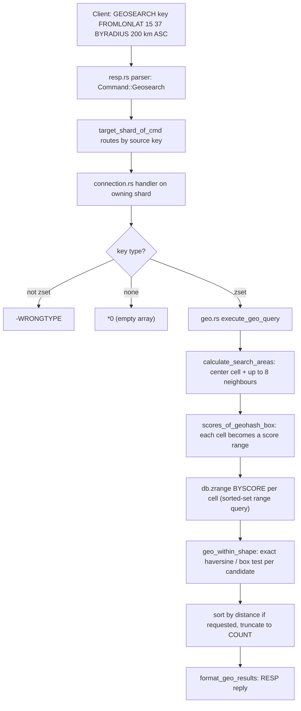

# Component 17: Geospatial Commands

> **High-Level Design Spec**: [`docs/design/17_geospatial.md`](../design/17_geospatial.md)
> **Consolidated Implementation Spec**: [`docs/internal/components.md`](components.md)
>
> **Main source**: `src/geo.rs` (math, search algorithm, reply formatting).
> **Glue**: `src/resp.rs` (parsing into `Command::Geo*`), `src/connection.rs` (command handlers,
> key extraction, shard routing), `src/aof.rs` (persistence/replication encoding),
> `src/table.rs` + `src/zindex.rs` (the sorted-set storage that geo sets live in).

---

## 1. What this subsystem does

Rudis implements the Redis `GEO*` command family so that clients can store points on the Earth
(longitude/latitude pairs attached to member names) and ask questions such as "how far apart are
Palermo and Catania?" or "which stores are within 5 km of me, nearest first?".

The supported commands are:

| Command | Purpose |
| :--- | :--- |
| `GEOADD` | Add/update members with coordinates. |
| `GEODIST` | Distance between two members. |
| `GEOPOS` | Coordinates of members. |
| `GEOHASH` | Standard 11-character geohash strings of members. |
| `GEORADIUS` / `GEORADIUS_RO` | Members within a radius of a lon/lat point (optionally `STORE`/`STOREDIST`). |
| `GEORADIUSBYMEMBER` / `GEORADIUSBYMEMBER_RO` | Same, centred on an existing member. |
| `GEOSEARCH` | Radius or box search centred on a member or a lon/lat point. |
| `GEOSEARCHSTORE` | `GEOSEARCH` whose result is written to a destination sorted set. |

There is **no dedicated geo data type**. Exactly as in Redis, a "geo set" is an ordinary sorted
set (ZSET) whose scores are 52-bit integer geohashes. `TYPE` reports `zset`, and every `Z*`
command works on a geo set. The point of the encoding is that nearby points tend to have nearby
scores, so a spatial search can be turned into a handful of score-range queries on the sorted set.

The implementation is a close port of Redis's `geohash.c` / `geohash_helper.c` / `geo.c`
algorithms, and real Redis's own Tcl suite `tests/redis-tests/unit/geo.tcl` is part of the
`CORE_SUITES` list in `scripts/run_redis_test_suite.sh`.

## 2. Mental model



Two encodings are in play, and keeping them apart is the key to reading `geo.rs`:

1. **Storage geohash** — fixed 26 bits per axis, 52 bits total, stored as the ZSET score
   (`encode_geohash` / `decode_geohash`).
2. **Search grid cells** — a variable-precision geohash (`GeoHashBits`, `step` bits per axis) used
   only during a search to pick which score ranges to scan. A coarse cell corresponds to a
   contiguous range of storage scores.

A search therefore has two phases: a cheap, approximate **candidate** phase (pick ≤ 9 grid
cells, range-scan their scores) and an exact **filter** phase (decode each candidate and compute
its true spherical distance).

---

## 3. Constants

All defined at the top of `src/geo.rs`.

| Constant | Value | Meaning |
| :--- | :--- | :--- |
| `EARTH_RADIUS_IN_METERS` | `6372797.560856` | Spherical Earth radius used by every distance computation. Same literal as Redis. |
| `MERCATOR_MAX` | `20037726.37` | Half the Earth's circumference in metres; loop bound in `geohash_estimate_steps_by_radius`. |
| `GEO_LAT_MIN` / `GEO_LAT_MAX` | `-85.05112878` / `85.05112878` | Valid latitude range (Web-Mercator limit), **not** ±90. |
| `GEO_LON_MIN` / `GEO_LON_MAX` | `-180.0` / `180.0` | Valid longitude range. |
| `GEO_STEP_MAX` | `26` | Bits per axis of the storage hash. Declared but the encode/decode loops hard-code `26`. |
| `GEOHASH_ALPHABET` (private) | `0123456789bcdefghjkmnpqrstuvwxyz` | Standard base32 geohash alphabet, used only by `GEOHASH` output. |

---

## 4. Encodings and basic math

### 4.1 Storage hash: `encode_geohash` / `decode_geohash`

**Interleaving** (also called Morton or Z-order encoding) means building one integer by
alternating bits from two integers. Points close together in 2-D usually share a long common
prefix, so they sort close together.

`encode_geohash(lon, lat) -> Result<u64, String>`:

1. Reject coordinates outside `[GEO_LON_MIN, GEO_LON_MAX]` × `[GEO_LAT_MIN, GEO_LAT_MAX]` with
   `ERR invalid longitude,latitude pair <lon>,<lat>` (6 decimal places).
2. Linearly map latitude and longitude onto `[0, 2^26)` and truncate to integers (clamped to
   `2^26 - 1`).
3. Interleave the 26 bits of each: latitude bit *i* goes to bit `2i` (even positions), longitude
   bit *i* goes to bit `2i+1` (odd positions). Result: a 52-bit integer.

`decode_geohash(hash) -> (lon, lat)` reverses the bit extraction and returns the **centre** of
the decoded cell: `lat = GEO_LAT_MIN + ((ilat + 0.5) / 2^26) * (GEO_LAT_MAX - GEO_LAT_MIN)` (and
the longitude analogue), clamped back into range. Because the score is quantised, a round trip
is close but not exact; the unit test `test_geohash_encode_decode_roundtrip` asserts agreement
within `1e-5` degrees.

**Why a 52-bit integer fits in an `f64` score:** an `f64` has a 53-bit significand, so every
52-bit integer is represented exactly. `GEOADD` stores `hash as f64`; readers convert back with
`score as u64`.

### 4.2 `GEOHASH` strings: `geohash_to_base32`

The public geohash standard (geohash.org) uses latitude range `[-90, 90]`, but the stored hash
uses the Mercator range. So `geohash_to_base32(score)`:

1. Decodes the score with `decode_geohash` (Mercator range) to get lon/lat.
2. Re-encodes those coordinates with the **standard** ranges (`[-90,90]`, `[-180,180]`) into a
   fresh 52-bit interleaved value.
3. Emits 11 base32 characters: characters 0–9 take successive 5-bit groups from the top of the
   52-bit value; the 11th character is always index 0 (`'0'`), as in Redis, since 52 bits do not
   fill 55.

### 4.3 Units: `GeoUnit`

```rust
pub enum GeoUnit { Meters, Kilometers, Miles, Feet }
```

| Method | `m` | `km` | `mi` | `ft` |
| :--- | :--- | :--- | :--- | :--- |
| `to_meters(v)` | `v` | `v * 1000` | `v * 1609.34` | `v * 0.3048` |
| `from_meters(m)` | `m` | `m / 1000` | `m / 1609.34` | `m / 0.3048` |

`GeoUnit::parse` is case-insensitive (`M`, `km`, `Mi`, … all work) and otherwise fails with
`unsupported unit provided. please use M, KM, FT, MI`. The mile factor `1609.34` (not the exact
`1609.344`) deliberately matches Redis.

### 4.4 Distances: `haversine_distance` / `geohash_lat_distance`

- `geohash_lat_distance(lat1, lat2)` = `EARTH_RADIUS_IN_METERS * |lat2 - lat1|` (in radians):
  the exact arc length along a meridian.
- `haversine_distance(lon1, lat1, lon2, lat2)` is the standard great-circle (haversine) formula
  on a sphere of radius `EARTH_RADIUS_IN_METERS`:
  1. `v = sin((lon2 - lon1) / 2)`. If `v == 0` (same longitude), return
     `geohash_lat_distance` — a fast path that also avoids rounding error.
  2. `u = sin((lat2 - lat1) / 2)`, `a = u² + cos(lat1)·cos(lat2)·v²`.
  3. Return `2 · R · asin(clamp(sqrt(a), 0, 1))`. The clamp prevents `NaN` when rounding pushes
     `sqrt(a)` slightly above 1.

Worked example (from the unit test `test_haversine_palermo_catania`): Palermo
(13.361389, 38.115556) to Catania (15.087269, 37.502669) is ≈ 166 274 m; `GEODIST` reports it
formatted to four decimals.

---

## 5. The search grid

### 5.1 Data structures

```rust
pub struct GeoHashBits { pub bits: u64, pub step: u8 }   // one grid cell
pub struct GeoHashArea {                                  // that cell's lon/lat rectangle
    pub min_lon: f64, pub max_lon: f64,
    pub min_lat: f64, pub max_lat: f64,
}
pub enum GeoSearchShape {
    Radius { radius_m: f64 },
    Box { width_m: f64, height_m: f64 },   // full width/height, not half
}
```

| Type | Field | Meaning |
| :--- | :--- | :--- |
| `GeoHashBits` | `bits` | Interleaved cell index using `2 * step` bits (same lat-even/lon-odd layout as storage). |
| | `step` | Bits per axis, 1..=26. Smaller step = bigger cell. |
| `GeoHashArea` | `min_/max_lon`, `min_/max_lat` | Bounding rectangle of a cell in degrees. |
| `GeoSearchShape` | `Radius.radius_m` | Search radius in metres. |
| | `Box.width_m`, `Box.height_m` | Full box extent in metres, centred on the query point. |

### 5.2 Cell helpers

- `encode_with_step(lon, lat, step)` — same normalise-and-interleave as `encode_geohash`, but for
  `step` bits per axis, and it **clamps** out-of-range coordinates instead of erroring.
- `decode_area(hash)` — returns the full `GeoHashArea` rectangle of a cell (not just its centre).
- `geohash_move_x(&mut hash, d)` / `geohash_move_y(&mut hash, d)` — move one cell east/west
  (`x`, longitude) or north/south (`y`, latitude) directly on the interleaved bits, without
  decoding. The masks `0xaaaa…` and `0x5555…` isolate the odd (longitude) and even (latitude)
  bits; the target axis's bits are incremented or decremented with a carry trick (fill the
  other axis's bit positions with 1s so the carry ripples through them), then re-masked to
  `2 * step` bits. `d == 0` is a no-op; moves wrap around at the grid edge. This mirrors Redis's
  `geohashMoveX` / `geohashMoveY`.
- `scores_of_geohash_box(hash) -> (min, max)` — shifts the cell's bits left by
  `52 - 2 * step`. Every storage hash inside that cell has those bits as its prefix, so the cell
  equals the half-open score range `[bits << shift, (bits + 1) << shift)`.

### 5.3 Choosing precision: `geohash_estimate_steps_by_radius(range_m, lat)`

1. If `range_m == 0`, return 26 (finest cells).
2. Start at `step = 1`; while `range_m < MERCATOR_MAX`, double `range_m` and increment `step`.
3. Subtract 2 from `step`.
4. If `|lat| > 66`, subtract 1 more; if `|lat| > 80`, subtract another 1 (cells get narrower in
   metres of longitude near the poles, so coarser cells are needed to cover the same distance).
5. Clamp to `1..=26`.

Bigger radius → smaller step → bigger cells. For a 200 km radius at latitude 37:
200 000 doubles 7 times before exceeding 20 037 726 (200 000 · 2⁷ = 25.6 M), so `step` reaches
8, then 8 − 2 = **6** bits per axis (cells ≈ 5.6° of longitude by ≈ 2.7° of latitude).

### 5.4 Approximate query rectangle: `geohash_bounding_box(shape, lon, lat) -> [min_lon, min_lat, max_lon, max_lat]`

1. Half-extents: radius → `(r, r)`; box → `(width/2, height/2)`.
2. `lat_delta` = half-height ÷ R, in degrees.
3. Longitude delta = half-width ÷ R ÷ `cos(lat)`, in degrees, computed at both the top edge
   (`lat + lat_delta`) and bottom edge (`lat - lat_delta`); if the cosine is ≤ `1e-6` (pole), the
   delta is 180°.
4. Northern-hemisphere centres (`lat >= 0`) use the top-edge delta for both sides; southern use
   the bottom-edge delta.

This rectangle is **only** used to decide which cells to scan. It never decides membership.

### 5.5 Candidate cells: `calculate_search_areas(shape, lon, lat) -> Vec<GeoHashBits>`

1. Compute the query rectangle (§5.4).
2. Effective radius: `radius_m` for a circle; half the box diagonal
   (`sqrt((w/2)² + (h/2)²)`) for a box.
3. `steps = geohash_estimate_steps_by_radius(radius, lat)`; encode the centre cell at that step.
4. Compute the 8 neighbours with the move helpers, in fixed order
   `[N, S, E, W, NE, NW, SE, SW]` (diagonals are an E/W move followed by an N/S move).
5. **Coverage check:** if the N neighbour's `max_lat` is below the rectangle's top, or S's
   `min_lat` above its bottom, or E's `max_lon` below its right edge, or W's `min_lon` above its
   left edge — i.e. the 3×3 block does not cover the query — and `steps > 1`, decrease `steps`
   by 1 and recompute the centre and all neighbours. This happens **at most once**.
6. **Trimming** (only when `steps >= 2`): compare the centre cell's own rectangle to the query
   rectangle. If the centre cell already extends past the query's south edge, drop S, SW and
   SE; past the north edge, drop N, NE, NW; past the west edge, drop W, SW, NW; past the east
   edge, drop E, SE, NE.
7. Return the centre cell followed by the surviving neighbours in the fixed order. At most 9
   cells, regardless of query size.

---

## 6. Running a search: `execute_geo_query`

```rust
pub fn execute_geo_query(db: &mut ShardDb, key: &[u8], center_lon: f64, center_lat: f64,
    shape: GeoSearchShape, unit: GeoUnit, withdist: bool, withhash: bool, withcoord: bool,
    count: Option<usize>, any: bool, asc: Option<bool>) -> Vec<GeoItemResult>
```

`asc` is `Some(true)` for `ASC`, `Some(false)` for `DESC`, `None` if neither was given.

Steps:

1. `areas = calculate_search_areas(&shape, center_lon, center_lat)`.
2. For each cell, skipping a cell identical (same `bits` and `step`) to the one just processed:
   1. Convert to `[min_score, max_score)` with `scores_of_geohash_box`.
   2. `db.zrange(key, ZRangeOpts { by_score: true, min_score, max_score, max_inc: false,
      with_scores: true, .. })` (the default `min_inc` is `true`, so the range is half-open).
   3. For each `(member, score)`: skip it if already in the `seen` hash set (a member can match
      several cells); otherwise call `geo_within_shape`. On a hit, push a `GeoItemResult`.
   4. If `any` is set and `results.len() >= count`, stop immediately (both loops).
3. Ordering: if `asc` is `None`, `COUNT` was given and `ANY` was not, sort ascending by
   distance (so `COUNT` keeps the nearest). Otherwise sort ascending/descending only if `asc`
   is `Some`. With no `ASC`/`DESC` and no `COUNT`, results stay in cell-visit order.
4. Truncate to `count` if given.

### 6.1 Exact membership: `geo_within_shape(shape, score, lon, lat) -> Option<((lon, lat), dist_m)>`

The candidate's score is decoded with `decode_geohash`, then:

- **Radius:** `dist = haversine_distance(centre, member)`; hit if `dist <= radius_m`.
- **Box:**
  1. `geohash_lat_distance(member_lat, centre_lat)` must be ≤ `height_m / 2`.
  2. `haversine_distance(member_lon, member_lat, centre_lon, member_lat)` — the east-west
     distance measured along the member's own latitude — must be ≤ `width_m / 2`.
  3. The reported distance is the full great-circle distance from the centre.

Both tests use exact spherical formulas. Because candidates are always re-checked here, an
imprecise query rectangle can only change how much work is done, not which members are returned.

### 6.2 Result record: `GeoItemResult`

| Field | Type | Meaning |
| :--- | :--- | :--- |
| `member` | `Bytes` | Member name. |
| `dist` | `Option<f64>` | Distance in the caller's unit; `Some` only with `WITHDIST`. |
| `hash` | `Option<u64>` | Raw 52-bit score; `Some` only with `WITHHASH`. |
| `coord` | `Option<(f64, f64)>` | Decoded (lon, lat); `Some` only with `WITHCOORD`. |
| `dist_m` | `f64` | Distance in metres, always set (used for sorting and `STOREDIST`). |
| `score` | `u64` | Raw score, always set (used for `STORE`). |

### 6.3 Reply formatting: `format_geo_results(out, results, has_options)`

- `has_options == false` (no `WITH*` flag): a flat array of member bulk strings.
- Otherwise each element is a sub-array: `member`, then `dist` as a bulk string formatted
  `{:.4}` (if present), then `hash` as an integer (if present), then `coord` as a 2-element array
  of bulk strings (if present). The order is fixed regardless of the order the flags were given.
- Coordinates use Rust's default `f64` `Display` (shortest round-trip form), not C's `%.17g`.

### 6.4 Worked example

Data: `GEOADD Sicily 13.361389 38.115556 Palermo 15.087269 37.502669 Catania`.
Query: `GEOSEARCH Sicily FROMLONLAT 15 37 BYRADIUS 200 km ASC WITHDIST`.

1. Parser builds `Command::Geosearch { from_lonlat: Some((15, 37)), by_radius: Some((200, Kilometers)), asc: Some(true), withdist: true, .. }`.
2. Handler checks type (`zset`), centre = (15, 37), shape = `Radius { radius_m: 200000 }`.
3. `calculate_search_areas`: step 6 (§5.3), centre cell plus neighbours, possibly coarsened
   once and trimmed.
4. Each cell becomes a score range; `zrange BYSCORE` returns Palermo and Catania as candidates.
5. `geo_within_shape`: Catania ≈ 56 km, Palermo ≈ 190 km — both ≤ 200 km.
6. `ASC` sorts by `dist_m`; reply is
   `[[Catania, "56.4413"], [Palermo, "190.4424"]]` (distances in km, four decimals — the same
   values Redis documents for this dataset).

---

## 7. Commands in detail

All handlers live in `execute_local_command` in `src/connection.rs`. Every command except
`GEOADD` first calls `db.type_of(key)` and returns
`-WRONGTYPE Operation against a key holding the wrong kind of value` if the key exists and is not
a `zset`; `GEOADD` relies on `db.zadd`'s own type check.

### 7.1 `GEOADD key [NX|XX] [CH] lon lat member [lon lat member ...]`

- **Parse:** at least 5 args. Leading `NX`/`XX`/`CH` tokens are consumed in any order until the
  first non-flag. `syntax error` if the remaining count is zero or not a multiple of 3, or if
  both `NX` and `XX` were given. Non-numeric coordinates → `value is not a valid float`;
  out-of-range → `invalid longitude,latitude pair <lon>,<lat>`.
- **Execute:** each pair is encoded with `encode_geohash` (a second range check), then the whole
  batch goes to `db.zadd` with `ZAddFlags { nx, xx, ch, gt: false, lt: false, incr: false }`.
  Reply: integer from `zadd` (added count, or added+changed with `CH`).
- **Propagation:** the `Command::Geoadd` itself is logged (`aof.rs` re-serialises it as
  `GEOADD key [NX] [XX] [CH] lon lat member ...`).

### 7.2 `GEODIST key member1 member2 [m|km|ft|mi]`

- **Parse:** 4 or 5 args; unit optional.
- **Execute:** `zscore` both members; if either is missing → nil bulk (`$-1`). Otherwise decode
  both, `haversine_distance`, convert with `from_meters` if a unit was given (default metres),
  reply as a bulk string with four decimals. A missing key also yields nil.

### 7.3 `GEOPOS key [member ...]`

- **Parse:** at least 2 args; zero members is allowed (reply `*0`).
- **Execute:** array with one entry per member: a 2-element array `[lon, lat]` (default `f64`
  formatting) or a nil array (`*-1`) if the member is missing.

### 7.4 `GEOHASH key [member ...]`

- **Parse:** at least 2 args.
- **Execute:** array of 11-character strings from `geohash_to_base32`, or nil bulk for missing
  members.

### 7.5 `GEORADIUS key lon lat radius unit [options]` and `GEORADIUS_RO`

Options: `WITHCOORD`, `WITHDIST`, `WITHHASH`, `COUNT n [ANY]`, `ANY`, `ASC`, `DESC`,
`STORE dst`, `STOREDIST dst`.

- **Parse rules:**
  - at least 6 args; lon/lat range-checked; negative radius → `radius cannot be negative`.
  - `COUNT` must be a positive integer (`COUNT must be > 0`); `ANY` may follow it or appear on
    its own elsewhere, but `ANY` without `COUNT` → `the ANY argument requires COUNT argument`.
  - `STORE`/`STOREDIST` with any `WITH*` flag →
    `STORE option in GEORADIUS is not compatible with WITHDIST, WITHHASH and WITHCOORD options`.
  - In the `_RO` form, `STORE`/`STOREDIST` are a `syntax error`. Both forms produce the same
    `Command::Georadius`; `get_cmd_name` reports a store-less one as `GEORADIUS_RO`.
  - Any unknown token → `syntax error`.
- **Execute:**
  1. Type check. If the key does not exist: with a store target, delete the target and reply
     `:0`; otherwise reply `*0`.
  2. `shape = Radius { radius_m: unit.to_meters(radius) }`, run `execute_geo_query`.
  3. Without a store target: reply via `format_geo_results`.
  4. With a store target (`STORE` and `STOREDIST` share one destination slot; if both are given,
     the `STORE` key wins but `STOREDIST` scoring is used):
     - empty result → delete the destination (emitting a `del` keyspace event if it existed),
       reply `:0`;
     - otherwise delete the destination, then `zadd` every result with score = raw geohash
       (`STORE`, so the destination is itself a usable geo set) or `unit.from_meters(dist_m)`
       (`STOREDIST`, a distance-ranked set). Emits `new`/`overwritten`/`type_changed` keyspace
       events via `notify_set_key_events_local`. Reply: number of stored members.
  5. **Propagation:** `GEORADIUS` has no AOF serialiser; the handler logs its *effects* instead —
     a `DEL` of the destination and a `ZADD` with the computed scores.

### 7.6 `GEORADIUSBYMEMBER key member radius unit [options]` and `_RO`

Same options, parse rules and store behaviour as `GEORADIUS` (including the error string that
says "GEORADIUS"). The centre is the member's decoded score; if the key exists but the member
does not → `-ERR could not decode requested zset member`.

### 7.7 `GEOSEARCH key FROMMEMBER m | FROMLONLAT lon lat  BYRADIUS r unit | BYBOX w h unit  [ASC|DESC] [COUNT n [ANY]] [WITHCOORD] [WITHDIST] [WITHHASH]`

- **Parse rules:**
  - giving `FROMMEMBER`/`FROMLONLAT` twice, both, or `BYRADIUS`/`BYBOX` twice/both → `syntax error`;
  - neither origin → `exactly one of FROMMEMBER or FROMLONLAT can be specified for GEOSEARCH`;
  - neither shape → `exactly one of BYRADIUS and BYBOX can be specified for GEOSEARCH`;
  - negative radius → `radius cannot be negative`; negative width/height →
    `height or width cannot be negative`; `FROMLONLAT` range-checked;
  - `COUNT`/`ANY` rules as for `GEORADIUS`. There is no `STORE` option.
- **Execute:** type check; missing key → `*0`. Resolve the centre (member lookup failure →
  `-ERR could not decode requested zset member`). Build `Radius` or `Box` with all lengths
  converted to metres; the unit given with the shape is used for `WITHDIST`. Run
  `execute_geo_query` and reply with `format_geo_results`.

### 7.8 `GEOSEARCHSTORE dst src FROMMEMBER|FROMLONLAT ... BYRADIUS|BYBOX ... [ASC|DESC] [COUNT n [ANY]] [STOREDIST]`

- **Parse:** same as `GEOSEARCH` (error messages say `GEOSEARCHSTORE`), plus `STOREDIST`; any
  `WITHCOORD`/`WITHDIST`/`WITHHASH` →
  `GEOSEARCHSTORE is not compatible with WITHDIST, WITHHASH and WITHCOORD options`.
- **Execute:**
  1. Type check on `src`. If `src` is missing: delete `dst` (logging a `DEL`), reply `:0`.
  2. Resolve centre and shape as in `GEOSEARCH`; run `execute_geo_query` with all `WITH*` off.
  3. Empty result → delete `dst` (with `del` event if it existed), reply `:0`. Otherwise delete
     `dst`, `zadd` results scored by raw geohash or (with `STOREDIST`) by distance in the shape's
     unit, emit set-key events, reply with the count.
  4. **Propagation:** the `Command::Geosearchstore` itself is logged (`aof.rs` re-serialises all
     its options), so replicas and AOF replay re-run the search against their own copy of `src`.

---

## 8. Routing, key extraction and other integration points

| Function (`src/connection.rs`) | Geo behaviour |
| :--- | :--- |
| `cmd_primary_key` | Returns the source `key` for all eight commands. |
| `for_each_cmd_key` / `cmd_keys` | Reports `key` plus `store`/`storedist` for `GEORADIUS*`; `dest` and `key` for `GEOSEARCHSTORE`. Used for the cluster `CROSSSLOT` check, the `cross-shard-strict` check, and for `WATCH`/client-tracking invalidation when a change is recorded. |
| `target_shard_of_cmd` | Routes all eight commands by the source `key` only. |
| `get_cmd_name` | Command names for stats/slowlog; maps store-less `GEORADIUS*` to the `_RO` names. |

Other files:

- `src/aof.rs` (`command_to_resp`): serialisers for `Geoadd` and `Geosearchstore` (units written
  back as `m`/`km`/`mi`/`ft`).
- `src/slowlog.rs`: renders `GEOADD` as `geoadd key lon lat member ...` (flags omitted).
- `src/acl_categories.rs` / `src/command_docs.rs`: static `COMMAND INFO` / `COMMAND DOCS` metadata
  for the geo commands (copied from Redis).

---

## 9. Storage substrate and complexity

A geo set is a `RudisZSet` (`src/table.rs`):

- `Small(Vec<(OrderedScore, CompactKey)>)` for up to `SMALL_ZSET_LIMIT` (64) members. A
  by-score range is a linear filter over the vector.
- `Full(ZIndex)` above that (`src/zindex.rs`: members stored once in a page store, a hash table
  for member lookup, and a deque of sorted runs for order). A by-score range uses
  `ZIndex::iter_from_score(min)` to seek to the first score ≥ `min`, then walks forward until the
  score reaches `max`.

So for a large set, a search costs about `(≤ 9 cells) × (seek + members in that cell)` plus the
exact filter on each candidate — it does **not** scan the whole set. `GEODIST`/`GEOPOS`/`GEOHASH`
are one `zscore` hash lookup per member.

---

## 10. Invariants & gotchas

- **Latitude limit is ±85.05112878°**, not ±90°. Out-of-range input is rejected at parse time
  (`resp.rs`) and again in `encode_geohash` for `GEOADD`.
- **Two geohash flavours.** Stored scores use the Mercator latitude range; `GEOHASH` strings are
  re-encoded with the standard ±90° range. Do not compare them bit-for-bit.
- **Search grid bits must line up with storage bits.** `GeoHashBits` uses the same lat-even /
  lon-odd layout as `encode_geohash`; `scores_of_geohash_box` depends on that to turn a cell
  into a score prefix range.
- **Cell score ranges are half-open** (`min_inc` default `true`, `max_inc: false`), so adjacent
  cells neither overlap nor leave gaps.
- **Pruning never causes false positives**: every candidate goes through `geo_within_shape`.
- **`ANY` returns the first matches found, unsorted** unless `ASC`/`DESC` is also given; without
  `ANY`, `COUNT` implies ascending order.
- **Units:** mile factor is `1609.34`, matching Redis — do not "fix" it.
- **A geo set is just a ZSET.** `ZADD geo 123 x` with a non-geohash score is accepted; geo
  commands will silently decode it as some coordinate. `ZRANGE`, `ZREM`, `DEL` etc. all work on
  geo sets (there is no `GEODEL`; use `ZREM`).
- **Distances** are reported with `{:.4}`; coordinates use Rust's shortest round-trip `f64`
  formatting, which can differ in trailing digits from Redis's `%.17g`.

---

## 11. Limitations / not implemented

- **Store destination on a different shard (standalone multi-shard mode).** Rudis partitions the
  keyspace across shard threads by key hash (hash-tag aware) even when cluster mode is off (default shard count
  is `min(cores, 8)`). `target_shard_of_cmd` routes `GEORADIUS* STORE/STOREDIST` and
  `GEOSEARCHSTORE` by the *source* key, and the handler writes the destination into that shard's
  local `ShardDb`. If the destination key hashes to a different shard, the result lands on the
  wrong shard and later direct reads of the destination (which route by its own slot) do not see
  it. In cluster mode this cannot happen because the `CROSSSLOT` check (gated on
  `router.cluster_enabled`) rejects such commands. Outside cluster mode, `cross-shard-strict yes`
  (config file, `--cross-shard-strict`, or `CONFIG SET`; default `no`) makes
  `execute_command_inner` refuse a command whose keys (`cmd_keys`) live on different shards with
  the same `-CROSSSLOT Keys in request don't hash to the same slot` error, which closes this gap.
  Using hash tags (e.g. `{geo}src` /
  `{geo}dst`) avoids the problem.
- **`BYPOLYGON`** appears in the copied `COMMAND DOCS` metadata for `GEOSEARCH`/`GEOSEARCHSTORE`
  but is not parsed — it is a `syntax error`.
- **No RESP3-specific replies**: distances and coordinates are always bulk strings, as in RESP2.
- **Unreachable fallback:** the `GEOSEARCH`/`GEOSEARCHSTORE` handlers default to
  `Radius { radius_m: 0.0 }` when no shape is present, but the parser already rejects that.
- **Spherical model only**: distances use a fixed-radius sphere, not the WGS-84 ellipsoid (same
  as Redis), so errors of up to ~0.5% are expected versus geodesic tools.

---

## 12. Testing

- Unit tests in `src/geo.rs` (`mod tests`): `test_geohash_encode_decode_roundtrip`,
  `test_haversine_palermo_catania`, `test_unit_conversions`.
- End-to-end tests in `tests/e2e_commands.rs`: `test_geospatial_engine_e2e` and
  `test_geospatial_bounding_geohash_pruning_e2e` (radius queries over Palermo/Catania/Rome that
  must include and exclude the right cities).
- Redis compatibility: `tests/redis-tests/unit/geo.tcl`, run via
  `scripts/run_redis_test_suite.sh` (listed in `CORE_SUITES` as `unit/geo`).

---

## 13. Code map

| File | Key symbols | What they do |
| :--- | :--- | :--- |
| `src/geo.rs` | `EARTH_RADIUS_IN_METERS`, `MERCATOR_MAX`, `GEO_LAT_*`, `GEO_LON_*`, `GEO_STEP_MAX` | Constants. |
| | `GeoUnit` (`parse`, `to_meters`, `from_meters`) | Unit parsing/conversion. |
| | `encode_geohash`, `decode_geohash` | 52-bit storage score codec. |
| | `geohash_to_base32` | `GEOHASH` string output. |
| | `haversine_distance`, `geohash_lat_distance` | Spherical distances. |
| | `GeoHashBits`, `GeoHashArea`, `encode_with_step`, `decode_area` | Variable-precision search cells. |
| | `geohash_move_x`, `geohash_move_y` | Neighbour-cell bit tricks. |
| | `geohash_estimate_steps_by_radius` | Radius → cell precision. |
| | `GeoSearchShape`, `geohash_bounding_box` | Query shape and its approximate lon/lat rectangle. |
| | `calculate_search_areas` | Centre + ≤ 8 neighbour cells, coarsened once and trimmed. |
| | `scores_of_geohash_box` | Cell → half-open score range. |
| | `geo_within_shape` | Exact radius/box membership test. |
| | `GeoItemResult`, `execute_geo_query` | Shared search executor. |
| | `format_geo_results` | RESP reply for search commands. |
| `src/resp.rs` | `Command::Geoadd` … `Command::Geosearchstore`; `"GEOADD"` … `"GEOSEARCHSTORE"` parser arms | Wire parsing and validation. |
| `src/connection.rs` | `execute_local_command` (geo arms) | Command handlers, store logic, keyspace events, propagation. |
| | `cmd_primary_key`, `for_each_cmd_key`, `target_shard_of_cmd`, `get_cmd_name` | Key extraction, routing, naming. |
| | `notify_set_key_events_local` | `new`/`overwritten`/`type_changed` events for store targets. |
| `src/aof.rs` | `command_to_resp` (`Geoadd`, `Geosearchstore` arms) | AOF/replication encoding. |
| `src/slowlog.rs` | `Geoadd` arm | Slowlog argument rendering. |
| `src/table.rs` | `RudisZSet`, `SMALL_ZSET_LIMIT`, `ZRangeOpts`, `ZAddFlags` | Sorted-set storage and range options. |
| `src/zindex.rs` | `ZIndex::iter_from_score` | Ordered seek used by by-score ranges on large sets. |
| `src/shard.rs` | `ShardDb::zrange`, `zscore`, `zadd`, `type_of` | Per-shard database API used by the handlers. |
