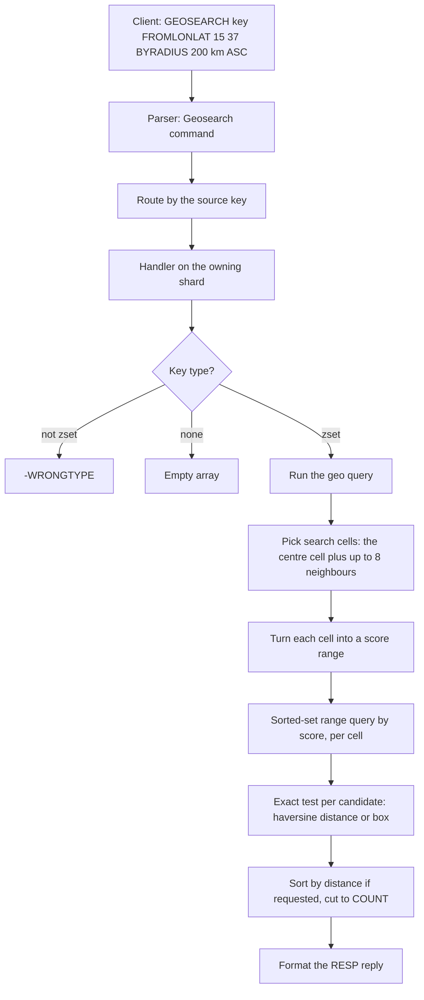

# Component 17: Geospatial Commands

> **High-Level Design Spec**: [docs/design/17_geospatial.md](../design/17_geospatial.md)
> **Consolidated Implementation Spec**: [docs/internal/components.md](components.md)
> **Main source files**: src/geo.rs (the math, the search algorithm and reply formatting). Glue:
> src/resp.rs (parsing into `Command::Geo*`), src/connection.rs (command handlers, key extraction,
> shard routing), src/aof.rs (persistence and replication encoding), src/table.rs and src/zindex.rs
> (the sorted-set storage that geo sets live in). The [Code map](#13-code-map) lists the key symbols.

---

## 1. What this subsystem does

Rudis implements the Redis `GEO*` command family so that clients can store points on the Earth
(longitude and latitude pairs attached to member names) and ask questions such as "how far apart are
Palermo and Catania?" or "which stores are within 5 km of me, nearest first?".

| Command | Purpose |
| :--- | :--- |
| `GEOADD` | Add or update members with coordinates. |
| `GEODIST` | Distance between two members. |
| `GEOPOS` | Coordinates of members. |
| `GEOHASH` | Standard 11-character geohash strings of members. |
| `GEORADIUS`, `GEORADIUS_RO` | Members within a radius of a longitude/latitude point (optionally `STORE` or `STOREDIST`). |
| `GEORADIUSBYMEMBER`, `GEORADIUSBYMEMBER_RO` | The same, centred on an existing member. |
| `GEOSEARCH` | A radius or box search centred on a member or a longitude/latitude point. |
| `GEOSEARCHSTORE` | `GEOSEARCH` whose result is written to a destination sorted set. |

There is **no dedicated geo data type**. Exactly as in Redis, a "geo set" is an ordinary sorted set
(ZSET) whose scores are 52-bit integer geohashes. `TYPE` reports `zset`, and every `Z*` command works
on a geo set. The point of the encoding is that nearby points tend to have nearby scores, so a spatial
search can be turned into a handful of score-range queries on the sorted set.

The implementation is a close port of Redis's `geohash.c`, `geohash_helper.c` and `geo.c` algorithms, and
real Redis's own Tcl suite `tests/redis-tests/unit/geo.tcl` is part of the `CORE_SUITES` list in
`scripts/run_redis_test_suite.sh`.

---

## 2. Mental model



Two encodings are in play, and keeping them apart is the key to reading src/geo.rs:

1. **The storage geohash.** A fixed 26 bits per axis, 52 bits total, stored as the sorted-set score.
2. **Search grid cells.** A variable-precision geohash (a bit string and a *step*, the bits per axis) used
   only during a search to pick which score ranges to scan. A coarse cell corresponds to a contiguous range
   of storage scores.

A search therefore has two phases: a cheap, approximate **candidate** phase (pick at most 9 grid cells and
range-scan their scores) and an exact **filter** phase (decode each candidate and compute its true spherical
distance).

| Term | Meaning |
| :--- | :--- |
| **Geohash** | A single integer built by interleaving the bits of a point's longitude and latitude. |
| **Interleaving** | Also called Morton or Z-order encoding: alternating bits from two integers. Points close together in 2-D usually share a long common prefix, so they sort close together. |
| **Haversine** | The standard formula for great-circle distance on a sphere. |
| **Step** | The number of bits per axis in a search cell. A smaller step means a bigger cell. |
| **Mercator range** | The latitude limit of about ±85.05° used by the stored hash. |

---

## 3. Constants

The constants are at the top of src/geo.rs. The Earth is a sphere of radius 6,372,797.560856 m (the same literal
as Redis). Valid latitudes are ±85.05112878° (the Web-Mercator limit), **not** ±90°, and valid longitudes are
±180°. The storage hash has 26 bits per axis. Half the Earth's circumference in metres (20,037,726.37) bounds a
loop in the precision estimate. [Reference details](#141-constants) lists them all.

---

## 4. Encodings and basic math

### 4.1 The storage hash

Encoding a longitude and latitude into a score works like this:

1. Reject coordinates outside the valid ranges with `ERR invalid longitude,latitude pair <lon>,<lat>` (six
   decimal places).
2. Linearly map latitude and longitude onto `[0, 2^26)` and truncate to integers (clamped to `2^26 − 1`).
3. Interleave the 26 bits of each: latitude bit *i* goes to bit `2i` (even positions), longitude bit *i* goes to
   bit `2i + 1` (odd positions). The result is a 52-bit integer.

Decoding reverses the bit extraction and returns the **centre** of the decoded cell: the minimum latitude plus
`(ilat + 0.5) / 2^26` of the latitude span, and the longitude analogue, clamped back into range. Because the
score is quantised, a round trip is close but not exact; the unit test `test_geohash_encode_decode_roundtrip`
asserts agreement within 1e-5 degrees.

**Why a 52-bit integer fits in a floating-point score.** An `f64` has a 53-bit significand, so every 52-bit
integer is represented exactly. `GEOADD` stores the hash as an `f64`; readers convert back to an integer.

### 4.2 GEOHASH strings

The public geohash standard (geohash.org) uses a latitude range of ±90°, but the stored hash uses the Mercator
range. So producing a `GEOHASH` string:

1. Decode the score (Mercator range) to get longitude and latitude.
2. Re-encode those coordinates with the **standard** ranges (±90° and ±180°) into a fresh 52-bit interleaved value.
3. Emit 11 base32 characters: characters 0–9 take successive 5-bit groups from the top of the 52-bit value; the
   11th character is always index 0 (`'0'`), as in Redis, since 52 bits do not fill 55. The alphabet is the
   standard `0123456789bcdefghjkmnpqrstuvwxyz`.

### 4.3 Units

There are four units: meters, kilometers, miles and feet. Conversion to meters multiplies by 1, 1000, 1609.34 and
0.3048; conversion from meters divides. Parsing is case-insensitive (`M`, `km`, `Mi` and so on all work) and
otherwise fails with `unsupported unit provided. please use M, KM, FT, MI`. The mile factor `1609.34` (not the
exact `1609.344`) deliberately matches Redis.

### 4.4 Distances

* The **latitude distance** of two latitudes is the Earth radius times the absolute difference in radians: the
  exact arc length along a meridian.
* The **haversine distance** is the standard great-circle formula on a sphere of that radius:
  1. `v = sin((lon2 − lon1) / 2)`. If `v` is 0 (same longitude), return the latitude distance, a fast path that
     also avoids rounding error.
  2. `u = sin((lat2 − lat1) / 2)` and `a = u² + cos(lat1)·cos(lat2)·v²`.
  3. Return `2 · R · asin(clamp(sqrt(a), 0, 1))`. The clamp prevents `NaN` when rounding pushes `sqrt(a)` slightly
     above 1.

**Worked example** (from the unit test `test_haversine_palermo_catania`). Palermo (13.361389, 38.115556) to Catania
(15.087269, 37.502669) is about 166,274 m; `GEODIST` reports it formatted to four decimals.

---

## 5. The search grid

### 5.1 Data structures

A grid cell is a bit string plus a step (1–26 bits per axis), using the same latitude-even, longitude-odd layout
as the storage hash. A cell's *area* is its bounding rectangle in degrees. A search *shape* is either a radius (in
metres) or a box (the full width and height in metres, not half, centred on the query point). The declarations are
in [Reference details](#142-types).

### 5.2 Cell helpers

* **Encode with a step** does the same normalise-and-interleave as the storage encoder, but for `step` bits per
  axis, and it **clamps** out-of-range coordinates instead of erroring.
* **Decode area** returns the full rectangle of a cell, not just its centre.
* **Move east/west or north/south** operates directly on the interleaved bits, without decoding. The masks
  `0xaaaa...` and `0x5555...` isolate the odd (longitude) and even (latitude) bits; the target axis's bits are
  incremented or decremented with a carry trick (fill the other axis's bit positions with 1s so the carry ripples
  through them), then re-masked to `2 × step` bits. A zero move is a no-op, and moves wrap around at the grid edge.
  This mirrors Redis's `geohashMoveX` and `geohashMoveY`.
* **Scores of a cell** shifts the cell's bits left by `52 − 2 × step`. Every storage hash inside that cell has those
  bits as its prefix, so the cell equals the half-open score range `[bits << shift, (bits + 1) << shift)`.

### 5.3 Choosing precision

1. If the range is 0, use 26 (the finest cells).
2. Start at step 1; while the range is below the Mercator maximum, double the range and increment the step.
3. Subtract 2 from the step.
4. If the latitude's magnitude exceeds 66°, subtract 1 more; if it exceeds 80°, subtract another 1 (cells get narrower
   in metres of longitude near the poles, so coarser cells are needed to cover the same distance).
5. Clamp to 1–26.

A bigger radius gives a smaller step and bigger cells. **Example.** For a 200 km radius at latitude 37, 200,000 doubles
7 times before exceeding 20,037,726 (200,000 · 2⁷ = 25.6 M), so the step reaches 8, then 8 − 2 = **6** bits per axis
(cells about 5.6° of longitude by about 2.7° of latitude).

### 5.4 The approximate query rectangle

The bounding box of a search returns the minimum longitude, minimum latitude, maximum longitude and maximum latitude:

1. The half-extents are the radius in both directions for a radius, or half the width and half the height for a box.
2. The latitude delta is the half-height divided by the Earth radius, in degrees.
3. The longitude delta is the half-width divided by the radius and by `cos(lat)`, in degrees, computed at both the top
   edge (`lat + lat_delta`) and the bottom edge (`lat − lat_delta`); if the cosine is at most 1e-6 (a pole), the delta
   is 180°.
4. Northern-hemisphere centres (latitude at least 0) use the top-edge delta for both sides; southern ones use the
   bottom-edge delta.

This rectangle is **only** used to decide which cells to scan. It never decides membership.

### 5.5 Candidate cells

1. Compute the query rectangle (§5.4).
2. The effective radius is the radius for a circle, or half the box diagonal (`sqrt((w/2)² + (h/2)²)`) for a box.
3. Estimate the step from the radius (§5.3) and encode the centre cell at that step.
4. Compute the 8 neighbours with the move helpers, in the fixed order north, south, east, west, north-east,
   north-west, south-east, south-west (diagonals are an east or west move followed by a north or south move).
5. **Coverage check.** If the north neighbour's maximum latitude is below the rectangle's top, or the south's minimum
   latitude is above its bottom, or the east's maximum longitude is below its right edge, or the west's minimum
   longitude is above its left edge (that is, the 3×3 block does not cover the query) and the step is above 1,
   decrease the step by 1 and recompute the centre and all neighbours. This happens **at most once**.
6. **Trimming** (only when the step is at least 2). Compare the centre cell's own rectangle to the query rectangle. If
   the centre cell already extends past the query's south edge, drop south, south-west and south-east; past the north
   edge, drop north, north-east and north-west; past the west edge, drop west, south-west and north-west; past the east
   edge, drop east, south-east and north-east.
7. Return the centre cell followed by the surviving neighbours in the fixed order. At most 9 cells, regardless of query
   size.

---

## 6. Running a search

The shared executor takes the shard data, the key, the centre longitude and latitude, a shape, a unit, the three `WITH*`
flags, an optional count, the `ANY` flag, and an optional direction (`Some(true)` for `ASC`, `Some(false)` for `DESC`,
`None` if neither was given). Its steps:

1. Compute the search areas (§5.5).
2. For each cell, skipping a cell identical (same bits and step) to the one just processed:
   1. Convert it to a half-open score range `[min_score, max_score)`.
   2. Run a sorted-set by-score range with scores (the default includes the minimum and the code excludes the maximum,
      so the range is half-open).
   3. For each (member, score): skip it if it is already in the "seen" set (a member can match several cells);
      otherwise run the exact membership test. On a hit, push a result.
   4. If `ANY` is set and the result count has reached the count, stop immediately (both loops).
3. **Ordering.** If no direction was given, `COUNT` was given and `ANY` was not, sort ascending by distance (so `COUNT`
   keeps the nearest). Otherwise sort ascending or descending only if a direction was given. With no `ASC`/`DESC` and
   no `COUNT`, results stay in cell-visit order.
4. Truncate to the count if given.

### 6.1 Exact membership

The candidate's score is decoded to a longitude and latitude, then:

* **Radius:** the haversine distance from the centre must be at most the radius.
* **Box:**
  1. The latitude distance between the member and the centre must be at most half the height.
  2. The east-west distance, measured along the member's own latitude, must be at most half the width.
  3. The reported distance is the full great-circle distance from the centre.

Both tests use exact spherical formulas. Because candidates are always re-checked here, an imprecise query rectangle can
only change how much work is done, not which members are returned.

### 6.2 The result record

Each result carries the member name, an optional distance in the caller's unit (only with `WITHDIST`), an optional raw
52-bit hash (only with `WITHHASH`), optional decoded coordinates (only with `WITHCOORD`), and two always-set fields: the
distance in metres (used for sorting and `STOREDIST`) and the raw score (used for `STORE`).

### 6.3 Reply formatting

* With no `WITH*` flag, the reply is a flat array of member bulk strings.
* Otherwise each element is a sub-array: the member, then the distance as a bulk string with four decimals (if present),
  then the hash as an integer (if present), then the coordinates as a 2-element array of bulk strings (if present). The
  order is fixed regardless of the order the flags were given.
* Coordinates use Rust's default `f64` display (the shortest round-trip form), not C's `%.17g`.

### 6.4 Worked example

Data: `GEOADD Sicily 13.361389 38.115556 Palermo 15.087269 37.502669 Catania`. Query: `GEOSEARCH Sicily FROMLONLAT 15 37
BYRADIUS 200 km ASC WITHDIST`.

1. The parser builds a `Geosearch` command with a longitude/latitude origin of (15, 37), a radius of 200 km, ascending order
   and distances requested.
2. The handler checks the type (`zset`), takes the centre (15, 37) and the shape (a radius of 200,000 m).
3. The search areas use step 6 (§5.3): the centre cell plus neighbours, possibly coarsened once and trimmed.
4. Each cell becomes a score range, and a by-score range returns Palermo and Catania as candidates.
5. The exact test: Catania is about 56 km away and Palermo about 190 km, both within 200 km.
6. `ASC` sorts by distance, and the reply is `[[Catania, "56.4413"], [Palermo, "190.4424"]]` (distances in km, four decimals,
   the same values Redis documents for this dataset).

---

## 7. Commands in detail

All handlers live in the local-execution routine in src/connection.rs. Every command except `GEOADD` first checks the key's type
and returns `-WRONGTYPE Operation against a key holding the wrong kind of value` if the key exists and is not a `zset`; `GEOADD`
relies on the sorted-set add's own type check.

### 7.1 GEOADD key [NX|XX] [CH] lon lat member [lon lat member ...]

* **Parse:** at least 5 arguments. Leading `NX`, `XX` and `CH` tokens are consumed in any order until the first non-flag. `syntax
  error` if the remaining count is zero or not a multiple of 3, or if both `NX` and `XX` were given. Non-numeric coordinates give
  `value is not a valid float`; out-of-range ones give `invalid longitude,latitude pair <lon>,<lat>`.
* **Execute:** each pair is encoded (a second range check), then the whole batch goes to the sorted-set add with the `NX`, `XX` and `CH`
  flags. The reply is the integer from the add (the added count, or added plus changed with `CH`).
* **Propagation:** the `GEOADD` command itself is logged (the AOF encoder re-serialises it as `GEOADD key [NX] [XX] [CH] lon lat
  member ...`).

### 7.2 GEODIST key member1 member2 [m|km|ft|mi]

* **Parse:** 4 or 5 arguments; the unit is optional.
* **Execute:** look up both scores; if either member is missing, reply nil (`$-1`). Otherwise decode both, compute the haversine distance,
  convert with the unit if one was given (default metres), and reply as a bulk string with four decimals. A missing key also gives nil.

### 7.3 GEOPOS key [member ...]

* **Parse:** at least 2 arguments; zero members is allowed (reply `*0`).
* **Execute:** an array with one entry per member: a 2-element array `[lon, lat]` (default `f64` formatting) or a nil array (`*-1`) if the member
  is missing.

### 7.4 GEOHASH key [member ...]

* **Parse:** at least 2 arguments.
* **Execute:** an array of 11-character strings, or nil bulk for missing members.

### 7.5 GEORADIUS key lon lat radius unit [options] (and GEORADIUS_RO)

The options are `WITHCOORD`, `WITHDIST`, `WITHHASH`, `COUNT n [ANY]`, `ANY`, `ASC`, `DESC`, `STORE dst` and `STOREDIST dst`.

* **Parse rules:**
  * At least 6 arguments; longitude and latitude are range-checked; a negative radius gives `radius cannot be negative`.
  * `COUNT` must be a positive integer (`COUNT must be > 0`); `ANY` may follow it or appear on its own elsewhere, but `ANY` without `COUNT` gives
    `the ANY argument requires COUNT argument`.
  * `STORE` or `STOREDIST` with any `WITH*` flag gives `STORE option in GEORADIUS is not compatible with WITHDIST, WITHHASH and WITHCOORD options`.
  * In the `_RO` form, `STORE` and `STOREDIST` are a `syntax error`. Both forms produce the same command; the name reported for stats is
    `GEORADIUS_RO` for a store-less one.
  * Any unknown token gives `syntax error`.
* **Execute:**
  1. Type check. If the key does not exist: with a store target, delete the target and reply `:0`; otherwise reply `*0`.
  2. Build the radius shape (converted to metres) and run the search.
  3. Without a store target, format the reply (§6.3).
  4. With a store target (`STORE` and `STOREDIST` share one destination slot; if both are given, the `STORE` key wins but `STOREDIST` scoring is
     used):
     * an empty result deletes the destination (emitting a `del` keyspace event if it existed) and replies `:0`;
     * otherwise delete the destination, then add every result with the score being the raw geohash (`STORE`, so the destination is itself a usable
       geo set) or the distance in the unit (`STOREDIST`, a distance-ranked set). It emits `new`, `overwritten` or `type_changed` keyspace events.
       The reply is the number of stored members.
  5. **Propagation.** `GEORADIUS` has no AOF serialiser; the handler logs its *effects* instead: a `DEL` of the destination and a `ZADD` with the
     computed scores.

### 7.6 GEORADIUSBYMEMBER key member radius unit [options] (and _RO)

The same options, parse rules and store behaviour as `GEORADIUS` (including the error string that says "GEORADIUS"). The centre is the member's
decoded score; if the key exists but the member does not, the reply is `-ERR could not decode requested zset member`.

### 7.7 GEOSEARCH

`GEOSEARCH key FROMMEMBER m | FROMLONLAT lon lat  BYRADIUS r unit | BYBOX w h unit  [ASC|DESC] [COUNT n [ANY]] [WITHCOORD] [WITHDIST] [WITHHASH]`

* **Parse rules:**
  * Giving `FROMMEMBER` or `FROMLONLAT` twice or both, or `BYRADIUS` or `BYBOX` twice or both, gives `syntax error`.
  * Neither origin gives `exactly one of FROMMEMBER or FROMLONLAT can be specified for GEOSEARCH`; neither shape gives `exactly one of BYRADIUS
    and BYBOX can be specified for GEOSEARCH`.
  * A negative radius gives `radius cannot be negative`; a negative width or height gives `height or width cannot be negative`; `FROMLONLAT` is
    range-checked.
  * The `COUNT` and `ANY` rules are as for `GEORADIUS`. There is no `STORE` option.
* **Execute:** type check; a missing key gives `*0`. Resolve the centre (a member lookup failure gives `-ERR could not decode requested zset
  member`). Build a radius or box shape with all lengths converted to metres; the unit given with the shape is used for `WITHDIST`. Run the search and
  format the reply.

### 7.8 GEOSEARCHSTORE

`GEOSEARCHSTORE dst src FROMMEMBER|FROMLONLAT ... BYRADIUS|BYBOX ... [ASC|DESC] [COUNT n [ANY]] [STOREDIST]`

* **Parse:** the same as `GEOSEARCH` (error messages say `GEOSEARCHSTORE`), plus `STOREDIST`; any `WITHCOORD`, `WITHDIST` or `WITHHASH` gives
  `GEOSEARCHSTORE is not compatible with WITHDIST, WITHHASH and WITHCOORD options`.
* **Execute:**
  1. Type check on `src`. If `src` is missing: delete `dst` (logging a `DEL`) and reply `:0`.
  2. Resolve the centre and shape as in `GEOSEARCH`; run the search with all `WITH*` off.
  3. An empty result deletes `dst` (with a `del` event if it existed) and replies `:0`. Otherwise delete `dst`, add the results scored by raw geohash or
     (with `STOREDIST`) by distance in the shape's unit, emit set-key events, and reply with the count.
  4. **Propagation:** the `GEOSEARCHSTORE` command itself is logged (the AOF encoder re-serialises all its options), so replicas and AOF replay re-run
     the search against their own copy of `src`.

---

## 8. Routing, key extraction and other integration points

| Function (src/connection.rs) | Geo behaviour |
| :--- | :--- |
| `cmd_primary_key` | Returns the source key for all eight commands. |
| `for_each_cmd_key`, `cmd_keys` | Reports the key plus the `STORE`/`STOREDIST` target for `GEORADIUS*`, and the destination and source for `GEOSEARCHSTORE`. Used for the cluster `CROSSSLOT` check, the `cross-shard-strict` check, and for `WATCH` and client-tracking invalidation when a change is recorded. |
| `target_shard_of_cmd` | Routes all eight commands by the source key only. |
| `get_cmd_name` | Command names for stats and the slow log; maps store-less `GEORADIUS*` to the `_RO` names. |

Other files:

* src/aof.rs: serialisers for `Geoadd` and `Geosearchstore` (units written back as `m`, `km`, `mi`, `ft`).
* src/slowlog.rs: renders `GEOADD` as `geoadd key lon lat member ...` (flags omitted).
* src/acl_categories.rs and src/command_docs.rs: static `COMMAND INFO` and `COMMAND DOCS` metadata for the geo commands (copied from Redis).

---

## 9. Storage substrate and complexity

A geo set is a `RudisZSet` (src/table.rs):

* `Small`, a vector of (score, key) pairs, for up to `SMALL_ZSET_LIMIT` (64) members. A by-score range is a linear filter over the vector.
* `Full`, a `ZIndex` (src/zindex.rs), above that: members stored once in a page store, a hash table for member lookup, and a deque of sorted runs for
  order. A by-score range seeks to the first score at or above the minimum, then walks forward until the score reaches the maximum.

So for a large set, a search costs about (at most 9 cells) × (a seek plus the members in that cell), plus the exact filter on each candidate. It does
**not** scan the whole set. `GEODIST`, `GEOPOS` and `GEOHASH` are one hash lookup per member.

---

## 10. Invariants & gotchas

1. **The latitude limit is ±85.05112878°**, not ±90°. Out-of-range input is rejected at parse time and again in the encoder for `GEOADD`.
2. **Two geohash flavours.** Stored scores use the Mercator latitude range; `GEOHASH` strings are re-encoded with the standard ±90° range. Do not
   compare them bit for bit.
3. **Search grid bits must line up with storage bits.** Grid cells use the same latitude-even, longitude-odd layout as the storage encoder; the
   cell-to-scores conversion depends on that to turn a cell into a score prefix range.
4. **Cell score ranges are half-open** (the minimum is included, the maximum excluded), so adjacent cells neither overlap nor leave gaps.
5. **Pruning never causes false positives:** every candidate goes through the exact test.
6. **`ANY` returns the first matches found, unsorted** unless `ASC` or `DESC` is also given; without `ANY`, `COUNT` implies ascending order.
7. **Units.** The mile factor is `1609.34`, matching Redis. Do not "fix" it.
8. **A geo set is just a ZSET.** `ZADD geo 123 x` with a non-geohash score is accepted; geo commands will silently decode it as some coordinate.
   `ZRANGE`, `ZREM`, `DEL` and so on all work on geo sets (there is no `GEODEL`; use `ZREM`).
9. **Distances** are reported with four decimals; coordinates use Rust's shortest round-trip `f64` formatting, which can differ in trailing digits from
   Redis's `%.17g`.

---

## 11. Limitations / not implemented

* **A store destination on a different shard (standalone multi-shard mode).** Rudis partitions the keyspace across shard threads by key hash (hash-tag
  aware) even when cluster mode is off (the default shard count is the smaller of the core count and 8). The router sends `GEORADIUS* STORE/STOREDIST`
  and `GEOSEARCHSTORE` to the *source* key's shard, and the handler writes the destination into that shard's local data. If the destination key hashes
  to a different shard, the result lands on the wrong shard and later direct reads of the destination (which route by its own slot) do not see it. In
  cluster mode this cannot happen because the `CROSSSLOT` check rejects such commands. Outside cluster mode, `cross-shard-strict yes` (config file,
  `--cross-shard-strict` or `CONFIG SET`; default `no`) makes the dispatcher refuse a command whose keys live on different shards with the same
  `-CROSSSLOT Keys in request don't hash to the same slot` error, which closes this gap. Using hash tags (for example `{geo}src` and `{geo}dst`) avoids the
  problem.
* **`BYPOLYGON`** appears in the copied `COMMAND DOCS` metadata for `GEOSEARCH` and `GEOSEARCHSTORE` but is not parsed; it is a `syntax error`.
* **No RESP3-specific replies:** distances and coordinates are always bulk strings, as in RESP2.
* **Unreachable fallback.** The `GEOSEARCH` and `GEOSEARCHSTORE` handlers default to a radius of 0 when no shape is present, but the parser already
  rejects that.
* **Spherical model only.** Distances use a fixed-radius sphere, not the WGS-84 ellipsoid (the same as Redis), so errors of up to about 0.5% are expected
  versus geodesic tools.

---

## 12. Testing

* Unit tests in src/geo.rs (`mod tests`): `test_geohash_encode_decode_roundtrip`, `test_haversine_palermo_catania` and `test_unit_conversions`.
* End-to-end tests in `tests/e2e_commands.rs`: `test_geospatial_engine_e2e` and `test_geospatial_bounding_geohash_pruning_e2e` (radius queries over
  Palermo, Catania and Rome that must include and exclude the right cities).
* Redis compatibility: `tests/redis-tests/unit/geo.tcl`, run through `scripts/run_redis_test_suite.sh` (listed in `CORE_SUITES` as `unit/geo`).

---

## 13. Code map

| File | Key symbols | Role |
| :--- | :--- | :--- |
| `src/geo.rs` | `EARTH_RADIUS_IN_METERS`, `MERCATOR_MAX`, `GEO_LAT_*`, `GEO_LON_*`, `GEO_STEP_MAX` | Constants. |
| `src/geo.rs` | `GeoUnit` (`parse`, `to_meters`, `from_meters`) | Unit parsing and conversion. |
| `src/geo.rs` | `encode_geohash`, `decode_geohash` | The 52-bit storage score codec. |
| `src/geo.rs` | `geohash_to_base32` | `GEOHASH` string output. |
| `src/geo.rs` | `haversine_distance`, `geohash_lat_distance` | Spherical distances. |
| `src/geo.rs` | `GeoHashBits`, `GeoHashArea`, `encode_with_step`, `decode_area` | Variable-precision search cells. |
| `src/geo.rs` | `geohash_move_x`, `geohash_move_y` | Neighbour-cell bit tricks. |
| `src/geo.rs` | `geohash_estimate_steps_by_radius` | Radius to cell precision. |
| `src/geo.rs` | `GeoSearchShape`, `geohash_bounding_box` | The query shape and its approximate longitude/latitude rectangle. |
| `src/geo.rs` | `calculate_search_areas` | The centre plus up to 8 neighbour cells, coarsened once and trimmed. |
| `src/geo.rs` | `scores_of_geohash_box` | A cell to a half-open score range. |
| `src/geo.rs` | `geo_within_shape` | The exact radius or box membership test. |
| `src/geo.rs` | `GeoItemResult`, `execute_geo_query` | The shared search executor. |
| `src/geo.rs` | `format_geo_results` | The RESP reply for search commands. |
| `src/resp.rs` | `Command::Geoadd` through `Command::Geosearchstore`; the `GEOADD` through `GEOSEARCHSTORE` parser arms | Wire parsing and validation. |
| `src/connection.rs` | `execute_local_command` (the geo arms) | Command handlers, store logic, keyspace events, propagation. |
| `src/connection.rs` | `cmd_primary_key`, `for_each_cmd_key`, `target_shard_of_cmd`, `get_cmd_name` | Key extraction, routing, naming. |
| `src/connection.rs` | `notify_set_key_events_local` | `new`, `overwritten` and `type_changed` events for store targets. |
| `src/aof.rs` | `command_to_resp` (the `Geoadd` and `Geosearchstore` arms) | AOF and replication encoding. |
| `src/slowlog.rs` | The `Geoadd` arm | Slow-log argument rendering. |
| `src/table.rs` | `RudisZSet`, `SMALL_ZSET_LIMIT`, `ZRangeOpts`, `ZAddFlags` | Sorted-set storage and range options. |
| `src/zindex.rs` | `ZIndex::iter_from_score` | The ordered seek used by by-score ranges on large sets. |
| `src/shard.rs` | `ShardDb::zrange`, `zscore`, `zadd`, `type_of` | The per-shard database API used by the handlers. |

---

## 14. Reference details

### 14.1 Constants

| Constant | Value | Meaning |
| :--- | :--- | :--- |
| `EARTH_RADIUS_IN_METERS` | `6372797.560856` | Spherical Earth radius used by every distance computation. Same literal as Redis. |
| `MERCATOR_MAX` | `20037726.37` | Half the Earth's circumference in metres; the loop bound in the precision estimate. |
| `GEO_LAT_MIN`, `GEO_LAT_MAX` | `-85.05112878`, `85.05112878` | Valid latitude range (the Web-Mercator limit), **not** ±90. |
| `GEO_LON_MIN`, `GEO_LON_MAX` | `-180.0`, `180.0` | Valid longitude range. |
| `GEO_STEP_MAX` | `26` | Bits per axis of the storage hash. Declared, but the encode and decode loops hard-code 26. |
| `GEOHASH_ALPHABET` (private) | `0123456789bcdefghjkmnpqrstuvwxyz` | The standard base32 geohash alphabet, used only by `GEOHASH` output. |
| `SMALL_ZSET_LIMIT` | 64 | Members at which a sorted set changes representation. |
| Mile factor | 1609.34 | Meters per mile (matches Redis). |
| Foot factor | 0.3048 | Meters per foot. |
| Maximum search cells | 9 | The centre cell plus 8 neighbours. |

### 14.2 Types

```rust
pub enum GeoUnit { Meters, Kilometers, Miles, Feet }

pub struct GeoHashBits { pub bits: u64, pub step: u8 }   // one grid cell
pub struct GeoHashArea {                                  // that cell's lon/lat rectangle
    pub min_lon: f64, pub max_lon: f64,
    pub min_lat: f64, pub max_lat: f64,
}
pub enum GeoSearchShape {
    Radius { radius_m: f64 },
    Box { width_m: f64, height_m: f64 },   // full width/height, not half
}

pub fn execute_geo_query(db: &mut ShardDb, key: &[u8], center_lon: f64, center_lat: f64,
    shape: GeoSearchShape, unit: GeoUnit, withdist: bool, withhash: bool, withcoord: bool,
    count: Option<usize>, any: bool, asc: Option<bool>) -> Vec<GeoItemResult>
```

| Type | Field | Meaning |
| :--- | :--- | :--- |
| `GeoHashBits` | `bits` | The interleaved cell index using `2 × step` bits (the same latitude-even, longitude-odd layout as storage). |
| `GeoHashBits` | `step` | Bits per axis, 1–26. A smaller step is a bigger cell. |
| `GeoHashArea` | `min_lon`, `max_lon`, `min_lat`, `max_lat` | The bounding rectangle of a cell in degrees. |
| `GeoSearchShape::Radius` | `radius_m` | Search radius in metres. |
| `GeoSearchShape::Box` | `width_m`, `height_m` | The full box extent in metres, centred on the query point. |

| `GeoItemResult` field | Type | Meaning |
| :--- | :--- | :--- |
| `member` | `Bytes` | Member name. |
| `dist` | `Option<f64>` | Distance in the caller's unit; `Some` only with `WITHDIST`. |
| `hash` | `Option<u64>` | Raw 52-bit score; `Some` only with `WITHHASH`. |
| `coord` | `Option<(f64, f64)>` | Decoded (longitude, latitude); `Some` only with `WITHCOORD`. |
| `dist_m` | `f64` | Distance in metres, always set (used for sorting and `STOREDIST`). |
| `score` | `u64` | Raw score, always set (used for `STORE`). |

### 14.3 Unit conversion

| Method | `m` | `km` | `mi` | `ft` |
| :--- | :--- | :--- | :--- | :--- |
| `to_meters(v)` | `v` | `v * 1000` | `v * 1609.34` | `v * 0.3048` |
| `from_meters(m)` | `m` | `m / 1000` | `m / 1609.34` | `m / 0.3048` |
