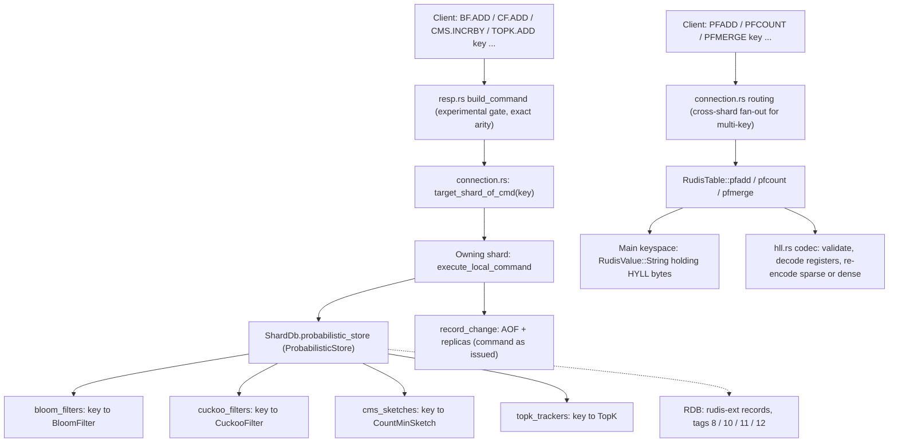

# Component 18: Probabilistic Data Structures

> **High-Level Design Spec**: [`docs/design/18_probabilistic.md`](../design/18_probabilistic.md)
> **Consolidated Implementation Spec**: [`docs/internal/components.md`](components.md)
>
> **Main source**: `src/probabilistic.rs` (Bloom filter, Cuckoo filter, Count-Min Sketch, Top-K,
> the per-shard `ProbabilisticStore`, and their binary encoding), `src/hll.rs` (Redis-compatible
> HyperLogLog codec).
> **Glue**: `src/resp.rs` (parsing into `Command::Bf*`/`Cf*`/`Cms*`/`Topk*`/`ProbRestore`/`Pf*`),
> `src/connection.rs` (command handlers in `execute_local_command`, cross-shard `PFCOUNT`/`PFMERGE`),
> `src/shard.rs` (the `ShardDb.probabilistic_store` field, RDB save), `src/table.rs` (`PF*`
> handlers on `RudisTable`, RDB load), `src/aof.rs` (AOF/replica encoding, AOF rewrite).

---

## 1. What this subsystem does

Probabilistic data structures answer questions about large streams of items using a small,
fixed amount of memory, in exchange for a bounded, one-sided error:

| Structure | Question it answers | Error |
| :--- | :--- | :--- |
| **Bloom filter** (`BF.*`) | "Have I seen this item?" | May say *yes* for an item never added (false positive); never says *no* for an added item. |
| **Cuckoo filter** (`CF.*`) | Same as Bloom, but items can also be deleted | False positives from 16-bit fingerprint collisions. |
| **Count-Min Sketch** (`CMS.*`) | "Roughly how many times have I seen this item?" | Only ever over-estimates. |
| **Top-K** (`TOPK.*`) | "Which items are the most frequent?" | Counts of newly admitted items are over-estimates. |
| **HyperLogLog** (`PF*`) | "Roughly how many *distinct* items have I seen?" | ~0.81% standard error. |

Two very different storage models are used:

- **Bloom / Cuckoo / CMS / Top-K** are RedisBloom-style commands. Their objects live in a
  per-shard side store, `ProbabilisticStore`, that is **outside the main keyspace**. These
  command families are *experimental*: they answer `ERR unknown command` unless the server runs
  with `enable-experimental-commands yes`.
- **HyperLogLog** is a core Redis feature. A `PFADD`ed key is an ordinary string key whose bytes
  follow the real Redis `HYLL` format, so it works with `EXPIRE`, `DEL`, `RENAME`, `DUMP`,
  replication and so on, like any other string.

## 2. Mental model



Read it as: every probabilistic command is routed by key hash to exactly one shard. On that
shard, the BF/CF/CMS/TOPK families touch only the side store; the `PF*` family touches only the
normal keyspace through the `hll.rs` codec.

---

## 3. Shared building blocks

### 3.1 Hashing

All four RedisBloom-style structures hash with **64-bit FNV-1a** (`fnv1a_hash(data, seed)`): the
standard offset basis `0xcbf29ce484222325` XORed with a seed, then for each byte
`hash ^= byte; hash *= 0x100000001b3` (wrapping). FNV-1a is a simple, fast, non-cryptographic
hash. It is deterministic across processes (no random seed), which matters for replay
(section 8).

`double_hash(data)` returns two FNV-1a hashes with different seeds, `(h1, h2)`, forcing `h2` to
1 if it would be 0. Bloom and CMS then use the **Kirsch–Mitzenmacher trick**: instead of `k`
independent hash functions, the `i`-th hash is `h1 + i*h2` (wrapping). This behaves like
independent hashing for these structures but costs only two real hash computations per item.

### 3.2 Size limit for client-chosen sizes

`MAX_SKETCH_BYTES = 512 << 20` (512 MiB, the same limit Redis puts on one string value). Each of
`BloomFilter`, `CuckooFilter` and `CountMinSketch` has two constructors:

- `new(...)` clamps its arguments and always allocates. It is used for the built-in
  auto-create defaults.
- `try_new(...)` computes the size first and returns `Err("... too large: at most 536870912
  bytes")` instead of trying a huge allocation. It is used by `BF.RESERVE`, `CF.RESERVE` and
  `CMS.INITBYDIM`.

`CMS.INITBYPROB` and `TOPK.RESERVE` do not go through `try_new` (see section 10).

---

## 4. Bloom filter (`BloomFilter`)

A Bloom filter is a bit array plus `k` hash functions. Adding an item sets the `k` bits it hashes
to. Looking an item up answers "yes" only if all `k` bits are set.

| Field | Type | Meaning |
| :--- | :--- | :--- |
| `capacity` | `usize` | Requested number of items (≥ 1). Used only for sizing and `BF.INFO`. |
| `error_rate` | `f64` | Target false-positive rate, clamped to `[0.00001, 0.5]`. |
| `num_bits` | `usize` | `m`, the number of bits in the array (≥ 64). |
| `num_hashes` | `usize` | `k`, bits set per item (1–30 when built by `new`). |
| `count` | `usize` | Number of `add` calls that set at least one new bit (saturating). |
| `bits` | `Vec<u64>` | The bit array, `ceil(m / 64)` words; bit `b` is bit `b % 64` of word `b / 64`. |

**Sizing (`BloomFilter::new`)**

1. `cap = max(capacity, 1)`, `err = clamp(error_rate, 0.00001, 0.5)`.
2. `m = ceil(-cap * ln(err) / ln(2)^2)` (computed in `f64` by `bits_for`, so huge capacities
   cannot overflow), then at least 64.
3. `k = round((m / cap) * ln 2)`, clamped to `[1, 30]`.
4. Allocate `m.div_ceil(64)` zeroed words.

*Worked example*: the auto-create default `BloomFilter::new(1000, 0.01)` gives
`m = ceil(1000 * 4.605 / 0.4805) = 9586` bits, `k = round(9.586 * 0.693) = 7`, and
`150` words. `BF.INFO` reports `Size = 150 * 8 = 1200` bytes.

`try_new` runs the same `bits_for` formula and refuses when `bits / 8 > MAX_SKETCH_BYTES`
(roughly 448 million items at 1% error fill 512 MiB).

**`add(item) -> bool`**

1. `(h1, h2) = double_hash(item)`.
2. For `i in 0..num_hashes`: `bit = (h1 + i*h2) mod num_bits`. If the bit is clear, set it and
   remember that the item was not already present.
3. If any bit was newly set, `count` is incremented (saturating) and `add` returns `true`.
   Otherwise it returns `false`: the item was *probably* already present.

`contains(item)` computes the same `k` positions and returns `false` as soon as one is clear.

---

## 5. Cuckoo filter (`CuckooFilter`)

A Cuckoo filter stores a short **fingerprint** (a 16-bit hash) of each item in one of two
candidate **buckets**. Each bucket holds `BUCKET_SIZE = 4` fingerprint slots. Because
fingerprints are stored, not bits, an item can be deleted by removing its fingerprint.

```rust
const BUCKET_SIZE: usize = 4;
const MAX_KICKS: usize = 500;

pub struct CuckooFilter {
    pub capacity: usize,                    // requested capacity (>= 1)
    pub num_buckets: usize,                 // power of two, >= 4
    pub count: usize,                       // fingerprints currently stored (saturating)
    pub buckets: Vec<[u16; BUCKET_SIZE]>,   // 0 = empty slot
}
```

**Sizing (`CuckooFilter::new`)**: `num_buckets = (max(capacity, 1) / 4).next_power_of_two()`,
at least 4. The auto-create default `new(1000)` gives `1000 / 4 = 250`, rounded up to `256`
buckets, i.e. 1024 slots of 2 bytes. `CF.INFO` reports `Size = num_buckets * 4 * 2 = 2048`.
`try_new` uses `checked_next_power_of_two` and refuses if `num_buckets * 8 bytes` exceeds
`MAX_SKETCH_BYTES`.

**Fingerprint and buckets**

- `fingerprint(item)`: low 16 bits of `fnv1a_hash(item, 0x5a5a…)`. A result of `0` is changed to
  `1`, because `0` marks an empty slot.
- `indices(item, fp)`: `i1 = fnv1a_hash(item, seed1) mod num_buckets`;
  `i2 = (i1 XOR fnv1a_hash(fp_le_bytes, seed2)) mod num_buckets`.
- `alt_index(i, fp)`: `(i XOR hash(fp)) mod num_buckets`. This is **partial-key cuckoo hashing**:
  the alternate bucket depends only on the current bucket and the fingerprint. Because
  `num_buckets` is a power of two, applying `alt_index` twice returns the original bucket. That
  lets the filter move a fingerprint without knowing the original item.

**`add(item) -> Result<bool, &str>`**

1. Compute `fp`, `i1`, `i2`.
2. Put `fp` in the first empty slot of bucket `i1`, else of bucket `i2`. On success, increment
   `count` and return `Ok(true)`.
3. Otherwise start a **kick chain**. The start bucket is `i1` if `fp` is even, else `i2`.
4. Repeat up to `MAX_KICKS` (500) times:
   1. Victim slot = `cur_fp % 4`. Swap `cur_fp` into that slot. The evicted fingerprint becomes
      the new `cur_fp`.
   2. `cur_i = alt_index(cur_i, cur_fp)`, the evicted fingerprint's other bucket.
   3. If `cur_i` has an empty slot, store `cur_fp` there, increment `count`, return `Ok(true)`.
5. After 500 kicks, return `Err("ERR Cuckoo filter is full")`.

The kick chain is **fully deterministic** and uses no random numbers: the start bucket and
victim slot both come from fingerprint values. The same filter state plus the same item always
produces the same result, which the AOF and replicas rely on (section 8).

`contains(item)` checks whether `fp` is in bucket `i1` or `i2`. `delete(item)` clears the first
slot that holds `fp` (bucket `i1` first, then `i2`), decrements `count`, and returns `true`. It
returns `false` if `fp` is in neither bucket.

---

## 6. Count-Min Sketch (`CountMinSketch`)

A Count-Min Sketch is a `depth × width` table of counters. Each row uses its own hash to pick
one column per item. Incrementing an item adds to one counter in every row. Querying it takes
the **minimum** of those counters. Other items that hash to the same column can only inflate a
counter, so every row over-estimates and the minimum is the tightest estimate.

| Field | Type | Meaning |
| :--- | :--- | :--- |
| `width` | `usize` | Columns per row (≥ 4 when built by `new`). |
| `depth` | `usize` | Rows (1–16 when built by `new`). |
| `total_count` | `u64` | Sum of all increments (saturating); `CMS.INFO`'s `count`. |
| `table` | `Vec<Vec<u64>>` | `depth` rows of `width` counters. |

**Constructors**

- `new(width, depth)`: `width` at least 4, `depth` clamped to `[1, 16]`. The auto-create default
  for `CMS.INCRBY` is `new(2000, 5)`: 10,000 counters, 80,000 bytes.
- `try_new(width, depth)`: refuses if `width * depth * 8 > MAX_SKETCH_BYTES` (after the same
  clamping).
- `from_prob(err, conf)`: the textbook formulas `w = ceil(e / max(err, 0.0001))`,
  `d = ceil(ln(1 / (1 - clamp(conf, 0.01, 0.9999))))`, then passed to `new`. *Example*:
  `CMS.INITBYPROB k 0.001 0.99` gives `w = ceil(2718.3) = 2719` and `d = ceil(ln 100) = 5`.
  Because `err` is floored at `0.0001`, the largest sketch it can build is `27183 × 10` counters
  (about 2.2 MB). That is why it does not need `try_new`.

**`incr_by(item, delta) -> u64`**

1. `(h1, h2) = double_hash(item)`.
2. For each row `r`: `col = (h1 + r*h2) mod width`, `table[r][col] += delta` (saturating). Track
   the minimum of the updated counters.
3. `total_count += delta` (saturating). Return the minimum, which is the new estimate.

This is the **standard update rule**: every row is incremented. The *conservative update*
variant (raise each row's counter only up to the new minimum) would give tighter estimates, but
it is not used. `query(item)` returns the minimum over the same cells without changing anything.

---

## 7. Top-K (`TopK`)

`TopK` tracks the `k` most frequent items with the **Space-Saving** algorithm. It keeps exactly
`k` counted items. When a new item arrives and the table is full, the item with the smallest
count is evicted, and the new item inherits that count plus its own increment. Counts of newly
admitted items are therefore upper bounds. Unlike RedisBloom's Top-K, there is no internal
Count-Min sketch and no decay.

| Field | Type | Meaning |
| :--- | :--- | :--- |
| `k` | `usize` | Maximum tracked items (≥ 1). |
| `items` | `HashMap<Bytes, u64>` | Tracked item → (over-)estimated count. |

**`add(item, increment) -> Option<Bytes>`** (returns the evicted item, if any)

1. `inc = max(increment, 1)`.
2. If `item` is already tracked, add `inc` to its count (saturating). Return `None`.
3. If fewer than `k` items are tracked, insert `item` with count `inc`. Return `None`.
4. Otherwise find the minimum-count item with a linear O(k) scan. **Ties go to the smallest item
   in byte order**, not to `HashMap` iteration order, which is seeded per process. Remove it,
   insert `item` with `min + inc` (saturating), and return `Some(evicted)`.

*Worked example* (`k = 3`): add `c`, `a`, `b` (each count 1), then add `d`. All counts tie at 1,
so the smallest item `a` is evicted. `d` gets count 2. `list()` then returns
`[(d,2), (b,1), (c,1)]`.

`query(item)` reports whether the item is tracked. `count(item)` returns its count, or 0.
`list()` returns all items sorted by descending count, with ties in ascending byte order, so the
order is the same in every process.

---

## 8. The store, persistence and replication

### 8.1 `ProbabilisticStore`

```rust
pub struct ProbabilisticStore {
    pub bloom_filters: HashMap<Bytes, BloomFilter>,
    pub cuckoo_filters: HashMap<Bytes, CuckooFilter>,
    pub cms_sketches: HashMap<Bytes, CountMinSketch>,
    pub topk_trackers: HashMap<Bytes, TopK>,
}
```

Each shard has one, as the field `ShardDb.probabilistic_store` in `src/shard.rs`. There is
**one store per shard, not one per `SELECT`ed database**. The four maps are independent, so the
same name can exist as a Bloom filter, a Cuckoo filter, a CMS, a Top-K **and** a normal string
key at the same time. The command family alone picks the map. No type-collision check exists.

### 8.2 Binary encoding (`encode` / `decode`)

Each structure has `encode(&self, buf)` and `decode(data) -> Result<(Self, bytes_used), &str>`.
All integers are little-endian. One format serves both the RDB records and the AOF rewrite's
`*.RESTORE` payloads.

| Kind (`ProbKind`) | RDB tag | Layout |
| :--- | :---: | :--- |
| `Bloom` | 8 | `capacity u64, error_rate f64 bits u64, num_bits u64, num_hashes u32, count u64, words u32, words × u64` |
| `Cuckoo` | 10 | `capacity u64, num_buckets u64, count u64, buckets u32, buckets × 4 × u16` |
| `Cms` | 11 | `width u64, depth u32, total_count u64, depth × width × u64` (row-major) |
| `TopK` | 12 | `k u64, n u32, n × (len u32, item bytes, count u64)` |

`decode` uses a bounds-checked `Reader`. It never panics on short input and checks dimensions
that would make later operations panic or allocate without limit:

- Bloom: `num_bits > 0`, `1 ≤ num_hashes ≤ MAX_BLOOM_HASHES (64)`, `words == ceil(num_bits / 64)`.
- Cuckoo: `num_buckets > 0` and equal to the bucket count, with enough bytes remaining before
  allocating.
- CMS: `width > 0`, `depth > 0`, `width * depth * 8` computed with `checked_mul`.
- Top-K: `k > 0`, `n ≤ k`. The `HashMap` pre-allocation is capped by `remaining / 12`, because
  every item takes at least 12 bytes.

Each failure returns a short error, for example `"Truncated BloomFilter header"`,
`"Invalid CountMinSketch dimensions"` or `"Truncated TopK item data"`.

`ProbabilisticStore::restore(kind, key, payload)` decodes the payload, requires every byte to be
consumed (else `"trailing bytes after the encoded state"`), and only then **replaces** the key's
structure of that kind. If any check fails, the store is left untouched.
`ProbabilisticStore::encoded_entries()` iterates over every structure as
`(ProbKind, &key, encoded bytes)`. `ProbKind::restore_command()` maps a kind to `BF.RESTORE`,
`CF.RESTORE`, `CMS.RESTORE` or `TOPK.RESTORE`.

### 8.3 RDB snapshots

- **Save**: `ShardDb::ext_item_keys` lists every extended key: JSON, Bloom, vector, Cuckoo, CMS,
  Top-K. `ShardDb::save_ext_item` writes each one as `[u32 key_len][key][tag][encode()]`. These
  records go into a `rudis-ext` AUX field of the Redis-format RDB (`save_extended_rdb_chunk` in a
  one-pass `save_rdb_chunk`; `SAVE`/`BGSAVE` and streamed full syncs write the same records one
  structure per step from a point-in-time `AofImage`).
  Real Redis and Valkey skip that field.
- **Load**: `RudisTable::load_legacy_records` (in `src/table.rs`) handles tags 8/10/11/12 with
  the same validating `decode` functions. A structure is inserted only if
  `target_shard(key) == shard_id`. A decode failure stops parsing, and the load reports an error.

### 8.4 AOF and replicas

Every successful mutation calls `record_change!`. That appends the command to the shard's AOF
and sends the same bytes to replicas. `aof::command_to_resp` encodes each of these **as
issued**: `BF.RESERVE/ADD/MADD`, `CF.RESERVE/ADD/ADDNX/DEL`, `CMS.INITBYDIM/INITBYPROB/INCRBY`,
`TOPK.RESERVE/ADD` and the internal `*.RESTORE`. Replaying the log in order rebuilds the exact
same state, because:

- all hashing is deterministic FNV-1a (section 3.1);
- the cuckoo kick chain is deterministic (section 5);
- Top-K ties are broken by item bytes, not hash-map order (section 7).

What is logged, precisely:

| Command | Logged when |
| :--- | :--- |
| `BF.ADD` / `BF.MADD` | At least one item set a new bit. |
| `CF.ADD` / `CF.ADDNX` | On success **and** on "filter is full". A failed insert has already moved fingerprints and dropped one, so the replay must do the same. |
| `CF.DEL` | Only when a fingerprint was removed. |
| `CMS.INCRBY`, `TOPK.ADD`, `CMS.INITBYPROB`, `TOPK.RESERVE` | Always. |
| `BF.RESERVE`, `CF.RESERVE`, `CMS.INITBYDIM` | Only on `+OK` (not when the key exists or the structure is too large). |
| `*.RESTORE` | On `+OK`. |

**AOF rewrite.** The normal rewrite (`rewrite_shard_aof` → `write_rewritten_aof`) writes an RDB
preamble image, which contains the records from section 8.3. The *canonical* rewrite
(`rewrite_shard_aof_canonical` → `write_canonical_aof`) produces plain commands that resharding
can split by key owner. Bloom and CMS contents cannot be rebuilt from user commands, so its
step 8 emits one `Command::ProbRestore { kind, key, payload }` per entry of `encoded_entries()`.
On the wire this is `BF.RESTORE key <binary payload>` (or `CF`/`CMS`/`TOPK`). The payload is a
binary-safe RESP bulk string.

---

## 9. Commands

### 9.1 Parsing (`src/resp.rs`)

- The names are in `EXPERIMENTAL_PREFIXES` (`"BF."`, `"CF."`, `"CMS."`, `"TOPK."`). When
  experimental commands are disabled, `build_command` returns `Command::Unknown` for all of
  them, including the internal `*.RESTORE`.
- Arity is checked exactly. **No optional arguments are accepted**: no `EXPANSION`,
  `NONSCALING`, `BUCKETSIZE`, `MAXITERATIONS`, or Top-K `width depth decay`. Extra arguments give
  `wrong number of arguments for '<cmd>' command`.
- `BF.RESERVE` requires `0 < error_rate < 1` (NaN is refused): `(0 < error rate range < 1)`.

### 9.2 Routing

`target_shard_of_cmd` sends every variant, including `ProbRestore`, to `target_shard(key)`. That
is the CRC16 slot when cluster mode is active, otherwise the hash of the key's hash tag. In
cluster mode, the normal slot `MOVED`/`ASK` checks apply. For ACL purposes each family is one
command name (`bf`, `cf`, `cms`, `topk`, categorised `@write @slow`). `Command::is_family_read`
marks the read-only variants (`*EXISTS`, `*INFO`, `CMS.QUERY`, `TOPK.QUERY`, `TOPK.LIST`). The
families are not listed in `COMMAND INFO`.

### 9.3 Behaviour reference (`execute_local_command`, `src/connection.rs`)

| Command | Missing key | Reply / behaviour |
| :--- | :--- | :--- |
| `BF.RESERVE key error_rate capacity` | — | `-ERR item exists` if the Bloom key exists; otherwise `try_new` → `+OK` or `-ERR Bloom filter too large: ...` |
| `BF.ADD key item` | auto-creates `new(1000, 0.01)` | `:1` if newly added, `:0` if probably present |
| `BF.MADD key item...` | auto-creates | array of `:1`/`:0` |
| `BF.EXISTS key item` | `:0` | `:1`/`:0` |
| `BF.MEXISTS key item...` | all `:0` | array of `:1`/`:0` |
| `BF.INFO key` | `-ERR not found` | `Capacity`, `Size` (`words × 8` bytes), `Number of filters` (always 1), `Number of items inserted` (`count`) |
| `CF.RESERVE key capacity` | — | `-ERR item exists` or `try_new` → `+OK` / `-ERR Cuckoo filter too large: ...` |
| `CF.ADD key item` | auto-creates `new(1000)` | `:1`; on a full filter `-ERR ERR Cuckoo filter is full` (see gotchas) |
| `CF.ADDNX key item` | auto-creates | `:0` if `contains` is true, otherwise like `CF.ADD` |
| `CF.EXISTS key item` | `:0` | `:1`/`:0` |
| `CF.DEL key item` | `:0` (no auto-create) | `:1` if a fingerprint was removed, else `:0` |
| `CF.INFO key` | `-ERR not found` | `Size` (`num_buckets × 8`), `Number of buckets`, `Number of items inserted` |
| `CMS.INITBYDIM key width depth` | — | **overwrites** any existing sketch; `try_new` → `+OK` / `-ERR CMS: width x depth too large: ...` |
| `CMS.INITBYPROB key error probability` | — | **overwrites**; `from_prob`; always `+OK` |
| `CMS.INCRBY key item inc [item inc ...]` | auto-creates `new(2000, 5)` | array of new estimates (one per pair) |
| `CMS.QUERY key item...` | zeros | array of estimates |
| `CMS.INFO key` | `-ERR not found` | `width`, `depth`, `count` (`total_count`) |
| `TOPK.RESERVE key topk` | — | **overwrites silently** with `TopK::new(topk)`; `+OK` |
| `TOPK.ADD key item...` | auto-creates `TopK::new(50)` | array: evicted item as a bulk string, or `$-1`; increment is always 1 |
| `TOPK.QUERY key item...` | all `:0` | array of `:1`/`:0` (tracked or not) |
| `TOPK.LIST key` | `*0` | item names only, in `list()` order (no counts) |
| `TOPK.INFO key` | `-ERR not found` | `k`, `width` (= number of currently tracked items) |
| `BF/CF/CMS/TOPK.RESTORE key payload` | — | `restore()` → `+OK`, or `-ERR <decode error>`; replaces the structure |

*Worked example*: `CMS.INCRBY clicks a 3 b 1 a 2` on a missing key creates a 2000×5 sketch,
increments `a` by 3, `b` by 1 and `a` by 2 in order, and replies `*3 :3 :1 :5` (assuming no
collisions). One `CMS.INCRBY` line is written to the AOF and replicas.

### 9.4 Interaction with the rest of the server

- **Invisible to generic key commands.** `DEL`, `EXISTS`, `TYPE`, `KEYS`, `SCAN`, `RENAME`,
  `EXPIRE`/`TTL`, `DBSIZE`, `DUMP`, `OBJECT` and `MEMORY USAGE` operate only on the main table.
  A Bloom filter cannot be deleted or given a TTL. Only `FLUSHALL`, or `FLUSHDB` while DB 0 is
  selected, removes it.
- **Counted in some places.** `ShardDb::keyspace_stats_by_db` adds the four map sizes to DB 0's
  key count (`INFO keyspace`). `DEBUG DIGEST` includes the structures (`src/digest.rs`,
  `ext_value_digest`). `WATCH` and client-side tracking see their keys, so a mutation
  invalidates them.
- **Not counted in memory.** `total_used_memory` and eviction size only sum the tables, so these
  structures are neither reported nor evictable under `maxmemory`.

---

## 10. HyperLogLog (`src/hll.rs`)

### 10.1 Concept

A HyperLogLog keeps 16384 small **registers** (6 bits each). Each element is hashed. The low 14
bits pick a register, and the register keeps the maximum **rank** seen: the position of the
first 1-bit in the remaining 50 bits. Long runs of zeros are rare, so a high rank implies many
distinct elements. The cardinality estimate combines all registers. Merging two HLLs is exact:
take the per-register maximum.

### 10.2 Byte format (Redis-compatible)

There is no Rust struct for an HLL. It is a raw byte string, exactly as Redis stores it.

| Bytes | Field | Notes |
| :--- | :--- | :--- |
| `0..4` | magic `"HYLL"` | |
| `4` | encoding | `HLL_DENSE = 0`, `HLL_SPARSE = 1` |
| `5..8` | unused | written as zeros |
| `8..16` | cached cardinality, `u64` LE | top bit of byte 15 set = cache **stale**, clear = valid |
| `16..` | payload | dense: 12288 bytes of packed 6-bit registers; sparse: an opcode stream |

Constants: `HLL_HDR_SIZE = 16`, `HLL_REGISTERS = 16384`,
`HLL_DENSE_SIZE = 16 + 12288 = 12304` bytes, `HLL_SPARSE_MAX_BYTES = 3000`. Errors are
`ERR_WRONGTYPE` (`"WRONGTYPE Key is not a valid HyperLogLog string value."`) and `ERR_INVALIDOBJ`
(`"INVALIDOBJ Corrupted HLL object detected"`).

**Dense payload**: register `n` occupies bits `6n .. 6n+5`, least-significant bit first.
`hll_dense_get_register` / `hll_dense_set_register` read a 16-bit little-endian window starting
at byte `6n / 8`, shift by `6n % 8`, and mask with `0x3F`. They bounds-check the second byte at
the end of the buffer.

**Sparse payload**: run-length opcodes, the same three as Redis.

| Opcode | Bit pattern | Meaning |
| :--- | :--- | :--- |
| ZERO | `00llllll` | `l + 1` (1–64) registers are 0 |
| XZERO | `01xxxxxx yyyyyyyy` | `(x << 8 | y) + 1` (1–16384) registers are 0 |
| VAL | `1vvvvvll` | `l + 1` (1–4) registers equal `v + 1` (1–32) |

The empty HLL from `hll_create_sparse_empty()` is 18 bytes: the header with the cache valid at 0,
followed by one XZERO `0x7F 0xFF` covering all 16384 registers.

### 10.3 Core functions

- **`murmur_hash_64a(key, seed)`**: a bit-exact port of Redis's MurmurHash64A
  (`M = 0xc6a4a7935bd1e995`, `R = 47`). It must match exactly, or register choices would differ
  from Redis.
- **`hll_pat_len(ele) -> (index, rank)`**: `hash = murmur(ele, 0xadc83b19)`;
  `index = hash & 0x3FFF`; `rank = trailing_zeros((hash >> 14) | 1 << 50) + 1`, so rank ≤ 51.
- **`hll_validate(bytes) -> Result<encoding>`**:
  1. Length ≥ 16 and magic `HYLL`, else `ERR_WRONGTYPE`.
  2. Dense: the length must be exactly `HLL_DENSE_SIZE`, else `ERR_WRONGTYPE`.
  3. Sparse: walk the opcodes, summing run lengths with `checked_add`. A truncated XZERO, a sum
     above 16384, or a final sum other than exactly 16384 gives `ERR_INVALIDOBJ`.
  4. Any other encoding byte gives `ERR_WRONGTYPE`.
- **`hll_decode_registers(bytes) -> [u8; 16384]`**: validates first, then unpacks dense or
  replays sparse opcodes into a zeroed array.
- **`hll_encode_sparse(regs) -> Option<Vec<u8>>`**: greedy run-length encoding. It emits ZERO for
  zero runs of up to 64 and XZERO chunks for longer runs, and VAL for runs of up to 4 equal
  non-zero registers. It returns `None` (meaning "use dense") if any register exceeds 32 or the
  output grows past `HLL_SPARSE_MAX_BYTES`.
- **`hll_encode_dense(regs)`**: packs into 12288 bytes.
- **`hll_create_from_regs(regs, card_cache)`**: tries sparse, falls back to dense, and writes the
  header. With `Some(c)` the cache is valid. With `None` the stale bit is set, and every mutation
  path passes `None`.
- **`hll_compute_card(regs)`**: a port of Redis's `hllCount` (Ertl's improved estimator,
  arXiv:1702.01284). PFCOUNT therefore returns the same number as Redis or Valkey for the same
  registers.
  1. Build a histogram `histo[v]` of register values.
  2. `z = m · τ((m − histo[51]) / m)`, where `m = 16384` and `q = 50`.
  3. For `j = 50 down to 1`: `z = (z + histo[j]) · 0.5`.
  4. `z += m · σ(histo[0] / m)`.
  5. Return `round(α∞ · m² / z)` with `α∞ = 0.7213475204444817`.

  `hll_sigma` and `hll_tau` are Redis's iterative series. They stop when an iteration no longer
  changes the value.
- **`hll_count(bytes)`**: validates. If the cache is valid, returns it without decoding.
  Otherwise it decodes, computes, and **writes the fresh value into the caller's buffer** with
  the stale bit cleared.
- **`hll_add(bytes, elements) -> bool`**: decodes all 16384 registers, raises each element's
  register to its rank if higher, and only if something changed re-encodes the whole object
  with `hll_create_from_regs(.., None)`.
- **`hll_merge(dest, sources)`**: per-register max and re-encode. **It has no callers**; every
  merge site has its own inline max loop.

### 10.4 `PF*` commands

The handlers are `RudisTable::pfadd`, `pfcount`, `pfmerge` and `pfdebug_*` in `src/table.rs`,
reached through thin `ShardDb` wrappers and answered by `execute_local_command`.

**`PFADD key [element ...]`**

1. Missing or expired key: create `hll_create_sparse_empty()`, add any elements, store it as a
   string, and reply `:1`. This also happens with zero elements.
2. Existing string: `hll_validate` first, so a non-HLL string errors even with no elements. With
   no elements, reply `:0`. Otherwise `hll_add`; write back and reply `:1` only if a register
   changed, else `:0`.
3. Legacy `RudisValue::HyperLogLog` (section 10.5): update the registers in place with
   `hll_pat_len`. The value stays legacy.
4. Any other type: the generic `WRONGTYPE Operation against a key holding the wrong kind of
   value`.

`:1` triggers `record_change!` and a `pfadd` keyspace event.

**`PFCOUNT key [key ...]`**

- One key: `hll_count`. If the cache was refreshed, the new bytes are stored back in memory.
  PFCOUNT is not a write command, so this refresh is **not** logged or replicated. A legacy
  value uses `hll_compute_card` directly; it has no cache. A missing key gives `0`.
- Several keys on one shard: decode each, max-merge into a temporary array, then
  `hll_compute_card`. Missing keys are skipped. Nothing is written back.

**`PFMERGE destkey [sourcekey ...]`**

1. Validation pass: `destkey` (if it exists) and every source must be a valid HLL string or a
   legacy value. Otherwise the command errors and nothing is written.
2. Merge pass: max-merge the registers of dest and all sources.
3. `set(destkey, hll_create_from_regs(merged, None))` and reply `+OK`. The command is logged. No
   keyspace event is emitted.

**Cross-shard multi-key** (`src/connection.rs`): if the keys of a `PFCOUNT`/`PFMERGE` hash to
different shards, cluster mode replies `-CROSSSLOT`, and so does a server running with
`cross-shard-strict yes` (config file, `--cross-shard-strict`, or `CONFIG SET`; default `no`),
which applies the same check by shard instead of by slot. Otherwise the router fetches each key with
`router.get`, decodes and max-merges locally, and either computes the count or writes the
result with `router.set`. That write is logged as a `SET` and fires `set` events.
`router.get` returns nothing for a key of the wrong type, so on this path a list key is
silently treated as missing instead of raising `WRONGTYPE`.

*Worked example*: with 4 shards and no cluster mode, `PFCOUNT a b c` with keys on shards 0, 1
and 3 does three `router.get` calls, decodes three register arrays, takes the per-register max,
and replies with `hll_compute_card` of the merged array.

**`PFDEBUG` / `PFSELFTEST`**

| Subcommand | Behaviour |
| :--- | :--- |
| `PFDEBUG GETREG key` | Array of 16384 integers (decoded registers). A missing key gives `ERR The specified key does not exist`; a non-HLL value gives `ERR_WRONGTYPE`. |
| `PFDEBUG ENCODING key` | `+sparse` or `+dense` (legacy values report `dense`). |
| `PFDEBUG TODENSE key` | Sparse → dense in place, **keeping** the cached-cardinality bytes. Replies `:1` if converted (logged), `:0` if already dense or legacy. |
| `PFDEBUG SIMD on/off` | Argument parsed and ignored; always `+enabled`. |
| `PFSELFTEST` | Always `+OK`; no test runs. |

Any other `PFDEBUG` subcommand gives `unknown subcommand for 'pfdebug' command`.

### 10.5 Keyspace view and the legacy variant

- An HLL key is `RudisValue::String`. `TYPE` reports `string` and `OBJECT ENCODING` reports
  `raw`. String commands work on it directly.
- `RudisValue::HyperLogLog(Box<[u8; 16384]>)` (decoded registers) is a **legacy** variant. It is
  only created by `RudisTable::deserialize_val_payload` type tag `5`. That path is reached from
  old native snapshots, legacy `DUMP` payloads passed to `RESTORE`, and the tiering spill/hydrate
  path, which also tags legacy values 5. Nothing creates one from scratch.
  - `PF*` commands handle it natively.
  - `APPEND`, `STRLEN`, `GETRANGE` and `SETRANGE` convert it with `hll_create_from_regs` first.
    `APPEND` and `SETRANGE` also turn the entry into a plain string.
  - Redis-format RDB output (`SAVE`, full sync) and `DUMP` write it as a proper dense `HYLL`
    string (`redis_rdb::hll_dense_string`, cache marked stale).
  - **`GET`** (`get_with_hash`, `get_compact_with_hash`, `write_get_resp`, which also back
    `router.get`) and the canonical AOF rewrite (`write_canonical_aof`, which emits
    `SET key <16384 raw bytes>`) expose the **raw 16384 register bytes** with no `HYLL` header.
    `PF*` commands reject such a string with `ERR_WRONGTYPE`.

---

## 11. Invariants & gotchas

- **Replay determinism is required.** Changes to the hash seeds, `fingerprint`, the kick-chain
  rules, or Top-K tie-breaking change what AOF replay or a replica computes from the same
  commands. Keep every path free of random numbers and hash-map iteration order.
- **The cuckoo "full" error loses an item.** After 500 kicks, the last evicted fingerprint is
  dropped, and `count` is not incremented. That can be the fingerprint of a *previously added*
  item, so `CF.EXISTS` can then give a false negative for it. The handler logs the failed
  command so replicas drop the same fingerprint.
- **Double `ERR` prefix.** `CuckooFilter::add` returns `"ERR Cuckoo filter is full"`, and the
  handler formats it as `-ERR {e}`, so clients see `-ERR ERR Cuckoo filter is full`.
- **`CF.ADD` allows duplicates.** Adding the same item twice stores its fingerprint twice, and
  `CF.DEL` removes one copy. Use `CF.ADDNX` for set semantics.
- **`alt_index` needs a power-of-two `num_buckets`.** `new` guarantees it. `decode` only checks
  that `num_buckets > 0` and matches the bucket count, so a hand-crafted `CF.RESTORE` payload
  with another bucket count breaks the "alternate of the alternate is the original" property.
  Deletes and kicks then misbehave, but nothing panics.
- **Decoded structures skip `new`'s clamping.** A decoded Bloom filter may use up to 64 hashes,
  and a decoded CMS may have `depth > 16` or `width < 4`. Counters coming from decoded state
  saturate instead of overflowing.
- **`BF.INFO` `count` is approximate.** It counts adds that flipped at least one bit, so a new
  item whose bits were all already set is not counted.
- **Reply integers are `i64` casts of `u64`.** A CMS counter above `i64::MAX` would print as a
  negative number.
- **RESERVE semantics differ by family.** `BF.RESERVE` and `CF.RESERVE` refuse an existing key.
  `CMS.INITBYDIM`, `CMS.INITBYPROB` and `TOPK.RESERVE` silently replace it, discarding its data.
- **Per-shard, not per-DB.** `SELECT 5; BF.ADD k x` and `SELECT 0; BF.EXISTS k x` see the same
  filter. `FLUSHDB` clears the store only when DB 0 is selected.
- **HLL cache bit.** Any path that changes registers must write the stale bit
  (`hll_create_from_regs(.., None)`). Only `PFDEBUG TODENSE` keeps the old cache, which is
  correct because the registers do not change.
- **`hll_validate` is the trust boundary.** `hll_decode_registers` and `hll_count` validate
  before reading, so an arbitrary string (from `SET`, `SETRANGE`, RDB import or replication)
  cannot cause out-of-bounds reads.

## 12. Limitations / not implemented

- No scalable Bloom or Cuckoo filters (`EXPANSION`, `NONSCALING`), no `BF.INSERT`, `BF.SCANDUMP`
  or `BF.LOADCHUNK`, no `CF.COUNT`, `CF.INSERT` or `CF.MEXISTS`, no `CMS.MERGE`, no
  `TOPK.INCRBY` or `TOPK.COUNT`, and no `TOPK.LIST WITHCOUNT`. `TOPK.ADD` always increments by 1.
- Over-filling a fixed Bloom filter silently raises its real false-positive rate; nothing
  signals it.
- Top-K eviction is an O(k) linear scan; there is no min-heap. Top-K counts are stored and
  persisted but cannot be read by any command.
- The CMS uses the standard update rule, not conservative update.
- The BF/CF/CMS/TOPK objects have no TTL, no `DEL`/`RENAME`/`TYPE`/`SCAN` visibility, no memory
  accounting and no eviction. The README's "Memory Sizing & Eviction" text mentions
  `probabilistic_store` as an eviction fallback, but `ShardDb::try_evict_one_key` only evicts
  from the table.
- `PFADD` and `PFMERGE` always fully decode and re-encode 16384 registers. Redis patches the
  sparse stream in place instead.
- `HLL_SPARSE_MAX_BYTES` is a hard-coded 3000. `hll-sparse-max-bytes` appears only in
  `config.rs`'s list of accepted-but-ignored Redis directives.
- `PFDEBUG SIMD` and `PFSELFTEST` are stubs. `hll::hll_merge` is unused.
- A PFCOUNT cache refresh is not propagated, so a replica may hold the same registers with a
  stale cache bit. Counts are identical either way.
- Legacy `RudisValue::HyperLogLog` values leak raw registers through `GET` and the canonical AOF
  rewrite (section 10.5).
- Cross-shard `PFCOUNT`/`PFMERGE` treat wrong-type keys as missing, and the cross-shard
  `PFMERGE` result is logged as a `SET`.

## 13. Tests

- `src/probabilistic.rs` unit tests cover each structure's basics, Top-K tie determinism, the
  encode/restore round trip, rejection of every truncation and of trailing bytes, `try_new`
  bounds, the Bloom hash-count cap, and counter saturation.
- `src/aof.rs`: `test_probabilistic_writes_round_trip_through_aof_encoding`,
  `test_probabilistic_state_survives_aof_replay_and_rewrite`. `src/table.rs`:
  `test_load_rdb_validates_probabilistic_records`, `test_rudis_table_bitmaps_and_hll`.
- `tests/e2e_experimental.rs`: `test_probabilistic_data_structures_e2e`.
  `tests/e2e_persistence.rs`: `test_probabilistic_writes_survive_restart_through_the_aof_e2e`,
  `test_probabilistic_writes_survive_aof_rewrite_and_restart_e2e`,
  `test_restore_forged_payloads_are_refused_e2e`. `tests/e2e_commands.rs`:
  `test_hostile_sizes_get_bounded_replies_e2e`, `test_experimental_commands_off_by_default_e2e`,
  `test_bitmaps_and_hyperloglog_e2e`.
  `tests/test_redis_rdb_compat.rs` covers HLL import/export and `legacy_rudis_rdb_still_loads`.
- `src/hll.rs` has no unit-test module. HLL behaviour is covered by the table and e2e tests above
  and by the ported Redis suite `tests/redis-tests/unit/hyperloglog.tcl`. None of these tests
  exercises cross-shard (non-hash-tagged) `PFCOUNT`/`PFMERGE`.

## 14. Code map

| File | Key symbols | What they do |
| :--- | :--- | :--- |
| `src/probabilistic.rs` | `fnv1a_hash`, `double_hash` | Deterministic FNV-1a hashing; Kirsch–Mitzenmacher hash pair |
| | `MAX_SKETCH_BYTES`, `MAX_BLOOM_HASHES` | 512 MiB client-size bound; decoded Bloom hash cap (64) |
| | `BloomFilter` (`new`, `try_new`, `bits_for`, `add`, `contains`) | Bloom filter |
| | `CuckooFilter` (`new`, `try_new`, `fingerprint`, `indices`, `alt_index`, `add`, `contains`, `delete`), `BUCKET_SIZE`, `MAX_KICKS` | Cuckoo filter with deterministic kicks |
| | `CountMinSketch` (`new`, `try_new`, `from_prob`, `incr_by`, `query`) | Count-Min Sketch |
| | `TopK` (`new`, `add`, `query`, `count`, `list`) | Space-Saving Top-K with deterministic ties |
| | `ProbabilisticStore` (`encoded_entries`, `restore`) | Per-shard maps; AOF-rewrite snapshot and `*.RESTORE` loading |
| | `ProbKind` (`restore_command`), `Reader`, `*::encode` / `*::decode` | Binary format shared by RDB and `*.RESTORE` |
| `src/hll.rs` | `murmur_hash_64a`, `hll_pat_len` | Redis-exact hashing and register/rank selection |
| | `hll_validate`, `hll_decode_registers` | Validation and decoding of `HYLL` strings |
| | `hll_encode_sparse`, `hll_encode_dense`, `hll_create_from_regs`, `hll_create_sparse_empty` | Encoding and header construction |
| | `hll_compute_card`, `hll_sigma`, `hll_tau`, `hll_count` | Redis `hllCount` estimator; cache-aware count |
| | `hll_add`, `hll_merge` (unused) | Mutation primitives |
| `src/resp.rs` | `Command::Bf*`/`Cf*`/`Cms*`/`Topk*`/`ProbRestore`/`Pf*`, `EXPERIMENTAL_PREFIXES`, `Command::is_family_read` | Parsing, experimental gate, read/write classification |
| `src/connection.rs` | `execute_local_command` (PROBABILISTIC COMMANDS arms, `Pf*` arms), `target_shard_of_cmd` | Handlers, replies, `record_change!`; routing; cross-shard `PFCOUNT`/`PFMERGE` |
| `src/shard.rs` | `ShardDb.probabilistic_store`, `flushdb`, `flushall`, `keyspace_stats_by_db`, `ext_item_keys`, `save_ext_item` | Store ownership, flushing, key counts, RDB save |
| `src/table.rs` | `RudisTable::pfadd`, `pfcount`, `pfmerge`, `pfdebug_getreg`, `pfdebug_encoding`, `pfdebug_todense`, `load_legacy_records`, `deserialize_val_payload`, `RudisValue::HyperLogLog` | HLL command logic; RDB load of tags 8/10/11/12; legacy HLL |
| `src/aof.rs` | `command_to_resp`, `write_canonical_aof`, `rewrite_shard_aof_canonical` | AOF/replica encoding; `*.RESTORE` snapshot in the canonical rewrite |
| `src/redis_rdb.rs` | `hll_dense_string`, `write_value_payload` | Legacy HLL exported as a dense `HYLL` string |
| `src/digest.rs` | `ext_value_digest` | `DEBUG DIGEST` coverage of probabilistic structures |
