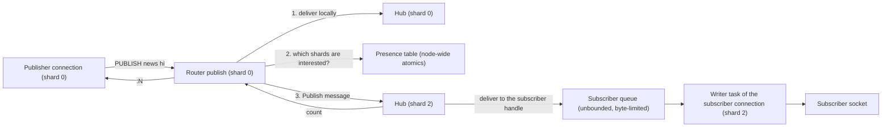

# Component 19: The Pub/Sub Messaging Hub

> **High-Level Design Spec**: [docs/design/19_pubsub.md](../design/19_pubsub.md)
> **Consolidated Implementation Spec**: [docs/internal/components.md](components.md)
> **Main source files**: src/pubsub.rs (the hub, the presence table, the glob matcher, the frame
> builders and the byte-limited subscriber queue), src/router.rs (cross-shard fan-out and slot
> routing), src/connection.rs (the subscribed-mode connection loop, the synchronous publish helpers
> and the output-limit disconnect), src/shard.rs (the cross-shard message variants) and src/server.rs
> (the remote-shard handlers). The [Code map](#10-code-map) lists the key symbols.

---

## 1. What this subsystem does

Pub/Sub ("publish/subscribe") lets clients exchange messages through named **channels** without storing anything in the keyspace. A client that runs `SUBSCRIBE news` is registered as a
listener on the channel `news`. Any client that later runs `PUBLISH news hello` causes every current listener to receive a push frame `["message", "news", "hello"]`, and the publisher gets
back the number of listeners that received it. Messages are fire-and-forget: nothing is persisted or replayed.

Rudis implements the three Redis flavours:

| Flavour | Subscribe and unsubscribe | Publish | Push frame kind |
| :--- | :--- | :--- | :--- |
| Exact channel | `SUBSCRIBE`, `UNSUBSCRIBE` | `PUBLISH` | `message` |
| Pattern | `PSUBSCRIBE`, `PUNSUBSCRIBE` (a glob such as `news.*`) | `PUBLISH` | `pmessage` |
| Sharded ("shard channel") | `SSUBSCRIBE`, `SUNSUBSCRIBE` | `SPUBLISH` | `smessage` |

Plus the introspection commands `PUBSUB CHANNELS`, `PUBSUB NUMSUB`, `PUBSUB NUMPAT`, `PUBSUB SHARDCHANNELS`, `PUBSUB SHARDNUMSUB` and `PUBSUB HELP`. Keyspace notifications
(`__keyspace@<db>__:<key>` and `__keyevent@<db>__:<event>`) are published through the same hub.

The hard part is that Rudis is **shared-nothing and thread-per-core**: each shard (one OS thread) owns its own state and talks to other shards only through message mailboxes. A subscriber's TCP
connection lives on one shard (its **home shard**), but a publisher may be on any other shard. This subsystem bridges that gap cheaply: it keeps a tiny lock-free "who might care" bitmask so a
`PUBLISH` only messages shards that plausibly have listeners, and it lets any shard push frames straight into a subscriber's outgoing queue.

---

## 2. Mental model



Key ideas:

* **One hub per shard.** It records only the subscriptions made *by connections on that shard* (plus shard-channel subscriptions routed to it). There is no global subscription map.
* **One presence table per node**, shared by all shards. It is a set of atomic bitmasks answering "might shard *k* have a subscriber whose channel hashes to this stripe, or any pattern subscriber at
  all?" False positives are harmless; false negatives cannot happen (for shard IDs below 256).
* **Delivery is a direct push.** The hub stores each subscriber's delivery handle (a clonable sender into the connection's outgoing queue). Whichever shard does the publish writes the frame straight
  into that queue; the connection's writer task drains it to the socket.
* **Slow subscribers are disconnected, never silently skipped.** The queue is unbounded by message count but bounded by **bytes** using the `client-output-buffer-limit pubsub` setting.
* **Sharded Pub/Sub does not use the presence table.** A shard channel is owned by exactly one shard, chosen by its CRC16 hash slot, just like a key.

| Term | Meaning |
| :--- | :--- |
| **Home shard** | The shard whose thread owns a subscriber's connection. |
| **Stripe** | One of 16 buckets that channel names hash into, for presence hints. |
| **Presence table** | The node-wide bitmasks that say which shards may have subscribers. |
| **Delivery handle** | A clonable sender into a subscriber connection's outgoing queue. |
| **Push frame** | The `message`, `pmessage` or `smessage` array (RESP3: `>` push type) delivered to a subscriber. |

---

## 3. Data structures

### 3.1 The per-shard hub

Each shard worker creates one hub as a shared cell, stores it in the router, and also uses it from that shard's cross-shard message handler. All maps are `hashbrown` maps and client IDs are `u64`.
The hub holds:

* exact channels, glob patterns and shard channels, each mapped to the set of subscribed client ids;
* the delivery handle for each client (present while the client has at least one subscription in this hub);
* reverse indexes from client to its channels, its patterns and its shard channels (on the home shard, the shard-channel index also lists channels held on *remote* owning shards; see §4.5);
* the set of clients that negotiated RESP3 (they get `>` push frames instead of `*` arrays);
* per-stripe counts of local (client, channel) subscriptions, and a count of local (client, pattern) subscriptions.

[Reference details](#111-hub-fields) lists the fields.

The reverse indexes make "unsubscribe from everything" and disconnect cleanup cost O(subscriptions held by this client) instead of O(all channels on the shard). The stripe counts and pattern count
are local reference counts whose only job is to decide when to flip a bit in the shared presence table: the bit is set on a 0 to 1 transition and cleared on a 1 to 0 transition, so the atomics
are touched rarely.

A client's **total subscriptions** is the size of its channel set plus its pattern set plus its shard-channel set. This is the count returned in every `subscribe` and `unsubscribe` reply, and it
decides whether the client is still "in subscribed mode" (§6).

### 3.2 The byte-limited delivery handle

One delivery handle is created per subscribed connection and cloned into every hub (local or remote) that holds one of its subscriptions. It wraps an unbounded queue drained by the connection's writer
task plus shared state (an atomic count of queued bytes, the time `queued` first crossed the soft limit, a flag set once the client is being disconnected, and the listening port and client id used to
find the client in the global registry).

| Method | Used by | Behaviour |
| :--- | :--- | :--- |
| `send(data)` | The connection itself (command replies, deferred self-messages) | Always queues; adds the length to `queued`. Never subject to the limit. |
| `deliver(&frame, &limit)` | Any shard's hub when publishing | Enforces the pubsub output-buffer limit (algorithm in §4.3). Returns whether the frame was queued. |
| `written(n)` | The writer task after a successful socket write | Saturating-subtracts `n` from `queued`. |
| `queued()` | The writer task | The current byte backlog (reported as the client's `omem`). |
| `raw()` | The transport split | Exposes the underlying sender (TLS transports need it). |

### 3.3 The presence table

The presence table has 16 stripes, each a 256-bit mask (four `AtomicU64` words, one bit per shard id), plus one 256-bit pattern mask.

* A **stripe** is a bucket of channel names: `stripe_for(channel) = hash_key(channel) % 16`, where `hash_key` is the same FxHash the storage table uses. In a stripe's mask, shard *s* is bit `s % 64` of
  word `s / 64`.
* The pattern mask says "shard *k* has at least one pattern subscriber". Patterns can match any channel, so they are not striped.
* Operations: add and remove a subscriber (atomic OR and AND on one stripe word), add and remove a pattern subscriber, and "is shard *s* interested in this channel?", which is true when either the
  channel's stripe word or the pattern word has the shard's bit set. All use relaxed ordering: the table is a hint, and the target shard always does the exact check.
* Shard ids of 256 or more are outside the bitmask: add and remove are no-ops for them and the interest check returns `true` (fail-open: always contacted, never missed).
* A helper returns only word 0 (shards 0–63); only unit tests call it.

**Lookup and sharing.** A process-wide map from port to table creates a table on first use. Keying by port keeps separate server instances in one process (tests) independent. A new router takes the
table for its own port; setting the base port then replaces it with the table for the node's **base port**. That matters in cluster mode, where each shard listens on its own port: all shards of one
node must share one table, otherwise a `PUBLISH` on one shard port would never see subscribers on another.

### 3.4 Frame builders

The frame builder hand-encodes a 3-element frame:

```text
*3\r\n$<len>\r\n<kind>\r\n$<len>\r\n<channel>\r\n$<len>\r\n<message>\r\n     (RESP2)
>3\r\n...same three bulk strings...                                         (RESP3 push)
```

The kind is `message` (exact channel) or `smessage` (shard channel). A second builder produces the 4-element `pmessage` frame (`*4` or `>4`) with the pattern as well. Frames are `Bytes`, so handing the
same frame to many subscribers is a reference-count bump, not a copy.

### 3.5 Thread-locals for self-delivery ordering

Two thread-locals exist so a subscribed client that publishes to a channel it listens on receives its own `:N` reply *before* the message, as in Redis (§4.4): the id of the client whose command is
currently running on this thread, and a list of frames addressed to that client that are deferred until after its reply.

---

## 4. Algorithms

### 4.1 Glob matching

The matcher is a port of Redis's recursive `stringmatchlen`, always case-sensitive. Supported syntax:

| Syntax | Meaning |
| :--- | :--- |
| `*` | Any run of bytes (consecutive `*` collapse; a trailing `*` matches immediately). |
| `?` | Exactly one byte. |
| `[abc]`, `[a-z]`, `[^...]` | A character class, a range (reversed ranges are swapped), negation. `\` escapes inside a class. |
| `\x` | A literal `x`. |
| anything else | A literal byte. |

The algorithm, per byte of the pattern while both pattern and text are non-empty:

1. On `*`: skip repeated `*`. If it is the last pattern byte, return true. Otherwise try matching the rest of the pattern against every suffix of the text, recursing with a nesting depth one higher.
2. A shared "skip longer matches" flag short-circuits: once a deeper recursion has exhausted the text without matching, no longer prefix can match either, so all outer `*` loops give up.
3. On `?`, `[`, `\` or a literal, consume one text byte if it matches, else return false.
4. When the text runs out, strip trailing `*`s; the match succeeds only if both are empty.

Recursion deeper than 1000 returns false. This is an abuse guard against stack exhaustion from patterns with many `*`, not a length limit.

**Example.** Matching `news.[a-c]*` against `news.bbc`: the literals match `news.`, `[a-c]` matches `b`, and `*` matches `bc`, so the match succeeds.

The matcher is used for pattern delivery (§4.2) and for filtering `PUBSUB CHANNELS <pattern>` and `PUBSUB SHARDCHANNELS <pattern>`.

### 4.2 Local delivery

`publish(channel, message)` runs on one shard and touches only that shard's hub:

1. **Exact pass.** Look up the channel's subscribers. For each, pick the RESP2 or RESP3 variant of the `message` frame, building each variant lazily at most once per call.
2. **Pattern pass.** Iterate *every* registered pattern; for each pattern that matches the channel, build (lazily, once per variant, per matching pattern, because the frame embeds the pattern) a
   `pmessage` frame and send it to that pattern's subscribers.
3. **Per-subscriber send.** If the subscriber is the client whose command is currently running on this thread, push the frame onto the deferred list and count it. Otherwise deliver to the client's
   handle, counting it only if delivery returns true. The pubsub limit is read once per publish call.
4. Return the count. A client subscribed both to `news` and to `n*` is counted (and receives) twice.

`spublish` is step 1 alone, using the shard channels and the `smessage` kind. Pattern subscribers never receive `SPUBLISH` traffic.

**Cost.** Exact delivery is O(subscribers of that channel). Pattern delivery is O(patterns registered on the shard) glob matches per publish; there is no pattern index.

### 4.3 Output-buffer limits

The limit comes from `client-output-buffer-limit pubsub`: a hard limit, a soft limit and a soft duration. The default is 33,554,432 (32 MiB) hard, 8,388,608 (8 MiB) soft for 60 s, the Redis default. A
value of 0 disables that limit. Delivery works like this:

1. If the client is already marked closing, return false (it is being disconnected).
2. Atomically add the frame length to `queued`; call the new total *q*.
3. The delivery is "over" if the hard limit is non-zero and *q* is at least the hard limit.
4. If not over and the soft limit is non-zero and *q* is at least the soft limit: if the soft timer is unset, record now (the first crossing is allowed); otherwise "over" is true once the elapsed time
   reaches the soft duration. Otherwise, if a soft timer was running, reset it (the backlog dropped below soft).
5. If over: subtract the length back, mark the client closing, and, only for the first caller to set it, close the client over its output limit with *q*. Return false.
6. Else push the frame into the queue (undo the byte count if the receiver is gone) and return true.

Closing a client over its output limit increments the `ClientOutputBufferLimitDisconnections` stat, logs a rate-limited Redis-style warning (`flags=P`), marks the client killed in the global registry,
and calls `shutdown(fd, SHUT_RDWR)` on its socket, the same mechanism `CLIENT KILL` uses. It is safe to call from any shard thread. The connection's writer then fails, the loop ends, and normal
cleanup runs (§4.6).

**Worked example** (hard limit 100 bytes, soft off, 40-byte frames). Delivery 1: `queued` is 40, accepted. Delivery 2: 80, accepted. Delivery 3: 120, which is at least 100, so it is rolled back to 80, the
client is marked closing and disconnected, and it returns false. Even if the writer later drains all 80 bytes, further deliveries return false.

### 4.4 Self-delivery ordering

In Redis, a RESP3 (or zero-subscription) client in subscribed mode that runs `PUBLISH ch x` on a channel it subscribes to gets `:1` first, then the `message` push. Rudis reproduces this:

1. Before each command, the pubsub loop records the client's id as the current-command client.
2. During the command, local hub publishes divert this client's frames to the deferred list (they still count toward the publish total).
3. After the command, the loop clears the id, queues the command's reply, then drains the deferred list and queues those frames.

Only the pubsub loop sets the current-command client. The normal request loop does not need to: a connection that has never subscribed is not in any hub, so it can never be a recipient.

### 4.5 Cross-shard operations

**`PUBLISH`** (the router's publish):

1. Deliver locally.
2. For every other shard that the presence table says is interested in the channel, take a one-slot response channel from the pool (it keeps up to 64 pairs) and send a `Publish` message.
3. After *all* sends are issued, await each reply and add the remote counts; return the channel pairs to the pool.

The remote shard handles `Publish` by calling its own hub's publish and replying with its count. A stripe collision only costs a wasted round trip that returns 0.

**Worked example (4 shards).** Client A on shard 1 runs `SUBSCRIBE news`; `news` hashes to stripe 7, shard 1's stripe count goes 0 to 1, so bit 1 of stripe 7's first word is set. Client B on shard 3
runs `PSUBSCRIBE n*`; shard 3's pattern count goes 0 to 1, setting bit 3 of the pattern mask's first word. Client C on shard 0 runs `PUBLISH news hi`: shard 0 delivers locally (0), checks shards 1, 2 and 3,
finds the interested mask `0b1010`, and sends `Publish` to shards 1 and 3 only. Shard 1 delivers `message` to A (1), shard 3 delivers `pmessage` to B (1), and C receives `:2`.

**Synchronous variants** are used when `PUBLISH` or `SPUBLISH` run inside synchronous code that holds the shard thread (scripts, through the local-execution routine). They cannot `.await`, so they send the
same messages and poll the replies for at most `SYNC_PUBLISH_COUNT_WAIT` (1 ms), yielding the thread between polls. Delivery does not depend on this wait; only the returned count may come up short. (Blocking
here used to deadlock two shards publishing to each other from scripts.)

**Keyspace notifications** publish locally and send a `Publish` message to interested shards without waiting for the reply.

**Introspection** fans out to every other shard and merges:

| Command | Merge rule |
| :--- | :--- |
| `PUBSUB CHANNELS [pat]` | The union of channel names, sorted. |
| `PUBSUB NUMSUB ch...` | A per-channel sum across shards, in request order. |
| `PUBSUB NUMPAT` | Remote shards return pattern *names*; the result is the number of **distinct** patterns node-wide. |
| `PUBSUB SHARDCHANNELS [pat]` | The union of shard channel names, sorted. |
| `PUBSUB SHARDNUMSUB ch...` | Each channel is asked only of its owning shard (channels grouped into one message per target shard). |

These do not consult the presence table and use fresh bounded(1) responders.

**Sharded Pub/Sub: slot routing.** For `SPUBLISH`, `SSUBSCRIBE` and `SUNSUBSCRIBE`, the owning shard is found from the channel's slot:

* The slot is the CRC16/XMODEM of the `{hash tag}` (or the whole name) mod 16384, the Redis Cluster slot function.
* The slot's shard comes from the router's slot-owner table if it has an entry for the slot, else `slot × num_shards / 16384`.

`SPUBLISH`: if the owner is this shard, call the local hub's `spublish`; otherwise send one `Spublish` message to the owner and await its count (0 if the send fails). No other shard is contacted.

`SSUBSCRIBE`: if the owner is local, the hub inserts into the shard channels, the client's shard-channel index and the client map. If remote, it sends an `Ssubscribe` message **carrying the delivery handle
clone** and waits for the ack; the remote hub then delivers `smessage` frames straight into this client's queue. Afterwards the home hub records the channel in its own shard-channel index (but not in the
shard-channel map or the client map) so the home shard can count and enumerate the client's shard channels without asking anyone. `SUNSUBSCRIBE` mirrors this, and "unsubscribe from all" iterates the home
shard's index calling unsubscribe per channel.

### 4.6 Subscribe and unsubscribe bookkeeping and cleanup

Subscribing a client to an exact channel, with presence information:

1. Store the handle in the client map (replacing any previous handle) and update the RESP3 set.
2. Insert the client into the channel's set. If newly inserted: if the stripe count is 0 and presence information was given (the shard id and the table), set this shard's bit; then increment the stripe
   count.
3. Add the channel to the client's channel set and return the client's total subscriptions.

Unsubscribing reverses this (decrement; clear the bit when the stripe count reaches 0; drop empty sets) and, if the client's total reaches 0, also removes it from the client map and RESP3 set. Pattern
subscribe and unsubscribe do the same with the pattern count and the pattern mask. The "all" variants walk the reverse index and return (name, remaining total) pairs, one per reply line. Shard-channel
subscribe and unsubscribe never touch the presence table. The plain wrappers pass no presence information (tests only).

**Removing a client** unsubscribes from everything (channels, patterns and shard channels), then removes the client from the RESP3 set and client map. It is called:

* By the `PubsubCleanup` drop guard in the pubsub loop when a subscribed connection ends (any reason: EOF, error, `QUIT`, protocol error, output-limit disconnect). It passes the presence information on the
  home shard and broadcasts a `RemoveClientPubSub { client_id }` message to every other shard, which remove the client without presence information, dropping shard-channel subscriptions held there. The guard
  also unregisters the client from the registry, the global client map, MONITOR and client tracking; it is declared so that it runs before the socket closes, so a concurrent close over the output limit never
  shuts down a reused file descriptor.
* By the `RESET` handler (the same local-plus-broadcast cleanup) when the client sends `RESET`.
* By the normal connection's cleanup guard, only if the shard's hub has any clients. When a connection switches into subscribed mode, that guard is forgotten and `PubsubCleanup` takes over.

Regular channel and pattern subscriptions only ever live on the home shard, so remote cleanup without presence information cannot leave a presence bit stale.

---

## 5. The cross-shard wire protocol

| Message | Payload | Remote action and reply |
| :--- | :--- | :--- |
| `Publish` | `channel, message, responder: Sender<usize>` | The hub's publish; reply with the count. |
| `Spublish` | `channel, message, responder: Sender<usize>` | The hub's `spublish`; reply with the count. |
| `Ssubscribe` | `client_id, channel, sender: SubscriberTx, is_resp3, responder: Sender<()>` | The hub's `ssubscribe`; ack. |
| `Sunsubscribe` | `client_id, channel, responder: Sender<()>` | The hub's `sunsubscribe`; ack. |
| `PubsubChannels` | `pattern: Option<Bytes>, responder: Sender<Vec<Bytes>>` | The hub's channel list. |
| `PubsubShardchannels` | `pattern: Option<Bytes>, responder: Sender<Vec<Bytes>>` | The hub's shard channel list. |
| `PubsubNumsub` | `channels: Vec<Bytes>, responder: Sender<Vec<(Bytes, usize)>>` | The subscriber count per channel. |
| `PubsubShardnumsub` | `channels: Vec<Bytes>, responder: Sender<Vec<(Bytes, usize)>>` | The shard subscriber count per channel. |
| `PubsubNumpat` | `responder: Sender<Vec<Bytes>>` | The list of the shard's pattern names. |
| `RemoveClientPubSub` | `client_id` (fire-and-forget) | Remove the client without presence information. |

---

## 6. Connection lifecycle: subscribed mode

### 6.1 Entering

In the normal request loop (the generic client loop, compiled for plaintext and TLS transports), a batch of parsed commands is scanned for a **mode-switch command**: `SUBSCRIBE`, `PSUBSCRIBE`,
`SSUBSCRIBE`, plus the replication commands `PSYNC`, `SYNC` and `DFLY FLOW`. For the first one:

1. Commands before it in the batch are executed normally.
2. The mode-switch gate enforces auth and ACL here, because these commands never reach the normal dispatcher: `-NOAUTH` if unauthenticated; with custom ACLs, `-NOPERM` for a forbidden command or forbidden
   channel. A denied command is dropped and scanning continues.
3. Pending output is flushed, the client is marked as pub/sub in the global client map, the normal cleanup guard is forgotten, and the connection is handed to the pubsub loop with the subscribe command, the
   rest of the batch and the unparsed buffer. **The connection stays in this loop for the rest of its life.**

### 6.2 Inside the pubsub loop

1. Create an unbounded channel; wrap the sender in a delivery handle for this port and client id; split the transport into reader and writer.
2. Spawn a **writer task**: wait for a frame; if more are queued, coalesce them into one buffer up to `WRITE_BATCH` (256 KiB); update the client's `omem` from the queued count; write; then report the bytes
   written. (One write per message could not keep up with several publishing shards.)
3. Process the initial subscribe, then the leftover batch, then the buffer, then read the socket forever. Each command goes through the pubsub command handler wrapped in the self-delivery protocol of §4.4;
   replies are queued on the writer channel. A `Protocol error:` parse error, `QUIT`, EOF or a read error, or exceeding the client query-buffer limit ends the loop.

The handler's behaviour:

| Command | Behaviour |
| :--- | :--- |
| `SUBSCRIBE`, `PSUBSCRIBE`, `SSUBSCRIBE` | Checked by the mode-switch gate first. One reply per name: `[kind, name, total]`, `*3` for RESP2 or `>3` for RESP3. |
| `UNSUBSCRIBE`, `PUNSUBSCRIBE`, `SUNSUBSCRIBE` | One reply per removed name; with no arguments and nothing to remove, a single reply with a null name (`$-1`) and the current total. Names are written binary-safely. |
| `PING [msg]` | If RESP3 or zero subscriptions: a normal `+PONG` or bulk reply. Otherwise `["pong", msg-or-""]`. |
| `CLIENT REPLY` | Sets the reply mode; `+OK` only for `ON`. |
| `QUIT` | `+OK`, then the loop ends. |
| `RESET` | Leaves `MULTI`, clears name, RESP3, database and monitor, drops all subscriptions, resets auth to `default`, replies `+RESET`. The connection stays in the loop. |
| `MULTI`, queued commands, `EXEC`, `DISCARD` | Transactions work inside the loop. At `EXEC`, queued `SUBSCRIBE`, `UNSUBSCRIBE`, `PSUBSCRIBE` and `PUNSUBSCRIBE` are run against the hub; everything else goes to the normal dispatcher. |
| Anything else | If RESP3 **or** the client currently has zero subscriptions: executed normally. Otherwise: `-ERR Can't execute '<cmd>': only (P\|S)SUBSCRIBE / (P\|S)UNSUBSCRIBE / PING / QUIT / RESET are allowed in this context`. |

So a client that unsubscribes from everything (or uses RESP3) can run normal commands again, but it keeps running them through the pubsub loop's path, not the optimized normal loop.

---

## 7. Delivery guarantees

* **At most once, no persistence.** A message reaches only the subscribers registered at the moment the publishing shard processes it. There is no backlog or replay.
* **No silent per-message drops.** A subscriber's queue is unbounded by count; a subscriber that falls too far behind (by bytes) is **disconnected** and counted in
  `client_output_buffer_limit_disconnections`. Once the closing flag is set, no further frames are queued.
* **Exact publish counts on the async path.** The router's publish and `spublish` await every contacted shard. The synchronous script path may under-count (1 ms wait).
* **Ordering.** Frames from one publishing shard to one subscriber arrive in publish order (a single FIFO queue and per-shard-pair FIFO mailboxes). Publishes from *different* shards to the same channel
  are not ordered relative to each other.
* **Presence hints.** False positives are possible (stripe collisions; any pattern subscriber marks the shard for every channel); false negatives are not, for shard ids below 256; shard ids of 256 and above
  are always contacted.

---

## 8. Invariants and gotchas

1. **The client map must contain an id if and only if that client has at least one subscription in this hub** (on the home shard, remote shard-channel subscriptions in the shard-channel index also
   count). Every unsubscribe path removes the client-map and RESP3 entries when the total hits 0. Keep that if you add a new subscription kind.
2. **Presence bits are driven by local reference counts.** Never call the add or remove subscriber functions directly from command code; go through the `*_with_presence` methods, or a bit can be cleared
   while another local subscriber in the same stripe still exists.
3. **Stripe counts count (client, channel) pairs, not channels.** Two clients on the same channel contribute 2.
4. **The hub runs inside a shared borrow** during publish; `deliver` must never re-enter the hub. Closing a client over the output limit only touches global state and the socket, which keeps this true.
5. **`send` bypasses the limit.** Command replies and deferred self-messages are always queued (and counted in `queued`), so a client's own replies can push it over the limit, making the *next* published
   message trigger the disconnect.
6. **Self-deferral is local only.** If a subscribed client `SPUBLISH`es to a shard channel owned by another shard on which it is subscribed, the remote shard delivers directly and the `smessage` can arrive
   before the client's `:N` reply.
7. **`SPUBLISH` from scripts may pick a different shard than `SSUBSCRIBE`.** The synchronous script path uses the router's plain target-shard function, which in standalone mode (no cluster, no slot-owner
   table) hashes with FxHash, whereas `SSUBSCRIBE` always uses the CRC16 slot and the slot-to-shard function. With several shards in standalone mode, a script's `SPUBLISH` can miss shard-channel subscribers.
8. **`EXEC` inside subscribed mode** formats queued `SUBSCRIBE` and `PSUBSCRIBE` replies as RESP2 arrays even for RESP3 clients, and does not special-case `SSUBSCRIBE` and `SUNSUBSCRIBE`: they reach the
   normal dispatcher, where `SSUBSCRIBE` is a no-op with no output and `SUNSUBSCRIBE` replies with count 0 without unsubscribing.
9. **Pattern subscribers make a shard "interested" in every channel**, so one `PSUBSCRIBE` on a shard means every `PUBLISH` on the node contacts that shard.
10. **The router's publish re-hashes the channel once per candidate shard** (each interest check computes the stripe). Cheap, but visible in a publish-heavy profile.

---

## 9. Limitations and not implemented

* There is no pattern index: each publish glob-matches every pattern on every interested shard.
* Presence filtering covers 256 shard ids; above that every shard is always contacted.
* Subscribed mode is sticky for the connection (it never returns to the normal request loop), though normal commands become allowed again at zero subscriptions or with RESP3.
* The glob matcher is case-sensitive only; there is no `nocase` entry point.
* Sharded Pub/Sub routes with this node's local slot-to-shard mapping. The Pub/Sub code paths themselves do no cross-node `-MOVED` redirection for a shard channel whose slot another cluster node owns.
* There is no message persistence, acknowledgement or replay (use Streams for that).

---

## 10. Code map

| File | Key symbols | Role |
| :--- | :--- | :--- |
| `src/pubsub.rs` | `PubSubHub`, `subscribe_with_presence`, `unsubscribe_with_presence`, `psubscribe_with_presence`, `punsubscribe_with_presence`, the `*_all_with_presence` methods, `ssubscribe`, `sunsubscribe`, `sunsubscribe_all`, `publish`, `spublish`, `remove_client_with_presence`, `channels`, `shard_channels`, `numsub`, `shard_numsub`, `numpat`, `total_subscriptions` | The per-shard subscription registry and local delivery. |
| `src/pubsub.rs` | `SubscriberTx` (`new`, `send`, `deliver`, `written`, `queued`, `raw`), `SubscriberState`, `pubsub_limit` | The subscriber queue with byte-based output-limit enforcement. |
| `src/pubsub.rs` | `ShardedPresenceTable`, `PUBSUB_STRIPES`, `PUBSUB_WORDS_PER_STRIPE`, `stripe_for`, `is_shard_interested`, `get_presence_table`, `PRESENCE_TABLES` | Node-wide lock-free interest hints. |
| `src/pubsub.rs` | `glob_match`, `stringmatchlen_impl`, `build_pubsub_frame`, `build_pubsub_pframe`, `CURRENT_COMMAND_CLIENT_ID`, `DEFERRED_SELF_PUBSUB` | Pattern matching, frame encoding, self-delivery ordering. |
| `src/router.rs` | `Router::publish`, `pubsub_channels`, `pubsub_numsub`, `pubsub_numpat`, `spublish`, `ssubscribe`, `sunsubscribe`, `sunsubscribe_all`, `pubsub_shardchannels`, `pubsub_shardnumsub`, `acquire_pubsub_responder`, `release_pubsub_responder`, `set_base_port`, `target_shard_for_slot`, `key_slot`, `slot_to_shard` | Cross-shard fan-out, slot routing, the responder pool, selection of the node-wide presence table. |
| `src/connection.rs` | `run_pubsub_loop`, `handle_pubsub_cmd`, `PubsubCleanup`, `reset_client_pubsub`, `is_mode_switch_cmd`, `mode_switch_denied`, `unsubscribe_reply`, `update_global_client_pubsub` | The subscribed-mode connection state machine, the writer task, auth and ACL on entry, cleanup. |
| `src/connection.rs` | `close_client_over_output_limit`, `client_output_limit_reached`, `BufferLimit`, `PUBSUB_BUFFER_LIMIT`, `get_client_output_buffer_limit` | Output-limit configuration and the cross-thread disconnect. |
| `src/connection.rs` | `publish_sync`, `spublish_sync`, `collect_publish_counts`, `SYNC_PUBLISH_COUNT_WAIT`, `notify_keyspace_event_sync_in_db` | Publishing from synchronous contexts (scripts, keyspace notifications). |
| `src/shard.rs` | `ShardMessage::{Publish, Spublish, Ssubscribe, Sunsubscribe, PubsubChannels, PubsubShardchannels, PubsubNumsub, PubsubShardnumsub, PubsubNumpat, RemoveClientPubSub}` | Inter-shard Pub/Sub messages. |
| `src/server.rs` | Shard worker setup (`PubSubHub::new`), the cross-shard message loop | Creates each shard's hub and executes remote Pub/Sub requests against it. |

### How to verify changes

```bash
cargo fmt --check
cargo clippy --all-targets -- -D warnings
cargo test --lib pubsub
```

---

## 11. Reference details

### 11.1 Hub fields

The hub is created once per shard by the shard worker in src/server.rs as `Rc<RefCell<PubSubHub>>`, stored in `Router.pubsub`.

| Field | Type | Meaning |
| :--- | :--- | :--- |
| `channels` | `HashMap<Bytes, HashSet<u64>>` | Exact channel to subscribed client ids. |
| `patterns` | `HashMap<Bytes, HashSet<u64>>` | Glob pattern to subscribed client ids. |
| `shard_channels` | `HashMap<Bytes, HashSet<u64>>` | Shard channel (owned by this shard) to client ids. |
| `clients` | `HashMap<u64, SubscriberTx>` | Client id to its delivery handle. Present while the client has at least one subscription in this hub. |
| `client_channels` | `HashMap<u64, HashSet<Bytes>>` | Reverse index: client to its exact channels. |
| `client_patterns` | `HashMap<u64, HashSet<Bytes>>` | Reverse index: client to its patterns. |
| `client_shard_channels` | `HashMap<u64, HashSet<Bytes>>` | Reverse index: client to its shard channels (on the home shard this also lists channels held on *remote* owning shards; see §4.5). |
| `client_resp3` | `HashSet<u64>` | Clients that negotiated RESP3. |
| `stripe_counts` | `[usize; PUBSUB_STRIPES]` | Local (client, channel) subscriptions per presence stripe. |
| `total_patterns` | `usize` | Local (client, pattern) subscriptions. |

### 11.2 Delivery handle and presence table

```rust
#[derive(Clone, Debug)]
pub struct SubscriberTx {
    tx: flume::Sender<Bytes>,           // unbounded queue drained by the conn's writer task
    state: Arc<SubscriberState>,        // shared by every clone (all shards)
}
struct SubscriberState {
    queued: AtomicUsize,                // bytes queued but not yet written to the socket
    soft_since_ms: AtomicU64,           // when queued first crossed the soft limit, or 0
    closing: AtomicBool,                // set once the client is being disconnected
    port: u16,                          // listening port (key into GLOBAL_CLIENTS)
    client_id: u64,
}

pub const PUBSUB_STRIPES: usize = 16;
pub const PUBSUB_WORDS_PER_STRIPE: usize = 4; // 4 x 64 bits = 256 shard IDs

pub struct ShardedPresenceTable {
    pub channel_stripes: [[AtomicU64; PUBSUB_WORDS_PER_STRIPE]; PUBSUB_STRIPES],
    pub pattern_presence: [AtomicU64; PUBSUB_WORDS_PER_STRIPE],
}

thread_local! {
    pub static CURRENT_COMMAND_CLIENT_ID: Cell<Option<u64>>;   // client whose command is running
    pub static DEFERRED_SELF_PUBSUB: RefCell<Vec<Bytes>>;      // frames addressed to that client
}
```

The process-wide presence map is `static PRESENCE_TABLES: LazyLock<RwLock<HashMap<u16, Arc<ShardedPresenceTable>>>>`, accessed through `get_presence_table(port)`.

### 11.3 Constants

| Name | Value | Meaning |
| :--- | :--- | :--- |
| `PUBSUB_STRIPES` | 16 | Channel-name buckets in the presence table. |
| `PUBSUB_WORDS_PER_STRIPE` | 4 | 64-bit words per stripe, so 256 shard ids. |
| `PUBSUB_BUFFER_LIMIT` | `BufferLimit::new(33554432, 8388608, 60)` | 32 MiB hard, 8 MiB soft for 60 s. |
| `SYNC_PUBLISH_COUNT_WAIT` | 1 ms | Longest wait for remote counts on the synchronous path. |
| `WRITE_BATCH` | 256 KiB | Largest coalesced write in the writer task. |
| Responder pool | 64 pairs | `pubsub_responder_pool`. |
| Glob recursion limit | 1000 | Deeper recursion returns false. |
| Presence shard-id limit | 256 | Shard ids at or above this are always contacted. |
