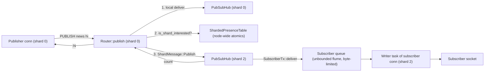

# Component 19: Pub/Sub Messaging Hub — Implementation Reference

> **High-Level Design Spec**: [`docs/design/19_pubsub.md`](../design/19_pubsub.md)
> **Consolidated Implementation Spec**: [`docs/internal/components.md`](components.md)
> **Main source files**: `src/pubsub.rs` (hub, presence table, glob matcher, frame builders,
> byte-limited subscriber queue); `src/router.rs` (cross-shard fan-out and slot routing);
> `src/connection.rs` (subscribed-mode connection loop, synchronous publish helpers, output-limit
> disconnect); `src/shard.rs` (cross-shard message variants); `src/server.rs` (remote-shard
> handlers).

---

## 1. What this subsystem does

Pub/Sub ("publish/subscribe") lets clients exchange messages through named **channels** without
storing anything in the keyspace. A client that runs `SUBSCRIBE news` is registered as a listener
on the channel `news`; any client that later runs `PUBLISH news hello` causes every current
listener to receive a push frame `["message", "news", "hello"]`, and the publisher gets back the
number of listeners that received it. Messages are fire-and-forget: nothing is persisted or
replayed.

Rudis implements the three Redis flavours:

| Flavour | Subscribe / unsubscribe | Publish | Push frame kind |
| :--- | :--- | :--- | :--- |
| Exact channel | `SUBSCRIBE` / `UNSUBSCRIBE` | `PUBLISH` | `message` |
| Pattern | `PSUBSCRIBE` / `PUNSUBSCRIBE` (glob such as `news.*`) | `PUBLISH` | `pmessage` |
| Sharded ("shard channel") | `SSUBSCRIBE` / `SUNSUBSCRIBE` | `SPUBLISH` | `smessage` |

Plus the introspection commands `PUBSUB CHANNELS`, `PUBSUB NUMSUB`, `PUBSUB NUMPAT`,
`PUBSUB SHARDCHANNELS`, `PUBSUB SHARDNUMSUB` and `PUBSUB HELP`. Keyspace notifications
(`__keyspace@<db>__:<key>` / `__keyevent@<db>__:<event>`) are published through the same hub.

The hard part is that Rudis is **shared-nothing, thread-per-core**: each shard (one OS thread)
owns its own state and talks to other shards only through message mailboxes. A subscriber's TCP
connection lives on one shard (its **home shard**), but a publisher may be on any other shard.
This subsystem bridges that gap cheaply: it keeps a tiny lock-free "who might care" bitmask so a
`PUBLISH` only messages shards that plausibly have listeners, and it lets any shard push frames
straight into a subscriber's outgoing queue.

## 2. Mental model



Key ideas:

* **One `PubSubHub` per shard.** It records only the subscriptions made *by connections on that
  shard* (plus shard-channel subscriptions routed to it). There is no global subscription map.
* **One `ShardedPresenceTable` per node** (shared by all shards through an `Arc`). It is a set of
  atomic bitmasks answering "might shard *k* have a subscriber whose channel hashes to this
  stripe, or any pattern subscriber at all?" False positives are harmless; false negatives cannot
  happen (for shard IDs below 256).
* **Delivery is a direct push.** The hub stores each subscriber's `SubscriberTx` (a clonable
  sender into the connection's outgoing queue). Whichever shard does the publish writes the frame
  straight into that queue; the connection's writer task drains it to the socket.
* **Slow subscribers are disconnected, never silently skipped.** The queue is unbounded by message
  count but bounded by **bytes** using the `client-output-buffer-limit pubsub` setting.
* **Sharded Pub/Sub does not use the presence table.** A shard channel is owned by exactly one
  shard, chosen by its CRC16 hash slot, just like a key.

## 3. Data structures

### 3.1 `PubSubHub` — per-shard subscription registry (`src/pubsub.rs`)

Created once per shard by the shard worker in `src/server.rs` as
`Rc<RefCell<PubSubHub>>`, stored in `Router.pubsub`, and also used by that shard's
cross-shard message handler. All maps are `hashbrown` maps; client IDs are `u64`.

| Field | Type | Meaning |
| :--- | :--- | :--- |
| `channels` | `HashMap<Bytes, HashSet<u64>>` | Exact channel → subscribed client IDs. |
| `patterns` | `HashMap<Bytes, HashSet<u64>>` | Glob pattern → subscribed client IDs. |
| `shard_channels` | `HashMap<Bytes, HashSet<u64>>` | Shard channel (owned by this shard) → client IDs. |
| `clients` | `HashMap<u64, SubscriberTx>` | Client ID → its delivery handle. Present while the client has ≥1 subscription in this hub. |
| `client_channels` | `HashMap<u64, HashSet<Bytes>>` | Reverse index: client → its exact channels. |
| `client_patterns` | `HashMap<u64, HashSet<Bytes>>` | Reverse index: client → its patterns. |
| `client_shard_channels` | `HashMap<u64, HashSet<Bytes>>` | Reverse index: client → its shard channels (on the home shard this also lists channels held on *remote* owning shards; see §4.5). |
| `client_resp3` | `HashSet<u64>` | Clients that negotiated RESP3 (they get `>` push frames instead of `*` arrays). |
| `stripe_counts` | `[usize; PUBSUB_STRIPES]` | Number of local (client, channel) subscriptions whose channel hashes to each presence stripe. |
| `total_patterns` | `usize` | Number of local (client, pattern) subscriptions. |

The reverse indices make "unsubscribe from everything" and disconnect cleanup cost
O(subscriptions held by this client) instead of O(all channels on the shard). `stripe_counts` and
`total_patterns` are local reference counts whose only job is to decide when to flip a bit in the
shared presence table: the bit is set on a 0 → 1 transition and cleared on a 1 → 0 transition, so
the atomics are touched rarely.

`total_subscriptions(client_id)` = size of the client's channel set + pattern set + shard-channel
set. This is the count returned in every `subscribe`/`unsubscribe` reply, and it decides whether
the client is still "in subscribed mode" (§6).

### 3.2 `SubscriberTx` — byte-limited delivery handle (`src/pubsub.rs`)

```rust
#[derive(Clone, Debug)]
pub struct SubscriberTx {
    tx: flume::Sender<Bytes>,           // unbounded queue drained by the conn's writer task
    state: Arc<SubscriberState>,        // shared by every clone (all shards)
}
struct SubscriberState {
    queued: AtomicUsize,                // bytes queued but not yet written to the socket
    soft_since_ms: AtomicU64,           // when queued first crossed the soft limit, or 0
    closing: AtomicBool,                // set once the client is being disconnected
    port: u16,                          // listening port (key into GLOBAL_CLIENTS)
    client_id: u64,
}
```

One `SubscriberTx` is created per subscribed connection in `run_pubsub_loop` and cloned into
every hub (local or remote) that holds one of its subscriptions. Its methods:

| Method | Used by | Behaviour |
| :--- | :--- | :--- |
| `send(data)` | The connection itself (command replies, deferred self-messages) | Always queues; adds `data.len()` to `queued`. Never subject to the limit. |
| `deliver(&frame, &limit)` | Any shard's hub when publishing | Enforces the pubsub output-buffer limit (algorithm in §4.3). Returns whether the frame was queued. |
| `written(n)` | Writer task after a successful socket write | Saturating-subtracts `n` from `queued`. |
| `queued()` | Writer task | Current byte backlog (reported as the client's `omem`). |
| `raw()` | Transport split | Exposes the underlying `flume::Sender` (TLS transports need it). |

### 3.3 `ShardedPresenceTable` — node-wide interest hints (`src/pubsub.rs`)

```rust
pub const PUBSUB_STRIPES: usize = 16;
pub const PUBSUB_WORDS_PER_STRIPE: usize = 4; // 4 x 64 bits = 256 shard IDs

pub struct ShardedPresenceTable {
    pub channel_stripes: [[AtomicU64; PUBSUB_WORDS_PER_STRIPE]; PUBSUB_STRIPES],
    pub pattern_presence: [AtomicU64; PUBSUB_WORDS_PER_STRIPE],
}
```

* A **stripe** is a bucket of channel names: `stripe_for(channel) = hash_key(channel) % 16`,
  where `hash_key` is the same FxHash used by the storage table (`src/table.rs`). Each stripe holds
  a 256-bit bitmask (four `AtomicU64` words), one bit per shard ID: `word = shard_id / 64`,
  `bit = shard_id % 64`.
* `pattern_presence` is a single 256-bit mask: "shard *k* has at least one pattern subscriber".
  Patterns can match any channel, so they are not striped.
* Operations: `add_subscriber` / `remove_subscriber` (`fetch_or` / `fetch_and` on one stripe
  word), `add_pattern_subscriber` / `remove_pattern_subscriber`, and
  `is_shard_interested(shard_id, channel)` which returns
  `(channel_stripes[stripe][word] | pattern_presence[word]) & (1 << bit) != 0`.
  All use `Ordering::Relaxed`: the table is a hint, the target shard always does the exact check.
* Shard IDs ≥ 256 are outside the bitmask: add/remove are no-ops for them and
  `is_shard_interested` returns `true` (fail-open — always contacted, never missed).
* `interested_shards(channel) -> u64` returns only word 0 (shards 0–63). Only unit tests call it;
  production code uses `is_shard_interested`.

**Lookup / sharing.** `get_presence_table(port)` returns the `Arc` for a port from a process-wide
`static PRESENCE_TABLES: LazyLock<RwLock<HashMap<u16, Arc<ShardedPresenceTable>>>>`, creating it
on first use. Keying by port keeps separate server instances in one process (tests) independent.
`Router::new` takes the table for its own port; `Router::set_base_port` then replaces it with the
table for the node's **base port**. That matters in cluster mode, where each shard listens on its
own port: all shards of one node must share one table, otherwise a `PUBLISH` on one shard port
would never see subscribers on another.

### 3.4 Frame builders (`src/pubsub.rs`)

`build_pubsub_frame(kind, channel, message, is_resp3)` hand-encodes a 3-element frame:

```
*3\r\n$<len>\r\n<kind>\r\n$<len>\r\n<channel>\r\n$<len>\r\n<message>\r\n     (RESP2)
>3\r\n...same three bulk strings...                                         (RESP3 push)
```

`kind` is `message` (exact channel) or `smessage` (shard channel). `build_pubsub_pframe(pattern,
channel, message, is_resp3)` builds the 4-element `pmessage` frame (`*4` / `>4`). Frames are
`Bytes`, so handing the same frame to many subscribers is a reference-count bump, not a copy.

### 3.5 Thread-locals for self-delivery ordering (`src/pubsub.rs`)

```rust
thread_local! {
    pub static CURRENT_COMMAND_CLIENT_ID: Cell<Option<u64>>;   // client whose command is running
    pub static DEFERRED_SELF_PUBSUB: RefCell<Vec<Bytes>>;      // frames addressed to that client
}
```

Used so a subscribed client that publishes to a channel it listens on receives its own `:N`
reply *before* the message, as in Redis (§4.4).

## 4. Algorithms

### 4.1 `glob_match` — pattern matching

`glob_match(pattern, text)` is a port of Redis's recursive `stringmatchlen`, always
case-sensitive (it calls the internal `stringmatchlen_impl` with `nocase = false`). Supported
syntax:

| Syntax | Meaning |
| :--- | :--- |
| `*` | Any run of bytes (consecutive `*` collapse; a trailing `*` matches immediately). |
| `?` | Exactly one byte. |
| `[abc]`, `[a-z]`, `[^...]` | Character class, range (reversed ranges are swapped), negation. `\` escapes inside a class. |
| `\x` | Literal `x`. |
| anything else | Literal byte. |

Algorithm (per byte of pattern, while both pattern and text are non-empty):

1. On `*`: skip repeated `*`. If it is the last pattern byte, return true. Otherwise try matching
   the rest of the pattern against every suffix of the text, recursing with `nesting + 1`.
2. A shared `skip_longer_matches` flag short-circuits: once a deeper recursion has exhausted the
   text without matching, no longer prefix can match either, so all outer `*` loops give up.
3. On `?`, `[`, `\`, or a literal, consume one text byte if it matches, else return false.
4. When the text runs out, strip trailing `*`s; the match succeeds only if both are empty.

Recursion deeper than 1000 returns false — an abuse guard against stack exhaustion from patterns
with many `*`, not a length limit.

Example: `glob_match(b"news.[a-c]*", b"news.bbc")` → literals match `news.`, `[a-c]` matches `b`,
`*` matches `bc` → true.

`glob_match` is used for pattern delivery (§4.2) and for filtering `PUBSUB CHANNELS <pattern>` and
`PUBSUB SHARDCHANNELS <pattern>` (`PubSubHub::channels` / `PubSubHub::shard_channels`).

### 4.2 `PubSubHub::publish` — local delivery

`publish(channel, message) -> usize` runs on one shard and touches only that shard's hub:

1. **Exact pass.** Look up `channels[channel]`. For each subscriber, pick the RESP2 or RESP3
   variant of the `message` frame, building each variant lazily at most once per call.
2. **Pattern pass.** Iterate *every* entry in `patterns`; for each pattern where
   `glob_match(pattern, channel)` is true, build (lazily, once per variant, per matching pattern —
   the frame embeds the pattern) a `pmessage` frame and send it to that pattern's subscribers.
3. **Per subscriber send.** If the subscriber is the client whose command is currently running on
   this thread (`CURRENT_COMMAND_CLIENT_ID`), push the frame onto `DEFERRED_SELF_PUBSUB` and count
   it. Otherwise call `clients[id].deliver(frame, limit)`, counting it only if it returns true.
   The pubsub limit is read once per publish call via `get_client_output_buffer_limit(Pubsub)`.
4. Return the count. A client subscribed both to `news` and to `n*` is counted (and receives) twice.

`PubSubHub::spublish` is the same as step 1 alone, using `shard_channels` and the `smessage` kind.
Pattern subscribers never receive `SPUBLISH` traffic.

Cost: exact delivery is O(subscribers of that channel); pattern delivery is O(patterns registered
on the shard) glob matches per publish — there is no pattern index.

### 4.3 `SubscriberTx::deliver` — output-buffer limit

The limit is a `BufferLimit { hard_limit, soft_limit, soft_seconds }` from
`client-output-buffer-limit pubsub`, default `PUBSUB_BUFFER_LIMIT = BufferLimit::new(33554432,
8388608, 60)` (32 MiB hard, 8 MiB soft for 60 s — the Redis default). A value of 0 disables that
limit.

1. If `closing` is already set, return false (the client is being disconnected).
2. Atomically add the frame length to `queued`; call the new total `q`.
3. `over = hard_limit > 0 && q >= hard_limit`.
4. If not over and `soft_limit > 0 && q >= soft_limit`: if `soft_since_ms == 0`, record now (the
   first crossing is allowed); otherwise `over = now - soft_since_ms >= soft_seconds * 1000`.
   Otherwise, if a soft timer was running, reset it to 0 (the backlog dropped below soft).
5. If over: subtract the length back, set `closing`, and — only for the first caller to set it —
   call `connection::close_client_over_output_limit(port, client_id, q)`. Return false.
6. Else push the frame into the flume queue (undo the byte count if the receiver is gone) and
   return true.

`close_client_over_output_limit` (in `src/connection.rs`) increments the
`ClientOutputBufferLimitDisconnections` stat, logs a rate-limited Redis-style warning
(`flags=P`), marks the client killed in `GLOBAL_CLIENTS`, and calls `shutdown(fd, SHUT_RDWR)` on
its socket — the same mechanism `CLIENT KILL` uses. It is safe to call from any shard thread.
The connection's writer then fails, the loop ends, and normal cleanup runs (§4.6).

Worked example (hard 100 bytes, soft off, 40-byte frames): deliver → `queued` 40 ✔; deliver → 80
✔; deliver → 120 ≥ 100 → rolled back to 80, `closing` set, client disconnected, returns false.
Even if the writer later drains all 80 bytes, further delivers return false.

### 4.4 Self-delivery ordering

In Redis, a RESP3 (or zero-subscription) client in subscribed mode that runs `PUBLISH ch x` on a
channel it subscribes to gets `:1` first, then the `message` push. Rudis reproduces this:

1. Before each command, `run_pubsub_loop` sets `CURRENT_COMMAND_CLIENT_ID = Some(client_id)`.
2. During the command, local hub publishes divert this client's frames to `DEFERRED_SELF_PUBSUB`
   (they still count toward the publish total).
3. After the command, the loop clears the id, queues the command's reply with `send`, then drains
   `DEFERRED_SELF_PUBSUB` and queues those frames with `send`.

Only `run_pubsub_loop` sets `CURRENT_COMMAND_CLIENT_ID`. The normal request loop does not need
to: a connection that has never subscribed is not in any hub, so it can never be a recipient.

### 4.5 Cross-shard operations (`src/router.rs`)

**`Router::publish(channel, message)`** — used by the `PUBLISH` command:

1. Deliver locally: `self.pubsub.borrow().publish(..)`.
2. For every other shard `sid` where `presence_table.is_shard_interested(sid, channel)` is true,
   take a one-slot response channel from `pubsub_responder_pool` (`acquire_pubsub_responder`;
   the pool keeps up to 64 pairs) and send `ShardMessage::Publish`.
3. After *all* sends are issued, await each reply and add the remote counts; return the channel
   pairs to the pool.

The remote shard handles `Publish` by calling its own `PubSubHub::publish` and replying with its
count. A stripe collision only costs a wasted round trip that returns 0.

Worked example (4 shards). Client A on shard 1 runs `SUBSCRIBE news`; `news` hashes to stripe 7,
shard 1's `stripe_counts[7]` goes 0 → 1, so bit 1 of `channel_stripes[7][0]` is set. Client B on
shard 3 runs `PSUBSCRIBE n*`; shard 3's `total_patterns` goes 0 → 1, setting bit 3 of
`pattern_presence[0]`. Client C on shard 0 runs `PUBLISH news hi`: shard 0 delivers locally (0),
checks shards 1, 2, 3 → interested mask is `0b1010`, so it sends `Publish` to shards 1 and 3 only.
Shard 1 delivers `message` to A (1), shard 3 delivers `pmessage` to B (1); C receives `:2`.

**Synchronous variants** (`connection::publish_sync` / `spublish_sync`) are used when `PUBLISH` /
`SPUBLISH` run inside synchronous code that holds the shard thread (scripts via
`execute_local_command`). They cannot `.await`, so they send the same messages and poll the
replies for at most `SYNC_PUBLISH_COUNT_WAIT` (1 ms) in `collect_publish_counts`, yielding the
thread between polls. Delivery does not depend on this wait; only the returned count may come up
short. (Blocking here used to deadlock two shards publishing to each other from scripts.)

**Keyspace notifications** (`notify_keyspace_event_sync_in_db`) publish locally and send
`ShardMessage::Publish` to interested shards without waiting for the reply.

**Introspection.** All "fan out to every other shard, merge":

| Command | Router method | Merge rule |
| :--- | :--- | :--- |
| `PUBSUB CHANNELS [pat]` | `pubsub_channels` | Union of channel names, sorted. |
| `PUBSUB NUMSUB ch...` | `pubsub_numsub` | Per-channel sum across shards, in request order. |
| `PUBSUB NUMPAT` | `pubsub_numpat` | Remote shards return pattern *names* (`Vec<Bytes>`); the result is the number of **distinct** patterns node-wide. |
| `PUBSUB SHARDCHANNELS [pat]` | `pubsub_shardchannels` | Union of shard channel names, sorted. |
| `PUBSUB SHARDNUMSUB ch...` | `pubsub_shardnumsub` | Each channel is asked only of its owning shard (channels grouped into one message per target shard). |

These do not consult the presence table and use fresh `flume::bounded(1)` responders.

**Sharded Pub/Sub — slot routing.** For `SPUBLISH`, `SSUBSCRIBE` and `SUNSUBSCRIBE` the owning
shard is `target_shard_for_slot(key_slot(channel))`:

* `key_slot` = CRC16/XMODEM of the `{hash tag}` (or whole name) mod 16384 — the Redis Cluster
  slot function.
* `target_shard_for_slot` uses the router's `slot_owners` table if it has an entry for the slot,
  else `slot_to_shard(slot, num_shards) = slot * num_shards / 16384`.

`Router::spublish`: if the owner is this shard, call the local `PubSubHub::spublish`; else send
one `ShardMessage::Spublish` to the owner and await its count (0 if the send fails). No other
shard is contacted.

`Router::ssubscribe(client_id, channel, tx, is_resp3)`: if local, `PubSubHub::ssubscribe`
inserts into `shard_channels`, `client_shard_channels` and `clients`. If remote, it sends
`ShardMessage::Ssubscribe` **carrying the `SubscriberTx` clone** and waits for the ack; the remote
hub then delivers `smessage` frames straight into this client's queue. Afterwards the home hub
records the channel in its own `client_shard_channels` (but not in `shard_channels`/`clients`) so
the home shard can count and enumerate the client's shard channels without asking anyone.
`Router::sunsubscribe` mirrors this, and `Router::sunsubscribe_all` iterates the home shard's
`client_shard_channels` calling `sunsubscribe` per channel.

### 4.6 Subscribe / unsubscribe bookkeeping and cleanup

`subscribe_with_presence(client_id, channel, tx, is_resp3, presence_info)`:

1. Store `tx` in `clients` (replacing any previous handle) and update `client_resp3`.
2. Insert the client into `channels[channel]`. If newly inserted: if
   `stripe_counts[stripe] == 0` and `presence_info = Some((shard_id, table))`, set this shard's
   bit; then increment `stripe_counts[stripe]`.
3. Add the channel to `client_channels[client_id]`; return `total_subscriptions`.

`unsubscribe_with_presence` reverses this (decrement; clear the bit when the stripe count reaches
0; drop empty sets) and, if the client's total reaches 0, also removes it from `clients` and
`client_resp3`. The `psubscribe_*` / `punsubscribe_*` pair does the same with `total_patterns` and
`pattern_presence`. `*_all_with_presence` variants walk the reverse index and return
`(name, remaining_total)` pairs, one per reply line. `ssubscribe` / `sunsubscribe` /
`sunsubscribe_all` never touch the presence table. The plain `subscribe`, `unsubscribe`, etc.
wrappers pass `presence_info = None` (tests only).

`remove_client_with_presence(client_id, presence_info)` runs `unsubscribe_all_with_presence`,
`punsubscribe_all_with_presence`, `sunsubscribe_all`, then removes the client from
`client_resp3` and `clients`. It is called:

* By the `PubsubCleanup` drop guard in `run_pubsub_loop` when a subscribed connection ends (any
  reason: EOF, error, `QUIT`, protocol error, output-limit disconnect). It passes
  `Some((shard_id, presence_table))` on the home shard and broadcasts
  `ShardMessage::RemoveClientPubSub { client_id }` to every other shard, which run
  `remove_client_with_presence(client_id, None)` to drop shard-channel subscriptions held there.
  The guard also unregisters the client from the registry, `GLOBAL_CLIENTS`, MONITOR and client
  tracking; it is declared so that it runs before the socket closes, so a concurrent
  `close_client_over_output_limit` never shuts down a reused fd.
* By `reset_client_pubsub` (same local + broadcast cleanup) when the client sends `RESET`.
* By the normal connection's `ClientCleanup` guard, only if the shard's hub has any clients. When
  a connection switches into subscribed mode, that guard is `mem::forget`-ed and `PubsubCleanup`
  takes over.

Regular channel and pattern subscriptions only ever live on the home shard, so remote cleanup
with `presence_info = None` cannot leave a presence bit stale.

## 5. Cross-shard wire protocol (`src/shard.rs`, handled in `src/server.rs`)

| `ShardMessage` variant | Payload | Remote action / reply |
| :--- | :--- | :--- |
| `Publish` | `channel, message, responder: Sender<usize>` | `PubSubHub::publish`; reply count. |
| `Spublish` | `channel, message, responder: Sender<usize>` | `PubSubHub::spublish`; reply count. |
| `Ssubscribe` | `client_id, channel, sender: SubscriberTx, is_resp3, responder: Sender<()>` | `PubSubHub::ssubscribe`; ack. |
| `Sunsubscribe` | `client_id, channel, responder: Sender<()>` | `PubSubHub::sunsubscribe`; ack. |
| `PubsubChannels` | `pattern: Option<Bytes>, responder: Sender<Vec<Bytes>>` | `PubSubHub::channels`. |
| `PubsubShardchannels` | `pattern: Option<Bytes>, responder: Sender<Vec<Bytes>>` | `PubSubHub::shard_channels`. |
| `PubsubNumsub` | `channels: Vec<Bytes>, responder: Sender<Vec<(Bytes, usize)>>` | `numsub` per channel. |
| `PubsubShardnumsub` | `channels: Vec<Bytes>, responder: Sender<Vec<(Bytes, usize)>>` | `shard_numsub` per channel. |
| `PubsubNumpat` | `responder: Sender<Vec<Bytes>>` | List of the shard's pattern names. |
| `RemoveClientPubSub` | `client_id` (fire-and-forget) | `remove_client_with_presence(client_id, None)`. |

## 6. Connection lifecycle: subscribed mode (`src/connection.rs`)

### 6.1 Entering

In the normal request loop (`handle_client`, generic over plaintext and TLS transports), a batch
of parsed commands is scanned for a **mode-switch command** (`is_mode_switch_cmd`:
`SUBSCRIBE`, `PSUBSCRIBE`, `SSUBSCRIBE`, plus the replication commands `PSYNC`, `SYNC`,
`DFLY FLOW`). For the first one:

1. Commands before it in the batch are executed normally.
2. `mode_switch_denied` enforces auth and ACL here, because these commands never reach
   `execute_command`: `-NOAUTH` if unauthenticated; with custom ACLs, `-NOPERM` for a forbidden
   command or forbidden channel. A denied command is dropped and scanning continues.
3. Pending output is flushed, `update_global_client_pubsub(port, id, true)` marks the client as
   pub/sub in `GLOBAL_CLIENTS`, the normal cleanup guard is forgotten, and the connection is
   handed to `run_pubsub_loop` with the subscribe command, the rest of the batch and the unparsed
   buffer. **The connection stays in this loop for the rest of its life.**

### 6.2 Inside `run_pubsub_loop`

1. Create an unbounded `flume` channel; wrap the sender in `SubscriberTx::new(raw_tx, router.port,
   client_id)`; split the transport into reader and writer.
2. Spawn a **writer task**: wait for a frame; if more are queued, coalesce them into one buffer up
   to `WRITE_BATCH` (256 KiB); update the client's `omem` from `queued()`; write; call
   `written(n)`. (One write per message could not keep up with several publishing shards.)
3. Process the initial subscribe, then the leftover batch, then the buffer, then read the socket
   forever. Each command goes through `handle_pubsub_cmd` wrapped in the self-delivery protocol of
   §4.4; replies are queued with `write_tx.send`. A `Protocol error:` parse error, `QUIT`,
   EOF/read error, or exceeding the client query-buffer limit ends the loop.

`handle_pubsub_cmd` behaviour:

| Command | Behaviour |
| :--- | :--- |
| `SUBSCRIBE`, `PSUBSCRIBE`, `SSUBSCRIBE` | Checked by `mode_switch_denied` first. One reply per name: `[kind, name, total]`, `*3` for RESP2 / `>3` for RESP3. |
| `UNSUBSCRIBE`, `PUNSUBSCRIBE`, `SUNSUBSCRIBE` | One reply per removed name; with no arguments and nothing to remove, a single reply with a null name (`$-1`) and the current total. Names are written binary-safely. |
| `PING [msg]` | If RESP3 or zero subscriptions: a normal `+PONG` / bulk reply. Otherwise `["pong", msg-or-""]`. |
| `CLIENT REPLY` | Sets the reply mode; `+OK` only for `ON`. |
| `QUIT` | `+OK`, then the loop ends. |
| `RESET` | Leaves MULTI, clears name/RESP3/db/monitor, drops all subscriptions (`reset_client_pubsub`), resets auth to `default`, replies `+RESET`. The connection stays in the loop. |
| `MULTI` / queued commands / `EXEC` / `DISCARD` | Transactions work inside the loop. At `EXEC`, queued `SUBSCRIBE`/`UNSUBSCRIBE`/`PSUBSCRIBE`/`PUNSUBSCRIBE` are run against the hub; everything else goes to `execute_command`. |
| anything else | If RESP3 **or** the client currently has zero subscriptions: executed normally via `execute_command`. Otherwise: `-ERR Can't execute '<cmd>': only (P\|S)SUBSCRIBE / (P\|S)UNSUBSCRIBE / PING / QUIT / RESET are allowed in this context`. |

So a client that unsubscribes from everything (or uses RESP3) can run normal commands again, but
it keeps running them through `run_pubsub_loop`'s path, not the optimized normal loop.

## 7. Delivery guarantees

* **At-most-once, no persistence.** A message reaches only the subscribers registered at the
  moment the publishing shard processes it. There is no backlog or replay.
* **No silent per-message drops.** A subscriber's queue is unbounded by count; a subscriber that
  falls too far behind (by bytes) is **disconnected** and counted in
  `client_output_buffer_limit_disconnections`. Once `closing` is set, no further frames are queued.
* **Exact publish counts on the async path.** `Router::publish` / `spublish` await every
  contacted shard. The synchronous script path may under-count (1 ms wait).
* **Ordering.** Frames from one publishing shard to one subscriber arrive in publish order
  (single FIFO queue, per-shard-pair FIFO mailboxes). Publishes from *different* shards to the
  same channel are not ordered relative to each other.
* **Presence hints**: false positives are possible (stripe collisions, any pattern subscriber
  marks the shard for every channel); false negatives are not, for shard IDs < 256; shard IDs
  ≥ 256 are always contacted.

## 8. Invariants & gotchas

* **`clients` must contain an ID iff that client has ≥1 subscription in this hub** (on the home
  shard, remote shard-channel subscriptions in `client_shard_channels` also count). Every
  unsubscribe path removes the `clients`/`client_resp3` entries when the total hits 0 — keep that
  if you add a new subscription kind.
* **Presence bits are driven by local ref-counts.** Never call `add_subscriber` /
  `remove_subscriber` directly from command code; go through the `*_with_presence` methods, or a
  bit can be cleared while another local subscriber in the same stripe still exists.
* **`stripe_counts` counts (client, channel) pairs, not channels.** Two clients on the same
  channel contribute 2.
* **The hub runs inside `RefCell::borrow()`** during publish; `deliver` must never re-enter the
  hub. `close_client_over_output_limit` only touches global state and the socket, which keeps this
  true.
* **`SubscriberTx::send` bypasses the limit.** Command replies and deferred self-messages are
  always queued (and counted in `queued`), so a client's own replies can push it over the limit,
  making the *next* published message trigger the disconnect.
* **Self-deferral is local only.** If a subscribed client `SPUBLISH`es to a shard channel owned by
  another shard on which it is subscribed, the remote shard delivers directly and the `smessage`
  can arrive before the client's `:N` reply.
* **`SPUBLISH` from scripts may pick a different shard than `SSUBSCRIBE`.** `spublish_sync` uses
  `Router::target_shard(channel)`, which in standalone mode (no cluster, no `slot_owners`) hashes
  with FxHash/`shard_of_hash`, whereas `Router::ssubscribe` always uses
  `key_slot` + `target_shard_for_slot`. With several shards in standalone mode, a script's
  `SPUBLISH` can miss shard-channel subscribers.
* **`EXEC` inside subscribed mode** formats queued `SUBSCRIBE`/`PSUBSCRIBE` replies as RESP2
  arrays even for RESP3 clients, and does not special-case `SSUBSCRIBE`/`SUNSUBSCRIBE`: they reach
  `execute_command`, where `SSUBSCRIBE` is a no-op with no output and `SUNSUBSCRIBE` replies with
  count 0 without unsubscribing.
* **Pattern subscribers make a shard "interested" in every channel**, so one `PSUBSCRIBE` on a
  shard means every `PUBLISH` on the node contacts that shard.
* **`Router::publish` re-hashes the channel once per candidate shard** (`is_shard_interested`
  computes `stripe_for` each call). Cheap, but visible in a publish-heavy profile.

## 9. Limitations / not implemented

* No pattern index: each publish glob-matches every pattern on every interested shard.
* Presence filtering covers 256 shard IDs; above that every shard is always contacted.
* Subscribed mode is sticky for the connection (it never returns to the normal request loop),
  though normal commands become allowed again at zero subscriptions or with RESP3.
* `glob_match` is case-sensitive only; there is no `nocase` entry point.
* Sharded Pub/Sub routes with this node's local slot → shard mapping (`target_shard_for_slot`).
  The Pub/Sub code paths themselves do no cross-node `-MOVED` redirection for a shard channel
  whose slot another cluster node owns.
* No message persistence, acknowledgement or replay (use Streams for that).

## 10. Code map

| File | Key symbols | What they do |
| :--- | :--- | :--- |
| `src/pubsub.rs` | `PubSubHub`, `subscribe_with_presence`, `unsubscribe_with_presence`, `psubscribe_with_presence`, `punsubscribe_with_presence`, `*_all_with_presence`, `ssubscribe`, `sunsubscribe`, `sunsubscribe_all`, `publish`, `spublish`, `remove_client_with_presence`, `channels`, `shard_channels`, `numsub`, `shard_numsub`, `numpat`, `total_subscriptions` | Per-shard subscription registry and local delivery. |
| `src/pubsub.rs` | `SubscriberTx` (`new`, `send`, `deliver`, `written`, `queued`, `raw`), `SubscriberState`, `pubsub_limit` | Subscriber queue with byte-based output-limit enforcement. |
| `src/pubsub.rs` | `ShardedPresenceTable`, `PUBSUB_STRIPES`, `PUBSUB_WORDS_PER_STRIPE`, `stripe_for`, `is_shard_interested`, `get_presence_table`, `PRESENCE_TABLES` | Node-wide lock-free interest hints. |
| `src/pubsub.rs` | `glob_match`, `stringmatchlen_impl`, `build_pubsub_frame`, `build_pubsub_pframe`, `CURRENT_COMMAND_CLIENT_ID`, `DEFERRED_SELF_PUBSUB` | Pattern matching, frame encoding, self-delivery ordering. |
| `src/router.rs` | `Router::publish`, `pubsub_channels`, `pubsub_numsub`, `pubsub_numpat`, `spublish`, `ssubscribe`, `sunsubscribe`, `sunsubscribe_all`, `pubsub_shardchannels`, `pubsub_shardnumsub`, `acquire_pubsub_responder`, `release_pubsub_responder`, `set_base_port`, `target_shard_for_slot`, `key_slot`, `slot_to_shard` | Cross-shard fan-out, slot routing, responder pool, node-wide presence table selection. |
| `src/connection.rs` | `run_pubsub_loop`, `handle_pubsub_cmd`, `PubsubCleanup`, `reset_client_pubsub`, `is_mode_switch_cmd`, `mode_switch_denied`, `unsubscribe_reply`, `update_global_client_pubsub` | Subscribed-mode connection state machine, writer task, auth/ACL on entry, cleanup. |
| `src/connection.rs` | `close_client_over_output_limit`, `client_output_limit_reached`, `BufferLimit`, `PUBSUB_BUFFER_LIMIT`, `get_client_output_buffer_limit` | Output-limit configuration and cross-thread disconnect. |
| `src/connection.rs` | `publish_sync`, `spublish_sync`, `collect_publish_counts`, `SYNC_PUBLISH_COUNT_WAIT`, `notify_keyspace_event_sync_in_db` | Publishing from synchronous contexts (scripts, keyspace notifications). |
| `src/shard.rs` | `ShardMessage::{Publish, Spublish, Ssubscribe, Sunsubscribe, PubsubChannels, PubsubShardchannels, PubsubNumsub, PubsubShardnumsub, PubsubNumpat, RemoveClientPubSub}` | Inter-shard Pub/Sub messages. |
| `src/server.rs` | Shard worker setup (`PubSubHub::new`), cross-shard message loop | Creates each shard's hub and executes remote Pub/Sub requests against it. |

### How to verify changes

```bash
cargo fmt --check
cargo clippy --all-targets -- -D warnings
cargo test --lib pubsub
```
