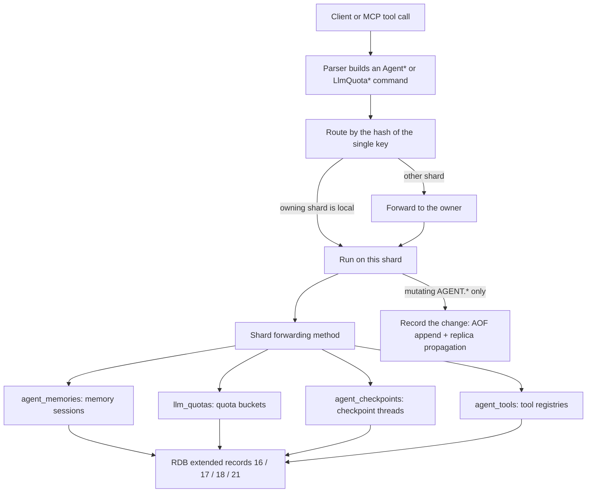
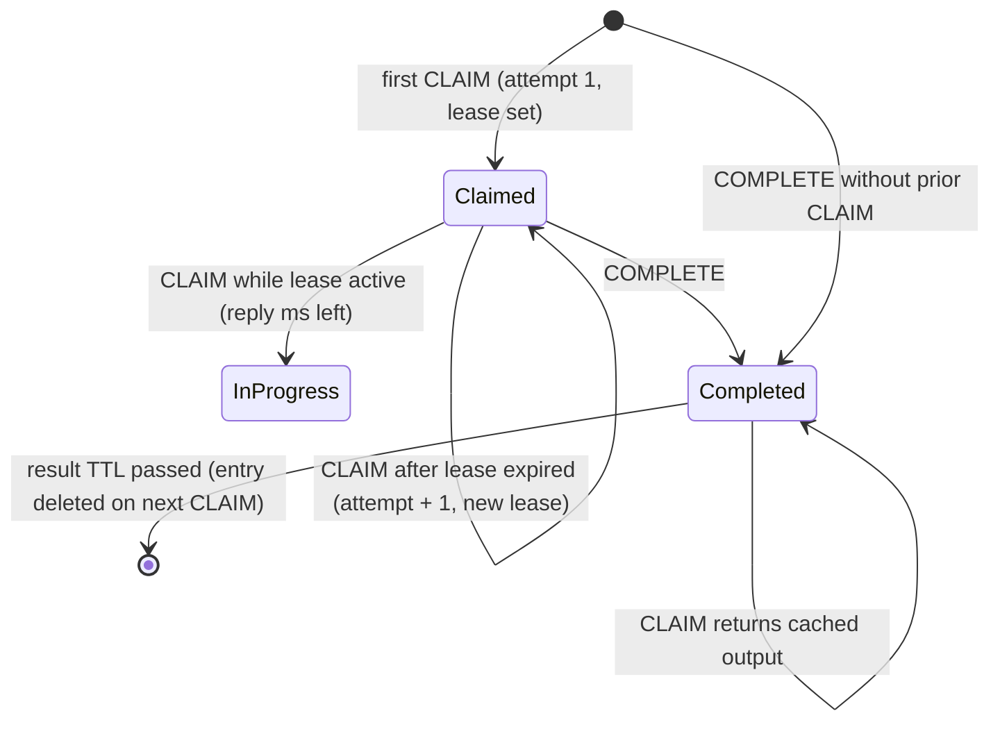

# Component 20: Agent Memory, LLM Quota and Checkpoints

> **High-Level Design Spec**: [docs/design/20_agent_memory.md](../design/20_agent_memory.md)
> **Consolidated Implementation Spec**: [docs/internal/components.md](components.md)
> **Main source files**: src/agent.rs (all four data structures and their algorithms), src/shard.rs (per-shard
> stores, forwarding methods, RDB save and restore), src/resp.rs (command parsers), src/connection.rs (routing,
> dispatch, RESP replies, change logging), src/aof.rs (AOF re-serialization and canonical rewrite) and
> src/mcp.rs (MCP tool wrappers). The [Code map](#9-code-map) lists the key symbols.

---

## 1. What this subsystem does

Rudis has four small, independent "AI-native" stores aimed at applications that drive LLM agents. Each store is keyed by an ordinary Redis key, lives on the shard that owns that key, and is driven by
its own command family:

| Store | Commands | Problem it solves |
| :--- | :--- | :--- |
| **Agent memory session** | `AGENT.MEM.ADD`, `.CONTEXT`, `.COMPACT`, `.INFO`, `.CLEAR` | Keep a conversation's turns, hand back "the newest turns that fit in N tokens" for the next prompt, and optionally recall older turns that are semantically similar to a query embedding. |
| **LLM quota bucket** | `LLM.QUOTA.RESERVE`, `.SETTLE`, `.INFO` | Rate-limit calls to an LLM provider by both requests-per-window (RPM) and tokens-per-window (TPM), reserving an estimated token count before a call and correcting it to the real count afterwards. |
| **Checkpoint thread** | `AGENT.CHECKPOINT.PUT`, `.GET`, `.HISTORY` | Save an agent's state after each step as a node in a parent-pointer tree, so a run can resume from the latest step or "time-travel" to and fork from any earlier one. |
| **Tool registry** | `AGENT.TOOL.CLAIM`, `.COMPLETE` | Make tool calls idempotent: the first caller to claim a call id gets a lease and runs the tool; concurrent duplicates are told it is in progress; once completed, everyone gets the cached result. |

There are thirteen commands in total. The four stores share no base type and no module-level state; they are grouped only because they serve the same audience. None of them is a normal Redis value:
they do not appear in `KEYS`, `SCAN`, `TYPE`, `EXISTS`, `DEL` or `EXPIRE`.

Users reach them through RESP commands, and two of the families are also exposed as MCP tools ([Component 21](21_mcp_server.md)): `rudis_agent_memory_add`, `rudis_agent_memory_context`,
`rudis_agent_checkpoint_put` and `rudis_agent_checkpoint_get` build the same command variants the RESP parser builds.

| Term | Meaning |
| :--- | :--- |
| **Turn** | One message in a conversation (a role such as `user`, `assistant` or `system` plus content). |
| **Working memory / recent window** | The newest non-compacted turns whose token counts fit a budget. |
| **Episodic memory / recall** | Older turns found by vector similarity rather than recency. |
| **HNSW** | Hierarchical Navigable Small World graph, the approximate-nearest-neighbour index from [Component 08](08_vector_engine.md). |
| **Compaction** | Replacing old turns in the prompt window with one summary turn written by the caller (the server does not generate summaries). |
| **Lease** | A time-limited exclusive claim on a tool call id. |
| **Change recording** | The macro that, after a successful mutation, invalidates `WATCH` and client-tracking state for the command's keys and appends the command to the AOF and replication stream. |

---

## 2. Mental model



Each shard owns four `hashbrown::HashMap<Bytes, T>` fields on its data: `agent_memories`, `llm_quotas`, `agent_checkpoints` and `agent_tools`. A command touches exactly one entry of one map, on one shard,
synchronously inside the shard's thread, so every operation is atomic with respect to other commands on the same key without any locking.

Persistence works on two tracks:

* **Snapshots** (RDB, full resync, the AOF-rewrite image) write all four maps as Rudis-specific extended records.
* **The command log** (the AOF tail and live replication) carries the mutating `AGENT.*` commands, but **never** `LLM.QUOTA.*`.

---

## 3. Data structures

All four live in src/agent.rs. [Reference details](#101-type-definitions) lists the declarations.

### 3.1 Agent memory session

A turn has an id (per session, starting at 1, never reused), a free-form role (compaction summaries use `system`), content, a token count (caller-supplied or estimated), optional opaque caller metadata, and
a `compacted` flag (true means folded into a summary and hidden from the window). A session holds the turns in chronological order (including compacted ones), a second index from turn id to position, an
optional HNSW index (created on the first vector, always cosine), the next turn id, the sum of tokens over non-compacted turns, and a count of successful compactions.

`AGENT.MEM.CONTEXT` returns the recent turns plus a list of recalled episodes; an episode carries an id, role, content, metadata and a score in 0–1 (§4.2).

Key points:

* The turns are a vector, not a map, so the recent-window walk is a plain reverse scan; the id-to-position index turns HNSW hits (which are keyed by id) back into turns.
* The HNSW key for a turn is **the turn id rendered as a decimal string** (`"17"`), not the raw integer. Recall has to parse it back.
* The index is created with the session id, the vector's dimension and the cosine metric (the index defaults: M = 16, build ef = 64, search ef = 32). The **first vector a session ever sees fixes its
  dimension**; there is no way to choose another metric.
* Compacted turns stay in the session **and** keep their embedding in the index. Nothing is ever removed from a session except by deleting the whole session.

### 3.2 LLM quota bucket

A bucket holds the settled calls as (start time, actual tokens) pairs in a queue, the outstanding reservations as a map from id to (reserve time, estimated tokens), the next reservation id (starting at 1) and
the sliding-window width in milliseconds (at least 1).

* The **limits themselves (RPM and TPM) are not stored**; every `RESERVE` passes them. Two callers using the same key with different limits each get checked against their own numbers over the same shared
  history.
* The window defaults to 60,000 ms. A bucket is created by the first `RESERVE` on its key, with that call's `WINDOW` value (or 60,000). **Any later `RESERVE` that passes `WINDOW` overwrites the bucket's
  window for all subsequent calls.**
* Timestamps are monotonic `Instant`s. Snapshots convert them to wall-clock expiry times (§6.2).

### 3.3 Checkpoint thread

A thread holds a map from step id to node (a second `PUT` with the same step id overwrites the node), a list of step ids in first-seen order (a re-`PUT` does not append again), the head step id (the step most
recently `PUT`, on any branch), and the next sequence number (starting at 1).

Each node has a step id, an optional parent id, a sequence number (the thread-wide `PUT` counter at the time of the write), a wall-clock timestamp in milliseconds taken by the server inside `put`, a state and optional
metadata. Parent ids are not validated: a node may name a parent that does not exist (yet), and cycles are possible.

### 3.4 Tool registry

The registry maps a call id to an entry holding the last `INPUT` given to a successful claim, the output (set by `COMPLETE`), the number of successful claims (the attempt), the active-claim expiry (the lease) and the
cached-result expiry (none means forever). The entry type is crate-private; src/shard.rs and src/aof.rs read it for persistence. The input is stored but never returned by any command.

A claim returns one of three states: *claimed*, *in progress* or *completed*, together with an optional output (set only for completed) and an integer: the attempt number for claimed, the lease milliseconds left
for in progress, and 0 for completed.

---

## 4. Algorithms

### 4.1 Adding a turn

1. Take `id = next_turn_id`.
2. If a vector was supplied:
   * reject an empty vector with `ERR vector dimension must be greater than 0`;
   * create the HNSW index if this is the session's first vector, with that vector's length as the dimension;
   * reject a length that differs from the index dimension with `ERR vector dimension mismatch`;
   * insert the vector under the key `id.to_string()` (an index error becomes `ERR <msg>`).
3. `next_turn_id += 1`.
4. The token count is the caller's `TOKENS` value or an estimate: `ceil(len_in_bytes / 4)`, at least 1. This is a fixed "4 bytes per token" heuristic, not a tokenizer; it overestimates for multi-byte scripts such
   as CJK, where a 3-byte character is often one token.
5. `active_tokens += tokens` (saturating), push the turn with `compacted: false`, record its position, and return the id.

The shard's add creates the session entry *before* calling `add`, so a rejected first `ADD` can leave an empty session behind.

### 4.2 Building the context

The inputs are `max_tokens`, an optional query vector, and `recall_k`.

1. If both a query and an index exist and their dimensions differ, return `ERR vector dimension mismatch`.
2. **Recent window.** Walk the turns newest to oldest, skipping compacted turns. Stop at the *first* turn whose tokens would push the running total over `max_tokens`; otherwise take it and remember its id.
   Reverse the result into chronological order. This is greedy by recency: a smaller, older turn that would still fit is not taken once a larger turn has stopped the walk.
3. **Episodic recall** runs only if a query was given, the session has an index, and `recall_k > 0`. It runs a filtered graph search for `recall_k` hits with the default search ef, no re-ranking, and a
   filter that rejects any key whose parsed id is already in the recent window. The filter is applied during the graph walk, so a turn never appears in both lists.
4. Each hit's key is parsed back to an id, looked up through the id-to-position index, and returned as an episode with `score = clamp(1 − distance, 0, 1)`. Hits that fail to resolve are skipped silently.

Cosine distance in src/vector.rs is `max(1 − cos_sim, 0)` (and exactly 1.0 if either vector has zero norm), so the score is effectively `max(cos_sim, 0)`: orthogonal and opposite embeddings both score 0.0. Recall can
return compacted turns and older summaries; that is the point of keeping their embeddings.

**Worked example** (from the module test). Four turns with 12, 10, 10 and 10 tokens and 3-dimensional embeddings `[1,0,0]`, `[0.9,0.1,0]`, `[0,1,0]` and `[0,0.9,0.1]`. Calling `context(max_tokens = 20, query =
[1,0,0], recall_k = 2)`:

* The window walk takes turn 4 (total 10) and turn 3 (total 20), and turn 2 would make 30, which is over 20, so it stops. The recent turns are `[3, 4]`.
* Recall excludes ids 3 and 4 and returns turns 1 and 2 (closest to `[1,0,0]`), in that order.

### 4.3 Compaction

The inputs are `keep_recent`, a caller-written `summary`, an optional token count and an optional summary vector.

1. Collect the positions of all non-compacted turns in chronological order.
2. If there are `keep_recent` or fewer of them, return 0 and change nothing.
3. Allocate `summary_id = next_turn_id`; if a vector was given, validate and index it exactly as `add` does (the summary becomes recallable). Increment `next_turn_id`.
4. `compact_count = active − keep_recent`. Mark the **oldest** `compact_count` active turns `compacted = true` and subtract their tokens from `active_tokens`.
5. Add the summary's tokens (given or estimated) to `active_tokens`.
6. Insert the summary turn (`role = "system"`, no metadata) into the turns:
   * if `keep_recent > 0`, at the position of the oldest *kept* active turn, just before the turns it did not summarize, so the window reads `[..., summary, kept turns]`;
   * if `keep_recent == 0`, at the end.
7. Rebuild the id-to-position index from scratch (the insert shifted later positions). The cost is O(total turns, including compacted ones) per compaction.
8. Increment the compaction count and return `compact_count`.

Continuing the example: `compact(keep_recent = 1, summary(8 tokens), vector [0.7,0.7,0])` compacts turns 1–3 (returning 3) and inserts summary id 5 before turn 4. `info()` now reports 2 active turns, 5 total, 18 active
tokens, dimension 3, 5 vectors and 1 compaction. A later `context(50, [1,0,0], 1)` returns the window `[5 (system), 4]` and still recalls compacted turn 1.

### 4.4 Session info

Info returns the active turn count, total turns, active tokens, vector dimension, episodic vector count and compactions. The active turns are counted on every call; the dimension and vector count are 0 when no index
exists. For a missing session the shard's info returns all zeros.

### 4.5 Reserving quota

1. If `window_ms` was passed, set the bucket's window to `max(window_ms, 1)`.
2. **Evict:** pop entries from the front of the settled queue while they are at least `window_ms` old (stopping at the first younger one), and drop reservations at least `window_ms` old.
3. `active = settled + reservations`, and `committed` is the sum of settled tokens plus the sum of estimated reservation tokens.
4. **Admit** if `active < rpm` **and** `committed + est_tokens <= tpm`: insert a reservation `(now, est_tokens)` under the next reservation id (then increment) and return `allowed = true`, the id,
   `remaining_tokens = tpm − (committed + est_tokens)` and `retry_after_ms = 0`.
5. **Deny** otherwise: `remaining_tokens = tpm − committed` (saturating) and `retry_after_ms = window_ms − age_of_oldest_entry` (at least 1), where the oldest entry is the older of the front settled call and the
   oldest reservation. With no entries at all, `retry_after_ms = window_ms`.

A reservation that is never settled still counts against both limits until it ages out of the window. A request whose `est_tokens` alone exceeds `tpm` is denied forever, yet still gets a finite `retry_after_ms`.

### 4.6 Settling and quota info

Settling a reservation evicts, removes the reservation, and pushes `(reservation_time, actual_tokens)` onto the back of the settled queue. It returns `(true, actual − estimated)`; a negative delta means the estimate was
too high and the difference is freed from then on. An unknown or already-expired id returns `(false, 0)`, not an error. A missing key also returns `(false, 0)`.

Info evicts, then returns the active request count, the used tokens, the reserved tokens, the active reservation count and the window. For a missing key it returns `(0, 0, 0, 0, 60000)` without creating a bucket.

**Worked example** (module test, RPM 2, TPM 1000, 60 s window):

| Step | Call | Result |
| :--- | :--- | :--- |
| 1 | `reserve(est 700)` | allowed, id 1, remaining 300 |
| 2 | `reserve(est 500)` | denied (700 + 500 > 1000), remaining 300, `retry_after_ms > 0` |
| 3 | `settle(1, actual 400)` | `(true, −300)`; 400 is now committed |
| 4 | `reserve(est 500)` | allowed, id 2, remaining 100 |
| 5 | `reserve(est 50)` | denied by RPM: 1 settled + 1 reserved = 2, not less than 2 |

### 4.7 Checkpoints: put, get and history

* **Put** (step id, parent id, state, metadata): take `seq = next_seq` and increment it, read the wall clock into the timestamp, append the step id to the order list only if it is new, insert or overwrite the node,
  set the head to the step id, and return `seq`. Re-`PUT`ting an old step overwrites its contents (the old contents are lost) and makes it the head again.
* **Get** (step id): the named node, or the head node when no step is given; nothing if absent.
* **History** (from step, limit): starting at the given step (or the head), push the node, then follow parent ids, until `limit` nodes are collected, a step has no stored node, or a step repeats (a visited-set cycle
  guard). A limit of 0 returns nothing. The output order is leaf to root.

**Worked example.** `PUT step_1`; `PUT step_2a PARENT step_1`; `PUT step_2b PARENT step_1`; `PUT step_3b PARENT step_2b` return sequence numbers 1–4. The head is `step_3b`; `HISTORY` from the head is `[step_3b,
step_2b, step_1]`; `HISTORY FROM step_2a` is `[step_2a, step_1]`, so the abandoned branch stays reachable.

### 4.8 Tool leases: claim and complete

A claim takes a call id, a TTL and an optional input; the lease length is `max(ttl_ms, 1)` ms.



For an existing entry the checks run in this order:

1. If the result expiry has passed, delete the entry and fall through to "new entry" (the attempt restarts at 1).
2. If the output is set, return *completed* with the cached output and an integer of 0.
3. If the lease is still active, return *in progress* with the remaining lease milliseconds (at least 1).
4. Otherwise (the lease expired, no output): increment the attempt, renew the lease, replace the input if a new one was given, and return *claimed* with the attempt.

A missing entry is inserted with attempt 1 and a fresh lease, and returns *claimed* with 1.

Complete always succeeds and returns true: it sets the output, clears the lease, and sets the result expiry to now plus `max(ttl, 1)` if a TTL was given, otherwise none (cached forever). A missing entry is created directly
in the completed shape (attempt 1). `COMPLETE` is not tied to the claimer: anyone can complete any call id, even while another caller's lease is active.

**Worked example.** `CLAIM tools call_99 TTL 30000 INPUT {...}` gives `CLAIMED, nil, 1`. A second `CLAIM` 5 ms later gives `IN_PROGRESS, nil, ~29995`. `COMPLETE tools call_99 OUTPUT {"rows":[1]} TTL 60000` gives `1`.
The next `CLAIM` gives `COMPLETED, {"rows":[1]}, 0`, until 60 s later, when it becomes a fresh `CLAIMED, nil, 1`.

---

## 5. Commands: syntax, routing and replies

### 5.1 Syntax

The parsers are in src/resp.rs. Option names are case-insensitive. Integers that fail to parse give `value is not an integer or out of range`; unknown options give `syntax error`.

| Command | Syntax and defaults |
| :--- | :--- |
| `AGENT.MEM.ADD` | `session role content [TOKENS n] [VEC\|VECTOR <vec>] [META m]` |
| `AGENT.MEM.CONTEXT` | `session [MAX_TOKENS\|MAXTOKENS n] [QUERY\|VEC\|VECTOR <vec>] [RECALL\|RECALL_K k]`. At least one option is required (4 or more arguments). `max_tokens` defaults to 2048 and `recall_k` to 0; a query sets `recall_k` to 3 if it is still 0 at that point. |
| `AGENT.MEM.COMPACT` | `session KEEP_RECENT\|KEEP n SUMMARY s [TOKENS n] [VEC\|VECTOR <vec>]`. Both `KEEP_RECENT` and `SUMMARY` are required. |
| `AGENT.MEM.INFO`, `.CLEAR` | `session` |
| `LLM.QUOTA.RESERVE` | `key RPM n TPM n EST_TOKENS\|TOKENS n [WINDOW\|WINDOW_MS ms]`. RPM, TPM and EST_TOKENS are required. |
| `LLM.QUOTA.SETTLE` | `key reservation_id actual` or `key reservation_id ACTUAL_TOKENS\|TOKENS actual` |
| `LLM.QUOTA.INFO` | `key` |
| `AGENT.CHECKPOINT.PUT` | `key step_id [PARENT p] [STATE s] [META m]`; the state may also be given positionally as the fourth argument. State is required. |
| `AGENT.CHECKPOINT.GET` | `key [step_id]` or `key STEP step_id` |
| `AGENT.CHECKPOINT.HISTORY` | `key [FROM\|STEP step] [LIMIT n]`; the limit defaults to 50. |
| `AGENT.TOOL.CLAIM` | `key call_id [TTL\|PX ms] [INPUT i]`; the TTL defaults to 30,000 ms. |
| `AGENT.TOOL.COMPLETE` | `key call_id [OUTPUT o] [TTL\|PX ms]`; the output may be positional as the fourth argument. Output is required; no TTL means cached forever. |

`<vec>` is either `<dim> f1 ... f<dim>` (decimal floats) or a single blob of little-endian float32 bytes (decoded by the search module's vector decoder). If the token after `VEC` is not a positive integer, or is larger
than the number of remaining arguments, it is treated as a blob.

The MCP wrappers in src/mcp.rs default `max_tokens` to 2048 and `recall_k` to 3 for `rudis_agent_memory_context`.

### 5.2 Routing and dispatch

Every variant has exactly one key (`session` or `key`). The primary-key, per-key and target-shard helpers all return that key, so the command runs on the shard that owns the key: locally through the local-execution
routine, or forwarded to another shard. The command-name helper reports the families as `AGENT` and `LLM`.

The stores are **not per logical database**: `SELECT` does not change which session a key names. `FLUSHDB` clears all four maps only when the current database is 0; `FLUSHALL` always clears them.

### 5.3 Replies

| Command | Reply |
| :--- | :--- |
| `AGENT.MEM.ADD` | The integer turn id. |
| `AGENT.MEM.CONTEXT` | A 2-element array: `[recent, recalled]`. Each recent turn is `[id, role, content, tokens, meta\|nil]`; each recalled episode is `[id, role, content, score, meta\|nil]` with the score as a bulk string with 6 decimals. A missing session gives two empty arrays. |
| `AGENT.MEM.COMPACT` | The integer number of turns compacted (0 for a missing session or nothing to do). |
| `AGENT.MEM.INFO` | A flat 14-element array: `session`, `active_turns`, `total_turns`, `active_tokens`, `vector_dim`, `episodic_vectors`, `compactions`, each with its value. |
| `AGENT.MEM.CLEAR` | `1` if the session existed, else `0`. |
| `LLM.QUOTA.RESERVE` | `[allowed 0/1, reservation_id\|nil, remaining_tokens, retry_after_ms]` |
| `LLM.QUOTA.SETTLE` | `[found 0/1, delta]` |
| `LLM.QUOTA.INFO` | A flat 12-element array: `key`, `active_requests`, `used_tokens`, `reserved_tokens`, `active_reservations`, `window_ms`, each with its value. |
| `AGENT.CHECKPOINT.PUT` | The integer `seq`. |
| `AGENT.CHECKPOINT.GET` | A flat 10-element array `step_id`, `parent_id` (nil if none), `seq`, `state`, `meta` (nil if none), each with its value, or nil if not found. `timestamp_ms` is **not** returned. |
| `AGENT.CHECKPOINT.HISTORY` | An array of the same 10-element node arrays, leaf to root. |
| `AGENT.TOOL.CLAIM` | `[CLAIMED\|IN_PROGRESS\|COMPLETED, output\|nil, meta_int]` |
| `AGENT.TOOL.COMPLETE` | The integer `1`. |

---

## 6. Persistence and replication

### 6.1 The command log

The change is recorded only when a command really changed state:

| Command | Logged when |
| :--- | :--- |
| `AGENT.MEM.ADD` | It succeeded. |
| `AGENT.MEM.COMPACT` | It compacted at least one turn. |
| `AGENT.MEM.CLEAR` | The session existed. |
| `AGENT.CHECKPOINT.PUT` | Always. |
| `AGENT.TOOL.CLAIM` | The result is *claimed* (*in progress* and *completed* change nothing). |
| `AGENT.TOOL.COMPLETE` | Always. |
| `CONTEXT`, `INFO`, `GET`, `HISTORY` | Never (reads). |
| `LLM.QUOTA.RESERVE`, `SETTLE`, `INFO` | **Never.** |

The AOF encoder re-serializes the six loggable variants into canonical RESP: `AGENT.MEM.ADD` (adding `TOKENS`, `VEC <dim> <floats...>` and `META` only when present), `AGENT.MEM.COMPACT ... KEEP_RECENT n SUMMARY s
[TOKENS] [VEC]`, `AGENT.MEM.CLEAR`, `AGENT.CHECKPOINT.PUT ... [PARENT] STATE s [META]`, `AGENT.TOOL.CLAIM ... TTL ms [INPUT]` (the TTL is always written) and `AGENT.TOOL.COMPLETE ... OUTPUT o [TTL]`. There is no
encoding for any `LlmQuota*` variant.

Because the log carries commands, not results, replaying it recomputes anything time-dependent: a replayed `AGENT.CHECKPOINT.PUT` stamps its own timestamp; a replayed `AGENT.TOOL.CLAIM` starts a fresh full-length lease; a
replayed `AGENT.TOOL.COMPLETE ... TTL` restarts the TTL. `seq`, turn ids and attempt counts replay identically because they depend only on command order.

Because change recording is also what invalidates `WATCH` and client tracking, `LLM.QUOTA.*` writes do not invalidate a `WATCH` on the quota key.

### 6.2 Snapshot records

Snapshots (the point-in-time image that `SAVE`, `BGSAVE`, streamed full resyncs and `BGREWRITEAOF` build, and the one-pass chunk behind the full-RDB generator) write the agent stores in the small-records writer, inside
the `rudis-ext` AUX field that Redis and Valkey ignore. Each record is `key, type byte, payload`; integers are little-endian, byte strings are length-prefixed, and optional strings have a presence byte.

| Type | Store | Payload | Written when |
| :---: | :--- | :--- | :--- |
| 16 | Memory session | `next_turn_id`, `active_tokens`, `compactions`, turn count, then per turn `id`, `role`, `content`, `tokens`, `meta?`, `compacted` byte, vector (`u32` length + floats, length 0 = none). The vector is read back from the HNSW index by the turn's id string. | Every session. |
| 17 | Checkpoint thread | `next_seq`, `head_step_id?`, node count, then per node in `order` sequence: `step_id`, `parent_id?`, `seq`, `timestamp_ms`, `state`, `metadata?` | The thread has at least one node. |
| 18 | Tool registry | Call count, then per call `call_id`, `input?`, `output?`, `attempt`, `lease_unix_ms`, `expire_unix_ms` (0 = none) | At least one call whose result has not expired. |
| 21 | Quota bucket | `window_ms`, `next_reservation_id`, then settled requests as `(expiry_unix_ms, tokens)` and reservations (sorted by id) as `(id, expiry_unix_ms, est_tokens)`; expiry is start time plus window | It has live entries, or `next_reservation_id > 1`. |

`Instant`s are converted to absolute Unix-epoch milliseconds on save (`unix_now + time left`) and back to `Instant`s on load (`now + (saved − unix_now)`), so deadlines survive a restart in wall-clock terms.

The restore routine (called from the table loader for types 15–18 and 21) reverses this. Notable behaviour:

* **Ownership filter.** The loader computes whether the key's shard equals the loading shard. Records for keys another shard owns are parsed (to advance the cursor) and dropped, so a snapshot loads correctly into a
  different shard count.
* **Sessions** are rebuilt turn by turn; the HNSW index is recreated (cosine) at the first non-empty vector and every vector re-inserted, and the id-to-position index is rebuilt.
* **Checkpoints** are restored with their original timestamps and sequence numbers.
* **Tool calls** whose result expiry has passed by load time are dropped; an expired lease becomes "no lease" while keeping the attempt.
* **Quota entries** whose window end has passed are dropped; survivors get a back-dated `Instant` so they age out at the same wall-clock moment. The next reservation id is kept, so outstanding reservation ids can still be
  settled after a restart (exercised by `test_llm_quotas_round_trip_through_rdb`).

### 6.3 Canonical (command-form) rewrite

The canonical AOF writer (used by the canonical shard rewrite when AOF resharding re-splits files after the shard count changes, and when importing external Redis AOFs) writes the stores back as commands instead of RDB
records:

1. **Sessions.** With no compacted turns, one `AGENT.MEM.ADD` per turn (with `TOKENS`, vector and meta). With compacted turns: an `ADD` for every compacted turn, then `AGENT.MEM.COMPACT KEEP_RECENT 0` whose summary is the
   first active turn (the most recent summary), then an `ADD` for each remaining active turn. This is why `compact` with `keep_recent == 0` appends the summary at the end.
2. **Checkpoints.** One `AGENT.CHECKPOINT.PUT` per node in order sequence.
3. **Tools.** Completed, unexpired calls become `AGENT.TOOL.COMPLETE` with the remaining TTL; uncompleted calls with a live lease become `AGENT.TOOL.CLAIM` with the remaining lease time; uncompleted calls whose lease has
   expired are omitted.
4. **Quota buckets are not written.**

This form is lossy: turn ids are renumbered (compacted turns first), the compaction count restarts at 1 and the next turn id follows the replay; checkpoint `seq`s are renumbered in order sequence, timestamps are re-stamped
and the head becomes the last step in order (not the original head if an older step was re-`PUT`); tool attempt counts reset to 1 and completed calls lose their input.

### 6.4 Durability summary

| Store | Snapshot | AOF tail and live replication | Canonical rewrite |
| :--- | :--- | :--- | :--- |
| Memory sessions | yes | yes | yes (ids renumbered) |
| Checkpoints | yes (exact) | yes (timestamps re-stamped) | yes (seq and head may change) |
| Tool registries | yes | yes (leases and TTLs restart on replay) | yes (attempts reset) |
| Quota buckets | yes | **no** | **no** |

So after a restart from AOF, a quota bucket holds whatever the last rewrite image captured (minus entries that have since aged out); later reservations and settlements are lost. A replica gets quota state only from its
full-resync snapshot and never sees later quota changes.

---

## 7. Invariants and gotchas

1. **One store per key family, no collisions with normal keys.** A string key `foo` and an agent session `foo` coexist; `DEL foo` removes only the string.
2. **`active_tokens` must equal the sum of non-compacted turn tokens.** `add` adds, `compact` subtracts and adds the summary; the RDB path restores the stored value rather than recomputing it.
3. **The id-to-position index must match the turns.** `add` appends one entry; `compact` and restore rebuild the whole map.
4. **The dimension is fixed by the first vector**, from either `ADD` or `COMPACT`; a later query or vector of another length errors.
5. **Recall never duplicates the window**, but it does return compacted turns and old summaries.
6. **Scores lose sign:** `score = max(cos_sim, 0)`; zero-norm vectors score 0.
7. **Quota eviction assumes the settled queue is in time order, but it is not always.** Settling pushes the *reservation's* start time onto the back of the queue. If reservations are settled out of creation order, an
   older timestamp can sit behind a younger one; eviction stops at the first young entry, so the older one keeps counting until everything in front of it has expired. `info` and `reserve` can therefore over-count
   briefly.
8. **`WINDOW` is sticky:** the last `RESERVE` that passes it changes the window for every caller of that key.
9. **Unsettled reservations count until they age out;** there is no cancel command.
10. **Checkpoint overwrites are silent** and move the head; `HISTORY` shows current contents only. A parent id is not validated; history stops at a missing parent or a cycle.
11. **Tool completion is unconditional:** no ownership check, no compare-and-set on the lease.
12. **A completed result whose TTL expired resets the attempt to 1**, while an expired *lease* (never completed) keeps counting attempts.
13. **Time-dependent values are not deterministic across replay** (§6.1): checkpoint timestamps, lease ends, result TTLs.

---

## 8. Limitations and not implemented

* There are no per-session limits: turn count, content size and the HNSW index grow until `AGENT.MEM.CLEAR` deletes the whole session. There is no selective eviction, no TTL, and no way to delete a single turn or
  embedding.
* There is no metric choice for episodic recall (always cosine), no quantization, and no tiering of the session index.
* Token estimation is a 4-bytes-per-token heuristic.
* The server does not summarize; `COMPACT` stores whatever summary the client sends.
* There is no delete or clear command for checkpoint threads or tool registries; their entries leave only through `FLUSHDB` (database 0) or `FLUSHALL`, or (for tool results with a TTL) expiry on the next `CLAIM`. Expired tool
  entries are not swept proactively.
* `AGENT.CHECKPOINT.GET` and `HISTORY` do not expose `timestamp_ms`.
* `LLM.QUOTA.*` state is not logged to the AOF and not replicated live; it is per key and per shard (no cluster-wide quota), and the RPM and TPM limits are supplied per call rather than configured.
* Only four of the thirteen commands are exposed as MCP tools.
* The agent stores are shared across logical databases rather than scoped per `SELECT`ed database.

---

## 9. Code map

| File | Key symbols | Role |
| :--- | :--- | :--- |
| `src/agent.rs` | `AgentTurn`, `AgentEpisodeHit`, `AgentContextResult`, `AgentMemorySession` (`add`, `context`, `compact`, `info`, `estimate_tokens`) | Working memory, HNSW-backed recall, compaction. |
| `src/agent.rs` | `LlmReserveResult`, `LlmQuotaBucket` (`reserve`, `settle`, `info`, `evict_expired`) | The sliding-window RPM/TPM governor. |
| `src/agent.rs` | `AgentCheckpointNode`, `AgentCheckpointThread` (`put`, `get`, `history`) | The parent-pointer checkpoint tree. |
| `src/agent.rs` | `ToolClaimState`, `ToolClaimResult`, `ToolCallEntry`, `AgentToolRegistry` (`claim`, `complete`) | Idempotent tool-call leases and the result cache. |
| `src/shard.rs` | `ShardDb` fields `agent_memories`, `llm_quotas`, `agent_checkpoints`, `agent_tools`; the `agent_mem_*`, `llm_quota_*`, `agent_checkpoint_*` and `agent_tool_*` methods | Per-shard stores and thin forwarding methods (create on write, defaults for missing keys). |
| `src/shard.rs` | `flushdb`, `flushall` | Clear the stores (`FLUSHDB` only from database 0). |
| `src/shard.rs` | `save_extended_small_records`, `restore_ai_native_rdb_record`, `AofImage` | Snapshot records 16, 17, 18 and 21 and their restore; the AOF-rewrite image. |
| `src/table.rs` | The extended-record loader (dispatch on type bytes 15–18 and 21) | Computes ownership and calls `restore_ai_native_rdb_record`. |
| `src/resp.rs` | The `AGENT.MEM.*`, `LLM.QUOTA.*`, `AGENT.CHECKPOINT.*` and `AGENT.TOOL.*` parse arms; `Command::Agent*` and `LlmQuota*` | Command syntax and defaults. |
| `src/connection.rs` | `cmd_primary_key`, `for_each_cmd_key`, `target_shard_of_cmd`, `get_cmd_name`, `execute_local_command`, `record_change!`, `log_change` | Routing, dispatch, reply encoding, change logging. |
| `src/aof.rs` | `command_to_resp` (the agent arms), `write_canonical_aof`, `rewrite_shard_aof_canonical`, `reshard_aof_dir` | AOF encoding and command-form rewrite. |
| `src/vector.rs` | `HnswIndex::new`, `search_filtered`, `get_vector_cow`, `cosine_distance` | The index used for episodic recall. |
| `src/mcp.rs` | `rudis_agent_memory_add`, `rudis_agent_memory_context`, `rudis_agent_checkpoint_put`, `rudis_agent_checkpoint_get` | MCP tool to command mapping. |

### How to verify changes

```bash
cargo fmt --check
cargo clippy --all-targets -- -D warnings
# Module unit tests: window/recall/compaction, reserve/settle, checkpoint DAG + tool leases
cargo test --lib agent:: -- --test-threads=1
# Quota RDB round trip
cargo test --lib test_llm_quotas_round_trip_through_rdb
# AOF encoding / rewrite tests
cargo test --lib aof:: -- --test-threads=1
```

---

## 10. Reference details

### 10.1 Type definitions

```rust
pub struct AgentTurn {
    pub id: u64,               // per-session, starts at 1, never reused
    pub role: Bytes,           // free-form; compaction summaries use "system"
    pub content: Bytes,
    pub tokens: u64,           // caller-supplied or estimated
    pub meta: Option<Bytes>,   // opaque caller metadata
    pub compacted: bool,       // true = folded into a summary, hidden from the window
}

pub struct AgentMemorySession {
    pub session_id: String,              // the key, lossily UTF-8 decoded
    pub turns: Vec<AgentTurn>,           // chronological, including compacted turns
    pub id_to_pos: HashMap<u64, usize>,  // turn id -> index in `turns`
    pub index: Option<HnswIndex>,        // created on the first vector; always Cosine
    pub next_turn_id: u64,               // starts at 1
    pub active_tokens: u64,              // sum of `tokens` over non-compacted turns
    pub compactions: u64,                // successful compactions
}

pub struct LlmReserveResult {
    pub allowed: bool,
    pub reservation_id: Option<u64>,   // Some only when allowed
    pub remaining_tokens: u64,         // TPM headroom after this decision
    pub retry_after_ms: u64,           // 0 when allowed
}

pub struct LlmQuotaBucket {
    pub requests: VecDeque<(Instant, u64)>,          // settled calls: (start time, actual tokens)
    pub reservations: HashMap<u64, (Instant, u64)>,  // id -> (reserve time, estimated tokens)
    pub next_reservation_id: u64,                    // starts at 1
    pub window_ms: u64,                              // sliding-window width, at least 1
}

pub enum ToolClaimState { Claimed, InProgress, Completed }

pub struct ToolClaimResult {
    pub state: ToolClaimState,
    pub output: Option<Bytes>,  // Some only for Completed
    pub meta_int: u64,          // Claimed: attempt number; InProgress: lease ms left; Completed: 0
}

pub(crate) struct ToolCallEntry {
    pub(crate) input: Option<Bytes>,          // last INPUT given to a successful claim
    pub(crate) output: Option<Bytes>,         // set by COMPLETE
    pub(crate) attempt: u64,                  // number of successful claims
    pub(crate) lease_until: Option<Instant>,  // active-claim expiry
    pub(crate) expire_at: Option<Instant>,    // cached-result expiry (None = forever)
}

pub struct AgentToolRegistry { pub(crate) calls: hashbrown::HashMap<Bytes, ToolCallEntry> }
```

| Checkpoint thread field | Type | Meaning |
| :--- | :--- | :--- |
| `nodes` | `hashbrown::HashMap<Bytes, AgentCheckpointNode>` | `step_id` to node. A second `PUT` with the same `step_id` overwrites the node. |
| `order` | `Vec<Bytes>` | `step_id`s in first-seen order; a re-`PUT` does not append again. |
| `head_step_id` | `Option<Bytes>` | The step most recently `PUT` (on any branch). |
| `next_seq` | `u64` | Next sequence number, starts at 1. |

Each `AgentCheckpointNode` has `step_id: Bytes`, `parent_id: Option<Bytes>`, `seq: u64`, `timestamp_ms: u64`, `state: Bytes` and `metadata: Option<Bytes>`.

### 10.2 Constants

| Name | Value | Meaning |
| :--- | :--- | :--- |
| Token estimate | `ceil(bytes / 4)`, at least 1 | Used when `TOKENS` is not given. |
| Default `max_tokens` | 2048 | `AGENT.MEM.CONTEXT` window budget. |
| Default `recall_k` | 0 (3 when a query is given) | `AGENT.MEM.CONTEXT` recall count. |
| Default quota window | 60,000 ms | `LLM.QUOTA.RESERVE`. |
| Default tool lease | 30,000 ms | `AGENT.TOOL.CLAIM`. |
| Default history limit | 50 | `AGENT.CHECKPOINT.HISTORY`. |
| HNSW defaults | M 16, build ef 64, search ef 32, cosine | Episodic index. |
| RDB extended record types | 16, 17, 18, 21 | Session, checkpoint thread, tool registry, quota bucket. |
