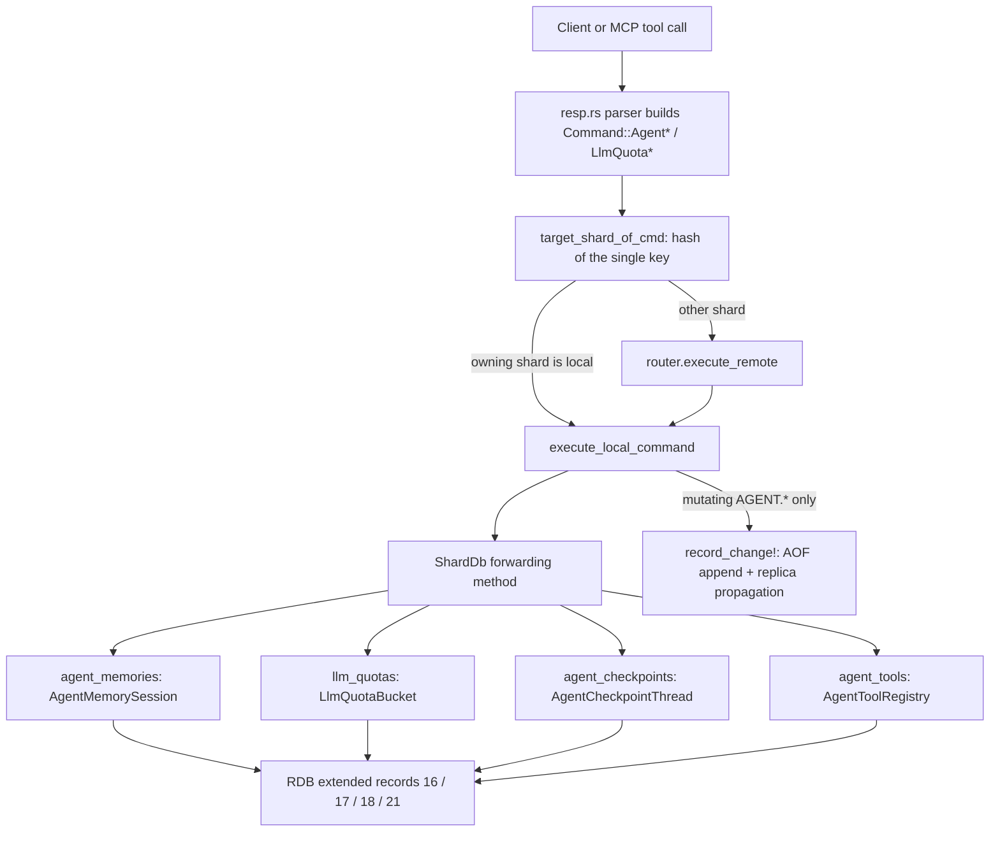
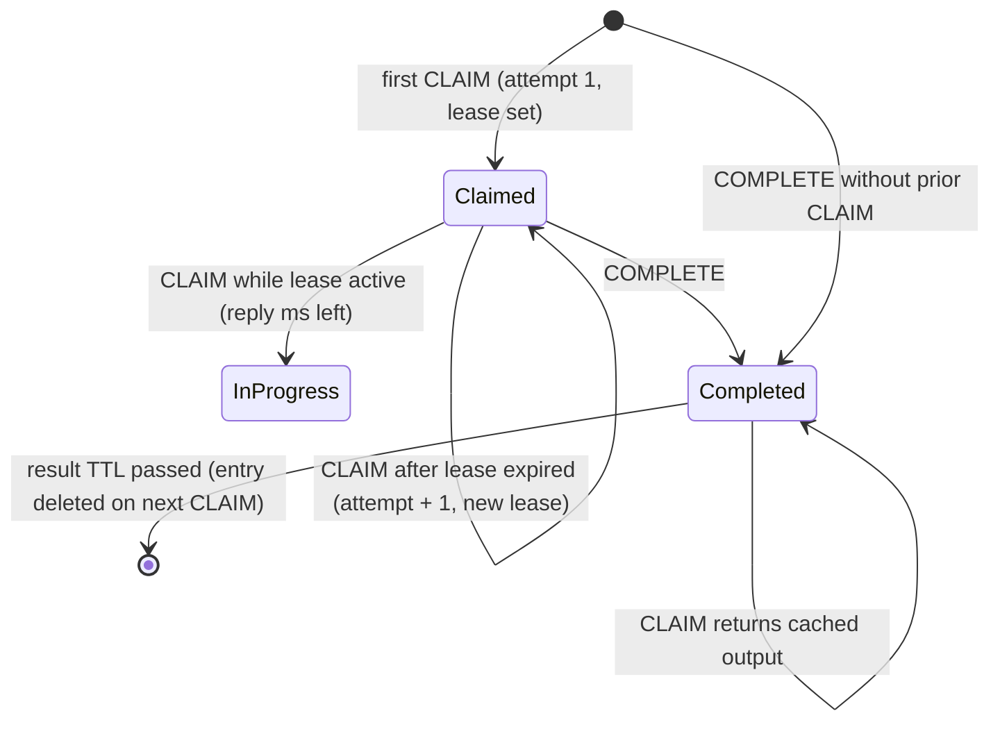

# Component 20: Agent Memory, LLM Quota & Checkpoints — Implementation Reference

> **High-Level Design Spec**: [`docs/design/20_agent_memory.md`](../design/20_agent_memory.md)
> **Consolidated Implementation Spec**: [`docs/internal/components.md`](components.md)
> **Main source files**: `src/agent.rs` (all four data structures and their algorithms);
> `src/shard.rs` (per-shard stores, forwarding methods, RDB save/restore); `src/resp.rs` (command
> parsers); `src/connection.rs` (routing, dispatch, RESP replies, change logging); `src/aof.rs`
> (AOF re-serialization and canonical rewrite); `src/mcp.rs` (MCP tool wrappers).

---

## 1. What this subsystem does

Rudis has four small, independent "AI-native" stores aimed at applications that drive LLM
agents. Each store is keyed by an ordinary Redis key, lives on the shard that owns that key, and
is driven by its own command family:

| Store | Commands | Problem it solves |
| :--- | :--- | :--- |
| **Agent memory session** (`AgentMemorySession`) | `AGENT.MEM.ADD`, `.CONTEXT`, `.COMPACT`, `.INFO`, `.CLEAR` | Keep a conversation's turns, hand back "the newest turns that fit in N tokens" for the next prompt, and optionally recall older turns that are semantically similar to a query embedding. |
| **LLM quota bucket** (`LlmQuotaBucket`) | `LLM.QUOTA.RESERVE`, `.SETTLE`, `.INFO` | Rate-limit calls to an LLM provider by both requests-per-window (RPM) and tokens-per-window (TPM), reserving an estimated token count before a call and correcting it to the real count afterwards. |
| **Checkpoint thread** (`AgentCheckpointThread`) | `AGENT.CHECKPOINT.PUT`, `.GET`, `.HISTORY` | Save an agent's state after each step as a node in a parent-pointer tree, so a run can resume from the latest step or "time-travel" to and fork from any earlier one. |
| **Tool registry** (`AgentToolRegistry`) | `AGENT.TOOL.CLAIM`, `.COMPLETE` | Make tool calls idempotent: the first caller to claim a call id gets a lease and runs the tool; concurrent duplicates are told it is in progress; once completed, everyone gets the cached result. |

There are thirteen commands in total. The four stores share no base type and no module-level
state; they are grouped only because they serve the same audience. None of them is a normal
Redis value: they do not appear in `KEYS`/`SCAN`, `TYPE`, `EXISTS`, `DEL` or `EXPIRE`.

Users reach them through RESP commands, and two of the families are also exposed as MCP tools
(Component 21): `rudis_agent_memory_add`, `rudis_agent_memory_context`,
`rudis_agent_checkpoint_put` and `rudis_agent_checkpoint_get` build the same `Command` variants
the RESP parser builds.

**Jargon used below**

- **Turn**: one message in a conversation (a role such as `user`/`assistant`/`system` plus content).
- **Working memory / recent window**: the newest non-compacted turns whose token counts fit a budget.
- **Episodic memory / recall**: older turns found by vector similarity rather than recency.
- **HNSW**: Hierarchical Navigable Small World graph, the approximate-nearest-neighbour index
  from Component 08 (`HnswIndex` in `src/vector.rs`).
- **Compaction**: replacing old turns in the prompt window with one summary turn written by the
  caller (the server does not generate summaries).
- **Lease**: a time-limited exclusive claim on a tool call id.
- **`record_change!`**: the macro in `execute_local_command` that, after a successful mutation,
  invalidates WATCH/client-tracking state for the command's keys and appends the command to the
  AOF and replication stream.

---

## 2. Mental model



Each shard owns four `hashbrown::HashMap<Bytes, T>` fields on `ShardDb`: `agent_memories`,
`llm_quotas`, `agent_checkpoints`, `agent_tools`. A command touches exactly one entry of one map,
on one shard, synchronously inside the shard's thread — so every operation is atomic with
respect to other commands on the same key without any locking.

Persistence works on two tracks:

- **Snapshots (RDB, full resync, AOF-rewrite image)** write all four maps as Rudis-specific
  extended records.
- **The command log (AOF tail, live replication)** carries the mutating `AGENT.*` commands, but
  **never** `LLM.QUOTA.*`.

---

## 3. Data structures

All four live in `src/agent.rs`.

### 3.1 Agent memory session

```rust
pub struct AgentTurn {
    pub id: u64,               // per-session, starts at 1, never reused
    pub role: Bytes,           // free-form; compaction summaries use "system"
    pub content: Bytes,
    pub tokens: u64,           // caller-supplied or estimated
    pub meta: Option<Bytes>,   // opaque caller metadata
    pub compacted: bool,       // true = folded into a summary, hidden from the window
}

pub struct AgentMemorySession {
    pub session_id: String,              // the key, lossily UTF-8 decoded
    pub turns: Vec<AgentTurn>,           // chronological, including compacted turns
    pub id_to_pos: HashMap<u64, usize>,  // turn id -> index in `turns`
    pub index: Option<HnswIndex>,        // created on the first vector; always Cosine
    pub next_turn_id: u64,               // starts at 1
    pub active_tokens: u64,              // sum of `tokens` over non-compacted turns
    pub compactions: u64,                // successful compactions
}
```

`AGENT.MEM.CONTEXT` returns an `AgentContextResult { recent_turns: Vec<AgentTurn>,
recalled_episodes: Vec<AgentEpisodeHit> }`. An `AgentEpisodeHit` carries `id`, `role`, `content`,
`meta` and a `score: f32` in `[0, 1]` (see §4.2).

Key points:

- `turns` is a `Vec`, not a map, so the recent-window walk is a plain reverse scan;
  `id_to_pos` is a second index used to turn HNSW hits (which are keyed by id) back into turns.
- The HNSW key for a turn is **the turn id rendered as a decimal string** (`"17"`), not the raw
  integer. Recall has to parse it back.
- The HNSW index is created with `HnswIndex::new(session_id, dim, VectorMetric::Cosine)` (the
  index's defaults: M = 16, `ef_construction` = 64, `ef_search` = 32). The **first vector a
  session ever sees fixes its dimension**; there is no way to choose another metric.
- Compacted turns stay in `turns` **and** keep their embedding in the index. Nothing is ever
  removed from a session except by deleting the whole session.

### 3.2 LLM quota bucket

```rust
pub struct LlmReserveResult {
    pub allowed: bool,
    pub reservation_id: Option<u64>,   // Some only when allowed
    pub remaining_tokens: u64,         // TPM headroom after this decision
    pub retry_after_ms: u64,           // 0 when allowed
}

pub struct LlmQuotaBucket {
    pub requests: VecDeque<(Instant, u64)>,          // settled calls: (start time, actual tokens)
    pub reservations: HashMap<u64, (Instant, u64)>,  // id -> (reserve time, estimated tokens)
    pub next_reservation_id: u64,                    // starts at 1
    pub window_ms: u64,                              // sliding-window width, at least 1
}
```

- The **limits themselves (`rpm`, `tpm`) are not stored**; every `RESERVE` passes them. Two
  callers using the same key with different limits each get checked against their own numbers
  over the same shared history.
- `window_ms` defaults to 60 000. A bucket is created by the first `RESERVE` on its key, with
  that call's `WINDOW` value (or 60 000). **Any later `RESERVE` that passes `WINDOW` overwrites
  the bucket's window for all subsequent calls.**
- Timestamps are `std::time::Instant` (monotonic). Snapshots convert them to wall-clock expiry
  times (§6.2).

### 3.3 Checkpoint thread

| Field | Type | Meaning |
| :--- | :--- | :--- |
| `nodes` | `hashbrown::HashMap<Bytes, AgentCheckpointNode>` | `step_id` → node. A second `PUT` with the same `step_id` overwrites the node. |
| `order` | `Vec<Bytes>` | `step_id`s in first-seen order; a re-`PUT` does not append again. |
| `head_step_id` | `Option<Bytes>` | The step most recently `PUT` (on any branch). |
| `next_seq` | `u64` | Next sequence number, starts at 1. |

Each `AgentCheckpointNode` has `step_id: Bytes`, `parent_id: Option<Bytes>`, `seq: u64` (the
thread-wide `PUT` counter at the time of the write), `timestamp_ms: u64` (wall-clock ms taken by
the server inside `put`), `state: Bytes` and `metadata: Option<Bytes>`. Parent ids are not
validated: a node may name a parent that does not exist (yet), and cycles are possible.

### 3.4 Tool registry

```rust
pub enum ToolClaimState { Claimed, InProgress, Completed }

pub struct ToolClaimResult {
    pub state: ToolClaimState,
    pub output: Option<Bytes>,  // Some only for Completed
    pub meta_int: u64,          // Claimed: attempt number; InProgress: lease ms left; Completed: 0
}

pub(crate) struct ToolCallEntry {
    pub(crate) input: Option<Bytes>,          // last INPUT given to a successful claim
    pub(crate) output: Option<Bytes>,         // set by COMPLETE
    pub(crate) attempt: u64,                  // number of successful claims
    pub(crate) lease_until: Option<Instant>,  // active-claim expiry
    pub(crate) expire_at: Option<Instant>,    // cached-result expiry (None = forever)
}

pub struct AgentToolRegistry { pub(crate) calls: hashbrown::HashMap<Bytes, ToolCallEntry> }
```

`ToolCallEntry` is crate-private; `src/shard.rs` and `src/aof.rs` read it for persistence.
`input` is stored but never returned by any command.

---

## 4. Algorithms

### 4.1 `AgentMemorySession::add`

1. Take `id = next_turn_id`.
2. If a vector was supplied:
   - reject an empty vector with `ERR vector dimension must be greater than 0`;
   - create the HNSW index if this is the session's first vector, with that vector's length as
     the dimension;
   - reject a length that differs from the index dimension with `ERR vector dimension mismatch`;
   - insert the vector under the key `id.to_string()` (an index error becomes `ERR <msg>`).
3. `next_turn_id += 1`.
4. `tokens` is the caller's `TOKENS` value or `estimate_tokens(content)` =
   `ceil(len_in_bytes / 4)`, minimum 1. This is a fixed "4 bytes per token" heuristic, not a
   tokenizer; it overestimates for multi-byte scripts such as CJK, where a 3-byte character is
   often one token.
5. `active_tokens += tokens` (saturating), push the turn with `compacted: false`, record its
   position in `id_to_pos`, return the id.

`ShardDb::agent_mem_add` creates the session entry (`entry().or_insert_with`) *before* calling
`add`, so a rejected first `ADD` can leave an empty session behind.

### 4.2 `AgentMemorySession::context`

Inputs: `max_tokens`, an optional `query` vector, `recall_k`.

1. If both a query and an index exist and their dimensions differ, return
   `ERR vector dimension mismatch`.
2. **Recent window.** Walk `turns` newest → oldest, skipping compacted turns. Stop at the
   *first* turn whose tokens would push the running total over `max_tokens`; otherwise take it
   and remember its id. Reverse the result into chronological order. This is greedy by recency:
   a smaller, older turn that would still fit is not taken once a larger turn has stopped the
   walk.
3. **Episodic recall** runs only if a query was given, the session has an index, and
   `recall_k > 0`. It calls `HnswIndex::search_filtered(query, recall_k, None, false,
   Some(filter))` — default `ef_search`, no re-ranking — where the filter rejects any key whose
   parsed id is already in the recent window. The filter is applied during the graph walk, so a
   turn never appears in both lists.
4. Each hit's key is parsed back to an id, looked up through `id_to_pos`, and returned as an
   `AgentEpisodeHit` with `score = clamp(1 − distance, 0, 1)`. Hits that fail to resolve are
   skipped silently.

Cosine distance in `src/vector.rs` is `max(1 − cos_sim, 0)` (and exactly `1.0` if either vector
has zero norm), so `score` is effectively `max(cos_sim, 0)`: orthogonal and opposite embeddings
both score `0.0`. Recall can return compacted turns and older summaries — that is the point of
keeping their embeddings.

**Worked example** (from the module test). Four turns with 12, 10, 10, 10 tokens and 3-d
embeddings `[1,0,0]`, `[0.9,0.1,0]`, `[0,1,0]`, `[0,0.9,0.1]`.
`context(max_tokens = 20, query = [1,0,0], recall_k = 2)`:

- Window walk: turn 4 (total 10), turn 3 (total 20), turn 2 would make 30 > 20 → stop.
  `recent_turns = [3, 4]`.
- Recall excludes ids 3 and 4 and returns turns 1 and 2 (closest to `[1,0,0]`), in that order.

### 4.3 `AgentMemorySession::compact`

Inputs: `keep_recent`, caller-written `summary`, optional `tokens`, optional summary vector.

1. Collect the positions of all non-compacted turns in chronological order.
2. If there are `<= keep_recent` of them, return `Ok(0)` and change nothing.
3. Allocate `summary_id = next_turn_id`; if a vector was given, validate and index it exactly as
   `add` does (the summary becomes recallable). `next_turn_id += 1`.
4. `compact_count = active − keep_recent`. Mark the **oldest** `compact_count` active turns
   `compacted = true` and subtract their tokens from `active_tokens`.
5. Add the summary's tokens (given or estimated) to `active_tokens`.
6. Insert the summary turn (`role = "system"`, `meta = None`) into `turns`:
   - if `keep_recent > 0`, at the position of the oldest *kept* active turn, i.e. just before the
     turns it did not summarize, so the window reads `[…, summary, kept turns]`;
   - if `keep_recent == 0`, at the end of `turns`.
7. Rebuild `id_to_pos` from scratch (the insert shifted later positions). Cost is
   O(total turns, including compacted ones) per compaction.
8. `compactions += 1`; return `compact_count`.

Continuing the example: `compact(keep_recent = 1, summary(8 tokens), vector [0.7,0.7,0])`
compacts turns 1–3 (returns 3), inserts summary id 5 before turn 4. `info()` now reports
2 active turns, 5 total, 18 active tokens, dim 3, 5 vectors, 1 compaction. A later
`context(50, [1,0,0], 1)` returns window `[5 (system), 4]` and still recalls compacted turn 1.

### 4.4 `AgentMemorySession::info`

Returns `(active_turns, total_turns, active_tokens, vector_dim, episodic_vector_count,
compactions)`. `active_turns` is counted on every call; `vector_dim`/`episodic_vector_count` are
0 when no index exists. For a missing session `ShardDb::agent_mem_info` returns all zeros.

### 4.5 `LlmQuotaBucket::reserve`

1. If `window_ms` was passed, set `self.window_ms = max(window_ms, 1)`.
2. **Evict**: pop entries from the front of `requests` while they are at least `window_ms` old
   (stopping at the first younger one), and drop reservations at least `window_ms` old.
3. `active = requests.len() + reservations.len()`;
   `committed = Σ requests.tokens + Σ reservations.est_tokens`.
4. **Admit** if `active < rpm` **and** `committed + est_tokens <= tpm`: insert a reservation
   `(now, est_tokens)` under `next_reservation_id` (then increment) and return
   `allowed = true`, the id, `remaining_tokens = tpm − (committed + est_tokens)`,
   `retry_after_ms = 0`.
5. **Deny** otherwise: `remaining_tokens = tpm − committed` (saturating) and
   `retry_after_ms = window_ms − age_of_oldest_entry` (minimum 1), where the oldest entry is the
   older of the front request and the oldest reservation. With no entries at all,
   `retry_after_ms = window_ms`.

A reservation that is never settled still counts against both limits until it ages out of the
window. A request whose `est_tokens` alone exceeds `tpm` is denied forever, yet still gets a
finite `retry_after_ms`.

### 4.6 `LlmQuotaBucket::settle` and `info`

`settle(reservation_id, actual_tokens)` evicts, removes the reservation, and pushes
`(reservation_time, actual_tokens)` onto the back of `requests`. It returns
`(true, actual − estimated)`; a negative delta means the estimate was too high and the
difference is freed from then on. An unknown or already-expired id returns `(false, 0)` — not an
error. A missing key also returns `(false, 0)`.

`info()` evicts, then returns `(active_requests, used_tokens, reserved_tokens,
active_reservations, window_ms)`. For a missing key `ShardDb::llm_quota_info` returns
`(0, 0, 0, 0, 60000)` without creating a bucket.

**Worked example** (module test, RPM 2, TPM 1000, 60 s window):

| Step | Call | Result |
| :--- | :--- | :--- |
| 1 | `reserve(est 700)` | allowed, id 1, remaining 300 |
| 2 | `reserve(est 500)` | denied (700 + 500 > 1000), remaining 300, `retry_after_ms > 0` |
| 3 | `settle(1, actual 400)` | `(true, −300)` — 400 now committed |
| 4 | `reserve(est 500)` | allowed, id 2, remaining 100 |
| 5 | `reserve(est 50)` | denied by RPM: 1 settled + 1 reserved = 2, not < 2 |

### 4.7 Checkpoints: `put`, `get`, `history`

- **`put(step_id, parent_id, state, metadata)`**: take `seq = next_seq++`, read the wall clock
  into `timestamp_ms`, append `step_id` to `order` only if it is new, insert/overwrite the node,
  set `head_step_id = step_id`, return `seq`. Re-`PUT`ting an old step overwrites its contents
  (the old contents are lost) and makes it the head again.
- **`get(step_id)`**: the named node, or the head node when no step is given; `None` if absent.
- **`history(from_step, limit)`**: starting at `from_step` (or the head), push the node, then
  follow `parent_id`, until `limit` nodes are collected, a step has no stored node, or a step
  repeats (a `HashSet` cycle guard). `limit == 0` returns nothing. Output order is leaf → root.

**Worked example.** `PUT step_1`; `PUT step_2a PARENT step_1`; `PUT step_2b PARENT step_1`;
`PUT step_3b PARENT step_2b` return seq 1–4. The head is `step_3b`; `HISTORY` from the head is
`[step_3b, step_2b, step_1]`; `HISTORY FROM step_2a` is `[step_2a, step_1]` — the abandoned branch
stays reachable.

### 4.8 Tool leases: `claim` and `complete`

`claim(call_id, ttl_ms, input)`, with the lease length `max(ttl_ms, 1)` ms:



For an existing entry the checks run in this order:

1. `expire_at` has passed → delete the entry and fall through to "new entry" (attempt restarts
   at 1).
2. `output` is set → `Completed` with the cached output, `meta_int = 0`.
3. Lease still active → `InProgress`, `meta_int` = remaining lease ms (minimum 1).
4. Otherwise (lease expired, no output) → `attempt += 1`, renew the lease, replace `input` if a
   new one was given → `Claimed` with `meta_int = attempt`.

A missing entry is inserted with `attempt = 1` and a fresh lease → `Claimed`, `meta_int = 1`.

`complete(call_id, output, ttl_ms)` always succeeds and returns `true`: it sets `output`, clears
the lease, and sets `expire_at = now + max(ttl, 1)` if a TTL was given, otherwise `None` (cached
forever). A missing entry is created directly in the completed shape (`attempt = 1`). `COMPLETE`
is not tied to the claimer: anyone can complete any call id, even while another caller's lease is
active.

**Worked example.** `CLAIM tools call_99 TTL 30000 INPUT {...}` → `CLAIMED, nil, 1`. A second
`CLAIM` 5 ms later → `IN_PROGRESS, nil, ~29995`. `COMPLETE tools call_99 OUTPUT {"rows":[1]}
TTL 60000` → `1`. The next `CLAIM` → `COMPLETED, {"rows":[1]}, 0`, until 60 s later, when it
becomes a fresh `CLAIMED, nil, 1`.

---

## 5. Commands: syntax, routing and replies

### 5.1 Syntax (parsers in `src/resp.rs`)

Option names are case-insensitive. Integers that fail to parse give
`value is not an integer or out of range`; unknown options give `syntax error`.

| Command | Syntax and defaults |
| :--- | :--- |
| `AGENT.MEM.ADD` | `session role content [TOKENS n] [VEC\|VECTOR <vec>] [META m]` |
| `AGENT.MEM.CONTEXT` | `session [MAX_TOKENS\|MAXTOKENS n] [QUERY\|VEC\|VECTOR <vec>] [RECALL\|RECALL_K k]` — at least one option is required (4+ arguments). `max_tokens` defaults to 2048, `recall_k` to 0; a query sets `recall_k` to 3 if it is still 0 at that point. |
| `AGENT.MEM.COMPACT` | `session KEEP_RECENT\|KEEP n SUMMARY s [TOKENS n] [VEC\|VECTOR <vec>]` — both `KEEP_RECENT` and `SUMMARY` required. |
| `AGENT.MEM.INFO` / `.CLEAR` | `session` |
| `LLM.QUOTA.RESERVE` | `key RPM n TPM n EST_TOKENS\|TOKENS n [WINDOW\|WINDOW_MS ms]` — RPM, TPM, EST_TOKENS required. |
| `LLM.QUOTA.SETTLE` | `key reservation_id actual` or `key reservation_id ACTUAL_TOKENS\|TOKENS actual` |
| `LLM.QUOTA.INFO` | `key` |
| `AGENT.CHECKPOINT.PUT` | `key step_id [PARENT p] [STATE s] [META m]`; the state may also be given positionally as the fourth argument. State is required. |
| `AGENT.CHECKPOINT.GET` | `key [step_id]` or `key STEP step_id` |
| `AGENT.CHECKPOINT.HISTORY` | `key [FROM\|STEP step] [LIMIT n]` — limit defaults to 50. |
| `AGENT.TOOL.CLAIM` | `key call_id [TTL\|PX ms] [INPUT i]` — TTL defaults to 30 000 ms. |
| `AGENT.TOOL.COMPLETE` | `key call_id [OUTPUT o] [TTL\|PX ms]`; the output may be positional as the fourth argument. Output is required; no TTL means cached forever. |

`<vec>` is either `<dim> f1 … f<dim>` (decimal floats) or a single blob of little-endian
float32 bytes (decoded by `search::decode_vector`). If the token after `VEC` is not a positive
integer, or is larger than the number of remaining arguments, it is treated as a blob.

The MCP wrappers in `src/mcp.rs` default `max_tokens` to 2048 and `recall_k` to 3 for
`rudis_agent_memory_context`.

### 5.2 Routing and dispatch (`src/connection.rs`)

Every variant has exactly one key (`session` or `key`). `cmd_primary_key`, `for_each_cmd_key`
and `target_shard_of_cmd` all return that key, so the command runs on the shard that owns the
key: locally via `execute_local_command`, or via `router.execute_remote` to another shard.
`get_cmd_name` reports the families as `"AGENT"` and `"LLM"`.

The stores are **not per logical database**: `SELECT` does not change which session a key names.
`FLUSHDB` clears all four maps only when the current DB is 0; `FLUSHALL` always clears them.

### 5.3 Replies

| Command | Reply |
| :--- | :--- |
| `AGENT.MEM.ADD` | integer turn id |
| `AGENT.MEM.CONTEXT` | 2-element array: `[recent, recalled]`. Each recent turn is `[id, role, content, tokens, meta\|nil]`; each recalled episode is `[id, role, content, score, meta\|nil]` with `score` as a bulk string formatted to 6 decimals. A missing session gives two empty arrays. |
| `AGENT.MEM.COMPACT` | integer number of turns compacted (0 for a missing session or nothing to do) |
| `AGENT.MEM.INFO` | flat 14-element array: `session`, `active_turns`, `total_turns`, `active_tokens`, `vector_dim`, `episodic_vectors`, `compactions` |
| `AGENT.MEM.CLEAR` | `1` if the session existed, else `0` |
| `LLM.QUOTA.RESERVE` | `[allowed 0/1, reservation_id\|nil, remaining_tokens, retry_after_ms]` |
| `LLM.QUOTA.SETTLE` | `[found 0/1, delta]` |
| `LLM.QUOTA.INFO` | flat 12-element array: `key`, `active_requests`, `used_tokens`, `reserved_tokens`, `active_reservations`, `window_ms` |
| `AGENT.CHECKPOINT.PUT` | integer `seq` |
| `AGENT.CHECKPOINT.GET` | flat 10-element array `step_id`, `parent_id` (nil if none), `seq`, `state`, `meta` (nil if none) — or nil if not found. `timestamp_ms` is **not** returned. |
| `AGENT.CHECKPOINT.HISTORY` | array of the same 10-element node arrays, leaf → root |
| `AGENT.TOOL.CLAIM` | `[CLAIMED\|IN_PROGRESS\|COMPLETED, output\|nil, meta_int]` |
| `AGENT.TOOL.COMPLETE` | integer `1` |

---

## 6. Persistence and replication

### 6.1 Command log: which commands reach the AOF and replicas

`record_change!(cmd)` is called only when a command really changed state:

| Command | Logged when |
| :--- | :--- |
| `AGENT.MEM.ADD` | it succeeded |
| `AGENT.MEM.COMPACT` | it compacted at least one turn |
| `AGENT.MEM.CLEAR` | the session existed |
| `AGENT.CHECKPOINT.PUT` | always |
| `AGENT.TOOL.CLAIM` | the result is `Claimed` (`InProgress`/`Completed` change nothing) |
| `AGENT.TOOL.COMPLETE` | always |
| `CONTEXT`, `INFO`, `GET`, `HISTORY` | never (reads) |
| `LLM.QUOTA.RESERVE` / `SETTLE` / `INFO` | **never** |

`aof::command_to_resp` re-serializes the six loggable variants into canonical RESP:
`AGENT.MEM.ADD` (adding `TOKENS`, `VEC <dim> <floats…>`, `META` only when present),
`AGENT.MEM.COMPACT … KEEP_RECENT n SUMMARY s [TOKENS] [VEC]`, `AGENT.MEM.CLEAR`,
`AGENT.CHECKPOINT.PUT … [PARENT] STATE s [META]`, `AGENT.TOOL.CLAIM … TTL ms [INPUT]` (TTL always
written) and `AGENT.TOOL.COMPLETE … OUTPUT o [TTL]`. There is no encoding for any `LlmQuota*`
variant.

Because the log carries commands, not results, replaying it recomputes anything time-dependent:
a replayed `AGENT.CHECKPOINT.PUT` stamps its own `timestamp_ms`; a replayed `AGENT.TOOL.CLAIM`
starts a fresh full-length lease; a replayed `AGENT.TOOL.COMPLETE … TTL` restarts the TTL.
`seq`, turn ids and attempt counts replay identically because they depend only on command order.

Because `record_change!` is also what invalidates WATCH and client tracking, `LLM.QUOTA.*` writes
do not invalidate a `WATCH` on the quota key.

### 6.2 Snapshot records

Snapshots (`ShardDb::save_rdb_chunk` for SAVE/BGSAVE and full-resync RDB generation, and the
`AofImage` used by BGREWRITEAOF) write the agent stores in `save_extended_small_records`, inside
the `rudis-ext` AUX field that Redis/Valkey ignore. Each record is `key, type byte, payload`;
integers are little-endian, byte strings are length-prefixed, optional strings have a presence
byte.

| Type | Store | Payload | Written when |
| :--- | :--- | :--- | :--- |
| 16 | memory session | `next_turn_id`, `active_tokens`, `compactions`, turn count, then per turn `id`, `role`, `content`, `tokens`, `meta?`, `compacted` byte, vector (`u32` length + floats, length 0 = none). The vector is read back from the HNSW index by the turn's id string. | every session |
| 17 | checkpoint thread | `next_seq`, `head_step_id?`, node count, then per node in `order` sequence: `step_id`, `parent_id?`, `seq`, `timestamp_ms`, `state`, `metadata?` | the thread has at least one node |
| 18 | tool registry | call count, then per call `call_id`, `input?`, `output?`, `attempt`, `lease_unix_ms`, `expire_unix_ms` (0 = none) | at least one call whose result has not expired |
| 21 | quota bucket | `window_ms`, `next_reservation_id`, then settled requests as `(expiry_unix_ms, tokens)` and reservations (sorted by id) as `(id, expiry_unix_ms, est_tokens)` — expiry = start time + window | it has live entries, or `next_reservation_id > 1` |

`Instant`s are converted to absolute Unix-epoch milliseconds on save (`unix_now + time left`)
and back to `Instant`s on load (`now + (saved − unix_now)`), so deadlines survive a restart in
wall-clock terms.

`ShardDb::restore_ai_native_rdb_record` (called from the table loader for types 15–18 and 21)
reverses this. Notable behaviour:

- **Ownership filter**: the loader computes `is_owned = target_shard(key, num_shards) ==
  shard_id`. Records for keys another shard owns are parsed (to advance the cursor) and dropped,
  so a snapshot loads correctly into a different shard count.
- **Sessions** are rebuilt turn by turn; the HNSW index is recreated (Cosine) at the first
  non-empty vector and every vector re-inserted, and `id_to_pos` is rebuilt.
- **Checkpoints** are restored with their original `timestamp_ms` and `seq` values.
- **Tool calls** whose result expiry has passed by load time are dropped; an expired lease
  becomes "no lease" while keeping `attempt`.
- **Quota entries** whose window-end has passed are dropped; survivors get a back-dated
  `Instant` so they age out at the same wall-clock moment. `next_reservation_id` is kept, so
  outstanding reservation ids can still be settled after a restart (exercised by
  `test_llm_quotas_round_trip_through_rdb`).

### 6.3 Canonical (command-form) rewrite

`write_canonical_aof` (used by `rewrite_shard_aof_canonical` when `reshard_aof_dir` re-splits
AOF files after the shard count changes, and when importing external Redis AOFs) writes the
stores back as commands instead of RDB records:

1. **Sessions**: with no compacted turns, one `AGENT.MEM.ADD` per turn (with `TOKENS`, vector and
   meta). With compacted turns: an `ADD` for every compacted turn, then
   `AGENT.MEM.COMPACT KEEP_RECENT 0` whose summary is the first active turn (the most recent
   summary), then an `ADD` for each remaining active turn. This is why `compact` with
   `keep_recent == 0` appends the summary at the end.
2. **Checkpoints**: one `AGENT.CHECKPOINT.PUT` per node in `order` sequence.
3. **Tools**: completed, unexpired calls become `AGENT.TOOL.COMPLETE` with the remaining TTL;
   uncompleted calls with a live lease become `AGENT.TOOL.CLAIM` with the remaining lease time;
   uncompleted calls whose lease has expired are omitted.
4. **Quota buckets are not written.**

This form is lossy: turn ids are renumbered (compacted turns first), `compactions` restarts at 1
and `next_turn_id` follows the replay; checkpoint `seq`s are renumbered in `order` sequence,
timestamps are re-stamped and the head becomes the last step in `order` (not the original head if
an older step was re-`PUT`); tool attempt counts reset to 1 and completed calls lose their
`input`.

### 6.4 Durability summary

| Store | Snapshot | AOF tail / live replication | Canonical rewrite |
| :--- | :--- | :--- | :--- |
| memory sessions | yes | yes | yes (ids renumbered) |
| checkpoints | yes (exact) | yes (timestamps re-stamped) | yes (seq/head may change) |
| tool registries | yes | yes (leases/TTLs restart on replay) | yes (attempts reset) |
| quota buckets | yes | **no** | **no** |

So after a restart from AOF, a quota bucket holds whatever the last rewrite image captured (minus
entries that have since aged out); later reservations and settlements are lost. A replica gets
quota state only from its full-resync snapshot and never sees later quota changes.

---

## 7. Invariants & gotchas

- **One store per key family, no collisions with normal keys.** A string key `foo` and an agent
  session `foo` coexist; `DEL foo` removes only the string.
- **`active_tokens` must equal the sum of non-compacted turn tokens.** `add` adds, `compact`
  subtracts and adds the summary; the RDB path restores the stored value rather than
  recomputing it.
- **`id_to_pos` must match `turns`.** `add` appends one entry; `compact` and restore rebuild the
  whole map.
- **Dimension is fixed by the first vector**, from either `ADD` or `COMPACT`; a later query or
  vector of another length errors.
- **Recall never duplicates the window**, but it does return compacted turns and old summaries.
- **Scores lose sign**: `score = max(cos_sim, 0)`; zero-norm vectors score 0.
- **Quota eviction assumes `requests` is in time order, but it is not always.** `settle` pushes
  the *reservation's* start time onto the back of `requests`. If reservations are settled out of
  creation order, an older timestamp can sit behind a younger one; eviction stops at the first
  young entry, so the older one keeps counting until everything in front of it has expired.
  `info` and `reserve` can therefore over-count briefly.
- **`WINDOW` is sticky**: the last `RESERVE` that passes it changes the window for every caller of
  that key.
- **Unsettled reservations count until they age out**; there is no cancel command.
- **Checkpoint overwrites are silent** and move the head; `HISTORY` shows current contents only.
  `parent_id` is not validated; `history` stops at a missing parent or a cycle.
- **Tool completion is unconditional**: no ownership check, no compare-and-set on the lease.
- **A completed result whose TTL expired resets `attempt` to 1**, while an expired *lease*
  (never completed) keeps counting attempts.
- **Time-dependent values are not deterministic across replay** (§6.1): checkpoint timestamps,
  lease ends, result TTLs.

---

## 8. Limitations / not implemented

- No per-session limits: turn count, content size and the HNSW index grow until
  `AGENT.MEM.CLEAR` deletes the whole session. No selective eviction, no TTL, no way to delete a
  single turn or embedding.
- No metric choice for episodic recall (always Cosine), no quantization, no tiering of the
  session index.
- Token estimation is a 4-bytes-per-token heuristic.
- The server does not summarize; `COMPACT` stores whatever summary the client sends.
- No delete/clear command for checkpoint threads or tool registries; their entries leave only via
  `FLUSHDB` (DB 0) / `FLUSHALL`, or (for tool results with a TTL) expiry on the next `CLAIM`.
  Expired tool entries are not swept proactively.
- `AGENT.CHECKPOINT.GET`/`HISTORY` do not expose `timestamp_ms`.
- `LLM.QUOTA.*` state is not logged to the AOF and not replicated live; it is per-key, per-shard
  (no cluster-wide quota), and the RPM/TPM limits are supplied per call rather than configured.
- Only four of the thirteen commands are exposed as MCP tools.
- The agent stores are shared across logical databases rather than scoped per `SELECT`ed DB.

---

## 9. Code map

| File | Key symbols | What they do |
| :--- | :--- | :--- |
| `src/agent.rs` | `AgentTurn`, `AgentEpisodeHit`, `AgentContextResult`, `AgentMemorySession` (`add`, `context`, `compact`, `info`, `estimate_tokens`) | Working memory, HNSW-backed recall, compaction |
| `src/agent.rs` | `LlmReserveResult`, `LlmQuotaBucket` (`reserve`, `settle`, `info`, `evict_expired`) | Sliding-window RPM/TPM governor |
| `src/agent.rs` | `AgentCheckpointNode`, `AgentCheckpointThread` (`put`, `get`, `history`) | Parent-pointer checkpoint tree |
| `src/agent.rs` | `ToolClaimState`, `ToolClaimResult`, `ToolCallEntry`, `AgentToolRegistry` (`claim`, `complete`) | Idempotent tool-call leases and result cache |
| `src/shard.rs` | `ShardDb` fields `agent_memories`, `llm_quotas`, `agent_checkpoints`, `agent_tools`; `agent_mem_*`, `llm_quota_*`, `agent_checkpoint_*`, `agent_tool_*` | Per-shard stores and thin forwarding methods (create-on-write, defaults for missing keys) |
| `src/shard.rs` | `flushdb`, `flushall` | Clear the stores (FLUSHDB only from DB 0) |
| `src/shard.rs` | `save_extended_small_records`, `restore_ai_native_rdb_record`, `AofImage` | Snapshot records 16/17/18/21 and their restore; AOF-rewrite image |
| `src/table.rs` | extended-record loader (dispatch on type bytes 15–18, 21) | Computes `is_owned` and calls `restore_ai_native_rdb_record` |
| `src/resp.rs` | `AGENT.MEM.*`, `LLM.QUOTA.*`, `AGENT.CHECKPOINT.*`, `AGENT.TOOL.*` parse arms; `Command::Agent*`/`LlmQuota*` | Command syntax and defaults |
| `src/connection.rs` | `cmd_primary_key`, `for_each_cmd_key`, `target_shard_of_cmd`, `get_cmd_name`, `execute_local_command`, `record_change!`, `log_change` | Routing, dispatch, reply encoding, change logging |
| `src/aof.rs` | `command_to_resp` (agent arms), `write_canonical_aof`, `rewrite_shard_aof_canonical`, `reshard_aof_dir` | AOF encoding and command-form rewrite |
| `src/vector.rs` | `HnswIndex::new`, `search_filtered`, `get_vector_cow`, `cosine_distance` | Index used for episodic recall |
| `src/mcp.rs` | `rudis_agent_memory_add`, `rudis_agent_memory_context`, `rudis_agent_checkpoint_put`, `rudis_agent_checkpoint_get` | MCP tool → `Command` mapping |

### How to verify changes

```bash
cargo fmt --check
cargo clippy --all-targets -- -D warnings
# Module unit tests: window/recall/compaction, reserve/settle, checkpoint DAG + tool leases
cargo test --lib agent:: -- --test-threads=1
# Quota RDB round trip
cargo test --lib test_llm_quotas_round_trip_through_rdb
# AOF encoding / rewrite tests
cargo test --lib aof:: -- --test-threads=1
```
