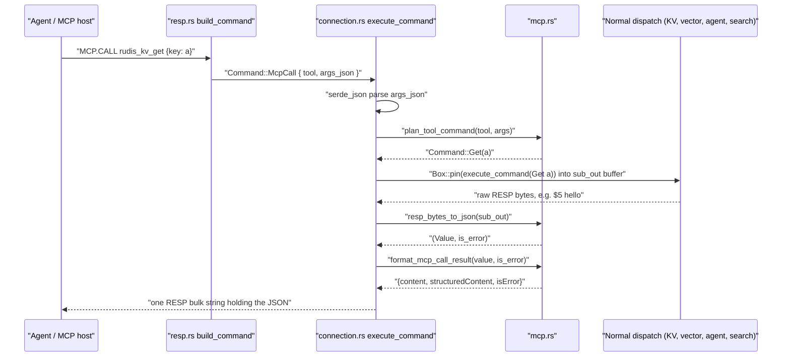

# Component 21: Built-in Model Context Protocol (MCP) Server — Implementation Reference

> **Source files**: `src/mcp.rs` (tool catalog, tool → command planner, RESP → JSON converter),
> plus the `MCP.*` handling in `src/connection.rs` and parsing in `src/resp.rs`
> **High-level design**: [`docs/design/21_mcp_server.md`](../design/21_mcp_server.md)
> **Consolidated implementation spec**: [`docs/internal/components.md`](components.md)
> **Related**: [Component 20 — Agent Memory, LLM Quota & Checkpoints](20_agent_memory.md)
> (`src/agent.rs`) and [Component 08 — Vector Search Engine](08_vector_engine.md)
> (`src/vector.rs`, which also holds the semantic cache)

---

## 1. What this subsystem does

The **Model Context Protocol (MCP)** is an open protocol that lets LLM-based agents discover
and invoke "tools" exposed by a server. A tool is a named operation with a JSON Schema
describing its arguments; the agent sends `{tool name, JSON arguments}` and receives a JSON
result.

Rudis ships a small, built-in MCP server so that an agent framework can use Rudis's KV store,
semantic cache, vector sets, agent memory/checkpoints and full-text search **without a separate
MCP adapter process**. The agent (or its host) still connects over the normal Redis protocol
(RESP) port and issues one of three commands:

| Command | Purpose |
| :--- | :--- |
| `MCP.TOOLS` | List the built-in tools as a RESP array. |
| `MCP.CALL <tool> [args_json]` | Call one tool; reply is a JSON result object in a bulk string. |
| `MCP.RPC <json_rpc_request>` | Speak a subset of MCP's **JSON-RPC 2.0** envelope (`initialize`, `ping`, `tools/list`, `tools/call`). |

There is no separate HTTP/stdio transport: MCP messages ride inside RESP bulk strings. A host
that wants a real MCP stdio/HTTP endpoint has to bridge it to `MCP.RPC` itself.

The key design choice is that **a tool call is just a translated Rudis command**. `src/mcp.rs`
never touches storage. It turns `(tool, args)` into an ordinary `Command` value (for example
`rudis_kv_get {"key":"a"}` becomes `Command::Get("a")`), the connection layer runs that command
through the normal dispatcher, and the raw RESP reply is converted back to JSON.

> [!IMPORTANT]
> The `MCP.` command family is **experimental** and is off by default. Unless the server runs
> with `enable-experimental-commands yes` (config file) or `--enable-experimental-commands yes`
> (CLI), `MCP.TOOLS`/`MCP.CALL`/`MCP.RPC` are parsed as unknown commands.

---

## 2. Mental model



Three layers, each with one job:

1. **Catalog** (`builtin_mcp_tools`, `tools_list_json`) — the static list of 11 tools and their
   JSON Schemas.
2. **Planner** (`plan_tool_command`) — validates arguments and builds the native `Command`.
3. **Reply translation** (`resp_bytes_to_json`, `format_mcp_call_result`) — turns the inner
   command's RESP reply into the MCP result envelope.

The orchestration (JSON parsing, recursion into `execute_command`, JSON-RPC method dispatch)
lives inline in `src/connection.rs`, inside `execute_command_inner`'s big `match`.

---

## 3. Data structures

### 3.1 `McpToolDef`

```rust
#[derive(Debug, Clone)]
pub struct McpToolDef {
    pub name: &'static str,
    pub description: &'static str,
    pub input_schema: Value, // JSON Schema object built with serde_json::json!
}
```

| Field | Type | Meaning |
| :--- | :--- | :--- |
| `name` | `&'static str` | Tool name the agent passes to `MCP.CALL` / `tools/call` (e.g. `rudis_kv_get`). |
| `description` | `&'static str` | One-line human/LLM-readable description. |
| `input_schema` | `serde_json::Value` | `{"type":"object","properties":{...},"required":[...]}`. Serialized as `inputSchema` on the wire. |

### 3.2 The three `Command` variants (`src/resp.rs`)

```rust
// MODEL CONTEXT PROTOCOL (MCP) COMMANDS
McpTools,
McpCall { tool: String, args_json: Bytes },
McpRpc(Bytes),
```

`get_cmd_name` maps all three to the name `"MCP"` (used for command stats, slowlog and the
"last command" of a client). In the generated ACL table (`src/acl_categories.rs`) the command
`mcp` belongs to the categories **`@admin`, `@slow`, `@dangerous`** and declares read+write key
access. A user with `+@all -@dangerous` therefore cannot run any `MCP.*` command.

---

## 4. The 11-tool catalog

`builtin_mcp_tools()` returns a hand-written `Vec<McpToolDef>`. In source order:

| # | Tool | Required args | Optional args (schema default) | Backing command |
| :-: | :--- | :--- | :--- | :--- |
| 1 | `rudis_kv_get` | `key` | — | `GET` |
| 2 | `rudis_kv_set` | `key`, `value` | `px` (ms TTL) | `SET` |
| 3 | `rudis_semantic_set` | `namespace`, `id`, `prompt`, `response`, `vector` | `px`, `scope` | `SEMANTIC.SET` |
| 4 | `rudis_semantic_get` | `namespace`, `vector` | `threshold` (0.15), `k` (1), `scope` | `SEMANTIC.GET` |
| 5 | `rudis_vector_add` | `key`, `element`, `vector` | `attr` (JSON attribute string) | `VADD` |
| 6 | `rudis_vector_search` | `key`, `vector` | `count` (5), `filter`, `with_scores` (true), `with_attribs` (false) | `VSIM` |
| 7 | `rudis_agent_memory_add` | `session`, `role`, `content` | `tokens`, `vector`, `meta` | `AGENT.MEM.ADD` |
| 8 | `rudis_agent_memory_context` | `session` | `max_tokens` (2048), `query_vector`, `recall_k` (3) | `AGENT.MEM.CONTEXT` |
| 9 | `rudis_agent_checkpoint_put` | `key`, `step_id`, `state` | `parent_id`, `meta` | `AGENT.CHECKPOINT.PUT` |
| 10 | `rudis_agent_checkpoint_get` | `key` | `step_id` | `AGENT.CHECKPOINT.GET` |
| 11 | `rudis_ft_search` | `index`, `query` | `limit` (10) | `FT.SEARCH` |

Vector-valued arguments (`vector`, `query_vector`) are JSON arrays of numbers; all other
arguments are strings, integers, numbers or booleans as noted.

`tools_list_json()` is a pure view over `builtin_mcp_tools()`: it renames `input_schema` to
`inputSchema` and wraps the list as `{"tools": [ {name, description, inputSchema}, ... ]}`.
Both `MCP.TOOLS` and JSON-RPC `tools/list` are built from `builtin_mcp_tools()`, so the two
surfaces always report the same tool set.

---

## 5. Wire behaviour

### 5.1 `MCP.TOOLS`

Parsing (`build_command` in `src/resp.rs`): any extra arguments are ignored; it always yields
`Command::McpTools`.

Reply: a RESP array with one element per tool. Each element is a flat 6-element array:

```
*6
$4 name         $<n> <tool name>
$11 description $<n> <description>
$11 inputSchema $<n> <schema serialized as a JSON string>
```

This is a flat key/value array, **not** a RESP3 map, even for RESP3 clients, and the schema is a
JSON string inside a bulk string, not a nested RESP structure.

### 5.2 `MCP.CALL <tool> [args_json]`

Parsing: needs 2 or 3 words total, else `ERR wrong number of arguments for 'mcp.call' command`.
`tool` is the lossy-UTF-8 second word; `args_json` defaults to `{}` when omitted.

Handling in `execute_command_inner`:

1. Parse `args_json` with `serde_json::from_slice`. On failure, reply with a RESP error
   `-ERR invalid JSON arguments: <serde error>`. This is the **only** case where `MCP.CALL`
   replies with a RESP-level error.
2. Call `plan_tool_command(&tool, &args)`. On `Err(msg)`, reply with a bulk string containing
   `format_mcp_call_result(Value::String(msg), true)` — a normal reply whose JSON says
   `"isError": true`.
3. On `Ok(planned)`, create an empty `sub_out: Vec<u8>` and run
   `Box::pin(execute_command(planned, ...))` with the **same** router, client id, client
   registry, `asking`, `authenticated` and `auth_user` as the outer command. (`Box::pin` is
   needed because `execute_command` is an `async fn` calling itself.)
4. Convert `sub_out` with `resp_bytes_to_json`, wrap with `format_mcp_call_result`, serialize
   to a JSON string and send it as one RESP bulk string.

**Worked example.**

```
> MCP.CALL rudis_kv_set {"key":"mcp:k1","value":"mcp_hello"}
```

1. Args parse to `{"key":"mcp:k1","value":"mcp_hello"}`.
2. The planner builds `Command::Set { key: "mcp:k1", value: "mcp_hello", expire_in: None,
   condition: SetCondition::None, get: false, keepttl: false, past_expired: false }`.
3. The recursive `execute_command` writes `+OK\r\n` into `sub_out`.
4. `resp_bytes_to_json` yields `("OK", false)`; the client receives the bulk string
   `{"content":[{"type":"text","text":"OK"}],"structuredContent":"OK","isError":false}`.

A following `MCP.CALL rudis_kv_get {"key":"mcp:k1"}` runs `GET`, gets `$9\r\nmcp_hello\r\n`,
and returns `"text":"mcp_hello"`.

### 5.3 `MCP.RPC <json_rpc_request>`

Parsing: needs exactly 2 words (command + one bulk string holding the whole JSON-RPC request),
else `ERR wrong number of arguments for 'mcp.rpc' command`.

Handling:

1. Parse the body with `serde_json::from_slice`. On failure, reply (as a bulk string, not a
   RESP error) with `{"jsonrpc":"2.0","id":null,"error":{"code":-32700,"message":"Parse error: ..."}}`.
2. Read `id` (missing → `null`) and `method` (missing or not a string → `""`).
3. Dispatch on `method`:

| `method` | Response |
| :--- | :--- |
| `initialize` | `result: {"protocolVersion":"2024-11-05","capabilities":{"tools":{"listChanged":false}},"serverInfo":{"name":"rudis-mcp","version":"0.1.0"}}` — all literal constants. `params` is ignored. |
| `ping` | `result: {}` |
| `tools/list` | `result: tools_list_json()` |
| `tools/call` | Reads `params.name` (default `""`) and `params.arguments` (default `{}`), then runs the same plan → recursive `execute_command` → `resp_bytes_to_json` → `format_mcp_call_result` pipeline as `MCP.CALL`, and puts the envelope in `result`. A planning error is also placed in `result` (with `isError: true`), **not** in a JSON-RPC `error` member — the MCP convention for tool failures. |
| anything else | `error: {"code":-32601,"message":"Method not found: <method>"}` |

4. Every response object carries `"jsonrpc":"2.0"` and the echoed `id`, is serialized to one
   JSON string, and is sent as a single RESP bulk string. `MCP.RPC` never produces a RESP-level
   error after a successful parse of the command words.

**Worked example.**

```
> MCP.RPC {"jsonrpc":"2.0","id":2,"method":"tools/call","params":{"name":"rudis_agent_memory_add","arguments":{"session":"s","role":"user","content":"remember 7788","vector":[1.0,0.0,0.0]}}}
```

The planner builds `Command::AgentMemAdd { session: "s", role: "user", content: "remember 7788",
tokens: None, vector: Some([1.0, 0.0, 0.0]), meta: None }`; the agent-memory handler's RESP
reply is converted to JSON and returned as
`{"jsonrpc":"2.0","id":2,"result":{"content":[...],"structuredContent":...,"isError":false}}`.

---

## 6. The planner: `plan_tool_command`

`plan_tool_command(tool: &str, args: &Value) -> Result<Command, String>` is one `match` on the
tool name. For each tool it:

1. Reads required string fields with `get_req_str` (fails fast with `?`).
2. Reads required vectors with `args.get("vector")` (missing → `missing required argument
   'vector'`) and `parse_f32_vec`.
3. Reads optional fields with `.get(..).and_then(as_u64 / as_f64 / as_str / as_bool)`, applying
   defaults. A present-but-wrong-typed optional field is silently treated as absent.
4. Fills every other field of the `Command` with a hard-coded value.

Unknown tool names return `Err("Unknown MCP tool: <tool>")`.

| Tool | `Command` built | Mapping details |
| :--- | :--- | :--- |
| `rudis_kv_get` | `Command::Get(key)` | — |
| `rudis_kv_set` | `Command::Set { .. }` | `px` → `expire_in = Duration::from_millis(px.max(1))`; `condition: SetCondition::None`, `get`, `keepttl`, `past_expired` all `false`. |
| `rudis_semantic_set` | `Command::SemanticSet { .. }` | `vector` boxed; `px` → `ttl` (same `max(1)` rule); `scope` boxed if present; `quantize: false`; also reads an optional `tokens` (u64) that the schema does not advertise. |
| `rudis_semantic_get` | `Command::SemanticGet { .. }` | `threshold` default `0.15` (as `f32`); `with_score`, `with_prompt`, `with_id` all `true`. The schema's `k` argument is **not read** — `SemanticGet` has no `k` field. |
| `rudis_vector_add` | `Command::Vadd { .. }` | `attr` → `setattr`; `is_redis_vset: true`; `metric`, `reduce`, `quant`, `ef`, `m` = `None`; `quantize`, `pq`, `tiered`, `cas` = `false`. |
| `rudis_vector_search` | `Command::Vsim { target: VsimTarget::Vector(v), .. }` | `count` default 5, then `count.max(1)` (0 becomes 1, no upper cap); `with_scores` default `true`, `with_attribs` default `false`; `epsilon`, `ef`, `filter_ef` = `None`; `truth`, `no_thread` = `false`. |
| `rudis_agent_memory_add` | `Command::AgentMemAdd { .. }` | `tokens` optional u64; `vector` parsed only if present and not JSON `null`; `meta` optional string. |
| `rudis_agent_memory_context` | `Command::AgentMemContext { .. }` | `max_tokens` default 2048; `query_vector` → `query` (parsed only if present and non-null); `recall_k` default 3. |
| `rudis_agent_checkpoint_put` | `Command::AgentCheckpointPut { .. }` | `parent_id`, `meta` optional. |
| `rudis_agent_checkpoint_get` | `Command::AgentCheckpointGet { .. }` | `step_id` optional (absent → the handler returns the latest checkpoint). |
| `rudis_ft_search` | `Command::FtSearch { index, query, options }` | `options = Box::new(SearchOptions { limit, ..SearchOptions::default() })`; every other search option takes its default. |

### 6.1 Argument helpers

**`get_req_str(args, field)`** — returns the field if it is present **and** a JSON string;
otherwise `Err("missing required string argument '<field>'")`. A wrong type (e.g.
`{"key": 123}`) gets the same "missing" message.

**`parse_f32_vec(val, field_name)`** — converts a JSON array of numbers to `Vec<f32>`:

1. Not an array → `'<field>' must be an array of numbers`.
2. Empty array → `'<field>' cannot be empty`.
3. Any element not representable by `as_f64` (strings, booleans, nested arrays) →
   `'<field>' elements must be numbers`.
4. Each value is narrowed with `as f32` (no overflow or precision check).

Because every helper failure propagates with `?`, a bad argument is rejected before any
`Command` exists and before anything reaches the storage layer.

---

## 7. Reply translation

### 7.1 `parse_resp_frame` / `resp_bytes_to_json`

`parse_resp_frame(buf, pos) -> Option<(Value, next_pos, is_error)>` is a small recursive,
position-based RESP parser private to `mcp.rs` (separate from the main wire parser in
`src/resp.rs`). It finds the header line ending in `\r\n`, then switches on the prefix byte:

| Prefix | JSON result | Notes |
| :-- | :-- | :-- |
| `+` simple string | `String` | |
| `-` error | `String` (the error text) | sets `is_error = true` |
| `:` integer | number (`i64`) | unparseable → `0` |
| `,` RESP3 double | number (`f64`) | unparseable → `0.0` |
| `_` RESP3 null | `null` | |
| `$-1` null bulk | `null` | |
| `$N` bulk string | `String` (lossy UTF-8) | returns `None` if fewer than `N + 2` bytes remain |
| `*-1` null array | `null` | |
| `*N` array | `Array`, recursively | `is_error` is true if **any** element is an error |
| `%N` RESP3 map | `Object` | string keys used as-is; non-string keys are stringified as JSON (e.g. a key `:1` becomes `"1"`) |
| anything else | `None` | e.g. RESP3 `#` boolean, `~` set, `=` verbatim, `(` big number, `>` push, `|` attribute, `!` blob error |

`resp_bytes_to_json(buf) -> (Value, bool)` calls `parse_resp_frame(buf, 0)`. If that returns
`None` anywhere in the tree, the **whole** reply falls back to
`(Value::String(lossy_utf8(buf)), false)` — the raw RESP bytes as text, never flagged as an
error. Trailing bytes after the first frame are ignored.

Worked example: inner reply `*2\r\n$5\r\nhello\r\n:42\r\n` → `(["hello", 42], false)`;
`-ERR unknown command\r\n` → `("ERR unknown command", true)`; `%1\r\n+status\r\n+healthy\r\n`
→ `({"status":"healthy"}, false)`.

### 7.2 `format_mcp_call_result`

```rust
pub fn format_mcp_call_result(val: Value, is_error: bool) -> Value {
    let text = match &val {
        Value::String(s) => s.clone(),
        other => serde_json::to_string(other).unwrap_or_default(),
    };
    json!({
        "content": [{ "type": "text", "text": text }],
        "structuredContent": val,
        "isError": is_error
    })
}
```

Every tool result — success or failure — has a single text content item (the string itself,
or the value re-serialized as JSON) **and** a `structuredContent` copy of the structured value.
`isError` is the only failure signal; there is no separate error code.

---

## 8. Interaction with the rest of the server

Because the planned command re-enters the top-level `execute_command` (not
`execute_local_command`), it goes through **every** gate and side effect an ordinary client
command would:

- **Auth and ACL**: `acl_denied` runs again for the inner command's own ACL name and keys. A
  user allowed to run `mcp` but not `set` gets the inner `-NOPERM ...` reply wrapped as
  `isError: true`.
- **Cluster routing**: slot checks (`-MOVED`, `-CLUSTERDOWN`) apply to the inner command's key;
  redirects come back as error text inside the JSON envelope, not as a real RESP redirect.
- **Loading / read-only replica / maxmemory / min-replicas checks**: applied to the inner
  command (e.g. a `rudis_kv_set` on a read-only replica returns `READONLY ...` with
  `isError: true`).
- **Stats, slowlog, MONITOR**: both the outer `MCP` command and the inner command record their
  own command stat, may each produce a slowlog entry, and are each broadcast to MONITOR
  clients.
- **Reply protocol**: the inner command runs with the client's RESP2/RESP3 setting, which is
  why `parse_resp_frame` understands the RESP3 `%`, `,` and `_` types.

Backing subsystems reached through the inner dispatch:

| Tools | Subsystem |
| :--- | :--- |
| `rudis_kv_get`, `rudis_kv_set` | KV store (`src/table.rs`) |
| `rudis_semantic_set`, `rudis_semantic_get` | Semantic cache (`SemanticCache`, `src/vector.rs`) |
| `rudis_vector_add`, `rudis_vector_search` | Redis-style Vector Sets / HNSW (`src/vector.rs`) |
| `rudis_agent_memory_*`, `rudis_agent_checkpoint_*` | Agent memory bank and checkpoint store (`src/agent.rs`) |
| `rudis_ft_search` | RediSearch-style index; `FT.SEARCH` is handled by `router.ft_search`, which aggregates across shards (`src/search.rs`, `src/router.rs`) |

---

## 9. Invariants & gotchas

- **Schema and planner are maintained by hand, separately.** Nothing checks that they agree.
  Known mismatches: `rudis_semantic_get` advertises `k` (default 1) but the planner ignores it;
  `rudis_semantic_set` accepts `tokens` but the schema does not list it.
- **Most `Command` knobs are hidden.** `rudis_vector_add` cannot set metric, quantization, PQ,
  tiering, `REDUCE`, `EF`, `M` or `CAS`; `rudis_vector_search` cannot set `EPSILON`, `EF`,
  `FILTER-EF`, `TRUTH` or `NOTHREAD`; `rudis_ft_search` only exposes `limit`.
- **"Missing" vs. wrong type.** `get_req_str` reports a wrong-typed required field as missing.
  Wrong-typed optional fields are silently ignored and the default is used.
- **TTL floor.** `px: 0` becomes 1 ms (`max(1)`), not "no expiry" and not an error.
- **Count floor.** `count: 0` in `rudis_vector_search` becomes 1; there is no upper cap in the
  MCP layer.
- **Errors are mostly in-band.** Only invalid `MCP.CALL` JSON and wrong arity produce RESP
  errors. Planning errors and inner-command errors return `isError: true` in a successful reply;
  JSON-RPC uses `error` only for parse errors (`-32700`) and unknown methods (`-32601`).
- **`isError` is coarse.** An array reply with a single error element (anywhere, recursively)
  marks the whole result as an error.
- **Unparseable replies become text.** Any RESP3 type the converter does not know makes the
  whole reply a raw-text string with `isError: false`.
- **Lenient JSON-RPC envelope.** A missing `method` becomes `""` and yields
  `-32601 Method not found: ` rather than `-32600 Invalid Request`; `jsonrpc` is not checked.
- **Double accounting.** One tool call shows up as two commands in stats/slowlog/MONITOR.
- **Fixed identity.** `initialize` always reports protocol `2024-11-05`, server `rudis-mcp`
  version `0.1.0`, and `tools.listChanged: false`, independent of the build.

---

## 10. Limitations / not implemented

- **Experimental gate**: disabled unless `enable-experimental-commands` is on.
- **Transport**: only RESP-embedded; no native MCP stdio, HTTP or SSE transport.
- **JSON-RPC subset**: only `initialize`, `ping`, `tools/list`, `tools/call`. No
  `resources/*`, `prompts/*`, `logging/*`, `completion/*` or `notifications/*`.
- **No batches**: a top-level JSON array is not treated as a batch; `get("method")` on an array
  is `None`, so it gets a single `-32601 Method not found: ` response.
- **No notifications**: a request without `id` still gets a response (with `id: null`).
- **Fixed tool set**: 11 compiled-in tools; no registration API, no `listChanged` events.
- **Partial coverage**: no tools for deleting keys, `SEMANTIC.DEL/FLUSH/INFO`,
  `AGENT.MEM.COMPACT/INFO/CLEAR`, `AGENT.CHECKPOINT.HISTORY`, `AGENT.TOOL.CLAIM/COMPLETE`,
  `LLM.QUOTA.*`, or vector-set commands other than `VADD`/`VSIM`.
- **Text-only content**: results are always one `text` content item plus `structuredContent`;
  no image/resource content types.
- **Tests**: `mcp::tests` has two unit tests. `test_mcp_tools_list_and_command_planning`
  only asserts at least 10 tools, plans every tool and checks three error paths;
  `test_resp_bytes_to_json_full_spectrum` covers each supported RESP prefix and
  `format_mcp_call_result`. The end-to-end test
  `test_mcp_protocol_tools_call_and_rpc_e2e` (`tests/e2e_experimental.rs`) covers `MCP.TOOLS`,
  `MCP.CALL` for KV set/get, and `MCP.RPC` `initialize` plus `tools/call` for agent memory add/context.

---

## 11. Code map

| File | Key symbols | What they do |
| :--- | :--- | :--- |
| `src/mcp.rs` | `McpToolDef` | Tool definition record (name, description, JSON Schema). |
| `src/mcp.rs` | `builtin_mcp_tools` | Hard-coded list of the 11 tools. |
| `src/mcp.rs` | `tools_list_json` | `{"tools":[...]}` view used by JSON-RPC `tools/list`. |
| `src/mcp.rs` | `plan_tool_command`, `get_req_str`, `parse_f32_vec` | Validate JSON args and build the native `Command`. |
| `src/mcp.rs` | `parse_resp_frame`, `resp_bytes_to_json` | RESP2/RESP3 reply → `serde_json::Value` + error flag, with raw-text fallback. |
| `src/mcp.rs` | `format_mcp_call_result` | Build the MCP `{content, structuredContent, isError}` envelope. |
| `src/resp.rs` | `Command::McpTools`, `Command::McpCall`, `Command::McpRpc` | Command variants. |
| `src/resp.rs` | `build_command` (`"MCP.TOOLS"`, `"MCP.CALL"`, `"MCP.RPC"` arms) | Arity checks and argument capture. |
| `src/resp.rs` | `EXPERIMENTAL_PREFIXES`, `is_experimental_command_name`, `set_experimental_commands` | Experimental gate covering the `MCP.` prefix. |
| `src/connection.rs` | `execute_command_inner` (`Command::McpTools` / `McpCall` / `McpRpc` arms) | Reply formatting, JSON-RPC dispatch, recursive `execute_command` for tool calls. |
| `src/connection.rs` | `get_cmd_name` | Names all three variants `"MCP"`. |
| `src/connection.rs` | `acl_denied` | Re-run for the inner planned command. |
| `src/acl_categories.rs` | `COMMANDS` entry `mcp` | ACL categories `@admin @slow @dangerous`. |
| `tests/e2e_experimental.rs` | `test_mcp_protocol_tools_call_and_rpc_e2e` | End-to-end coverage over a real connection. |
