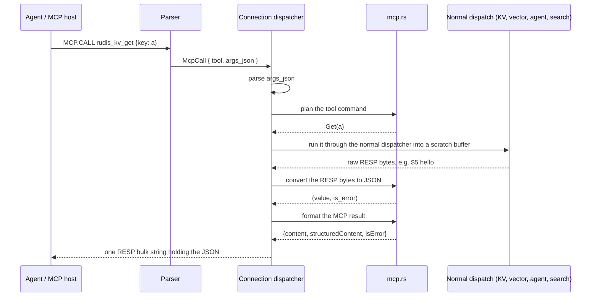

# Component 21: The Built-in Model Context Protocol (MCP) Server

> **High-Level Design Spec**: [docs/design/21_mcp_server.md](../design/21_mcp_server.md)
> **Consolidated Implementation Spec**: [docs/internal/components.md](components.md)
> **Main source files**: src/mcp.rs (the tool catalog, the tool-to-command planner and the RESP-to-JSON converter), plus the `MCP.*` handling in
> src/connection.rs and parsing in src/resp.rs. Related: [Component 20, Agent Memory, LLM Quota and Checkpoints](20_agent_memory.md) (src/agent.rs) and
> [Component 08, Vector Search Engine](08_vector_engine.md) (src/vector.rs, which also holds the semantic cache). The [Code map](#11-code-map) lists the key symbols.

---

## 1. What this subsystem does

The **Model Context Protocol (MCP)** is an open protocol that lets LLM-based agents discover and invoke "tools" exposed by a server. A tool is a named operation with a JSON Schema describing its arguments;
the agent sends `{tool name, JSON arguments}` and receives a JSON result.

Rudis ships a small, built-in MCP server so that an agent framework can use Rudis's key-value store, semantic cache, vector sets, agent memory and checkpoints, and full-text search **without a separate MCP
adapter process**. The agent (or its host) still connects over the normal Redis protocol (RESP) port and issues one of three commands:

| Command | Purpose |
| :--- | :--- |
| `MCP.TOOLS` | List the built-in tools as a RESP array. |
| `MCP.CALL <tool> [args_json]` | Call one tool; the reply is a JSON result object in a bulk string. |
| `MCP.RPC <json_rpc_request>` | Speak a subset of MCP's **JSON-RPC 2.0** envelope (`initialize`, `ping`, `tools/list`, `tools/call`). |

There is no separate HTTP or stdio transport: MCP messages ride inside RESP bulk strings. A host that wants a real MCP stdio or HTTP endpoint has to bridge it to `MCP.RPC` itself.

The key design choice is that **a tool call is just a translated Rudis command**. src/mcp.rs never touches storage. It turns `(tool, args)` into an ordinary command value (for example `rudis_kv_get {"key":"a"}`
becomes `Command::Get("a")`), the connection layer runs that command through the normal dispatcher, and the raw RESP reply is converted back to JSON.

> [!IMPORTANT]
> The `MCP.` command family is **experimental** and is off by default. Unless the server runs with `enable-experimental-commands yes` (config file) or `--enable-experimental-commands yes` (command line),
> `MCP.TOOLS`, `MCP.CALL` and `MCP.RPC` are parsed as unknown commands.
>
> MCP is also a **cargo feature**, `mcp`, on by default (`[features] default = ["mcp", "xdp"]` in Cargo.toml). A `cargo build --release --no-default-features` build leaves src/mcp.rs out
> (`#[cfg(feature = "mcp")] pub mod mcp;` in src/lib.rs). The three command variants still parse, but the dispatcher answers all of them with `-ERR MCP is not compiled into this build (cargo feature mcp)`,
> even with experimental commands on.

---

## 2. Mental model



Three layers, each with one job:

1. **The catalog.** The static list of 11 tools and their JSON Schemas.
2. **The planner.** Validates arguments and builds the native command.
3. **Reply translation.** Turns the inner command's RESP reply into the MCP result envelope.

The orchestration (JSON parsing, recursion into the dispatcher, JSON-RPC method dispatch) lives inline in src/connection.rs, inside the dispatcher's big `match`.

| Term | Meaning |
| :--- | :--- |
| **Tool** | A named operation with a JSON Schema for its arguments. |
| **JSON-RPC 2.0** | The request/response envelope MCP uses: `jsonrpc`, `id`, `method`, `params`, and `result` or `error`. |
| **Planner** | The function that maps a tool name and JSON arguments to a native command. |
| **Envelope** | The `{content, structuredContent, isError}` object every tool result is wrapped in. |

---

## 3. Data structures

### 3.1 A tool definition

A tool definition holds the tool name (what the agent passes to `MCP.CALL` or `tools/call`, for example `rudis_kv_get`), a one-line human- and LLM-readable description, and the input schema: a JSON Schema
object `{"type":"object","properties":{...},"required":[...]}` built with `serde_json::json!` and serialized as `inputSchema` on the wire. [Reference details](#121-type-definitions) shows the declaration.

### 3.2 The three command variants

The parser produces three variants: `McpTools`, `McpCall { tool, args_json }` and `McpRpc(body)`. The command-name helper maps all three to the name `MCP` (used for command stats, the slow log and a client's "last
command"). In the generated ACL table (src/acl_categories.rs) the command `mcp` belongs to the categories **`@admin`, `@slow` and `@dangerous`** and declares read and write key access. A user with `+@all -@dangerous`
therefore cannot run any `MCP.*` command.

---

## 4. The 11-tool catalog

The catalog function returns a hand-written list. In source order:

| # | Tool | Required args | Optional args (schema default) | Backing command |
| :-: | :--- | :--- | :--- | :--- |
| 1 | `rudis_kv_get` | `key` | none | `GET` |
| 2 | `rudis_kv_set` | `key`, `value` | `px` (ms TTL) | `SET` |
| 3 | `rudis_semantic_set` | `namespace`, `id`, `prompt`, `response`, `vector` | `px`, `scope` | `SEMANTIC.SET` |
| 4 | `rudis_semantic_get` | `namespace`, `vector` | `threshold` (0.15), `k` (1), `scope` | `SEMANTIC.GET` |
| 5 | `rudis_vector_add` | `key`, `element`, `vector` | `attr` (JSON attribute string) | `VADD` |
| 6 | `rudis_vector_search` | `key`, `vector` | `count` (5), `filter`, `with_scores` (true), `with_attribs` (false) | `VSIM` |
| 7 | `rudis_agent_memory_add` | `session`, `role`, `content` | `tokens`, `vector`, `meta` | `AGENT.MEM.ADD` |
| 8 | `rudis_agent_memory_context` | `session` | `max_tokens` (2048), `query_vector`, `recall_k` (3) | `AGENT.MEM.CONTEXT` |
| 9 | `rudis_agent_checkpoint_put` | `key`, `step_id`, `state` | `parent_id`, `meta` | `AGENT.CHECKPOINT.PUT` |
| 10 | `rudis_agent_checkpoint_get` | `key` | `step_id` | `AGENT.CHECKPOINT.GET` |
| 11 | `rudis_ft_search` | `index`, `query` | `limit` (10) | `FT.SEARCH` |

Vector-valued arguments (`vector`, `query_vector`) are JSON arrays of numbers; all other arguments are strings, integers, numbers or booleans as noted.

The list view is a pure view over the catalog: it renames `input_schema` to `inputSchema` and wraps the list as `{"tools": [ {name, description, inputSchema}, ... ]}`. Both `MCP.TOOLS` and JSON-RPC `tools/list` are built from
the catalog, so the two surfaces always report the same tool set.

---

## 5. Wire behaviour

### 5.1 MCP.TOOLS

The parser ignores any extra arguments; it always yields `McpTools`.

The reply is a RESP array with one element per tool. Each element is a flat 6-element array of three name and value pairs:

```text
*6
$4 name         $<n> <tool name>
$11 description $<n> <description>
$11 inputSchema $<n> <schema serialized as a JSON string>
```

This is a flat key and value array, **not** a RESP3 map, even for RESP3 clients, and the schema is a JSON string inside a bulk string, not a nested RESP structure.

### 5.2 MCP.CALL <tool> [args_json]

Parsing needs 2 or 3 words in total, else `ERR wrong number of arguments for 'mcp.call' command`. The tool is the lossy-UTF-8 second word; `args_json` defaults to `{}` when omitted.

Handling in the dispatcher:

1. Parse `args_json` with `serde_json::from_slice`. On failure, reply with a RESP error `-ERR invalid JSON arguments: <serde error>`. This is the **only** case where `MCP.CALL` replies with a RESP-level error.
2. Plan the tool command. On an error message, reply with a bulk string containing the formatted call result of that message with the error flag set: a normal reply whose JSON says `"isError": true`.
3. On success, create an empty scratch buffer and run the planned command through the dispatcher with the **same** router, client id, client registry, `asking` flag, `authenticated` flag and `auth_user` as the outer
   command. (A boxed future is needed because the dispatcher is an `async fn` calling itself.)
4. Convert the scratch buffer to JSON, wrap it as an MCP result, serialize it to a JSON string and send it as one RESP bulk string.

**Worked example.**

```text
> MCP.CALL rudis_kv_set {"key":"mcp:k1","value":"mcp_hello"}
```

1. The arguments parse to `{"key":"mcp:k1","value":"mcp_hello"}`.
2. The planner builds `Command::Set { key: "mcp:k1", value: "mcp_hello", expire_in: None, condition: SetCondition::None, get: false, keepttl: false, past_expired: false }`.
3. The recursive dispatch writes `+OK\r\n` into the scratch buffer.
4. The converter yields `("OK", false)`; the client receives the bulk string `{"content":[{"type":"text","text":"OK"}],"structuredContent":"OK","isError":false}`.

A following `MCP.CALL rudis_kv_get {"key":"mcp:k1"}` runs `GET`, gets `$9\r\nmcp_hello\r\n`, and returns `"text":"mcp_hello"`.

### 5.3 MCP.RPC <json_rpc_request>

Parsing needs exactly 2 words (the command plus one bulk string holding the whole JSON-RPC request), else `ERR wrong number of arguments for 'mcp.rpc' command`.

Handling:

1. Parse the body with `serde_json::from_slice`. On failure, reply (as a bulk string, not a RESP error) with `{"jsonrpc":"2.0","id":null,"error":{"code":-32700,"message":"Parse error: ..."}}`.
2. Read `id` (missing means `null`) and `method` (missing or not a string means `""`).
3. Dispatch on `method`:

| `method` | Response |
| :--- | :--- |
| `initialize` | `result: {"protocolVersion":"2024-11-05","capabilities":{"tools":{"listChanged":false}},"serverInfo":{"name":"rudis-mcp","version":"0.1.0"}}`, all literal constants. `params` is ignored. |
| `ping` | `result: {}` |
| `tools/list` | `result:` the tool list view. |
| `tools/call` | Reads `params.name` (default `""`) and `params.arguments` (default `{}`), then runs the same plan, recursive dispatch, convert and format pipeline as `MCP.CALL`, and puts the envelope in `result`. A planning error is also placed in `result` (with `isError: true`), **not** in a JSON-RPC `error` member, which is the MCP convention for tool failures. |
| anything else | `error: {"code":-32601,"message":"Method not found: <method>"}` |

4. Every response object carries `"jsonrpc":"2.0"` and the echoed `id`, is serialized to one JSON string, and is sent as a single RESP bulk string. `MCP.RPC` never produces a RESP-level error after a successful parse of
   the command words.

**Worked example.**

```text
> MCP.RPC {"jsonrpc":"2.0","id":2,"method":"tools/call","params":{"name":"rudis_agent_memory_add","arguments":{"session":"s","role":"user","content":"remember 7788","vector":[1.0,0.0,0.0]}}}
```

The planner builds `Command::AgentMemAdd { session: "s", role: "user", content: "remember 7788", tokens: None, vector: Some([1.0, 0.0, 0.0]), meta: None }`; the agent-memory handler's RESP reply is converted to JSON and
returned as `{"jsonrpc":"2.0","id":2,"result":{"content":[...],"structuredContent":...,"isError":false}}`.

---

## 6. The planner

The planner takes a tool name and the JSON arguments and returns a command or an error message. It is one `match` on the tool name. For each tool it:

1. Reads required string fields with a helper that fails fast.
2. Reads required vectors from the `vector` argument (missing gives `missing required argument 'vector'`) and parses them into floats.
3. Reads optional fields as unsigned integer, float, string or boolean, applying defaults. A present-but-wrong-typed optional field is silently treated as absent.
4. Fills every other field of the command with a hard-coded value.

Unknown tool names return `Unknown MCP tool: <tool>`.

| Tool | Command built | Mapping details |
| :--- | :--- | :--- |
| `rudis_kv_get` | `Get(key)` | |
| `rudis_kv_set` | `Set { .. }` | `px` becomes `expire_in = Duration::from_millis(px.max(1))`; the condition is none, and `get`, `keepttl` and `past_expired` are all `false`. |
| `rudis_semantic_set` | `SemanticSet { .. }` | The vector is boxed; `px` becomes the TTL (same `max(1)` rule); `scope` is boxed if present; `quantize` is `false`; it also reads an optional `tokens` (unsigned) that the schema does not advertise. |
| `rudis_semantic_get` | `SemanticGet { .. }` | `threshold` defaults to 0.15 (as `f32`); `with_score`, `with_prompt` and `with_id` are all `true`. The schema's `k` argument is **not read**: `SemanticGet` has no `k` field. |
| `rudis_vector_add` | `Vadd { .. }` | `attr` becomes the set-attribute; it is marked as a Redis vector set; metric, reduce, quant, ef and m are unset; quantize, pq, tiered and cas are `false`. |
| `rudis_vector_search` | `Vsim { target: Vector(v), .. }` | `count` defaults to 5, then is floored at 1 (0 becomes 1, no upper cap); `with_scores` defaults to `true` and `with_attribs` to `false`; epsilon, ef and filter-ef are unset; `truth` and `no_thread` are `false`. |
| `rudis_agent_memory_add` | `AgentMemAdd { .. }` | `tokens` is an optional unsigned integer; `vector` is parsed only if present and not JSON `null`; `meta` is an optional string. |
| `rudis_agent_memory_context` | `AgentMemContext { .. }` | `max_tokens` defaults to 2048; `query_vector` becomes the query (parsed only if present and non-null); `recall_k` defaults to 3. |
| `rudis_agent_checkpoint_put` | `AgentCheckpointPut { .. }` | `parent_id` and `meta` are optional. |
| `rudis_agent_checkpoint_get` | `AgentCheckpointGet { .. }` | `step_id` is optional (absent makes the handler return the latest checkpoint). |
| `rudis_ft_search` | `FtSearch { index, query, options }` | The options are `SearchOptions { limit, ..SearchOptions::default() }`; every other search option takes its default. |

### 6.1 Argument helpers

**Required string.** The helper returns the field if it is present **and** a JSON string; otherwise `missing required string argument '<field>'`. A wrong type (for example `{"key": 123}`) gets the same "missing"
message.

**Float vector.** The helper converts a JSON array of numbers to a vector of `f32`:

1. Not an array gives `'<field>' must be an array of numbers`.
2. An empty array gives `'<field>' cannot be empty`.
3. Any element not representable as a float (strings, booleans, nested arrays) gives `'<field>' elements must be numbers`.
4. Each value is narrowed with `as f32` (no overflow or precision check).

Because every helper failure propagates with `?`, a bad argument is rejected before any command exists and before anything reaches the storage layer.

---

## 7. Reply translation

### 7.1 The RESP-to-JSON converter

The frame parser is a small recursive, position-based RESP parser private to src/mcp.rs (separate from the main wire parser in src/resp.rs). It finds the header line ending in `\r\n`, then switches on the prefix byte:

| Prefix | JSON result | Notes |
| :--- | :--- | :--- |
| `+` simple string | `String` | |
| `-` error | `String` (the error text) | Sets the error flag. |
| `:` integer | number (`i64`) | Unparseable gives `0`. |
| `,` RESP3 double | number (`f64`) | Unparseable gives `0.0`. |
| `_` RESP3 null | `null` | |
| `$-1` null bulk | `null` | |
| `$N` bulk string | `String` (lossy UTF-8) | Returns nothing if fewer than `N + 2` bytes remain. |
| `*-1` null array | `null` | |
| `*N` array | `Array`, recursively | The error flag is true if **any** element is an error. |
| `%N` RESP3 map | `Object` | String keys are used as is; non-string keys are stringified as JSON (for example a key `:1` becomes `"1"`). |
| anything else | nothing | For example RESP3 `#` boolean, `~` set, `=` verbatim, `(` big number, `>` push, `\|` attribute, `!` blob error. |

The top-level converter calls the frame parser at position 0. If that returns nothing anywhere in the tree, the **whole** reply falls back to the raw RESP bytes as lossy text and is never flagged as an error. Trailing
bytes after the first frame are ignored.

**Worked examples.** The inner reply `*2\r\n$5\r\nhello\r\n:42\r\n` becomes `(["hello", 42], false)`; `-ERR unknown command\r\n` becomes `("ERR unknown command", true)`;
`%1\r\n+status\r\n+healthy\r\n` becomes `({"status":"healthy"}, false)`.

### 7.2 The result envelope

Every tool result, success or failure, is built like this:

```rust
pub fn format_mcp_call_result(val: Value, is_error: bool) -> Value {
    let text = match &val {
        Value::String(s) => s.clone(),
        other => serde_json::to_string(other).unwrap_or_default(),
    };
    json!({
        "content": [{ "type": "text", "text": text }],
        "structuredContent": val,
        "isError": is_error
    })
}
```

So each result has a single text content item (the string itself, or the value re-serialized as JSON) **and** a `structuredContent` copy of the structured value. `isError` is the only failure signal; there is no separate
error code.

---

## 8. Interaction with the rest of the server

Because the planned command re-enters the top-level dispatcher (not the local-execution routine), it goes through **every** gate and side effect an ordinary client command would:

* **Auth and ACL.** The ACL check runs again for the inner command's own ACL name and keys. A user allowed to run `mcp` but not `set` gets the inner `-NOPERM ...` reply wrapped as `isError: true`.
* **Cluster routing.** Slot checks (`-MOVED`, `-CLUSTERDOWN`) apply to the inner command's key; redirects come back as error text inside the JSON envelope, not as a real RESP redirect.
* **Loading, read-only replica, maxmemory and min-replicas checks** apply to the inner command (for example a `rudis_kv_set` on a read-only replica returns `READONLY ...` with `isError: true`).
* **Stats, slow log, MONITOR.** Both the outer `MCP` command and the inner command record their own command stat, may each produce a slow-log entry, and are each broadcast to MONITOR clients.
* **Reply protocol.** The inner command runs with the client's RESP2 or RESP3 setting, which is why the converter understands the RESP3 `%`, `,` and `_` types.

Backing subsystems reached through the inner dispatch:

| Tools | Subsystem |
| :--- | :--- |
| `rudis_kv_get`, `rudis_kv_set` | The key-value store (src/table.rs). |
| `rudis_semantic_set`, `rudis_semantic_get` | The semantic cache (`SemanticCache`, src/vector.rs). |
| `rudis_vector_add`, `rudis_vector_search` | Redis-style vector sets and HNSW (src/vector.rs). |
| `rudis_agent_memory_*`, `rudis_agent_checkpoint_*` | The agent memory bank and checkpoint store (src/agent.rs). |
| `rudis_ft_search` | The RediSearch-style index; `FT.SEARCH` is handled by the router's search, which aggregates across shards (src/search.rs, src/router.rs). |

---

## 9. Invariants & gotchas

1. **The schema and the planner are maintained by hand, separately.** Nothing checks that they agree. Known mismatches: `rudis_semantic_get` advertises `k` (default 1) but the planner ignores it; `rudis_semantic_set`
   accepts `tokens` but the schema does not list it.
2. **Most command knobs are hidden.** `rudis_vector_add` cannot set metric, quantization, PQ, tiering, `REDUCE`, `EF`, `M` or `CAS`; `rudis_vector_search` cannot set `EPSILON`, `EF`, `FILTER-EF`, `TRUTH` or
   `NOTHREAD`; `rudis_ft_search` only exposes `limit`.
3. **"Missing" versus wrong type.** The required-string helper reports a wrong-typed required field as missing. Wrong-typed optional fields are silently ignored and the default is used.
4. **TTL floor.** `px: 0` becomes 1 ms, not "no expiry" and not an error.
5. **Count floor.** `count: 0` in `rudis_vector_search` becomes 1; there is no upper cap in the MCP layer.
6. **Errors are mostly in-band.** Only invalid `MCP.CALL` JSON and wrong arity produce RESP errors. Planning errors and inner-command errors return `isError: true` in a successful reply; JSON-RPC uses `error` only for
   parse errors (-32700) and unknown methods (-32601).
7. **`isError` is coarse.** An array reply with a single error element (anywhere, recursively) marks the whole result as an error.
8. **Unparseable replies become text.** Any RESP3 type the converter does not know makes the whole reply a raw-text string with `isError: false`.
9. **A lenient JSON-RPC envelope.** A missing `method` becomes `""` and yields `-32601 Method not found: ` rather than `-32600 Invalid Request`; `jsonrpc` is not checked.
10. **Double accounting.** One tool call shows up as two commands in stats, the slow log and MONITOR.
11. **Fixed identity.** `initialize` always reports protocol `2024-11-05`, server `rudis-mcp` version `0.1.0`, and `tools.listChanged: false`, independent of the build.

---

## 10. Limitations / not implemented

* **Experimental gate:** disabled unless `enable-experimental-commands` is on.
* **Cargo feature:** a build without the `mcp` feature refuses all three commands with `-ERR MCP is not compiled into this build (cargo feature mcp)`.
* **Transport:** only RESP-embedded; no native MCP stdio, HTTP or SSE transport.
* **A JSON-RPC subset:** only `initialize`, `ping`, `tools/list` and `tools/call`. No `resources/*`, `prompts/*`, `logging/*`, `completion/*` or `notifications/*`.
* **No batches.** A top-level JSON array is not treated as a batch; reading `method` from an array gives nothing, so it gets a single `-32601 Method not found: ` response.
* **No notifications.** A request without `id` still gets a response (with `id: null`).
* **A fixed tool set:** 11 compiled-in tools; no registration API, no `listChanged` events.
* **Partial coverage:** no tools for deleting keys, `SEMANTIC.DEL/FLUSH/INFO`, `AGENT.MEM.COMPACT/INFO/CLEAR`, `AGENT.CHECKPOINT.HISTORY`, `AGENT.TOOL.CLAIM/COMPLETE`, `LLM.QUOTA.*`, or vector-set commands other than
  `VADD` and `VSIM`.
* **Text-only content:** results are always one `text` content item plus `structuredContent`; no image or resource content types.
* **Tests.** `mcp::tests` has two unit tests. `test_mcp_tools_list_and_command_planning` only asserts at least 10 tools, plans every tool and checks three error paths; `test_resp_bytes_to_json_full_spectrum` covers each
  supported RESP prefix and the result envelope. The end-to-end test `test_mcp_protocol_tools_call_and_rpc_e2e` (`tests/e2e_experimental.rs`) covers `MCP.TOOLS`, `MCP.CALL` for KV set and get, and `MCP.RPC` `initialize`
  plus `tools/call` for agent memory add and context; it is ignored in a build without the `mcp` feature, and so are the `mcp::tests` unit tests (the module is not compiled).
  `test_mcp_and_xdp_follow_their_cargo_features_e2e` checks either outcome: a tool list with the feature, the "cargo feature mcp" error without it.

---

## 11. Code map

| File | Key symbols | Role |
| :--- | :--- | :--- |
| `src/mcp.rs` | `McpToolDef` | The tool definition record (name, description, JSON Schema). |
| `src/mcp.rs` | `builtin_mcp_tools` | The hard-coded list of the 11 tools. |
| `src/mcp.rs` | `tools_list_json` | The `{"tools":[...]}` view used by JSON-RPC `tools/list`. |
| `src/mcp.rs` | `plan_tool_command`, `get_req_str`, `parse_f32_vec` | Validate JSON arguments and build the native command. |
| `src/mcp.rs` | `parse_resp_frame`, `resp_bytes_to_json` | RESP2/RESP3 reply to `serde_json::Value` plus an error flag, with a raw-text fallback. |
| `src/mcp.rs` | `format_mcp_call_result` | Build the MCP `{content, structuredContent, isError}` envelope. |
| `src/resp.rs` | `Command::McpTools`, `Command::McpCall`, `Command::McpRpc` | Command variants. |
| `src/resp.rs` | `build_command` (the `MCP.TOOLS`, `MCP.CALL` and `MCP.RPC` arms) | Arity checks and argument capture. |
| `src/resp.rs` | `EXPERIMENTAL_PREFIXES`, `is_experimental_command_name`, `set_experimental_commands` | The experimental gate covering the `MCP.` prefix. |
| `src/connection.rs` | `execute_command_inner` (the `McpTools`, `McpCall` and `McpRpc` arms) | Reply formatting, JSON-RPC dispatch, recursive dispatch for tool calls; a `#[cfg(not(feature = "mcp"))]` arm refuses all three. |
| `src/connection.rs` | `get_cmd_name` | Names all three variants `MCP`. |
| `src/connection.rs` | `acl_denied` | Re-run for the inner planned command. |
| `src/acl_categories.rs` | The `mcp` entry in `COMMANDS` | ACL categories `@admin @slow @dangerous`. |
| `tests/e2e_experimental.rs` | `test_mcp_protocol_tools_call_and_rpc_e2e`, `test_mcp_and_xdp_follow_their_cargo_features_e2e` | End-to-end coverage over a real connection; the cargo-feature switch. |
| `Cargo.toml`, `src/lib.rs` | `[features]` `mcp` (default on), `#[cfg(feature = "mcp")] pub mod mcp` | The compile-time switch for the whole subsystem. |

---

## 12. Reference details

### 12.1 Type definitions

```rust
#[derive(Debug, Clone)]
pub struct McpToolDef {
    pub name: &'static str,
    pub description: &'static str,
    pub input_schema: Value, // JSON Schema object built with serde_json::json!
}

// MODEL CONTEXT PROTOCOL (MCP) COMMANDS
McpTools,
McpCall { tool: String, args_json: Bytes },
McpRpc(Bytes),
```

| `McpToolDef` field | Type | Meaning |
| :--- | :--- | :--- |
| `name` | `&'static str` | The tool name the agent passes to `MCP.CALL` or `tools/call` (for example `rudis_kv_get`). |
| `description` | `&'static str` | A one-line human- and LLM-readable description. |
| `input_schema` | `serde_json::Value` | `{"type":"object","properties":{...},"required":[...]}`. Serialized as `inputSchema` on the wire. |

### 12.2 Constants

| Name | Value | Meaning |
| :--- | :--- | :--- |
| Tools in the catalog | 11 | Compiled in. |
| JSON-RPC protocol version | `2024-11-05` | Reported by `initialize`. |
| Server identity | `rudis-mcp`, version `0.1.0` | Reported by `initialize`. |
| JSON-RPC parse error | -32700 | Returned for an unparseable `MCP.RPC` body. |
| JSON-RPC method not found | -32601 | Returned for any other method. |
| `SemanticGet` default threshold | 0.15 | `rudis_semantic_get`. |
| `rudis_vector_search` default count | 5 (floored at 1) | `count`. |
| `rudis_agent_memory_context` defaults | `max_tokens` 2048, `recall_k` 3 | |
| `rudis_ft_search` default limit | 10 | `limit`. |
| TTL floor | 1 ms | `px: 0` becomes 1 ms. |
