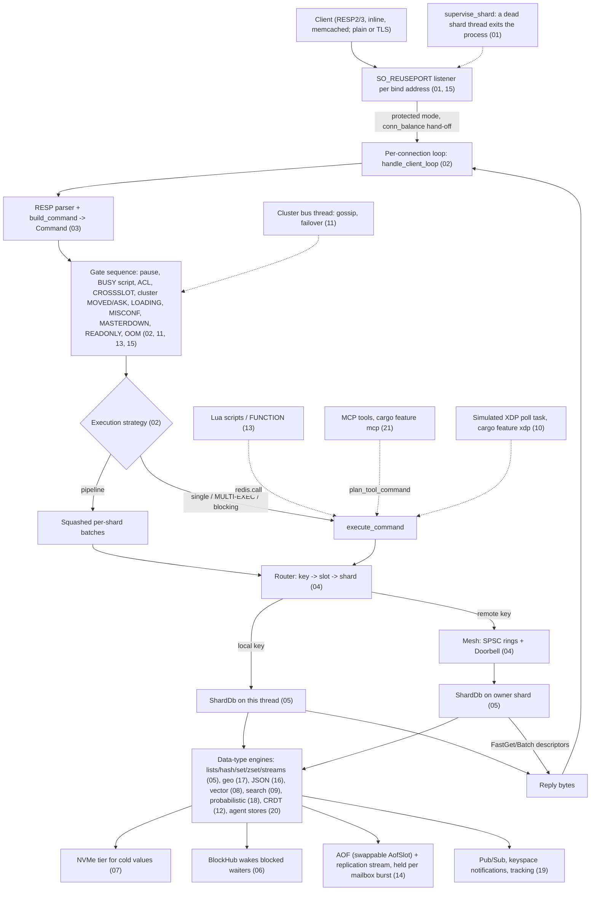

# Rudis Internals: Consolidated Implementation Overview

This document is a one-stop overview of how Rudis is built. Each numbered section below
summarises one subsystem (what it does, its key structures and algorithms, and the gotchas worth
knowing) and links to the full per-subsystem reference in this directory, which covers the same
material in depth and can be read without opening the source. For the index of those documents
and a suggested reading order, see [README.md](README.md). For design rationale ("why"), see
[`docs/design/`](../design/).

## The system in one picture

Rudis is a Redis-compatible server built as a **shared-nothing, thread-per-core** engine. At
startup `main.rs` parses a redis-server-compatible command line/config, builds a lock-free
**mesh** of SPSC rings between every pair of shards, and starts one pinned OS thread per shard.
Each shard thread runs its own monoio event loop (io_uring, with an epoll fallback), owns its own slice of the keyspace
(`ShardDb`), and accepts connections on its own `SO_REUSEPORT` listener for each `bind` address.

A request is handled entirely on the thread that accepted the connection until it needs a key
owned by another shard; then it is shipped over the mesh as a `ShardMessage` and the reply comes
back through shared-memory descriptors or a pooled channel.

Reading the diagram: the solid path is the normal command path; the dotted entries are
alternative ways a `Command` gets into the same executor. Numbers in parentheses are the
section (and per-subsystem doc) that covers each box.

### Cross-cutting conventions

- **Everything is per shard.** Each shard owns its key table, side stores (JSON, probabilistic,
  CRDT, agent memory, vector sets, search partitions), AOF file, tier file and blocking-waiter
  registry. Cross-shard work goes through the mesh, never through shared locks on data.
- **Experimental families are gated.** The command prefixes in `EXPERIMENTAL_PREFIXES`
  (`JSON.`, `BF.`, `CF.`, `CMS.`, `TOPK.`, `FT.`, `SEMANTIC.`, `CRDT.`, `LLM.`, `MCP.`, `XDP.`)
  parse as unknown commands unless `enable-experimental-commands` is on (off by default).
  `AGENT.*` and the Redis 8 vector-set commands (`VADD`, `VSIM`, ...) are not gated. Separately,
  MCP and XDP are cargo features (`mcp`, `xdp`, both on by default): a `--no-default-features`
  build still parses `MCP.*`/`XDP.*` but answers `-ERR ... is not compiled into this build`.
- **Cross-shard atomicity covers `EXEC`, `MGET`, `MSET` and key/element moves.** These use VLL
  locks plus the `XShardWriteGuard` seqlock (04, 02); other multi-key commands spanning shards
  run per shard. `cross-shard-strict yes` refuses every multi-key command whose keys span shards
  with `-CROSSSLOT` outside cluster mode.
- **Cluster mode uses per-shard ports.** In cluster mode shard *N* listens on `base_port + N`
  and redirects are single-hop; node-wide registries (WATCH, MONITOR, ACL, CLIENT KILL,
  pub/sub presence) are keyed by the base port.
- **Writes are logged once.** A mutating command calls `record_change!`, which invalidates
  WATCH/tracking and hands the encoded bytes to both the shard's AOF and the replication stream.
  Before changing a key, write paths call `shard::before_write` so an in-progress point-in-time
  image (`SAVE`/`BGSAVE`, full sync, AOF rewrite) keeps the key's prior state.

---

## 01. Reactor Runtime & Server Lifecycle

> Full reference: [01_reactor_runtime.md](01_reactor_runtime.md) · Main source: `src/main.rs`, `src/server.rs`, `src/shutdown.rs`, `src/conn_balance.rs`, `src/netsec.rs`, `src/transport.rs`, `src/version.rs` + `build.rs`, `Cargo.toml` (features)

Rudis implements a shared-nothing, thread-per-core architecture where each keyspace shard runs on a dedicated OS thread hosting a single-threaded async monoio runtime (io_uring with epoll fallback). This subsystem bootstraps the process, parses redis-server-compatible CLI/config options, binds `SO_REUSEPORT` listeners, spawns pinned shard threads under a supervisor (`supervise_shard`) that exits the process if a shard dies, accepts incoming client connections, balances connections across shards, isolates connection panics, drives background maintenance, and coordinates shutdowns that wait for replicas, quiesce, save and drain.

**Key structures**
- `Args` — CLI flags parsed via clap with support for redis-server directive rewriting and CLI overrides (including `--cross-shard-strict`, `--dual-channel-replication-enabled`, and `--version`, which prints `long_version()` with the git commit).
- `ShardSender` / `ShardReceiver` — Endpoints of the N×N cross-shard mailbox mesh backed by SPSC queues (capacity 64, self-ring 16) with overflow `VecDeque` fallback (counted in `MAILBOX_OVERFLOWS`, exported as `rudis_mailbox_overflows_total`) and atomic `Doorbell` wakeups.
- `CONN_COUNTS` — Process-global array of 256 `AtomicUsize` tracking active client connections per shard for accept-time rebalancing.
- `INFLIGHT` — Global array of 256 cache-padded per-shard atomic counters tracking running command batches for shutdown quiescing.
- `AofSlot` — Per-shard swappable holder of the `AofWriter`, so `CONFIG SET appendonly` can turn AOF on and off at runtime; every user fetches the writer from the slot at each use, and the flusher task runs only while the slot holds its writer.
- `ShutdownCommand` — Guard held while a `SHUTDOWN` command runs (`shutdown_command_running()`), so the signal watcher leaves a pending signal alone instead of starting a second shutdown.
- `PlainTransport` — Client transport wrapper around a raw stream renting `BytesMut` directly to io_uring with a 16 KiB spare read threshold.
- `CatchUnwind` — Future wrapper executing each poll inside `std::panic::catch_unwind`, so a panic in one connection task does not kill the other connections on its shard; panics outside these wrappers reach `supervise_shard`.
- `TlsWorkerConfig` — TLS configuration containing certificate, key, and rustls server configuration (or self-signed fallback) distributed to shard workers.
- `SystemSanityReport` — OS check results inspecting overcommit memory, somaxconn, max open files, and transparent huge pages.

**Key algorithms**
- Connection rebalancing ([§6](01_reactor_runtime.md#6-accepting-connections)) — `claim_owner` scans up to 4 times for the strictly least-loaded shard in `CONN_COUNTS`, atomically reserves the slot via CAS, and hands off the connection fd via `ShardMessage::AdoptConnection` without re-registering on adoption.
- Connection accept loop ([§6](01_reactor_runtime.md#6-accepting-connections)) — `accept_until_shutdown` retains a pinned accept future across 200 ms timeout checks against the shutdown flag to prevent dropping kernel-completed io_uring accepts.
- Cross-shard message dispatch ([§5](01_reactor_runtime.md#5-the-shard-worker)) — Drains up to 64 `ShardMessage`s back-to-back using non-async `try_recv`, holding replication bytes for the burst (`begin_stream_batch` / `flush_stream_batch` before any non-data message / `end_stream_batch`), fetching the AOF writer from the slot per message, flushing appended AOF bytes via `aof_write_after_mailbox`, and yielding cooperative execution to local client tasks.
- Pipeline batch execution ([§5](01_reactor_runtime.md#5-the-shard-worker)) — Remote shards process grouped commands via `ShardMessage::Batch`, executing fast paths when tracking, AOF, replication, and notifications are inactive, while deferring tiered keys to asynchronous NVMe cold reads; a `replicate_as` field lets a push stream a logical `LMOVE`/`SMOVE` instead of itself.
- Shard supervision ([§3.6](01_reactor_runtime.md#36-shard-supervision)) — `supervise_shard` runs each worker under `catch_unwind`; a panic, or a return while the server is not shutting down, logs `FATAL` and calls `exit(1)` so the service manager restarts the server, which recovers from AOF/RDB.
- Shutdown coordination ([§7](01_reactor_runtime.md#7-shutdown)) — `SHUTDOWN [NOSAVE|SAVE] [NOW] [FORCE]` or a signal first waits for replicas (`wait_replicas_before_shutdown`: pause writes, `GETACK` every 100 ms, up to `shutdown-timeout`, default 10 s; cancellable with `SHUTDOWN ABORT`), refuses while the initial AOF is being written (unless `FORCE`), quiesces new command batches via per-shard `INFLIGHT` counters (up to 2 s), performs optional RDB persistence, broadcasts `shutdown(SHUT_RD)` to drain client sockets (up to 2 s), and synchronizes shard exits across a 3 s barrier before the final AOF sync.
- Port collision probe ([§3](01_reactor_runtime.md#3-process-startup)) — Binds a probe socket with `SO_REUSEADDR` but without `SO_REUSEPORT` (retrying for up to 3 seconds) to detect lingering or competing listeners before shards bind with `SO_REUSEPORT`.

**Gotchas & open issues**
- `save` defaults to Redis's save points (`3600 1 300 100 60 10000`, `DEFAULT_SAVE_POINTS`): the config file's first `save` line replaces them, later lines add to them, and `save ""` clears them; after `save ""` with `appendonly no`, writes since the last manual save are lost on shutdown unless `SHUTDOWN SAVE` is used.
- A shard thread that panics or returns outside shutdown takes the whole process down (`supervise_shard`); there is no in-process shard restart.
- The replica wait before shutdown is bounded by `shutdown-timeout`, `SHUTDOWN ABORT` only cancels a shutdown still in that wait, and a signal that arrives while the initial AOF is being written is consumed with a warning.
- `--cross-shard-strict` and `--dual-channel-replication-enabled` are not in `RUDIS_FLAGS`, so on the command line they are read as config directives rather than through their clap fields.
- TLS connections bypass connection rebalancing entirely, running strictly on the accepting shard and remaining invisible to the `CONN_COUNTS` census.
- `ShardDb` is strictly thread-local (`Rc<RefCell<ShardDb>>`); holding `borrow_mut()` across an `.await` boundary causes runtime panics.
- Fatal errors during startup RDB restore or AOF replay immediately terminate the entire process with exit code 1 to protect existing persisted data.
- Shard worker threads require 32 MiB stack size (`SHARD_THREAD_STACK_SIZE`) to accommodate deep async futures and embedded Lua execution.
- Connection rebalancing occurs only at accept time; long-lived connections are never migrated dynamically across shards.

---

## 02. Connection Lifecycle & Command Execution

> Full reference: [02_connection_lifecycle.md](02_connection_lifecycle.md) · Main source: `src/connection.rs`, `src/server.rs`, `src/transport.rs`

Every client connection is handled as a dedicated reactor task on a CPU-pinned thread-per-core shard. It sits at the entry point of the server, responsible for accepting sockets, balancing connections across shards, parsing RESP2/RESP3 or Memcached commands, applying security and cluster routing gates, executing commands locally or squashing cross-shard batches via lock-free mailboxes, and writing buffered replies under AOF durability barriers.

**Key structures**
- `ClientInfo` — Shard-local registry entry in `client_registry` holding per-connection state, protocol version (`is_resp3`), selected database (`db`), output/query buffer metrics (`omem`, `qbuf_len`), tracking inbox, and raw socket descriptor.
- `GlobalClientEntry` — Node-wide registry entry in `GLOBAL_CLIENTS` enabling cross-shard operations such as `CLIENT KILL`, tracking invalidations, and MONITOR fan-out.
- `ClientScope` / `WithCurrentDb` — Future and execution adapters that swap thread-locals (`CURRENT_DB`, `CURRENT_CLIENT_ID`, `CLIENT_NO_TOUCH`, ACL user) on every poll to prevent context leakage across interleaved async connection tasks.
- `ConnScratch` — Pooled per-connection scratch buffers (up to 32 per thread) with 128 KiB inbound buffer, 64 KiB outbound buffer, and preallocated cross-shard batch vectors.
- `CompactResp` — Reply slot enum storing inline payloads up to 30 bytes (`Small`), heap vectors (`Big`), zero-copy bytes (`Bulk`), or static constants (`OK`, `NULL`, `INT_0`).
- `BatchResponder` — Shared-memory cross-shard mailbox with a lock-free atomic state machine (`BATCH_IDLE` → `RUNNING` → `SLEEPING` → `COMPLETED`) and `Doorbell` wakeups.
- `BufferLimit` — Output buffer limits (`hard_limit`, `soft_limit`, `soft_seconds`) configured per client class (`Normal` defaults to unlimited, `Slave` to 256/64 MiB/60 s, `Pubsub` to 32/8 MiB/60 s).

**Key algorithms**
- *Connection accept & balancing* — Reactor shards accept connections via `SO_REUSEPORT`; non-cluster plaintext connections query a global census (`CONN_COUNTS`) and hand off to the least-loaded shard via `into_raw_fd` and `ShardMessage::AdoptConnection` ([§3.1](02_connection_lifecycle.md#31-plaintext-accept)).
- *Client event loop* — Reads socket input into `ConnScratch`, parses up to 1024 commands or 1 MiB per batch, enforces query buffer limits, gates commands, invokes the execution engine, drains tracking invalidations, and flushes output ([§5.2](02_connection_lifecycle.md#52-each-iteration)).
- *Command gating* — After the prologue's pause check (which returns a `WriteRunning` guard) and busy-script check (`-BUSY` unless the command is in `allowed_while_busy`), sequentially validates protected commands, replica write quorums (`-NOREPLICAS`), authentication (`-NOAUTH`), ACLs, `-CROSSSLOT` (one slot in cluster mode, one shard under `cross-shard-strict`), cluster slot ownership (`-MOVED`/`-ASK`, with `ClusterNodeInfo::port_for_slot` picking a peer's shard port), loading state, persistence errors (`-MISCONF`), `-MASTERDOWN` (`replica-serve-stale-data no` while the master link is down, unless the command has the `stale` flag), replica read-only rules, and memory limits ([§7.1](02_connection_lifecycle.md#71-prologue-before-any-gate), [§7.2](02_connection_lifecycle.md#72-gate-sequence)).
- *Pipeline squashing* — Partitions multi-command pipelines by target shard, executes local commands inline or via fast paths, dispatches parallel `ShardMessage::Batch` messages using pooled `BatchResponder` mailboxes, and writes replies in exact pipeline order ([§9](02_connection_lifecycle.md#9-pipeline-squashing)).
- *Multi-shard transactions* — `EXEC` refuses before running anything on a busy script, on `MASTERDOWN`/`READONLY`/`NOREPLICAS`/`OOM` (`-EXECABORT`), on queued errors, on keys spanning slots (cluster) or shards (`cross-shard-strict`), or on a failed `WATCH` (watched keys past their TTL are expired first); then it acquires VLL cross-shard transaction locks in sorted shard order, holds `XShardWriteGuard::locked()`, suppresses `BlockHub` wakeups, streams more than one write to replicas as one `MULTI ... EXEC` block (`TxStreamBlock`), and runs queued commands atomically ([§7.5](02_connection_lifecycle.md#75-transactions)).
- *Cross-shard multi-key commands* — Outside `EXEC`, `MGET`/`MSET` use the seqlock-based `write_mget_resp_atomic` / `mset_atomic`; `RENAME`/`COPY`, `LMOVE`/`SMOVE`, `MSETNX` and `BITOP` across shards take the VLL locks, and cross-shard `BLMOVE` loops over a locked move plus a wake waiter ([§7.7](02_connection_lifecycle.md#77-cross-shard-multi-key-commands)).
- *Blocking operations* — Attempts initial resolution across shards, registers waiters with `BlockHub`, installs `BlockedClientGuard`, and polls socket closure every 20 ms via `MSG_PEEK` until unblocked or timed out; `CLIENT UNBLOCK` also ends `WAIT`/`WAITAOF` via `replication::unblock_waiter` ([§7.6](02_connection_lifecycle.md#76-blocking-commands)).
- *AOF reply barrier* — Under `appendfsync always`, synchronizes every shard's AOF if writes occurred; otherwise, when AOF was on at connection start, calls `write_aof_through` on write batches and, with replicas connected, `wait_streams_flushed` so acknowledged writes are already in the replication stream before replies go out ([§5.4](02_connection_lifecycle.md#54-aof-reply-barrier)).

**Gotchas & open issues**
- Enabling `CLIENT TRACKING`, `MONITOR`, `CLIENT PAUSE`, a paused write batch, or active blocked waiters disables pipeline squashing node-wide or shard-wide, falling back to sequential execution; so does a cross-shard `MGET` mixed with other commands ([§6](02_connection_lifecycle.md#6-execution-strategies), [§15](02_connection_lifecycle.md#15-invariants-and-gotchas)).
- The AOF/replication reply barrier is keyed on whether AOF was on when the connection started, so connections opened before `CONFIG SET appendonly yes` (and all connections without AOF) skip the write-through and the replication-stream flush before replies ([§15](02_connection_lifecycle.md#15-invariants-and-gotchas)).
- Cross-shard atomicity covers only `EXEC`, `MGET`, `MSET` and key/element moves; a cross-shard element move blocks the source shard's thread for up to 10 s while the destination applies its push ([§16](02_connection_lifecycle.md#16-limitations-and-not-implemented)).
- Write fast paths bypass AOF logging, replica streams, and keyspace notifications; any of these active requires dispatching through `execute_local_command` ([§9.2](02_connection_lifecycle.md#92-phase-1-walk-the-pipeline)).
- Outstanding remote shards during squashing are tracked in a 64-bit mask (`1u64 << target_shard`), which would alias if the server is configured with more than 64 shard threads ([§16](02_connection_lifecycle.md#16-limitations-and-not-implemented)).
- Replication streaming over TLS is rejected (`into_tcp_stream` fails), and TLS connections bypass cross-shard accept load balancing ([§3.2](02_connection_lifecycle.md#32-tls-accept), [§8](02_connection_lifecycle.md#8-mode-switches)).
- `CLIENT REPLY OFF` suppresses successful command responses but does not suppress gate errors returned prior to command dispatch ([§7.4](02_connection_lifecycle.md#74-epilogue)).
- Single-target command dispatch sleeps 2 ms whenever blocked waiters exist before execution to let woken clients reply first, injecting latency for concurrent operations ([§7.3](02_connection_lifecycle.md#73-dispatch)).

---

## 03. RESP Protocol Engine & Command Parser

> Full reference: [03_resp_engine.md](03_resp_engine.md) · Main source: `src/resp.rs`, `src/connection.rs`

The RESP protocol engine parses incoming client byte streams, AOF replay files, and replication feeds into strongly typed `Command` variants before routing or execution. It acts as the front door of the server, multiplexing RESP arrays, memcached text storage commands, and inline text commands on the same port without performing reply encoding or protocol version negotiation.

**Key structures**
- `Command` — Enum with ~380 variants representing every supported command; compile-time asserted to ≤ 184 bytes by boxing large options (such as `SearchOptions` and `ZRangeOpts`).
- `SmallVec<[Bytes; 1]>` — Inline 1-slot vector used for single-key operations (`DEL`, `EXISTS`, `HSET`, `SADD`, etc.) to eliminate heap allocations on hot paths.
- `PROTO_MAX_BULK_LEN` — `AtomicUsize` defaulting to 512 MiB; dynamically caps bulk string lengths, memcached data payloads, and bitfield offsets (unit tests override it per thread with the `cfg(test)` `TEST_PROTO_MAX_BULK_LEN`, never the global setter).
- `DETACH_FRAME_MAX` — 64 KiB threshold; frames or arguments at or below this size are copied into dedicated allocations rather than sliced from the read buffer to prevent pinning large socket buffers.
- `TRUSTED_INPUT` — Thread-local boolean that bypasses bulk length limits during internal operations like AOF replay, rewrite splitting, and replica stream ingestion.
- `EXPERIMENTAL_COMMANDS` — `AtomicBool` gating non-Redis module prefixes (`JSON.`, `FT.`, `SEMANTIC.`, `LLM.`, `MCP.`, `XDP.`, etc.) unless enabled at startup.
- `SetCondition` / `ClusterSubcommand` / `ClientSubcommand` — Strongly typed auxiliary enums representing multi-verb options and conditional flags carried inside `Command` variants.

**Key algorithms**
- `parse_command` loops over the read buffer, routing to RESP array parsing, memcached storage sniffing, or inline tokenizing while skipping empty frames without recursion ([§4.1](03_resp_engine.md#41-the-entry-point-choosing-a-grammar)).
- `find_newline` scans for `\n` while treating an optional preceding `\r` as part of the terminator, allowing header lines to accept both CRLF and bare LF ([§4.2](03_resp_engine.md#42-line-endings)).
- `parse_resp_array` runs a non-consuming validation pass (pass 1) over argument headers and CRLF terminators before consuming bytes, ensuring complete frames and split-invariance ([§4.3](03_resp_engine.md#43-resp-arrays-validate-first-then-cut)).
- Array fast path intercepts small frames (≤ 16 arguments) by command name length, slicing arguments directly from the frame and bypassing constructor overhead for common shapes like `GET`, `SET`, and `INCR` ([§4.3](03_resp_engine.md#43-resp-arrays-validate-first-then-cut)).
- `parse_memcached_storage_command` inspects the first CRLF line for storage verbs (`set`, `add`, `replace`), validates byte size against limits, and returns a tri-state result distinguishing between incomplete data and inline fallthrough ([§4.5](03_resp_engine.md#45-memcached-storage-commands)).
- `build_command` matches uppercased command names across ~350 arms, validating counted argument bounds against hard vector and repetition limits before variant instantiation ([§4.6](03_resp_engine.md#46-building-the-command)).
- Classification helpers (`allows_oom`, `is_write_command`) inspect shebang flags for Lua scripts and consult a thread-cached ACL table to categorize write operations ([§4.8](03_resp_engine.md#48-classifying-commands-writes-and-out-of-memory)).
- Redis-compatible grammars for `SHUTDOWN [NOSAVE|SAVE] [NOW] [FORCE]` / `SHUTDOWN ABORT`, `FAILOVER [TO host port] [FORCE] [TIMEOUT ms]` / `FAILOVER ABORT` (`parse_failover` into `replication::FailoverRequest`), `PSYNC ... FAILOVER`, and `WAIT`/`WAITAOF` timeouts (`parse_wait_timeout`: not an integer, then negative, then out of range when added to the current time) ([§5](03_resp_engine.md#5-notable-command-grammars)).

**Gotchas & open issues**
- Framing errors (`Protocol error:`) leave the buffer untouched and require closing the connection, whereas command syntax errors consume the frame and return `-ERR` ([§8](03_resp_engine.md#8-invariants-and-gotchas)).
- Memcached storage sniffing precedes inline parsing, causing inline commands matching `set|add|replace <key> <num> <num> <num>` to stall waiting for a payload chunk ([§8](03_resp_engine.md#8-invariants-and-gotchas)).
- `VADD` dynamically sniffs `args[2]`; literal member names matching `REDUCE`, `FP32`, or `VALUES` trigger Redis 8 Vector Set parsing rather than Rudis native syntax ([§5](03_resp_engine.md#5-notable-command-grammars)).
- `AUTH` and `HELLO AUTH` convert passwords via `String::from_utf8_lossy`, which mutates arbitrary binary passwords before reaching ACL checks ([§8](03_resp_engine.md#8-invariants-and-gotchas)).
- Fast-path parsing and `build_command` are separate implementations; semantic or option changes made to one must be manually kept in sync with the other ([§8](03_resp_engine.md#8-invariants-and-gotchas)).
- `Command::MemcachedGet` and `Command::MemcachedQuit` are never produced by the parser; single-key memcached `get` becomes Redis `Get`, and `quit` maps to Redis `Quit` ([§9](03_resp_engine.md#9-limitations-and-not-implemented)).
- RESP3 input syntax (e.g., maps `%`, sets `~`, pushes `>`) is not parsed; only RESP arrays, inline text, and memcached commands are accepted ([§9](03_resp_engine.md#9-limitations-and-not-implemented)).

---

## 04. Sharding Architecture & Cross-Core Mesh

> Full reference: [04_sharding_mesh.md](04_sharding_mesh.md) · Main source: `src/router.rs`, `src/mailbox.rs`, `src/shard.rs`, `src/server.rs`, `src/connection.rs`

Rudis partitions the database across threads (default `min(cores, 8)`), pinning each shard to a core running an independent `monoio` event loop and an un-mutexed `ShardDb`. When a client connection lands on a shard that does not own the requested key, this subsystem resolves key ownership, dispatches work orders across a full mesh of lock-free ring buffers, and returns responses via shared-memory descriptors, direct slot writes, or pooled channels without mutex contention.

**Key structures**
- `Router` — Per-shard routing and dispatch state holding shard identifiers, the local `ShardDb`, mesh senders, slot ownership/migration tables, the swappable AOF slot (`aof_slot`, read through `Router::aof()`), and pre-allocated descriptor pools.
- `ShardDb` — Core data container owned exclusively by one worker thread, holding the active `RudisTable`, inactive logical databases swapped via `SELECT`, AI state, tiering references, and `replica_local_keys` (keys clients wrote to a writable replica, which the replica expires itself).
- `XShardWriteGuard` — Cross-shard write mark backing a seqlock (a global writer count plus an epoch bumped at each write's start and end); held `locked()` by VLL-lock holders or `lock_free()` by a cross-shard `MSET`, so lock-free `MGET`s can detect a half-applied write.
- `SpscQueue<T>` — Lock-free single-producer single-consumer ring buffer with a power-of-two capacity (64 for cross-core, 16 for loopback) and a mutex-protected overflow queue ensuring strict FIFO delivery.
- `Doorbell` — Lock-light wake-up primitive using an atomic state (`IDLE`, `WAITING`, `RUNG`) and an optional parked `Waker` to eliminate channel overhead when unparking receivers.
- `ShardSender` / `ShardReceiver` — Endpoints of the inter-shard mesh using cache-padded sleeping flags and memory fences for a Dekker handshake that avoids wake-up loss when posting work.
- `FastGetDescriptor` / `FastSetDescriptor` — Reusable shared-memory structures for remote single-key reads and writes, signaling completion via an embedded `Doorbell` and pooled up to a cap of 64.
- `BatchResponder` — Four-state handshake object (`IDLE`, `RUNNING`, `SLEEPING`, `COMPLETED`) allowing remote shards to write `CompactResp` replies directly into the caller's pre-allocated response vector.
- `CompactResp` — Compact representation of command replies stored inline up to 30 bytes (`Small`) without heap allocation, or referencing a 256 KiB thread-local reply slab for unpacked string data.

**Key algorithms**
- Key routing and slot mapping ([§3](04_sharding_mesh.md#3-key-routing)) — Keys are partitioned by extracting `{...}` hash tags; cluster mode maps the CRC16 slot to shards via contiguous ranges (`slot * n / 16384`), while standalone mode hashes with FxHash and mixes via splitmix64 before taking modulo `n`.
- Single-key remote dispatch ([§7.1](04_sharding_mesh.md#71-single-key-operations)) — The router checks key ownership; local keys execute immediately against `ShardDb`, while remote keys acquire a pooled descriptor (`FastGet`/`FastSet`), push an SPSC message, spin up to `cross-shard-spin` times, and park on a `Doorbell` until the owning shard writes the result.
- Scatter-gather `MGET` and `MSET` ([§7.2](04_sharding_mesh.md#72-single-command-mget-scatter-gather), [§7.4](04_sharding_mesh.md#74-cross-shard-atomicity-a-seqlock-with-a-locked-fallback)) — Multi-key operations partition keys by destination shard, execute local sub-batches immediately, and dispatch `ScatterMget`/`ScatterMset` messages across the mesh; an atomic pending counter triggers a wake-up only when the final remote shard completes. Outside `EXEC`, `write_mget_resp_atomic` keeps a cross-shard read only if the `XSHARD_*` epoch did not move (3 tries, then a locked read), and `mset_atomic` writes lock-free under an `XShardWriteGuard`, falling back to the locks while a locked MGET runs.
- Squashed pipeline execution ([§7.7](04_sharding_mesh.md#77-squashed-pipelines)) — Pipelined commands are batched per target shard and folded with sub-slots for multi-key commands; remote shards execute items in FIFO order and write `CompactResp` values directly into the requester's buffer through a `BatchResponder` pointer. Replicas with writes, and cross-shard `MGET`/`MSET` mixed with other commands, fall back to per-command execution.
- Mailbox message draining ([§5.6](04_sharding_mesh.md#56-the-receive-loop)) — Each shard's cross-shard worker drains incoming rings round-robin up to a burst limit of 64 messages, holds replication bytes for the burst (flushing them before any non-data message and before yielding), flushes pending AOF bytes to the kernel, and yields cooperatively before sleeping.
- Cross-shard transaction locks ([§7.11](04_sharding_mesh.md#711-cross-shard-transaction-locks)) — Multi-shard `EXEC`, cross-shard `RENAME`/`COPY`, element moves, `MSETNX`, `BITOP`, locked `MSET`/`MGET` and snapshot cuts (`pause_cross_shard_writes`) acquire advisory per-shard locks in ascending shard order with ids from one shared `next_tx_id`, releasing them in reverse order upon completion.
- Cross-shard element moves ([§7.12](04_sharding_mesh.md#712-cross-shard-element-moves-lmove-rpoplpush-smove)) — `LMOVE`/`SMOVE` across shards run the pop on the source shard's thread (`move_element_from_source`, via `ShardMessage::MoveElement`), which blocks until the destination applies the push from a one-item `Batch` whose `replicate_as` streams the logical command, so replicas see one `LMOVE`/`SMOVE` in order.
- Broadcast fan-out and barriers ([§7.8](04_sharding_mesh.md#78-broadcast-operations), [§7.10](04_sharding_mesh.md#710-cluster-redirection-and-slot-table-propagation)) — Commands like `FLUSHALL` and cluster slot updates broadcast messages across all rings; slot changes follow with a `SlotBarrier` round trip on every ring to ensure preceding updates take effect.

**Gotchas & open issues**
- Lifetime of direct batch memory ([§8](04_sharding_mesh.md#8-invariants-and-gotchas)) — The caller's response buffer backing `BatchResponder` must never resize, move, or drop while remote shards are executing, as remote workers write directly via raw pointers.
- Strong-count pool validation ([§8](04_sharding_mesh.md#8-invariants-and-gotchas)) — Descriptors and responders can only be returned to pools or reused when `Arc::strong_count == 1` and all remote references are dropped to prevent late writes from corrupting new requests.
- Advisory transaction locks ([§7.11](04_sharding_mesh.md#711-cross-shard-transaction-locks), [§9](04_sharding_mesh.md#9-limitations-and-not-implemented)) — Per-shard transaction locks only serialize the lock holders above against each other; ordinary concurrent single-key commands bypass them entirely, and two concurrent lock-free cross-shard `MSET`s of the same keys may apply in different orders on different shards. Never take them inside `EXEC`, which already holds them.
- Cross-shard writers must announce themselves ([§8](04_sharding_mesh.md#8-invariants-and-gotchas)) — Any new operation writing several shards as one step must hold an `XShardWriteGuard`, and every write handler must call `shard::before_write` before changing a key so snapshot images keep the old value.
- `cross-shard-strict` gaps ([§9](04_sharding_mesh.md#9-limitations-and-not-implemented)) — The check lives in `execute_command` and `EXEC` and uses static routing, so multi-key commands folded into squashed per-shard batches are not checked; single-hop cluster `-MOVED` via `port_for_slot` assumes the peer's default `slot_to_shard` layout.
- Static vs dynamic routing divergence ([§9](04_sharding_mesh.md#9-limitations-and-not-implemented)) — Some paths (AOF loading, replica playback, and generic fallback commands) route via static functions, which do not reflect dynamic `slot_owners` assignments outside cluster mode.
- 64-shard pipeline limitation ([§9](04_sharding_mesh.md#9-limitations-and-not-implemented)) — The squashed pipeline dispatcher tracks pending shard batches using a single `u64` bitmask, assuming the process does not exceed 64 shards.
- Standalone key remapping ([§8](04_sharding_mesh.md#8-invariants-and-gotchas)) — Standalone mode places keys by hashing directly to shard IDs without slots, meaning changing thread count reshuffles the entire keyspace.

---

## 05. Storage Engine & Compact Encodings

> Full reference: [05_storage_engine.md](05_storage_engine.md) · Main source: `src/table.rs`, `src/compact.rs`

Each shard owns an in-memory, thread-local hash table with no locks that holds that shard's slice of the keyspace, one table per logical database. In the request path, the connection (or, for remote keys, the owning shard's mailbox worker) invokes `RudisTable` methods (`get_with_hash`, `set_extended_with_hash`, collection mutations, etc.) directly. Beyond request execution, persistence (RDB/AOF), replication logging, NVMe cold storage tiering, active expiry, and cluster slot migration interact directly with `RudisTable` and its underlying extendible-hashing directory and compact byte-packed data representations.

**Key structures**
- `RudisTable` — Per-shard storage engine holding the database's `RudisFlatTable`, active sampling cursors (`sample_cursor`, `spill_cursor`), memory counters (`data_bytes`, `num_expires`), per-hash-field TTL deadlines (`hash_field_expires`), recycled container pools (`SmallCollectionArena`), and dropped NVMe tier extents (`dropped_tier`).
- `RudisFlatTable` — Extendible hash table over directory-addressed `RawSegment` instances; uses a power-of-two directory vector of segment IDs (`directory`, length 2^global_depth), incremental heap/structure size accumulators, and an optional 64 KiB cluster slot key counter (`slot_counts`).
- `RawSegment` — Open-addressing SwissTable-like segment containing a 16-byte-mirrored control array (`ctrl`), a 1028-entry slot-to-arena mapping (`slot_idx`, 2 bytes each, marking unoccupied slots as `NO_ENTRY` = `u16::MAX`), a 4-slot overflow stash, an access tracking vector (`last_access`, 2 bytes each), and a dense entry arena (`entries`) holding up to 1024 main entries plus 4 stash entries.
- `RudisEntry` — Exactly 40-byte storage unit consisting of a 24-byte `CompactKey` and a 16-byte `RudisValue`; whole-key expiration deadlines live packed directly inside the key enum rather than in a separate entry field.
- `CompactKey` — 24-byte enum storing inline keys up to 23 bytes without TTL (`Inline` / `Inline23`), inline keys up to 18 bytes with a 40-bit millisecond-packed deadline (`InlineTtl` / `InlineTtl18`), or boxed byte slices with nanosecond `Expiry` timestamps (`Heap` / `HeapTtl`).
- `RudisValue` — 16-byte enum holding inline integers (`Int`), inline/heap-packed/shared strings (`String(CompactStr)`), 8-byte pointer small hashes (`SmallHash`), or boxed representations for large hashes (`PackedHash`), lists (`PackedList`), sets (`RudisSet`), sorted sets (`RudisZSet`), streams (`RudisStream`), legacy HyperLogLogs, and NVMe tiered pointers (`Tiered` / `Cooled`).
- `CompactStr` — 16-byte value string supporting 0–15 byte inline strings, 7-bit ASCII packing for 16–17 bytes (and 25–255 byte heap allocations), 6-bit packing for 18–20 byte strings in a 64-character alphabet, 5-bit packing for 21–24 byte strings in a 32-character alphabet, raw heap allocations, and refcounted zero-copy `Shared(Box<Bytes>)` for strings >= 256 bytes (`SHARE_MIN`) after first read.
- `PageStore<H>` — Shared packed-entry heap for `PackedHash`, `PackedSet`, and `ZIndex` (`RudisZSet`); manages entries packed into 4096-byte pages (`PAGE_BYTES`) with dead-entry bit tracking, handle-widening (`u32` to `u64`), and half-dead page compaction.

**Key algorithms**
- Key lookup and probing: Hashes a key using `fxhash::hash64` and avalanches it with `mix_hash`; bits 10 and up index the directory to locate a `RawSegment`, where SIMD-style 16-byte group comparisons probe 7-bit fingerprints, prefetch `slot_idx` into the dense arena, verify keys via `fast_slice_eq`, step triangularly across groups, and fall back to the 4-slot stash after two group misses.
- Extendible segment splitting and growth: When inserting into a segment with `growth_left == 0`, the table purges tombstones if live entries are under half capacity, doubles capacity in place up to 1024 slots, or splits a full 1024-slot segment by doubling the directory if local depth equals global depth and redistributing entries between two segments based on bit `10 + local_depth`.
- Background directory shrinking and buddy merging: The shard cron periodically scans for buddy segment pairs at the same local depth whose combined items do not exceed `MERGE_MAX_ITEMS` (256), merges them into the higher segment ID while placing a `HOLE_DEPTH` placeholder at the lower ID to preserve `SCAN` cursor correctness, and halves the directory once full depth is no longer required.
- Active and passive key expiry: Read and write paths lazily check `num_expires > 0` before checking deadlines and removing expired keys via `expire_slot` (which notifies tracking, emits keyspace events, logs `DEL` replication commands, and queues NVMe extents to `dropped_tier`), while a 100 ms shard cron cycle scans up to 512 positional slots from `sample_cursor` to eagerly reap up to 20 expired whole-key TTLs and 8 hash keys with expired fields. On a replica the cron instead runs `expire_replica_local_keys`, which expires only keys clients wrote to a writable replica (`replica_local_keys`, checked with `key_has_expire`) ([§6.1](05_storage_engine.md#61-key-expiry)).
- Sampling-based memory eviction: When shard memory exceeds its share of `maxmemory`, `ShardDb::try_evict_one_key` calls `try_evict_one_key_with(policy, samples, on_evict)` on the selected DB and then the other DBs; it scans positional slots starting from `sample_cursor`, samples `maxmemory-samples` eligible candidates (default 5, `CONFIG SET` accepts 1–64; evaluating nearest deadline for TTL policies, idle time wrapped to 16 bits for LRU, or decayed logarithmic counter for LFU), calls `before_write_table` first if a snapshot image is active (so `SAVE`/`BGSAVE`, full sync and AOF rewrite images keep the key), and evicts the highest-ranked entry while updating `data_bytes` and replication logs ([§6.4](05_storage_engine.md#64-eviction)).
- Collection threshold promotion and page compaction: Collections start in compact forms (`SmallHash`, or small `Vec` for sets and sorted sets) and permanently promote to page-backed representations (`PackedHash`, `PackedSet`, `ZIndex`) when element counts or sizes exceed thresholds (e.g., 512 entries or 64 bytes for hashes, 64 entries for sets); when individual 4 KiB `PageStore` pages become at least 50% dead, live handles are re-indexed and packed entries are slid down in place.
- HyperLogLog register updates: `PFADD` operates directly on Redis-compatible 16-byte `HYLL` blobs stored in `RudisValue::String`, decoding all 16,384 6-bit registers, computing MurmurHash64A candidate register values, and re-encoding to sparse run-length format if registers remain <= 32 and payload fits in 3,000 bytes (`HLL_SPARSE_MAX_BYTES`), otherwise falling back to dense 12,304-byte representation and invalidating cached cardinality.

**Gotchas & open issues**
- Key lookups require raw hashes: Probing methods in `RudisFlatTable` require the raw key hash and execute `mix_hash` internally; callers must never pass a pre-mixed hash, or directory and segment slot selection will degrade.
- Short-lived global index validity: Positional indexes (`seg_id << 11 | slot`) are immediately invalidated by any insert that causes segment splits or rebuilds, as well as by `shrink_step`, `defrag`, or `clear`; callers must re-find entries rather than cache indexes across operations.
- Expiry suppression during pause and replication: Key expiration is suspended during `CLIENT PAUSE`, write replay (AOF loading and replication stream application), and on read-only replicas; read paths hide expired keys, but actual entry reclamation and AOF `DEL` generation are deferred until master commands arrive. A writable replica only sweeps the keys written to it directly.
- Eviction sampling anomalies: TTL eviction policies (`volatile-ttl`, `allkeys-ttl`) ignore `maxmemory-samples` and scan up to the entire positional cursor bound (`cursor_bound()`) on every eviction; random eviction policies take the `samples`-th eligible slot sequentially from the shared cursor rather than picking true random keys; and eviction during a snapshot relies on `CURRENT_DB` being set to the table's DB.
- Irreversible collection promotion and partial cron maintenance: Collections promoted to `PackedHash`, `PackedSet`, or `ZIndex` never demote back to small vector or inline formats even if all elements are deleted; furthermore, periodic `shrink_step` and `trim_arena_step` maintenance only runs on the active selected database, leaving other databases uncompacted unless explicitly targeted by `active_defrag` or `FLUSHDB`.
- 16-bit LRU clock wrap: The access tracking clock records coarse monotonic time truncated to 16 bits in seconds, which wraps after ~18.2 hours of idleness and can cause extremely stale keys to be treated as newly accessed during LRU eviction.

---

## 06. Blocking Operations & the Reactive Event Hub

> Full reference: [06_blocking_hub.md](06_blocking_hub.md) · Main source: `src/block.rs`, `src/connection.rs`, `src/shard.rs`

The blocking hub coordinates Redis commands that suspend execution until data becomes available (`BLPOP`, `BRPOP`, `BLMPOP`, `BLMOVE`, `BLMOVEM`, `BZPOPMIN`, `BZPOPMAX`, `BZMPOP`, `XREAD [BLOCK]`, and `XREADGROUP [BLOCK]`). When a fast non-blocking lookup returns empty, the connection registers a waiter in a per-port registry and waits on a bounded flume channel; write operations (`LPUSH`, `ZADD`, `XADD`, etc.) notify the hub, which immediately serves matching waiters on the key owner's thread under the hub lock, writes and replicates the resulting mutations, and delivers results through the channel.

**Key structures**
- `BlockHub` — Per-port registry protected by a `parking_lot::Mutex`, mapping `(usize, Bytes)` (db index, key) to list, zset, and stream waiter queues, plus reverse maps of blocked client IDs to `flume::Sender` channels.
- `TOTAL_BLOCKED_WAITERS` — Global `AtomicUsize` tracking the sum of active waiters, paused counts, and blocked clients across all hubs; provides a lock-free fast exit for write fast paths.
- `WaiterOp` — Enum defining whether a list waiter performs a `Pop` (`BLPOP`/`BRPOP`/`BLMPOP`), a single `Move` (`BLMOVE`/`BRPOPLPUSH`), a multi-element `Movem` (`BLMOVEM`), or a `Wake` (cross-shard `BLMOVE`: the client is woken with an empty `Popped` and one element is held back for it, but nothing is popped).
- `ListWaiter` / `ZSetWaiter` — Waiter records containing `client_id`, target `key`, operation parameters, and `flume::Sender` channels (`bounded(1)`) for sending popped elements or unblock errors.
- `StreamWaiter` — Waiter record storing `client_id`, target `key`, a rewritten non-blocking `Command` with concrete stream IDs, client RESP3 mode, and the reply sender.
- `BlockedListResult` / `BlockedStreamResult` — Typed payloads delivered over waiter channels: popped values, unblock reasons (`Timeout`, `Error`, `WrongType`), or stream query responses (`Data`, `Error`, `CrossShard`).
- `BlockedClientGuard` — RAII guard created at connection registration that unregisters all waiters for a client ID upon drop (handling timeouts, cancellations, errors, and disconnects).

**Key algorithms**
- **Serve list and sorted-set waiters** ([§5](06_blocking_hub.md#5-algorithms)): On write, the owner shard walks the key's FIFO queue under the hub lock, popping elements directly from the shard table, appending the non-blocking pop to the shard AOF/replica stream, and sending results via flume until the key is exhausted.
- **Serve stream waiters** ([§5.3](06_blocking_hub.md#53-serving-stream-waiters)): Visits all waiters on the modified stream key concurrently, re-executing each stored `XREAD`/`XREADGROUP` against the shard database using the client's RESP protocol and propagating group state updates.
- **Command life cycle & post-registration recheck** ([§5.5](06_blocking_hub.md#55-the-blocking-side-a-commands-life-cycle)): Handlers execute a non-blocking attempt first; if empty, they register waiters on the hub and immediately execute `recheck_blocking_keys` (locally or via `ShardMessage::NotifyList`) to eliminate lost wakeups from writes racing between lookup and registration.
- **Cross-shard moves** ([§5.5](06_blocking_hub.md#55-the-blocking-side-a-commands-life-cycle)): In standalone mode, cross-shard `BLMOVE`/`BRPOPLPUSH` (`blmove_across_shards`) loops: try a locked `move_element_across_shards`; if the source is empty, register a wake waiter (`register_list_wake_waiter`), wait for the time left, and retry after a wakeup. The hub never pops across shards, and replicas get one logical `LMOVE` from the destination's shard; cross-shard `BLMOVEM` returns `-CROSSSLOT`, and with `cross-shard-strict yes` multi-key blocking commands spanning shards get `-CROSSSLOT` before the handler runs.
- **Wait loop and disconnect detection** ([§5.6](06_blocking_hub.md#56-waiting-timeouts-and-disconnect-detection)): Connections await channel notifications in 20 ms slices; on each timeout tick, the thread performs a non-blocking `libc::poll` on the socket file descriptor to cleanly abort and unregister if the client disconnected.
- **Transaction deferral (MULTI/EXEC)** ([§6](06_blocking_hub.md#6-multiexec-deferred-notification)): `EXEC` first runs its refusal checks (busy script, MASTERDOWN, read-only replica, min-replicas, OOM, queued errors, CROSSSLOT, WATCH) without touching the hub, then calls `hub.pause()` before running queued commands, causing write hooks to buffer modified keys in `pending_notifies`; an `ExecCleanup` guard invokes `resume()` to notify owner shards of all buffered keys in batch.
- **Unblocking without data** ([§7](06_blocking_hub.md#7-releasing-waiters-without-data)): Clients are released via deadline expiry, `CLIENT UNBLOCK`, socket disconnects, non-list move destinations (`WRONGTYPE`), or role change to replica (`unblock_writers` sends error to write-capable waiters). `CLIENT UNBLOCK` on a client in `WAIT`/`WAITAOF` falls back to `replication::unblock_waiter` (`TIMEOUT` returns the counts reached so far, `ERROR` returns `-UNBLOCKED`).

**Gotchas & open issues**
- **Owner thread execution invariant**: Notifications must run on the thread that owns the key's shard so table access and AOF/replica logging remain local; non-owner threads must forward via `ShardMessage::NotifyList`.
- **List waiter duplicate-key starvation/deadlock**: Because `notify_list` lacks client deduplication within a single call, listing the same key multiple times (e.g. `BLPOP q q 0`) followed by a multi-element push can cause `send` to block on a full `bounded(1)` channel.
- **Single-move notification limit**: `notify_list` serves at most one `Move`/`Movem` waiter per write notification, requiring subsequent writes or rechecks to unblock remaining chained move waiters.
- **Global `has_blocked_waiters` check**: The `TOTAL_BLOCKED_WAITERS` atomic check ignores the `port` argument, forcing writes on unblocked server instances in the same process to take slower lock paths if any waiter exists on another port.
- **`CLAIM` slice polling latency**: `XREADGROUP ... CLAIM min-idle` polls pending entry eligibility in 1–50 ms slices rather than reactive event notification, introducing up to ~50 ms latency before claiming idle entries.
- **Bypass of `BlockHub` for `WAIT`/`WAITAOF`**: Replication wait commands do not use `BlockHub`; `wait_acks` polls replica acknowledgements (timeout `0` waits forever, as in Redis), and `WAITAOF` counts only AOF-fsynced copies. They count in INFO `blocked_clients` (`WAIT_BLOCKED_CLIENTS`) but get no `b` flag in `CLIENT LIST`.
- **Cross-shard `BLMOVE` wakeups are not reservations**: a woken cross-shard `BLMOVE` must recheck its source, and can lose the element to a client that pops right then and block again; each `Wake` waiter holds back one element from the waiters behind it, but the `llen <= reserved` gate does not cap a `COUNT` pop that gets past it.
- **Expired keys and WATCH invalidation**: `notify_list` and `notify_zset` touch watched keys via `touch_watched_key` to break active `WATCH` transactions before serving, but immediately abort without serving if the target key is logically expired.

---

## 07. NVMe SSD Tiered Storage Engine

> Full reference: [07_nvme_tiering.md](07_nvme_tiering.md) · Main source: `src/tiering.rs`, `src/router.rs`

Rudis spills cold key value payloads to per-shard NVMe files when allocator memory exceeds `maxmemory` under `maxmemory-policy noeviction`, leaving compact 16-byte pointer variants in the shard table. Sitting between client command routing and the in-memory data store, commands transparently hydrate tiered values via synchronous preads before execution, while single `GET` commands either stream cold strings asynchronously or promote keys back to memory depending on node-wide memory pressure.

**Key structures**
- `RudisValue::Tiered` / `RudisValue::Cooled` — Heap-boxed 16-byte enum variants holding disk-only pointers or write-through cached values, charged a flat 24 bytes (plus payload for `Cooled`) in memory accounting.
- `TieredPointer` — 17-byte record pointer (`file_id: u32`, `offset: u64`, `length: u32`, `value_type: u8`) referencing an on-disk record prefixed by `b"TIER"` with a 21-byte header and xxHash64 checksum.
- `ShardTierManager` — Per-shard single-threaded manager controlling the shard's local file (`tier_shard_<id>.db`), file allocation cursor in 64 MiB increments via `fallocate`, small-bin packing, and extent reuse.
- `SmallBinsManager` — Packs small records (<2,048 bytes) into 4 KiB pages (`ActiveBin`), tracking per-page active record counts and buffering unwritten pages in `flushing` memory until io_uring writes land.
- `OpManager` — Handles per-shard I/O concurrency, coalescing concurrent reads to identical 4 KiB pages via `flume` channels and applying backpressure (returning `WouldBlock`) when in-flight writes exceed 16 MiB.
- `TieringStats` — Server-wide atomic statistics and memory tracking block keyed by base port, aggregating allocator usage (`real_used_total`), offload/upload thresholds (default 60% and 80%), and 18 operational counters.
- `dropped_tier` — Per-table queue of `(TieredPointer, bool)` entries tracking disk extents freed by overwrites, deletions, expiration, or eviction until `drain_dropped_tier` reclaims them.

**Key algorithms**
- **Disk allocation & SmallBins** — Records below 2,048 bytes pack into 4 KiB pages flushed when full, while larger records allocate first-fit extents from `free_extents` or grow the file in 64 MiB steps via `fallocate` ([§4.2](07_nvme_tiering.md#42-allocating-disk-space), [§4.3](07_nvme_tiering.md#43-stashing-a-value)).
- **Automatic tiering loop** — Triggered after writes, via a 20 ms cron, or at the OOM gate, auto-tiering first decommits `Cooled` values without I/O, then round-robin scans hot table entries (skipping values <64 bytes) to spill up to 1,024 victim keys until reaching 5% headroom ([§4.10](07_nvme_tiering.md#410-automatic-tiering-under-maxmemory)).
- **Async & coalesced reading** — Small-bin reads check unwritten memory buffers (`active_bin` or `flushing`) first, falling back to coalescing concurrent 4 KiB page reads through `OpManager`, while large records issue direct async reads ([§4.4](07_nvme_tiering.md#44-reading-a-record-back)).
- **GET path & cold streaming** — When reading a `Tiered` key, if node memory is constrained (at or above `offload_threshold_pct`, default 60%), string values are streamed directly to the client leaving the key cold; otherwise, the value is promoted to `Cooled` in RAM ([§4.6](07_nvme_tiering.md#46-the-get-path)).
- **Command hydration** — Non-GET commands invoke `hydrate_cmd_keys` before execution, synchronously reading the record via blocking `pread` on the shard thread, deserializing the payload into a hot value, and queuing the stale disk pointer in `dropped_tier` ([§4.7](07_nvme_tiering.md#47-hydration-making-tiered-keys-answer-every-command)).
- **Space reclamation & GC** — Overwritten or deleted keys enqueue pointers to `dropped_tier`; large extents punch filesystem holes (`FALLOC_FL_PUNCH_HOLE`) immediately, while 4 KiB small-bin pages are punched and returned to `free_pages` by a 2-second background GC loop once their live record count reaches zero ([§4.8](07_nvme_tiering.md#48-freeing-disk-space-when-a-key-goes-away), [§4.9](07_nvme_tiering.md#49-garbage-collection)).
- **Reflink snapshots** — `TIER SNAPSHOT` flushes active small-bins, calls `sync_all`, and creates copy-on-write file snapshots via `ioctl(FICLONE)` (falling back to `copy_file_range`) alongside a manifest metadata file ([§4.12](07_nvme_tiering.md#412-snapshots-tier-snapshot-dir)).

**Gotchas & open issues**
- **Synchronous hydration under memory pressure** — Non-GET operations and RDB/AOF saves block the shard thread with synchronous `pread` calls to bring tiered values into RAM regardless of memory limits ([§4.7](07_nvme_tiering.md#47-hydration-making-tiered-keys-answer-every-command), [§6](07_nvme_tiering.md#6-invariants-and-gotchas)).
- **RENAME over tiered destination double-free** — Renaming onto an existing tiered or cooled destination queues the old destination pointer in `dropped_tier` while also invoking `on_key_overwritten`, risking a double-free on the next queue drain ([§6](07_nvme_tiering.md#6-invariants-and-gotchas)).
- **Pipelined GET on tiered keys returning WRONGTYPE** — Batch and squashed-pipeline GET handlers check `RudisTable::get_compact_with_hash`, which returns `WRONGTYPE` for `Tiered` enum variants instead of `Ok(None)`, causing pipelined cold reads to fail ([§7](07_nvme_tiering.md#7-limitations-and-not-implemented)).
- **Round-robin victim selection** — Auto-tiering selects spill victims via a round-robin table cursor with no LRU/LFU frequency tracking, risking eviction of hot keys ([§4.10](07_nvme_tiering.md#410-automatic-tiering-under-maxmemory), [§7](07_nvme_tiering.md#7-limitations-and-not-implemented)).
- **Volatile disk lifecycle** — Tier files are truncated on startup and `FLUSHALL` (`flock` protected), and snapshots are write-only with no recovery mechanism; persistence relies entirely on RDB/AOF storing hydrated values ([§4.1](07_nvme_tiering.md#41-opening-the-tier-file), [§6](07_nvme_tiering.md#6-invariants-and-gotchas)).
- **Unused upload threshold** — The configuration setting `tiered-upload-threshold` (default 80%) is parsed, stored, and reported in `TIER INFO`, but is not referenced by any execution logic ([§5.2](07_nvme_tiering.md#52-configuration), [§7](07_nvme_tiering.md#7-limitations-and-not-implemented)).
- **Direct I/O misalignment** — `RUDIS_DIRECT_IO` falls back silently on error, but memory buffers lack 4 KiB address alignment and large reads request unaligned lengths, causing direct I/O to fail with `EINVAL` on strict filesystems ([§7](07_nvme_tiering.md#7-limitations-and-not-implemented)).

---

## 08. Vector Search Engine

> Full reference: [08_vector_engine.md](08_vector_engine.md) · Main source: `src/vector.rs`, `src/shard.rs`

Stores float embeddings and performs exact or approximate k-nearest-neighbour search across Redis 8 Vector Sets (`VADD`/`VSIM`), RediSearch `VECTOR` fields, LLM semantic caches (`SEMANTIC.*`), and agent episodic memory. Shard worker threads execute vector commands directly within their single-threaded `ShardDb` state, routing distance calculations to SIMD kernels (AVX-512, AVX2+FMA, or portable) and traversing in-memory graphs or scanning contiguous arrays.

**Key structures**
- `HnswIndex` — Hierarchical Navigable Small World graph for ANN search; stores `nodes: Vec<Option<HnswNode>>`, adjacency lists up to layer 16, LIFO `free_ids`, and optional random projection matrix capped at 16M floats (`MAX_PROJECTION_ENTRIES`).
- `HnswNode` — Individual graph element holding a key `Bytes`, full-precision `Vec<f32>` (emptied if tiered), optional SQ8 `QuantizedVector`, 1-bit `binary` signs, `pq` codes, and per-layer neighbor lists.
- `FlatIndex` — Structure-of-arrays exact vector store for RediSearch `FLAT` fields; stores contiguous `f32` vectors up to `MAX_VECTOR_DIM` (65,536) with swap-remove deletion.
- `VectorFieldIndex` — Two-arm enum (`Flat` or `Hnsw`) wrapping vector indices for RediSearch fields, abstracting KNN search, range queries, and memory reporting.
- `QuantizedVector` — 8-bit scalar quantization (SQ8) storing `min_val`, `scale`, `data: Vec<u8>`, and precalculated sum terms, enabling asymmetric distances without dequantization (the full `f32` vector is still kept in RAM unless the set is `TIERED`).
- `ProductQuantizer` — Subspace quantizer splitting vectors into `m` sub-vectors mapped to 256 centroids, trained via deterministic furthest-first k-means and evaluated using asymmetric distance computation (ADC) tables.
- `SemanticCache` — Cosine-based `HnswIndex` and metadata map per namespace; caches LLM prompt/response pairs with TTLs, tracks token savings, and purges expired entries lazily on access.

**Key algorithms**
- Distance SIMD dispatch — Runtime feature detection chooses between AVX-512F (32 lanes/iter with FMA), AVX2+FMA (16 lanes/iter), or portable unrolled chunks; fused kernels compute asymmetric SQ8-to-f32 distances directly without unpacking.
- HNSW insertion & repair — Assigns levels via xorshift64 capped at 16, greedily descends to the target level, connects up to `m`/`m0` neighbors via Malkov & Yashunin's Algorithm 4 diversity heuristic, and eagerly repairs neighbor sets on `remove`.
- Top-k beam search — Traverses layers 1..max greedily, runs bounded best-first search on layer 0 with capacity `ef`, evaluates optional filter expressions during traversal, and optionally reranks candidates using full-precision vectors.
- `.vtier` disk spilling — Appends full `f32` vectors into an unmanaged temp file `{temp_dir}/rudis-vtier-{pid}-{uid}.bin`, clears in-RAM `vector`, keeps SQ8 codes in memory for graph navigation, and reads exact vectors back via positional pread during rerank.
- Expression filter evaluation — Evaluates `VSIM ... FILTER` expressions dynamically via recursive descent against element JSON attributes during traversal, rejecting invalid JSON or missing attributes without disconnecting the search path.
- Semantic cache lookup & expiration — Purges expired entries lazily on access, runs cosine search with threshold gating, updates token savings counters on hits, and supports scoping filters.

**Gotchas & open issues**
- Quantized sets (`Q8`/`BIN`) never get full-precision reranking in `VSIM`, and their full `f32` vectors remain in RAM unless `TIERED` is explicitly specified.
- Deleting the `entry_point` requires an O(N) full-graph scan to elect the node with the highest layer, and slot IDs are reused LIFO without graph compaction.
- The `.vtier` spill file is append-only, never truncated, compacted, or deleted when indices are dropped, and opens a new file handle on every write or rerank read.
- The PQ distance table is rebuilt for every visited candidate inside `dist_to_node` rather than once per query, and auto-training never encodes pre-existing nodes without `pq` codes.
- Projection matrices from `REDUCE` and runtime `EF` settings are lost during snapshot (RDB) and AOF recovery, preventing subsequent inserts at the original input dimension.
- Similarity scores in `VSIM` (`clamp(1 - dist/2, 0, 1)`) assume a distance range of `[0, 2]`, producing distorted scores for legacy indexes using `L2` or `IP`.
- Filter string literals are decoded byte-by-byte as Latin-1, causing non-ASCII literals to fail equality checks against valid JSON strings.

---

## 09. RediSearch Full-Text Engine and Hybrid Vector Fusion

> Full reference: [09_redisearch.md](09_redisearch.md) · Main source: `src/search.rs`, `src/router.rs`, `src/shard.rs`

Rudis provides RediSearch-compatible secondary indexing and hybrid search over HASH and JSON keys. Queries arrive via commands like `FT.SEARCH`, `FT.HYBRID`, and `FT.AGGREGATE`; the coordinating shard parses the query AST and executes scatter/gather requests across shard threads, evaluating BM25 text relevance, numeric range trees, and vector nearest neighbours before fusing or aggregating the merged results.

**Key structures**
- `InvertedIndex` — the core search index holding term postings, numeric trees, document metadata, and backing FLAT or HNSW vector indices; maintained in lock-free per-shard partitions (`ShardDb.search_indices`) and a process-wide `SEARCH_INDICES` mirror.
- `IndexSchema` — defines index name, target key type (`HASH` or `JSON`), key prefixes, and field definitions (`Text`, `Numeric`, `Tag`, `Vector`).
- `SchemaField` — schema field holding identifier (raw field name or JSONPath), alias (derived or explicit), and field configuration (`FieldType`).
- `Posting` — compact 8-byte entry storing `doc_id: u32` and `term_freq: u32` in an unsorted postings vector per term.
- `DocMeta` — per-document metadata keyed by dense `DocId`, tracking the raw document key, total text token count (`doc_len`), raw fields, numeric values, tag sets, vector chunks, and indexed terms for fast deletion.
- `RangeTree` — numeric index wrapping `BTreeMap<OrderedF64, Vec<DocId>>` for O(log N + K) range queries with inclusive bounds.
- `QueryAst` — enum representing parsed query expressions (`Term`, `Prefix`, `NumericRange`, `TagFilter`, `And`, `Or`, `Not`, `KnnVector`, `VectorRange`, `MatchAll`).
- `SearchOptions` — execution parameters parsed from `FT.SEARCH`, specifying pagination (`LIMIT`), sort field and direction, field projections (`RETURN`), runtime parameters (`PARAMS`), and fusion weights (`RRF` or `LINEAR`).

**Key algorithms**
- Query parsing and parameter resolution ([§6](09_redisearch.md#6-the-query-language)) — splits query strings into terms, ranges, tag filters, and KNN suffixes (`=>[KNN k @field $vec]`), resolving `$param` references against runtime `PARAMS`.
- BM25 text scoring ([§7.1](09_redisearch.md#71-bm25-scoring)) — scores term hits using Okapi BM25 (k1 = 1.2, b = 0.75) with inverse document frequency based on vocabulary posting counts and document length normalized by average document length.
- Vector nearest-neighbour search ([§7.2](09_redisearch.md#72-knn-search)) — dispatches KNN/radius queries to FLAT or HNSW indices in `src/vector.rs`, dynamically falling back to brute force if pre-filter cardinality is <= 10% of index size.
- Hybrid fusion ([§9](09_redisearch.md#9-hybrid-fusion)) — executes text and vector subqueries across shards, combining ranks via Reciprocal Rank Fusion (default k = 60) or normalized linear score weighting (alpha * text + beta * vector).
- Distributed scatter/gather ([§10.1](09_redisearch.md#101-scatter-and-gather)) — the router broadcasts `ShardMessage::SearchQuery` to all shards requesting candidates up to `offset + limit`, then merges, sorts, deduplicates, and paginates the final response.
- Aggregation pipeline ([§10.2](09_redisearch.md#102-ftaggregate)) — coordinates single-shard execution of sequential `FILTER`, `APPLY`, `GROUPBY` (with `COUNT`, `SUM`, `AVG`, `MIN`, `MAX`), `SORTBY`, and `LIMIT` stages over up to 100,000 search hits.
- Document lifecycle & deletion ([§4](09_redisearch.md#4-indexing)) — writes intercept `HSET`/`JSON.SET`/`DEL` to update both shard partitions and global mirror; document removal iterates only the terms recorded in `DocMeta.terms` (O(terms in doc)).

**Gotchas & open issues**
- Dual-copy divergence: `FT.SEARCH` queries per-shard partitions, while `FT.INFO` and `FT._LIST` inspect the global mirror; commands like `FT.ADD` or in-place JSON operations (`JSON.NUMINCRBY`) mutate only the mirror.
- Non-hooked mutations: `HDEL`, `HINCRBY`, TTL expiration, eviction, and `FLUSHDB`/`FLUSHALL` do not trigger index updates, leaving orphaned postings until keys are rewritten or rebuilt.
- Schema aliasing quirks: JSON text fields defined with `AS` are indexed under both identifier and alias, doubling term frequency counts and document length.
- Query behavior surprises: `FieldScope` (`@field:term`) only verifies field existence rather than confining matching terms to that field; all query terms undergo stemming regardless of field `NOSTEM` flags; `SORTBY` only works on numeric fields.
- Index reload & memory overhead: Every document is indexed twice (partition + mirror), doubling memory usage; definitions alone are persisted in AOF/RDB (`EXT_TYPE_SEARCH_INDEX`), with documents re-indexed on startup.
- `FT.DROPINDEX [DD]` drops indices across shards and writes AOF records, but the `DD` flag never deletes underlying keys.

---

## 10. Kernel Bypass and Zero-Copy Networking

> Full reference: [10_kernel_bypass_xdp.md](10_kernel_bypass_xdp.md) · Main source: `src/xdp.rs`, `src/zerocopy.rs`, `Cargo.toml` (`xdp` feature)

Rudis provides an in-process simulation of Linux AF_XDP kernel bypass networking alongside zero-copy sending wrappers, but no real client traffic ever uses kernel bypass. Real client connections arrive via standard `SO_REUSEPORT` TCP listeners managed by `src/netsec.rs`. The simulated XDP subsystem serves as an administrative packet classification and command injection harness gated behind experimental commands (`enable-experimental-commands`), allowing synthetic frames injected via `XDP.INJECT` to traverse simulated UMEM and ring buffers before extracting inner payloads that execute directly against shard state, the AOF and replicas. The engine is compiled only with the `xdp` cargo feature (on by default); without it only `XdpAction` remains, `XDP.*` still parses but replies `-ERR XDP is not compiled into this build (cargo feature xdp)`, and no poll task is spawned.

**Key structures**
- `XdpEngine` — Process-wide singleton managing CIDR rules (`RwLock<Vec<XdpRule>>`), per-source IPv4 rate limiters (`RwLock<HashMap<u32, TokenBucket>>`), atomic traffic counters, and a shared `(port, queue_id)` socket table; defaults to `XdpMode::Skb` if `/sys/class/net` exists.
- `XskUmem` — Simulated user-space packet memory containing fixed-size frames (frame size 2048 bytes; 4096 frames in `Skb` mode, 128 in `Simulated`), where individual frame byte buffers are lazily allocated on first write.
- `XskRing<T>` — Generic SPSC circular ring buffer with power-of-two capacity (up to 4096 entries) and atomic producer/consumer indices, guarding each slot with an `RwLock<T>`.
- `XskSocket` — Simulated AF_XDP socket binding a queue ID to private `XskUmem` memory and four `XskRing` rings: `fill_ring` (free frame indexes), `rx_ring` (received packets), `tx_ring` (transmitted replies), and `comp_ring` (completed transmit frames).
- `XdpRule` — IPv4 CIDR filter rule holding pre-masked network and netmask values along with an `XdpAction` verdict (`Pass`, `Drop`, `Redirect`, or `Tx`), evaluated sequentially.
- `TokenBucket` — Per-IPv4 address rate limiter tracking burst capacity (default 50,000 tokens) and refill rate (default 100,000 tokens/s), where each classified packet consumes 1 token.
- `RegisteredBufferPool` — Unused page-aligned buffer allocator in `src/zerocopy.rs` providing a fixed pool of registered 64 KiB slots with pre-built `libc::iovec` arrays for `io_uring` fixed-buffer transmission.
- `ZeroCopyEngine` — Unused zero-copy transmit harness wrapping `SO_ZEROCOPY` socket enablement, `libc::send` with `MSG_ZEROCOPY` fallback on `ENOBUFS`, and `io_uring::opcode::SendZc` preparation.

**Key algorithms**
- `XdpEngine::process_packet` packet classification: Increments byte and packet counters, inspects frame headers for Ethernet or bare IPv4 source addresses, checks matching CIDR rules sequentially, tests the source IP's `TokenBucket`, and defaults to `Redirect` if no rule or rate limit drops the frame.
- `extract_transport_payload` payload extraction: Strips Ethernet and IPv4/TCP headers using declared IHL and TCP data offset fields, passing through raw RESP or inline text payloads intact so inner commands can be parsed by `resp::parse_command`.
- `XskSocket::inject_rx` frame ingestion: Triggered by `XDP.INJECT`, this pops a free frame index from `fill_ring`, writes up to 2048 payload bytes into UMEM, and pushes an `XdpDesc` to `rx_ring`, returning the frame to `fill_ring` if `rx_ring` is full.
- Per-shard background poll loop: In builds with the `xdp` feature, each shard runs a periodic background task (5 ms interval when experimental commands are enabled, 200 ms when disabled) that calls `rx_burst` to drain up to 32 descriptors, returns frame indexes to `fill_ring`, classifies each frame, and executes `Pass` or `Redirect` payloads.
- Injected command execution: Parsed commands evaluate their target shard via `target_shard_of_cmd`; single-key commands route to the key's owning shard via cross-shard messaging, while others execute directly on the polling shard's database, reading the AOF writer from the shard's `AofSlot` for each command (so a runtime `CONFIG SET appendonly` applies at once) and logging writes through `log_change` to the AOF and connected replicas, pushing generated RESP replies into `tx_ring` and `comp_ring`.
- `ZeroCopyEngine::send_zc` zero-copy transmission: For buffers at or above 4096 bytes (`PAGE_SIZE`), issues `libc::send` with `MSG_ZEROCOPY | MSG_NOSIGNAL`, automatically falling back to standard `MSG_NOSIGNAL` copy transmission if the call errors or exhausts buffer limits (`ENOBUFS`).

**Gotchas & open issues**
- `XDP.INJECT` bypasses client connection controls: Injected commands execute directly via `execute_local_command` against the shard database (and reach the AOF and replicas) using the thread's current database index, bypassing per-connection ACL rules, authentication, and MULTI transaction state.
- Two gates, two errors: with experimental commands off, `XDP.*` is an unknown command; with them on in a build without the `xdp` feature, it is ACL-checked and refused as not compiled in. Code naming any engine type other than `XdpAction` must itself be `#[cfg(feature = "xdp")]`.
- Inline text can trigger false IPv4 classification: Any payload of 20 or more bytes starting with an ASCII byte whose top nibble is 4 (such as uppercase letters `A`–`O`, including `GET`) is parsed as an IPv4 header, subjecting text commands to unexpected CIDR matching and rate limiting.
- Transmit rings leak and never drain: Responses pushed to `tx_ring` and `comp_ring` by shard workers are never read or transmitted out to network interfaces, causing `tx_ring` to fill permanently after 4096 replies in `Skb` mode and silently discard subsequent replies.
- SPSC ring concurrency hazard: `XskRing` uses atomic index increments without compare-and-swap, so concurrent `XDP.INJECT` commands across multiple connection threads targeting the same queue ID can race on `fill_ring` and `rx_ring`, leading to dropped packets or duplicate frame assignments.
- Oversized frame truncation: UMEM frames are fixed at 2048 bytes; injected payloads exceeding this threshold are silently truncated on write, causing transport payload parsing to fail and drop the frame without error or counter increments.
- Zero-copy networking primitives are unused: The primitives in `src/zerocopy.rs` are not connected to any network listeners or client streams, contain no `MSG_ERRQUEUE` completion reader for kernel page release, and never register buffers with active `io_uring` rings.

---

## 11. Redis Cluster Topology and the Gossip Protocol

> Full reference: [11_cluster_topology.md](11_cluster_topology.md) · Main source: `src/cluster.rs`, `src/connection.rs`, `src/router.rs`, `src/server.rs`

Rudis partitions the keyspace into 16,384 hash slots and participates in a Redis Cluster by maintaining cluster membership, gossiping node health, electing replacement masters, and redirecting clients. On the client request path, every incoming keyed command first checks for multi-slot violations (`-CROSSSLOT`), inspects migration state (`-ASK` / `-MOVED`), confirms whether the local node serves the slot, and forwards to the owning local shard port or returns a `-MOVED` redirect to a peer shard before executing.

**Key structures**
- `ClusterHub` — Singleton `Arc` per base port managing node identity, configuration epochs, slot claims (`my_slots` vector of merged ranges), peer table (`nodes` mapping up to 1000 nodes), failure reports, and `nodes.conf` persistence.
- `ClusterNodeInfo` — Metadata for one peer, storing its 40-character hex node ID, IP, client/bus ports, role flags, health state (`FailState`), shard count (`shards`), heartbeat timestamps, config epoch, and assigned slot ranges.
- `FailState` — Three-state health enum (`Ok`, `PFail`, `Fail`) tracking physical node reachability independently from logical master or replica roles.
- `SlotState` — Per-shard router enum (`Stable`, `Migrating(addr)`, `Importing(src)`, `Moved(addr)`) tracking live slot migrations to answer `-ASK` or `-MOVED` redirects during key transfers.
- `SlotMigrationPlan` — Represents a planned slot movement (`slot`, source/target node IDs, and IP:port addresses) generated during cluster rebalancing or resharding.
- `RebalanceOptions` — User configuration for cluster rebalancing, holding per-node target weights, simulation flags, an imbalance threshold percentage (default 1.25%), and migration pipeline batch sizes (clamped 1–1000, default 16).
- `ClusterCheckReport` — Summary produced by `CLUSTER CHECK` detailing cluster validation results, total assigned slots, open slots, duplicate slot assignments, and migrating/importing states.

**Key algorithms**
- `cluster_bus_tick` heartbeat and failure detection ([§7](11_cluster_topology.md#7-heartbeats-and-failure-detection)): Every 500 ms, a background thread pings known peers in parallel batches of 64 over raw TCP to exchange slot claims and gossip payloads. If a peer misses heartbeats past `node_timeout_ms` (default 5000 ms), it is marked `PFail`; once a majority quorum of slot-serving masters agree, it is marked `Fail` and broadcast to all peers.
- `claim_slots` conflict resolution ([§8.2](11_cluster_topology.md#82-the-conflict-rule)): Incoming heartbeat and failover frames compare the sender's config epoch against current owners; higher epochs take conflicting slots, with ties awarded to the incumbent holder. If an active master loses all its slots to a higher-epoch peer, it automatically demotes itself to a replica of that peer.
- `start_election` automatic failover ([§9.1](11_cluster_topology.md#91-automatic-election)): When a replica detects its master is `Fail` and holds master data (`holds_master_data`), it delays 500–1000 ms, increments `current_epoch`, and requests votes (`FAILOVER_AUTH_REQUEST`) from all slot-serving masters. Upon securing a strict majority of votes, it detaches from replication, becomes master at the new epoch, assumes the failed master's slots, and broadcasts `FAILOVER_ANNOUNCE`.
- Manual failover ([§9.2](11_cluster_topology.md#92-manual-failover-cluster-failover)): Without `FORCE`, a replica sends `MFSTART` to pause master writers for up to 5000 ms; the master then waits up to 1 s until no admitted write is still running and every shard has streamed what it holds (`wait_writes_streamed_blocking`) before answering with its offset (or `-ERR writes did not settle for the manual failover`). The replica waits for its local replication offset to match, then transitions to master without an election. `FORCE` or `TAKEOVER` immediately promotes the replica and claims the master's slots without pausing writers or waiting for offset synchronization. The standalone `FAILOVER` command is refused in cluster mode.
- Per-command routing and redirection ([§10](11_cluster_topology.md#10-request-routing-and-redirects)): Keyed commands verify that multi-key requests share the same hash slot before evaluating router migration states and `my_slots`. Unserved slots yield `-MOVED` to the peer's specific shard port (`port_for_slot`, using the `shards=N` the peer announces), migrating keys absent locally trigger `-ASK`, and requests hitting the wrong local core return `-MOVED` to the internal shard port (`base_port + shard_id`). Outside cluster mode, `cross-shard-strict yes` returns `-CROSSSLOT` for keys spanning shards, and `EXEC` discards cross-slot (or, in strict mode, cross-shard) transactions.
- `migrate_keys_to_node` slot migration ([§11](11_cluster_topology.md#11-slot-migration)): The source node sets local state to `Migrating`, sets the target to `Importing`, and migrates keys in batches using pipelined `DUMP`/`RESTORE` with atomic `del_if_unchanged` deletions, reusing one connection (`conn: &mut Option<TcpStream>`) for all batches of a slot and dropping it after any error (`MIGRATE` passes `&mut None`). Once empty, `CLUSTER SETSLOT <slot> NODE myself` on the target bumps its config epoch, while the source marks the slot `Moved`.
- `compute_rebalance_plan` rebalance planning ([§12](11_cluster_topology.md#12-rebalance-planning)): Evaluates cluster-wide master allocations against configured weights and a threshold percentage (default 1.25%), iteratively pairing the most over-allocated donor with the most under-allocated receiver to generate slot migration plans summing to 16,384 slots.

**Gotchas & open issues**
- Lock acquisition order: Always acquire `my_slots` before acquiring `nodes` in `ClusterHub` to prevent deadlocks between bus thread updates and client routing checks ([§4.1](11_cluster_topology.md#41-the-hub)).
- Default epoch-0 slot claim: An unconfigured node defaults to claiming all 16,384 slots at config epoch 0; because tie-breaking favours the current holder, two fresh nodes that MEET each other retain all slots without redirecting until slots are explicitly assigned via `ADDSLOTS` ([§16](11_cluster_topology.md#16-invariants-and-gotchas)).
- Single-host limitation: Nodes always advertise `127.0.0.1` across bus frames, redirects, and introspection outputs; multi-host clusters and `cluster-announce-*` directives are currently unsupported ([§17](11_cluster_topology.md#17-limitations-and-not-implemented)).
- Unauthenticated plaintext bus: The cluster bus uses unencrypted line-delimited plain text with no authentication or TLS, opening connections per tick and trusting incoming frames up to a 1 MiB line limit and 256 connection cap ([§6.1](11_cluster_topology.md#61-threads-and-framing), [§17](11_cluster_topology.md#17-limitations-and-not-implemented)).
- Rebalance data movement asymmetry: `CLUSTER REBALANCE` executes key transfers only on the source node; running rebalance on the receiver only performs metadata updates, leaving the router in an `Importing` redirect loop ([§16](11_cluster_topology.md#16-invariants-and-gotchas)).
- Incomplete slot migration on batch failure: In `execute_rebalance_plans`, if a key batch fails during migration, key transfers stop but the slot is still finalized (`SETSLOT NODE` and `Moved`), stranding unmoved keys on the source behind a `-MOVED` redirect ([§16](11_cluster_topology.md#16-invariants-and-gotchas)).
- A refused `MFSTART` leaves the master paused: if writes do not settle within 1 s the master replies with an error, but its writers stay paused and `mf_paused` stays set until the 5 s pause expires ([§16](11_cluster_topology.md#16-invariants-and-gotchas)).
- `cross-shard-strict` works per shard while cluster `CROSSSLOT` works per slot, so keys can share a shard without sharing a slot ([§16](11_cluster_topology.md#16-invariants-and-gotchas)).

---

## 12. CRDT Data Types and Manual Multi-Region Sync

> Full reference: [12_crdt_types.md](12_crdt_types.md) · Main source: `src/crdt.rs`, `src/connection.rs`, `src/router.rs`

Provides conflict-free replicated data types (`LWW-Register`, `OR-Set`, `PN-Counter`) under the experimental `CRDT.*` family to support multi-region deployments. Shards maintain their own isolated store alongside the keyspace; single-key operations execute directly on the owning shard, whereas whole-store commands (`CRDT.DUMP`, `CRDT.MERGE`, `CRDT.GC`) fan out across all shards via the connection router.

**Key structures**
- `HybridLogicalClock` — Monotonic clock holding atomic physical ms and logical counters; clamps remote timestamps to `MAX_REMOTE_CLOCK_AHEAD_MS` (1 hour) ahead of local wall time.
- `HlcTimestamp` — 14-byte wire layout (`physical_ms: u64`, `logical: u32`, `node_id: u16`) ordered lexicographically for LWW resolution and set element tagging.
- `LwwRegister` — Holds `value: Bytes`, `timestamp: HlcTimestamp`, and `tombstone: bool`; preserves old byte values upon deletion markers.
- `OrSet` — Observed-Remove set containing `elements: HashMap<Bytes, HashSet<HlcTimestamp>>` and `tombstones: HashSet<HlcTimestamp>`, where an element is present if any tag remains un-tombstoned.
- `PnCounter` — Positive-Negative counter tracking per-node totals in `p` and `n` (`HashMap<u16, i64>`), clamping the net sum to `i64` and rejecting overflow via `PN_OVERFLOW`.
- `CrdtStore` — Per-shard container on `ShardDb` holding private `clock`, `registers`, `sets`, and `counters` isolated from `RudisTable` and logical database selection.
- `CrdtEntry` — Enum over register, counter, and set entries with 1-byte type discriminators (`1`, `2`, `3`) used for encoding and decoding binary sync blobs.

**Key algorithms**
- **Timestamp generation and tracking** — `HybridLogicalClock::now` advances local wall time or increments the logical counter, while `update` clamps remote timestamps to 1 hour ahead and advances the clock past all merged entries ([§4.1](12_crdt_types.md#41-generating-a-local-timestamp)).
- **LWW-Register write and merge** — Local `CRDT.SET` unconditionally replaces the register with a newly stamped timestamp, while `LwwRegister::merge` adopts remote state only if the incoming timestamp is strictly greater.
- **OR-Set add, remove, and merge** — `CRDT.SADD` stamps and inserts a unique tag per member, `CRDT.SREM` moves all current tags to tombstones, and `merge` unions all tags and tombstones so concurrent adds survive removals ([§4.4](12_crdt_types.md#44-or-set)).
- **PN-Counter increment and merge** — `CRDT.INCRBY` updates the local node's slot in `p` or `n` using checked arithmetic, and `merge` computes per-node maxima across both maps independently ([§4.5](12_crdt_types.md#45-pn-counter)).
- **Whole-store dump and router-split merge** — `CRDT.DUMP` concatenates raw payloads across shards; `CRDT.MERGE` validates the full binary blob upfront and re-encodes per-shard sub-payloads routed by key hash, unless the keyspace check refuses it first (`-CROSSSLOT` for a payload spanning slots in cluster mode, or spanning shards with `cross-shard-strict yes`) ([§6.3](12_crdt_types.md#63-whole-store-commands-router-fan-out)).
- **Effect logging for durability** — Mutating commands bypass standard command logging and invoke `record_crdt_effect!`, writing deterministic `CRDT.MERGE` payload fragments or absolute-cutoff `CRDT.GC` records to AOF and replication streams ([§7.1](12_crdt_types.md#71-logging-writes-as-effects)).
- **Tombstone pruning** — `CRDT.GC` evaluates an absolute unix millisecond cutoff from a TTL (default 24 hours) or `BEFORE` argument, discarding expired register tombstones and set tombstone tags across all shards.

**Gotchas & open issues**
- **Node ID collision on default ports** — `node_id` defaults to the listening port (`ShardDb::new(port)`); cross-region nodes sharing the same port collide on counter slots, causing `merge` to take the maximum rather than summing.
- **Local writes overwrite future-dated state** — Because remote timestamps are clamped to one hour ahead, a subsequent local write stamps a smaller timestamp yet still overwrites local state, diverging until the next merge.
- **Memory growth on re-adds and counters** — `CRDT.SADD` appends a new timestamp tag on every call even if the member already exists, and counter node maps never shrink; only `CRDT.GC` reclaims set tombstones.
- **Premature GC causes resurrection** — Pruning tombstones with `CRDT.GC` before all peer nodes have merged deletions permits older active replicas to resurrect deleted registers and elements.
- **Resharding routes canonical merges by payload** — `split_rewritten_aof_to_shards` hashes the first argument (the binary payload bytes) instead of the underlying key, misplacing single-key canonical `CRDT.MERGE` entries into non-owning shards.
- **Single ACL category and key visibility** — All `CRDT.*` commands map to the single ACL command `crdt` requiring both read and write permissions, preventing granular permission checks between read-only and mutating commands.

---

## 13. Lua Scripting and Redis 7 Functions

> Full reference: [13_scripting_functions.md](13_scripting_functions.md) · Main source: `src/scripting.rs`, `src/connection.rs`

Executes ad-hoc Lua 5.4 scripts (`EVAL`, `EVALSHA`) and managed Redis 7 libraries (`FCALL`) via an embedded `mlua` runtime. In the request path, the connection dispatcher validates declared keys, rejects multi-shard keys with `-CROSSSLOT`, routes execution to the shard owning `KEYS[1]`, or runs locally on a freshly instantiated Lua VM whose nested `redis.call` invocations execute synchronously against that shard's `ShardDb`.

**Key structures**
- `SCRIPT_CACHE`: Process-wide `LazyLock<RwLock<HashMap<String, String>>>` caching script source code by lowercase SHA-1 digest for `EVALSHA`.
- `FunctionLib`: Registered library struct holding `name`, engine (`"LUA"`), `raw_code` (shebang commented out), `original_code` for RDB persistence, and a `Vec<FunctionDef>`.
- `FUNCTION_LIBS`: Process-wide `LazyLock<RwLock<HashMap<String, FunctionLib>>>` mapping case-insensitive library names to `FunctionLib` definitions shared across shards.
- `FunctionDef`: Metadata for a registered function, storing its name, description, and execution flags (`no-writes`, `allow-oom`, `allow-stale`, `no-cluster`, `allow-cross-slot-keys`).
- `ScriptRedirect`: Thread-local state machine enum (`Off`, `Armed`, `Disarmed`, `To(usize)`) tracking transparent shard redirection for keyless scripts ([§5.3](13_scripting_functions.md#53-keyless-scripts-and-the-redirect-state-machine)).
- `SCRIPT_RECORDED_ERROR`: Thread-local `Cell<bool>` set when an inner command records an error in `INFO errorstats`, preventing double counting by the outer script runner.
- `CJsonConfig`: Per-VM configuration struct controlling `cjson` limits, defaulting `encode_max_depth` and `decode_max_depth` to 1000.
- `RunningScript` / `RUNNING_SCRIPTS`: Process-wide list of running scripts (at most one per shard thread, each tagged with the node's base port, with a `BUSY_SCRIPTS` counter as fast path), filled and cleared by the `ScriptRunGuard` RAII guard; each entry records whether the script wrote (`note_script_write`) so other shards can answer `-BUSY` and kill it ([§3.4](13_scripting_functions.md#34-the-running-script-registry)).

**Key algorithms**
- **Script dispatch and routing**: The dispatcher checks declared keys via `keys_span_shards`; if keys span multiple shards it returns `-CROSSSLOT`, and if `KEYS[1]` belongs to another shard it forwards the command via `router.execute_remote` carrying `CURRENT_AUTH_USER` to enforce caller ACLs ([§5.1](13_scripting_functions.md#51-the-dispatcher-arms)).
- **Keyless script redirection**: When a script declares zero keys, the dispatcher enters `Armed` state; if the first `redis.call` targets a foreign shard, the command fails, transitions to `To(shard)`, and the dispatcher discards the error to rerun the script remotely.
- **Fresh VM isolation and sandboxing**: Every `EVAL` or `FCALL` creates a new `mlua::Lua` runtime, replaces standard globals with a locked, read-only `_G` metatable, and registers read-only proxies for `redis`, `bit`, `cjson`, and `cmsgpack` without VM reuse.
- **In-script command execution (`redis.call`)**: Inner commands are parsed via `resp::build_command`, checked against caller ACLs, debug gating, read-only script rules, min-replicas, and memory limits, then executed locally against `ShardDb` with individual mutation logging to AOF and replication.
- **Library registration (`FUNCTION LOAD`)**: A temporary VM executes the library under a 500 ms instruction-count hook (checking every 1000 instructions) to capture `redis.register_function` definitions before saving the source to `FUNCTION_LIBS` ([§7.1](13_scripting_functions.md#71-function-load)).
- **Function execution (`FCALL`)**: Locates the library in `FUNCTION_LIBS`, checks `no-writes` compliance if invoked via `FCALL_RO`, re-runs the library's full source in a fresh VM to capture the target closure, and calls it with `(keys, args)` ([§7.2](13_scripting_functions.md#72-fcall)).
- **RESP ⇄ Lua type conversion**: Translates Redis replies to Lua types (`+OK` to `{ok="OK"}`, `$-1` to `false`, arrays to tables) and converts script returns back into RESP2 or RESP3 byte sequences up to a 1000-level recursion limit ([§6.5](13_scripting_functions.md#65-resp-and-lua-conversion)).

**Gotchas & open issues**
- **Single-shard execution constraint**: Scripts execute synchronously on a single shard thread and cannot access keys across shards; undeclared or non-local key access terminates with a script error ([§9](13_scripting_functions.md#9-invariants-and-gotchas)).
- **No VM pooling or bytecode caching**: Every `EVAL` and `FCALL` constructs a fresh `mlua::Lua` VM and recompiles source text (with `FCALL` re-executing library top-level code on every call), paying instantiation overhead on each invocation.
- **Long-running scripts**: A global instruction hook (every 10,000 instructions, also covering the `FCALL` library re-run) marks a script busy past `busy-reply-threshold` / `lua-time-limit` (default 5000 ms); clients on other shards then get `-BUSY` (also as `-EXECABORT` at `EXEC`) except for `allowed_while_busy` commands. `SCRIPT KILL`/`FUNCTION KILL` stop a script that has not written, otherwise `-UNKILLABLE`. The script's own shard (its clients and cross-shard requests sent to it) stays blocked until it ends, so with `threads=1` nothing can kill it; for a script that wrote, `SHUTDOWN NOSAVE` is the practical way out ([§6.7](13_scripting_functions.md#67-long-running-scripts--busy-script-kill-function-kill), [§10](13_scripting_functions.md#10-limitations-and-not-implemented)).
- **Script effect replication**: Only inner mutating commands issued via `redis.call` are recorded to AOF and replication streams; script source text and `SCRIPT FLUSH` are never written to the AOF.
- **Top-level vs. inner `allow-oom` handling**: Declaring `flags=allow-oom` in a script shebang only bypasses top-level gating; individual inner write commands without inherent OOM exemption are still rejected when `maxmemory` is reached.
- **Function dump format divergence**: `FUNCTION DUMP` emits a proprietary `RUDFUNCv1` CRC-checked JSON payload incompatible with Redis binary dumps, though RDB `FUNCTION2` records remain compatible.

---

## 14. Persistence (AOF, RDB Snapshots) and Replication

> Full reference: [14_persistence_replication.md](14_persistence_replication.md) · Main source: `src/aof.rs`, `src/replication.rs`, `src/snapshot.rs`, `src/redis_rdb.rs`, `src/shutdown.rs`

Rudis persists in-memory shard data across restarts and streams state to replicas by canonicalizing every mutation into RESP wire commands through a single shared encoder. In the request path, mutating commands execute locally on their owning shard thread, invoke `record_change!`, write RESP bytes into a per-shard AOF buffer, and hand identical bytes to the server's replication hub (held per mailbox burst) before returning client replies under configured fsync barriers. AOF can be switched on and off at runtime, every snapshot (`SAVE`/`BGSAVE`, full sync, AOF rewrite) is a point-in-time copy-on-write image, and replication adds dual-channel full sync, `MULTI`/`EXEC` blocks, coordinated `FAILOVER`, and a replica wait before shutdown.

**Key structures**
- `AofWriter` / `AofSlot` — Per-shard append buffer and file handle managing monotonic byte offsets, group commits, and async flushes (`appendfsync` every 5 ms / ~1 s sync, `mark_fsynced` for `WAITAOF`), held in a swappable `AofSlot` so `CONFIG SET appendonly` can install or remove it; a writer opened at runtime logs into an `.incr` file until the initial rewrite lands.
- `ReplicationHub` — Per-server central state holding the active `ReplicationRole`, PSYNC2 `ReplIds`, stream offsets, connected replicas, failover state, and synchronization channels.
- `StreamBuf` — Thread-local buffer holding a shard's replication bytes for one mailbox burst (`begin_stream_batch` / `flush_stream_batch` / `end_stream_batch`), with per-shard `StreamProgress` counters that `wait_streams_flushed` uses before replies, `WAIT`, `FAILOVER` and shutdown read the offset.
- `ReplicationBacklog` — Circular ring buffer (default 1 MB, minimum 16 KB, 3600 s TTL) protected by a write lock that establishes total byte ordering for partial resyncs; after a restart it is kept for 60 s, and `release_idle_backlog` frees an idle one with a new replication id.
- `ConnectedReplica` — Master-side tracking for a replica client, including output buffers bounded by replica client limits, ACK/FACK offsets, lag timestamps (enforced by `repl-timeout` via `drop_timed_out_replicas`), and full-sync cut tracking.
- `FullSyncCut` — Coordination barrier with per-shard atomic flags and a pre-buffer that captures mutations during forkless shard serialization to stitch a consistent stream.
- `AofImage` — Point-in-time RDB image of a shard (owner `AofRewrite`, `FullSync` or `Save`) built incrementally in 1 ms steps; pre-write traps (`before_write`, `before_write_table` for eviction) preserve key states before mutation.
- `TxStreamBlock` — Wraps a transaction's writes so replicas receive them as one `MULTI ... EXEC` block, applied whole on the replica.
- `SnapshotState` — Server-wide tracking across 256 cache-line-striped atomic write counters (`WRITES`), save schedules (`save <secs> <changes>`, Redis's three points by default), and failure flags.
- `ReplIds` — Replication history identifiers holding the current 40-hex-character ID, secondary ID (`replid2`), and the offset boundary for PSYNC2 negotiations.

**Key algorithms**
- *Write logging and propagation*: Mutating commands on a shard invoke `aof::encode_command` to serialize canonicalized RESP bytes (rewriting relative TTLs to absolute timestamps and random selections to explicit deletions) directly into the `AofWriter` fetched from the slot, holding identical bytes in `StreamBuf` until the burst ends or something depends on them ([§3.3](14_persistence_replication.md#33-holding-a-shards-bytes-for-a-mailbox-burst)).
- *AOF live rewrite*: Shards incrementally stream serialized RDB chunks in 1 ms slices while trapping incoming writes to unvisited keys into the image, catch up unapplied tail logs from `/proc/self/fd/`, and atomically rename temp files over `appendonly-<shard>.aof`.
- *Runtime `CONFIG SET appendonly`* ([§4.7](14_persistence_replication.md#47-turning-the-aof-on-and-off-at-runtime)): `enable_aof` opens an incremental writer on every shard (`SetAppendonly`), then runs an initial rewrite under `is_saving` while `aof_enabling` blocks `SHUTDOWN` (without `FORCE`) and SIGTERM, falling back to off on failure; `disable_aof` takes each writer out of its slot and syncs it.
- *Startup replay and resharding*: Shards memory-map their respective AOF files using `mmap` and `MADV_SEQUENTIAL`, load any RDB preamble, and parse the RESP tail in 8 MB chunks; if shard counts changed, `reshard_aof_dir` replays and splits canonical records before worker startup.
- *Point-in-time RDB saves* ([§5.3](14_persistence_replication.md#53-save-bgsave-and-the-save-schedule)): `SAVE`, `BGSAVE`, the schedule and shutdown saves start every shard's image at one point (`start_save_images`: apply token on replicas, `pause_cross_shard_writes`, `StartSaveImage`), then stream the shards one after another (`SaveImageStep`) into a background writer thread over a rendezvous channel (`flume::bounded(0)`), writing Redis version 11 records and encoding unsupported data types into the `rudis-ext` AUX field.
- *Full resync* ([§6.4](14_persistence_replication.md#64-full-resync-on-the-master-the-stream-cut)): Masters flush held bytes, pause cross-shard writes, initialize an `AofImage` per shard and arm `FullSyncCut` flags, then send the RDB by one of three transports: dual-channel (a separate RDB connection while the main link buffers the stream), streamed (`$EOF:`, 1 ms steps), or buffered; buffered post-cut changes are released only after the replica's initial `REPLCONF ACK`.
- *PSYNC2 resync, promotion and FAILOVER*: Replicas request `PSYNC <replid> <offset+1>`; if the offset falls within backlog bounds and valid history IDs, the master responds `+CONTINUE` with the backlog diff, while failover shifts the old history ID to `replid2` and drops sub-replicas. `FAILOVER` pauses writes, waits for no running write, flushed streams and the target's ack, then hands over with `PSYNC ... FAILOVER` ([§6.10](14_persistence_replication.md#610-failover-coordinated-switchover)).
- *Replica execution loop*: Replicas spool incoming full-sync RDBs to disk before memory-mapping and loading into shards, then apply the stream pipelined (4 MB reads, up to 8 `ReplicaBatches` in flight, `MULTI` blocks taken whole) under an apply token while mirroring identical raw bytes to sub-replicas; every read times out after `repl-timeout`.
- *Shutdown* ([§7](14_persistence_replication.md#7-shutdown)): `wait_replicas_before_shutdown` pauses writes and polls replica acks (GETACK every 100 ms) up to `shutdown-timeout`, then quiesces and saves; `SHUTDOWN ABORT` cancels the wait, and replica links release their batch guard so they do not hold the drain.

**Gotchas & open issues**
- Writes reach persistence and replication only if handled by `encode_command`; non-deterministic operations must log deterministic effects (e.g., `SPOP` logs `SREM`, CRDTs log `CRDT.MERGE`).
- Experimental command families (`JSON.`, `BF.`, `FT.`, etc.) are gated behind `enable-experimental-commands`; an AOF containing them causes fatal errors on restart if the flag is disabled.
- Snapshots are point-in-time but forkless: every write path must call `before_write` while an image is active, writes during a snapshot pay pre-image copies, cross-shard writes pause briefly while images start (for the whole serialization on the buffered full-sync path), and keys that expire during a `SAVE`/`BGSAVE` are missing from the file.
- Held stream bytes must be flushed before anything that depends on them; a path that reads `master_repl_offset` for a guarantee must call `wait_streams_flushed`, and the AOF writer must be fetched from its `AofSlot` at each use, never cached across awaits.
- Replicas do not actively expire their master's keys; they hide expired keys from readers until the master explicitly delivers a replicated `DEL` or `HDEL`. Only keys written directly to a writable replica (`replica_local_keys`) are expired locally. With `replica-serve-stale-data no`, a replica whose master link is down answers `-MASTERDOWN` to commands without the `stale` flag.
- A replica applies a `MULTI` block shard by shard, so its readers can briefly see part of a block.
- Dual-channel replication uses rudis's own messages (`+DUALCHANNELSYNC`, `$ENDOFF:`, `REPLCONF rdb-client-id`) and works rudis-to-rudis, not with Valkey's implementation.
- Unreadable tiered values spilled to NVMe abort saves, rewrites, and full syncs with errors rather than dropping data.
- Configuration directives for diskless loading and compression (`repl-diskless-load`, `rdbcompression`, `aof-use-rdb-preamble`) are ignored; rewrites always use preambles and replicas always spool the RDB to disk.

---

## 15. Security (ACL and Network Guards), Memory Allocator and TLS

> Full reference: [15_security_tls.md](15_security_tls.md) · Main source: `src/acl.rs`, `src/netsec.rs`, `src/tls.rs`, `src/allocator.rs`

This subsystem provides Redis-compatible access control, network ingress guards, userspace TLS termination, and memory allocator telemetry. At connection accept, network guards verify bind and protected-mode rules, and optional TLS terminates using rustls before wrapping into the unified client transport. On the request path, a process-wide flag (`HAS_CUSTOM_ACL`) lets the `default` user skip ACL lookups entirely until any custom ACL or `requirepass` is configured; otherwise commands pass through NOAUTH gating, command category and subcommand validation, key pattern matching, and channel authorization before reaching execution. Memory telemetry and eviction accounting leverage jemalloc runtime hooks and per-shard collection recycling pools.

**Key structures**
- `AclManager` — Server-wide ACL registry mapped per listening port in `PORT_ACLS`, managing `AclUser` entries, plaintext `requirepass`, an `acl_log` ring buffer (default capacity 128 via `acllog_max_len`), and pubsub channel defaults.
- `AclUser` — User authorization profile holding enabled status, SHA-256 password digests (`#<64-hex>`), effective permission bits (`CommandSet`, 8 × `u64` words covering 469 commands), key patterns (`KeyPattern` with `KEY_READ`/`KEY_WRITE` flags), and pubsub channel globs.
- `COMMANDS` / `CmdInfo` — Static 469-entry table generated from command JSON specs, encoding category bitmasks (21 `CATEGORIES` bits), read/write key permission flags, subcommand index ranges, and the `no_auth` exemption list (`auth`, `hello`, `quit`, `reset`).
- `CommandSet` — Compact bitset (`[u64; 8]`) representing effective per-command permissions indexed by `COMMANDS`, supporting fast bitwise operations for category expansion and privilege checks.
- `TlsTransport` — Unified transport wrapping a `monoio::net::TcpStream` and `rustls::ServerConnection`, managing reused ciphertext buffers, early plaintext drainage, and a bounded push channel (`flume`, capacity 4096) for out-of-band monitoring and tracking invalidations.
- `TlsRuntimeState` — Per-base-port runtime container in `TLS_RUNTIMES` holding certificate chains, private keys, client CA roots, and the active `rustls::ServerConfig`, enabling runtime certificate rotation without server restart.
- `ProtectedAction` — Action permission enum (`No`, `Yes`, `Local`) controlling execution of sensitive commands (`enable-debug-command`, `enable-module-command`), restricting `Local` operations strictly to loopback peers.
- `AllocatorStats` / `SmallCollectionArena` — jemalloc memory telemetry wrapper (allocated, active, resident, mapped, metadata bytes) alongside a per-shard lockless container pool (`RudisTable.arena`, capacity 1024) recycling lists, small sets, and small sorted sets.

**Key algorithms**
- Authentication & fast-path gate ([§4](15_security_tls.md#4-authentication)) — Connections start unauthenticated if `requirepass` is set or the default user lacks `nopass`; if `HAS_CUSTOM_ACL` is false and the session runs as `default`, per-command ACL checks return immediately without taking locks, while `AUTH` verifies passwords against stored SHA-256 digests via constant-time comparisons.
- Hierarchical authorization ([§5](15_security_tls.md#5-authorization-rules-and-checks)) — Command execution checks against `COMMANDS`, allowing `NO_AUTH` or `all_commands` immediately, validating specific subcommand bits or container aggregates, and matching first-arg rules for `SELECT`/`DEBUG`; keys demand single-pattern coverage for read/write flags, while channels match globs or literal `PSUBSCRIBE` entries.
- TLS handshake & pipeline ingestion ([§8](15_security_tls.md#8-tls)) — `TlsSession::handshake_monoio` drives non-blocking handshakes under a 10 s timeout; `decrypt_into` repeatedly loops `read_tls`, packet processing, and plaintext draining until all buffered ciphertext is consumed, ensuring pipelined requests arriving behind `Finished` are not lost.
- Port in-use probing & protected mode ([§7](15_security_tls.md#7-network-guards)) — Startup binds probe sockets without `SO_REUSEPORT` across plain, TLS, and cluster bus ports with a 3 s retry grace period to prevent silently joining zombie sockets; non-loopback connections are rejected with `-DENIED` if protected mode is active and the default user has no password.
- Dynamic ACL reloads & session revocation ([§6](15_security_tls.md#6-acl-subcommands)) — `load_from_aclfile` performs atomic whole-table configuration swaps from disk, while `ACL DELUSER` and `ACL LOAD` forcefully disconnect active sessions whose identities were removed or disabled.
- Maxmemory accounting & thread cache purge ([§9](15_security_tls.md#9-the-memory-allocator)) — Shards read thread-local jemalloc `allocatedp` and `deallocatedp` pointers with sub-nanosecond overhead to track net memory deltas between cron calibrations; post-restore paths invoke `flush_thread_cache` to clear transient thread-cache allocations and prevent premature memory eviction.
- Out-of-band push multiplexing ([§8.5](15_security_tls.md#85-out-of-band-pushes)) — Clients register either raw socket descriptors (plaintext) or bounded flume queues (TLS, capacity 4096) via `PushTarget`; TLS readers race socket reads against this queue to multiplex asynchronous monitor lines and tracking invalidations without stream corruption.

**Gotchas & open issues**
- `HAS_CUSTOM_ACL` is a process-wide one-way latch: once set by user modifications or `requirepass`, every server instance in the process permanently incurs the ACL lookup path ([§3.1](15_security_tls.md#31-process-wide-state-and-the-per-port-registry)).
- `PING` is not ACL-exempt: while the pre-authentication NOAUTH gate allows `AUTH`, `HELLO`, and `QUIT`, `PING` requires explicit command authorization ([§5.2](15_security_tls.md#52-the-command-check)).
- Port lookup divergence: ACL tables use `router.port` (aliased across cluster shards to the base port via `share_acl_with_port`), whereas protected mode and TLS runtimes key directly on `base_port` ([§10](15_security_tls.md#10-invariants-and-gotchas)).
- Client certificate verification defaults to `tls-auth-clients yes`, but silently disables client auth when `tls-ca-cert-file` is missing rather than rejecting connections ([§10](15_security_tls.md#10-invariants-and-gotchas)).
- Modifying or disabling users via `ACL SETUSER` takes effect on subsequent commands but preserves existing connections, whereas `ACL DELUSER` and `ACL LOAD` terminate affected sessions ([§10](15_security_tls.md#10-invariants-and-gotchas)).
- ACL selectors (`(...)` syntax) and first-arg rules on subcommands (`+cont|sub|arg`) are unsupported, while `sanitize-payload` is parsed and stored but has no effect on restore logic ([§11](15_security_tls.md#11-limitations-and-not-implemented)).
- TLS is restricted to client connections: neither replication links (`PSYNC`/`SYNC`) nor cluster bus communication support TLS, and `tls-port` cannot be dynamically reconfigured ([§11](15_security_tls.md#11-limitations-and-not-implemented)).

---

## 16. JSON Document Store and the JSONPath Engine

> Full reference: [16_json_store.md](16_json_store.md) · Main source: `src/json.rs`, `src/connection.rs`

Rudis provides a RedisJSON-compatible API for storing, reading, and mutating structured JSON documents via JSONPath expressions. In the request path, JSON commands are gated behind `enable-experimental-commands yes` in `build_command`, routed by key to the owning shard thread without locks, evaluated directly against that shard's dedicated `JsonStore` outside the main keyspace table, and on successful write propagate to AOF/replicas and trigger RediSearch re-indexing; multi-key reads (`JSON.MGET`) scatter-gather concurrently across shards via router mailboxes.

**Key structures**
- `JsonStore` — per-shard document table holding `hashbrown::HashMap<Bytes, serde_json::Value>` outside the main keyspace table; one per shard, not per logical database (counted under DB 0 in keyspace stats).
- `PathSegment` — enum representing parsed path tokens: `Root`, `Field(String)`, `Index(isize)`, `Wildcard`, and `Slice { start: Option<isize>, end: Option<isize> }`.
- `Command::Json*` — 16 RESP command variants in `src/resp.rs` representing JSON operations; read-only variants are marked in `Command::is_family_read`, while write variants trigger invalidation and AOF/replica logging.
- `ShardMessage::JsonMget` — mailbox request variant carrying `Vec<(usize, Bytes)>` (reply position and key), a JSONPath string, and a `flume::Sender` reply channel for cross-shard fan-out.
- `MAX_SET_INDEX_GAP` — constant `1 << 16` (65,536) in `src/json.rs` capping the maximum null-padding count when indexing beyond the end of an array in `set_json_path`.
- `TYPE_JSON` — extended type tag constant (100) in `src/digest.rs` used to hash JSON documents during `DEBUG DIGEST` calculations.

**Key algorithms**
- **Path parsing (`parse_json_path`)**: Character-scans the path into `PathSegment`s, normalizing `$` and `.` prefixes to `Root`, parsing bracketed indices, slices, or quoted fields without escapes, and falling back to a literal field on unrecognized syntax without returning errors.
- **Path querying (`query_json_path` / `query_json_path_mut`)**: Evaluates segments breadth-first starting from `root`, expanding `Field` against objects, clamped/negative `Index` or `Slice` against arrays, and `Wildcard` against all children while skipping mismatched types.
- **Path mutation (`set_json_path`)**: Evaluates existence against NX/XX predicates, auto-vivifies missing intermediate objects (`{}`) or arrays (`[]`) while silently overwriting conflicting scalar types, and appends at most `MAX_SET_INDEX_GAP` nulls when padding arrays ([§4.4](16_json_store.md#44-setting)).
- **Path deletion (`delete_json_path`)**: Queries all matching parent containers via `query_json_path_mut` and removes target fields or shifted array indices, while wildcard targets (`*`) clear the entire parent container.
- **Multi-key fan-out (`Router::json_mget`)**: Groups keys by owning shard, evaluates local keys directly, fans out one batched `ShardMessage::JsonMget` per remote shard over bounded flume channels, and scatters replies back into the ordered result array in ~1 round-trip; with `cross-shard-strict yes` outside cluster mode, a `JSON.MGET` spanning shards is refused with `-CROSSSLOT` instead ([§7](16_json_store.md#7-jsonmget-batched-cross-shard-fan-out)).
- **Change recording and propagation**: On non-empty or successful writes, `record_change!` invalidates client tracking / `WATCH` keys, streams commands to connected replicas, and appends to the shard's AOF buffer.
- **Snapshot persistence & restore**: Emits JSON documents as extended AUX records in `rudis-ext` (type byte `0x07`) during RDB saves; on load, records are parsed and restored via `insert_raw` filtered by shard key ownership ([§8.1](16_json_store.md#81-rdb-snapshots)).

**Gotchas & open issues**
- **Separate keyspace outside logical databases**: Documents are stored in `JsonStore`, invisible to core commands (`GET`, `DEL`, `KEYS`, `SCAN`, `EXPIRE`); `SELECT` has no effect, and `FLUSHDB` only clears JSON documents when run on database 0 (though `FLUSHALL` always clears it).
- **Destructive auto-vivification**: `JSON.SET` replaces any existing non-container value encountered along the path with an empty object or array without returning an error.
- **Partial mutations on error lack persistence & indexing**: If a multi-match mutation fails midway (e.g. `NUMINCRBY` hitting a non-number), earlier modified nodes remain in memory, but because the command returns `Err`, `record_change!` and RediSearch re-indexing are skipped.
- **First-match vs all-match asymmetry**: Getters (`JSON.TYPE`, `STRLEN`, `ARRLEN`, `OBJKEYS`, `OBJLEN`) and `ARRPOP` operate only on the first matching node, whereas mutators (`NUMINCRBY`, `ARRAPPEND`, `TOGGLE`, `CLEAR`, `DEL`) apply to all matches.
- **Formatting and type subtleties**: Arithmetic mutations cast via `f64`, losing integer precision above 2^53 and serializing with float decimals; `STRAPPEND` appends raw bytes verbatim without unquoting; and `JSON.GET` returns an array rather than a raw value if the path string contains `*` or `:` ([§5.2](16_json_store.md#52-jsonget-and-the-raw-versus-array-rule)).
- **Unsupported JSONPath syntax fails silently**: Recursive descent (`$..x`) collapses to direct child lookups (`$.x`), filter expressions (`?(...)`) match nothing, and bracket unions or slice steps are not supported.
- **Experimental command gate & missing commands**: JSON commands are gated under `enable-experimental-commands yes` (default `no`); commands like `JSON.ARRINSERT`, `JSON.ARRINDEX`, `JSON.ARRTRIM`, `JSON.MERGE`, and `JSON.MSET` are not implemented and return unknown-command errors.

---

## 17. Geospatial Commands

> Full reference: [17_geospatial.md](17_geospatial.md) · Main source: `src/geo.rs`, `src/connection.rs`

Rudis provides Earth coordinate storage and proximity searching (`GEOADD`, `GEODIST`, `GEOPOS`, `GEOHASH`, `GEORADIUS`, `GEOSEARCH`, and store variants) backed entirely by standard sorted sets without a dedicated data type. Commands parsed in `src/resp.rs` route by source key to the owning shard thread in `src/connection.rs`, which queries the underlying sorted set via score ranges and filters candidates geometrically in `src/geo.rs`.

**Key structures**
- `GeoHashBits` — Variable-precision search cell storing a `bits: u64` interleaved coordinate index and `step: u8` (1..=26 bits per axis; smaller step means coarser cell) [§5.1](17_geospatial.md#51-data-structures).
- `GeoHashArea` — Bounding rectangle of a grid cell defined by `min_lon`, `max_lon`, `min_lat`, and `max_lat` in degrees.
- `GeoSearchShape` — Target query shape, either `Radius { radius_m: f64 }` or `Box { width_m: f64, height_m: f64 }` (full dimensions in metres).
- `GeoItemResult` — Intermediate search hit carrying the member key, distance in metres and optional user unit, raw 52-bit geohash score, and decoded `(lon, lat)` coordinates.
- `GeoUnit` — Unit enum (`Meters`, `Kilometers`, `Miles`, `Feet`) handling conversions to and from metres (using `1609.34` metres per mile).
- `RudisZSet` — The underlying sorted-set substrate (`Small` array up to 64 members, `Full` `ZIndex` beyond), storing 52-bit interleaved geohashes exactly within 53-bit `f64` significands [§9](17_geospatial.md#9-storage-substrate-and-complexity).
- `ZRangeOpts` — Query options specifying half-open score ranges (`min_inc: true`, `max_inc: false`) passed to `ShardDb::zrange` to retrieve candidate members.

**Key algorithms**
- `encode_geohash` / `decode_geohash`: Projects coordinates onto Mercator limits (`[-180, 180]` lon, `[-85.05112878, 85.05112878]` lat) and interleaves 26 bits per axis into a 52-bit integer score whose reverse decoding returns the cell center [§4.1](17_geospatial.md#41-the-storage-hash).
- `geohash_to_base32`: Decodes the Mercator score back to coordinates, re-encodes them against standard `[-90, 90]` latitude into 52 bits, and emits 11 base32 characters (the 11th character is always `'0'`) [§4.2](17_geospatial.md#42-geohash-strings).
- Precision selection: `geohash_estimate_steps_by_radius` repeatedly doubles the query radius until reaching half the Earth circumference (`MERCATOR_MAX`), then adjusts `step` down by 2 (plus latitude pole penalties) to select bounding cell granularity [§5.3](17_geospatial.md#53-choosing-precision).
- Grid movement: `geohash_move_x` and `geohash_move_y` step one cell horizontally or vertically directly on the interleaved bit patterns using bitmask carry ripples without decoding [§5.2](17_geospatial.md#52-cell-helpers).
- Candidate cell collection: `calculate_search_areas` derives an approximate query bounding box, generates the center cell plus up to 8 neighbors using bit-twiddling moves, expands precision once if coverage is deficient, and trims exterior cells [§5.5](17_geospatial.md#55-candidate-cells).
- Search execution: `execute_geo_query` maps each unique search cell to a half-open score range `[bits << shift, (bits + 1) << shift)`, scans candidate members with `zrange BYSCORE`, de-duplicates them via a `seen` set, and terminates early on `COUNT ... ANY` [§6](17_geospatial.md#6-running-a-search).
- Exact filtering: `geo_within_shape` decodes each candidate score and tests exact spherical membership using haversine distance for radius queries or meridian/parallel distance checks for bounding boxes [§6.1](17_geospatial.md#61-exact-membership).

**Gotchas & open issues**
- Standalone multi-shard cross-slot stores: `GEORADIUS ... STORE` and `GEOSEARCHSTORE` route strictly by source key and write locally to the source shard; if the destination key hashes to a different shard, it becomes inaccessible unless cluster mode is active (which rejects cross-slot keys), `cross-shard-strict yes` is set (which rejects cross-shard keys), or hash tags align them [§11](17_geospatial.md#11-limitations-and-not-implemented).
- Non-standard latitude bounds: Input latitudes must strictly fall within `[-85.05112878, 85.05112878]` (Web-Mercator limits); coordinates outside this range are rejected at parse time and during encoding.
- Differing geohash representations: Stored ZSET scores use Mercator-clipped geohash bits, whereas `GEOHASH` wire output re-projects to standard `[-90, 90]` latitude base32, so integer scores and text geohashes cannot be matched bit-for-bit.
- Half-open score bounds: Cell score ranges must use `min_inc: true` and `max_inc: false` so that adjacent grid cells neither overlap nor leave gaps in the score space.
- Asymmetric propagation: `GEOADD` and `GEOSEARCHSTORE` propagate as whole commands to replicas and AOF, whereas `GEORADIUS ... STORE/STOREDIST` propagates decomposed `DEL` and `ZADD` mutations because it lacks an AOF command serializer [§7.5](17_geospatial.md#75-georadius-and-georadius-ro).
- Metadata discrepancy: Redis `COMMAND DOCS` metadata reports `BYPOLYGON` support for `GEOSEARCH`, but parsing treats `BYPOLYGON` as a syntax error [§11](17_geospatial.md#11-limitations-and-not-implemented).

---

## 18. Probabilistic Data Structures

> Full reference: [18_probabilistic.md](18_probabilistic.md) · Main source: `src/probabilistic.rs`, `src/hll.rs`

Provides memory-efficient approximate data structures: RedisBloom-compatible Bloom filters, Cuckoo filters, Count-Min sketches, and Space-Saving Top-K trackers residing in a per-shard side store outside the main keyspace, plus core Redis-compatible HyperLogLog strings stored directly in the main keyspace. Requests are routed by key hash to the owning shard; RedisBloom commands require `enable-experimental-commands yes` and manipulate the shard's `ProbabilisticStore`, whereas `PF*` commands manipulate ordinary string keys decoded and encoded via the `hll` codec.

**Key structures**
- `ProbabilisticStore` — per-shard container holding four maps (`bloom_filters`, `cuckoo_filters`, `cms_sketches`, `topk_trackers`) indexed by `Bytes` key, stored outside the main keyspace and scoped per shard rather than per database.
- `BloomFilter` — bit array with `bits: Vec<u64>`, `count: usize`, and `num_hashes` (1–30) using Kirsch–Mitzenmacher double-hashing, capped at `MAX_SKETCH_BYTES = 512 MiB` and defaulting to 1000 items at 1% error (9586 bits, 7 hashes).
- `CuckooFilter` — fingerprint-based filter supporting deletions via `buckets: Vec<[u16; 4]>` (power-of-two bucket count, ≥ 4) with 16-bit fingerprints and deterministic victim eviction chains up to `MAX_KICKS = 500`.
- `CountMinSketch` — 2D frequency table (`table: Vec<Vec<u64>>`) of `depth` rows (1–16) by `width` columns (≥ 4) with saturating counter updates and Kirsch–Mitzenmacher hashing, defaulting to `2000 × 5` (80 KB).
- `TopK` — frequency tracker using the Space-Saving algorithm with `items: HashMap<Bytes, u64>` capped at `k` items (default 50), evicting the minimum-count item on collision with ties broken by ascending byte order.
- `HyperLogLog` (byte payload) — Redis-compatible 16-byte header (`HYLL` magic, 1-byte encoding, 8-byte cached cardinality with MSB stale flag) followed by either a 12288-byte dense array (`HLL_DENSE_SIZE = 12304`) of 16384 6-bit registers or an opcode-compressed sparse stream capped at `HLL_SPARSE_MAX_BYTES = 3000`.
- `RudisValue::HyperLogLog` — legacy heap-allocated register array `Box<[u8; 16384]>` from type tag 5 (snapshots/tiering/restore), still understood by `PF*` commands; `GET` returns its raw registers (see gotchas).

**Key algorithms**
- *Kirsch–Mitzenmacher Hashing*: Bloom filters and Count-Min sketches generate two 64-bit FNV-1a hashes `(h1, h2)` via `double_hash` and compute the `i`-th index as `(h1 + i * h2) mod size`, avoiding independent hash calculations while remaining strictly deterministic.
- *Cuckoo Kicking*: If both candidate buckets `i1` and `i2 = (i1 ^ hash(fp)) mod num_buckets` are full, an eviction chain alternates buckets via partial-key cuckoo hashing for up to 500 deterministic swaps; if still unresolved, the last victim is dropped and an error is returned.
- *Space-Saving Top-K*: When full, `TopK::add` performs an O(k) linear scan for the minimum counter, breaking ties deterministically by lowest byte-order key, evicts it, and admits the new item with the evicted count plus increment.
- *HyperLogLog Cardinality Estimation*: `PFCOUNT` returns cached cardinality if the MSB is clear; otherwise it decodes all 16384 registers, evaluates Ertl's estimator using iterative series `hll_sigma` and `hll_tau`, and caches the result in-place.
- *Sparse-to-Dense HLL Transition*: Empty HLLs start as an 18-byte sparse stream; `hll_add` decodes registers, updates the maximum rank, and re-encodes, automatically demoting to 12304-byte dense format whenever any register exceeds 32 or sparse length exceeds 3000 bytes.
- *Cross-Shard Fan-Out*: For multi-key `PFCOUNT` or `PFMERGE` across shards, cluster mode returns `-CROSSSLOT` (as does standalone mode with `cross-shard-strict yes`), whereas otherwise standalone mode fetches registers via `router.get`, computes register-wise maximums locally, and writes back merged state via `router.set`.
- *State Persistence & Replication*: Changes are recorded as issued commands to AOF and replicas (deterministic FNV-1a and eviction rules guarantee identical replays); canonical AOF rewrites export side-store state via binary `*.RESTORE` commands, while RDB saves them as `rudis-ext` tags 8, 10, 11, and 12.

**Gotchas & open issues**
- Side-store structures are scoped per-shard, not per-database (`SELECT` is ignored), and are completely invisible to generic key commands (`DEL`, `EXPIRE`, `TYPE`, `SCAN`), memory accounting, and eviction.
- A full Cuckoo filter drops the last evicted fingerprint after 500 kicks and fails with double-prefixed `-ERR ERR Cuckoo filter is full`, permanently losing an existing item and causing subsequent false negatives.
- Overwrite semantics are inconsistent across families: `BF.RESERVE` and `CF.RESERVE` reject existing keys, but `CMS.INITBYDIM`, `CMS.INITBYPROB`, and `TOPK.RESERVE` silently wipe and replace existing sketches.
- Non-cluster cross-shard `PFCOUNT` and `PFMERGE` fetch source keys via `router.get`, which silently drops keys of the wrong type as missing rather than returning `WRONGTYPE`, and logs cross-shard `PFMERGE` writes as `SET`.
- Legacy `RudisValue::HyperLogLog` values leak unadorned 16384-byte raw register slices without the `HYLL` header through `GET` and canonical AOF rewrites, which `PF*` commands subsequently reject as `ERR_WRONGTYPE`.
- Decoded structures from `*.RESTORE` bypass constructor bounds clamping (allowing Bloom hashes up to 64 or non-power-of-two Cuckoo bucket counts, which breaks alternate bucket reversibility).
- `BF.INFO` `count` is approximate because it only tracks `add` operations that flipped at least one clear bit, ignoring additions where all hashed bits were already set.

---

## 19. The Pub/Sub Messaging Hub

> Full reference: [19_pubsub.md](19_pubsub.md) · Main source: `src/pubsub.rs`, `src/router.rs`, `src/connection.rs`

Pub/Sub delivers fire-and-forget messages across exact channels, glob patterns, and slot-routed shard channels without keyspace persistence. In Rudis's thread-per-core architecture, client connections transition permanently into a dedicated subscribed-mode loop upon executing a subscription command, bypassing the normal request loop. When publishing, the publisher's shard performs local delivery, consults a node-wide lock-free presence table to broadcast cross-shard messages only to shards hosting listeners, and pushes frames directly into subscribers' byte-bounded outgoing queues.

**Key structures**
- `PubSubHub` — Per-shard subscription registry holding `hashbrown` maps for exact channels, glob patterns, locally owned shard channels, reverse indices (`client_channels`, `client_patterns`, `client_shard_channels`), client delivery handles (`clients`), RESP3 status (`client_resp3`), and stripe/pattern subscription reference counts.
- `SubscriberTx` — Clonable delivery handle containing an unbounded `flume::Sender<Bytes>` drained by the connection's writer task and an `Arc<SubscriberState>` tracking queued byte backlog and soft-limit timestamps.
- `SubscriberState` — Shared synchronization state within `SubscriberTx` containing `queued: AtomicUsize` (backlog bytes), `soft_since_ms: AtomicU64` (timestamp when soft limit was first exceeded), `closing: AtomicBool`, client port, and client ID.
- `ShardedPresenceTable` — Node-wide interest bitmask shared via `Arc` (keyed by base port in `PRESENCE_TABLES`), holding 16 channel stripe masks (`channel_stripes: [[AtomicU64; 4]; 16]`) and a pattern mask (`pattern_presence: [AtomicU64; 4]`) covering up to 256 shard IDs.
- `BufferLimit` — Pub/Sub client output-buffer limit (`client-output-buffer-limit pubsub`), defaulting to 32 MiB hard, 8 MiB soft for 60 seconds (`PUBSUB_BUFFER_LIMIT = BufferLimit::new(33554432, 8388608, 60)`).
- `CURRENT_COMMAND_CLIENT_ID` & `DEFERRED_SELF_PUBSUB` — Thread-locals storing the active client ID and queued frames during `run_pubsub_loop` execution to guarantee a publishing subscriber receives its command reply before self-published messages.
- `PubsubCleanup` — Drop guard in `run_pubsub_loop` ensuring that when a connection terminates for any reason, local subscriptions are cleared, presence bits are updated, and `ShardMessage::RemoveClientPubSub` is broadcast before socket fd reuse.

**Key algorithms**
- **Cross-shard publish fan-out ([§4.5](19_pubsub.md#45-cross-shard-operations)):** `Router::publish` executes local delivery, queries `ShardedPresenceTable::is_shard_interested` per peer shard (always contacting shard IDs ≥ 256), dispatches `ShardMessage::Publish` using pooled response channels (up to 64 pairs), and aggregates reply counts.
- **Local delivery & pattern matching ([§4.1](19_pubsub.md#41-glob-matching), [§4.2](19_pubsub.md#42-local-delivery)):** `PubSubHub::publish` looks up exact subscribers and scans all registered patterns via `glob_match` (recursive, case-sensitive matching with a 1000-frame depth guard), lazily formatting RESP2 (`*3`/`*4`) or RESP3 (`>3`/`>4`) frames and dispatching to `SubscriberTx::deliver`.
- **Output-buffer limit enforcement ([§4.3](19_pubsub.md#43-output-buffer-limits)):** `SubscriberTx::deliver` atomically tracks queued backlog; if the hard limit or soft limit duration is breached, it flags the client closing and calls `close_client_over_output_limit` to terminate the socket via `shutdown(SHUT_RDWR)`.
- **Sharded Pub/Sub routing ([§4.5](19_pubsub.md#45-cross-shard-operations)):** `SSUBSCRIBE` and `SPUBLISH` compute the CRC16 hash slot (`key_slot`) and route to the owner shard; remote subscriptions transfer cloned `SubscriberTx` handles so owning shards push `smessage` frames directly without cluster-wide fan-out.
- **Subscribed connection loop ([§6](19_pubsub.md#6-connection-lifecycle-subscribed-mode)):** On detecting a subscription command in `handle_client`, the connection validates auth/ACL, migrates into `run_pubsub_loop`, and spawns a writer task that coalesces outbound frames into write batches up to 256 KiB (`WRITE_BATCH`).
- **Synchronous script execution ([§4.5](19_pubsub.md#45-cross-shard-operations)):** Lua scripts running `PUBLISH` or `SPUBLISH` invoke `publish_sync` or `spublish_sync`, polling peer shard responses in `collect_publish_counts` for up to `SYNC_PUBLISH_COUNT_WAIT` (1 ms) to prevent inter-shard deadlocks while shard threads are occupied.
- **Presence maintenance & cleanup ([§4.6](19_pubsub.md#46-subscribe-and-unsubscribe-bookkeeping-and-cleanup)):** Hubs flip bits in `ShardedPresenceTable` only on 0 ↔ 1 transitions of local stripe or pattern counts; socket closure triggers `PubsubCleanup` to clear local registries, zero presence bits, and broadcast `ShardMessage::RemoveClientPubSub`.

**Gotchas & open issues**
- **Sticky subscribed mode:** Connections that enter `run_pubsub_loop` never return to the normal request processing loop, even if all subscriptions are removed or the client uses RESP3.
- **Pattern presence amplification:** A single pattern subscription on any shard sets that shard's bit in `pattern_presence`, forcing all future node-wide `PUBLISH` calls to contact that shard for every channel.
- **Standalone script `SPUBLISH` slot mismatch:** In standalone multi-shard configurations, synchronous `spublish_sync` in Lua scripts routes via FxHash (`Router::target_shard`), whereas `ssubscribe` routes via CRC16 cluster slot (`target_shard_for_slot`), causing script publishes to miss subscribers.
- **Command reply limit bypass:** `SubscriberTx::send` enqueues command replies without enforcing buffer limits; accumulated replies can push total queued bytes over the limit, causing subsequent published messages to trigger client disconnection.
- **No cross-node redirection:** Sharded Pub/Sub relies solely on local slot-to-shard mapping and does not issue cluster `-MOVED` redirects if a shard channel's slot belongs to a remote cluster node.
- **Remote shard self-delivery ordering:** `DEFERRED_SELF_PUBSUB` only buffers local shard deliveries; publishing via `SPUBLISH` to a shard channel hosted on a remote shard may deliver `smessage` before the `:N` command reply.

---

## 20. Agent Memory, LLM Quota and Checkpoints

> Full reference: [20_agent_memory.md](20_agent_memory.md) · Main source: `src/agent.rs`, `src/shard.rs`

Rudis provides four independent AI-native stores—agent memory sessions, sliding-window LLM quota governors, checkpoint DAG threads, and idempotent tool registries—keyed by standard Redis keys and stored in per-shard hash maps on `ShardDb`. Commands route synchronously to the key's owning shard thread for lock-free processing; mutating `AGENT.*` commands propagate to AOF and replicas, while RDB snapshots serialize all four stores using extended records.

**Key structures**
- `AgentMemorySession` — chronological conversation history in `turns: Vec<AgentTurn>`, turn ID lookup `id_to_pos`, and optional `HnswIndex` (M=16, `ef_construction`=64, `ef_search`=32, Cosine metric) tracking `active_tokens`.
- `AgentTurn` — message unit holding per-session sequential `id` (starts at 1), `role`, `content`, `tokens` (caller-supplied or 4-bytes/token heuristic), optional `meta`, and `compacted` flag.
- `AgentEpisodeHit` — recall search result containing turn identifiers, role, content, caller metadata, and Cosine similarity `score` clamped to `[0, 1]`.
- `LlmQuotaBucket` — dual-rate governor holding settled calls `(Instant, tokens)` in a `VecDeque`, active reservations in a `HashMap`, and `window_ms` (default 60,000 ms); limits (`rpm`, `tpm`) are passed per call rather than stored.
- `AgentCheckpointThread` — parent-pointer execution tree with `nodes` map, insertion-order tracking `order`, `head_step_id`, and sequential counter `next_seq` (starts at 1).
- `AgentCheckpointNode` — checkpoint record containing `step_id`, unvalidated `parent_id`, thread sequence number `seq`, wall-clock timestamp `timestamp_ms`, payload `state`, and optional `metadata`.
- `AgentToolRegistry` — map of `call_id` to internal `ToolCallEntry` tracking leases and cached outputs.
- `ToolCallEntry` — entry holding optional invocation `input`, completed `output`, attempt counter `attempt`, active lease deadline `lease_until`, and cache TTL `expire_at`.

**Key algorithms**
- **Turn ingestion ([§4.1](20_agent_memory.md#41-adding-a-turn))**: Appends an `AgentTurn` with auto-incremented `next_turn_id` and token counts (caller-provided or `ceil(bytes / 4)` heuristic), initializing and inserting into `HnswIndex` on the first vector.
- **Context retrieval ([§4.2](20_agent_memory.md#42-building-the-context))**: Scans uncompacted `turns` newest-to-oldest until `max_tokens` (default 2048) is exceeded, then optionally queries `HnswIndex::search_filtered` for `recall_k` episodes while filtering out any turn IDs already selected in the recent window.
- **Turn compaction ([§4.3](20_agent_memory.md#43-compaction))**: When active turns exceed `keep_recent`, flags the oldest active turns as compacted, deducts their tokens from `active_tokens`, optionally embeds the summary in HNSW, inserts a `system` summary before kept turns, and rebuilds `id_to_pos`.
- **Quota reservation ([§4.5](20_agent_memory.md#45-reserving-quota))**: Evicts entries older than `window_ms`, checks whether active count `< rpm` and committed plus estimated tokens `<= tpm`, and either registers a reservation ID or returns `retry_after_ms` based on the oldest active entry.
- **Quota settlement ([§4.6](20_agent_memory.md#46-settling-and-quota-info))**: Evicts expired entries, removes the reservation ID, appends `(reservation_time, actual_tokens)` to settled requests, and returns `(true, actual - estimated)` or `(false, 0)` if missing/expired.
- **Checkpoint history traversal ([§4.7](20_agent_memory.md#47-checkpoints-put-get-and-history))**: Starting from head or target step, walks reverse chronological parent pointers up to `limit` (default 50) nodes with cycle detection, returning nodes in leaf-to-root order.
- **Tool claiming ([§4.8](20_agent_memory.md#48-tool-leases-claim-and-complete))**: Checks entry state to return cached output if already completed, returns remaining lease milliseconds if active, or increments `attempt` and grants a new lease of `ttl_ms` (default 30,000 ms).
- **Tool completion ([§4.8](20_agent_memory.md#48-tool-leases-claim-and-complete))**: Stores result `output`, clears any active lease, and sets result cache lifetime `expire_at` (`ttl_ms`, or cached indefinitely if omitted) without verifying caller ownership.

**Gotchas & open issues**
- **Isolation & command bypass**: Agent stores ignore standard key commands (`DEL`, `EXISTS`, `TYPE`, `SCAN`), are shared across logical databases without `SELECT` isolation, and clear only on `FLUSHALL` or `FLUSHDB` executed in DB 0.
- **Asymmetric durability**: Mutating `AGENT.*` commands propagate to AOF and live replicas via `record_change!`, but `LLM.QUOTA.*` commands are never logged or replicated; snapshots save all four stores via extended RDB records 16, 17, 18, and 21.
- **Out-of-order quota eviction**: Settle attaches the reservation's start timestamp; if settled out of order, older entries behind newer ones stall FIFO eviction until younger entries expire, briefly over-counting usage.
- **Fixed embedding dimension**: The first vector passed to a session via `ADD` or `COMPACT` permanently locks its `HnswIndex` dimension; subsequent mismatched vectors or query vectors return errors.
- **Replay drift & rewrite loss**: Replaying AOF commands re-stamps checkpoint wall-clock times and restarts tool leases/TTLs; canonical AOF rewrite renumbers IDs, resets attempt counts, and drops quota buckets entirely.
- **No granular eviction**: Sessions grow indefinitely until `AGENT.MEM.CLEAR` deletes the whole key, checkpoints cannot be deleted individually, and expired tool entries are only pruned lazily upon subsequent claims.

---

## 21. The Built-in Model Context Protocol (MCP) Server

> Full reference: [21_mcp_server.md](21_mcp_server.md) · Main source: `src/mcp.rs`, `src/connection.rs`

The built-in MCP server exposes Rudis subsystems—key-value storage, vector sets, semantic caching, agent memory, and full-text search—to LLM agents as Model Context Protocol tools without needing an external adapter process. Operating directly over RESP connections via `MCP.TOOLS`, `MCP.CALL`, and `MCP.RPC`, it sits between the connection parser and top-level command dispatch, parsing JSON tool arguments, translating them into native `Command` variants, and converting the resulting RESP replies back into standard MCP JSON envelopes.

**Key structures**
- `McpToolDef` — static metadata describing a registered tool, holding `name: &'static str`, `description: &'static str`, and `input_schema: serde_json::Value` (defining the 11 built-in tools).
- `Command::McpTools` — argument-less command variant parsed from `MCP.TOOLS` that formats and emits the full 11-tool catalog as a flat RESP array.
- `Command::McpCall` — command variant holding `{ tool: String, args_json: Bytes }` parsed from `MCP.CALL`, carrying the tool name and raw JSON argument string.
- `Command::McpRpc` — command variant wrapping a raw JSON-RPC 2.0 payload bulk string (`Bytes`) received via `MCP.RPC`.
- `SearchOptions` — full-text search configuration struct boxed into `Command::FtSearch` during planning, applying a default `limit` of 10.
- `SetCondition` — conditional execution enum (`SetCondition::None`) hardcoded when planning `rudis_kv_set` commands.

**Key algorithms**
- Tool command planning ([§6](21_mcp_server.md#6-the-planner)): `plan_tool_command` matches the tool identifier against the 11 catalog entries, validates arguments with `get_req_str` and `parse_f32_vec`, and populates concrete `Command` fields (e.g. mapping `rudis_kv_get` to `Command::Get`) before touching storage.
- Recursive tool command execution ([§5.2](21_mcp_server.md#52-mcpcall-tool-execution), [§8](21_mcp_server.md#8-interaction-with-the-rest-of-the-server)): Inside `execute_command_inner`, a planned command is dispatched recursively via `Box::pin(execute_command(...))` using an isolated `sub_out` buffer, evaluating full ACLs, cluster slot ownership, and replica read-only gates under the caller's session context.
- RESP frame to JSON parsing ([§7.1](21_mcp_server.md#71-the-resp-to-json-converter)): `parse_resp_frame` recursively decodes RESP2 and RESP3 frames (simple strings, errors, integers, floats, nulls, arrays, and maps) into `serde_json::Value`; if any unrecognized prefix is encountered, `resp_bytes_to_json` falls back to capturing the raw bytes as text with `is_error` set to false.
- Result envelope formatting ([§7.2](21_mcp_server.md#72-the-result-envelope)): `format_mcp_call_result` packages parsed output into an MCP JSON object containing a single `content` text item, a `structuredContent` payload, and an `isError` flag marked true if the inner command failed or any error frame was present.
- JSON-RPC 2.0 dispatching ([§5.3](21_mcp_server.md#53-mcprpc-json-rpc-handling)): Handled in `MCP.RPC`, which parses JSON envelopes and routes `initialize` (returning protocol `2024-11-05` and server `rudis-mcp 0.1.0`), `ping`, `tools/list`, and `tools/call`, returning JSON-RPC error codes `-32700` for parse failures or `-32601` for unknown methods.
- Catalog publishing ([§4](21_mcp_server.md#4-the-11-tool-catalog), [§5.1](21_mcp_server.md#51-mcptools)): `builtin_mcp_tools` constructs the static catalog, serialized either as flat RESP key-value arrays (`MCP.TOOLS`) or transformed with `tools_list_json` to `inputSchema` objects inside `{"tools": [...]}` (`MCP.RPC tools/list`).

**Gotchas & open issues**
- Experimental feature gate: All `MCP.*` commands are disabled by default and rejected as unknown unless the server is started with `enable-experimental-commands yes`. MCP is also the `mcp` cargo feature (on by default): with `--no-default-features`, `src/mcp.rs` is not compiled and `MCP.TOOLS`/`MCP.CALL`/`MCP.RPC` reply `-ERR MCP is not compiled into this build (cargo feature mcp)`.
- Schema and planner divergence ([§9](21_mcp_server.md#9-invariants-and-gotchas)): Catalog schemas and planner code are maintained separately without automated cross-checks; `rudis_semantic_get` advertises an unused `k` parameter, while `rudis_semantic_set` accepts an unadvertised `tokens` parameter.
- In-band error reporting: Inner command errors and planning failures do not produce RESP-level protocol errors or JSON-RPC `error` objects; they return successful outer envelopes with `isError: true`.
- Raw text parser fallback: Unrecognized RESP3 wire types cause `resp_bytes_to_json` to return the complete raw response buffer as unparsed text with `isError: false`.
- Arity and parameter clamping: Argument validation applies hardcoded floors such as `px.max(1)` (0 ms becomes 1 ms) and `count.max(1)`, while batch JSON-RPC requests and notifications are unsupported.
- Double accounting: Recursive dispatch causes both the outer `MCP` command and the inner translated command to be independently billed to client statistics, slowlog entries, and MONITOR streams.
- Fixed protocol identity: MCP `initialize` reports hardcoded protocol version `2024-11-05`, server name `rudis-mcp`, server version `0.1.0`, and `tools.listChanged: false` regardless of build configuration.
